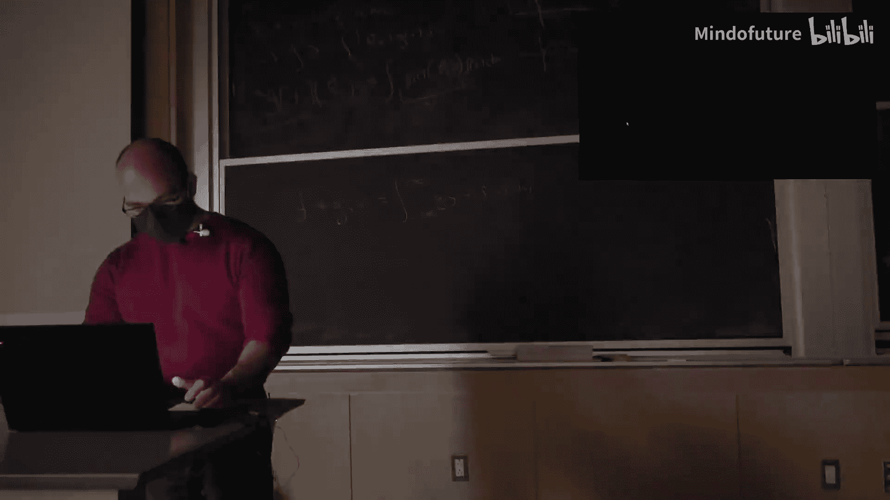

# 【麻省理工 - 中英】 计算机图形 MIT 6.837 ｜ Introduction to Computer Graphics ｜ 2021 p15 P15 Lecture 15 -  Antialiasing -BV1M9JVzpEBk_p15-

Allright， so let's go live and then。According， I go in here。And the so one。Okay。This is everybody。

 at least the six of you who apparently remain in this course killing me guys。Right。

 but I'm sure many other people are watching online or plan to later。😊。

In terms of course announcements， all that good stuff。 let's see。 So this morning。

 I got around to assorted administrative stuff as I， I was intending to do for a while。

 So I put the last like five or six years worth of midterms on the piaz。

 not piazza whatever this thing is。😊，Emad， no。Canvas。

 thank you so there you can take exams for days on canvas now so have fun with that you'll notice that if you do some pattern matching looking at the old exams that they tend to be quite similar to one another。

😊，I don't know， I would just maybe look very closely at those exams and practice Lewis as a good way to understand the kinds of things we tend to ask in this course。

 I don't really see any reason to like give you guys a super hard time。

It's very rare that you're held under duress for an hour and a half period and asked to solve computer graphics problems。

 having an exam seems kind of goofy。The policy is roughly that you have a two page。sheetet of notes。

 I don't usually ask too many questions that are like just recall kind of stuff。

 so it should be fine。And that's on the what 14，16， whatevers in the course calendar。

 Any questions about that？Yeah， so the deal is going to be that it's scheduled on a particular day。

 but rather than holding it in class， you'll have a 24 hour window to take it on。

God all these online tools I can never remember， Gscope。嗯。And， you know。

 our official policies that you should not cheat。 And that is a policy I feel strongly about。

So that's add any questions about that？😊，Cool， the other thing that I got around to。

 somebody asked for a list of course project topics。 So with your next homework， actually。

 something that I think we forgot to do with the T A is to post a thing to submit。😊。

A little project proposal if you look back at your project instructions which you may recall are on Canva。

 you're asked to write like a little proposal saying what you're going to do in your course project so that's going to be due at the same time as homework 4。

😊，Sorry， I noticed that when I phrase it that way， I get complaints， it is part of your homework for。

That seems to do better with students。 So one way or the other， you need to do that。

 So in service of that， I posted on Piazza a long list of like kind of vague project topics。

 You don't have to choose from that。 That's some idea。 I mean。

 roughly like if you look at the calendar。 like what we're looking for is is something on the order of like two homeworks worth of effort。

 remember the standard is you find like a tutorial or a method and graphics that you want to implement that's a little outside of the scope of the homeworks we did。

 You implement that。 that's basically。😊，You can work on your own or in partners， yes。

Oh let me repeat that a link because I have the microphone on。 Yeah， so， so on Piazza。

 there's like a fine teammates button that is always pinned at the top of the page， which is awesome。

 So if you need to find a partner for your project， I strongly encourage you too。 You're at MIT。

 You should network in such make friends。 all that good stuff You can do that there， yes。😊，Like。

 oh search。Like it's like， oh， I'm not individual person。I'm a group。That one's irrelevant。

 the project has two people。Any other questions？hRdy bud。Okay， so， so so that's that。 Oh， and。

 and one person asked about partial credit on the。Nowquis， my answer is， no。

 we already graded the last ones without it。 So we'll just keep doing that。 And again。

 they're a very small part of your grade。Also， arguably。

 if you've got a multiple part question wrong， it's just wrong。I don't know。

 I'm like kind of okay with that。All right， folks， so with that。😊。

Let's concerned started with our discussion for today so today we're going to have a whirlwind introduction to antialliasing everybody's favorite topic。

 so looks like one of these subtle things and graphics that really really matters and if you wanted to do it properly you'd need about two or three weeks worth of lecture。

😊，Sadly， for us， we have one lecture and not enough prerequisite through this course to really do this topic justice with all the integrals and function spaces and things that you need to do it carefully。

 So instead， we're going to draw lots of pictures。 So every year I。

Experiment with different ways of illustrating antialliasing and aliasing effects and every year it fails in different subtle ways so I'm going to need everybody's help if you're lost。

 that's reasonable because this is a tough topic and one that we're going to do with a lot of like pictorial approach that's because anti- aliasing basically is built on the theory of Fourier transforms and series and that is not a prerequisite for this course So if you ever lost you have questions then just stop me and we'll make it a discussion。

😊，That's airplane plan。I've， I've tried everything for this lecture like you know。

 I've tried like bringing in musical instruments and microphones。 I've tried。 nothing works。

 it's we should just allocate more time in any event so。😊。

Here's the basic issue that we're going to tackle today。 So at this point。

 I think we are all sick and tired of looking at shiny spheres on top of a checkerboard。

 but here I've drawn a particularly low quality set of shiny spheres on top of a checkerboard。😊。

And that's because this image here is like maybe 100 by100， it's really not so big。😊。

And the reason that we're kind of zoomed into this image here。Is that today。

 we're going to focus on one particular artifact that we've basically ignored so far in a discussion。

 I've alluded to it for a few times that we haven't really dived Doin。

Done discussed in the past lectures， which is the fact that the whenever there's a sharp edge in your image。

 something goes a little bit。Wrong， right， Like somehow we have this extremely jagged artifact on the side of our spheres here。

 But the reality is that probably we wouldn't expect that。 Probably we would color these pixels。

Cognizant of the fact that， like only part of the pixel is covered by the blue sphere and the rest is by the checkerboard。

 right， And somehow we， we haven't managed to。Do that calculation in a way that's careful。 right。

 I mean， like we could come up with some reasonable heuristics。

 like kind of average inside of a square or something。

But we're going to see today is that that's actually probably not the best approach。

But that the best approach is out of reach computationally。 So we're in kind of a weird limbo。

 And we have to decide the best thing that we can do。

 And that's why typically when you play with rendering software。

 there's like about 5 billion different options。 you can choose from in a big menu of different antialliasing techniques that balance between computation time。

 the quality of the image， sharppness of the edges versus the smoothness of the stuff away from the edges。

 All that good stuff is going to come into play。 Although not really in the theory will lay。

 We're gonna lay out the most simple version of this to at least just talk about like how people think about these problems and and kind of suggest how you might go about solving them carefully。

😊，Now， this issue is going to be one that we're going to roughly call a sampling issue right and the basic point here is that your pixel grid is kind of like a sample from the universe of all the colors coming into your eye。

 and the reality is there's some continuum image of sitting underneath。

 which is what we're trying to capture on this finite object and that's where things go haywire。

 we've actually seen a lot of instances of sampling issues and aliasing so far in this course。

 So if you were recall in our previous our previous lecture， we talked about an issue with texturing。

😊，Which was this kind of weird phenomenon where like somehow。

The intuition might be that like the best texture I can store for like a 3D model of my hand might be a really。

 really detailed photograph because why not， like that that that's a lot of detail。

 But that could actually lead to aliasing in the final image because two pixels that are very nearby in the image I'm trying to render and up very far apart in the texture map。

 And essentially because of all this random noise in the texture map image were just kind of random sampling something between。

 you know， like the white and the shiny parts of the skin here and and the tone underneath。😊。

Here's another example。 So when we talk about rasterization。

 like when we talk about how to draw lines on your computer screen。

 I think this is somehow the easiest way to see where aliasing is really problematic。

 you know maybe I'm trying to draw this light blue line on the screen， but of course， is an issue。

 which is that that line touches the pixel grid in kind of a weird sideways fashion and so I have to make this discrete decision as to what pixels to light up And if I do that in a sort of binary fashion like what I've drawn you here。

 which is certainly what computer graphics did for many decades。

 What you end up with is a phenomenon called the jas。

 which is exactly what it sounds like right you get this kind of jagged approximation of lines unless they're vertical or horizontal。

😊，And we can go on for days showing different examples， you know， like a whole like zoo of。

 of misfit images that that come from different sources。 So here's another one。

 This is sometimes called a moree pattern。 If you had a camera phone like circa 1015 years ago。

 this was a big issue。 these days， So your phones are are high enough。

 make aix that I think you'd be。😊，Well， I don't know。

 I'm sure you could manage to make this happen if you found the right texture。

 but I think for the most part， this isn't quite as big an issue。

 But like if you take a photo of a brick building here。

 notice that there's this really bizarre phenomenon。

 we'll talk a little bit about why this happens where the brick is a high frequency texture。

 meaning that spatially， it's varying， very quickly But actually when you look at it。

 hopefully you guys can all see that there's this kind of low frequency artifact that's going on which I don't think like somebody has painted dark and white stripes on the side of this brick building。

 but rather it has to do with the way that we've sampled and reconstruct this thing on the screen。😊。

And it goes on。 So like， for instance， here's another one。This apparently actually is a problem。

 Like if you're， if you're trying to film an advertisement for a car， I think you see this a lot。

 Let me see if it's gonna to load today。Oh， no。I like these videos。

 There's a whole like YouTube category worth of people on this stuff for that I don't。嗯。

So here's like a typical of the car ad for a while your car is driving forward。

And then suddenly of this weird phenomenon where the car looks like it's moving pretty fast。

 But like somehow the wheels look like they're like barely turning or even turning backward。 right。

 I think this is a pretty familiar scenario。Does anybody have a good explanation of what's going on in these videos yeah？

系啊。と用しな。Yeah， that's exactly right， so let's say that I have， you know based my car wheel。

And it's like rotating this way。And my camera is essentially captured。

 I'm going to turn this off because you guys are all。My。

 my camera is like capturinging an image once every， you know，30th of a second。

And my car wheel turns around once every 29th of a second。Right， so， so what does that mean。

 That means that， like， you know， if this direction is up。

The first time that my camera does a shutter。Then it's going to make most of its way around its turn。

And the next time I take that image。It's going be here。Right。

 so notice that there's sort of two explanations for how I got from this up direction to to sideways here。

 One is that the wheel was turning really quickly this way。

 The other is that it was turning really slowly to the left。

 And these are indistinguishable once you， if you just have this sequence of images that are sampled at discrete times。

😊，Right， and because of the way your camera works， at least like high quality cameras where you capture the whole image in one time。

 you， you get this kind of funny artifact that can happen due to the difference between essentially the cycles per second of your。

 your car wheel and and the number of times per second that your camera is taking an image。😊，In fact。

 for like low quality phone cameras， you can get all kinds of strange artifacts because oftentimes those happen in scan lines。

 like they don't actually capture all the pixels at once they kind of go row by row。

 And so then like if you scroll your camera across。

 suddenly everything in the world shears sideways because of this sampling issue。😊，Oh。

 is there anything embarrassing on here？No， okay good。

 yeah mean I always get nervous when I use YouTube， yeah Cor。😊，I'm looking out a car window。

When you're looking out your car。Now， I'm not a。I I don't think that's really how your eye works。

It could be。It might be that we should send you over to MIT Medical。Yeah。

 maybe like at a young age were you in a science laboratory， you know。

 like one of your eyes actually that red Terinator eye。No。

 I don't think that your eye is a rolling shutter。But maybe it could be the like I do think that there is some response rate that like rods and your cones have。

 right and perhaps there's some sampling and reconstruction thing。

 There's a professor or a P and Cil by the name of Ruth Rosenholts。

 who you should go talk to who who's an expert on all that kind of stuff。Yeah， so I don't know。

 be surprised my。😊，My like armchair psychologist would be like， well。

 maybe you've watched so many TV ads for cars that like in your mind somehow that's just getting filled in。

 but what do I know？Okay， so。When we look back， somehow in all of these phenomena。

 what's broken is a very similar artifact that like we live in a continuous world， except for Corry。

 And， you know， the continuous world is extremely detailed， right， I mean。

 there there's light going every which way。😊，We have a like a sensor。 And moreover。

 we have an image production device like your screen。

 both of which are composed of a finite grid of stuff。😊，Right， like。

 I can't put a color in between two pixels。 I just can't。And somehow。

 in all of these different phenomena。 And by the way， like here's inside of。

 of everybody's eye except their colleague here， you know， it's exactly the same on your， your。

 your actual like human hardware， right， Like you have a bunch of sensors inside of your R that are laid out in a particular layout。

 And indeed， you can see some of these undersampling artifacts maybe not the wing wheel effect。

 but other ones as sort of optical illusions。😊，And so in each of these cases。

 is what it has to do with the interface between a continuous world and discrete senses and display。

😊，Right， and that makes perfect sense。 I mean， like if you think about it。

 like for this image on the left， if I wanted to make a really coarse。Image of this， this scene。

 know， like maybe I'm only willing to make a 5 by5 grade of pixels。

 The real question I have to answer is like， well， what color goes in each of these squares。

And so so far， our answer in 6837 has been to take a point right at the center of each square and just say。

 well， the color of the pixel is the color of that square。And of course。

 we can see that that's like not a particularly suitable strategy。

So how are we going to address this， what do you guys think？呃 yeah咩。你有比。I think the。Severalal rate。

いくそ？That's right， do you know the name of that strategy？所上次 it's a。Heroic。So enough far off。

 we usually call that super sampling。 The idea that you。

 you send many rays into your pixel and you maybe average the color out。

 And and that's actually just about right。 So that's most， most of the strategies。 not all。

 We'll talk about some funny ones when we talk about raization。 really do have to。😊。

Do exactly that and the main question we have to answer today is what averaging weights to use。

And moreover， where to send this race？Can anybody think of what would be you guys a strategy。

 You're all engineers， like where would you send your raises and how would you average。い。

Maybe like a curve。So at the center。Is kind of intuitively the center is like like。

It's important the rest kind of starts overlapping with the Jason pixels Yeah so kind of I don't know where the pixels like where to send the bras。

 maybe just like a grid or like。P circles emating from the center or something like that。Okay。

 so George has one suggestion， which is that what I have a weights per per sample， which kind of。

Decay from the center of the pixel。 and that maybe I laid them out on some regular pattern。's。

 that's really reasonable。 Some some questions I might ask about that strategy。Would would be like。

 for example， you talked about a Gaussian， right， or a bell curve， whatever。

 But that's a function that has infinite extent。 So where do I cut it off， Do I cut it off。

On this square， or like maybe does like do pixel like some colors in the square actually affect the color of this pixel。

I don't know。 Yeah， I think。 because also， I remember mentioned that。like个。Re from a rate。

So you want Iuse the rate。嗯h。😊，Everything。For of everything。

And then try to find the proper weight so that I can read it。Where I can reuse all the arrays。Yeah。

 so so my has an interesting suggestion。 It's actually a tricky one in the context of ray tracing。

 which is that maybe I run into， you know， I intersect my array with an object。 And really。

 what matters is the fraction of my pixel that is covered by that object。 And the question is。

 can I somehow estimate that fraction。😊，And that's where things get a little bit tricky。

 So when we talk about rasterization。 We'll actually talk about some strategies for doing exactly that。

 and re tracing is a little bit trickier because the complexity of your seeing can be really high per array and moreover。

 because of reflection and all that other phenomena can get a little tricky。

 So this is a totally reasonable intuition and strategy。😊，And I think it's worth just。

Thinking about this stuff a bit before I just give you the answers。 And， and by the way。

 there are no answers here。 Like， there's just a million。

 like this are a topic every year people come up with new models for y。Have like。Kate found right。开啦。

Based on like。Oh A， You walked into my trap。 No， so sorry has some some some great。

 let's let's untangled that sentence a little bit。 So， so one was like， well。

 why not just like click that Gaussian at the the side of the pixel。 Sure， I can do that。

 But then like， let's say that I'm animating a circle moving across the screen。😊，Well。

 what's going to happen， Like the second that it passes the edge of a box。 Suddenly。

 the color is gonna have a discrete change。 Maybe that's not so good。Maybe it's okay， you know。

 there are plenty of rendering models where that's fine。The other。Question you asked， I forgot。

But no， you had a good one， too，Any earth？These are all these reasonable things。Yeah。😊，Very。

Absolutely， yeah， like， maybe I look at the geometry of the thing that I ran in。 like， for instance。

 I it facing the camera as it kind of pointed away。 And I use that as some means of。

 of finding averaging。 Yeah， global illumination strategy use that kind of thing a lot。😊，Alright。

 so the high level takeaway here is that there are many strategies for anti aliasing。

 I think what's missing。 All of you guys have really fabulous intuition， like somehow， you know。

 some kind of Gaussian looking function is gonna turn out Gaussians aren't exactly right。

 Everybody always guesses a be curve。😊，But that we're lacking kind of a unifying theory。 right。

 like like like no principle way of coming up with with some method for for actually choosing these pixel colors。

 And， and so that's what we're going talk about today。

And the really fun thing about talking about anti aliasing， which of course。

 is fighting against aliasing。Is that you get to use two different types of tricks to fix things。

 and you all in suggesting some of the ideas today have kind of brought both of these up。 I mean。

 there there's some mathematical things like averaging and somehow like quadriture and so on。

 On the other hand， you might say like， well， maybe my eye is less likely to see certain artifacts than others。

 So I'm going to bias my rendering techniques to produce some artifacts that mathematically are still bad news。

 but actually perceptually are okay。 Like， for instance， that moray pattern。

 that low frequency thing that we saw in the br building is a good example that your eye sees immediately。

 If I replace that with random speckle noise， you probably wouldn't see it。😊，Are both of those。

Good images， mathematically， like from an L2 approximation kind of perspective。 No， I mean。

 they're both bad versions of the photo you really wanted。

 But one perceptually is a lot worse than the other。😊，So that's what we're gonna to be doing today。

 There's so many approaches。 Here's yet another illustration。 Here's a little bit more。

Kind of principled version of this picture right。 So like here。

 we've taken a scan line of this really bad image of fruit。 And， of course。

 the function we really want to approximate is this nice smooth thing。 But because of our pixels。

 we get these like little vertical lines。 And now we have to reconstruct。

And the point here is that there are really two different sources of artifacts that can happen。

 One is the fact that I'd like to approximate this complicated function。

 But by virtue of sending out rays， the only data I got back is this。

And notice that it's not a scenario where I know， like I， I don't know what I don't know。

 It could be that there's some wild and crazy thing happening in between these pixels that I just didn't send a array there。

 So I just never saw it。 right， So this is issue number one。

 issueue number two is then my display technology。 Like。

 how do I take these numbers and then reconstruct an image。

 Both of these things can create artifacts。😊，Okay， so anyway。

 I've got like a million examples in our slides here。Here's our favorite checkerboard texture。

 This is a good one。 if you're ever testing out different anti aliasing tools to see which one is best。

 and we'll see that a lot。😊，These days and photographs。

 I think the place where you typically see this moe patterns like heres a really。

Offensive one is like， if you look at little thumbnails， like， you know， on your iPhone。

 when you're scrolling through like 10 different things tiled across。

 that's where you tend to see these patterns。Okay， so this is， you know。

 if you want to get philosophical about it， this is， I think。

 a nice place that like essentially distinguishes computer graphics from a lot of other domains。😊。

Which is that we're really all about like taking these continuous。

 real valued world problems and making them into discrete ones。

 when we've talked about that a lot in this course。 I mean。

 if you think about what we did in in differential equations and in your simulation homework。

 it was exactly this， right， I mean， time is a continuous variable。

 and we had to come up with strategies for how to sample it at discrete points in time。Okay。

 so now we're going to dig into some some details here and try to add some some math to our story。

So first question， we have to kind of。G play is。To define a little bit。

 at least for purposes of today's lecture， this is highly debatable sort of how we're going to think about pixels and displays。

😊，At the end of the day， a lot of your rendering algorithms essentially produce a big grid of numbers。

 Right， I mean， that's， that's really what you're doing， right。

 you have a description of a scene and you render it， and then you。

 you basically make like a Jpg right， And in our minds， somehow， when we say。

 when we use the phrase like pixel color。 we're referring to the numbers that are attached to the nodes on that。

 that grid。😊，And because of that， it's， it's a bit important to to note that like a pixel is sort of just like an infinitesimal kind of number associated with the location and space。

And the only reason that it's worth noting this is that， like。For example。

 I can download a JPg and look at it on my phone。 I can look at it on this projector。

 I can look at it on my computer screen。 And each of those actually have different reconstruction techniques。

 like some of them will display it as a square and some as a circle。

 All of these things are essentially displaying the same set of pixels just using different kind of reconstruction methods。

 So for our purposes today， we're not gonna dig into the details of like your display or something like that。

 We will later。 But rather， we're gonna think of this more like a mathematical problem。😊。

So let's cover a little bit of terminology， and then we're going to have our like fun pictorial introduction to the theory of anti aliasing。

So， essentially。What we're dealing with today is all about sampling artifacts。

 which is all about taking a continuous function and making a discrete one out of it。 right， So。

 for example， roughly， you know， if I hold up my favorite kind of virtual camera in front of my eye。

 I can take any X， Y position there and ask for its color and the X， Y could be。😊，7 comma 2。

 It could be pi and E like whatever。 Like every single one of those locations has a color ignoring quantum effects。

 I guess。 And essentially， the sampling problem is taking that continuous function and replacing it with a finite set of values。

😊，It's important to distinguish between sampling and another term that often gets confused with sampling。

 which is quantitization。😊，Quantization is the idea that then I have my pixel color。

Which is some real valued number， maybe between 0 and 1， right。And there are a lot of。

 I don't know if you know this。 There there are a lot of value like there are a lot of numbers between 0 and1。

 like infinitely many。 and your computer only has so many bytes or bits or whatever。

 So there's a second source of error called quantization， which is basically rounding， right？

 So today's lecture is gonna be concerned with sampling。

Right like this is this sort of spatial artifact。 and not the fact that after I get that value。

 I still have to round it。 Like we're not going to talk about double precision floating point。

The that's obviously important in graphics。 And many people do worry about that。 But it's。

 it's a different source of artifacts。 And， and not the one we're worried about for now。 Okay。

 so like， here's another illustration of what that looks like。 So if like。

 I have some continuous function kind of think of sampling as like approximating the X axis and quantization as as like cutting up the Y axis。

😊，All right， any questions so far？Neat。Okay。So essentially。

 when we talk about the theory of antialliasing， we can view it as kind of telling a story。

 And I remember when I saw this analogous lecture when I was an undergrad。

 it was wildly confusing about the first 75 times I saw it。 and it shows up by the way。

 and all kinds of different scenarios， it shows up in graphics。

 If you take a signal processing course， you'll see it there， but their signals are just usually 1D。

 but it's essentially the same story everywhere。😊，And it goes a little something like this。

 So I've got some continuous function。 in our case， it would be like visible light on， you know。

 in a square。😊，And。There's sort of two things that have to happen。Right，In order to produce an image。

 the first thing I have to do is take that continuous function。

 and I can view my ray tracer as this basically abstract machine that can take any position inside of that square and give me back the color associated at that point。

😊，My ray tracer doesn't tell me which points to ask for their color at。I think that purse。But rather。

 all the ray tracer can do is say like， oh， I give the ray tracer X comma Y。

 it gives me back of color。😊，So I have to make the decision when I have sampled enough to get a suitable image out。

So that's part one of my story。 And， and that can happen two different ways。

 it could happen with like a digital camera that would be like the real world version or a ray tracer。

 And what I get is a finite set of numbers。 So the first design decision I get to make is what points to ask for their color。

😊，Right， that's， that's the first decision I get to make or maybe how I， I average together。

So the next thing I have to do， right， is， these two words always come together， right。

 There's sampling and reconstruction。Later on， I have a display。

 and I had to actually reconstruct it， right， So I have this color associated to these like infinitesimal locations on my computer screen。

 I have a display technology in front of me。 I had to decide what color to tell my pixels to choose and display out to the world with some knowledge maybe of like the size of the pixel。

 the brightness of the screen， all that kind of stuff。😊，Okay。

 and so both of these steps can create aliasing， we're going to see that today。😊，So。

Here's another way to look into aliasing。 So here's like a very high frequency signal。

 This is sort of the explanation for that moray pattern we saw before。

 So on the left hand side of a very wiggly wave。 And I've sampled it at regular intervals。

 Notice that this is just like a sine wave。 And I've sampled it at these dotted lines。

 which are evenly spaced。😊，And then the red dots are showing you the intersection between the two。

 When you look just at the red dots， you'll notice that they form themselves like a lower frequency wave。

In fact， you can convince yourself that that is itself like a sine wave with some suitable change in in。

 in， with and， and what is it phase and。The other one。Amlitude frequency， whatever。Okay。

 so so in other words， like somehow the， the easiest explanation for these red dots is actually this function on the right。

And this phenomenon is called aliasing。 This is a good time to talk about aliasing because。

 of course， aliasing is really about ghosts。 you know， like essentially。

 you're seeing the ghost of a low frequency thing inside of your high frequency signal。😊。

Right so if you think of your。Ray tracer as the thing that gets to choose the locations of the dotted lines。

Notice that your rayrs job is kinda host from the start because your ray tracer doesn't get to know that there's like crazy stuff happening in between these samples。

 The only thing the ray tracer gets to do is say you know， it's like plain guess who， It just says。

 like， you know at this location， what color is this fixable or what color is the world， really。😊，嗯。

And like from the ray traces perspective over here。

 like maybe the ray tracer would just had some image grid， which is evenly space like this。

 It is actually a perfectly smooth image。 So it says like， oh， this is great。 I'm done。

 I shouldn't sample anymore。 It's a low frequency function。😊。

And that'ss sort of the catch 22 that hides here。Okay， so， so essentially。

 the solutions we're gonna talk about today are started twofold。

 and they they overlap in different ways。Essential are our two sort of big sledgehams in this space are to either over samplele。

 like take a bunch of samples from our image and a them together。 or to do a little blurring。 So。

 for example， if I have some of these， these weird artifacts。

 I can at least kind of dampen them out by smoothing my image a bit。😊。

But in order to really understand what happens here， we need to do a little bit of math。 I'm sorry。

Okay， so， so let's do that。 So here's my warning to you guys。 Like， I know some of you。

 like people were talking about like fancy abstract algebra lead groups before class today。

 So you're no doubt better qualified than I am to do all of this stuff。

 We're gonna do a very pictorial version of the theory of， of anti aliasing。

 And it' gonna be just enough for you to crack open a rendering book if you're so inclined and and read about this somewhere。

😊，Crack。对。Also。 Okay， so right。 So here's our we're gonna move to one dimensional signals rather than images。

 This particular transition actually isn't a big deal like the 1 D versus 2D theories is basically the same。

 But your instructor is bad at drawing picture。 So we're we're gonna say 1 D in particular。

 we're going to talk about what happens if we try to render render this one dimensional green function that I've plotted for you right So here the horizontal axis is x。

 The vertical  one is y。😊，Okay。So。This is what we're going to do。

 So let's try and kind of model our ray tracer in this context here。And what does that mean。

 So the first thing that we have to do is sample our function。😊，Mathematically。

 what do you think sampling kind of corresponds to， Maybe have an idea。 Like how。

 how would you model that。I don't think there's， there's anything。Too crazy here。

 like I've got a function F of x。Yes， in the back Zoom University。Yeah。Yeah， that's right。

 so I could take an evenly spaced set of x values and basically just remember f of x at those points。

😊，And then the key part is forgetting everything else。 right， I get to。

 my ray tracer gets to choose a set of x's。 It might as well be evenly spaced。 in some sense。

 Come back to that later。😊，嗯。And then I evaluate F of X。 And that is my model for， for rendering。

 And that's absolutely right。 Yeah， mathematics has a fancy way of describing that。

 I heard it mumbled over here somewhere， which doesn't surprise me。

 which is that I could take my function and basically。

 I could take the green guy and kind of multiply it by function。

 which is like 0 in between my evenly spaced locations， which is exactly the same as sampling it。😊。

If you're a math student， you'll get。Hot and bothered by this picture of drawn for you， because。

 of course， it makes no sense to have a function， which is almost everywhere 0。

 The reality is that you need little Dlta functions at these locations。

And so when you multiply them together， So you're kind of like taking F of x and multiplying it by a function which looks something like this。

😊，You know， this little。Vertical lines。At evenly spaced locations。

 And you can think of this like Delta X here as like the width of a pixel。Abody with me so far？Okay。

So here's the annoying thing about rendering， we've drawn this picture。

 but really from the computer's perspective， that's the data we have。😊，Right。

We don't know anything about the green function。 We asked for these values。 This is what we got。Okay。

 so then so that， that was sort of the first stage of our， our sort of。You know， a sad story here。

 the second half is that we have to reconstruct we talk about our display。And so what do we do， Well。

 the input to our reconstruction is this， it's not the green thing， right， That's all we get。

So what happens when we constructstruct， we probably get something like this purple function， right。

 like some reasonable interent。And here's where things go wrong。

Is that the green guy and the purple guy are not the same？

You can notice that we're slowly warming into the mathematical fiction very slowly。嗯。😊。

There are a few things to notice about this picture。

 which of course was drawn intentionally by your instructor here。

Notice that the green function and the purple function are actually like。

Kind of reasonable approximations of each other。 for the most part。

 But there's one place where it goes wrong。Where is that？That's right。

 where it changes really quickly， that's exactly the right thing to say。Essentially。

 in this little green bump here on the bottom。Notice that the sort of size of the wiggle down there was smaller than the spacing between the red samples。

 right， And that's exactly where things go wrong， right。

 Like when there's interesting content in my image， which is squeezed between two pixel samples。😊。

Cool， and so essentially， the theory of， of antialcing is really all about like。

 how do I choose my number of samples here to avoid this artifact。

 And The only way I'm gonna be able to do that is by having some my priori estimate of like。

 how much high frequency content do I think there's gonna be in the image， which， of course。

 is kind of a cache 22。😊，Okay， here's a more obvious example， of course。

 if I increase the complexity of my function and and decrease the number of samples I take。

 then my reconstruction would be really bad。 And that's that's really what's going on here。

 Or here's the worst possible one， which is this sort of idealized aliasing artifact。😊。

Or here the function I wanted was the red one， I sampled it at the blue points。

 and I got this other construction， which fits my data perfectly， is very smooth。

 but not what I wanted。Any questions so far。Cool， so here's the intuition you should have is there's too many wiggles between consecutive samples from your image。

 Okay， and like， you know， I think when you take Fourier theory the first time。

 there's like all these integrals and complex numbers and things。 But like that's really all this is。

 like this is just a mathematical way of talking about wigly stuff。😊。

And that that's I think what's important to remember， but of course， we need a way to formalize this。

And the way we're going to do that is using a particular mathematical technique called a Fourier series or Fourier transform。

 depending on how big X is。😊，嗯。For those of you who aren't familiar with Fourier， that's okay。

We've all seen Taylor series， I think， because we've taken calculus before。Remember。

 what is the Taylor series， It's just like taking a function and approximating it with a polynomial。

 right， like app it with like1 x x squared x cubed。😊。

And if you think back to like lectures 1 and two in this course。

 we talked about polynomial as like a basis for a set of functions， right。

But Fourier essentially proposes a different basis cosine and sine。 So that's the only difference。

And so essentially， the theorem by Joseph Fourer， one of very few mathematicians to have an interesting life。

Is that essentially you can take most functions。 Of course， this phrase is extremely susp。😊。

And you can write them as sort of linear combination of signs and cosines that are shifted and scaled。

 right， And， and that's， that's basically the Fourier series， Fourier transform in， in a nutshell。

Anybody know the story for you。 I mean， he's a really interesting guy。 right。

 Like he like marched in Egypt or something。 was that。きあ。I didn't know the greenhouse effect。

 but I didn't know that he was， Yeah， he was hanging out with Napoleon。 apparently， you know， most。

 I remember taking a history of mathematics course in college。 And for the most part， it's just like。

Well this guy SAT around and thought about some hard stuff and had some kids and died。

 But it's foer and Galois， are are the two that everybody always mentioned。In even。Essentially。

 the question is， how do we measure the frequency content， like the wiglyss of a function。

 And notice that frequency content sort of depends on the size of that sine wave， right。

 like the sharper is somehow that's that corresponds to higher frequency content。

And the way that Fourier chose to do it， I think oftentimes you take it in math they're just like。

 here's the Fourier。It's actually totally reasonable。If I have two dot products。Oh， man。

 I give it away。 but I have two factors。What have I done。

 And I want to know kind of how much of one vector is contained in another。 What do I do。😊，Anybody。

The cross product。 Yeah， that's right。 you can， you can leave。 right。

 Now I I I take their dot product， right， And of course。

 vectors that are parallel have a lot in common and their dot products quite large。 And， and as they。

 you know， become orthogonal， the dot pro goes to0 and eventually negative。 Yeah。

 so the dot product is really just a proxy for like how much two things have in common。 up to scale。

 I think that's a reasonable thing。😊，So essentially when you construct the Fourier transform。I mean。

 here's one way that I kind of think about it。If I have a function F of x， you know， so here's。

X and F of x。A function is just like a really complicated vector。 Its this a list of numbers。

 You see that， Like if I wanted to approximate my function， you know， I held F of x 1。

 F of x 2 and so on。 In fact， that's roughly what we're doing anyway。😊。

But the reality is that F of x is just like an infinitely long list of values。

 one value for every single x。So if I want to know how much two functions have in common。Well。

 I can still take their dot product， right， So So what is a dot product， Well， in in general。

 if I have two vectors， what do I do， Well I go through every slot of the first vector。

 every slot of the second one。😊，I multiply the two together。 and I， and I add right， in particular。

 right， if I have vector V。In vectorctor W。And I take their dot product。 right。

 It's going to be the sum over K of VK。W K like that。We can all agree with that。

So if I have two functions， F， for example， on the interval from 0 to 1， is to avoid infinities。

You know， what could I do？ Well， essentially， we could define something that's just like a dot product。

Which is the integral from 0 to one of f of x。G x。D， X。 and notice this is just a doubt product。

 It's just like thinking of F and G as long vectors of numbers， one for every single x。Right。

So if we're like willing to suspend disbelief a little bit and take some sort of a limit。 like。

 for instance， I think we've done that， right， like the Riman sum is basically exactly this。

Then what we're going to get is a dot product that works for functions。

So this explains how we go about defining the Fourier series。 I mean， Fourier is a smart guy in all。

 but really， it's quite brain dead。 right， Like， if I want to know how much cosine is inside of F。

What do I do， I take their job product， That's it。Right， so in general。

 that's exactly the way that we can think of。The Fourier transform。 So in general。

Think of the function。Si of of sine of Zi x。 So x here is going to be the horizontal axis。

 And Z is a constant。So what happens as Zyic gets really big。

My scene is like either making a rude gesture at me or answering the question。

 and I can't quite tell。The frequency gets really high， right， So in general， you know。

 a sign of of Z x is some。I always forget sun goes that way。You know， and essentially this。

 the spacing。You know， between the peak and the trough， for example， gets smaller as I gets bigger。

Okay， so in general。I could do a funny thing。 All of my 4ier is gonna be like up to a constant。

 I'm not gonna worry about like constant fact。Essentially， I can make an interesting function。

 And the question is。😊，If I have a function f of x。

 so I'm going think of x as like a spatial variable。And take it before you transform。

This is itself a function of Zi， which is a Greek letter that I can never draw。

I think I did an okay job。So this is hard notation。 I see， I see some like scared eyes。

 So F is a function of X。 this entire thing。Is the function of Zi。

 The idea is that it maps one function to another function。Okay。And this is the amount of。

 for example， sine of Z x hiding instead of F。And what do you think we're going to do？

Just take the job product， right， So this is just。The integral。

 I'm going to leave out the limits because I'll get it wrong sign of。Zi x。Times F X。

It's the top product。 That's it。 That's the Fourier transform。So here's the kind of funny thing。

 there's two variables， there's like a Z and an X here。Right， so the x is the， the， the thing。

 the input to F。And the force transform， the input is Zi， like a frequency。Right。

 so the idea here is that F considered as an entire function for all X has frequency content Z。

 which is given by this inner product， which is now a function of Z。😊，That makes sense。

 I know that the sentence is a little hard to parse。

We notice I've integrated out X in this expression， what I'm left with is Zi。Now。

 the reality is that in the actual Fourier transform， I need to deal with sine and cosine， right。

 Like， this only deals with odd functions。 So， so I would also。Need to do cosines。

 So the typical way that we get around that is by putting。You know， some kind of like E to the I I x。

 this doesn't matter for purposes of this course。😊，Essentially。

 notice that this is a complicated way of like dealing with sine and cosine at the same time。

 That's it。 It's a sneaky notation。Okay， so here's the， the picture that you should have in mind。

 I have original function F of x。 and usually the phrase uses that it's on this spatial domain。

 And that really makes sense for ray tracing。 right， Like here， X is like a point on my image。

 It's really in space。😊，Yeah， and now for every function F of x。There's another function。

 which a Fourier transform F。And that is a function of frequency。

 And it says for any given frequency， how much of that frequency is in F。

And it's obtained by computing this integral。Any questions yeah。Absolutely， yeah。

 so like if ones eye is really big， that corresponds to like this image has lots of pixels that are right next to each other with very different colors。

😊，Any questions？Okay， so， so that's essentially the way to think about Fourier transform。

's a way to take functions to functions， one of which is a function of a spatial variable。

 and the other is a function of frequency。😊，AFun fact。

 which is actually relevant for our discussion today。 If you take the Fourier transform twice。

 you get back the original function。😊，あちつけよ。Okay， so let's see an example。

 So here is an image of Pat Hammerhan as a famous computer graphics researcher。

 I stole it from Stanford's graphics course， which is why it's randomly a Stanford professor。😊。

And here's his path Fourier transform。So here， low frequency is in the middle。 And as I move out。

 the frequency gets bigger。In the two dimensional case， there's frequency in x and in y。

 which is why this is a2D grid。And now I can do different stuff。

 So one thing I could do would be edit the frequency image and then reconstruct it and see what happens。

So， for example， let's say that I took the pixels toward the center。And I zeroed them out。Right。

 so all that's left is stuff that's far away from the middle， which corresponds to high frequency。

What do you think this will look like？Weird， but can we maybe let's dig into that a little yeah。クビ来。

Yeah， it's basically looking for all the sharp features in my image。

 So here's here's Pat's high frequency content。 And you can see that essentially all that's left is extremely wggly stuff。

 One thing you might notice is that all the color is gone。😊，嗯。

What is the zero frequency content of a function？It's actually just the integral of the function。

 right and so one thing that we've lost is like the average color of the image。

 So now it's just like centered about 0。Okay， let's say that I do the opposite。

 let's say I only keep the low frequency content I filter out the high frequency stuff。

Then what's gonna happen。Its blurry。 That's right。 So here's here's， here's blurry pet。

Kind of hard to look at， actually， not because of pet， just because of frequency content。

And then finally， actually， one interesting thing that image filtering people often do is something called a band pass filter。

 which keeps frequencies that are neither small nor big， but like in a middle section。😊。

And here's a band pass filter on Pats。 It kind of nice to look at。 And notice that like。

The average color is gone， now centered about 0。And what you're seeing is like， well。

 the frequency content here somehow has some spatial scale。 right， Like it's。

 it's like on the order of an inch on this， on this screen here。

 And that's because that corresponds roughly to the size of the。

 the sine or cosine that's being filtered here。😊，Okay。

 this is all just to give some intuition for what the Fourier transform is doing。

 So The idea is that for every function on the left， there's some other function on the right。

 which is is frequency content。😊，His teeth are green。 Yeah。

 that's a little known fact about Pat Hammerhand。Yes， man。拐嘅啲。Mhm。😊，关。

That's an interesting observation。 So Marice pointed out that if you look at this image where I've only kept the high frequency content。

😊，And I compare that this band pass filter。 It does look like there's some color here。My best guess。

 actually， I， yeah， I know I can tell you what's going。😊，In general， so actually your eye。

 it turns out physiologically， is structured for exactly this phenomenon if you notice。

 many of the variations that we see at very high frequencies and images tend to just be in brightness。

 They don't tend to be in color。😊，So oftentimes， like if you look at the color content of an image and you filtered out the brightness。

 it would actually be relatively low frequency。 And so I think that's what you're seeing here that like the kind of middle band here still contains some interesting change in color。

 And then the high frequency information is mostly just brightness， like shadows and stuff。

 It's a great observation。 actually， image filtering people use this to their advantage sometimes because like theres some algorithms that are expensive to run on an image grid。

 So one thing you might do is convert to black and white。

 filter the black and white and then just put the color back。😊，And， and oftentimes you wont。

 you won't notice that somebody did that。 It's a great way to shave off a factor of three from your Sgra paper。

 not that I've ever done such a thing。Okay， so let's get back to our mathematical story， as usual。

 I get all excited about this topic and I run late。All so here's our function F。RightNow。

 if I want to evaluate it， it's Fourier transform。Then I want to know how much of some frequency Z is inside of F。

 So again， I like， oops here， I put a two pi。 again， I'm going to get all my constants wrong。

But I have this sine wave here。Basically， I just multipied the two。

 take the dot product and integrate。And that really explains the formula that I think many of you have probably seen before。

 It just looks more complicated， right So here's the actual Fourier transform on the slide。

By the way， different textbooks disagree on the constant factor in front of the Fourier transform。嗯。

There's nothing fancy about complex numbers here， really。

 if you just remember that E to the IX is the same as。What cosine of x plus I sine of x？

Then really all it's doing is just taking the job product with cosine and signine at the same time and storing them in two kind of components of a vector。

I don't I don't think you need to like worry about like complex analysis or anything here。

 Like that's really not the issue。Okay， and notice that this is a function of Z。 right。

 I've integrated out X。Al right， have I managed to confuse you guys yet because I'm going keep trying。

Maybe there is， maybe there isn't depends what textbook is。 it doesn't matter。

There are a lot of different definitions for  Fourier transform。 They're all basically same。

You're right， this one would I guess flip to the left， but that's okay。い、 yesス。So the right， So。

 so the， the red curve here is just， just like a a sine wave here。

 And this is just like for a fixed design， this is the thing is taking the product against。

 So this would be the real component of this。😊，Yeah。Any other question。Excellent， al right， guys。

 keep， keep holding none。 Okay， so finally， we have all the machinery we need。

To talk about sampling and reconstruction。 So here's a function of X。嗯。

I'm going to be be particularly lazy。 It turns out that Gaussians are bell curves。

 Their Fourier transform is itself a Gaussian or bell curve。

And so that's why I'm able to draw this picture here。

So we're going to have this schematic where the top of the screen is going to be the spatial domain。

 like this is my rendering and the bottom is going to be the frequency content。😊，Okay。

So remember what we do， we sample and we reconstruct。

Doesbody know what happens to Fourier transform when we sample。Yeah， Maxim does。

 I think he just remembers from his single processing class。But can you explain why。You can prove it。

Proofs are overrated。Yeah， so what happens if I sample my function。I's a really annoying phenomenon。

Which is that I take my original function or my original Fourier transform on the bottom in purple。

And then I repeat it a bunch of times， and then they all get sun together。Okay。Now。

 one thing I could do is make my samples more dense。 What do you think is going to happen here。

 We'll do it kind of experimentally， and then we'll try to explain what's going on。

So if I densely sample on the top。What's going to happen to the repeated guys？

Think about the limit where I sample like everywhere。 Well， then you don't get repeats at all。 So。

 you know， you're making the right gesture。That's exactly right。 If I sample more densely， the， the。

 the repeated stuff gets farther apart。 Maria's furring her eyebrow about than she should。

 because it's like mysterious why this should happen， right， Like。

 and you could have easily done this experimentally， right， Like。

 you could have just sampled a function and looked at it and， and so on， and indeed。

 I think that's that's what's going on。😊，So here's a sort of suggestive picture of what's going on。

 Let's， let's say that I have a really boring function， which is 0 at two different points。😊。

I was lazy， so they happened to be 0 at 0 and two puff。I'm bad at trigonometry。

 so this helped me a little bit。And I ask， what are all of the different ways that I could explain a function which is zero at these two samples。

 and I can say nothing about it in between。Right。And it turns out there are many explanations， right。

 One is that it's the constant function， which is 0 everywhere。 Another is that it's like maybe sine。

 Maybe another one is sine of 2 x and so on。😊，Do you guys see that in every single one of these functions。

 they happen to be zero at these two locations。And so intuitively， what's going on here。

When I sample a function， remember that I forget everything that happens in between those samples。

And so essentially， the information that I'm left with somehow ends up combining low and high frequency information because essentially these are all the possible explanations of what's going on with the data that I was able to collect。

😊，Now， of course， the better thing to do would be to actually work out the right formula and you can do that from Fourier transform。

 you'll see that this is really what happens。But， but this is really the phenomenon why that essentially。

 all of these different functions are explained equally well by the same Fourier transform。

 if I sample。 And so somehow they all get superposed together。😊。

Here's another kind of visualization with the same thing。 So here， if I take like a guitar string。

 you know， guitar strings are are fixed on the two ends。 and of course。

 these are a bunch of different waves。 All of these waves have value0 at the same locations on these two sides。

😊，And indeed， it's often the case when they vibrate that there's some superposition of a bunch of different waves that have all these different frequency content。

Notice that your guitar string can't have a frequency content that's in between these two。Right。

 because that would imply that like the curve didn't end at that location where it was pinned， right。

Now， just for fun，cause I'm a musician， I have to like。You talk about it for a second。

 So let's say that I， I have this guitar string。 I pluck it， right。

 So it's some combination of all these frequencies。 Now。

 I very carefully put my finger right here on the string。😊，Anybody know what happens？

Some of you play instruments probably do。的。といたから。So harmonic， yeah， that's a musical term for it。

 What's what's going on in in this picture。😊，Other。That's right。

 So if the string is vibrating and I put my finger right there。Can this frequency happen anymore， No。

 right because my finger is getting in the way of this motion， right？😊，Now。

 remember that the more vibrations there are here， the more， the more waves there are， right。

 the higher the pitch。So what does the instrument sound like if I do that。Makes a high pitched sound。

 right because I filtered out of a low frequency content。

 It's exactly like those pictures of Pat hammerra hand。And indeed。

 musicians actually use that to their advantage。 So here's notation musically。

 just case you're curious of what this looks like。😊，So here， it's great。

 I love this because it's Fourier transform in musical notation， which is kind of fun to look at。

 So here， what it's telling you is you put your finger down at this note all the way down。

 So this is like clipping the string to， to make that fundamental tone。😊，And then it's saying。

 take your other string and gently place it or your other finger and gently place it on the string at this other location。

And that location is chosen very carefully to align with one of the nodes。vibration。Yeah。

I wouldn room。No， vibrato is just wiggling your finger around and changing the pitch。 Yeah。

 on what instruments it does something confusing I never understood。Right， so， so in essence。

 what's going on here， These notes are like relatively low for a violin， but they sound really。

 really high。 So just for fun。😊，You can listen to what this sounds like。 Wedly。

 I happen to be in a symphony that's playing this piece this weekend。Right， so let's see。 Oh， no。

 I mess with。Right。So these are way higher notes than what's actually notated right and what's going on is the violenceolin is really carefully filtering out of low pitches and just leaving the high stuff behind。

This is very difficult to play incidentally， the other thing is that this is really unsta。

That stop okay。U。Yeah， this so saw cheese is a good piece。 Yeah， essentially， what。

 what happens if you get that finger just a little bit off right， of course。

 is it just sounds like a fart because now you're just， you know， you filter it out everything。😊，Now。

 graphics has exactly the opposite phenomenon。 So， so like essentially， when we're。

 we're seeing images like this， what have we done， We filtered out the high frequency contact and。

 and all we're left with is the low frequency stuff。😊。

And the way that we can understand that and the picture that we've drawn。

Is that there's irrecoverable mixing going on。 So remember this like kind of repeated function here。

 right， I took the Fourier transform of the original thing。

 I repeated a bunch of times across the the horizontal axis here。 This is a frequency axis。

 I sum them all together。😊，Well think about what happens as these things get closer to each other。

 when I send them together， I'm not going to be able to recover the shape of this thing。

It is no display technology that can take this information and make it into a version of the original image。

And that's essentially what goes wrong。Can anybody think of an exception to that rule。

 like when could this actually be okay？I sample my image and I actually can reconstruct the image。

Let me draw a picture。 So let's say that I took a Fourier transform of my image。

 and it happened to be 0 everywhere outside of some small region。 this is the Fourier transform。

 This isn't my photograph。 This is the frequency content。First of all， intuitively。

 what does this mean， That means that there's like no high frequency stuff， right。

 Everything is pretty low frequency here。When I sample my image， what's going to happen。

 I'm going to take this signal and repeat it a bunch of times。

Right and as long as I sample it really， really densely。Right so there's no high frequencies。Oh。

 by the way， sorry， the width of this thing is called the bandwidth。

 This is probably a term we've heard before。Well， now。What happens， Well。

 it repeats a bunch of times。But my original function is still here。

 There's no overlap between all the repeats。Right， so actually。

 if you told me the frequency at which you sampled your function。 right， So in other words， I know。

Where the thing repeats。I could actually reconstruct my original function here。How would I do it。

 I would zero out everything else。Just keep this thing。 Take the Fourier transform back。

 and I'm good。So。There's a question， which is like somehow this， this feels like a way out， right。

 Like we we， you know， we know how to do。Essentially。

 we can perfectly reconstruct an image so long as we sample it densely。

 and so long as it's band limited， in other words， there is no high frequency content。

What's the problem with that， How many images out there have no high frequency content。

Literally none。Right， so this story is a little bit limited。 right。

 What it's saying is that so long as you reconstruct the world's most boring function。

 you can do it very accurately， but it's still worth digging into a little bit because the question is like。

😊，Suppose I had a low frequency image， and more or less， I knew this with。

So it's not all that unreasonable。 I mean， if you look at a scene in front of you， you know。

 kind of space like where the interesting stuff is happening， at least approximately。

There is still a question which is how you would reconstruct that image。 We've done sampling。

 We haven't done reconstruction。I like。这孩子更。You know， you don't。

 your your high frequency is all got mixed together。 If you have frequency contact。

 you just cannot recover it。 So if I have a band limited signal， by the way， and then essentially。

 I can sample at a particular rate where the repeats don't overlap。

 And that rate is called thenyquis rate。 I believe it's twice the maximum frequency in your。

 your signal。And now this is the one case where I can actually reconstruct。 And here's how I do it。

Remember， the input to reconstruction is this Fourier transform of a bunch of repeats。

But I can just0 and everything， except the central repeat。

And I can do that by multiplying by a function， which is one inside of the Nquis rate and0 everywhere else。

And that would reconstruct the image。 right So the question is， what happens with the spatial domain。

This is the one part of Fourier stuff where we are going to have to sovel a little bit of math under the rug。

Which is that multiplying in the fourier domain corresponds to convolution in the spatial domain。

So in other words， if I have two functions， F of x and G of x， and I multiply them。

And then I take the Fourier transform。That is the same thing as taking the Fourier transform of F。

 taking the Fourier transform of G and convolving those two functions against each other。😊。

If you haven't heard the phrase convolution before， that's okay。Essential。

 convolution refers to taking one function， dragging it across the other and integrating them against each other。

Okay， so in general。Let's see if I can get the convolution formula， right？Every year。

 I think this is the year when I'll write down notes rather than doing it off the top of my head and then or another。

Right， so in general， if I have F convol with G。A point X， I'm going to get this wrong。The integral。

Let's see if。G of y。Minus X， F of x。Nope the other way around。No， I don't think that's right。

IThink that's right。One of them gets flipped when you convol。

 this is the difference between convolution and like autocorlation。😊，This is， this is what you get。

 So this is the picture on the screen of， of convolution。Essential。

 you're like taking the Fourier transform of G， kind of dragging against F and integrating on those different locations。

😊，Okay， so we even if lost there a tiny， tiny bit。The high level point is that multiplying in frequency domain is convolution in the spatial domain and vice versa。

So then the question is， what is the Fourier transform of this box function。

 right Because in the spatial domain， that's how I should reconstruct， right。

 It should should convolve my samples against whatever the Fourier transform is of the box。😊。

Anybody happen to know to have a question。Yes， Max is clearly taken to Fourier class。Yeah。

 it's called sync in English。 That's right。 So it's a function like this。😊，嗯。I wish think this。嗯嗯嗯。

Oh， this is correct。 Yeah， so this is actually， I think cosine of x over x。But in any event。

 it's a function which。You know， is particularly tall at x equals 0， still has the frequency content。

 But because it's divided by x， the frequency content。

It kind of gets dampened out the farther I go out。Okay。

So here is our perfect story in an ideal universe with a band limited signal。

 I had the world's most boring function in the spatial domain like this green guy here。

 And it's band limited。😊，By the way， you know， the Heisenberg Un principle says this can never happen for a real image。

 but。I sample my function， and that makes this thing repeat。Now to reconstruct it。

 I take the repeated guy， which is really the input to reconstruction and multiply it against the box。

That corresponds to convolving the impulse train at the top against the sink。

 And what I get back is the original function。 And the magic here is I made no approximation whatsoever。

😊，Yeah。So。If we think all the way back to George's comment before， you know， like。

 should I use a Gaussian to sample to weight my， my samples during ray tracing， The answer is， no。

 if I know the frequency content of my image perfectly。

 I should weight it using the sync function because that'll make a perfect reconstruction。😊。

The only problem is， of course。I don't actually know the frequency of content。 right。

 Like my like real life images don't have a Nquis rate。

 All I can do is kind of guess a reasonable sampling rate that probably captures most of the content。

 right， So if we go back to reality， practical signals can't have a finite bandwidth。

 This really is a Heisenberg uncertainty principle。 It's not usually stated that way。In fact。

 there are a lot of issues here。 another one is that we can't integrate against this stuff exactly because we're doing everything numerically。

😊，And S has negative numbers in it。Now， we know when we reconstruct our photograph that we have positive amounts of light。

 but we could easily make numerical mistakes or approximation and getting negative pixel values is a pretty common thing to do。

 So if we return to the idea we had at the beginning of lecture。 Indeed。

 what most people do is use some positive approximation of our reconstruction filter。😊。

There are also other issues， right， So essentially。

 what this theory predicts is that if I want to have a perfect anti aliasing tool。

 I should be actually sampling spatial locations that are infinitely far away with tiny amounts of weight that look like。

 you know， sine of x or cosine of x over x。😊，And of course。

 that would make for a very expensive rendering algorithm。The good news is， of course。

 that this function decays relatively quickly。 And so in practice， we don't really have to do that。😊。

And then there's one additional reality issue， which is that if I have a sharp edge in my image。

 essentially， all this theory goes out the window。 I mean， this is really for like differentiable。

 smooth stuff。 and an edge has a jump， and that will create like this crazy frequency content that's hard to capture。

😊，So anyway， the first thing we did was derive the classical theory。

 The next thing we did to tell you all the reasons why it's a little bit useless。 So。

 so the high level point here。😊，Is what that essentially， if I know the Ns rate of my image。

 So in other words， I know like roughly the spacing between interesting features of the image I'm trying to render。

Then the perfect filter that I should use is the sync function。

And that's the thing that I should integrate against to reconstruct the image perfectly。

 But there's still some， some challenges with that。 Yeah， and， and by the way， S still works in 2D。

 You just end up with like the sign of the distance rather than X。Okay。

 so that's the end of our kind of big。Math discussion， Any。

 any questions about this high level picture， it's a lot。 But if you kind of scroll through。

 the basic point is that we needed to formalize a notion of sampling and we needed to formalize a notion of reconstruction that both of those things correspond to pretty nice operations in the Fourier domain。

😊，Yes。Is there a way to intuitively understand。Yeah， the box function， right。

 like this thing we're using to reconstruct in the Fourier domain。

 like box function is very complicated， very simple， but it has a discontinuity。

 it drops very sharply。 So I think like roughly what's going on。 Remember。

 the Fourier transform is just like integrating against s。😊。

As the width gets bigger and bigger and bigger， smart， smart and smiling。And。If the。

 if there's like more negative wiggles in your sign than positive ones in in the size of that box and you get a negative value。

 right， so mathematically， that's why I'd have to think if there's some like hand wy reason why you'd expect negative frequency content。

 Like a negative value employee transform doesn't really mean something special。

 like a big absolute value or negative value is roughly the same intuitively is positive yeah。😊。

Any other things I can wave under the rug for you guys is many。Okay。

 so now let's go back to practice and talk about rendering what people actually do。

 And we'll see it's actually a lot easier to understand than the math here。 So in practice。

 people do what you guys probably would have guessed before we even started today's lecture。😊。

Which is that they just compute a bunch of pixel colors and then average together。 And oftentimes。

 they do it without being cognizant of Fourier theory at all。

 And they make perfectly reasonable images。 And indeed， you can see like， here's a sphere。

 Here's a relatively okay anti sphere。 But it's not great。 I mean， like when you look along the edge。

 you can still see that that jagged artifact。😊，And that turns out it's not actually a byproduct of the pixel grade。

 You can do better than this。 These are really subtle effects。

But rather just because they've a rather poor anti aliasing method。

So the simplest way you might an elias would be to take your image and rather than making a width by height image。

 you make a K times width and then K times height image。 And then you just downs samplele。 right。

 So like in other words， you render an image twice as big。 And now， you know。

 every pixel has four pixels in it from the big guy。 And you just average those colors。

 This is called uniform super sampling for obvious reasons。😊，That works okay。

 but your filter does not look like sync at all， it looks like a box and indeed you can get some artifacts。

 which is roughly why you see this kind of not so great。

 like you still see some sharp edges hiding here。😊。

And so a very typical thing to do would be to do that uniform super sample。

 but then maybe assign weights to the values in the inside of a pixel。

 which maybe approximate the function that we like。And this really does correspond to convolution。

 right， because now those weights are exactly the convolution filter applied。

 So you can kind of think this in two different ways。

 you're either convolving the big thing against this filter。

And then just ignoring every cave of pixel or rather ignoring。

Keeping every kind of pixel or you're just downsizing， those are exactly the same。嗯。😊。

There are better versions of of， of different things you can do， right， So， so， for instance。

 a different interpretation of the same thing like I just mentioned would be that kind of making a high resolution image。

Filtering it in a way that is cognizant of that Fourier theory。

 And then just reampling because you know that that filtered image doesn't have high frequency content。

 right， You just filtered it all out。There are many different filters out there。

 I think the most common one that people use。Is built with the spline because everything in this class is。

 So in particular， you take a spline approximation， which is by cubic。

 has only the most important negative lobe， it's called the Mitchell filter。

 And the good news is that it's finite least supported it so you don't need to like do this n squared algorithm for your image to decide on pixel colors。

😊，So you'll see some images of what this looks like， maybe I'll flip off the lights really quick。

I think it's kind of hard to see。 So here's a box filter， by the way。

 we might run a tad bit late today。Sorry， but we did on early last time， so。嗯。

Here's a box filtered image。 If you look at the checker board， especially in the reflective part。

 By the way， the slides are also on on canvas。 If you want to burn to retinas later。

 you'll see that theres some， some artifacts。 The other place to look in test images like this is in the background where you can see some some mo patterns that are appearing。

😊，Here's a Mitchell cubic filter， like the one I just mentioned。

 let's go back and forth between the two。And you can see this is the same pixel grid。

 but the cubic one， especially in the background， is creating a far less of this artifact。😊。

And this is the same amount of computation。 right， It's just the question of choosing the right averaging weights。

So that's it for uniform sampling。 right， So this is like。

Taking every pixel and making K samples on a little grid inside of that pixel。But in some。

 there's still a problem with uniform super sails。 It just pushes the problem the acing issues we've already talked about further out。

 right， like like exactly the same problems we already saw can occur here just at at a higher frequency。

 right， So no matter what we do， these things are gonna still appear。😊。

The reality is that your eye is far less sensitive to noise than it is to structured patterns。Right。

 so like。We can do some things that improve the look of the image。

 even though the frequency content is still bad right And so one technique that people use a lot is something called jittering。

Where essentially you would do that supersd grid， but rather than going right down the center of every pixel you randomly jetter is positioned just a little bit。

Now， the reality is the average spacing of these samples is the same as before， right。

 so I haven't like made a better filter。 All I've done is replaced moray patterns with speckles。

 Here's what this can look like。😊，So here's those one and two samples per per pixel。

 These are purposefully really low quality images。 so that you can see。 Indeed。

 with just two samples per pixel， you actually get a kind of reasonable looking image in the background。

I mean， remember that it's just mixing green and red hair。 So like， really。

 you're just seeing green and red colors in some random pattern。

 But your eye is actually able to filter that in a pretty reasonable way。😊，Now。

 the reality and something we'll return to more in future lectures。 When we do our super sampling。

 we have to be quite careful， especially with texturing。😊。

Because if you think about aliasing and sampling artifacts that get worse when you're looking at surfaces that are really skewed to the camera。

RightBecause now two nearby pixels will end up very far apart on the texture image right。

 And so because of that， we often have to filter out our texture maps in distorted ways。

 And essentially， this is really important because rarely does your kind of screen space density match the density of the pixel grid。

😊，And so because of that， we have to use the sorted filters。 for example， if we have a texture map。

 we need to make it bigger， we probably want to choose a careful filter to magnify。

 That's the easier one。 Like by bi linear interpretation interpretation is okay。

It certainly it's not the only one。 You actually， there's some argument to be had to use larger neighborhoods。

 even when you're magnifying。But miification is really the problem。

 right Like like so here's a texture map。 And you can see in the background here。

 it becomes undersampled。 The texture map is uniformly sampled。

 The issue is the interaction between the pixel grid and the texture map and the pixel grid and the image you're trying to render So as foreshortenening starts happening and the thing gets smaller and smaller All of a sudden。

 these sampling issues we've been talking about start to come up。😊。

And so people in graphics worry about this a lot， because this is not something that can be handled by just throwing more rays into a single pixel。

 right， because essentially， what it's saying is the farther away your texture is the more rays you would need。

 But you don't have a good way of detecting that。And so。Typically what people do。

 this is called minification， because you have a texture and you're making it smaller。

The issue here is， like， if I'm looking up a brick building。

Then like if you look at the pixel grid of the image projected onto the building。

 you'll get all kinds of weird shapes， right and those are sort of the filters that you need to deal with。

So the zero in order trick， which we already mentioned in a previous lecture。😊。

Is this idea called myth mapping。RightWhere you just store texture and then like lots of downsampled versions of texture。

 And now that we've talked about sampling and reconstruction， you can。

Now come up with like assorted pretty good filters for generating these smaller images using sync and so on。

And at the very least， what you can do there is kind of figure out like well。

 I know the size of my pixel， and so I'm going to choose a texture level which is roughly on the order of the size of the pixel there。

😊，And mit mapping actually is extremely effective。 So。

 so here is an example with like a horizontal line pattern。

 And by applying just like by linear mit mapping， I can get at least。A uniform amount of。

Badness as the image gets foreshortenened。But things can still get bad， especially。You know。

 in places where things are squeezed un uniformly or in the distance。

So here's another example with mi mapping， like lots of bad artifacts on the top。 And when I mim。

 I get a reasonable thing。Mit mappingapp is still not perfect， though， for a few different reasons。

One is for every pixel I have to decide on a MIp level。

Every single pixel has to decide which of those downsized images to choose from。

 which can create a discontinuity， because in your rendered image。

 there's going to be some line of pixels where suddenly your ray tracer transition from one mi level to the next。

 and you're probably going to see that。😊，So in practice。

 I think when when people choose their MI level。What do they do， Well， Well， roughly。

 there's some formula where you take a projection of a square on your screen onto the surface。

 You can do that to first order using the surface normal。We're running a little late。

 so maybe we'll skip over the computation for how to do that， you can find it in the slides。

 it's not terribly important。嗯。But you can still run into a problem。 here。I's an example of。

 of some things that can go wrong with with， with mi mapping。 Notice that when。

 when we're stress testing these algorithms， we tend to choose scenes where everything is like pointing like that。

 And do guys see why， like here I have a square pixel and it's getting projected onto the texture map and becomes a giant rectangle。

😊，But my mitm is， is a bit of a problem because the mitm is still evenly downsampled right in the the image plane。

 It doesn't know about like rectangular shapes versus square。

So there's all kinds of heuristic people use to get out of this scenario。

A typical one is to do MIt mapping to kind of take care of scale。

 but then still to take weighted averages in an elliptical fashion to deal with the anidropy kind of issue that appears here so one simple trick is to use elliptical weighted averages。

😊，This is kind of a sneaky idea where maybe what you do is you say， like really。

 I want some kind of ellipse filter in my my texture map， but I don't have access to that。

So I take it in theip， and I kind of approximate it as the sum of a few circles along a diagonal line of different radii。

 Each of those circles gives a different myth level。 and I average those colors together。

Notice this is a part of lecture where we describe at a high level。 the many approaches people have。

 you don't need to memorize all of these。 But when you put all these things together。

 it actually is quite effective。 So here is our same favorite checkerboard pattern。

 you can see with trilinear mi mapping。 you no longer have like the moray patterns right Like you don't have like black and white and weird ways that are making low frequency artifact in the back。

😊，But what you do see is that it regresses to gray really quickly。

And that's because somehow like it's choosing a mitm level， which is。

Probably a little aggressive right like essentially a square pixel here corresponds to this like rectangle down the pixel grid。

 which probably contains like more white squares than black or vice versa。

 but your mim is unable to capture that。Whereas if you use this elliptical weighted averaging trick。

 you can see that even in the background， this， this image looks okay。

These are all just different strategies。We're going to talk about one last one of them we're done。So。

What do you guys think is the most。In some sense， the biggest headache for anti alias。

 where do you think this comes up the most in graphics？It is with our guess。

ally what do you think where would NTLS thing be really important？

And drawing lines and where do lines show up on your screen all the time？Fs。Fons。

 fonts are the worse because fonts are really small。

 They take up a really small part of your screen relative to the total number of pixels。

 you're staring at them all day。 They comprisise of very thin ligatures and features。

 and essentially they' are the things that are going to burn your retinas out the fastest。😊，Yeah。

 I have a font or vector， but you still have a square grid of pixels on your screen， right， I mean。

 you still have to render these things。 You don't need a ray tracer to do fonts。 But like。

 you do need to decide on Facebook colors。😊，So people have put tons of effort into font rendering because small effects make a big difference in that space。

 especially back in the day when we had CR T monitors。And。

There are really interesting techniques out there for rendering fonts。Here's my favorite。 So。

 so many of you have probably heard of like clear type fonts， you know， like in Windows。

 they talk about clear type。 anybody know what that's doing。😊，So here's。

 here's a suggestive picture of what's going on。 So your computer screen。

 least many computer screens really aren't just colored pixels。

 but rather they're patterns of like RGB， RGB， RGB。😊。

So what goes on in clear type fonts is that the font is actually three times more dense than you think it is。

 And the anti aliasing actually happens at the level of the individual lights inside of your screen。

 rather than at the pixel level， which is where you guys are operating in open GL。

 So they control the different subpixs differently， which is able to essentially。😊。

Have antialliasing for brightness like we talked about before at a much higher rate than than the antialliasing for color。

 And that actually makes a huge difference perceptually。

 So if you like play with old computers before they had this like clever realization。

 they would do antialliasing at the level of pixels。 So you get images like number three here。😊。

And it turns out that just by this one clever trick of varying brightness along the pixel grid you can do much better。

 And this is known as a clear type font。😊，Clear type of phones are really clever。

 Can you think of any problem with with like building this in your operating system。

Depens on the display。 That's right。 So like， you know， maybe I invented a display。

 which like changes the order of R G and B。 If I weren't careful about that， then suddenly。

 my fonts would look awful。 So in order to implement something like this。

 it's actually usually like you need to know all about your hardware and be really confident in the layout of your subpixs in order to do it。

😊，Alright， folks， So that concludes our our discussion today。 So to run a little bit late。

Essentially， we talked about sampling and reconstruction。 If we have a perfect world within。

 you know， low frequency signal， we can do everything without any mistakes So long as we can evolve against sync。

 Saly， we can't。 So we have all these different tricks to address it。😊。

So next time we'll continue our discussion of rendering， I forget what topic that will be。

 but I'm sure it'll be exciting。Don't forget to start your homeworks and we'll see you later。

