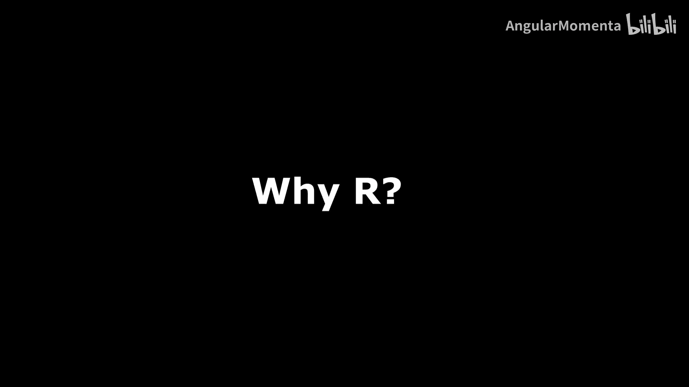
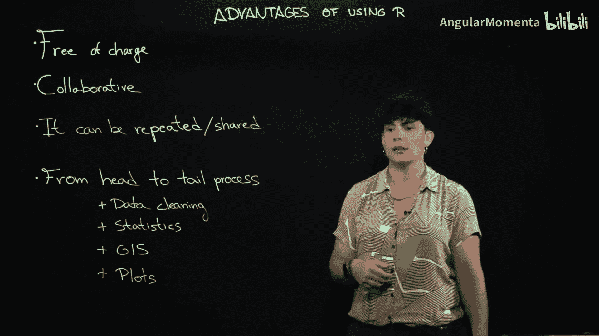
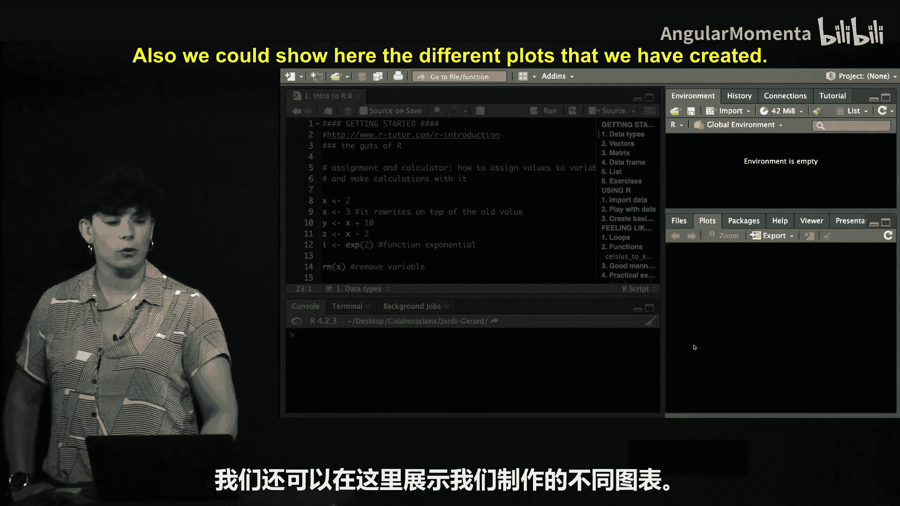
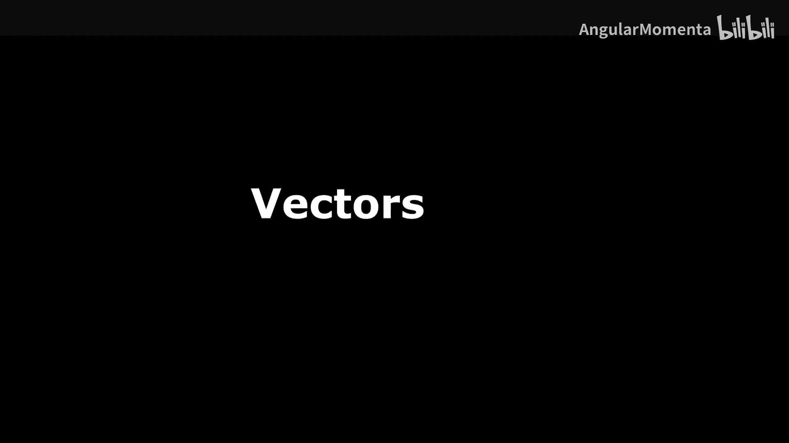
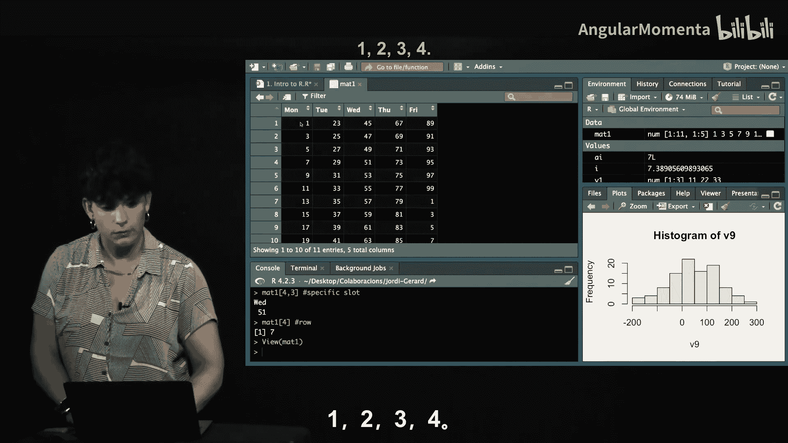
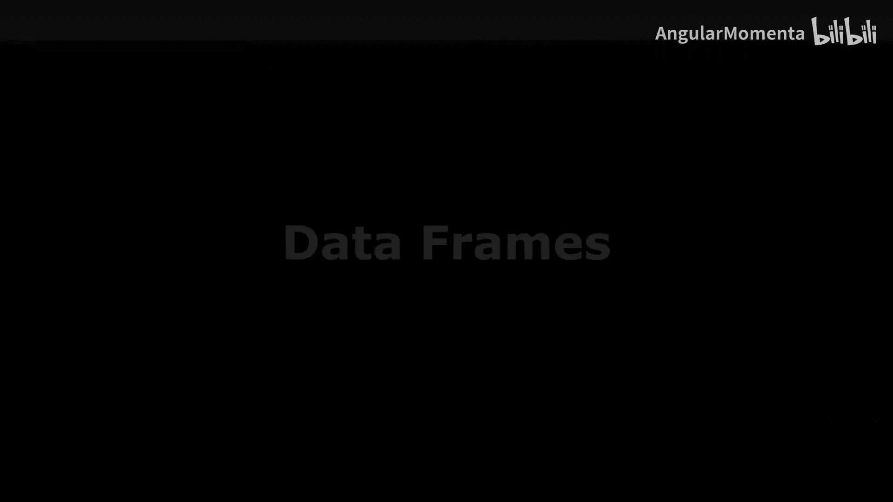

# 【麻省理工】R语言与地理信息系统入门-｜-MIT-RES.1-002-Introduction-to-R-and-GIS,-Fall-2023-p01-01-R语言导论，第一部分：界面与数据结构--BV1QqUoBPEJ2_p1-

In this video I'm going to go directly to R so what is R and what are the advantages of using R R is a coding language that's broadly used in some scientific areas。

 for example ecology or climate sciences and why is that well first of all R is free of chart。

 meaning that everybody can use it and as long as they have connection to internet they can download it and there is no subscription at all。

Second of all， that is collaborative， meaning that everybody can share their code through the our platform itself or also by alternative sources。

So this code can be shared and there's no need to start from scratch。 third of all。

 is that it can be repeated or shared。 So as I said。

 you can get your script and share it to somebody else。 You can。Publish it along with your research。

Fourth of all is that you can go from the head to tail to the process of the research so you can that involves the data cleaning processes。

 also the statistical processes and the GIS meaning that you can also use maps on R and finally you can produce nice plots so you can communicate your research。

So in this video we're going go through the first time we face R。

 so once we have downloaded our and we have downloaded and installed also our studio。

 this is what we see you might be surprised because your interface might have a different background it might be a white background and the font would be black。

 but that's something that can be changed by default it appears like that but my personal preference is to have it in black so it's not。

As fileol in for my eyes。 So this is something that you can change as well if youd like。

Here are the different panels you find the first panel here is the one where you are going to write your script。

 so all the different orders you're going to give to computer are listed right there and whenever you ask the computer to quantify or to execute an order is going to be displayed right here。

And then if the in these two different panels， we're going have in the top one， the。

The data that we have stored， the objects that we have stored and created。

 and here we're going to have different sort of things which could be the files in our computer so we can navigate through that。

 Also we could show here the different plots that we have created。

Here the packages， we're going to go through the packages。

 no worries in the future and also this is very important。

 this is going to be the help tab so whenever we face a new function that we are not familiar with。

 we can read some description of what its function is doing and how actually we can use it。Okay。

 so let's go to the code itself。 now I'm going to be presenting the different types of data that we can have。

So there are the different data types， then we're going to move through the vectors。

 we're going to go to the matrix followed by the data frames and finally the list and I'm going to wrap up the whole section by challenging you with some exercises so you can practice what we've been talking about。

So。Our works as a big calculator， so we are going to be assigning numbers to different variables。

 so the assigning sign it's this arrow here， so this is the variable we're going to be creating in this case it's going to be the X and we' are going to assign the value or the number number two to that x how can we execute an order so there are two ways of doing it the first of all is to point at the line we want to execute and then if you have a Mac you can click on command and return。

So， if you do that。You see now that this piece of code has been executed here。

 and we have created the X right here and is assigned to a2。 The other way of doing it is to just。

Highlight the line we want to execute and click into run right here。

That's especially beneficial if we want to run different lines of code。

 so if I would like to execute all these at the same time。

 I would just highlight everything and click on run。

You can also see that there are some fonts here that are in gray so they don't appear as bright。

 That's because they are annotations。 So this is not meant to be executed。

 So there's nothing related to this code and you can create these annotations by。

Locating it right after this sign here。So also to follow up with the assigning of values to the x。

 if you rewrite the x with another value， we're just going to smash the previous two so that two is going to be a three instead and we can just use these value we is created to assign it to another value。

So now we have this y right here， so to create the outcome of this variable。

 we're using the previous x that we just created and we are summing it to that value here。

As you can see now we have two， the x and the y， the x is the 3， and the y is the 13。

And we can keep going on。Using different。嗯。Mathematical expressions right there。

Also this is the first function you are seeing this means exponential so we're going to be calculating the exponential alpha a2 in this case the value we want to be targeting it's going to be between parentheses right here so if we run this piece of code again with pressing command and return on the line。

We're going to have。The exponential of why。Also， if we don't know how to use exponential and we don't know what that means。

 we just。Click where the function is and go in your keyboard with FN， which is function and F1。

And you see that。It points out to help right here so you can see， okay， logariths and exponentials。

 you can read the description of the function。And you can see right here how it is going to be used。

So that hopefully is going to help you to。Phase the different functions you can see throughout the code。

Also。What happens if we want to remove a variable， Well， you just write our M。

 which stands for remove and in between the parentheses， what we want to remove right here。W is。

Click on it and we'll see that the axe boom。It's gone。Okay。

 so now now that we've gotten through how to assign numbers to variables。

 we're going to start asking logic questions to R。 So first of all， I need again to create。

Some value for x now that we have it， I'm going to ask our if x is bigger than y。So for that。

 they just ran the command。And it's obviously false。 so in this case。X is not bigger than y。

 so it has to be smaller than y。 So there's the other way around of the question。Right here。

We can also ask if two values are equal by using two equal signs， one next to the other。

Or we can ask if it's not equal。 So by applying this sign next to an equal， we are。

Creating the negation of the equal， so non equalal。And here's how we ask logical questions。To R。

So let's move on to the data types， we have obviously numeric data types。

So which means that there are numbers assigned to those variables and we can ask what's the class of this value to R by writing class and the variable that we want to ask about so in this case it's saying that is numeric because if we go to。

This value here， we see that that's a number。We can ask also if that's an integer。

 which would be a number without decimals。So we ask is integralteger， and in this case， it says no。

 because as you can see， we have a lot of。Theimals following this number。嗯。

And we can force one number to be an integer。 So how do we do that。

Put this variable here as an integralteger。 So if we click on it。It says that now it could be 7。

 and we could store it in a different variable。 So in this case， let's just put。This one。

And as you can see。Now it's the same that we had， but just in integral form。

We can also assign characters to variables in this case so we want to write something here and just write lobster and assign it directly to Z。

 which would be a very reasonable way to assign word to a variable but in this case it doesn't work you can see here in another color that's a error so what is complaining is that okay R is expecting here this lobster to be already a variable that has been created How can we fix that problem we just have to put。

Loapster between。Commaas like that。put the C， which means concatenating and by using this format。

 R is going to understand that that's a word that we're going to assign。2 to Z。

 So if you go to the different values， now Z is all upster right here。And let's ask。

 what's the class of the？Well， it's a characteror。

Okay so let's move on to vectors what's a vector well so far we've just assign one value to one variable but we can just concatenate different values for the same variable in this case for example we want to create the vector number one and we want to assign1 and2 to the vector number one how do we do that we've seen already these construction form which is the C and parentheses so in between the parentheses we can separate by comms the different numbers we want to assign to V1。

 so if we enter this command。We see that now we have created this V1 and it's a numeric character if you follow these letters here and it has one and。

Concepts inside and these one and two concepts are the number one and the number two conveniently。

But we can create vectors with three。Categories and。In this case， V1， instead of having two。

 it has three like 1，2，3， and the first one is 11， 22 and 33。

But we can also create vectors with character variables inside so instead of having numbers we just concatenate different words inside and if we go to how vector two looks like we see that there's a gathering of character threat here that we have five that goes from1。

2，5 and inside of these we have Monday， Tuesday， Wednesday and so forth。Okay， what if we want to do。

 want to create a very long factor， but we don't want to spend time by writing each number on it。

 We have this very useful tool， which is the repetition of numbers。So we write this。

 And if we want to know more about the function， we can again。Go to FN in our keyboards and F1。

So by clicking that。We get some help right here。 This is because I have different packages installed。

 So that could be part of different packages， but we are interested in the package base。

 which is what comes from。R directly， which is the pure part。

So we just click in here and we're going to be directed to this function here。

And we can read through， we can repeat ingers， lengths。And X stands for。嗯。

The vector we want to repeat， and so by reading that we can have a good understanding of what preP。

Is doing。 So I just。Execute that order。And we see that we are repeating 22。Two times。

 but if I would change that， we want to repeat 22，20 times。 I can just do that and we repeat 22。

20 times and so forth。Okay， what if we want to create a concatenation of numbers that goes from  one to 100。

 It's as easy as just saying the first number I want to be。1 and the last number， I want to be 100。

 and just separated by these two dots in the middle， we're going to create the vector number 4 by。

Executing that order， so we see that we have a vector created by different integers that go from 1 to 100 and they just  one。

2， three，4，5， and it goes to 100。What if I want to see the complete vector。

 Because here we don't have enough space to just get to see the whole numbers， Does it just。

Select V4。And we。Comment and return。We can see here the whole thing。And also， we can write。

On this box here， I want to see V4 and just click returnturn。

And you see the same thing and you don't see the difference because。Here it is。

 Use is the one that we first ask。 And here is the second。We ask as well。All right。

 I just keep going what if we don't want to at least that goes from one to 1001 by one and we just wanted to do two by two so we just get one。

3，5 and so forth so there's also a sequence here create we can create a sequence that goes from number one。

To 100， but by two， so we just skip one and we just go two by two。So we have vector number five。

 let's see how vector number five looks like。So as you can see， we got 1，3。

5 and so forth until we get to 99， because， of course， 100 was out of the。The pairings。Okay。

 so what if I just want to get one of these numbers in the middle so we have， for example。

 this first simplicity purposes if we go to V4 again that we are going from 1 to 100。

 what if I want to see what's in this slot let's say number 20 so if I want to make a consultation just。

Let's go to the vector number four。And just put the cloud out there here。Concatetnating and I wantna。

just say， for example， I say the number 20。 so I want to see what's inside the number 20。

 So in the slot number 20， we have the number 20 in this case。

 So this is how I just select one number or if you can。If you want to select more than one。

 in this case， we go to V5。We use the concatenation。

ForSo I just want to explore what's in the slot number 10 and what's in the slot number 12 and I use yeah I'm creating a vector inside of the vector number5。

 so Im just going to make this consultation and you see the numbers that we have in these particular slots。

It wouldn't work if we would do it like this， just I wrote these for the purpose that you can see that there's an error applied to that code。

 so that's because you should put these numbers inside of the construction like with the C and the parentheses so R is able to understand。

What if we want to？Get rid of one of the numbers that I had inside a vector I can do that too by in this case and we're just going to create a vector number six we're going to use vector number two let's just remind what was vector number two it was at least of the different days of the week and we don't like Wednesday for some reason we just want to get rid of Wednesday we use the slot number three we say minus3 so V2 like vector number two minus the slot number three which in this case it's Wednesday。

So let's just apply that。Now just check out what's in V6。You he， boom， Wednesday is gone。What if？

We want to create Wa。Further details about functions。

 oh I've written here after different the different functions。

 what they are supposed to do so you don't have to consult every time the help section。

 so I created a comment right after them。U。So these are kind of similar。

 These are different functions that are gonna。Create random constructions of data。

 So every time we would run each one， it's going to be different because that's the purpose of the randomization of the data。

 And in this case， we are going to go from 10 to 50 by 10。 just。See how it goes。

So we have a random selection of 10 numbers that are going from 10 to 50。

 What happens if I rerun the same command？Hopefully。They are different。Okay。

 so just by applying the same structure of data， we get different outcomes because the purpose of that is that we resample。

嗯。The data， we can also put this randomization into。嗯。Normal distributions of data。

 So that's why we have this R norm here。 In this case， this sample is just random。

 but this is forcing this randomization of the data into。And normal distribution。

 So I'm just creating。This I'm just going to go with a V9 that I like it more。H。😔。

Now we take a look of Vign。We have a lot of numbers， different numbers。

But if we want to see how this data looks like， we' just create a histogram by putting hist right here。

 so also you can get familiar with how the plots look like by doing this。

 which is going to see how a histogram if this data look like。

So here we have a kind of normal distribution of data by。Applying this function here。

 I' just do it one more time so you can see that the distribution changes。And so， that's the plot。

Okay so now that we've been through the construction of different vectors。

 it would be interesting to ask our about different summary of those vectors。

 so one of the things that we might be interested when we are facing vectors is get to know the length of those so let's just ask our what's the length of in this case vector number four。

So we got it like the length is 100 and what happens if we just ask the summary what is going to summarize so while it summarizes this a bunch of information so we go from the minimum to the maximum so the minimum value in this case is one the maximum value is 100 but we also have the different quantiles and the median the mean so this is a very useful。

Function that we can use to get a good summary of the data that we are facing。 Also。

 we can use this different function right here to sum a vector。 So in this case， I don't know。

 they just use the vector number one。So it's going to sum each individual number that's contained inside vector number one。

 in this case， we can also ask only the minimum of any vector。

 also with the maximum and we can calculate the mean of any numerical vector as well。Okay。

 so now that we are familiar with vectors that we just went through a lot of information related to vectors。

 let's just move on to matrix， matrix is at the end an accumulation of vectors so we are moving into two dimension data。

 so we have different rows and different columns。But they are only related to numerical variables。

 we don't get to have characters inside of matrix， so just a heads up let to put attention into that detail in this case we're going to be creating a matrix that's going to combine vector number five and we're going to put it in rows so we want 10 rows and we want five columns。

嗯。We just。Click on that instruction。We see here that now we have a different subset of data so far we've had just values and vectors right here。

 but now we just created a new section which is called data and here we have a matrix。

 we can console these matrix again by just clicking into mat1 just command and return。We see it here。

We can also type here。Mawen。And return。But we can， in this case， click on。The data itself。

 and it's going to be displayed just like that so we can visualize easily how we've constructed the data。

So what this function has been doing is to split the vector number， in this case。

 number five that we had before， just putting it in order， separated in different columns。U。Also。

 this needs to be。It has to match with the length of the vector because in this case。

 I would say let's just not structure it in 10 rows。 Let's just make。Like 11 rows。

 what should happen？Is that R is saying。Hey， this is not。

Accurate because you are asking me to put the data in a format that it doesn't really fit。

Just the difference between warning and errors， so previously we've seen an error。

 it's just are is saying no， I'm not going to do that， but if there's a warning it's saying that hey。

 there's something wrong here but I'm able to do it so that's mostly the different between warnings and errors。

Am。😔，OrYou can just。Close that tab。And okay， we can also。Put names on these metrics。

 So we just consult what are the column names of those matrix is。 In this case。

 it's new because well it just console again the matrix。We have nothing here。But， we can。

Let's just remember what was in factor number  two。 So we have the different days of the week。

 So were just gonna assign this5。Characters in as a title of our matrix， just like that。

 And now we see that。Where we had nothing， now we have the different days right here。

 so we just assign column names to the metrics that we already had。

And how can we navigate through mattresses， So first of all。

 we have to name the object we want to navigate on。

So the mat number one and this stands for row it's like the first number it stands for the row which separated by a coma and the second number stands for the column so in this case I want to see what's on the row number four and the column number three。

It says that it's the number 51。And just for our information。

 it says that the column number three is name Wednesday。

And what if I want to get the whole row so I just put nothing in the second part。

 so I erase the three， I keep the coma It's very important to keep the coma otherwise it wouldn't it will give an error just I'm just going to try。

Oh yeah， it's going to go to the number four， Yeah， so it it takes the matrix。😊。

And it grows for the slot number four，1034， but what we want here is the whole row。

So。😔，I just put the coma here。They execute the thing and it's giving us the whole role。

So we won the whole column。I's just。Keep the three， erase the four。

 we're going to get the whole column number three。Just like that。And of course。

 if we want to reassign a value that we're getting， because here we are not recording this anyway。

 anywhere。 we're just consulting。 but if we wanted to。

Record this data or assign this data to a new variable。 We are always welcome to do so。

 So by just creating a name of the variable。Its like X X， for example，The arrow right there。

 and we would assign these。Data that we're consulting into a new variable。 So now。Xx variable here。

 it corresponds to the column number three of the matrix number one。Okay， so in this case。

 what am I doing here？I'm creating。A vector。Which is in the second part。Of this structure。

 So I am messing with the columns。I'm getting the column number one and the column number three of the matrix that we just created。

 and we are storing this data into。There's no variable。just check it out。How it looks like。

And indeed， we have the two columns right here。

Moving to data frame right now。Data frames are an evolution of metrics。

 And the good thing about data frames is that they allow us to put also。

Factors inside allows us to put as characters inside。

 so it's not going to be only numbers so we can have have a mixture of different data structures。

Also R by itself has a library of data frames， so if you have a want to play with data just for fun。

 you can access this data that's included inside the R in this case。

 the one that I'm using is one that's called empty。Cars， I'm going to sign this name。

Two cars right here， we just click on it。You'll see that this new data has been created。

 is in the same section as the matrix， but we see that in this case we have this little arrow。

 blue arrow right here that if we click on it， it's going to display the different column names and information of each column that is assigned to that data base。

So just for visualizing purposes， I'm just going to click on top of cars and here is what we have。

 This database is related to different car engines， miles per gallon。

A different number of cylinders that it has， so it allow us to play quite a lot。With this data。

We're going to just ask the length about cars as we did before with the vectors。

 it also applies to data frames。So here we have the length of that。

 what's the number of colors that columns that we have involved in here， we can also ask that to R。

We can also ask the number of rows that are involved。We can ask what's the column names。And again。

 we can use the same data structure that we use for matrixes。

By consulting what's on the row number four inside of cars？Using the same。

The structure we used before。And there's something else that's a new feature that I'm showing。

I'm showing here is that you can also select or consult a column by using its column name。

 so in this case there's this column name HP。Just put the dollar sign in here。

 so I'm saying this is the car's object that we assign。

Dollar sign and inside of the car I'm consulting the column called HP。

If we don't know what are the names involved in the in。This data frame， we just go from cars。

 just write the dollar sign， and it's going to be displayed in a list。

 What are the different columns that we have。 we can just。Scroll down and click the one that we like。

Just intro and it works just like that。Okay， so now we have already been going through a lot of different data structures。

 we went from individual characters to numbers， then we went to when we moved to vectors。

 then we move to mattresses， data frames， but there's like。

The summary of everything you could store every single type of data in one data structure。

 which is the masterpiece of everything， this is called the list so we can create a list of everything we want。

 we can put together as you can see like different vectors but we can put together a matrix there and we put data frame so in this case we're putting everything in that list which is。

Create these。And。As you can see here， it has been created。

 if you click on that arrow that we had also in the data frame， we see the different。

Data structures that we have inside that matrix， the first one is a numeric vector。

 then we have a character vector， we have another numerical vector。

 a vector that's created with integers， we have a negative frame and we also have a matrix。

Right there。So this is a way to store data。Easily that you don't even have to think about what's the structure of that data you just put it in there and you can consult okay。

 I just go to the space number six， which in this case is 1，2，3，4，5，6， is's going to be the matrix。

And you see， and of course， the matrix is here。😔，And this is how we can store everything in the same place。

And now that you've been exposed to such amount of data。

 I just prepare some exercises for you to start emptying your brains and putting everything into practice。

 so I encourage you to take this little。嗯。Questions here and try to answer them and if you are eager for more。

 I encourage you to go through different internet resources。 One good thing of R is also that。

You can find everything on the internet， so there's going to be a lot of resources for you to practice as well if you are hungry for more。

