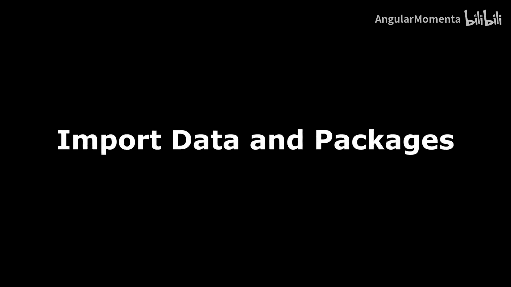
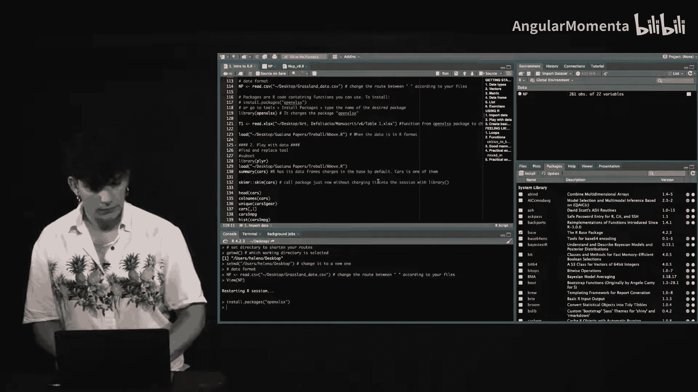
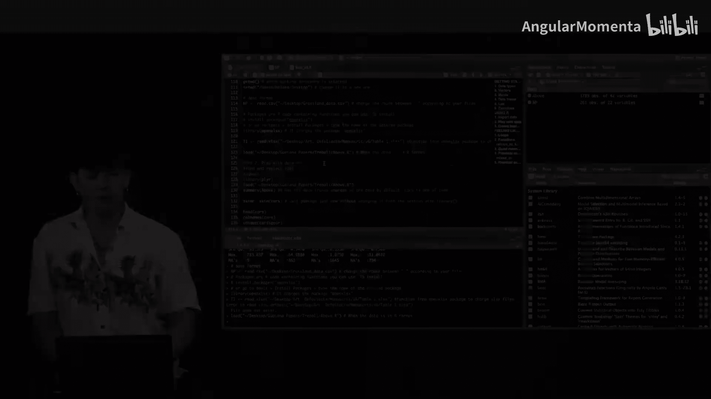
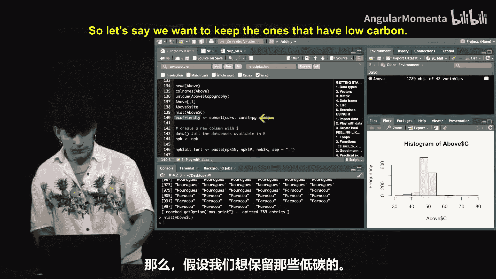
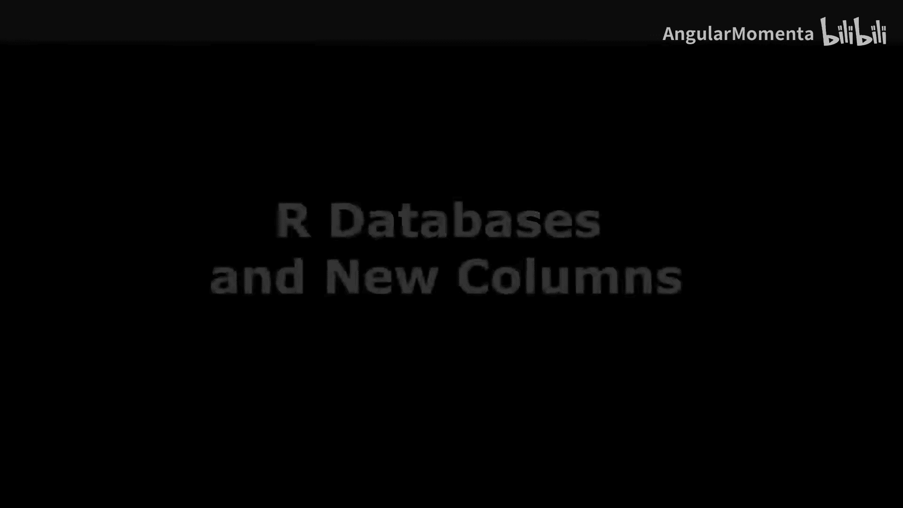
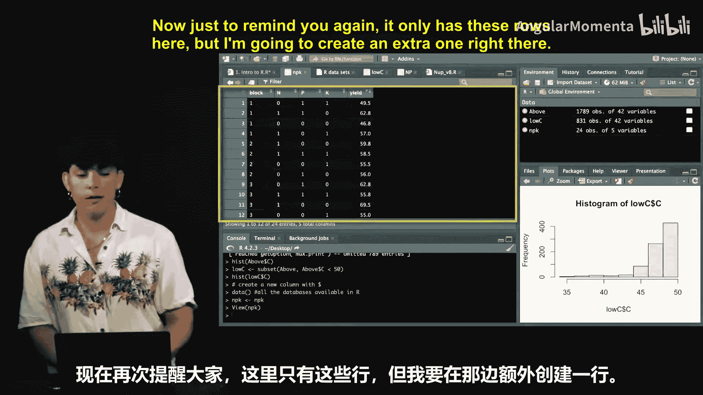
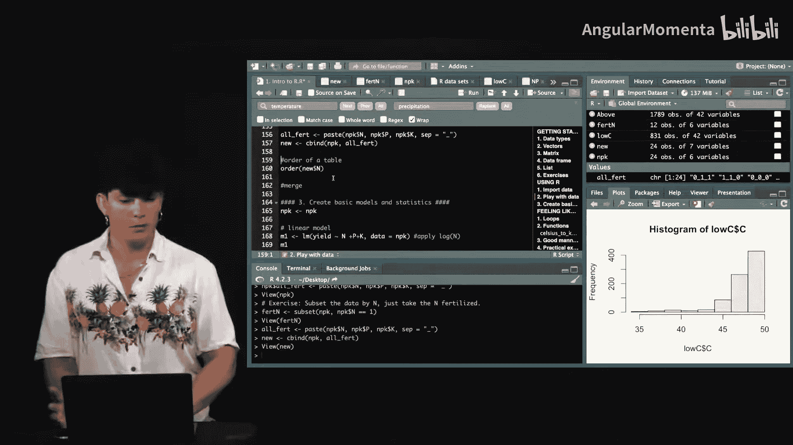

# 【麻省理工】R语言与地理信息系统入门-｜-MIT-RES.1-002-Introduction-to-R-and-GIS,-Fall-2023-p02-02-R语言导论，第二部分：数据操作实践--BV1QqUoBPEJ2_p2-

All right， hopefully you had the chance to practice the exercises that we went through on the last video and now we're going to start going directly to how to import data in R because we've been working on how to type or create data in the script itself。

 but now it's the turn to import data from other sources so I just，It eras everything。

 so we start with a whiteboard。 So if we click here。We're gonna clean。

Everything we've been working with also with the plots。And we can do the same with a console。Okay。

 so now well start with everything brand new。So first of all， where is the data taken from？

If you type get。WT， which it means working directory。

It's going to say what your working directory that's been linked to。

 so in this case I'm going to users， Alna and desktop。

And you can change this working directory by creating set WD and here write a new route。

 I'm just going to go with the same one right here。And by default， R allows you to import CSV files。

 This is the command you should write to。Import command as a CSV file。

 just read dots CSV and then your working directory here is it works for my laptop but of course you would have to change it depending on the location of the file you want to import。

And always。Between these commas right there。So if I click on here。😔，Is it？

This data has been imported and if I click on it， I can visualize everything's inside。

You can try it with whatever CSB file you have。But what happens if I want to import files that are in。

 for example。Excel format。 Well， for that， we would need a package in the beginning of the sessions I。

Briefly talked about packages when you go to this tab， you can see what packages you have installed。

 so now it's the time to go deeper with packages。Packages mostly are an accumulation of different functions that somebody has uploaded into the our interface。

 and you can download that them using tools， install packages。

And here you type the name of the packages you want to install。

Let's just go with the one that we want to install right now。These one。인ス스타。Yes。

And。😔，Okay， now it's already installed in our system。嗯。Also， another way to do it。Would be to type。

Install packages and between comms， the package name。

So that that works either way and now we have to charge this library into our session so okay the packet it's installed。

 it's in our computer， but now we have to call all these functions into our our session and to do so we just type library and the packet we want to charge so on just。

えと thisす。And now if we go to the packages list， we should see that open X L S X。Scroll all the way。

You see， it clicked。 It means that it is loaded。 You could click。

Here and click here and it would work exactly the same。

We've gotten good at installing and charging packages that just use them。

 I'm going to charge this file that is an XLSX file so it's an Excel file it mimics the function of the read CSV so it's read X XLsX and the same functioning so you just put the route here between commas and it loads itself here。

 the name I'm going to put to this database is T1。Oh， it says that the file does not exist。

 so that would be because。Some of these。Parts of the route， it is not。Well written。Also。

 there's something important。That might be handy for you is that R has its own R format file。

 which is the dot R， so it's a very compact way to store data and you can also load R files by just typing load and the route you have right here。

I just charge these with our file and I have the data frame。😔，Attach。Okay。

 I just realized that the font might be a little bit too small。

 So I'm just gonna make it bigger for you。 And also。

 I'm going to show you how to make the font bigger for your own purposes。 So if you click on your。

Command up here。 and then you go to the the sign plus， you see that。

Things are getting bigger and if you're going to go to the other way around。

 you just command and minus。Okay。So that would be handy for you。

And also I'm going to show I'm going to talk about a very interesting tool that our offers。

 which is the find and replaced tool， so if we go here we have this magnifying glass。

 you click on it。And you can type。Any。Characters you want to look for， let's say， I don't know。

 I want to know where I typed read。So。It's going to guide you through the different places in your script that you've wrote read。

And also， you would be able to replace。All read things into something else。

 I'm not going to do it now， because I， that would。Screw my whole my whole whole hour session。

 but that is just a very useful thing to do whenever you have， let's say。

 a variable that you want to change。 So initially you were working with temperature。

And you want to change temperature for precipitation。

And you can do it all at once in a very simple way。All right。That being said also。

I have this organization right here in the right， so you can follow。

The structure of the script that I'm having here， and I can click on the different names。

Or where I was so。I was about to rejoin the explanation right here。

 So this makes it easy to find as well。 How do I make things。Appear here。

 I just have to put four or these signs here and four at the end， so I just try it。

Now high has appeared right here。So is it a way that I personally find easy in order to？

Have tidy scrapes and not get lost。Into all this code。

Okay let's get back to the exercises now that we've learned how to upload data from our computer。

 I'm going to work with this database right here， which is the above that I already mentioned okay first of all what I would like to see is how the data looks like we can use this summary function that we already talked to previously。

😊，This is going to provide me。On a glance， what's inside this database。

 so where's the beginning right here。😔，So in each column we're going to have each column name。

 so that's the column name， then depending on if the variable looks categorical or it's numerical。

 we're going to have different features applied there， for example season it's a character。

But the ones that are't numeric， let's say。Carbon， we get。The minimum， the different quantiles。

 the mean and the maximum value and the number of nas。

 so here I have 500 Ns and so forth that's going to be applied to each column。So it's variable。 Also。

 another way that we can use to。See summary of our database。

It's the one that's provided by this package， so to remind you how to install and charge packages。

 you go right here， tools， install packages， and here you type the package you want to install and install。

And then to call the package in your session， you can do two things。This library situation。And。

But if you don't want to charge。Forever this packet in your session and you just want to use it in this line code。

 you can use these so you put the name of the packet here。Like。

These two sides and then the function you want to use。

 I is going to understand that you instantly call that package， but then you don't want it anymore。

So I'm just going to see what this provides。This is a very cool way to approach the data， because。

It offers。In another color whatever we have negative values。

 and also it provides us of the same information like the main standard deviation。

 different quantiles。And also the missing values。And this very interesting feature。

 which is a histogram of each column so we can see how the distribution of the data looks like。

 which could be sometimes very handy。Other ways to approach the database would be to call the Heathers。

 which is the different rows of the data we have I'm just going to replace the cards for the above。

Here we have it。So we're going to see only the six first rows。Just to remind you。

How can we check the column names？Just call names， this is all the variables that we have in this database。

😔，嗯。This is something that is also very useful， which is unique。 So it's going say。For example。

 we have a character associated to this database。嗯。Let's say。I don't know。

 topography what are the topgraphies that we have， so we have bottom slope and top。

These are the different categories。That we have inside this variable。

These is something that we already talked about。Which is a quick reminder of。Consulting。

Column by column。 So we should go to above and。Column number one。Here we have the column number one。

😔，And。But we also can call the things。By using the dollar sign， this is the number one。

 it's going to be the same。And。We can individually provide a histogram of the variables。Yeah。

 let's say， let's just gonna。See how carbon looks like。Histogram， the database。D sign in the column。

And this is how our data looks like。 Obviously， you can also change some of the features of this of the graph。

 this graph you can you could even like。Change the different X or Y axis， or you could。

Split the data in more bars， but that's something we're going to cover in future videos。

So following this histogram that we just created about carbon。

 we're just going to make a subset of the database we have based on the amount of carbon。

Let's say to say we want to keep。

The ones that have low carbon。嗯。Just subset， just change the name of the database。😔，Right here。

And now， inside the database。The variable we want to focus on。And we want it to be。Lower。Then，50。

Just go ahead。And you see that now we've created another database right here where the。

The columns are the same， but the only difference is that。We have。Less rows， lesss。

 less observations。 And if we see how。The histogram looks like。嗯嗯。

We see that now it has changed and the maximum is 50 and we have all the rows that have a value。

Of carbon below 50。

Okay， so I've already mentioned in other videos that R itself has a library of different databases。

 but' just going to go through that and just write data and parentheses。

So we're going to see all the data sets that are includes。Without installing anything。On the side。

 and I'm going to pick a database called NPK since my field of expertise is field sciences applied to plants and climate change。

This is a database。 Well I'm just going to charge it， so you can。Have an idea how it looks like。

 it has different blocks of experiment right here and also it indicates in every row if that block has been fertilized with nitrogen with phosphorus or potassium in this case zero means that it hasn't and the one it means that it has been fertilized and it records the amount of yield that has been produced right after this fertilization so we're going to play。

A little with this database。First of all， I'm going to create an extra。Column to combine nitrogen。

 phosphorus and potassium fertilization at the same time。 So how am I going to do this？ Well。

 I'm just going to create directly a column in our database。 Now just to remind you again。

 it only has this rows here。 and I'm going to create an extra one right there。

 Then it's going to be called all third all fertilization。 So I want to paste the。

Column that includes the nitrogen information， the phosphorus information。

 and the potassium information， and I'm going to separate each one。With this symbol。Here， so。

Just going to go ahead。R the command。 And now we've created a new column here that includes the different fertilizations。

 And we can see only in one factor what has been the。

Different treatments that that yield has been passed through。Okay。

Just going come with a little exercise here。 I'm asking you if you could subset this database and taking only the data that has been fertilized with nitrogen。

So how are you going to answer this exercise， First of all， let's just go back to the。

The data and see， okay， nitrogen， there's zeros and there's ones。

 and we want the ones that have just the number one， which means that they have been fertilized。

 so we just make up a name。Subet， what's the database we want to subset？What's the variable。

And we won the ones that are would。Equal。To one。And here's how we。Create a subset。

Filtering only by the ones that have been nitrogen fertilized。All right。

Other things that can be useful。 We have the arbine and the seabine。

 which basically paste vectors into the database。 So let's say we have the different。

Columns right here and we want to add an extra one。

 or if we have the different rows and we want to add。A row on the bottom。

 they have to match by length， but other than that。

 I is going to accept I just put that into practice。Previously。

 we created this new column right here， just to remind you that one。Okay。嗯。

But what if we just create the column on the site？Okay， here you see that we've created a vector。

That it includes the same information that we have previously included in the database。

 and we want to just。Use。😔，The seab just to combine。These two。

So it's like that's the new name that I came with， apply the function。

 I want to merge this one here and this one here。So if they match in size。

 r is going to allow us to do it。And now I have this is the one that I first created and this is the one that I just added。

 So this is two different ways of doing the same thing。

 R has multiple ways of doing sometimes the same， So just pick the one that works for you the best。

