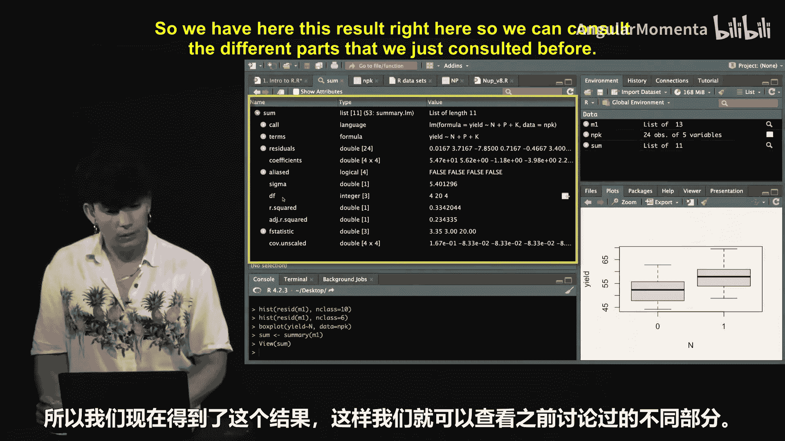
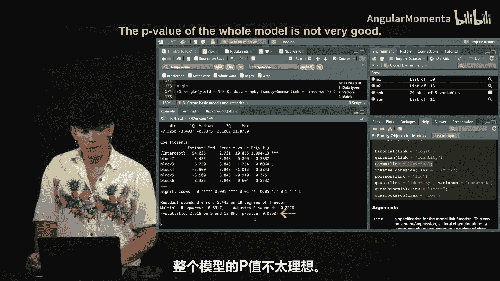
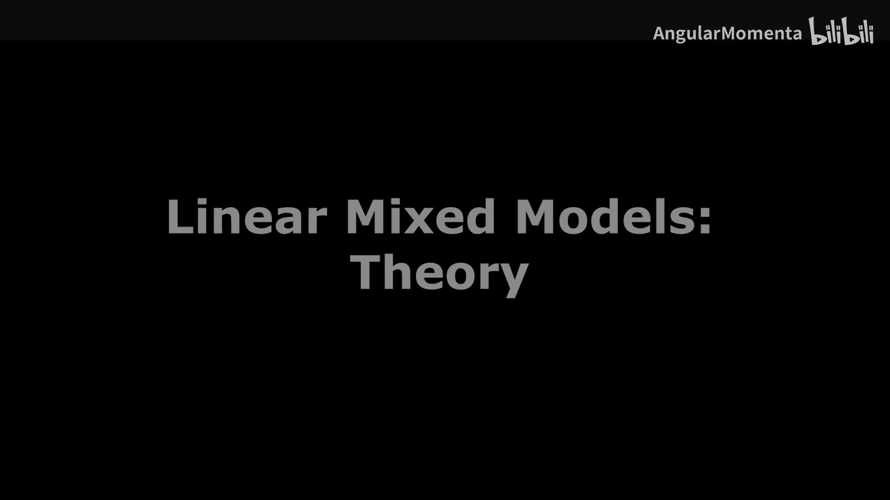
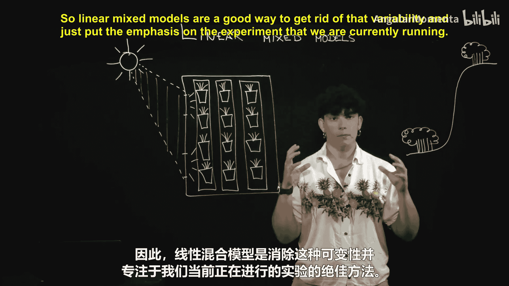
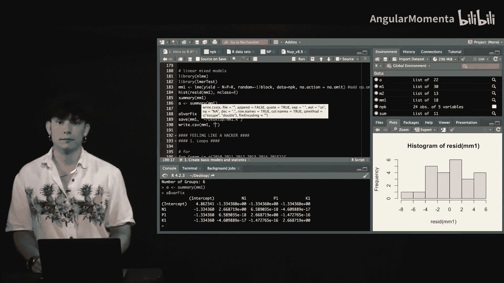

# 【麻省理工】R语言与地理信息系统入门-｜-MIT-RES.1-002-Introduction-to-R-and-GIS,-Fall-2023-p03-03-R语言入门，第三部分：R中的线性与混合效应模型--BV1QqUoBPEJ2_p3-

Okay， so now we're just going jump directly into how to use R for statistics I'm going to make a very quick tutorial about how to apply linear models into the data Also general linear models and mixed models I'm not going to cover the mathematical principles of that I'm just going to show you how to apply those models with code so first of all I'm just going to start over。

With all the objects here just cleaning a little bit， so it's not distracting us。

So just going to charge again the database we've been working with based on nitrogen and phosphorus implantation fertilization in yields。

 oop， sorry。嗯。Okay， so。This is how the structure of a linear model should look like。And first of all。

 we create the name of the model， model number one。We assign all of these into model number one。

LM which is linear model， and here we're going to have our dependent variable， the y。

 which is the yield。Just to remind you again， what the database is about。

 here we have how much yield has been produced after the different treatments of fertilization and we have the different experiments set in different blocks。

um。So and we are going just to separate dependent and independent variables。

 we put this sign in here， and then these are the different variables we want to explore coma and then data we assign the data we want to。

Expler， which is the NPK。So let's just run this。An。If we。See what we have in the object。

This is what we're going to see， which is not very informative。

 so what we need is to go to the summary of that model that's going to provide us with the information that we would need to understand what's going on in the model。

So just click on summary M1 and here what we're going to see。

 just make it bigger so you see properly。First of all， it's gonna a display。Like the formula。

 So what's the question that we've asked to the computer。

 Then we're gonna have the distribution of the residual。And here it goes the interesting part。

 which is the coefficients。This is the intercept and then the different effects of the different variables。

 nitrogen and phosphorus and potassium so when these are one so when there's fertilization we see that there is an increase because it's a positive value into the baseline with phosphorus there's a decrease in with potassium there's a decrease as well and just to see if those different treatments are significant or not based on 0。

05 value we have the different。Like the P values here and when whatever it eats。Significant， we have。

One is the risk， if it is very significant we have three and if it's marginal。

 we have this thought here and if theres nothing it means that it's not significant enough。

Also some interesting features is like the adjustP R square。

 as a reminder the R square goes between 0 and 1 in this case will be 0。

23 or like  23% and also the P value of the whole model。Is display right here。Just put this bag。Hm。

Something that's also very useful is to explore how the residuals look like to see if we have an appropriate distribution of the residuals if it follows a normal distribution。

I create a histogram of what of the residuals of the model one。 So that stands for residuals。

 a coma and。Previously， I mentioned that you can change the number of bars that are displayed in your histogram in this case。

 I want 10。Here it is I。Shorten that number。And now you will see that I have less bars。And so forth。

Something else you could do is a box plot。 I want to see what happens when I fertilize with nitrogen。

So I can' create a box plot just like that。Yield and nitrogen。

 So I'm just going to focus on nitrogen right now。 And again， the data that we want to explore。

 So just click on it and we see that。The ones that are not fertilized are lower and the ones that are fertilized。

Have higher yield。And we can。Save that summary that we created because its where all important data。

Leaves， so we have here this。Result right here。 So we can consult the different parts that we just。

Consulted before。

So everything is stored right here and we could even call individually the ones that let's say I I just want to store the coefficient so。

Ill go the sum， like the dollar。 and I go to coefficients。

And here I'm just going to see the coefficients。😔，Wehich tried the same that before。

Okay。Now it's the turn of the GLM the generalized linear models。

 they are quite similar to linear models， but one of the advantages with GLMs is that we can provide a distribution of the data in case the data wouldn't be normal we could apply family links like so to say if we want to have a gamma distribution then we can add that to the model so we don't have normal problems。

嗯。And so the structure， as you can see is mostly the same as the linear models just that we add that as a GLM。

 same y variable。And function of these different x variables， just。Go for the same。

If we wanted to apply the family， just， oh， lets just go back to the help thing。Just。😔。

See how GLM works。You see here it。Contemplates the possibility of other family in this case。

 by default is Gaussian。 So whatever you see here initially。Is what is displayed by default。

 but if you wanted to change this Gaussian into something else。

 then you could do it so if you scroll down you'll see the information about the family and if you click on family for details。

Here you see the different possibilities you have。So like if you want to apply a binomial distribution。

 gamma and so forth， this is what you should。Including your model。

 so I'm just going to copy that command。Go right here。You see， that's the function。 I won。

I have to put family first。And go ahead。And now。It follows my gamma distribution。

I'm not saying that's mathematically correct or not I'm just focusing on the commentss for you to be able to do it in your code。

Okay， so now that we've reached this point， I'll challenge you with this exercise asking the question are there any differences in yield due to its block。

 what is the block just？It a quick reminder， that's the block。

So you can answer the question both using linear model， all generalized linear model up to you。

All right， let just answer the exercise to do so I just going to create a model。

 It's going to be called N2。嗯。And the question we had， I'm going use linear model to answer that。

 The question was。Are there any differences in yield due to its block， so lets you see yield？As。

A variable。That's y variable。 And we wan to see if there's any difference due to block。嗯。

And then data。It's NPK。And that should work。Let's see what we have in the model。Again。

 I remind you that summary is where we want to go in order to see what's going on in the model。Okay。

Let's see。Well， let's say not really we don't have a lot of significance here。

 there's only one that marginals newly significant。

 this block number the might be a little bit different than the other blockss。嗯。

The P value of the whole model。

Is not very good。 So I would say that we don't have differences。Due to。The block。

Okay， so before moving forward to the mixed models。

 I would like to introduce them a little bit just to go through why are they important and how can we benefit from linear mixed models So let's imagine that we are working in our experiment in this case we are applying the experiment that we have in the database the NPK database。

 there are distributions based on blocks。 So what are those blocks。

 So let's just imagine that this is our working space， this is our lab。

 this is where we are performing our experiments but just because the distribution of the lab is like this。

 we have。One side where there are windows so where the sun could get into our experiment and there's the other side of the lab where there's no windows so I would anticipate at the beginning that maybe the plants that have more light so the ones that are closer to the window might grow more but this is something that I'm not interested in exploring in my experiment so to do that that's where I introduce blocks so I would record each of these plants that I'm growing into a different block so in this case I would have three blocks and。

These are distributed based on how close they are from the windows。

So this applies also into other sort of environments。 So if we move。

So this other design we see that this could apply in when you go to the field if that represents a forest。

 if you have a forest in the top of the hill that might be differently affected by the forest that' is in the bottom of the hill so this could be block number one and this could be block number two and we could use blocks for everything that comes into our mind let's say that we are exploring a variable and we assume that if our water river。

Is close to a city。 it's far from a city that could be important。 that could affect our experiment。

 So here is where we think about using linear mixed models to。

Take away the error or take away the variability that could come from things that are outside of our control so we don't have any interest in studying the differences in top and bottom of the heel and we don't have any interest in studying the differences between the plant are close to the window and the ones that are out of the window so linear mix models are a good way to get rid of that variability and just put the emphasis on the experiment that we are currently running。

After the quick explanation about the linear mix models， let's just go ahead。With a code again。

 just going to get rid of this。Yes。It might be distracting。嗯。

So linear models and generalized linear models are included in the R functions but for mixed models we have to install and charge extra packages in this case I'm going to use the NLME package and also the LMR test so I already have them installed but feel free to install them first。

And then。Charge them in your session。In this case， instead of LM or GLM， we have the LME。

 just linear mixed models。Our variable is still the yield。

 so how much yield is produced after the fertilization of nitrogen phosphorus and potassium。

 but now we are adding this random factor， this part of the model is what we call the fixed part。

The fixed variables or but。The ones that we're gonna include。

In this section are the random variables， which are the ones that we are not particularly interested in understanding。

 but we want to control so they don't add。Noise into our results。So in this case。

 the random one is the block， which based on the explanation of the linear mixed models are the different tables。

 the different blocks。The data and here I added something new that could be used in every model。

 which is how the model face the Ns， the Ns are empty values where art doesn't have information it's like a hole in the database so what happens when our faces a hole in the data in this case I'm just saying just omit。

That data， And just。Keep going。You could be NA omit and fail。

 so if you want the code to fail if it encounters an NA in this case I'm just omiing that just keep going and give me a result just going to run that。

And see how their residuals look like。Again， you can change the number of bars right here and I'm going to。

See， what's the result。Of the猫。嗯嗯。In this case， this。

This package doesn't offer us the symbols next to the variables to see if they are significant or not。

 but we can still read the P value but it also give us the value of the intercept in this case we have more significant results because of the controlling of the noise in the blocks so controlling that part of the variability allows us to better focus on the effect of the fertilization。

Here we would see that。Fratilization with nitrogen is significantly affecting our results。

 it is increasing the yield。By 5。And。Also， potassium is significantly affecting our yield production。

 but in this case is reducing the yield。Also， what we can do is again to store this information into an object。

 just I name it a。嗯。You can consult whatever is inside this summary。

 in this case I want to see the information about the fixed variables， which are these ones here。

And then I can also save this information into a file in case I want。

 just type save and the object you want to save coma and where do you want to store it？

Here I'm just going to use the R。Forma that I told you about， but if I wanted to store it。

 let's say in CSV， just write CSV。Again， the object you want to store。And the route。

Where you want to。Or do you want to put it in your computer？

