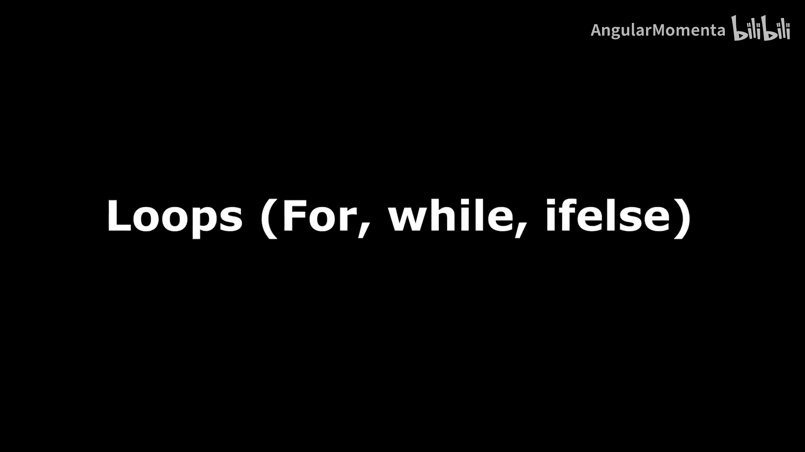
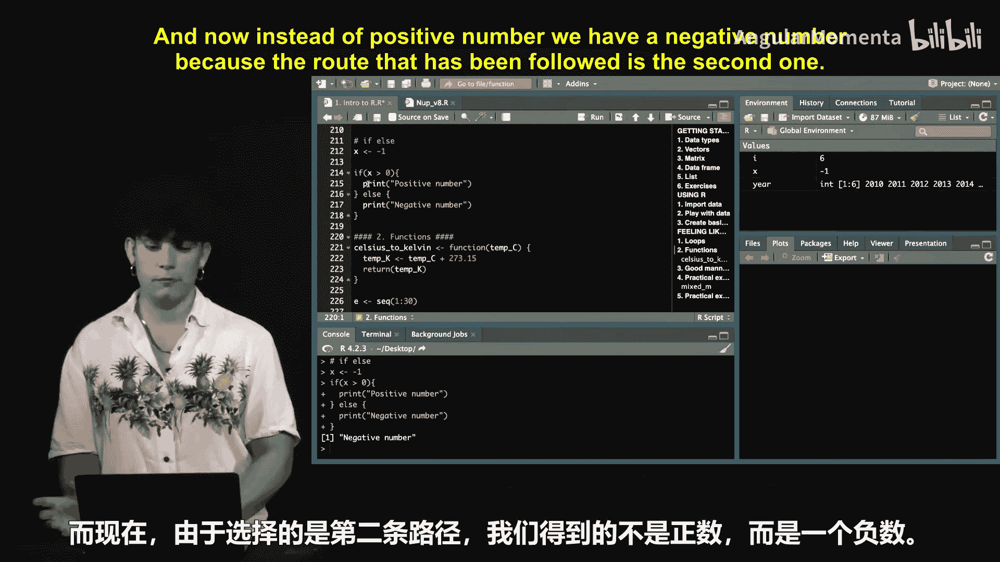
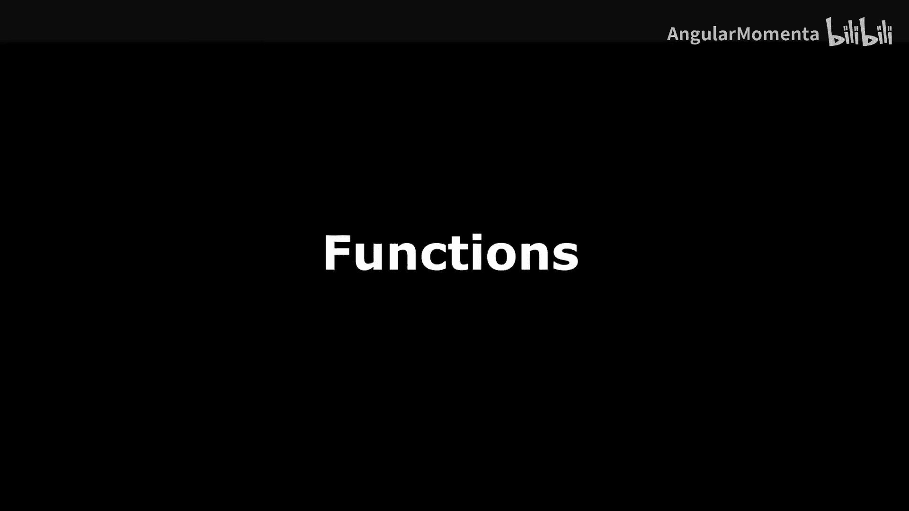
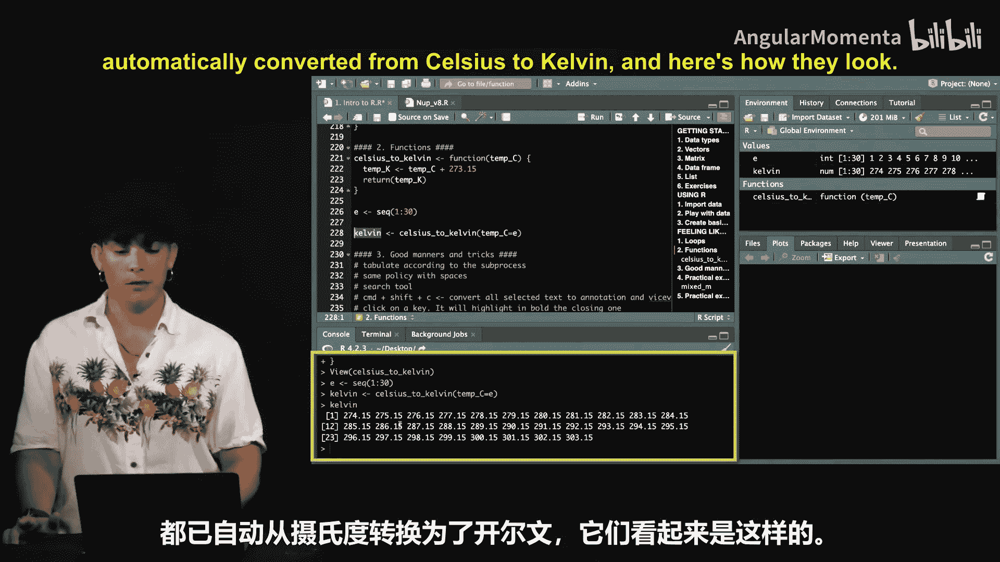
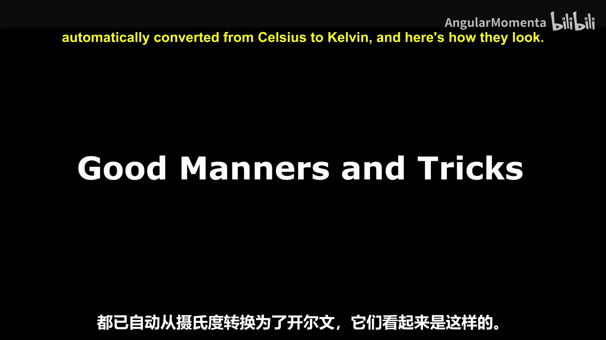
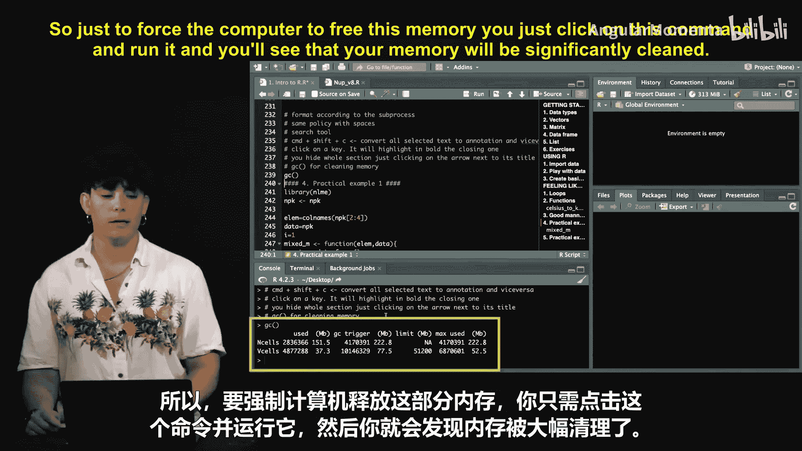
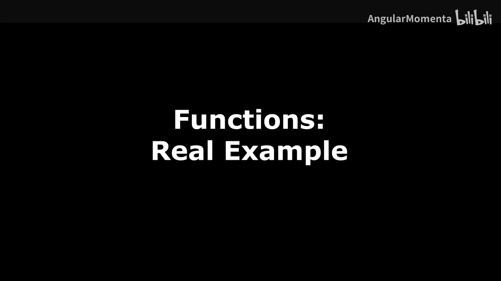
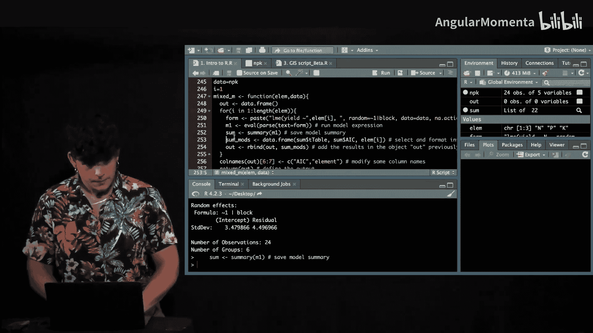

# 【麻省理工】R语言与地理信息系统入门-｜-MIT-RES.1-002-Introduction-to-R-and-GIS,-Fall-2023-p04-04-R语言入门，第四部分：循环与函数--BV1QqUoBPEJ2_p4-

Now is where things get interesting and where we' going to use the power of the computer to make our lives easier and not like prevent us from doing mechanical stuff over and over so we're just going to set some commands and the computer is going to run them for us without us being there repeating the stuff so there are two different types of loops we have the four loops and the wild loops the main difference between them is that the four loops are。

Statics so they are going to be repeated for the amount of iterations that we said at the beginning but then we have the while loops which are the ones that are going to stop once a comment is reached so whenever there is a constant that has overpast or whatever is a different that has been fulfilled。

You'll see that further when I'll explain them a little bit more in detail。

So let's just go with the for loop at the beginning。

John I'm just going to create a vector here that we're going to name year。

 it's going to go from 2010 and 2015。Just running it， so we have it also just as a reminder。

 we could do it。Like this。 And it would。Work either way。We have the same thing。U。

So what are we going to do with this？There's a very fixed structure for for loops。 It starts with。

The command4 so the R session understands that this is a for loop。

 you'll see that the font color changes here。And were going to see we're going to set initially the amount of times this is going to be repeated。

 so it's going to be throughout the whole year vector， so it's going to be repeated one，2， three，4，5。

 six times。And then。This is going to be the iteration。

 so every time this is going to change so when we go to the expression we want we are creating or the orders we want the forlook to repeat over and over。

This is the command that it's going to change so in the first iteration this part of the code is going to be 2010。

 but in the second iteration it's going to be 2011 and so forth until the end。

 so let's just see how it goes。Just click in here。And you can see that we have been repeating the same thing。

For six times， but every time it changed the command referring the year。All right。So。

Let's just move into the while loops。嗯。In this case。

 I'm going to create the iteration that's going to be a number one。嗯。

So it starts kind of the same way as the for loops。 So we said we're going to。Create a wild loop。

 so here the font changes again and we set the parameters about this loop。

So initially we want this to go。Until well all the times that this value here is lower than6。

As long as this value is lower than，6 just keep going and it's going to stop when this is not fulfilled。

So we're going to print the value。And then take the value and add one every time。

So just going to run these。And what we have been doing。

Is to add one at every iteration and the loop stopped when this condition was not fulfilled。

 so at the time where we read the6，6 is obviously no smaller than 6。

 so here is where the loop stopped。Also， there is something else it could become handy。

Even it's not a loop， it's something that could be introduced inside a loop。

Which is the if else condition。So in this case。😔，IJust going to set x as a2。

And what we're going to do is say， okay， if this value is bigger than two。

Fulfill this command right here。But if this is not the case， just do something else。So。

Just going to run fees。So we printed positive number because x is bigger than 0。

 So this is the command that has been executed。 But if I change the two for a -1， for example。

Just run。The command， let just run the whole if else。And now instead of positive number。

 we have a negative number because the route that has been followed is the second one。

So far， we've been working with functions that have already been defined or incorporated in some packages。

But we can also create our own functions so they can help us into our purposes。

So here I'm going to be creating a function called Celsius to Calvin， which is going to transform。

Celsius temperatures into celvin temperatures automatically。First of all。

 I have to name the function。And they are that I'm going to be creating a function。嗯。

Inside the parentheses， I have to specify what are the variables。That this would need， in this case。

 we would need an input of Celsius temperatures。And here is what we want the function to do。

 so we open the key。And。These are the mathematical calculations we want to set up。And finally。

 we need a return， just like， okay， once you have done all these。Give me back。This object here。

 which is the one that we have created right there。And obviously， closing the thing。Okay， these is。

The function that we've created it went directly here in the subset of functions， we could。

Go anytime and see how the function looks like。And now it's time to execute that function and obtain the results。

 So first of all， we create this sequence。That goes from 1 to 30， and it's stored in the E。嗯。😊。

And I'm just going up。Well let's start an object， let's say cvin， so make it more elegant。

And we apply。The function right here， the one that we created， the name that we。

Gave to our functions， Celsiusius to Kelvin。 And then we。

Do you remember that we ask the function to work with this input So we are saying this input that you need。

Take it from E。So you free to run the thing。We have。These results were。Alldi。

Temperatures have been automatically converted from Celsius to Kelvin and。

Here's how they look。

During these years of being an R user， I came across different good manners and tricks while coding。

Those good manners and tricks make my life easier， so I'm translating them to you hopefully you incorporate them now that you are starting your journey with R so you don't pass through the different hasstles that I pass through the first one is to format according to the process what do I mean with that so I'm just going to go through the complex function。

嗯。Here you can see that I indented the process， so I put more spaces or less depending on the process I am currently at。

So at this stage， we have whatever is related to the function， but then if I get in a little bit。

I get into the for loop and this is the different commands inside the for loop。

 so this help us visually keeping our code tidy and be able to reference where are we working on and what part corresponds to what section of the code。

Then it's also useful to follow the same policy with spaces。The reason for that is to。

 when you use the。The search tool， so if you are strict with your policy on spaces。

 then you will be able to find all the variables at the same time and so you're not going to get any。

Behind。um。Then we have a good tool to convert text into a comment and a comment to a text。

This is useful because when you are experimenting in your code and you don't know which one is going to be the good code。

 You keep converting them into comment and or real code。 So let's say this is something that I tried。

 and I want to。Recover again。 So you click on command， shift and see。So it's no longer a comment。

 so here you are saying， okay， this is the good code。

 but then you keep elaborating your code and at some point you're like， okay。

 this code I think I'm not going to use it anymore。

 I don't want to erase it because I might want to recover it。

But just can't keep converting them into comment or into real code， just。系。Clicking this。

There's also click on a key just to know where this key ends， so going back again。

To that function here， if you click on that key。You're going to get this one highlighted。

So this one that is highlighted is the one that's closing this key。

 so the function starts here and it's closed here。This is pretty obvious。

 but if you go to the for loop here in the middle of the function， you might get lost and it's like。

 okay。What is closing this key here， So this is the key that's closing。

 so the fur loop is comprehended。Only here。So this is very useful as well。

And here we have that you can hide the whole section just clicking on the arrow next to its title。

 so I've been creating here different title sections。

Which are the same titles that appear here on the site。

 so these is something that I follow to keep my script tidy and jump from one place to the other pretty easily。

 so if I click in any of these names I'm going to be teleported。

Through the place that I just clicked data frame， go to data frame。

 let's just go back to where we were。😊，So if you click on this arrow。

 you can make the whole section disappear。It's not that I'm erasing the code it' is that I'm folding the thing in。

 so it's not occupying visual space。You can just recover things pretty easily。

 just clicking here again。And。Finally， here is a way to freeze some memory。

When you are working with very heavy databases， let's say maps or huge data frames。

 this is going to occupy a lot of space in your computer。

 and sometimes even if you clean your environment， these memory is not free。

 so just to force the computer to free this memory， you just click on。嗯。Please comment and run it。

 and you'll see that your memory will be significantly cleaned。

And finally， to wrap up this session about introduction to R， I plan this practical example。

 which is a real example that I have used in。In my papers or in exercises that I do with R。

 we puts together everything we've learned， which is to charge packages。

 to take these databases that are part of R and combine everything in a function that also includes a for loop and at the end。

 just make some rearrangements on the product and save the data。So what I am doing here。

 just first of all。Remind you how we charge packages and how we install them。

 this package I already have it installed in my device， but you can install yours by。

Going to tool install packages again， type the name of the package and then install。

 and then you charge it to your session using library， so I'm going to charge this to the session。

And I'm going to store this NPK database that's inside R， name it the same way。

 so this is the database and what I'm going to do in this function that I'm going to be creating is to create unvariate models so just as a reminder。

We had this database where we have different blocks right here and three different treatments。

 so nitrogen fertilization， phosphorus fertilization， potassium fertilization。

 and finally we have the product which is the amount of yield that has been produced after the fertilizations so what we want to do in this function is to create univariate models so yield as a response of nitrogen addition yield as a response of phosphorus addition and yield as a response of potassium addition one by one。

So。First of all。Just this is going to be the name of the function， it stands for mixed models。

 this is the function that we' are going to be creating and these are the two variables that this function is going to need。

First element， which stands for elements and this is the data。

 the data is going to be the NPK database， and the elements are going to be the names of the different elements。

 so NPK。What。😔，I'm going to be doing first is to create an empty data frame。

 you can see that I'm going to be naming it out。So to create an empty data frame。

 we just set data frame here and put nothing inside， just going to see how it looks like。I created。

The object and it has zero observations and zero variables。

 so it's an empty database you click on here， there's nothing there。

 so here is where we are going to be storing。The information that we're going to be creating。

What do I do so inside of this function I created a for loop。

 this for loop how long is it going to run so it's going to run as long as the element is。

 so in this case I'm going to create the element which it includes the column names from NPK that goes from2 to4 which in this case is going to be NP and K just check it out。

And P& K， so it is going to run for three times。Three iterations， one per N，1 per P and1 per K。嗯。

What I'm doing here is to create the。Function itself。 So like the model that I'm want to be creating。

 this is going to be LM， the yield， which is going to be the y variable。And every iteration。

 I'm going to change the。Independent variables， so the firstrine is going to be the nitrogen and so forth。

And then I also include the random factor because this is going to be a mixed model and fact the random factor is going to be the block。

 Then we have the data and the inaction。Requirements。Okay， then on the the next line。

 we have the evaluation of this form。 So let's just click。Well，' just going to set that y as one。

 so let's just mimic the first iteration， just going to check line by line what happens right here。

So we have the form。This form。Looks like this。 And now we want to run。This text that we have。

 So here is where we include E and this here and the text is going to be the form。

 So this line of code is going to execute this model， so I just。Click here， is missing。

Something there。Let's see what it's the complaint。Oh yeah， sure I didn't say that data is NPK。

 so now I'm going to name data as NPK。AndNow it runs。So， we choose。We have that model。As we shoot。

And then I want to store the summary of this model in an object called sum。

And see what we have。So this is the summary。That we would have in a normal model。

And then I'm going to select the items inside this model that I'm made particularly interested。

So I'm going to get the tea table， what is the tea table that you see？Just。😔，😔，P values and。

The estimates and standard error and the friends of square anti values。

 then I also want to store the Ake values to know how good is the model。And finally。

 just to have a reference， what's the element。That we ran in that model。 So n。

 so I'm taking everything and I'm building another data frame that's going to be called sum mods。

 sum of models。Click here。This is what we're going to have。

And I'm just going to put it beautiful inside this output that we created at the beginning。

 so this result that we just saw is going to be stored there and now the first iteration would be done and we would go to the second one so we would repeat the same process。

 but instead of the n we would use the P。Then we will restore this outcome again。

downown to the like we would have the outcome of the n then the outcome of the P and finally the outcome of the K and once we would have that created the for load would stop and we would keep going in our function so we would change the column names just to make them prettier so it's going to be named like this like this so element and I say。

And we were going to have this as a return， so we want the function to give us back this out now that it's going to be filled。

So let's just try it out。😊，Just click the function now the function is created。

 they just run the function。I want the outcome to be stored in treatment and I say the elements in this case are going to be NPN K and the data is going to be NPK you could be able to change the obviously each of these two variables so if you would like to try that with another database you could do that that's the magic of the functions。

Just run these and see what we have。You see， here we have the outcome that we had in the first。

Iteration that's the second and that's the third just as a reminder our doesn't allow us to have a row name repeat it。

 so in the second time it repeats intercept it has to put a one and the second the third time it includes intercept it has to put two。

So that's something that R does automatically to avoid repeated names and get confused on the orders。

And just I decided to change the row names to make them more understandable， again。

 I had to name them differently to avoid this confusion。Serro names。Now。

 we have it nice and pretty to be understood。 and that would be a nice table to。

To publish in a paper where easily the results of the models could be seen。And also。

 if you don't w to see。Oh that I already have activated。

 but sometimes the numbers are shown in scientific notation。

 so if you want to change that and make them like with Comas。

 you just run options send 999 and the scientific notation is going to be changed to decimal。

And finally， we want to store。This outcome that we created this treatment into a file。

 so in this case I'm going to be creating a CSV file and you can change the route here to install it in to create this in your laptop whatever you want。

And just run these and you're going to have a beautiful outcome of this function。

