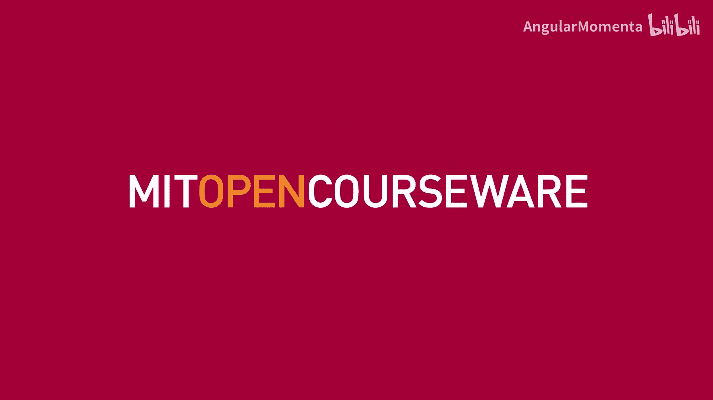
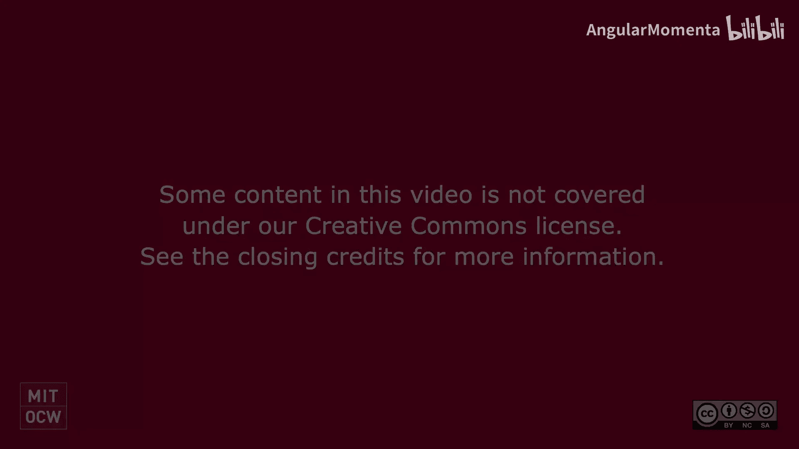
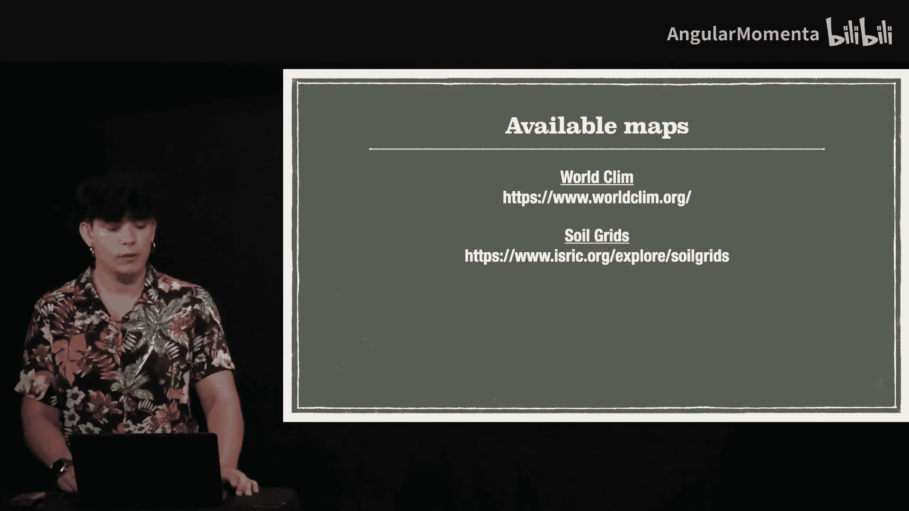
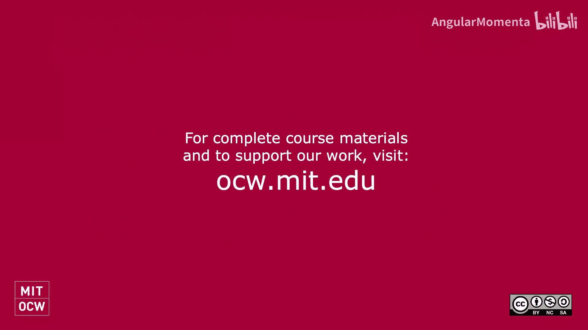

# 【麻省理工】R语言与地理信息系统入门-｜-MIT-RES.1-002-Introduction-to-R-and-GIS,-Fall-2023-p05-05-GIS导论，第一部分：核心概念--BV1QqUoBPEJ2_p5-

In this section of the course， I'm going to go directly jump to GIS so geographic information systems and before going directly to the code I just wanted to make sure that everybody' is in the same page in some key concepts so that's why I'm just going to clarify some of them。

So what you are going to learn in this video is be familiarized with concepts such as what are Victoriaial maps and what are raster maps or what are the differences among them and where should we use one or the other what is the projection so why do we need different projections also what's the concept of resolution and why should we taking into account resolution when working with maps and also different ways to create maps so there are mostly two different approaches to create maps with the first one would be the satellite maps that are created top to bottom and then we have the maps that are upscale that there are the other way around so they are created bottom to top。

So my goal is that then you would be able to apply all these concepts and manage all these concepts in your R code。

Okay， so here we have。The same image represented in the two different maps。

 so the first one is represented using a vectorial map and the second one is represented using braster。

The main differences is that in vectorial maps we can have irregular polygons。

 but in the raster maps we have a grid where all the cells are equally distributed。

 they have the same size and they are in the same disposition so that might affect how the different forms are represented so in case we are interested in the shape of the objects。

 maybe we would go to a vectorial map， but if we are interested in the content of the map we would go to raster representations。

Also， there is the concept of projection， as we all know， the earth is not a flat surface。

 so to overcome this representation in like to convert this round shape into something that's flat。

 we have encountered several problems。 so that's why we have different projections depending on。

Where we want to focus better on。So each representation has its pros and cones。 so for example。

 if we are more interested in。Having cur shapes in the poles， we would use one projection。

 but if we want to see kind of accurately the whole globe， maybe we choose something else。

But that has implications in how the shapes look like， for example， this is the same phase。

 but how this can be transformed or deformed depending on how we are representing it。

 so this is something we have to take into account because if we want to merge to extract information from different maps。

 they may be in different projections and how is this affecting us well。

Here you see South America and how this South America can be represented on how shape can change depending on the projection we are using。

 so before moving on in maps we have to make sure that the projection we are using is accurate to the piece of the earth that we want to represent or that we want to work on。

 what's the scale we are going to work on if we're going to work in a regional part or if we're going to work in a global scale and also make sure that all the maps are in the same projection so we don't have problems as in the image。

Then we have the resolution concept。This is a picture but a picture would be a good proxy of a raster map then end they are built the same so here we have the same image and the main difference is that the square size is completely different so the first one。

 the one is more in the left it doesn't have that much of a detail and the second one is very detailed。

One would think that is always better to go to more detailed resolution， but this has some drawbacks。

 which is that they are way more heavy。 so depending on the capacity your computer has or depending on how good is your internet connection。

 you might go to one or the other just as a。As a reminder that sometimes even if you are increasing the resolution。

 maybe that's not going to help us to have more accurate calculations just because the quality of the map was initially not the purest and was created in a coarser resolution。

 so even if we go to if we can transform a coser resolution to a more fine scale。

 we are not creating new information。So this is the top bottom approach of creating maps。

 we know that we have satellites。Going around above our heads。 So they use as a big camera。

 let's say， So they have different sensors。 They have different lenses。

 So they are taking kind of pictures or representations of the surface of the earth。 So they send。

Differentent wengths and then they get some bounced back and then they read the signal of that and based on those signals。

 they apply some corrections sometimes and that's how they create satellite images。

But then another way to create maps， sometimes when we don't have a signal from a satellite would be the upscaling approach here in the first map we have different dots。

 this is taken from a paper do ital 2020。just an example of an upscale map where they had real data。

 So each point is representing a real point where some。Field data has been taken then。

Based on this real information， a model is created using some environmental drivers， so drivers。

 and a model is created， and with this model then we can empty the spaces that are in between the different points based on an upscaling using that map。

So this is how we can obtain maps from a bottom top approach。

And also here just some resources you can find raster maps。

 the first one is the world glam where you can find environmental variables such as what related to climate。

 precipitation temperature and so forth， and then if you are interested in obtaining information from soils。

 you might go to soil grids where they have a lot of physical and chemical properties of different soils。

