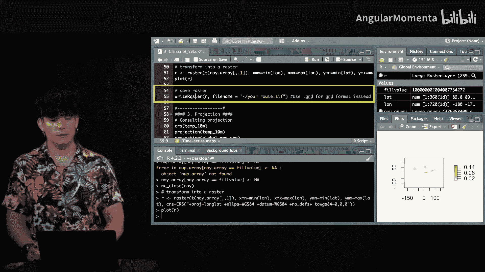
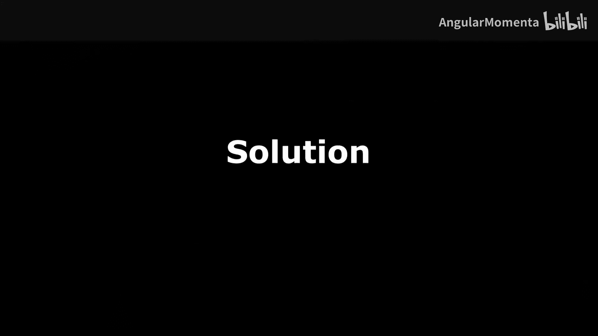
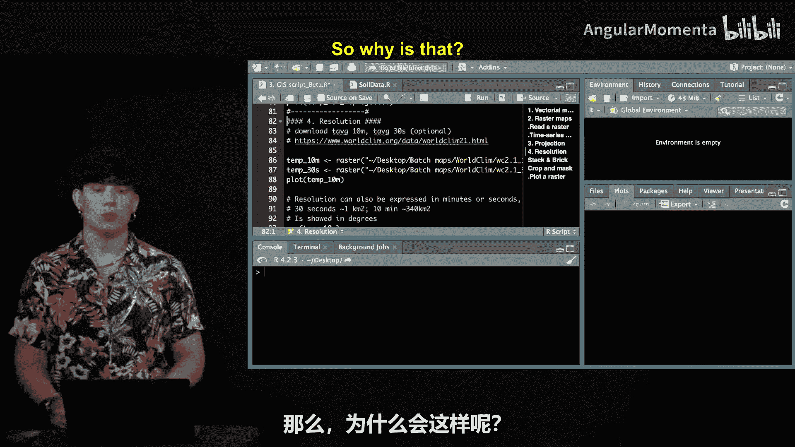
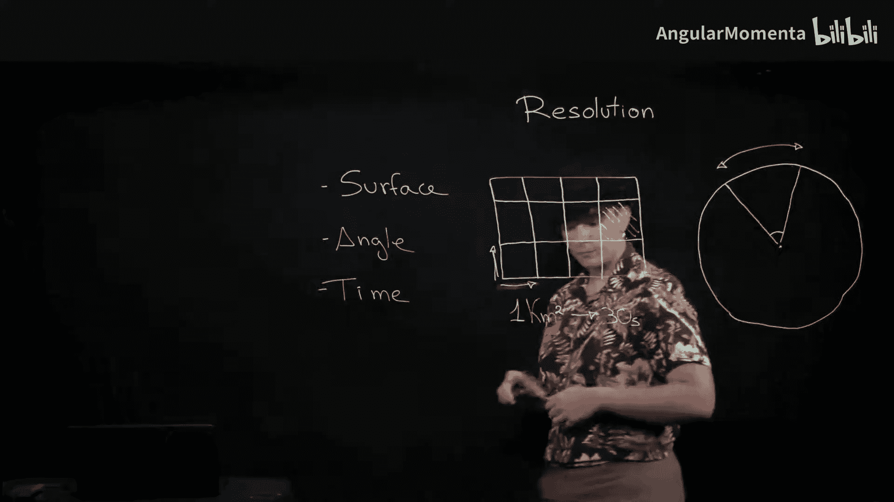
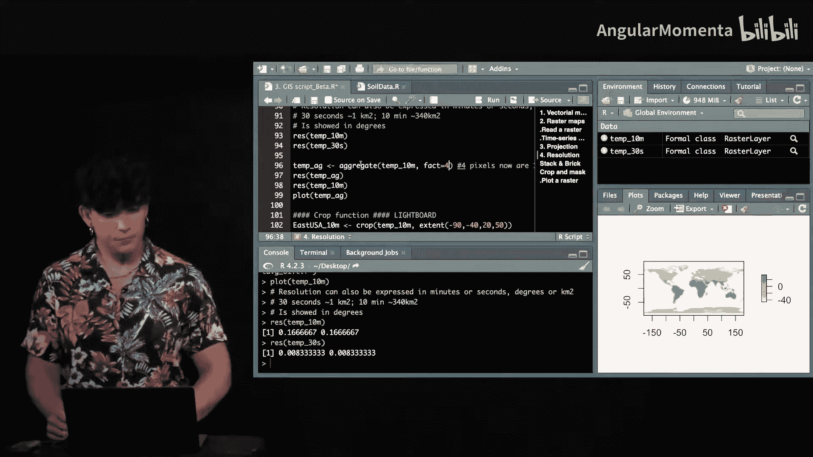

# 【麻省理工】R语言与地理信息系统入门-｜-MIT-RES.1-002-Introduction-to-R-and-GIS,-Fall-2023-p06-06-GIS-导论，第二部分：矢量地图、栅格地图与时间序列--BV1QqUoBPEJ2_p6-

Yeah。Right， so we are back to the code and now we're going to start applying the concepts that we've been talking to on our。

So the first thing is to read Victoriaial maps， how do we read Victoriaial maps well here I included a web page where you can download Victoriaial maps。

 they are basically physical vectors of the global Earth so you can find the coastal barriers。

The packages we're going to use are these three， I have already installed them。

 but feel free to install them and then。Log them into the session。

There are several ways to read Victoria maps， I just include three of them here， there's this one。

 my personal preference is the second one， there's this three third one that I just put them in a common。

So in the first one， we is using this。This function right here。

The projection needs to be specified previously。 so here is what I am doing。

 I'm just saying that I'm using the projection long la， which is longitude latitude。W GS 84。

 so I have to put this between commas and using this particular function here。

 So this is going to be the projection。 and when I'm reading the map。

What I have to do is to specify where this map is located in your computer and then specify what projection do you want it to be。

So。😔，You'll have that map here， it's giving me a warming just information。

 but everything worked fine。And my personal preference is this one where you don't even have to specify the projection。

 so it's going to be read by the packet itself， you only have to specify the route from your computer。

Good use。This it gives you some information。What it has read， what it includes。

And then I'm just going to plot。Just type plot and the map you want to plot。

 then you're going to see how this map looks like。You see， this is the。The boundaries of the ground。

And then we move on to ra maps。 This is pretty simple。 the the king or。The best。Personal preference。

 but the best package to use raers is the package raster so you can use it for like to manage all everything you need from resters。

Just going to load it into the session and its as easy to just to put rather here and the route of your map。

I'm gonna charge a temperature。Map that I've taken from World C。I need 10 minutes resolution。

It's going to see how it looks like。And this is how by default the map is created also if you feel like magnifying your map you can just click on Zoom here and it is going to pop out in an outside window so you will be able to see it bigger。

And then there is a particular way of displaying maps， which is using N format。

 which is when you are working on time series maps just because the maps are pretty heavy。Data。

 this is a particular way to store time series in a pretty efficient way。

But that makes it a little tricky to work with。 So that's I'm just going to show you how to do that。

 I'm going to clean。My environment。To not being distracting。

These are the packages you're going to need to go through this code。It's going to load them all。

And this is a map that I have obtained based on this reference here。 if you click on on that link。

 you would be able to download this information from internet。

 It's a nitrotion deposition map that goes from if I remain correctly from 19。

01 to 2020 or something like that。 So every time to time， there is a map。

 So that's why it's a time series。 So you have to picture。

Let's say a book and each page of the book is a map。

 so you have them all together and they are all the same size， the same resolution。

 but you have a repetition in time of the same map。Okay， first of all is to open the file。

 so A andC open where the map is。Take them up。And if that would be。A raster。

 you would be able to apply it right away。 So that's what it right here。

 No worries is's not going to work， but it's just to show you that it' a different way of organizing maps。

 So how do we do it to extract it and to convert it into a map we can see We can visualize。

 we can understand。The first thing we need to do is to see what are the names of the dimension of the map。

Just click names。The map at dimensions and this is going to return the three dimensions that we need to know which is the longitude latitude and the time but sometimes the authors name these variables differently so here is long la but it could be longitude latitude or time could be years or things like that so that's why we need to make sure how this is named。

So we're going to extract the longitude。Here is where we get the map structure。

 have longitude where variable get。😊，The longitude， okay， and we store it。In a vector。

Here we want to extract the latitude， we repeat the same， but with latitude instead。

And here we are extracting the information related to the time。

And what now we see that the latitude so is cut in 360。Different columns。

A rose in the longitude likewise， but 720。And。Then we want to get the actual information。

 So what's the content of the cells。 So we do this。Like that。So here is the content。

Something else we need to take into account is the NA values。

 so when creating a map there is a value that you use to name your NAs。

 sometimes is NA right away but some of the people use numbers like 9999 or just a big number and here what we are doing is to explore how the authors have named these NA value。

So。This is one I want to see。I'm curious， but this is the big number they named as missing value。

So to avoid this number to mess with our results I recommend you to change it to NA。

 so that's what I'm doing here， I'm replacing every number that looks like this to an NA。

 don't worry that you are not going to knock out important data it is mostly going to be Ns。

So we renders this chunk of code。Oh yeah， sorry about that。Now it should go。

It'sTing a while because there's a lot of data。And well， oh yeah， here we have it。

So now all the NAs would be replaced into NA value and now we no longer need to have opened the map so we can close it and it doesn't occupy space in our recession just close it because we already have the information we need。

And。How are we are going to transform this information we have in different chunks into an organized map that we can actually visualize and work with？

First of all， here I'm going to run an example， I'm just going to use the packet raster right here。😊。

嗯嗯。I need to include this the here which means transpose because otherwise if I don't put transpose。

 the image would look flipped， then this is the object， these are the different dimensions。

 longitude latitude and this number one is going to be the first timeframe so I'm going to just get the first map that we have。

Then it asks us for the minimum of the X axis， I'm going to put the minimum of the longitude。

 the maximum of the longitude and just by basically setting up the form of like the format of this raster map。

You have to specify as well。The projection。So this is going to be the projection that it's the same that we've used before in other maps。

And we just run this chunk of code。And we can plot our results。This is how the map looks like。

 this is the nitrogen deposition in I believe in 1901 and it includes also the sea。

 so that's why it looks like it doesn't look like the earth that we are used to。

And then how can we store this information in our computer， how can we write this wster？

So its just as easy as Wright Wright Raster。

Put the name of the file we want store。File name and your route as follows。

Yeah。Now we are moving to the resolution and if you might have pay attention when downloading the data from the worldCam that it allows you to download the maps in different resolutions。

 but in order to name the different resolutions worldC it uses time so why is that well actually you could face three different ways to approach resolution the first of all is the surface using the surface square one example would be this one kilometer square that refers to the map when we have it in a representation in a grid representation we would have each side of the grid。

Calculated by the surface that's occupying so。Take this。 That's 1 km， and that's 1 km。

 The problem of this approach is that it's not always accurate， because the。

The the part of the grid that's closer to the equator。

 it's smaller than the one that it goes to the pole。 So it's kind it kind of。

Sres when it goes to the edges and so that makes that this 1 kilom is not consistent throughout the whole map and to kind of overcome this problem。

 it came with the angle or the time approach which treats the earth as a round surface。

 This is not perfect because the the round is not。10% perfect。

 but it's better than using the surface， so what they do is to consider on one time。

 on one side the angle。That this opening is， so just let's take this square right here and let's just plot it on top of this。

So， the angle。That covers this part of the surface。

That would be displayed in the angle or also the time that the earth needs to rotate and cover this amount of surface。

 so for you to have a reference， for example，1 kilometer square resolution would be the same as 30 seconds in time。

So going back to the code here I downloaded two different resolutions for the temperature maps on WorldG。

 one is 10 minutes and the other one is the 30 seconds。

 the 10 minutes is okay to download the 30 seconds it might take a while。

If your internet connection is low。You can just believe what I'm saying。

 but if you want to try it out， obviously feel free。嗯。

Just to remind you how the map looks like it's going to look like this。

Let just check the resolution here on both maps here， we have this number here。

 but what does it mean here we have this other number here。

 so when we consult the resolution in our maps it's going to be showed in degrees so using the angle approach that I previously mentioned。

So how can we change resolution in a map， we can use the factor aggregate。

So if we have a number that's bigger than one， we are going to combine cells。

 so if we have in this case I'm combining in a factor of four， meaning that four cells。

 horizontal and four cells vertical are going to be combined in one。

There are different ways to calculate the resultant cell。

 so it could be using the mode or it could be using the min depending on what kind of data you have in your map。

But you could also increase your increase your resolution by using a number that's lower than one。

 So let's if you put a， let's say，0。5， you are going to divide a cell in。

Four because we are looking in like we're working in two dimensions。嗯。I mean。

 this is technically correct but conceptually done really makes a lot of sense because you are creating fake data。

 it's not that you are actually including the resolution of how good you are approaching reality。

 you are just creating more data for no more accuracy。

So in this case， I'm going to aggregate the map that we have in a factor of four。And I'm just gonna。

 consult。How the resolution has changed， so initially。I aggregated this one。

 this was the initial resolution and once the resolution was changed。

Let see the degrees has gone bigger because the surface is bigger。

 so the time or the degree to cover that surface is bigger。So if you plot that。

You may be able to see that。The quality of the image is a little worse。

