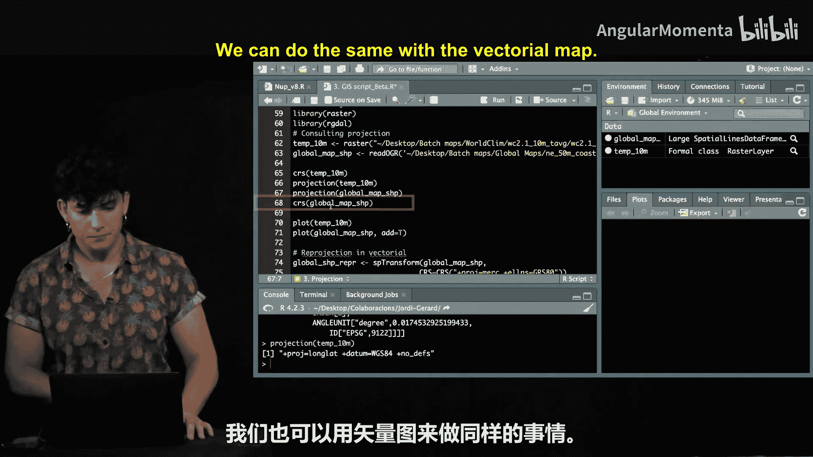

# 【麻省理工】R语言与地理信息系统入门-｜-MIT-RES.1-002-Introduction-to-R-and-GIS,-Fall-2023-p07-07-GIS-导论，第三部分：投影--BV1QqUoBPEJ2_p7-

All right， so as I mentioned in other videos in order to work with maps。

 we need to make sure that they are both in the same projection to avoid mismatches of the data and to do so I'm going to。

Teach you how to check on the projection， how can we extract information about them so I'm going to upload a raster map and a Victoriaial map。

 the first one is January temperature based on world clean maps and the second one is going to be this Victoriaial map that we already used also that is the shape of the surface of the earth。

One way to check information about projection is to use this CRIS。Clicking on here。

We see displayed a lot of information related to this map， but sometimes we only need this。

Chang here。This is related to that piece of code that R needs to understand what's the projection we are working on。

So if we want to go directly on checking these， we can just type projection and the map that we want to know about。

And here we have only the chunk of code related to that， we can do the same with the Victoriaial map。

And we see that in this case， the two maps are in the same projection so we can work with them with no problem。

Also as an extra layer ofs just a double check they match。

 I'm going to plot them one on top of the other to see that there's actually that they actually fit。

I'm just going to plot the map right here and to add the bacterialial map on top of it。

 I just need to add this part in the code so it means that it's going to add on top of the preview。

And here we have that the two maps they match so we can work with them with absolutely no problem。

 but in case they wouldn't be in the same projection and we would need to change one to the other。

 there's this。This function right here that it's included in the。And in the。

Packages that we've been using， that it transforms the projection of Victoriaial maps。

So if I'm going to change from the resolution we the projection we were using into the Merrcur projection。

 and if I plot this right now，You're going to see that the shape of the map is totally different。

And if we want to change the projection in a raster we would have to use another function because this one is not going to be useful for raster mats now I'm uploading information about soils that I took from soil grids。

 soil grid data it comes in a different projection than worldclaim data so I would need to transform one to the other in order to work with them at the same time。

So just to show you how this data looks like。In this case it's a carryonic exchange capacity of soils。

 so you see the shape is slightly different than the other map and just to double check that it's a different projection。

We just check on the information of the map。We have here on the CIS。

 we see that the projection is different。So I am going to reproject the temperature map into the soil data extension。

 and to do that I'll use this project Raster function。

This might take a little while because when we work with Raster maps， we have a lot of information。

 so it's a very dense grid that makes the times of processing these maps to be a little higher than possibly a Victoria map。

And several minutes later， the process hopefully。😔，Worked out。 I'm just going to plot。

To see what we have。 And here is the result where we have the temperature map transformed into the soil projection。

 just to double check， we can always。Xihou。It went。From the all one to this projection。

