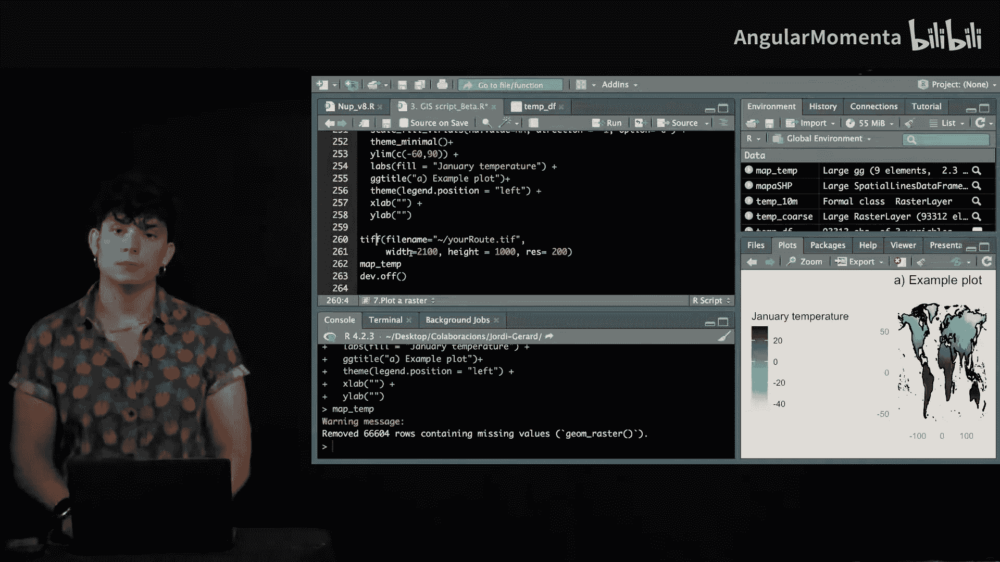

# 【麻省理工】R语言与地理信息系统入门-｜-MIT-RES.1-002-Introduction-to-R-and-GIS,-Fall-2023-p10-10-GIS-导论，第六部分：使用-ggplot2-绘制地图--BV1QqUoBPEJ2_p10-

During this course when we had the need to plot a map we use the code that is provided by default by R。

 but there are other ways to plot maps and make them easy to be tune according on our taste so now I'm going to show you how to display nice maps that are easy to tune using Ggipl。

And to do that， I'm going to charge the map that we've been using our friend， this temperature map。😊。

Also to make the process easier faster for R I'm going to aggregate this map so make it coarser in this case I'm going to use a factor of five so it means that from each five pixels I'm just creating one。

That's going to affect the result in this case it's going to make the image to be less defined。

But this is just because we aggregated the data。And we also need to transform this map into a data frame。

 this is a requirement to be able to plot it with Ggiplot。

So that's what I'm doing here as data frame by default， this command is not included。

 so this means that when transforming the map into a data frame。

 we are maintaining latitude and longitude as a variable by default this is false so it wouldn't be well I'm just going to show you how it is by default。

See， we only have one variable， but in this case if we would give this to Gpl。

 that wouldn't be able to provide us a map because x and y would be lacking。

 so we need to include this chunk of code here。That's going to give us。The latitudeal longitude。

 so now we have three variables instead of one， and then if we click on here， we have the x， the Y。

That's the name of the map that we've used just because it's very long and not easy to work with。

 I decided to change that name。Into temp of temperature。 so that's what I'm doing here。

And I'm going to charge the packages we're going to need to do this process。

 which is the map tools that is related to working with maps， then we have the Ggipl2 which。

Hes the main。Package we're going to be using here and then we have this Bs that is about the color palette we're going to use to create them up。

And I'm going to also charge this map that we've been using， which is the one that separates。

The water bodies， so it's the shape of the ground。And。This would be the most simple。

Code that would give us a map using Ggipl， so this part here would not be necessary。

 we could erase it， but in this case I am storing this code into this object。

So I am saying r to r that I'm going to be using Dpl in our base， its going to be this data frame。

I'm gonna add a plus。 I'm gonna say to G G plot， what do I want me。

So why do I want D plot to provide in this case， I want to have a。Gome Raster。

 So I want Dpl to give me a raster based on。These as an x， these is a white。So， we could。They could。

typepe it here and it would work equal， just if x or y would have different names。

 we would have to specify these names right here and then in fill I want G plot to fill this x and y with the temperature which is the third column that we have in that data frame。

So let's just run this piece of code。And see how it looks like。Okay。

 this is clearly not the most beautiful plot you could have ever seen。

So but this is just the basic and we're going to keep improving this map line by line so you can see how each piece of code changes the result of the map we're going to have。

First of all， what I want to include here is the shape of the earth。

 so I want to include that map that we just uploaded on top of this one to make a good differentiation between what's the sea and what's not。

So that's why I included this piece of。Goode here。I'm going to erase this plus to make the code stop right here。

😔，And see how that looks like。Okay？Now we have this nice black line around。

But now it turns out that I don't want。This black shape here， and I want to change the color palette。

 so to do that I'm going to include this piece of code as well。

Right here and I'm saying that the NA values are going to be N。

 so I'm asking this code not to show me the Ns， so that's going to erase this gray area here。Also。

 I'm going to change the direction of the color palette， meaning that now the black。

The black color is related to lower temperatures and I want it the other way around and also I am changing the color palette to have this shapes if we go to the he。

With FN and。F1。Here we see that。😔，This is the beginning。Of the help section， if we scroll down。

We get to the different options we have for color palette， these are the different options we have。

 so if instead of this letter here I put an A B or C。

 we would have different color palettes as an outcome。I chose。These ones just because。

This is our map。Has changed。I have to run it first， of course。

And I have to put a class because otherwise it wouldn't read this。😔，New line that I added。Okay。

I have changed the direction of the color palette。 As you can see， now， this gray area around。

Has disappeared？And the color palette also has changed。

I still want to keep improving this map because I don't like this background here。

 that's something called a theme of the map。You can change the theme and in this case I want the theme minimal。

And I also don't like this chunk to be displayed。 so I decided to。Reduce the y limits of the y axis。

 and instead of being there total extent， I'm just going to cut it at minus60。

 so it's going to be cut somewhere like here。To do so。It's going to include them plus。Is out。

Make it nicer and close。Just run it and see how will these affect our map。Okay， now we changed。

That great area we had in the background as well， and we are no longer displaying the southern latitudes。

U。Now， I want this。Do you have。A title and I wanted to have also like not display these or that。

And I want to change the legend position instead of being on the right， I want it to be on the left。

So all these changes are the ones that are implemented here。This is not displaying X and Y。Laps here。

This is going to be to change the position of the legend。This is the title。

 and this is going to change。This here， instead of temp， I wanted to。

Explain that it's the January temperature。So I'm going to include them all together。

And this is an example of how we can。Create and tune outcomes in a nice way so we can use this outcome as a。

A graphic representation in our scientific projects。Okay， this looks kind of nice and tidy here。

 but what if we want to extract this image and store it in our computer。

 a nice way to do it is using TIF extension。What I have to do is just to write TIF。

 write the file name where I want to。Create or generate this outcome。How big I want this image to be。

 the resolution by default is 100， I just put 200 here to make everything appear bigger。

And then you have to include here， what's the object you want to store in that object you just created。

And then， click on。This part， which is。givingiving the order to Art to close that file and give it as an outcome so you can consult in your computer and use it at your convenience。

