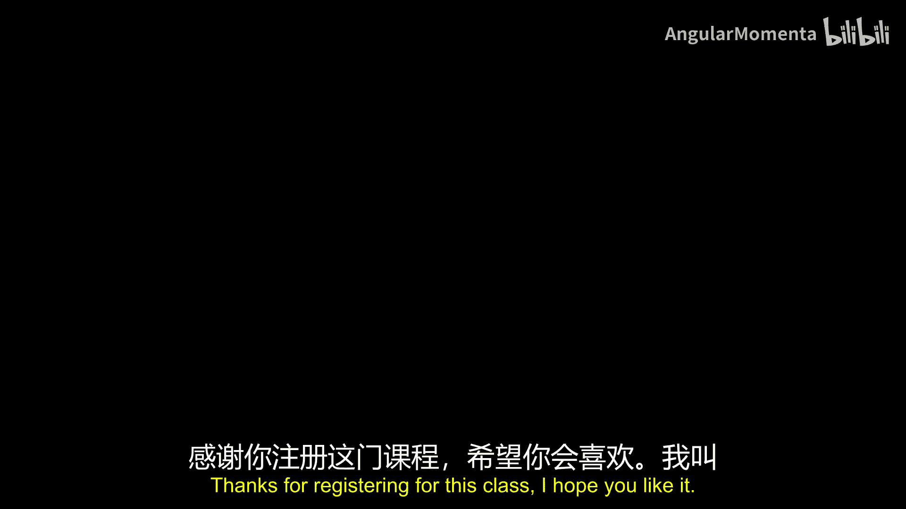
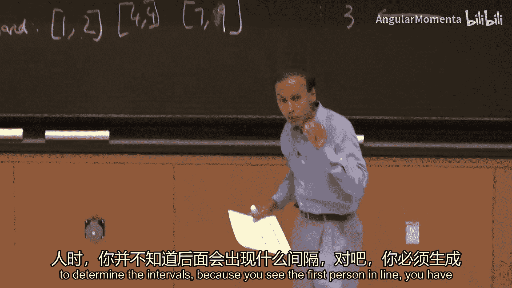
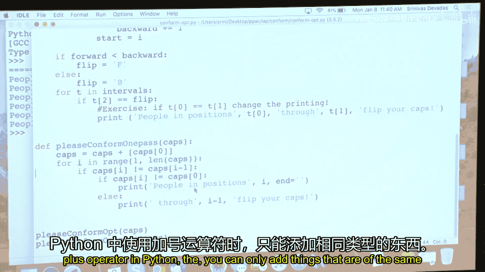
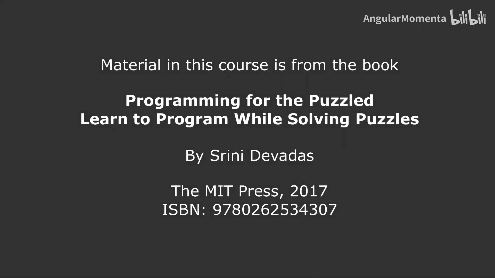

# 【麻省理工】为困惑的人编程-｜-MIT-6.S095-Programming-for-the-Puzzled,-IAP-2018-p01-谜题1-你们都会服从--BV1qp7LzeESm_p1-

Yeah。Good， everyone。Welcome to 6 S O 9，5。 thanks for registering for this class。 I hope you like it。

 My name is Trini Davidas。 I'm a professor of computer science at MI T obviously。

 and I've been teaching at MI T for for 30 years。 I've been at it for a while the reason I'm teaching this I class is because I want to try out this。

 this way of teaching programming that starts with the recreational world of mathematical puzzles algorithmic puzzles。

 And I want to connect it up to to writing programs。

 And I I have thought this material before in 6 double09 that I think some of you are registered for。

 but but I wanted to teach it in in a more interactive informal setting。

 And I should mention that I I wrote a book on this， which is a book that's。😊。

Recommended though' not required for 609。 And so you might see this in the MIT press bookstore and other places。

 and most of the material I'm going to cover here is is from the book。

 but I don't want you to read the book because I want you to listen to my explanations for the puzzles and try and think up of the solutions yourself and and then obviously do some coding not during lecture。

 but offline， and I'll show you some solutions to the puzzles and there'll be some exercises。

 So I don't want to spend a whole lot of time on logistics。 this is and an IAP class， as I mentioned。

 I'd like this to be informal and relaxed。 So we meet every day for two weeks。

 we have the holiday coming up on Monday。 So we'll have nine total lectures。

Roughly for an hour might spill over， but hopefully you'll。

 you'll be okay with it because you don't have， you know， another class to go to at noon。

 And if you do， let me know。 and I， I'll give you that five minutes of overflow personally at at some at a time of your choosing。

 but hopefully I'll keep keep on time。So， and in terms of work， I mean， this is a pass fail。

's it's a for credit class。 I know some of you maybe be listeners。

 but some of you are registered for it， So I'll have to assign you a grade。

 So they will be some exercises。 and I'm gonna make it very simple。

'll be exercises up on the website。 they'll be you know， two days from when I put them up。

 and you'll have options in terms of whether to do a really simple exercise that's know。

 probably gonna take about five minutes or do something harder。 And for each of the puzzles。

 There's two or three exercises， and you get to do all of them if you want。

 you can choose to do one or the other。 Allright， I'm gonna have office hours every day。

 from one to two。 I don't plan on putting solutions up to the exercises。

 the solutions to the to the puzzles themselves。 they be shown mostly in lecture and and put up on the shallow website but the solutions to the exercises。

I， I'm not gonna put up， but if you ever get stuck。 Well， that's what office hours are for。

 And if you can' solve the exercises， I'll help you solve them。 Alright， so that without further ado。

 let's， let's dive in and talk about talk about puzzles and solving puzzles using algorithms and then。

 and then programs。 Id really like this to be interactive。 So please ask questions。

 and I suggest solutions that I haven't thought of。 You know， that'd be great。 in my second edition。

 you know， whenever that is， you'll get credit for that。 Alright， so the first puzzle。😊。

I tried to have。I don't know。 Funny。Titles for all of these puzzles。Intriguing。

 And so the first puzzle is called you will all conform。 this is really a warm up puzzle。

 as you'll see， I mean， this is true for any class。

 things are going get more complicated as we go along。

 So we'll probably do 10 or 12 puzzles in the next two weeks。 And by the end。

 you're going to see things like memorization and dynamic programming and and things like that but towards the end of next week。

 And if you don't know what those mean， Well， that's great， because hopefully you know。

 you will know by the by the end of the two weeks。 And a lot of these things are algorithmic insights are are insights that will help you in course 6 classes for sure。

 And you know， perhaps even if you follow。😊，A career outside of outside of course sex。 Alright。

 so this particular puzzle is as I said， a fairly simple puzzle， at least to describe。

 And the setting is as follows。 So you're a gatekeeper。 at a baseball game。

 which is called a baseball game because baseball players wear caps。 And， you know。

 that's most people are watching games with with caps on。 And so you're a gatekeeper。

 And there's a bunch of people shining in line。😊，Let's just say each of them knows their number。

 and this is Python。 So the number starts at 0。 Okay， as opposed to one。 And theres。

 there's a whole bunch of people standing in line waiting to get in。 And they， they。

 they all have caps。 And some of them， you know， are writing their caps forwards。 So with the。

 with the I guess what do you call it。 What's the front of the cap call。The shade， the。

 the thing that gives you shade。 you know， up front。 And so we just， we just say。

 let me try and draw this out。 So， so this person is is wearing his cap like that。 And。

 and this lady here is， is wearing her cap like this。 Alright。

 So that's forwards and that's backwards， okay。So your your job here is。Straightfor。

 you can only let all of these people into line sorry， into the stadium that were in line。

If they all conform。Okay， so， so they all have to wear their caps in a particular orientation。

 And you don't particularly care which one。 Alright， And so they all have to be forwards。 You know。

 all， let's say， you know，13 of them。Or they all have to be backwards， right， now。

 all of them know their position on the line。 Alright， so this person knows that his position is 0。

 This lady here knows that her position is one， etc cetera， etc ceter， right， And so， so obviously。

You'd like to minimize the amount of work that you do。 and you could certainly choose。

 let's say you want everyone to be forwards。 You could say， hey， lady in position one， flip your cap。

 right， Oh， I should mention something that is important。

 So people have a different definition of forwards and backwards。 You know。

 it it's sort of what's natural and what's unnatural to them。

 So So it's we think that this person has his cap on forwards。 you know， for all， you know。

 he thinks he's got his cap on backwards or vice versa。 right。

 So you can assume that the definition of forwards and backwards is identical for all of the people in line and and and and really the same as your definition。

I mean， if it seems kind of unreasonable， Hey， I mean， this is a puzzle。 Okay， so， so， so let's。

 let's let's not argue about that。 we can argue about other things。

 like how to write Python programs probably。 So， so what you have to do now is you have to call out commands that that correspond to saying person in position 0。

 flip your cap。 right， That's all you can say you can just say， flip your cap right。

 you can obviously see how these caps are oriented。

 And you can ask let's say that you had something like that。

 I'm just making this up as they go along in terms of I'm not gonna draw all the caps here。But。

This is what looks like。 And so you see according to you， you know。

 youll see FB B in terms of forwards and backwards。

 And let's say you decide that you want everyone to have their their cap on forwards。

 Then you would you could say person position  one， flip your cap in position 2。

 flip your cap and then person position 4，7， etc ceter。

 right And you want to make it easier on yourself because people do know their indices。

 their positions in line And so you can say to save yourself some trouble。

 you could say people in positions  one through 2， and the implication is that it's inclusive flip your caps。

 right And so that takes care of these two。And perhaps， you know，8 here。And9。You know。

 had their caps on。啊。Backwards， and you could say people in position 7 through 9 flip your caps。

 right， So in this particular example， assuming that。Ths ended with 10 people in line 0 through 9。

 You could get away with three commands。 You could say one through 2。And the implication， as I said。

 is， this is inclusive。Fpped。And then you could say of 4。Flip。And then you could say， 7。Through 9。

Flip， okay。And if you did it the other way， you could also say person at zero flip and so this would go backwards。

 person at three flip。 obviously， you can't say0 through three because that would be wrong。

 and then you could you could say five through5 through six here。

 So you you would get three three commands in that case as well。 but if， in fact。

 for arguments sake let's just say that。I'm going to just turn this into。10 and put it。

 put an F down here。Then these three commands would still work if you wanted to focus on the。

 on the bees， on the backwards people and make， make them go forwards。

 But if you wanted to make all of the forward people go backwards， you would need one，23，4。

4 commands。 Alright， so， so in this particular case。

 you're better off doing that as opposed to doing four commands， alright。

So first straightforward question is， and I'm not talking about code yet。 algorithmically， you know。

 just in terms of pseudocode， and I'm happy with English。

How would you determine the minimum set of commands given a particular set of people。

 there's an arbitrary set of people， you want to make sure that you have the absolute minimum set of commands and you're going to have to use these intervals。

 So you definitely want to look for all the contiguous intervals， because obviously。

 if you say one followed and， and， and then that's a separate command。 and you say two， and。

 and that's a separate command， you end up having more commands than necessary， right， So。

 so anyone want to tell me， I guess roughly in， in， in terms of pseudocode how this would work。Yeah。

 go ahead。我意で。间嘅玩嘅。G them， and then whatever。The second one is so。

If you have whatever the second group is。If it's F B， those are the ones that each we with。I to beた。

And so。From what。You pass the route。我这边。系 이게最咗。Sounds good。 Do you have anything to add to that。せだ。

Back word。Right。S。Ler lower， that's good， good， excellent。 And so both of you had it right。

 So let me ex explain what these two gentlemen， what was your name， Gatra， what yours。F庭。

So Guatra and Fati said so basically this is， as I said， the natural algorithm that you would use。

 the natural algorithm would be that you walk through this list and you start computing what I would call you call it groups Guatra。

 but I'd call them intervals and interval is is something that is unbroken。 it's a contiguous。

 it's a contiguous set of people who all have their caps in the same orientation know be it forward or backwards and what you would do in this case is you would compute youd say I want to look at the forward intervals and the forward intervals would be00 because that would essentially what you have in here and going through that list you would get you would also say I'm gonna to be computing the backward intervals and in this case youd discover one2 as the backward backwards interval So I'm going to write them。

Not like that。 And in general， in the mathematical notation， when you put square brackets。

 these are closed intervals， right， So so 0 is included。

 And we're going to see a puzzle where you might see something a little bit different。

 So I wanted to point that out。 So 1，2 are both inside this interval。😊，And these two。

 you would generate， as you would， you would go through the list， and then you would generate 3，3。

Over here。 And then you would generate 4。 yeah， that's right。 Just for I'm sorry，4，4 over here。

 If you want to call it an interval， you could represent this differently。

 And there's nothing that's stopping you in Python to have these it slightly more complicated representation where you just have0 here as a number And if it's just a number。

 then it represents an interval of length 1， but let's just be uniform above this。

 usually when you have special cases。 and if you do things heterogeneously。

 then you have more code to write， it might get more efficient。

 but there's usually more code to write。 So you do 4，4 here。 and then you'd go up。

 and then youd have5 comma 6 And then you would do 7 comma I'm sorry，7 comma 9。

 So this is the first time you actually have something interesting in the sense that the interval has at representation that only has two numbers。

Where you actually have three people in that interval， right， And obviously。

 this could be arbitrarily large in in the context of people getting into a baseball game。

 And so 7 through 9。 And then finally here 10 through 10。Right。

 and so now you go ahead and you count and you realize that there's four intervals here and three intervals here。

 And then you say， I'm gonna go ahead and go with the with the backwards and asking the。

 the people who are。 well， according to you， backwards to flip their caps。 So we're all good。

 alright。So， so I'm going to show you code that that implements exactly this algorithm。

And while you see the code， I want you to think about this hot question。

This code is going to do exactly what we described。 It's going to go compute。All of these things。

And it is going to make a pass through the entire， as you can imagine。

 it's gonna make a pass through this entire python list this set this group of people。

 this queue of people and it's going to do this computation。

 And it's going to say4 is greater than3 And and then it's going to go through。

 And start calling out commands for each of the backward intervals。 So in some sense。

 it's going to make two passes over the the list。 Alright。

 so the first passes is to get all of the intervals together。 Then there's a check。

 And then the second passes is to take those， those backward intervals in this case and call out those commands。

 Allright， so that's what I mean by two passes。 Yeah，The boring。Isn't it what Because whichever。

Like orientation interval comes second is always brilliant， brilliant okay。

So I was going to say if you didn't understand what Gattra said wonderful。

 because then you can you can you can think about the question I'm gonna ask and ignore what he said。

 and and then we' we'll get to the I guess the more efficient code。

 But what I was going ask was is there a way that I'm looking at this and I'm just going and I'm going just start calling out by the moment I see that there's an interval。

 Okay， the moment I see like this is an interval。 and。

 and I'm going make a call with respect to whether I'm going to call out a command or not。 Alright。

 and I'm going to do this in one pass through this through this array。 Okay。

 I want to do this in one pass through the array。 I want to look at this and I say I see the interval0。

0。 Allright， is， is that going to be。😊，Something that I need to worry about in terms of that person having to flip his cap。

And then I see BB。 and I say， oh， the interval is one comma 2。

 is that is that something I'm gonna have to deal with in terms of a command， right？

 And so someone else， other than Gnara， I tell me if there's there's a one pass algorithm and explain to me why you can do this in one pass through their way。

 And just in terms of code， I'll preview this， the first algorithm needs according to my coding。

 which isn't great。26 lines of code。 the second one needs eight lines of code。 Alright， So yeah。

 go ahead。 But。😊，Iterated through the list seeing like and once you identify the first and second interval。

 you iterate through every type of the second interval and do a command for that for that That's absolutely right。

 what is your name？Kevin， so， so you had it right and， and Kevin has it right as well。

 So the observation here is actually if， if I it was said a little bit differently by Kevin。

 But I'm going to say it a little bit differently。 the observation is simply that that if you look at the very first orientation。

 right， the， the， the very first orientation is something which at best。😊。

Is is going to is going to be a tie right？ So if you if you had it ending at with 10 people 0 through 9 right。

 then the number of forward intervals is the same as the number of backwards intervals okay And if you went here obviously the number of forward intervals is greater than the number of backwards intervals。

 So you really only have to look at the first person in line to determine not to determine the intervals because you see the first person in line。

 you have no idea what the intervals are that are coming after right I mean。

 you can you have to generate those intervals。 So you have to make your pass through their array。

 But the first person in line gives it away in terms of what the final result is going to be with respect to your decision as to what set of commands what set of commands you're going to call up right And so because this is an F you basically say I'm going to go and I'm going。

To make the people with the with the bees flip their， flip their caps。 All right。

 And that's that's a small observation in terms of。it's insight， but obviously。

 it's potent in the sense that it's going to give you a onepa algorithm versus a twopa algorithm。

 And as I mentioned， it's going to give you a substantial reduction in amount amount of code that you write。

 Allright， So I'm gonna show you a bunch of code now， right， So this is usually how this is going go。

 by the way。 this， this entire class。 And this is kind of my way of teaching。

 at least this type of material that's algorithmic and has data structures and so on and。

 I like explaining to people what they're going to see in the code without having to deal with Python syntax and you。

 worrying about whether it's while loops or four loops and things like that。

 and tus or arrays and things like that。 right So's let's get into that。😊，啊。All right。

 I don't need this。啊， good。Allright。 So the naive algorithm first， okay。So what you see here。

Is an input。 So caps is is simply an input Python list that has， as you can see from our examples。

 the F's and the Bs right， And so F is forwards and B is backwards。

 and there's a couple of different Python list。 So you can run them with different things。

 And you know， all of this hopefully is not at all surprising to you because we went through all of this in terms of the pseudocode So the first initialization I can just highlight that to make it easy。

 So that's initialization And this part here， the comment sort of gives it away is you're making a pass through the array computing the computing the intervals right And so so how do you actually get the intervals。

 And there's one line of code that that does that And by the way。

 there's any questions about Python syntax。 just don't feel shy just tell me ask me a question。

 And I'm happy to explain it。😊，I mean， if I'm I don't want to explain things that you all know。

 obviously， but if any one of you doesn't know any particular thing， please don't feel shy。

Syntax is something that。Sometimes you even forget。 I mean I tend to forget things。

 So this thing here is， is essentially something that that decides on when what the intervals are。

 And and the insight here is simple。 You know that this interval ended when you see something here that is different from what the previous one is。

 right， So that's when you know， So you generate the interval right。

 you generate the interval when you， you go and find something that is different from the current location that you're pointing to right。

 So that's really what's going on out here。 in， in this line， you say setting。Start here。

 Start is your counter。 And remember， start is getting set again here。 initially， it was set to0。

 And if you ever get to the point where you're looking at I， it's the next thing you're looking at。

 And if cap start， which is the start of the interval is different from I。

 it meant that the interval that began with start ended And so you essentially say， well。

 that that needs to end at I -1 because obviously cap start is different from capsi。

 So this is the end of the interval right here。 Allright And this particular thing is our interval is is is something that includes both these two numbers。

 So it's not exactly that。 but it also includes。Where did my all go。It。

 it also includes whether this is an F or not。 So each of these things has。

I'm not gonna write it out for all of those things， but I has the， the orientation inside of it。

 So that's what you have out here。 that's why we have three of these in this tu。 right。

 This is a tuple because it's got round brackets around it。 I could have made it I。

 I could have made it a list if I wanted。And so that's essentially what we have here。

 And now here's what happens in this particular piece of code。

 when you get to the end and you fall off the end。So if you， if you just end。

 then this code essentially skips over and doesn't doesn't actually put in the last interval， right。

 because you don't see something when you come up here and you're， you're off the end of the array。

 you fall off the edge of the array， you don't see a B that is different from F， right？ So， so this。

 if you just wrote that code。 So it's something that I'd say。Many people could could， would have a。

 would have a quote bug where they won't add this part of the code here because they didn't realize this particular point that I made which。

 And so that last interval doesn't get added in， right？

 And so you have a bit more code here that decides on the last interval。And。And then you count。

 and then you go ahead and call the commands， alright。So， salt looks good。Yeah。

 very are good with this。 Is there a way that I could somehow。Euminate these four lines of code。

 which are a little bit annoying and， and just do things。In their way。How。

 how could I with a little trick， I could eliminate those four lines of code。 I mean， I might， I。

 I might need a little bit more， you know， quote prepro。 but how do I eliminate that。Someone else。

 I'll get you。 yep， go ahead。One way you can check。the end of。你方系自标一个。You could have an extra check。

 wasn't it？Kishka， so Kneka says that before you reach the end of the array。

 you or when you reach the end of the array， you go ahead and and and do a check that you've reached the end and generate the interval inside of it。

 It just kind of like moving this code inside of it。 right， So that's， that's reasonable。

 I'm not sure that's going to be as good as the way I'm that I want and which I which which I coded。

 Think about preprocessing。 Think about taking the array。 Yeah。In doing that on the wrong。

You could add what was your name。Kvin 2， Okay， alright， this， how many caves do we have here。 Okay。

 so， so， so you could， you could do this， right， So let me。

 let me show you something that's a little bit more。 So So that was 26 lines of code。

And so this says this is the line that's interesting。 So I had F and B， right？

 And so I don't want to add F or B there。 but what is what is convenient to do as it turns out。

 is to just have something that I essentially says there's an ending point。

 So you have an explicit end to their rate that is actually not something that would crash if you tried to access it you've added you had n people in line and now you have effectively n plus one people in line。

 but that n plus one person is a dummy or you can call them end And and then if you do that。

 then that's it。 the previous code works。 you can just remove those four lines and it'll all just work because your F or your B is not equal to end So whatever you had at the end。

 I'm sorrym overloading terms whatever you had at at the last element whether it was it was a B。

Its because it's ended here or F。 when you equate that to E And D， you're going to get an inequality。

 And so that last interval gets generated。 Okay， so so small optimization。

 Tony Hor was a very famous computer scientist said that inside every program。

 there's a smaller program waiting to get out。 Okay， so。

 so this is kind of one of the themes that I'd like to to harp on in this class。

 which is it's nice to write compact code， usually if you can write compact code， there's fewer。

 fewer bugs in it。 and you don't want to go overboat。 You don't want too many subtleties。 but it's。

 it's nice to write compact code。 And so this is a little bit more compact。 And and then finally。

 here's。😊，The， the one pass algorithm。Right， so the whole thing。

 so the please conform one pass is the is is the the smarter algorithm that essentially says， I look。

 if I just look at the very first thing。 I'm going to I'm going to be able to skip that and then move on。

 right， So this is fairly complicated。 I mean， it's it do， you know， the algorithm。

 trying to map that to this code is nontrivial。 So we'll spend a minute or two on it， right。

 But here's。😊，Here's how this works。 right， And by the way， just to make sure。呃。

So I've repeated things here。 So the first， the optimized algorithm for that particular example produced these first three commands。

 and then the the onepa algorithm produce exactly the same commands。 right。

 So this is good to do it's always nice to have a couple of different ways of solving a problem because then you can。

 you can verify things， right， anyway， So， so this piece of code is essentially something that does a similar trick to what we had before。

😊，In terms of adding。To the， to the original。List adding an an element。

 but we're not using E And D here。 We're actually saying we what。

 what we want to do because we're gonna to go ahead and skip this anyway。

 We know we're gonna skip the F。 So were whatever that is， we could just sort of add up here。 right。

 And so that's。That makes it easy。 You don't have to worry about what what the actual characters are and cooking up this E And D。

 which is different from the F or the B because， you know， hey。

 it's possible that that that people might use whatever they want to represent a forward cap or a backward cap。

 So this is very clean。 You go ahead and put exactly that over here。 You know。

 you're gonna skip that interval because of the you're going skip the the first the first interval effectively because that is what the algorithm allows you to do And then this part here is is doing what we had before we're not even generating the intervals。

 We're just directly making the commands So there's no tus in terms of thes and pending of the intervals data structure that we had。

's all it's all gone。 I'm just going to go ahead and fire off these commands。

 right And those commands are are。That written in kind of a funny way right because I'm going to go ahead and if I wanted to print these things out。

 you'd have to do this in this funny way。 if you're willing to wait and collect up the interval。

 you could certainly do that right but this is absolutely the most compact code that I could think of。

 and I'm printing a command in two different parts right I'm printing the first part of the command that says people in positions and that's the start of the interval I right。

 And I'm just using a Python construct or this E And D here is is something that the print command can recognize。

 and this simply says don't give me a new line。 I want to print it exactly as you saw from when I ran the code。

 the printing was exactly the same as the original algorithm right And so this E And D simply says don't print a new line at the end of people in positions whatever this number is call it 7。

 and you don't print。New line and then you go， you have a space here because you didn't print a new line or a space and you go through I -1。

 which is exactly the same as we had before。 You only discovered that at the end of an interval after you see the person that comes after the interval。

 right， So you have to go back to I -1。 So this makes sense。Any questions about this code。Yeah。

 go ahead。Not move and duplicate duplicate Yeah， so the plus there is a concatenation。

 and you have two list。 caps is a list。 And when you use a plus operator in Python。

 you can only add things that are of the same type okay。

 and so caps is is a list And cap 0 is an element of the list。

 And so you need to make it a list in order to use the plus operator。

 there's also other things you could do using a pen， for example。 right。

 So you could take that line and you could do caps start a pen cap 0， right。

 and you wouldn't need all of the square brackets。 But you know。

 that's just neither here or not there。 But obviously not answering your question。 So go ahead。

 Yeah gonna we skip interval orientation focusing on the first element。

But， but that's okay because remember the if statement is， is going to skip this one， too。

 So if I had two F's in the beginning， I think your question is。

 what would happen if I had two F's or three F's in the beginning。Right， so I'm going go ahead。

 And first thing I'm gonna to do is I'm gonna put an F at the end here。

 And then maybe there's a bunch of stuff。 But then the nice thing is that I'll skip this F2 because because the not equal to is not going to is is not going to fire。

 right。Right， the next line， the caps I not equal to I -1。This is， this is going to be equal to。

 So I I'm going to go ahead and go to the next iteration of the loop。 That makes sense。 Did。

 did people understand Far's question。Right， it was a good question， right， so the question was， you。

 you skip the first one。 But what is making you skip this one。

 because you wantna skip the first interval， correct。 And so that if statement is making you do that。

Alright， good， so as you can see， even a fairly straightforward puzzle。

 This is the simplest puzzle we're gonna do here， right， is the first one。 You know。

 and there's nuances associated with how you solve it。 But also how you code it right。

 And this is kind of like I said， you know， my， this is my eureka moment， you know， a few years ago。

 But I said， I think the way you want to teach programming is， is， is at least some。

 some aspects of programming is， in this fashion， right， anyway， good。 So we're done with this。😊。

Any questions about this puzzle。All right， good。

