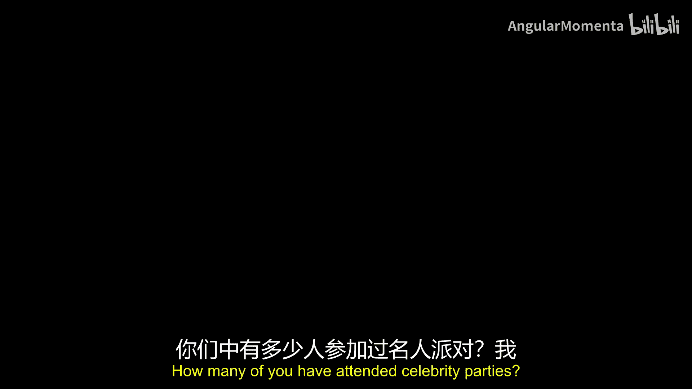
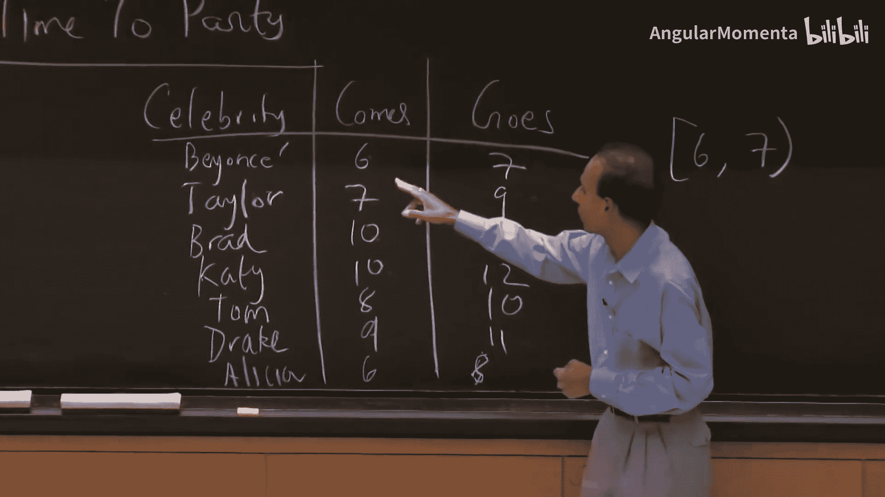
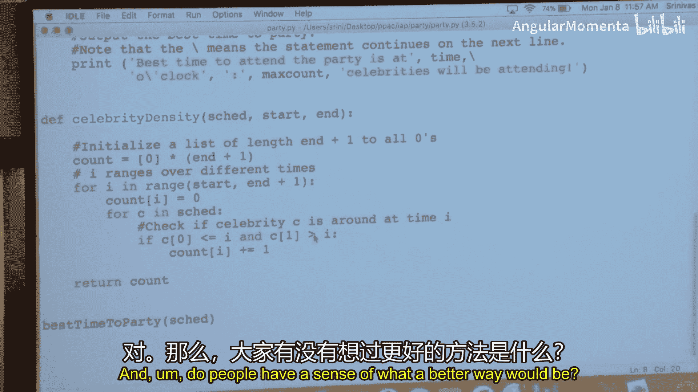
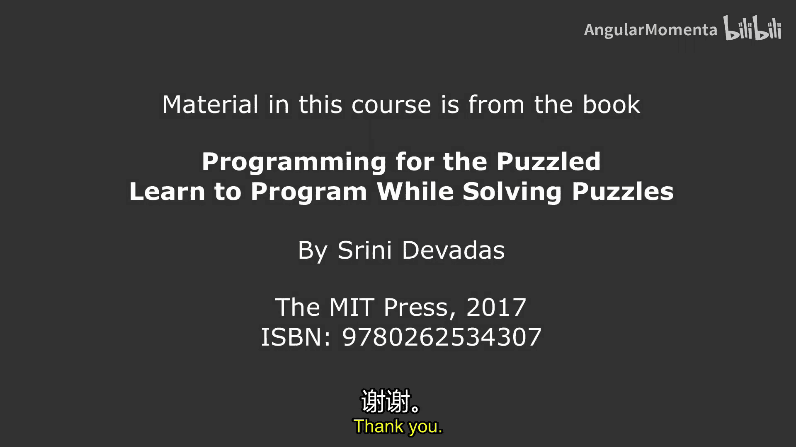

# 【麻省理工】为困惑的人编程-｜-MIT-6.S095-Programming-for-the-Puzzled,-IAP-2018-p02-谜题2-聚会的最佳时间--BV1qp7LzeESm_p2-

How many of you have attended celebrity parties。I havet。Right if we count'。

 M T professors being celebrities， I've been to a lot of them。 but that's， that's not the case。

 right。People don't。 don't rule。Think of us as celebrities。 We just fine with me。So this puzzle is。

 I call it the best time to party。And。Havingm having a little trouble racing。呃。You're right。

 There's another one。All right， well， I'm probably going to run this。But you know what。

 this time I'll， I'll， I'll use， I don't think I need this super thick shock。 This is slightly。

 I'll use this one。啊。So the the setup here with all of these things is's always a little bit of setup。

Is you got a ticket to this party that are gonna be all these celebrities。And it's a time ticket。

With some flexibility， you only get to stay for a certain amount of time before you have to leave and other people are going to come in and hop up with these celebrities。

 but you get to pick。At the particular time that you go， right？ And so initially。

 well set things up in a fairly straightforward way。 We're gonna say that you have an hour。

A particular hour， you know， maybe it's 6 to 7，7 to 8。 What have you， You get to choose。

 That's part of the puzzle。 How do you pick the best time to party。And you do have a schedule。

 and amazingly， these celebrities are going to stick to those schedules。

 But the schedule has been published with respect to when particular celebrities are going to be at this party。

 right And as you can imagine， as the title of the puzzle gives away， you want to choose the hour。

Are such that。The maximum number of celebrities。 So you， you're not particularly。Interested in in。

 in， in particular celebrities or or one specific celebrity。

 you just want to sort of max out in a number of selfies so you can put it on your Facebook page。

 Instagram， What have you。 And you have that schedule and you're trying to optimize the number。

 right。 So here you go。 we're gonna have a。Let's say， let's just solve this again， manually， first。

And then， we'll think of algorithms。We're going to have intervals， again。And so。

Think of these as ours。 You know， Beyonce comes in at 6， leaves at 7。Taylor from 7 through 9。Bread。

10 to11。Katie。Cer 12。Chong。8ight to 10。K round a room here。 Allright。

 so that's the schedule that's published， right， And we can think of these as ours。Comes in goes。

 There's one small subtlety。Which is， I'm gonna think of these as。Closed。

Intervals on the left end and open at the right end。 So all that means is。If this is 6 PM。

 then if you come in at 6 PM on the dot。Well， you certainly get to see Beyonce。

 And if you come in at 6，59， you get to see Beyonce。 But if you come in at 7， she's gone， right。

 and the same thing with a tailor at 9。 So you have to you， you have to choose your time properly。

Right， so what's， what's the best time You get to go for any hour that you choose。

What's the best time to go to get the maximum number of selfies。Anyone。

Can do this manually use tell me how tell me what the what the time is。

 And then I'll ask you what your algorithm was。Right， so。Someone who hasn't hasn't answered yet。一ep。

Either six or 1 oclock，Either six or what's your name？Oh， Kevine， right， sorry。

Youd're the other camp， right， So6 o'clock are 10 o'clock because it's 6 o'clock。 So who。

 who are the people you'd see at 6 o'clock。That's only two。So can you do better than two。

 Can someone do better than what Kevin did。Yeah， go ahead finish。让你。get gravity。Yes。

 so you could do three at 10 o'clock， you would get Brad。You'd get Katie。And then you'd also get Dr。

 Okay， so that's 3。 Okay， so。That's， that's the best you can do in， in， in this， in this puzzle。

 right， But， you know， you might， you might have hundreds of celebrities and you want to pick the right time。

 So obviously， if you want to write a computer program here， right。

 what algorithm Kevin or Kishka did you use to do this。How do you do it in your head。

either one of you did you go hour by hour？Did you go 6 o'clock。

 How many people are there or did you try and intersect or what did you do。What what's。

 what's a natural， What's， what's a reasonable way of proceeding here， right？

 What's a reasonable way of proceeding。Someone other than， yeah， back there。

The frequent at one a time。 So look at， look at the hours。 Look， you say you say 6 o'clock and。

 and you try and see how many sixes are up there or。Right， what's your name， Nsha。

 So Nsha says she's gonna go look for 6 o'clock and see if how many sixes are up there， right。

 And there's two sixes up there。 And you know， maybe that's why Kevin said 6， right。

 on the other hand， clearly， know， that didn't quite work， right in this case。

 because what what happened was 10 o'clock， there's only two of those。

 And so that looks good too 6 and 10。 But you miss the fact that 10 exists in between in 9 and 11。

 correct， So you're not explicitly seeing these things， right So but that gives you an algorithm。

 I mean， it does give you an algorithm。 The algorithm is let me go ahead and do a little bit better than what you described a little more relaxed check。

 right， It's not just an identical I want 6 to be in the table but I want to see if 6 is contained in the interval associated with any particular celebrity。

 correct。SoIf I did 6， I'd say6 is contained in this interval。 It's not contained in this interval。

 not， not， not， not， yes。😡，Right， so I'd get 2。 And then when I finally got to 10， I'd get contained。

 contained， contained， and I'd get 3。 right， So there's clearly an algorithm。

Here that depends on the the number of hours that you're looking at depends really on the granularity of time。

 Okay， so this， this particular algorithm would say let me go ahead and enumerate that different times that I could possibly go。

 I could start at 6。 I could start at 7。 but I mean， maybe able to start at 6，30， I could go from 6。

30 to 7，30。 Maybe that's you're allowed to do that， right， the point is。

 if you stick with the original description， you could go ahead and enumerate 6 through 12。

 and then you could generate a bunch of different numbers associated with the number of celebrities and you could go ahead and pick。

What what time you want to go， right？ So this is look is it's a little bit like our previous puzzle in the sense that there's a relatively straightforward strategy that enumerates different hours and goes through and does a bunch of computation and then picks the maximum in this case。

 previously was the minimum for you will all conform Here is the maximum。

 right What is a disadvantage of this， this particular algorithm that we just described。

 Well what is one potential disadvantage。Right。Yep。该系 fun。I mean， like it's not thing here。

 so you have to make multiple passes on like for example， like you have both， like first of all。

 we have to enumerate all of the possible times and then for every time you have to go through the list like over and。

That's right， so there's a lot of computational。This this is our computation。

 our computational overhead。 let me show you what the code looks like for the straightforward algorithm。

 Alright， And so it' it's going to again intuitive。 It's going to do exactly what we just described。

 right。 And so if you look at what you have up there。 schedule up there is。

 is simply a set of a set of intervals。 right， And thes。

 And so I have something that's bigger than this example here。 but it includes that。

 And this whole bunch of things in there。 And now I'm going to look at this is just a start time for particular celebrity this is the end time for that celebrity。

 I'm just setting that up。 And and I'm going to go ahead and I'm looking at for each see in schedule。

 I'm going look at this。 I'm going look at that。 I'm going look at that。 I'm going。😊。

out what the the start time is and the end this。 and I'm just doing this simply because I want to figure out what the earliest。

What what what the earliest start time for any of these celebrities are。 So in this case。

 it's6 and the latest time that a celebrity is is around is 12 right So that's all that this first thing does。

 It just it's just finding the range that I have to deal with。 Okay So there's not much there。

 I'm going go ahead and compute what's called the celebrity density。

 And I'll show you the code for that。 But that's essentially what we describe。

 which is for a particular hour between start and end。

 How many celebrities do I see at that particular hour right And then for the next hour。

 how many celebrities do I see， I'm just calling it the density right And and then the count is is a list that is going to have celebrity densities for particular times that correspond to the indices of count。

 And I'm just going go through that list。 And I'm going figure out the time that has max count or the maximum number of celebrities。

 And this couple of different ways of doing。Don't worry about that。

 but I'm happy to answer questions if if you have them。 And then I just say， you know。

 the best time to attend the party is at this time， time， which was discovered here。

 And the number of celebrities who are going to be attending is max count。 okay。

 So so this is essentially the code for for， for the algorithm。

 And this thing here is is doing the slightly more relaxed check that that I alluded to。

 which was like when you have 6 o'clock。 you're not just looking for 6 here you're looking for6 within this interval that looks like this。

 So6 is definitely within this。 but it would not be。😊。

6ix。Is not。Is not inside5 and 6， as I described to you before， right， So that's simply the check。

 that's why you have a less than equal to here and and as strictly greater than over here。

 just to take care of that closed and open part of it。 So again。

 if you don't understand every nuance in this code is not that big a deal。

 But hopefully you have the overall picture right make sense， right Okay， so as you can imagine。

 there's a much better way。 Okay， theres， there's a much better way that isn't as exhaustive as this one。

 right and do people have a sense of what a better way would be or would you like a hint and anyone want to conjecture a different way of solving this problem thats yeah。

 go ahead。

So the exhaustiveness of this algorithm is as follows。 So basically， what I'm saying is。

What I'm saying is I'm going to go look at the range of times and all of these are are per hour。

 right， Everything is is per hour。 I'm going to look at the range of times。

 and I'm going to go ahead and and include 6 through 12 here， right， And I'm going to go 6。

 And I'm going to go figure out at 6。 how many celebrities exist。And then at 7。

 how many celebrities exist。 And then at 8 all the way to 12， right， And I'm going to get in count。

 which is that list there I'm going to get for each for， for count 6， I'm going to say two。

And for count 10， I'm going to get 3。Right， because 10 is， is the hour。

 And then I'm going to go through that list and figure out that 10 had the maximum number in it。

 And that's the exhaustiveness。That makes sense。 right？ So， so if we're good with that。

 this algorithm works， but it's a little painful， right？ And so。

 so what's what any ideas as to how we could do things quite differently， which would be more。

 more efficient。 Its and let me， let me give out the word。 I want， I want an incremental way of。

 of doing this， right。How， how could I do this？ I have a starting time。

And I want to compute the same densities in， in an incremental way， okay。Someone else other than 40。

Yeah， back there。Well so you have to start on the end time if you just for each list of whatever two bullet time or whatever you would you could keep like。

A different count dictionary of that the start time and then increment through each of the start times until the and just add one each time basically through each set of times and each time you're absolutely on the right track。

 And it turns out you don't even need dictionaries。 you can do this with just plain list。

 But the idea here is actually a very compelling one。

 it's something that you'll see in other algorithms。

 whenever you have something where you're doing repeated computation。

 there's always many a time there's way of removing redundancy and turning into incremental computation。

 right And so the inside here is the following。The only time that celebrity density。

 which is the number of celebrities that are in the room。

 changes is obviously when a celebrity enters or when a celebrity leaves。Right， I mean， that's it。

 I mean， you know， we're all celebrities here， you know， and， and I guess we did have someone leave。

 So there you go。 And， and maybe someone is gonna come in， right， So。

 so I just need to monitor you know， sort of input and output or entry and exit。 Okay， So。

 and I also know what the endpoints are with respect to the six time 6 PM versus versus 12， correct。

 So what I can do here。Is the following。supposeupp。Suppose I had。A chart that looks like this。Right。

And what I'm drawing here。Is these intervals。 They're not exactly what I had up there。

 but I'm drawing those intervals out。 right， So you could think of this。If you like。As being6。

You can think of these two lined up。As being7 and so on and so forth， okay。So。

 so I could draw these out。 And， and I I don't really have to draw these out in in a computer program。

 but I can certainly draw them out。In， in terms of giving you the intuition， right。

 So what I'm gonna to do is I'm gonna start with 0。 So before 6。

 there's absolutely no one in the room。 So I'm at 0， okay。And the moment I see。

 I I I take one of these things。 And if I， if I see a celebrity。I can increment the count。

 So here I get at 5， I'm at 0， at 6， I get one and。And at seven。

 no one has left and two more people have come in， so I get three。Okay。

And now the next thing happens out here。 Let's say this one here is 8。 I would get 4 for that。

And then， out here。It's 9。 I go 4-1 equals3 because this， this celebrity left。Okay， so。

 so essentially， what I want to do is not have to compute this over and over for every time running through all of the list of celebrities like I did before。

 right， for 6， I went through all the celebrities for 7， I went through all the celebrities。

 But if I sort the celebrities in increasing order of start times。

 essentially this picture is important。 and it it requires sorting because I went from left to right。

 right， And when I go from left to right， I'm essentially saying I want to see things that come earlier before the ones that come later。

 right， that's essentially what time goes to the right， right， So I'm going from left to right。

 So if I take these intervals。And I sought them。Okay， and basically sawdom by the， by the。

 by the start times。Then all I need to do is in the sortded list of intervals。

 I just showed you the computation that we have to perform。Okay。

 the computation that we have to perform is this was the first interval in the sortded list of intervals。

 right， because it was the leftmost interval。And I take that， and I go ahead and implement it to one。

 right。 Then the next thing I do is I don't have to worry about any time， even if there was a time。

 if this was 6 and this was 8， for example， as long as there's no celebrity that came in at 7。

There's no reason for me to change anything in my data structure。

 right the only times that are interesting are when celebrities enter and leave。

 Okay so the other nice thing about this algorithm is that it will work if Beyonce came in at 6，39。

 you know，39， you know39 seconds，39 minutes，39 seconds and left you know at 6，51， whatever。

 right because I'm only concerned with the entry of a celebrity and the exit of a celebrity that correspond to these these points that you see here right does the algorithm make sense from an intuitive standpoint right you see what's happening here hopefully the picture gives you gives you a sense for how you're doing the correct computation and the only times that things change are when at the endpoint of these intervals right when you see someone increment when you when someone leaves decrement right So set of numbers。

That you generate is essentially the density down at the bottom that corresponds to at particular times。

 not necessarily on the hour， but whenever the celebrities come and go and so that list that you get is all that you need to look at to figure out what the maximum is So ultimately down below in this particular example。

 perhaps four was the maximum right and it started with zero， it climbs up， you know。

 maybe goes to four， maybe goes to5 and then goes down again， maybe climbs up again， who cares。

 you know once you get to the point where you've written a program size doesn't matter anymore So the last thing I'll do is I'll show you the code for this it'll be up on the website and feel free to come to office hours and ask me questions about the code or before lecture tomorrow but this is the entirety of the code and。

Not even using the builtin sort functions in Python， right。

 I mean I went ahead and wrote it just to give you a sense of how long the code would be。

 but it's a much more elegant algorithm。 It， it would run faster on large examples。

 And I don't want to get into asymptotic complexity that's really beyond this class。

 But as you can imagine， rather than going through the list of celebrities over and over。

 we're actually doing sorting exactly once， right， So So that's that's better。

 But essentially what happens here is is simple。 you go ahead and you create each of these times。

 So this is particular celebrity， particular time。 And this is the start point of the celebrity。

 So you， you have to mark that。 This is very different from that。 What happens here is。Im。

Adding what happens here is I'm subtracting， right So I have to know whether this point is very different from that point。

 This is the same as that， same as that。 And all of these are similar。

 but I have to differentiate between the two for obvious reasons。

 right So I have to have start and n And then I go ahead and take these times each of these times that you see with these black dots here。

 They're all need to be sorted because that's the only way I'm going go from left to right。 right。

 that's the only way by going through that list of times right So I'm going to go ahead and do that sorting。

 And I could have done times do sort， by the way。 I don't have to have sort list。 but I just。

 as I said， I wanted to show you the the code without using any Python library functions。

 And then I and then choose time is。Simply looking through that list， finding that maximum number。

 be it 4 or 5 and returning the index of that， because that tells you what the。

 what the particular time is。 And that time will always be。 Can someone tell me last question。

 And I'll let you go what， What am I， what am I going to get on any given example。

 What am I going to get as the best time。Any given example。I'll get to you if， if Guatra yeah。

 a time when more people come than leave at time when more people come leave， that's， that's correct。

 But I want something stronger。 But， what's your name， Josh， Yeah， Josh is right。

 but I want something even stronger than than at time that more people come than leave。 I mean， I's。

 it's， it's， it's correct， but a variant observation。 someone else。😊。

I I want to say something about there's two sets of points here， right。

 there's two sets of points here。 Which point， which set of points are going to be the ones that are in play。

With respect to the maximum time， right， that's maybe a better question。Right。Go ahead not。

The arrival。That's right。 The arrival time of a celebrity， right。 And it's true that what you said。

 George is correct。 Ultimately， the best time is going to be when the maximum number of arrivals happen。

 right， but at the bottom line is， I'm never going to I'm never going to see。

 this is actually an interesting observation。 And there's an exercise related to this observation for this puzzle that you might want to look at。

 that I'll put up on on the website as soon as we're done here。're。

 you're always going pick one of these beginning times， because that's when the increment happens。

 You'd never pick one of these because that's when a decrement happens， right。

 So so that's all I wanted to say， And and the reason I wanted to say that as I said。

 there's there's an extra question on top of this yet another algorithm to solve this that is really based on that final observation that we made。

 Allright， Well thank you。 Sorry for going over。 But as I said， this is I。 For me。😊。

