# 【麻省理工】为困惑的人编程-｜-MIT-6.S095-Programming-for-the-Puzzled,-IAP-2018-p03-谜题3-你可以读心（经过一点校准）--BV1qp7LzeESm_p3-

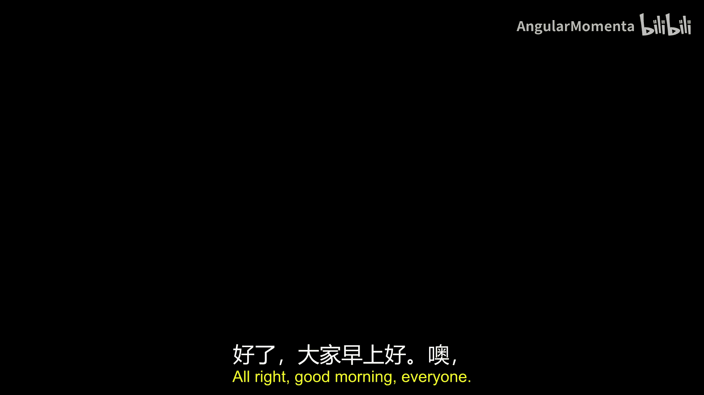

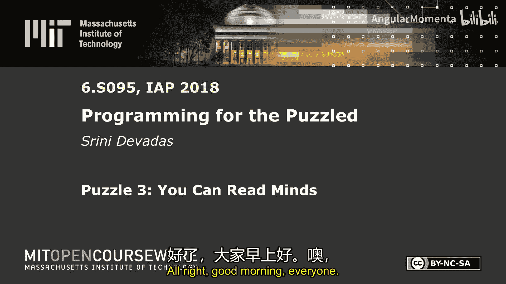

All right， Good morning， everyone。Oh， do we have a treat for you today？I'm going to。

Publicize for the first time my hidden talent of mind reading。And since this is a magic trick。

 you know， every every magician needs an assistant。 And I want to introduce Billy Moses to you。

 Billy is a PhD student。 He already has three degrees from M T， but he wants a fourth， I guess。😊。

And so， so I'm going to turn it over to Billy here。And， and Billy is going to sort of set things up。

 I'm just going to do my thing， which is read your minds， okay。So go ahead， Billy。

 So what's gonna happen is I'm gonna I have this card deck right here。 Nor card deck。

 perfectly normal cards。 they're not in any weird order。 You can see them。

 I'm gonna give five people the opportunity to pull a card and then give it back to me。

 They can look at the card。 Then what's gonna happen is I'm going to turn over four of these cards show you the final card。

 and then Trinis try to guess the fifth card。 but what I need you to do is but I'm gonna guess。

 I need all of you to really focus on that hidden card， I mean in your heads， right。

 So I can't do individual mind reading。 just in case you guys were worried， know。

 So if you think I'm wearing a terrible colored shirt， I'm not going know。 Okay。

 but if you all think of this this hidden card， I'm going be able to guess it。

 But so I need some help。right okay， and wants to try pulling some of the cards。 Okay。

 and can take your favorite cards here yeah。You can look at it。Give it back to me。 once's see you。

Cool， anyone else want to pick a card or pick a card。Then look at the full deck。

 look at whatever card you want， take it。그こはい。You're doing a little and you else want to pick a car。

 you want to pick a card？Go题。Okay。Anyone else want to pick a card？我哋佢。Cool。And pick a car。Cool。Okay。

Get my cards all nice together。Okay， so five cards。 I'm going show you first。

 And then we're gonna present them in a fun way for Schni to see that the five cards are as follows。

 We have this wonderful seven of clubs。😊，We have a。Jack of hearts。We have。Seven of hearts。We have。

Queen of spades。 We have。10 of clubs。 Now， for the people who pulled the cards。

 these are indeed the cards that you gave me， right， No one missed their card in the deck。 Okay。

 I'll go get trainingni。All right， ready for me yep。Okay。The first card is。The seven of clubs。

 the second card is。The Jack。Of hearts。 The third card is。The 7。Of hearts。The fourth card is。

 and this is the final card that Trini will be able to see。The queen of spades。 Now。

 everyone think to yourself， you've got to see the card， the fifth card that trainni is gonna have。

 Think it very closely in your mind。 Think， right， definitely a clubs， definitely a clubs。Okay， see。

 and I'm getting。I'm getting a ten0 of clubs。And it is a ten of clubs。All right。Thank you。All right。

 so。I guess I'll have to confess。I'm not a mind reader， but I also did not cheat， okay。So there's。

 there's an algorithm here。 And you guys w to know what the algorithm is。 So you can go try this out。

 I guess when you go back home next or whatever at your in at your dorms or with your with your classmates。

 So it's not as easy as。It might seem simply because the combinations aren't really in our favor。

 right？ So if you think about it。There's 52 cards。 So this is a regular deck of cards。 You know。

 as I said， there's no cheating here。Billy showed me four cards。So which means the fifth card。

I could be。In a one of 48， right？I mean， it's completely random。

 You guys picked these five cards completely at random。 So theres。

 there's no way that that fifth card could be anything specific。 Okay。

 so what Billy had to do was in the four cards that he showed me。He really had to communicate。

One of specifically， you know， one of 48 possibilities。Which is kind of， you know， if you。

 if you think about it， the math doesn't quite work out， right？ So if you just say， so what。

 what are the ways how much information could you imagine communicating in terms of bits of information。

 right， you know， in terms of possibilities or bits。

 how much information do you think that that Billy could communicate in these four cards。

 was were also depict at random， Obviously， they have to be specific cards， right。

 He just put them up there， right， So， so if I have four cards。

 What are the ways that Billy could communicate information。 when you saw what he did。Any ideas？Yeah。

 you not。The order the cards are placed， the order of the class are placed。 So that's。

 that's a a great answer。 But if you look at the order in which the cards are placed。

 how many different orderings are there。4 cards。 How many different orderings。4 factorial， right。

 And that is。24， right。 So I'm not quite at 48 yet， right， So that's， that's a bit of a problem。

Right， so is there something else going on other than the ordering。呀。二は。

So you mean the way he put them up， you know， you know， slowly versus quickly。

 or did you mean something which was。Time in terms of the exposure of the cards， or。就。

It lay down for。はきな。Well， but that's all part of the ordering。 I mean。

 you have to be a little careful here in that I mean， you can do both right I mean。

 you can constrain the ordering and then say that there's 24 different ordering。

 The moment you constrain orderings the number of ordering shrinks right So I will say that as I said。

 this is a very leg trick。 It' completely algorithmic。

 We're gonna write code for it or I'm gonna show you code for it。

 but there's nothing else other than the ordering is there's no slate of hand。

 there's no hidden communication know， hidden't stress words。

 you know clubs meant something or you know spades meant something else。 it was just the ordering。

 Okay And so so there's a gap here in terms of 24 and 48 right And so what's cool about this trick is we're actually going to be able to do this original trick where the fifth card could be one。

48， because we're going to do one thing that you probably didn't notice because we only did the trick once。

 Alright， And so let me explain。How this is gonna work with just sort of randomly picking。

 I'm just gonna pick the top five cards， assumingum these are， these are shuffled。 and。

 and you can assume these things are at random， right？ So。

 so I have five cards that I've picked here。And can you all see them。Right， okay， what， what do you。

 what do you notice about these five cards。Anything。Yep，4。Like four times and five。はい。

Right so youre saying the suit right So so so it is clear。 this is true here。

 You have the seven of clubs and the 1 of clubs， right。

 but these the cards that you pulled out are close。 anyway， So。

 so they look pretty similar to the ones we used。 But that's probably just because we't shuffle the deck。

 But obviously， if you have five cards and you only have four suits I guess you could call it the pigeonhole principle from 66042。

 but you're definitely going to have a pair of cards that are going to be of the same suit。

 right maybe more than two cards of the same suit， which you guaranteed for any five cards。

 let me just pick another five。 that two of them are going to be of the same suit right that's pretty much guaranteed。

 And so we end up ended up getting clubs again here。 And so you have two and four of the same。

 same suit。So， so the first thing that happens in this trick is we use the first card。

To give away the soup， right， Or Billy used the first card to give away the soup。 Alright。

 doesn't quite。I。Finish the story here， because let's just say that I'm going use。The first card。

To signify the suit。So in this， in this case。Let's just say I I， I， I， I， I'm gonna to do clubs。 Now。

 I have a choice here。I could。A Billy， I could have hidden。

2 and showed me the four of clubs as the first card right， or vice versa， right。

 And keep that in mind because that's actually incredibly important， right。

 But if you just say that the first card is going to signify the suit。

Then let's say the suit is now out of the picture。 right， So I know the suit of the card。How many？

 So I have three cards left。Alright。And I got a hidden card。 I know the suit of the hidden card。

 but that card could be。The hidden card。How many possibilities are there for the hidden card now。

How many possibilities， I mean， this is all a random。Well，13。Oh， good point。 Yeah， was good， good。

 good。 So this， this is exactly why I need ten of students。 Okay， good。 So there's 12 possibilities。

😊，Since one of them was， one of them was shown， right， So did that help us。

There are three cards left。 And so how many different I mean， the first card is the first card。

 right， So it's no longer part of this。Permutations， yeah。

 I can't count it in terms of the permutations。 There's only three cards left。

 And those certainly those three cards could be ordered。In in a certain way。

 But how many combinations or permutations are there of three cards。Only  six permutations。 So again。

 I， I seem to have a problem here。 I， I don't seem to have sort solved the original problem of the 24 to 48。

 I still have a 6 to 12 gap， right， So we're gonna have to somehow cover that gap， alright。

And any thoughts give you a little bit of a hint as to how this gap is going to be covered When I talked about the two and the four。

 How am I going to cover this gap。The 6 to 12 gap， right？Yeah，Sa the next card， if you can save it。

2一。But you mean say， I mean Billy is going to say something。Yeah。Thinking that啲 final。guess。So。

 I mean， he， the only thing he can do is， is give me。

 give me an ordering of the remaining three cards。 right， Yeah， go ahead。 Kevin right。A world highly。

limit。That's good。 That's good。 A low high limit on the range。 exactlyactly right。

 exactlyactly right。 So what's happening here is not only do I have the first card。

 and it's not that the first card is just giving me the suit。 I mean， that's the way I said it。

 right， But the first card also has a number on it， right， The first card has a number on it。

 So that number could be an anchor。That is going to help me figure out what the hidden card is。

 right？ And what's important to understand。 And this is really the last interesting。

Point with respect to shrinking these possibilities or these permutations down is you want to think about your。

 let me draw this out properly。In nice little circle， you don't want to think about。

Just acending sequence of of cards or or numbers。 You want to think about this as being circular。

As you'll see， for the following reason。Right， so let's just say the A is a1。

And so we're going to think of that as being the the smallest number。 So you go one through 13。

 In this case， the king is the 13。 Alright， so that's your number。 And so you could。

 you could imagine you go one through 13。 So let's just do that first。

 And then I'll explain to you why I drew it in the circle。 And the first thing that happens is。

I'm going to take some card here。And I'm going to make that the first card。Right。

 so I don't care about suits anymore。 And if I just picked this another five cards。

 let's just do this again with with another set of five cards。And what do I have here， Oh， I got。

 I got all mostly hearts。 Okay， so let me do something more interesting。

There is too many hearts there。Right， let's do this。Right， so， so now。I got a2 and a jack。

 and I got a 10 and an 8。 Okay， now I'll make this even more interesting by picking。 I want to pick。

 I want to get a heart card。 And let's see how this works。😊，finally。All right， so。

 so this is what I have。 King of arts。Aero spades， etc cetera。 So the。

 the two cards with the same suit are the the two and the jack。Right， and。

So here's the important thing。 One of the things that Billy did kind of in a subtle way。

 I'm assuming。 And some of you may have picked up on it。

 the very first card that he asked one of you to pick。 It certainly wasn't the hidden card， right？

 I mean， he got all five cards。 And then he decided which of the cards was going to be the hidden card。

 and then took the remaining four cards and encoded them。Right， and if you don't do that。

 if you just say this， if you， if you the district won't work if this is the hidden card， okay。

The trick is only going to work， as it turns out， if the the， the hidden card is a two。

 it won't even work。If the hidden card。Is a jack。O。And there's a reason for that。 All right。

 And can you， can you think of the reason for that， if you look at the board。

Can you think of the reason for that， Someone other than Fardi。Someone else。What do you see up here。

 So what am I trying to do in terms of what， what would happen。

 You guys talked about Kevin mentioned the distance and things like that， right， You know。

 you can call it the offset。 So what would happen。If I hit the jack and I did this， I。

 I did something like this where I， the two of diamonds was the first card that was put out。

 And then I tried to encode a number using these remaining three cards。 What's the。

 what's the biggest number that I could encode。 I mean， in in I I， I need to encode。Lots of numbers。

 right。so what's， what's the biggest number that I could encode here。

 If I had six pro mutations and I start with one， the biggest number that I could encode is a 6。

Right， sadly， the jack is too far away from the two。 right， If I think of the jack as being an 11。

 it's 9 away from the two， right， but。Help me out here。 What could I do if I， if I flipped it。

 what happens。Cant you just count backwards。 You can count backwards。

 or what do I have up there and on the board。What do you see up there on the board？

I wrote something that was linear。 but what， what what do I have up there on the left。Circls。

 so you think more more arithmetic。You know， think， think of this as being circular。 Okay。

 so what happens is that if I picked a two and a and and a jack。If I。

 what I want to do is to gohawkwise， okay。And because there are only 13 cards。For any pair of cards。

 it's always the case that I can choose。The first card in such a way that the hidden card is at most6 away from the first card。

 Okay， because you you， you could get into a situation where obviously。

 if I ended up hiding the jack and exposing the two， I ended up getting a 9。

 which is impossible to encode。 But if I。Hide the two and expose the jack。 Then I go 1，2，3，4。

 and I'm I'm at basically 4， okay。So， so that's the last thing。 Alright。

 so let's just do this really quickly with with yet another set of five cards。 right， Now， obviously。

 we practice so we could do this fairly quickly。 right， but and you can practice do。

 But sometimes think you get lucky， You know， and you get easy， easy things to encode， right？

 So what happens here， someone So now that you know， the algorithm you have some choices here。

 but obviously， you have not all choices will work。 You got to be a little bit careful。

 What would you， what would you hide。😊，So， so you need to make sure that you， you get。

 you can choose a pair of， I'll make this a little bit easier。呃。嗯。

Sometimes choices make things more difficult。Right。Perfect。All right。So， so what you see here is you。

 you， you know that you have to do the clubs now， right， because you have the， the clubs as， as。

 as being the the suit that's repeated， No other suits are repeated， right？

 So what am I going to expose and what am I going to hide。 That's your first question。Right。

Someone else。You guys could are gonna have to do the trick。 That's the final exam for this class。

 Okay， on Friday， next week， you're all doing the trick， no。Right， so what am I going to。

 what am I going to， Yeah， go ahead， Josh， you're gonna hide the a。King。

 of called to be the first card。 You're gonna hide the ace exactlyly right。 You。

 you want to hide the ace because you want to go this way。 And if you do it the other way around。

 it's not gonna to work。 You're gonna hide the ace。 and you're going to make the king the first card。

And， and now what you need to do is this is， this is gone， right。

 And now what I need to do is I need to。Encode a number between one and 6 in general。 in this case。

 I need to encode the number one。 Okay， in order to give away the fact that the hidden card is an ace。

 and now I could do what was suggested before， which is have some sort of I mean。

 there's obviously an ordering associated with that these cards that you see up here。

 if I call this a one， and I call this the 13。 then let's do the logical thing。

 which is one is smaller than two， which is smaller than 13， but I might end up， you know。

 I might have a9 of hearts here rather than a five of hearts。

 and I got to obviously be able to order the9 of hearts in relation to the five of hearts as well。

 right So because I all of these could be nines， actually。

 And and so so I can't just rely on the number to do the ordering。

 So I could just choose an arbitrary clubs。Is small， is smallest diamonds。Is the next。

 And then I got hearts。I just did this because this is a little bit easy to remember for me。

 You can do this in many different ways in alphabetical order。 you know， C DH S。 And so so this。

 that's， that's moot here， what I need to do is to encode the number one。 okay。

 And when I encode in order to encode the number one。

 I have to have some sort of way of of ordering this。

 And so what I'm gonna do is I'm gonna say SL M is one。 So what do I mean by SL M the smallest card。

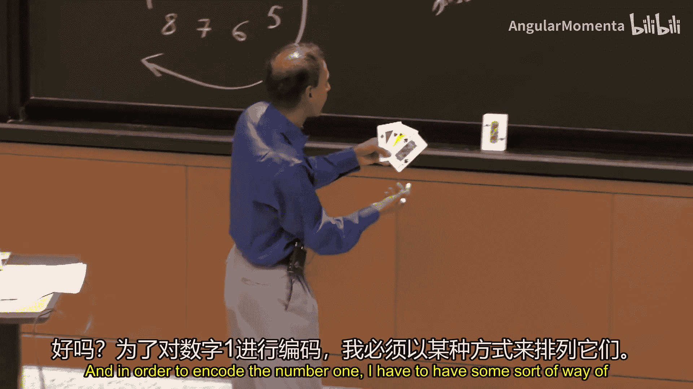

Is is first。 the I'm sorry。 S M L is is。Increasing。This the smallest card is is the first one。

 The medium card is the second one。 and the largest card is the third one。 Okay。

 and I'll write this out。 And you can see the code for it。 But when you see something like L L M S。

 you're gonna get a 6 and there's obviously six of these different combinations。 right。

 the details are actually entirely up to you。 I mean。

 the most important thing here is the ordering that Billy had had to be the ordering that I had。

 Alright， And so yesterday， when we practiced at one time， there was a mismatch。 And we got it wrong。

 But that's the only way the trick would would would fail。 it really， I mean。

 other than human error is if the is the encoding this is really encoding followed by decoding。

 And obviously you need the same algorithm， if you will。

 which requires that you need the same ordering in this case for the for the cards right。

 So so that's it， that's that's the trick。It doesn't seem that interesting anymore，But， no。

 it is interesting if you show it to people and， and the fun part is in in and actually doing it。

 So I encourage you all to， to do it。😊，Any questions about how this trick works。

So what I'd like to do is show you some code for for this trick。

 And there's also code that was useful to both of us because we could practice by ourselves。

 we didn't have to be in the same room to practice because I could sort of randomly generate a bunch of these four cards。

 And obviously， the program knew what the hidden card was。 And I could you know。

 I'll show you the code。 I could type in what the hidden card was。 And it would say， you know。

 I guess it would say you're a mind reader extraordinaire sorry not impressed And and Billy could do the same thing in terms of checking as encoding。

 Allright， And then after we had done here talking about the the code。

 and there' some interesting things with the code。😊。

It let's talk about whether you could the talk about different kinds of tricks。 And in particular。

 I want to talk about whether we could go from five cards to four cards using a different encoding scheme。

 right so。够。So。I wrote this code about a year ago， and I think I'd probably write it differently。

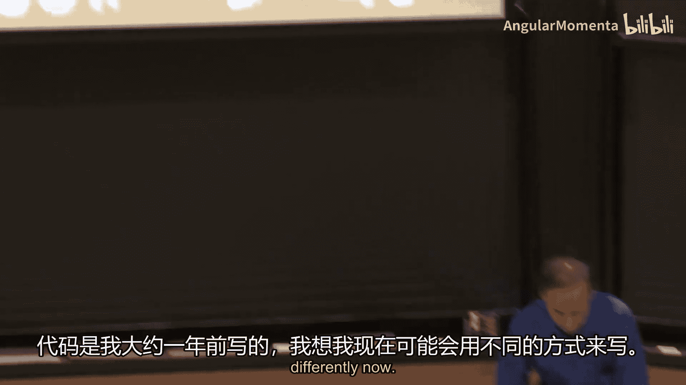

No， but we， we have what we have。So the the， the first thing is you have to decide on an order。Right。

 you absolutely have to decided an order and the cards themselves， as I mentioned。

 there's a natural order associated with the numbers。 And， of course。

 you can decide if you want to start with with the two。 And then and the ace could be 14。 I mean。

 kind of makes sense for you to go 1 through 13。 So that's really what we have here。

 the ace is the smallest card and the king is the biggest card。 And as I mentioned。

 the clubs are smaller than the diamonds， etc ce。 So I just have a deck of cards that is ordered。

 as you see up there。 And that's just a python list that tells you what the ordering of these 52 cards are。

 right That makes sense。嗯。So the so there's many procedures here。

 many routines that do different things。 And a lot of them use the same codes。

 I'm not gonna explain each each one of them。 But this one is is a good one。

 And I'll also show you the computer assistant one。

 which is essentially this procedure except that it allows it allowed me to practice by myself and generated cards randomly。

 In this case， what happens is you input five cards。

 And what this does is so you could sort of take five cards out from the deck。

 And then manually you can you can choose the hidden card， order the remaining four。

 And if you typed in those five cards into this particular procedure。

 it would give you the first four cards。 Okay， And so you can then verify that you've done the ordering。

 So this would be something that I don't know if Billy used this to practice， but he could have。

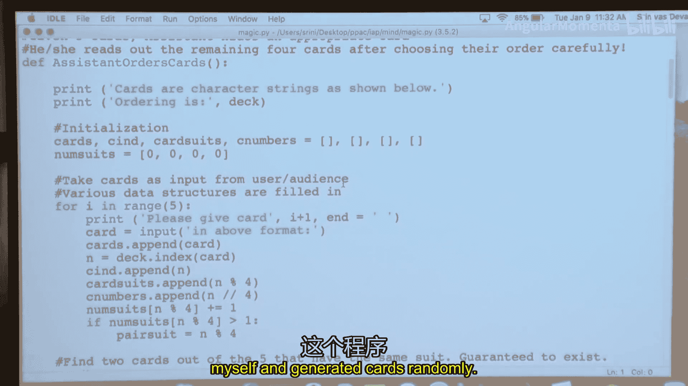

呃。So what do I have here。 Well， the first thing is just printing out what the order is。

 There's a bunch of things that need to get initialized。 Car is simply a list of five cards。

 and then you have index or C end， which is the indices in that in that giant list that we have that had 52 cards in it。

 they just the indices of the various cards。 can you can use dot index。

 which is a method to go from card， which is like a underscore C， for example， to to the index。

 And then card suits are what the suits are for the cards and it's 0，1，2 and3 for clubs diamonds etc。

 And then the numbers are what the numbers of the cards are1 through 13 you kind of need there's a bunch of bookkeeping。

 As you can imagine we're doing things in in our head here。

 But if you want to get a computer program to actually do all of these computations。

 It's not complicated。 But you have to worry about。

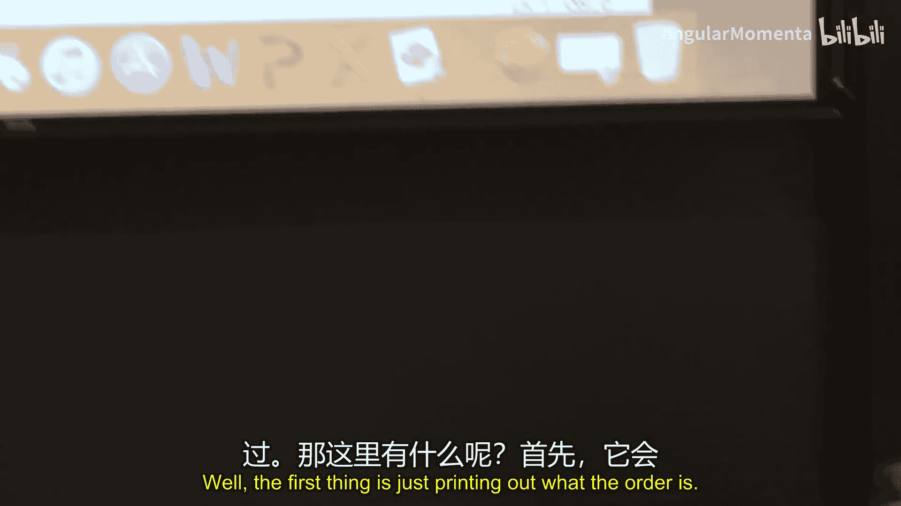

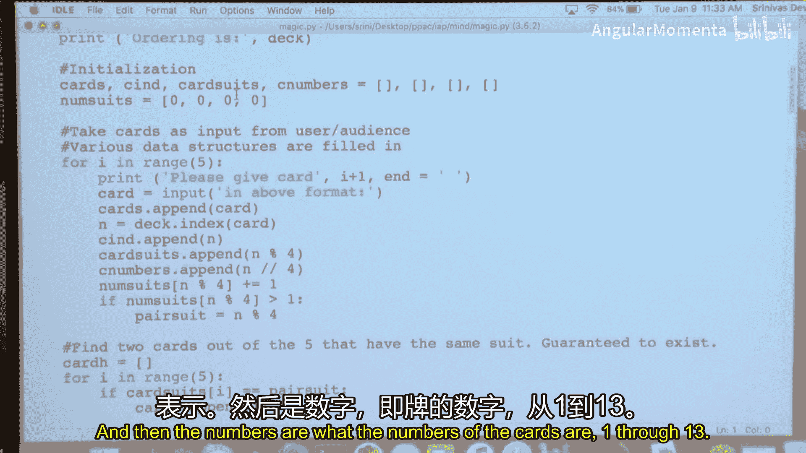

4 suits。 And you got to worry about the 13 cards。 And you have to go ahead and encode SMML or produce this encoding。

 right， So you can imagine there's a bunch of code。 It's not complicated code。

 but there's a bunch of code。 right， So the first thing that happens here is in this particular。

Procedure， you want to input these cards in。And so let me just run it。 And。

 And so you get a sense of what this procedure does。 Alright， beautiful。 So let's just say。

 let me just pick five of these here。So first one is five of hearts。 I'm sorry，5 of， five of hearts。

 Yep，5 of hearts，9 of diamonds。Jack of spades。Ten of arts。And。A of arts。And so it。

 it essentially says。嗯。The first， so if I have something like this， it ended up choosing。呃。

It' end up choosing the 10 as the hidden card。And decided to choose 5 as the first one。

 And then because 10 was the hidden card， you needed to encode 5， right？ And so。

 so the way you encode 5 is is by。Encoding。L， S and M。So the first card that should， should be up。呃。

Is a jack followed by the， the， the smallest card， which is an 8 followed by a 9。 Okay。

 that's essentially it。So now that you've seen that， let's let's take a look。

 I'm not gonna go through every line of code here。 I want to point out a couple of things that are interesting。

 This is simply filling in that data structures。 the only thing that's interesting here or the thing that's probably the most interesting here is what I've highlighted this is a way of taking an element in the Python list and getting the index for it。

 And so that's essentially something that it's object oriented programming we probably want to get into that in this class。

 but you'll definitely see that in W09 and other classes。

 and essentially what we have here given the ordering is the suits simply correspond to whatever the index is mod 4 because as you can see from the clubs are this is0 the index0 and the next the next club is。

I is is index0，1，2，3，4。 So you're going to get mod of clubs is always going to be mod4 of clubs is always going to be a0。

 mod4 of diamonds is always going to be a one etc。 right So that's essentially what happens here。

 And the first thing I need to do is figure out two cards that have the same suit because that's important because that's going to determine what my first card is and what my hidden cards are。

 And that's what happens over here。

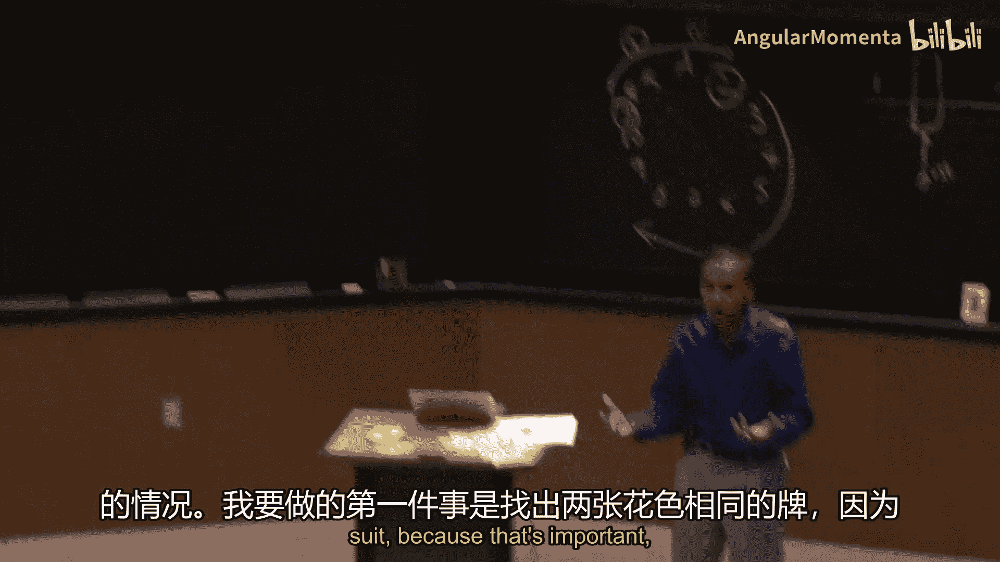

And then once I have that， I need I've sort of split these five cards into two piles。

 one of which has the hidden and the first card in it。

 and the other pile has the three cards that correspond to the ordering in it。 Obviously。

 the computations that I have to do for the first couple are quite different from the ones for the the remaining three cards。

 in one case， it's ordering。 In the other case， it's a comparison。

 And I do have to the most interesting remaining part of the code that I'm going to show you is the determination of what the hidden card is and what the first card is。

 And that's going to require this is the part that actually took me the longest to code。

 I got it wrong a couple of times。 it's going to require me it's five lines of code， but it's subtle。

 It's going to require me to kind of figure out whether it's the jack versus the two know or vice versa and and things get a little bit interesting for example。

 if you had。If it wasn't the Jack and the two。啊。The example I had here a let's put a jack in 2。

 Let's say I had a 3 and a 10。Right， they're kind of the furthest apart and you had to be kind of super careful here because you know。

3 to 10 is obviously7， which is too large， but you need to go 10 to3。

 which is 6 right So the things that are diametrically opposite to each other are usually the hardest when it comes to actually doing the trick but it's also hard from a standpoint of coding。

 I had to get the mods right and the subtracts in terms of what got subtracted from the other So so the rest of it is I just have a high level descriptions。

 obviously the code for these individual subroutines is in the file as well。

 but this one determines what's hidden， what the other card is and what the number that you need to encode is。

 So when you go do the split and you have the two cards you obviously need to decide which one goes first。

 which one is hidden and you also get the number and that number at better be between one and6。

 otherwise this is not going work。And then you remove the other。

 the two cards hidden and other from from the set of five cards in order to actually do this S M L。

 it was a little easier for me to sort these cards。

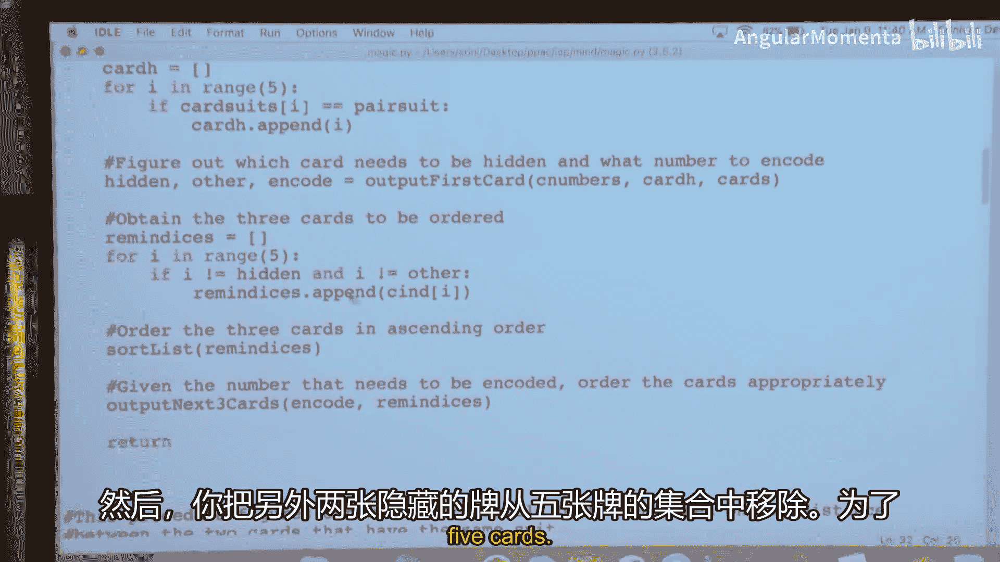

And then depending on the number and code， I change the order。 Obviously， if I sort the cards。

 I'm gonna get SMML。 and that may not be what I want。

 but it it's easier to start with SML saying this is the order that gave me the number one as an encoding。

 what do I need to do in order to change that encoding to a two or a5 or a6 of what have you And so that's what this this output next three cards does。

 So so this this is what took me the longest to code right I mean， it was a few minutes。

 but the rest of it was was pretty much busy work。 wasn't too much thinking。 so this thing here。

 as you can see is you don't need to worry too much about list itself and the indexing into it。

 the bottom line is I need to figure out this situation。

 And I need to subtract And so when when I see something that says。10 and a 3， I end up getting a 7。

 And then I know that I have to do a flip。 Okay， but it also may be the case that I might get something。

That the reason I need the the mod 13 is partly because I might end up getting a negative number。

 right， So it's not clear that in code take away the mod 13 is going to give me a positive number。

 right know， I might be subtracting 9 from 2 right So I end up getting a-7 So so you don't know this。

 I mean， the program doesn't know which one is which and it has to figure out which one is which and flip them together。

 So if there's any code that you want to look at carefully it' is this code and it's just a matter of sort of going through the combinations in making sure I know it works。

 but you need to convince yourself it works。 Allright So so that's pretty much there's not much more to say here that wouldn't be of obvious to you looking at it carefully。

 So I don't want to bebor the obvious。 And output next three cards is the part that I。

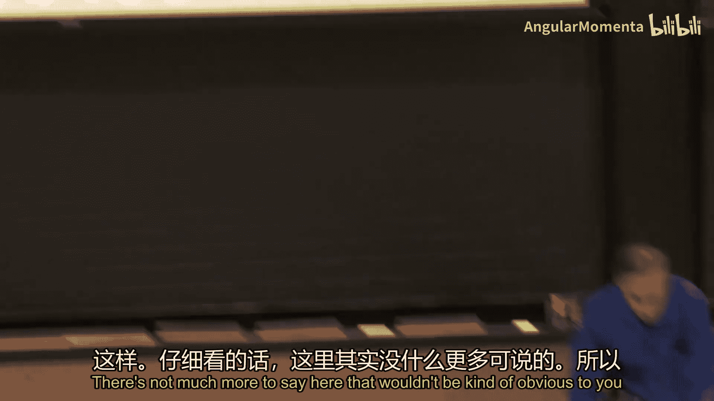

Described you start with sort of the default ordering， which encodes a1。

 and then you need to do a little bit of flipping。 If you want to encode a three， for example。

 and if you want to encode a 3， then you would change things around。

 And this is exactly what I described to you before So this is actually fairly straightforward。

 If you have that table written in front of you。 you just go off and write that certainly。

 if you change the the algorithm， know all of this would change quite dramatically。

 And there's an exercise which ask you to do that， which you could certainly try to do。

I want to show you one other thing， which is， which is interesting。 And， and then I。

 I want to run this new sub routine routine。 So what I have here is。I'm gonna run。

 Oh I've already run it。 So Im， I， I want to show you computer assistant。Which was very useful to me。

And this says， please give me a random number of at least six digits， right？ So obviously。

 I don't want to know what the hidden card is if I want to practice in a legitimate way， right。

 So so what I did was I said I'm going have this sort of hokey。 I'm just really hokey。

 I'm gonna to have this hokey algorithm that's going to take this giant number that I'm going to type in and somehow going to take this giant number and it's going to deterministically generate five cards based on this giant number。

 Okay， but I didn't want to have an obvious way。 I mean， I don't want to say the number 1，2，3，4。

5 and then end up getting the first five cards in the deck or something like that because that would sort of give it away right So I want to have some sort of some sort of obfuscated way of taking a giant number and generating something that was at least unpredictable to me in terms of the five cards that are generated。

 Okay， and so what I do is if I type in。If if I type in a number， you know some some random number。

 and at this point， I have no idea what the what what the five cards are gonna be generated are。

 Okay， and this does tell me it does do the assistant audit cards functionality。

 So it does take those five cards， hides a card right。

 and then exposes the four cards to me right And so I'd get different。

 depending on what number I type。 So the way I practiced is I just sort of you know。

 close my eyes and just type some random number and then it would produce four cards for me and notice that this is wonderful。

😊，Notice that there's above， right？ This is exactly why I put this up。 And wow， what luck， right， So。

 so notice that this， this didn't work， right， you know， and that's a fix。 That's an ex exercise。

 I'm not I kid you not。 It's an exercise that that's going be up there， which is know。

 fix my hokey algorithm So it doesn't do this。 Okay。

 And so what happened here was I had a deterministic way。

 This wasn't a random number generator the good way of doing this would have been to use Python's random random number generator facility and not have me do anything because obviously I type something that turned into into that。

 which is deck that you know king of hearts in it。 And so so my deterministic way。

 which was a convenient way because only four lines of code didn't need me to to include the python random library etc。

 causes trouble， right， So this obviously won't work， right。😊，It I'll just type something。

 and it's gonna say sorry， not impressed。 Okay， not impressed with my guests and not impressed with my code。

 Okay， so let me do this again。And so， let me just do that。And now what。可真是。This is ridiculous。

 I mean， does my code even work？Oh。I'm going to blame it on my computer。 I told you my。

 my laptop was acting up。Okay。Okay1，1，1，2，2，2。Ohello。Thank you。Alright， so， so now I， I see this。

 And I say7 of7 of clubs。 So that's the first card。 So clearly it'， it's the clubs。

 And then 10 king and 6， right， So 10 is the medium。 So I got medium large M S， right？

 So M S is M L S would be 4， right， So， so 4 would give me the jack of clubs， right， There you。😊。

Right， so this work， Okay， but I now I want to show you the last thing I'll do is show you this code。

 and you guys should absolutely fix this code。 It is clear what your exercise is。

Or you could I do want to talk about。Doing this with four cards。 So， so notice that this。

 this is the offending line of code。Okay， so what I did was I wanted to generate five kind of random looking numbers out of this giant number that I typed in。

 right， and and I got lazy and I was tired of this puzzle by the time ended up coding it。

 So I just said， you know， I want I don't want to include random dotlib from Python I'm just going take this。

 And I'm going to do some sort of iterative computation where I'm generating what I think are our random numbers between one and 52 from this giant number that I typed in。

 And I'm going to do this five times。 And what happened as you saw is that I generated the same number twice a couple of times。

 right And that's why obviously the trick doesn't work in that case。

 What was interesting was the way I found this bug was not the obvious way that we just saw here was it was actually something where the hidden card was the same as one of the four cards。

 Okay， that was exposed。 I didn't know that， right， So I'm like， what。

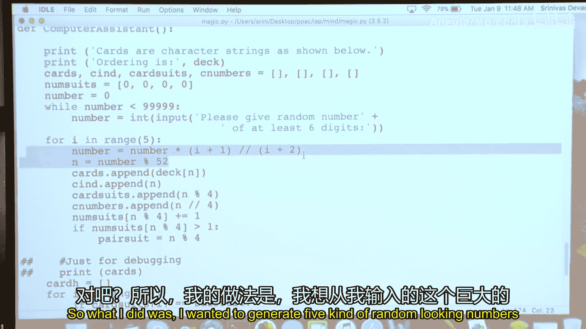

You know， why am I not getting this right， right， It kept saying sorry， not impressed， right。

 And what it meant was it wasn't impressed with my coding， not， not with my deductive skills。 Okay。

 so it took me a while to figure this out。 Alright， and you can fix it。 Okay， so， so that's it。 Any。

 any questions about the， what we've talked about， the puzzle or the code。Right， okay。

 so in the five minutes that we have left。 let's talk about whether there would be a trick。

 which would be perhaps even more impressive where we would only use four cards， right。

 So itd only be four cards that the audience selects and we would Billy， I guess。

 would show me three cards。😊，And I'd have to guess the fourth， okay。Would that。

 would that be possible， I mean， the numbers really， you know， don't work， right。

 because that that fourth card， I could be one out of I guess if you show three cards。

1 out of 49 different possibilities。 and it would be， would be pretty difficult， right， you could。呃。

You know， think about something where。The only way I could come up with was required much more encoding。

 But I was thinking about something like this， right， where let's say I have these four cards， right。

And let's even take， let's， let's say that they're all of different suits， right。

 because that's possible。 What， what the other thing that happens when you have。

 when you only have four cards is they all four could be of different suits， right。

 That's certainly possible。 I keep。2。What do I want？ I want a heart， okay。Good。

 so I have something like this。 And now I'm in real trouble， right。I mean。

 clearly anything that we talked about isn't gonna work， right？

 So let's say that that I end up choosing one of these cards， you know， to hide， right。

 So this this ace is hidden。 Okay， because it's not quite clear what I what I can do here。

 but bear with me for just a minute。 So for argument's sake， let's say that that now at this point。

 I'm trying to get more information out of this。 the ordering isn't gonna help me。 I mean。

 the ordering isn is gonna help me a little bit。 but what am I gonna get like6。

 know one through 6 from this。 so I could say the first card is， is an anchor。 Okay。

 And so I'm gonna expose this， So the only thing I could think of was you could sort of do this is a little bit obvious and maybe giving things away。

 But depending on where you have the hidden card。 and you can get more information based on。

The order in which you put these cards out and whether theyre to the left or the right of this of this hidden card。

 Okay， so you need to do something like that。 I mean， I I， I haven't figured this out。

 I at least I can't think of think of a complete solution to this puzzle。

 but I do feel like that you can get some information。

 additional information based on whether you put things to the left or the right。

 And that's clearly a bit of information that you get and maybe you could add to that and you know。

 think about it。 rights I think it， it makes for an interesting exercise。

 and obviously this other ways of of doing the five card trick as well， alright。Cool， alright。

 That's all I had for today。 If there are no questions， we can。Close this particular session。

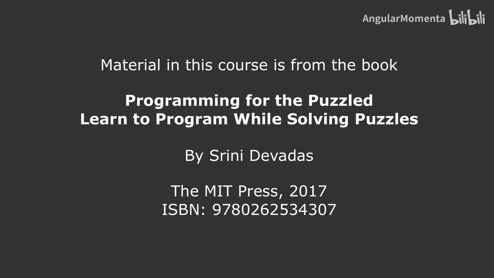