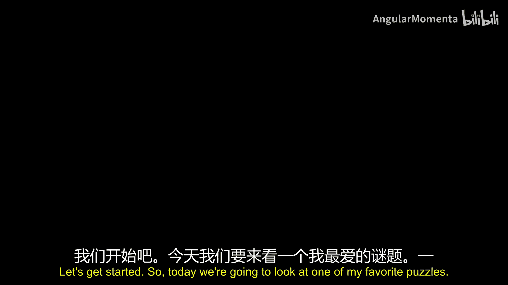
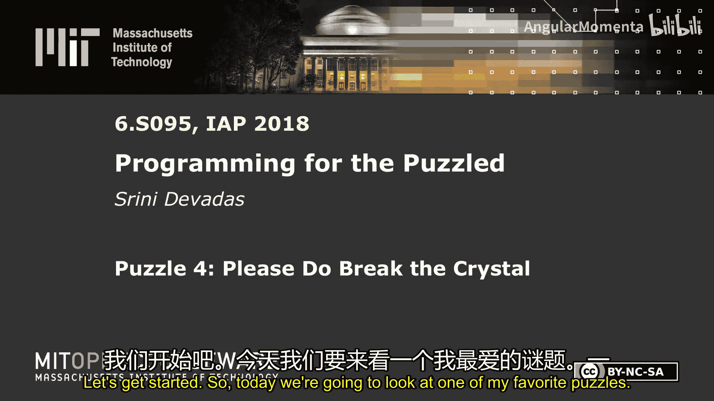
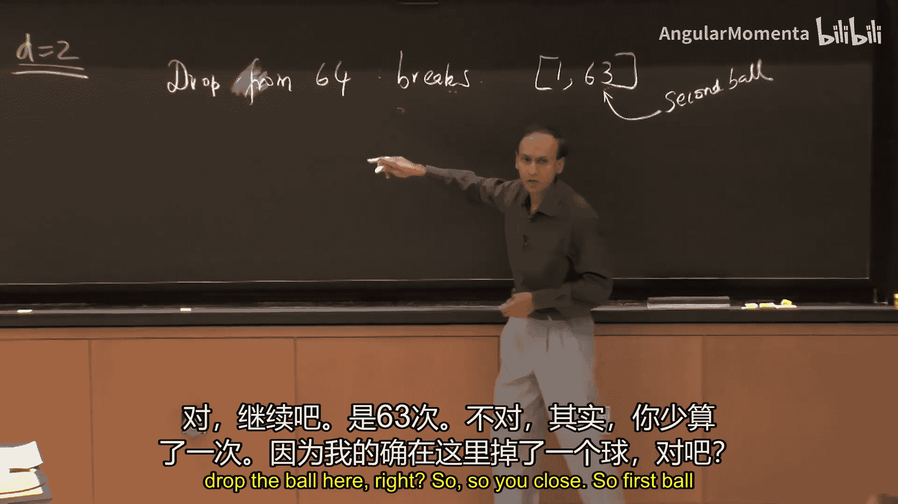
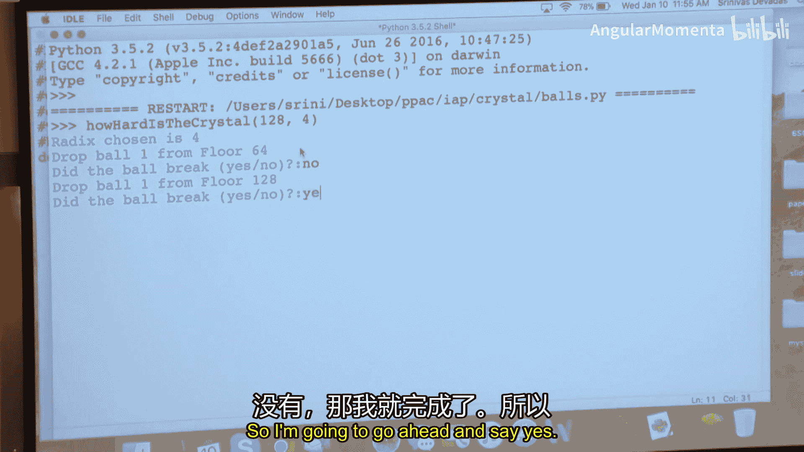
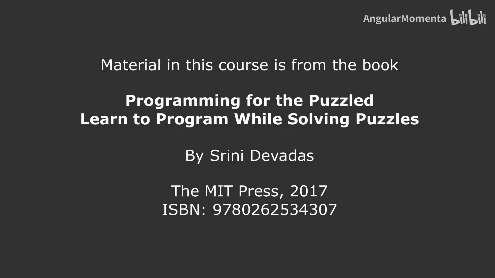

# 【麻省理工】为困惑的人编程-｜-MIT-6.S095-Programming-for-the-Puzzled,-IAP-2018-p04-谜题4-请打破水晶--BV1qp7LzeESm_p4-

。晚点我。Let's get started。 So today we're going to look at one of my favorite puzzles。

 I'll say right at the beginning that the coding associated with the puzzle is fairly straightforward。

😊，But the analysis associated with this puzzle is quite intricate。And in particular。

 you're gonna have to do worst case analysis， which is really a good thing to。

 for you to learn about。Because asymptotic analysis in algorithms is all about worst case。 Allright。

 so keep that in mind when you try to come up with answers to my questions， always keep in mind that。

I'm going to be asking for what happens in the worst case。 You know， in the context of our puzzle。

Which is， is， is called the crystal ball puzzle。 And it's fairly popular in the literature。

 though I've generalized it a little bit。You have a situation where you're supposed to figure out the hardness coefficient。

Of a crystal ball。 And in the generalized version， you have a set of identical crystal balls， right。

 so。How do you find this hardness coefficient？ Well。

 you go up to this Shanghai tower that has 128 floors。1 through 1，28。And you drop。

This ball from say floor 1。 So just you're standing here and let's say you just drop it from there。

 or you go up to floor 2 and you drop the ball and the hardness coefficient。

Is defined as the highest floor。From which you can drop the ball and the ball does not break。 Okay。

 so what this means is if。For F。The ball doesn't break。And it breaks。At F plus one。

Then the hardness coefficient is F。And you can assume a monotonousity properly that says that if it did not break at floor F。

 then。It won't break。This implies。That it， it， it， it won't break at at any floor less than or equal to F。

 Okay， which makes sense， right。I otherwise， it would be kind of complicated。 It would be random。

 and we won't be able to do any interesting analysis。So， the。easyas version of the puzzle， of course。

 which is not particularly interesting is。If you needed to get。This this exactly， right。

 So your job depends on getting that number exactly right。 So there's no shortcuts。

 You got to get it right。 You can't be off by one either way。 And you have only one ball， right？

 So you， you only have one ball。 So， so what can you do if you only have one ball and you have to get it exactly right。

Try every floor， right， And， and， but more important， I try from lower floors to higher floors。

 right， So you， you drop it at at floor 1。 So one ball。You drop。From floor 1， and if it， and。

 and if it breaks， then your hardness coefficient is， is you， you return 0。But then if。

 if you keep going and it， and it you let's say you drop of dut do， dot。Of from。floor。65。

 and it breaks。 and you've gone in order。 Then the hotness coefficient is 64， okay。Right。

 so that's easy enough。 There's， there's no optimization here。 It's the only thing you can do。

 So that's why it's not particularly interesting。Now。

 if you have identical crystal balls that are guaranteed that were manufactured in exactly the same way。

 etca， et ceter。Then obviously， things get a lot more interesting because you can try to minimize something。

 And I'm going write it over here because I want you to keep this in mind throughout the lecture。😊。

Our goal here。Is to minimize。The worst case。Number of drops。For our problem。And。We want to。

 we want to solve the problem in the general case， with D balls。And I should say the identical balls。

But more important， the reason I'm writing this up is。As I said before。

 we need to focus on the worst case， right， So it may be the case that for a given set of balls。

 your algorithm does very well。In in the sense that the hardness coefficient happened to be 42 and you。

 you picked the floor as as as of 41 to begin with And so you drop from 41 and it doesn't break and then you go to 42 and it doesn't break and you go to 43 and it doesn't and it breaks and you go。

 oh， I only need a two drops for this particular problem。

 but but if you but if the hardness coefficient happened to be 65 and you started from floor 41。

 I mean， you need 20 odd number of drops， right， So you have to be careful in that you have to analyze whatever strategy you come up with。

in the case where the hardness coefficient could be pretty much anything。 I mean。

 it could be 0 or it could be 128。 Al right， in that Shangi Tower example。Allright。

 so the first interesting question。Is。What happens when I have。2 identical balls。Right， so， oh。

 before we do that。According to。According to my metric here。What is the worst case？

Number of drops for one ball。What is the worst case number of drops for one ball。Give me a number。

 someone else。你 back，我要做你。1，28， exactly right。 So it's，'s 128。

 because I could have had a ball that doesn't break from the 1，28 floor。

 I don't know that to begin with。 I have to start with floor 1。 And I got to go 1，2，3，4， etc ce。

 right， So the worst case for one ball is 1 hundred28。 And you can't do better than that。 Allright。

 but of course， it gets more interesting when D is large。😊。

So our goal now is to discover an algorithm。That is going to minimize the worst case number of drops for D equals 2。

 Okay， that's， that's our， that's our current goal。 right。

 And then we'll look at more even more general things。

 So how would you do if things if you had D equals 2。Right。And just I。

 it doesn't matter if you don't get the algorithm right， I'll let we'll analyze it。

 You propose something， we'll， we'll analyze it， and then we'll decide if we can do better or not。

 Yeah， go ahead。Drop the ball from the Howood 。664。你是保他。Use the bottom half excellent。

 What's your name。Sorry， so， so Do says that we should do binary research， right。

 which is very intuitive and and kind of make sense in lot of context， including this one。

 And so let's drop。From， sorry， from 64。 And the reason she picked that is because 1。

28 divided by 2 is 64。 And if it breaks。Then you need to look at the interval 1， comma 63， right。

 because it， if it。I'm sorry。 if， yeah， that's right。 If， if it breaks， you。

 you need to look at the interval 1 comma 63 with a second ball。 I mean。

 that that first ball is gone。 Okay， shards of crystal or whatever you want to call it。

 So so you just have the second ball。 And so now at this point， you have no choice。 right。

 You only have one ball left。 right， As I mentioned。

 your job depends on getting that hardness coefficient right。

 So you can only use that first algorithm， in terms of starting from one and going all the way to 63。

 And so what is the worst case， number of drops， given that diamond picked the midpoint for this algorithm。

 someone else。Yeah， go ahead。It's 6063。 No， actually。

 it's you're off by one because I did drop the the ball here， right， So， so close。 So I first ball。

was dropped once， one dropped。And at this one， if， in fact， you the hardness coefficient was 64。

 you dropped the second ball 60，63 times。And that would be the worst case in the， in。

 in this instance。 Now I've， I've skipped over one little thing。

 And the fact that this is the midpoint implies that this is， in fact， the correct answer。

 But you do have to analyze。 I mean， remember， you know， when you do analysis。

 you do have to cover the entire spectrum here。 So you do have to look at the case where the。

 the drop from 64。It does not break。Okay， and in that case， you're looking at。

Looking at 65 through 128。But you do have two balls for this。Right， it didn't break。

 So you still have two balls for that， right。 And so you can imagine that now that you have two balls and you have a small interval that you're going to be able to do something like 32 for that。

 The bottom line is you don't even need to you can get a little bit lazy here。

 You don't really need to analyze what the number is。

 because you know that this number 63 plus1 is is larger than that， because you want it worst case。

 right So this this is the kind of thing that you have to do when you do algorithmic analysis。

 maybe not exactly in in a puzzle situation like this。 But you you have to look at all the cases。

 right， And you have to find kind of the max of all the cases， right， So is this the best you can do。

Yeah， go ahead。Thank great。When we8 into smaller sections even the first fall instead。

half you could do it every 16 floors every 16 floors starting from the bottom and then once the first fall breaks and you have a smaller area。

Let's say race。32， you have to only test。在的。What did they。That's correct。 Yeah。

 so it turns out you can do it。 I mean， this is obviously。

 there's not gonna be a whole lot of optimization here with D equals 2。

 but you'd be surprised as to how much better you can do than 64。

 which is obviously a big step forward。From 128， but you can go a few more steps as well。

 And so what was your name？Lucy， so Lucy has it right。 it's a similar idea。

 except you don't necessarily need to do the intuitive。Bine research。

 it's actually kind of different from that because of the way this problem is structured and。

What her idea is is that well， we'll look at something smaller， a smaller interval。Okay。

And that she picks 16。 So let's go。1632 is our algorithm。Is something that goes 1632，48，64 dot。

 da dot。 And， you know， maybe gets up all the way to。 I guess 6， Yeah，1，28 and 1616 is a。Its 1。

28 is a multiple of 16， right， Some， some math person tell make sure I'm right。 So。

 so you have so what happens here。 So let's analyze this to make sure that we're good in terms of an improvement。

 right？ we have to be careful。 So let's just arbitarily say that。It broke at 64， Okay。

 because that's kind of what happened over in that previous algorithm， too。

 So that means I've done four drops。Without a break。Right。I'm sorry，4 drops。

3 drops without a break and four drops total。Right， so I've done four drops。

 But now the cool thing is， I don't have to start from 16。 I can I know it didn't break at 48。😊。

RightSo I I can now look at forrop still break。A first ball。That is what I wanted to say。And now I。

 I can look at the interval。4849， because 48， it did not break， right，49 to 63。Inclusive， right。

 And so if you do that， that's 15。It's 15。 the difference is 14， but it's inclusive。 So it's 15。

 So 15 plus 4 red that is 19 drops。All right。Yeah， back there。 the worst case。ll be 27 Yes， that's。

 that's that's， that's absolutely correct。 So， so 19 is not the worst case。 I mean。

 it it is looking good， but this was exactly the point I was trying to make right from the beginning。

 You will not done yet。 I mean， you cannot just go off and say that 19 is the worst case for this algorithm。

 The worst case for this this particular algorithm occurs at a different point from the。

 the original algorithm that went midway， right， every algorithm is different。 the parameters are。

 are different here。 And so I'm just calling it a different algorithm。

 But the the case that would happen is， I guess youd have 1，12 here。And then you'd go1，2。

 So how many。 So let's say it gets to 1，208。 And if it doesn't break， then you're clearly done。

 So that's not the worst case。 right？ So if it gets to 1，28 and it， and it breaks。

Then so how many drops have we done，1，28 divided by 16。Is what is 8， Are you sure。You're all sure。

 Okay， then I'm sure。So， that's 8 drops。And now you need to do 1，13。To 127。And that we know is 15。So。

 that's 23。Alright， So， so， so the best you've done here is， is 23， right， But I be satisfied。

We're never satisfied。 You always want to do a little bit better。 Okay， so， so how did she pick 16。

Why did you come up to 16， Lucy， It looked like a nice number。You just you just figured， oh， nice。

 Okay。 So， so， so if it had 17， then we would had real trouble， right， with， with all these numbers。

 Yeah， go ahead，I think you can do a little bit better if you get closer to the square root of。

 beautiful， beautiful。 I love you guys。 You guys make it so easy。😊。

So that's the next thing I was going to try and pry out of you。 But you got it out。

 without much effort from me。So you can， you can kind of get analytical here as opposed to doing things empirically。

 which was you know， try a number and figure out what happened， which is kind of what we did。

 And you can be a little more analytical about this。 And you could say， hey。

 suppose I want to find this number k， which is kind of this 64， started with 64， went to 16。

 And now we're thinking we can do better than 16 even。 And we start dropping。Things at K2 K。3K。

 And I want to get this exactly right。So let me look at my notes and you go dot dot dot n divided by k -1。

Times k。And， and divided by k times K， which is obviously M。 And so I， I'm trying to。

 I'm trying to write it。 and I'm trying to get this K。 I want to write something。

 I want to minimize some quantity and discover the K that is going to give me my best case in the worst case。

 Okay， minimize the the worst case。 right， So that's， that's really what I want。😊，So。

 so if you look at what， what happens here。You're， you're in a situation where you have to now。

 you have to count， right， I mean， what do you wantanna， we've decided that。

That K is this general strategy。 and we don't quite know what K is。

 And we have to do some analysis of the worst case situation in order to find the K that would work well for us。

 And so the way you do this is by essentially the analysis we've done so far。

 and kind of we have a nice， the point that was made here。

 I think was it was Kevin who said we have to go to the last drop because that's kind of the the case where it's the worst case。

 and that's similar here as well。 because if you go up all the way here。

 and then it breaks if it doesn't break here， you're done。 if it breaks here。

 then you got you done a lot of drops before it broke that first ball。

 And so that's the situation which you can pull in as your worst case situation。

 right So that's exactly what we did before。And so， so if you really think about it， the， the。Isumm。

First ball。Doesn't break。Till the last drop。Is the， is the worst case situation， right？

 And so what does that mean from a symbolic standpoint with respect to the number of drops of So so the number of drops in this case。

Of the first ball， can someone give me an equation for it。Yeah， ahead and Kevin too，So。So n over K。

 right， So， so that's， that's what happened there。 Now， well， it broke， right。

 That's what we decided here。 And so now you need to search。嗯。And。K plus one。Right。To。Bell。

 you gotta all the way there。I'm sorry it， it broke there。 So you got to go n -1。呃。

IThis is the same as what I wrote before。 and， but it's just that I had numbers。

 and it was can easier to write numbers than write these symbols。

 But we have to do this because we don't know what K is， okay。

So the if you look at the how many drops are And if you kind do this， you get if。

 if you notice this gets simplified to N。Yeah， so this is N。 then you have minus K。plus one。

All the way to n -1。Right， so if you subtract and this is a plus one here。 Boy， this is confusing。

 I'm not good at math。I'm definitely not good to math。 So this is K -1 drops。呃。In the worst case。

Alright。So you now need to add these two things together。So what we'd like to do is minimize。嗯。

N divided by k， which is this plus that。Right。We want to minimize this function。Right。

 N is's a constant。 K is variable， right， And we know for a given n。

 we want to discover the K that minimizes this quantity。

 And it goes back to the in intuition that that I think Josh had about a square root N， right。

 So again， high school calculus here， which I've forgotten， is hopefully you haven't。

 because you still need it。 I don't。And you end up essentially saying you can turn this into two race to square root of n-1。

Drops。In the worst case。All right。So for so you can take the， the floor of that。And that's。

 that's 11。 Okay， so， so that's， that's the square root of n。 So two times 11-1 is 21。

 So you can do 21。 So you think 21 is the optimum。Yeah， Kevinvin。그没都。Yes， as you can。

 you can do a little bit better。 I don't want to do this Yes yet。 Hopefully we'll have time。

 We'll get to that because I want to go to the the D greater than two case。

 But you're absolutely right。 It turns out you can do this would， this would give you 21。

 as I mentioned at 22-1 it turns out you can do better by a few drops。

 And the assumption we made here。😊，What is the assumption that we made here。When I wrote this。

 what assumption did I make， which is kind of similar to what Kevin just said， but not exactly。

 right， But someone point out the assumption that was made here。Not you。 someone else。All right。

 youre not go for it。Yeah， the intervals are equal， right， So， so， so I this， look， it's。

 it's a different problem。 If it didn't break here。Then， I got a smaller。I have two balls。

And I had a smaller problem。 So why would I use the same K， right？ I mean， that kind of makes sense。

 right？ So now it's more complicated。 And hopefully we'll get to that。

 But I want to do other things first。 So so that's the reason。 So at least。

 you know why 21 isn't optimal， right， It's because of this constraint that we placed on ourselves in order to do this analysis to get to the point where we had two times square root of n -1 that that corresponds to the equal interval constraint。

 Okay。Al， so good。 Alright， Any questions about this。So as you can imagine。

 I'm not going to show you code that computes two times square root of n -1 so that that doesn't make sense。

 but we do have code to look at that corresponds to the case where D could be 3 D could be 4 and then obviously it gets more interesting in terms of what your strategy is and we won't go with optimizing。

 In fact， it's an open problem as to what the optimum strategy would be for arbitrary D D meaning the number of balls if it's 5。

6， whatever。 partly because of what I just talked about with respect to you need to utilize unequal intervals。

 but the natural thing to do now is to move to D equals arbitrary number of balls and stick with kind of the same algorithmic approach of having equal intervals And the question is。

 you know， what are these intervals。 and how would we find the size of these intervals because it's kind of not immediately obvious。

I told you D was 5。 and you， you don't wantan to just keep the three balls away and， you know。

 sell them later and just use the two， right， That doesn't give you your minimum。

 doesn't minimize your worst case。 You want to use these， use these balls。Go， all right， So let's。

Let's talk a little bit about。If I had D equals 3， I mean， again， you use your intuition。

What what do you think we should do。What happened for D equals 2 with respect to that interval and how was it related to n right？

 So what what do you think just wild guess maybe even what do you think we need to do if we had d equals 3 for that very first ball in terms of what we need to look at in relation to the the the interval size。

Yeah， back there。 bro， bro， what what's your name。Ryan， so Ryan says， you know， Q rootod。 And yeah。

 that， that's the correct intuition。 It's a little bit unclear。 You know， what happens， You know。

 So you do cube roots。 And maybe you have， you know， what's the cube root of 1，28。5， you know yeah。

 that's right。 I think it's 5。 Okay， it's close to 5。 You know， it it 6 or 5 or 6， right。

 And and so maybe I do 6。 and then I do 12 and it's it's a little bit strange。

 So it turns out it's actually6 and 12 when you start with 1，28 when you have three balls。

 it doesn't seem like it's gonna give you the worst case， right， right， because you know。

 like in the worst case， you might be dropping the ball 6，12，18，24， etc cetera， etc ce。

 right So cube root is right， but it's something a little bit different because it gave us this interval that was kind of too small。

 So how would I get something that's bigger， you'd want things that are a little bit bigger， I mean。

 I think you're going in the right direction， but I don't want 6 and 12 and 18。 I mean， clearly。

 that's going to give me like 25 drops And that's even worse than then then the two ball case。

 which which really means you should lose your job and never get another one。

 right So if you do something that bad。😊，So so that thats what what would you do that's。

 kind of different from Kbe rootod， but related to cube brood， right。Yeah， go ahead fun。あとにで。Yeah。

 yeah， two third。 So so what you want to do is you want to start it makes sense that when you have lots of balls in terms of being able to use them。

 that you start with larger intervals and you shrink them。

 right That's exactly what happened with two balls。

 you started with K in the case where we have two balls。

 and then were down to one when we have one ball So that's really what you're doing when you have one ball。

 all you can do is go one floor at a time。 when you have when you have two balls。

 you go K where K happen to be square root of n。 And then we have three balls。

 you kind of want to start with like n raised to two thirds in terms of the in terms of the interval right And then if I had four balls the argument would be that I would start with n raised to three quarters and then I would go to square root of n and then I would go so on and so forth。

 And what is that reminding you of。 what is in terms of these powers know getting not quite n， but 5。

6 n and so on。 What is that reminding you of。Yeah。From number number theory or just sort of regular arithmetic。

Yeah， different bases。 It's different a different ras arithmetic， right。

 So it turns out the way you want to solve this problem。 And。

 and this is in keeping with the intuition you you you have with respect to the cube roots and so on and so forth。

 The way we want to do this is we want to think about D digit numbers。And the numbers themselves。

 And D is the number of balls。And so that's the digitous。 But what。

 what is the raix of these numbers， Okay， the， the， the ras of these numbers are going to be related。

To the， to the K to the intervals， right， So you， you， you essentially want to say， you know。

 I'm counting in multiples of k， right， You know， I went K，2 K，3 K， etc cetera。

 So if I had like radix K， that means I'm just incrementing that particular particular digit， right。

 You know， if I， if I go， if I had raix 12 and， and， and I had 1，0 and radix12。Right， then you know。

 this， this， this would be。嗯。So when I go 2，0， then the the most significant digit got incremented。

 And so this， this is plus 12。This is 12 times larger。 I'm sorry。

12 larger than 20 is 12 larger than 10 in in in ratingdix 12， right， makes sense。

 just like20 is 10 larger than。Than 10 in in decimal， right， So， so that's。

 that's the way you want to think about this。 And so you're going to do our。A numbers。

And the first thing that you need to do is you need to figure out based on the number of floors that you have。

 figure out given D， you're given n， the the number of floors。 and you。

 you're given the number of balls。 And you got to figure out what raix you're working in。

 And this is going be a generalization of the square root of n as as you'll see。

 we we want to choose a radix。 such that。R race to D。Is greater than n。I choose R。

Such that R race to D is greater than n。 right And so that comes back to， obviously。

 if you needed if D were 2， then it makes sense that R would be square root of n right。

 which is in keeping with what we talked about right But if if D is3， then the radix。

 not necessarily the interval that we choose because the intervals are going to be different is going to be more like the cube root of n。

 which is also proposed Ryan mentioned that。 And so， so in this case， let's say that n where 128。

And D equals 4。Then， we would choose。R equals 4 because4 raised to 4 is 256。

 which is greater than 128， and we can't choose3 because three raised to 4 is only 81 and 81 isn't greater than 128 So you'd have to choose 4 So so what we are now saying is we want to somehow figure out we're not quite there at an algorithm yet。

 but we have a kind of a path forward in that we want to look at the representation that our area representation of these digit numbers and we're going to essentially increment。

 And so our our goal roughly speaking were going to go with this representation and we're going to start incrementing digits。

 So we just go 0，12 in terms of the digits but but because the representation。

is our area that means something different in terms of the number of floors， depending on what R is。

 right， I mean， just like I said， if this were， if this were turnernary Ternary representation。

 then then in terms of floors， this is only you know， this would be for Ternary。

 this would be three floors，2，0。 in 20 would be  three floors away from 1，0， right， in decimal 20s。

 10 floors away from 1，0 and so on and so forth。 That makes sense。Yeahep， ask me questions if。

 if you're confused。So let's take an example。 So， and then we'll。

 we'll look at that we'll look at code that actually builds this algorithm from， from scratch。

So we take our example of D equals 4 for our canonical 128 floor Shanghai Tower。

 because you do want to get a sense of how things improve。

 We did improve from obviously D equals1 through D equals 2 with the equal interval assumption。

 but with this radix idea we'd like to see how much better we can do with D equals 4。

 And we wanted to substantially better than than 21 drops or whatever we had back there。So。

 so R is 4。 D is 4。 I'm sorry。 D is 4。 N equals 1，28。

And what we're going to do is the smallest number is 0，0，0，0。 and in in brackets。I'm I'm gonna write。

 you know what the decimal representation is， because I think that does give you some intuition。

 you get a sense of how this translates into into floors。 And after after a while。

 if you're gonna tell someone to do this you want to give them floor numbers in decimal because Shanghai Tower doesn't have some weird representation for the floors when you get to an elevator or anything like that。

 So， so this is floor 0。 And now the highest number is 3，3，3，3 which which happens to be 2，55。

 I'm not gonna write floor each time。 But when I put things in brackets here。

 that's the decimal representation。 Okay， so that's 255。 So that's obviously too big。

 we don't need that。 But we're stuck with having to choose R equals 4 for the reasons I described to you before。

 So so there's somewhere in here， there's there's a 128。

 and I can't I don't have it right up in front of me as to what。What 128 would correspond to， but 1。

2，3，3， for example， would be floor。1，1，1。Right， so so the way this works。

 and you all know your ratingrithmetic， it's three times 1 plus3 three times 4 plus two times 4 square plus 1 times 4 cubed。

 right？ That's， that's what you have。 And that's how you get 1，1，1。

So all what you have to do in in order to do this right is， is to start with the most significant。

Digit， which is the leftmost digit。 And that makes sense because we want our intervals when we have lots of balls to be large and that as you move and the balls break。

 you're going to start shifting。Right word。 And you're going to be incrementing different things。

 right， And that's essentially going to give us， give us our， give us our algorithm。

 And so we'll talk about， let me just give you an example of the algorithm。 and we'll。

If we look at we look at how the the algorithm is implemented， as I mentioned。

 it turns into 10 lines of code because all you're doing is translating into this representation。

 and you're just incrementing bits of the representation。 And it's interactive。

 You can play with it later today or whenever and you can sort of think of a hardness coefficient in your head then see how how things work out。

 But before we end， we obviously have to do a worst case analysis off this of this algorithm because that's a whole point of this exercise。

 So let's so so in this case， where do you think I should So I don't want to drop。

 obviously at floor 0。 I mean， that there's no notion of that。

 So where do I drop at at the beginning。The first drop is that。Given what I told you。

You can tell me in any， any representation。Where would I drop the first ball if I have four balls and 128 floors。

I said， I want to start with， with something that that obviously there's some large interval here。

 And I want to I， I want to start in the left hand side。 and I want to increment the leftmost bit。

 which is the most significant bit， right？ So I would start with。1，0，0，0。 Okay， so the first drop。

Is at 1，0，0，0， which is at floor 64。Okay。That's the first draw。 Now， if， if， in fact。

 this this does not break。 All right， So let's assume that this does not break。

Then what do I do next。2 is 0，0，0， right？And this would be 128。Right， okay。

 let's assume that this breaks here。Alright， so now what do I do。It broke。 I lost a ball。

Now I have three balls left。 still。 that's the good news。 And how many。 So what do I need。

 where do I need to move， If I have three balls left。

 I need to be in a representation that has how many digits。3 digits， right， So I need to move。 I I I。

 it broke at 2000。 So I know that it's less than 2000。 So I need to go back to this。

 because this is the， this is the highest floor in general， when whenever things break， you。

 you go back to the highest floor that you know that the ball didn't break， right？ I mean。

 that's the canonical strategy that we followed all through。 when something when the ball breaks。

 you go back and say， oh， but I do know that there was the highest floor in which the ball did not break。

 and I have to start with one plus that， right。So， so。

 so what I'm going to do here is I need to go up and。Yeah， because it broke， I need to look at。1，0，0。

1。Right， the interval that I need to look at。Is 1，0，0，1， right， because it's one more than that。

And all the way to1，3，3，3。Which is one less than that。Okay。

So and this if you may feel a little bit better looking at this in decciimal， I certainly do。哦。

It's 65，1，27， which makes perfect sense。 So far， we've played around with the with with the balls。

 the first two balls。 And so we haven't really seen anything very dramatically different from the the。

 the two ball case。 but more， more is coming。 right， Let's say this does not break。

 If this does not break。Then what would I do now。If it does not break， I'm sorry，The my bad。

 my bad Take I haven't even actually told you。 I've， I've just talked about the interval。

 and I haven't said what drop you need to make， right， So， so ignore what I said just now。

 I think that the the next question is the ball broke。 So I have a second ball。

And I want the first drop of the second ball。Alright， and I， I， I want to look at this。

 I want to look at this interval， and it has to be somewhere inside this interval。

 but it's not gonna be。 I'm not， I'm not gonna drop this at this floor，65 or 1，3，3，3， I wna。

 I wanna pick something in between right and so now looking at this， tell me。

 according to what you know so far。 where do you think I should drop。The second ball。

 for the first time。Go ahead。96。 And how did you get that。Just like。You， you and you put 1，1，0，0。

 perfectf。 What's your name， Evan， So Evan says 96。 I guess see things in decimal， you know。

 naturally， like most of us。 but the the way you would code this， by the way。

 is by incrementing this digit Okay， and you'd get 1，1，01，1，0，0。 And in this case。

 let's say it does not break。Then where do you go， Evan。Yeah， after 96， it doesn't break。

 What what would you do。Oh， then you would go to what is that。InIn， no in， in。

 in in this representation in in easy it make whatever is easier for you。1 perfectfect，1，2，0，0。

 which happens to be， I think 1，12。So you go to floor 1，12。 This was 96。Right。

 and then you need to add another 16 to that。 Yep，1，12。And so on。 right， So I want。

 I won't bore you with this。 you get a sense of what's what's going on here。 And obviously。

 with these things， you can wave your hands and you get a sense of what's going on。 But ultimately。

 you know， what's great about。computeruter science and programming is theres you gotta teach a dumb computer to do exactly the right thing。

 And there's no two things about it in terms of you understand this algorithm。

 I didn't understand this algorithm until I coded it fully， right， I mean。

 maybe I still don't understand it considering the， the mistakes I'm making。

 But this is because I I've lost a bunch of grey cells。So， so let me。

 let me show you what the code looks like。 it's 15 lines of code。 right， It's not that much。

 And as you can imagine the representation is I could have used many things I just used the list for each of these digits。

 I'm incrementing these digits and I want to spend a whole lot of time on the code but what I want to do before we end here is talk about I actually let me do that first before we go to the code。

 I want to talk about the worst case here， right， because that's all， that's what this is all about。

 I want to get an equation just like we did for two times square root of n -1 and all of these different things。

 I want to get an equation for the worst case in terms of the number of drops in relation to R and D which are obviously related to N right because R race to D has to be greater than n right So if you kind of look at this。

 And it turns out， this is not a difficult analysis right。

ThinkIf you think about it and you start thinking about worst case and you think about how were incrementing these things。

 these phases and if you can think about a phase as as when when a ball breaks know。

 that's when a phase is done and you move the second phase right tell me。

 how many drops I have you break it up in terms of the number of phases or the number of balls。

 whichever way you want to think about it。 and use the same kind of worst case analysis we've done with respect to what happens what happens in the worst case you have to keep doing a bunch of drops。

 and really for these algorithms， the floor 127， the hardness coefficient of actually the hardness coefficient of 127 is is the hard one it's a difficult one because you kind of go through and you go all the way there and you do all of these things before you drop the ball a lot of times before it breaks。

And you do that for every ball， right， That would be the worst case， right。

 So that's kind of where things are at。 So from a symbolic standpoint。

 what is the worst case in the first phase in terms of the number of drops of the first ball。

From a symbolic standpoint， right。It's the first digit I'm talking about。

 Its the first ball I'm talking about。 And I'm I'm dropping this ball。

 as you can see at these different points。 So in general。

 how many drops would I have before you know I've either I maybe done completely because I know it doesn't break at floor 128 or what I have you。

 But what is， what is the worst case when that ball breaks Give me an equation。什方。

What's so I drop it once。 I drop it twice。 I， am I gonna drop it like， like if， if， if R is 5。

 am I gonna drop it 10 times。m what am I doing in terms of the。

 what is the upper limit in terms of this this digit。R -1。 And where am I starting from。1。

 so there you go。 What's， what's answer。R -1， right， So that's it。 So it turns out。That。

I have R -1 drops。In the worst case。For the first ball。And。I mean， it's a same representation。

 Every digit is， is the same raix， obviously， right， And now that ball broke。

 and I moved to the to the second digit with the second ball。 And I'm gonna start again。

 And in the worst case， I I could have r -1 drops for that as well， right。

 because I'm gonna go increment from 0， But the first one， I'm gonna to do is a one。

 And then I'm gonna to do a two and all the way to R -1， so。😊，R minus-1 drops for the second ball。

And then I go all the way to D balls。So， so my answer。呃。Yeah， go ahead over here。 on。还容易。Okay。

 so ours scored in this case。And we say the worst case is three。

How do we get three because if it doesn't break on either those on the 1000 and 2000 arent we？钱 drop。

Yeah， so so it gets a little。 you're absolutely right But if if the number were 2，55。

 so one of the things that's happening here is we've lost some precision because r race to D needed to be this large number of 255。

 And this algorithm is actually going to work for 2，55 floors。 Allright Yeah， because of N。 So， so。

 so it's not yeah， so that's kind of know it a good question you asked。 But unfortunately。

 you kind of want to choose a case where you have perfect precision in terms of r race to D is exactly what you need it to be。

 And in that case， this analysis works Yeah's the max n。 that's exactly right。 So I mean。

255 is substantially larger than 128。 So it kind of makes sense that as you said that you would be able to shave off certain things And so you can kind of do that。

 but little more involved。 But I think intuition is important。

 And the intuition is simply that your worst case number of。😊。

ps assuming your being a little bit imprecise would simply be R -1 times D。In， in the。

 in the worst case。 And this would be true for all N， which is less than R raised to D， you know。

 for， for for all lamb。 Alright， so it's， so now just in terms of numbers。

 I had R equals 4 and D equals 4。 And so you end up getting 12 drops for the 1。

28 case all the way to， you know，2，55 as well。 you need， you need 12 drops in the worst case。

 even for 2，55 floors。 right， which， which is really what you were asking， right， so good， right。

 That makes sense。So I'm not going to spend a whole lot of time on this code， but that's it。

s converting， I could have used a Python library function for that。 But that's simply a conversion。

 because I wanted to print things out， I don't even need this particular subroutine。

 which is essentially something that is doing conversion from decimal to to ourrithmetic。

 And as you can see， you see subtract and adding the adding is is the incrementation that I just erased。

 but you do see it up there from 1，0 to 20。 That's why you add。

 sometimes you need to subtract because things break And when things break。

 you need to go back to to the highest floor where the ball didn't break So that's where you do the subtraction。

 And so this is how if you ran this it's not the greatest user user interface。

But that's not the point。The crystal。So I'm going to do 128。And 4， which is our example。

And it says rating chosen as ball 4。 Did the did the did the ball break， I say no。

 And then I you know， did the did drop the ball， did the ball break。 If I say no here， then I'm done。

 right， So I'm going to go ahead and say yes， and then I'm gonna say no。 And then no。

 I'm going keep going no。

No。No， because this is the worst case，And I had， I got 11 right， in this case。

 So you do get close in， in the sense that Grnara was asking， you know， could you shave off。

 You only shaved off one。Because of the impresion。 So there is a case where even though you would only get 12 for12 55。

 but you do get 11 for 128。 Okay right， cool， good， So I let you look at the code。

 if you guys can can leave any time you want I just wanted to mention。

 I wanted to go back to the one thing that I didn't get that I mentioned。

 but I haven't gotten do which is this is still， you can still do better you can still do better。

 not because of what Gunara mentioned， know， that's just imprecision thing。

 but assuming even that was taken care of because the numbers worked out。

 you can do better because K can be made a different。

 You can do unequal intervals right So let me put that in the notes and you can read it by yourself。

 you had a question Evan you going through the ball drops kept answering that the ball did not did start asking you why did start telling you where like the next ball drop。

😊，It went 1，2， and then it went also to ball 3 and ball 4。

 I just stayed ball2 a whole time if it never broke。 That's exactly right。

 But that that's that's because sad lazy。😊，Yeah， yeah， yeah。 So it'd be a fine exercise to fix that。

 I mean， it's not one of the， it's not one of the exercises。 That's how you turn。 You know。

 after 30 years of teaching。 whenever I get a question， I turn it into an opportunity。 You know。

 for homework。 Okay， alright， that's how it works。 Alright， good。 See you guys next time， so。😊。

