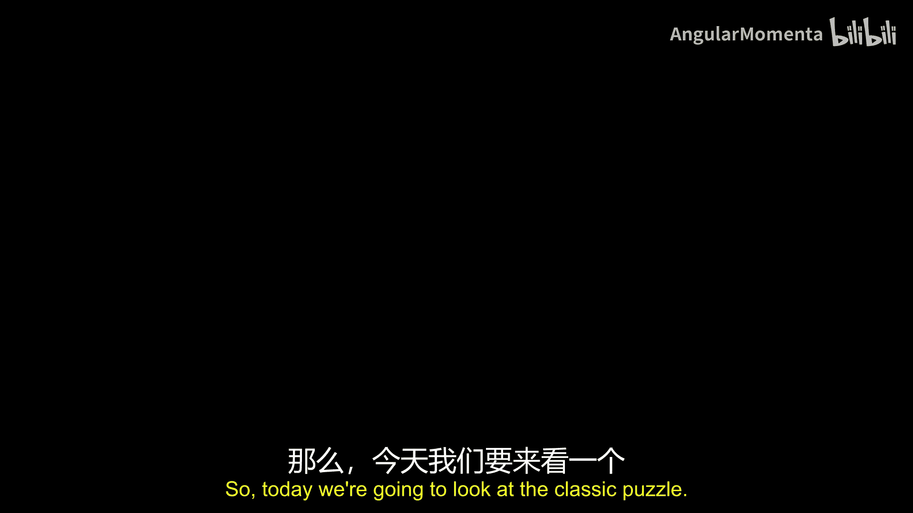
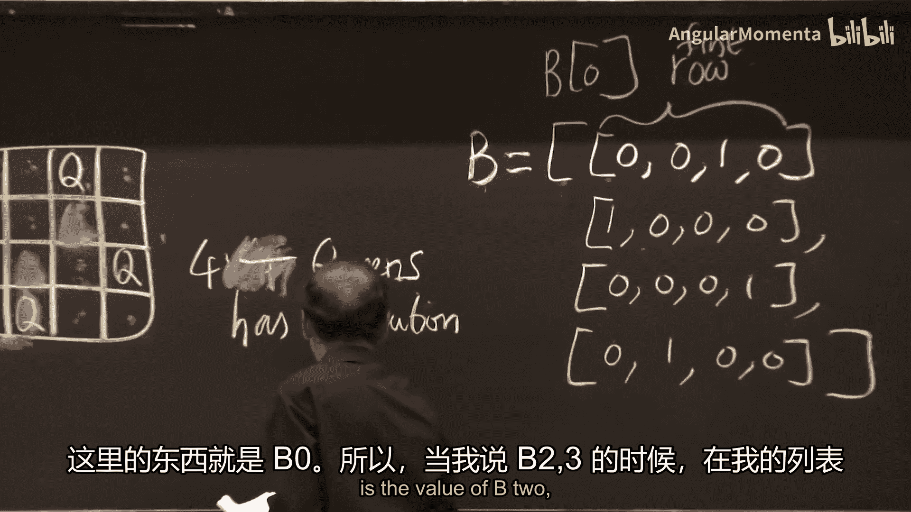
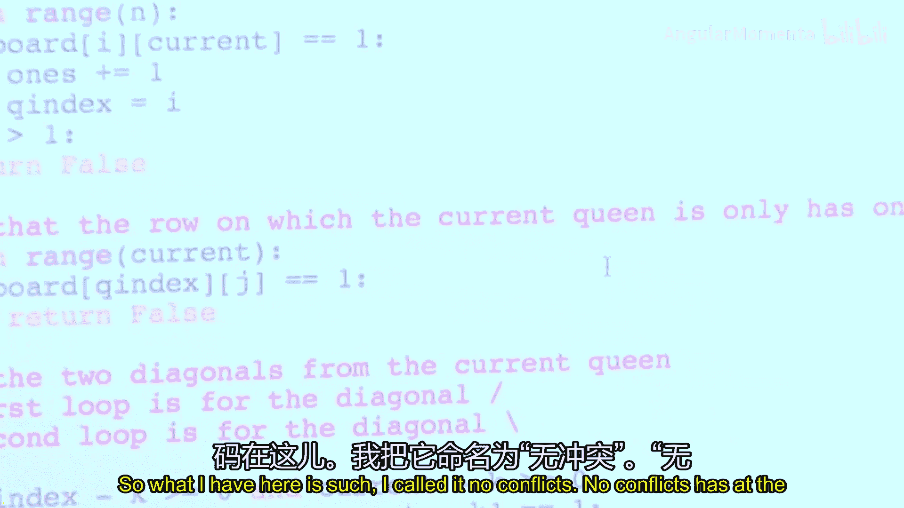
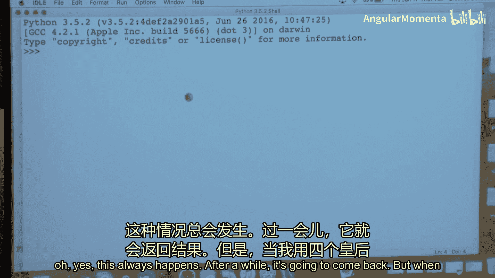
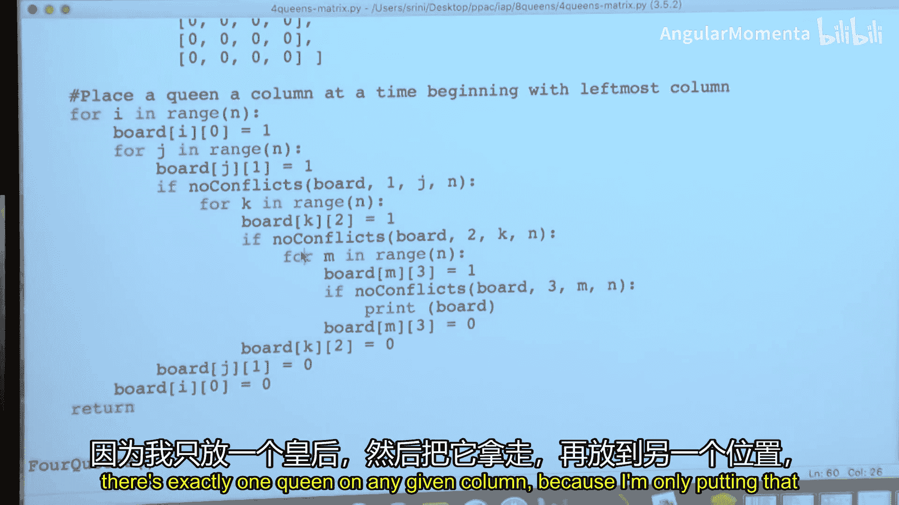
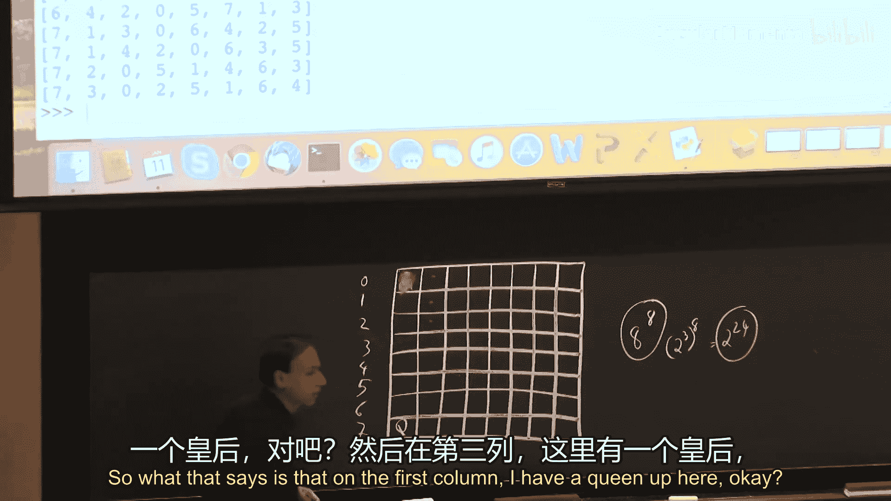
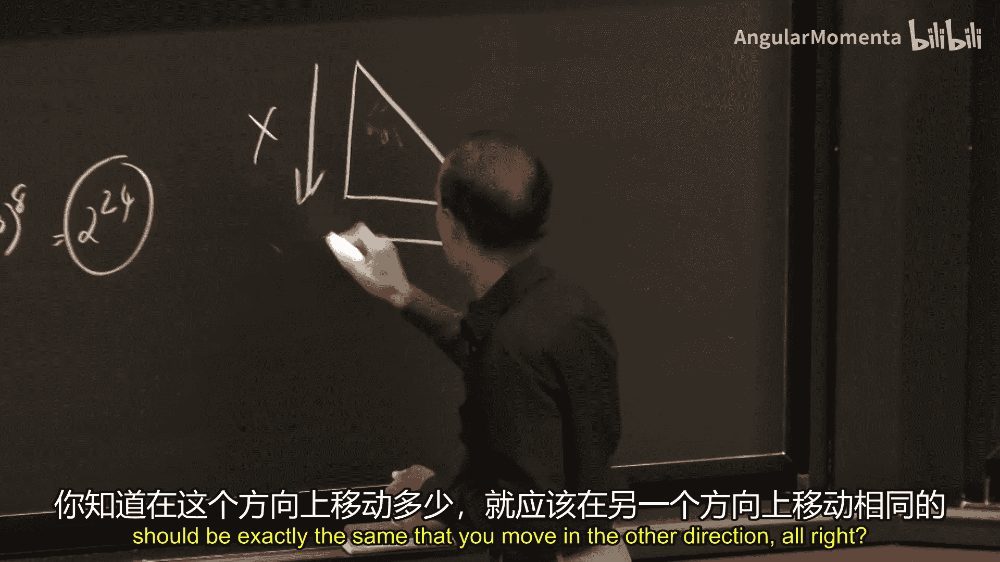
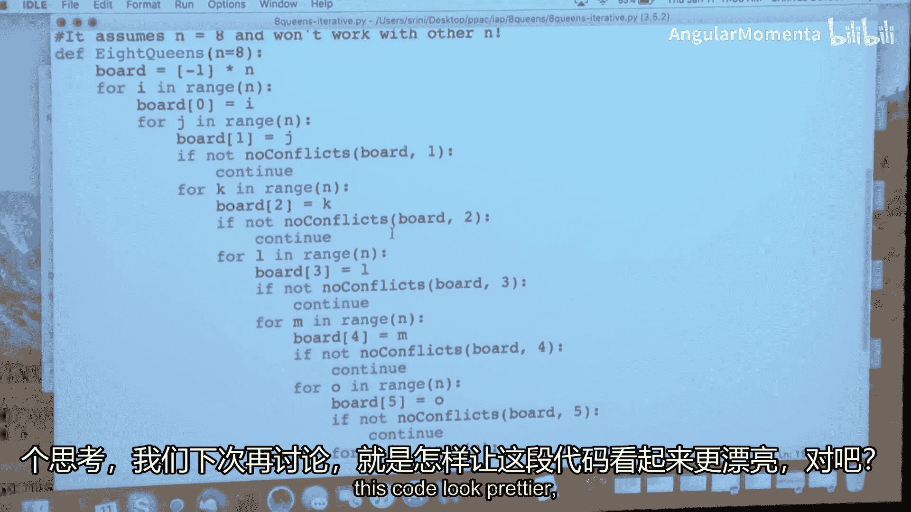
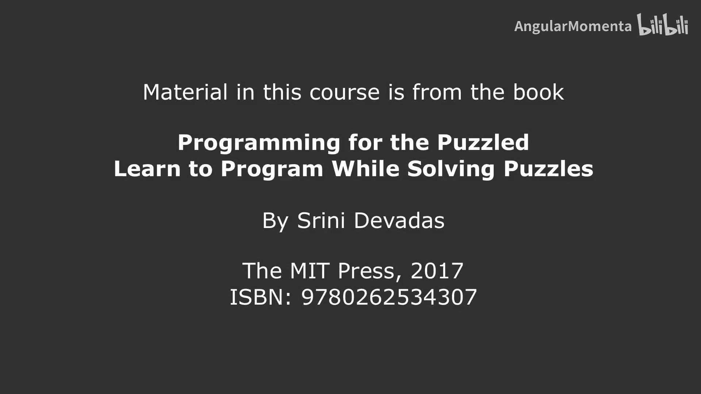

# 【麻省理工】为困惑的人编程-｜-MIT-6.S095-Programming-for-the-Puzzled,-IAP-2018-p05-谜题5-让那些皇后分开--BV1qp7LzeESm_p5-

So today we're going to look at a classic puzzle。 It's called the a queens puzzle。

IAnd very easy to describe。 I'll write down the rules if youd happen not to know chess and how a queen moves on a chess board in a moment。

But before I get into that， I just wanted to mention that the programming paradigms that we're gonna be looking at today are is。

 is， I should say， the programming paradigm is， is one of exhaustive enumeration。

And the what we want to do algorithmically is to look at all possible cases。

 all possible combinations， possibilities。 because we wanted to exhaust the space to determine if there's a solution to this particular instance of the。

 the problem or not。 And one of the problems， as I mentioned， is the eight queens problem。

 But you can imagine that you could say I'd like to solve a smaller problem。

 the five queens problem or the three queens problem。 And you'd like， obviously。

To be able to write code that solves this generalized problem where you can vary the number of rows and columns on a board。

 I mean， it's no longer a chessboard。 if it's not 8 rows and eight columns。

 but you can still obviously concoct a puzzle associated with an arbitrary size mode。

And then the other thing we that we'll do today is look at data structures。

 And so this is obviously going to be a data structure that's immediately clear from what I have up there on the board。

 matrix data structure to solve the problem。 But can you do things more efficiently with a different selection of a data structure。

 alright。So the8 queens problem is simply says I place。Eight queens。On a chessboard。

And that implies immediately that it's8 by8。As I've drawn over there。Such that。No queen。Attacks。

Any other queen。Now， if you had no background in solving this problem， perhaps in your chess。

 and you。Might think there's a solution。 You might think there's not。 I mean。

 a queen is pretty powerful。 A queen。 this implies because a queen can move horizontally。

 it can move vertically， It can move diagonally know。

 back and forth in in both directions up and down left and right and I guess up and down， diagonally。

 it's， it's a powerful piece。 It's the most powerful piece in chess。

 And how can you first time I heard about this problem。

 I my guess was that there wasn't a solution today queen's problem， And you know。

 how many of you think there's a solution to this problem。 do you know there' is a solution。

 or do you think there's a solution。Its like okay。N because they can。The way So。

 so so Grtro says this is a solution。 How many of you before you。

 you heard him thought there wasn't a solution。Right right。Well， you know， years ago， I I。

 I was convinced that there was no solution because I tried very hard and I couldn't find one。

 I tried very hard for a half hour。 Okay， and， and then I decided there wasn't one， right。

 So but but then you know， we can could now at this point， I。

 or it got to the point where I could write a computer program in about a half hour or an hour to solve this problem。

 And I did discover a solution。 So I'm kind of giving it away。 It turns out there's many solutions。

 And this certainly different code for slightly different code for finding one solution versus finding all of them right。

 and we'll do both。So without further ado， you want to translate the movement of the queens。

Into a set of rules。That。Tell you if you found a solution or not。And。There's basically。

 there's essentially three rules because the queen。Can move。In three different ways。

No two queens can be on the same column， no two queens can be on the same row。

No two queens can be in the same diagonal。And remember， there's two diagnoseagonals。

 one of which that goes this way and other one that goes that way。Right， so。

There's a lot of combinations here。If you think about this and you look at this board over here。

I have eight different。rows in eight different columns。 And the way that。

Someone might try to solve this problem。Is go you know， either left to right or top down。

 And I've written。The constraint， no two queens can be in the same column first。 So you can imagine。

 And this is what we're going to do。 you could certainly modify the code and modify our strategy。

 but we're going to go left to right。 So what we're going to do is we know we put a queen up here。

 we can't put a queen in any other row on that first column， obviously。

 because of the first constraint。 So maybe I'll put a queen up here。 And then at that point。

 I can move to the second column in my manual strategy。

 and I couldn't put a queen up up here because of the second constraint。

 No two queens can be on the same row。 And if I had a queen up here。 let me just write that up。

 So I can't put one here， I can't put one here。 I could put one here。

 And this goes back to what Gunatro said about this is how an moves in chess。

 and so so that gets me two queens。 and obviously not a solution to the problem of the eight queens。

 but maybe I'm a quarter of the way there， right。It turns out you have to do what is called backtracking and backtracking simply means you may have to undo a decision you made with respect to the placement of a particular queen in this exhaustive search strategy and the important thing when you when you do search。

 as I mentioned early on， you have to convince yourself that the code you've written is going to exhaust all of the possibilities and that it won't mis solutions and if you don't exhaust all the possibilities。

 your code will terminate and you may throw up your hands because you had buggy code or because you had a buggy search strategy and say there's no solution to the problem。

 whereas there is a solution to the problem Allright。So and the way you do this search。

 this exhaustive search， because it's quite intense。There's a lot of combinations。

 and they grow exponentially with the number of rows and columns in on our board is important。

 And so you want to be careful that you don't do redundant work that you don't do things that you don't really have to because combinations you know。

 blow up。 So there's hundreds of millions of combinations with respect to putting queens up here。

 So if you really think about it， there's like 8 difference places， you can put a queen here，8，8，8。

 etc。 So。You know， there's 8 race to 8， right， if you， if you think about that。

 and that's a large number， right？ And if you translate that， I don't even know what that is。

 But it's you， you could do， you know， this is two race to 3。Rise to 8。 So that's two race to 24。

 which is， which， which is in the in the millions。 And if you had a larger。

 if you had a larger board， it was isn't a chessboard， then it would be much， much larger right。

 as you as you grew the size of the board。 But two race to 24 doesn't scare us these days because computers are so fast。

 But back when I was your age， that was a large number。 Okay。

And you didn't want to write code that took two race to 24 steps to solve problems。Now。

 it takes a matter of fractions of seconds。To， to run through those kinds of combinations。

 because you're running gigaherz on computers。But before we dive into the specifics of a particular strategy。

 let's look at smaller problems。 You always get intuition about about problems by shrinking them and making them simpler。

 So let's look at the case of a two by two board。Can I solve the two queens problem on a two by two board。

 No， right， So if I put a queen here， well， immediately， I cannot put a queen。

 It attacks all of these other positions。 So the two by two does not have a solution。

 Let's look at a 3 by3。Right， so let's say upper put a queen up here。So the way I'm doing this。

 by the way， is column by column。 And that's kind of going to be our strategy。 As I said。

 you could flip it to row by row。 But no reason to do both。 Just pick one。

 And so I put a queen up here。 I can't put one here。 I can't put one here， I can't put one here。

 right， So I go ahead and put that over here。 Can I put a queen here， No， because that attacks it。

 Can I put a queen here。 No， because this attacks it。 And clearly， I can't build it over here。 So。

 so am I done。 I can I just give up now。What should I do。Well I don't want to give up now。

 I don't want to say that at 3 by 3 at this point， I don't know what the answer is in terms of whether a solution exists for a  three by 3 or not。

 But， but at this point， given that I put a queen up here and I went through this process。

I cannot give up， right and why cannot I give up， what should I do next？😡，Once I've failed here。

 I put a queen here， a queen here。 And I said， you know， I can't put a queen anywhere here。

 What do I do。Right。Yeah go ahead，发。이땐 그。You can change the position of the first queen。

 That's exactly right。So I need to backtrack。 so I， I tried a few different things here。

 and it was exactly the same thing where I， I had a queen here。 And let's say I have a。

 a very straightforward strategy thats that is going to put queens down and run a piece of code that is going to check for conflicts。

 This is， this is going to be our most important。Subroutine that we're going to write。

 and it's going to be dependent on the data structure that we pick。 But that is our。

 our fundamental check， you know， the conflict checker。 So I could put a queen here。

 And obviously with one queen， there's no reason to run the conflict checker。

 When I put a queen here， I run the conflict checker and it says conflict。Here conflict。 here。

 no conflict， right， And then I move on to the next。 And I get conflict for all three of them。 right。

 So at this point， I have to have a way in my code。

 This is exactly the enumeration that I need in my code to go back and say。

 just like I tried different combinations for the second column before I converged on putting a queen down here。

 I need to go back and change this。To， do this。So I， I put a queen here。 Then can I put a queen here。

Here。Here， no， right。 So that doesn't work either。 So then I go up。And put a queen here。 And now。

 you know where this is headed because of symmetry。 I can。

 I the only place I can put a queen is over here。And once I put a queen over over there。

 I can't put a queen in any of these points。 right。

 So it turns out a3 by three does not have a solution at this point。

 because I've gone through all of the combinations with respect to the starting points on， on。

 on the first column。 And， and then with each of those starting points。

 I've gone through all of the combinations in the second column and the and the third column。

 I've effectively done the three raised to three， which was。Basically。

 what I described to you previously with respect to these different combinations。 Now。

 I don't know of the8 we kind of think at this point that there is a solution in those8 race to8 combinations for the eight queens problem。

 But there were no， there was no solution in the two race to two combinations for the three queens for the two queens problem。

 And there were no solutions in the three race to three combinations or placements for the three queens problem。

 Okay， so let's do four queens。And the reason I'm doing this is。I want to point out one thing。

 which is in efficiency。A trick that is gonna to be important to make sure that our code runs in a reasonable amount of time。

 right， and which is kind of implicit in in what we've done here。 But I want to point it out。

 So in the in the case of four queens， I'm gonna go off。 and， and I'm gonna put queen up here。

 And I'm gonna run through this fairly quickly。 no， no， yes， And so I move on。 no， no， no， no。No。

 right。 So， so oops。But now I don't need to go back all the way to the first。I can。

 I can put a queen here。 right， So now， no， yes。 So I get a little further。

AndAnd then I could move to the fourth column。 No， no， no， no。 I mean。

 they attack from here or attack from there。 right， oops， alright， let's just go。

Can I put it over here？ No， no， I went back to the most recently placed queen。 Okay， so。

 so one thing that is important， which you kind of get a sense for when you increase the size of the board is when you fail。

 when conflict， check conflicts returns falls， when you fail。

 you go back to the most recent decision， most recent column that you've placed your， your。

 your queen and you change that and you enumerate those possibilities。 Okay， and。

 and when you do that， the other thing that we've done， by the way。

Is when we put after for the first queen， you know。

 we put a queen down with impunity for the second queen。

 we checked the lone existing queen on the board for a conflict， right， for the third queen what。

 what am I doing here for the third queen what conflicts am I checking when I placed the third queen on one of the rows of the third column。

Specifically， what， what conflicts am I checking， I mean， who， who am I checking with。Yeah。

 go ahead back there。Yeah， the two queens。 And what am I doing for the existing queens that are already on the board。

 Do I do I do anything for them？ No， So that is， I guess it doesn't seem like much。

 but it's an important notion。 Okay the notion here is。

 I'm doing a certain amount of incremental checking when I place a new queen。

 And it's only the new relationships that the new queen or the conflicts that the new queen would have that need to be checked。

 And in general， you know， if I had seven queens up on the board。

 and I've sort of set it up nicely with the seven queens that are all happy， right。

 the nonconflicting。 no reason to go look at each of those pairs of seven queens when I put an8 queen down as I change the position of the8 queen。

 All I care about is that8 queen doesn't conflict with the first seven queens。

 So I have to check in general， if I'm putting the Kate queen down。m I'm effectively checking for。

For k-1 pairs of conflicts or you know， K-1 queens were already put down。

 the Ca queen is putting is being put down。 and I need to check for the for the ones that already existed。

 I don't have to do K -1 square right， you know， because the K -1 were in there。

 they clearly have there's different pairs over there。 I'm all done with that。 Allright。

 I'm all done with that。 right， So so let's keep going here。 So where was I。

 I forget exactly where it was at。 but we decided that this didn't work because I failed on column 4。

 but I can't put it over here and I can't put it over here， right， So now at this point。

 I've gone through and I I've said， look， for these two。

 what it means now is that for these two positions of for the first two columns。

 there's no solution to the four queens problem okay。And so， and， and， so and I did。

 I exhausted the positions for this position。 I I've also exhausted。

 So I can say something even stronger than that because for this position。

 I looked at the two two possibilities， which were this and that。 And neither of them work as well。

 right？ So the stronger statement now is that。There's no solution to the four queens problem。

 If you put a queen on the top left corner， right， But it doesn't mean that there's no solution to the four queens problem。

 I gonna answer your question。t say no。か啦。symmetry。 yes， wonderful。

 So it turns out that you can do rotations and reflections。

 And if you're willing to to take your code。 remember the computers are dumb。

 you have to explain to them what a rotation is and what a reflection is。 But if you do that。

 then it turns out you can get significant reductions in8 race to 8 or what have you and I'll go back and I'll tell you about the number of solutions to the8 queens problem。

 if you just looked at it this way， know without sort of rotating yourself reflecting and and then tell you how many unique solutions they actually are if you took into account。

 the symmetries associated with rotation and reflection。

 and the last part is important because it can cut down your commatorialll search if you do take that into account But as I said。

 you know for our purposes two race to 24 is not a large number anymore。

 So we can just blast through and not have to do thatright but now。😊，What I need to do is I。

 I erased everything。 You know， I， I tried that first queen in the corner iss probably not gonna work here。

 right， And so because of I been not probably， it will not work here。 Sorry about that。 But。

 you know， this is different， right？ I mean， that clearly we have to check， right？ So， so here， no。

 here， no， here， no， yes。Right， and then here， yes， right， So I can put that over here。

 And then I move on here， no， here， no， here。Yes， that's right。

So we don't know if there's not another solution。 And， in fact， there is there's two solutions。

 We won't go there We won't go there， but 4 by 4。I'm sorry， four queens。Has a solution。

So now we're ready to code。 Okay， now we're ready to code。

 the one thing we need to do is decide on a data structure。

 But before I show you the code or even talk about the data structure。

 I do want you to keep in mind this search strategy that we employed right And the search strategy was a column by column search strategy。

 And it requires enumeration and changing positions of queens and deciding when to do that is going to be based on whether check conflicts gives you back true or false。

 and we can set up check conflicts。 So it's not checking there's two ways you could do this。

 you could say here is a board。 I'm going check all pairs of conflicts associated with all the queens on the board。

 And I'm gonna just use that procedure over and over。 That's not what we did in our search strategy。

 What we did was we have a check conflicts。Strategy that really takes a new queen。

As an argument and sort of the existing。A board as a second argument。Right， and it's。

 it's really checking for the new queens conflicts with the existing queens。

 And that cuts down on the amount of computation that you want to do。 Alright， so so given that。

 what is the most natural data structure that you can think of that would that would be applicable to the a queens problem or or the four queens problem。

 What's the most natural data structure that you can think of。Someone， yeah， go ahead。

2 dimensional array， two dimensional array， two dimensional list。

 what I have of and that's exactly right。 So， so let's say that。I， I。

 decided to do exactly what Ryan suggested。 And'm what I'm gonna do is I'm gonna have a two dimensional array or two dimensional list in a Python you know。

 call list， which looks like this。 And this is going to look exactly like the board that you have there。

嗯。Two dimensional。 This is the the， the list of lists。 And you have lists in here。

 And so the important thing， people。All of you， if you haven't already。

 will spend some debugging time you know， in your programming careers figuring out why things don't work trying to figure out why things don't work。

 And it'll be because you flip the I and G in the of a two dimensional array or a list， okay。

 because you you you， you'll think that some things a rows and some things are columns and you'll flip them around。

 So I don't want to do that。 I already did that。 know， enough times in my life。

 So I don't want to do that。 And so right here， think of B0 as being the the B0 is the first row。

 right， So this thing here。Is， is B 0。 So when I say something like。

23， what is the value of B2，3 in my list B。1。Right， and B3，2。Is。0， okay， so that's， I mean。

 I could obviously have confused myself。 There'd be a bug in the code if Id switched the the identities of。

 of rows and columns， right， That's exactly the point。So I can now imagine that check conflicts。

 given what we said about incremental checking， but it still has to do。

 obviously computation on the the B array or look at the B array and decide what's going on。

 And I'm gonna to be putting in one and zeros inside of the B array。 And the first two I mean。

 they're all straightforward。 I mean， it's not complicated code here。

 But but the first two checks are slightly easier than the third check。

 no two queens on the same column。 implies that I need to actually look at。

The first index changing you know， from 0 to3。 and for some particular what I just write this out here。

So no two queens of the same column would mean that I want to go 0 through。 Let's just call it 7。

Because I have the eight queens problem。 And then I need to look at I where I varies。 actually。

 let me just call it call that J。 I like I for rows and J for columns。 and J varies J would be 0。

 And you check that B 0，7，0。 only has 1，1。Right， that's essentially what I need to check for。

 And then I need to check it for J equals 0。 I need check it for J equals 1。

 I need to check it for J equals 2， etc cetera。 right， that makes sense。

 And then not two queens on the same row。 I I， I need to check that B I and I can go from 0 to 7。哎呃。

For。I'm sorry。 No two means can be on the same row。 Yeah， that's right。 So， so I this can， this。

 this goes from 0 to 7。 And then I fixed the value of the column。And。No， I。This is fixed。

So right now， let's just say that I Id look at the first row。 I'd go0 here。

 and then I go 0 through 7 here。And， and then I make sure that on B 0， this exactly 1，1， right。

 alright， so。We're all good here。 Yep， okay， the diagonal is is the I N G both change。 Alright。

 And the thing with the diagonal is， and I'll show you the code for this。

 I think it's it's much easier to explain the code as opposed to drawing things now。😊，Because it's。

 it'， it's about。The specifics of things。 And so here here it is。

 So what I have here is such I called it no conflicts。 no conflicts has the board。

 which is our D A here or B list。 in general， we're gonna be working incrementally on the current column。

 So that's what that is。 So you move from0 to all the way down。

 And then you have something that we we're gonna call Q index， which is which is where you are。

 So you have two， two things that you need to worry about。

 you're working on on a column that's current。 And then you also have the position that corresponds to the corresponds to the row。

 where you're putting the queen down。 So you obviously need two of these values for。

For， to point into the two dimensional list。 So that's your Q index over here。

 And this simply is setting n to be4。 I mean， I could this is a general procedure。

 But because I'm calling this in a four queens procedure。 we're gonna do things iteratively now。

 So I need to know exactly how many rows and columns they are on my board。

 So I've just set that up to be to be n equals 4。 But that's essentially the dimension。

So as you can see I'm gonna to check that there's a single one in the current column。

 This is what I was trying to go over over there。 but I think this code is probably more evocative。

 I'm simply checking to see that the number of ones in the current column is not greater than one。

 if it's greater than one， then immediately， I'd return false。

 And And then here this is a little bit easier。 I check that the current queen is this is the row in which the current queen is on only has one queen on it。

 And for for the remember as I'm going。呃。There's a single one in the current in。

 in the current column。And。This thing here says， I need to check that when I put a queen down here that this is the。

 I need to check all this entire row to make sure that this queen is the only one on it。Right。

And then I also need to check this。And that。Okay。And so， those two checks。而。Over here。This and that。

 So the diagonal， the left diagonal is the first one， the， the first check。

 and then the one that goes over to the right is the second check。 right And again， yeah， go ahead。

The first procedure look。Or that only one。One columnSo I see in a line that is Q and index equal to。

Why is that line added like here we're checking that if we add the in that decision that there is no conflict I talk my this line here Yes exactly and like also like because our algorithm like makes sure that as we progress we add at each。

That one queen per column one we having the first place to check for column beautiful that's。

 that's a great question。 So I'm gonna， I'm gonna answer that in in a minute or so。 Alright。

 So so he Fadi was asking about whether the checks are redundant or not。 I mean。

 he and and he was pointing to particular piece of code。 let me explain this code。

 and then I'll answer Fa's question， okay。So what I have here is， is our， this is actually the。

 the search algorithm， right， And this is exactly what we've talked about up until this point。

You you're going to go over， you're gonna go column by column right？

 And then you're going to go row by row。 And so that's essentially what what the two loops are。

 this's not the loops here。 obviously， right， you know， this this horrible code， right， I mean。

 I'm not saying this is this is pretty code， right， but this is horrible code。

 and and what happens here is over here I'm going to go ahead and say this is I'm starting with I'm going vary。

 Im I'm starting with with the first column。 So the column is fixed here。 Okay， remember。

 I'm going column by column。 So that's why this is a0。

 And then I'm going to vary the position of the queen on the row。 Okay， and that I varies。 Allright。

 And then the next thing I'm going to do is I'm going to go to the second column。

 And I'm going to so that's why this is a one。 And then I'm going to vary the position of the queen on the on each of the rows corresponding to the second column。

And so on and so forth。 right， That's it。 right， It's a brutal code。 Okay， and and I'll show you， I。

 I wrote code for8 queens。 It goes all the way to there， right， But so that's it。 I mean， you know。

 you can see it's simple code。 I'm not， you know， sometimes， you know， bruish means simple。

 not always。 And so there's no conflicts thing is is is essentially something that that is calling this this。

No conflicts procedure that is doing all of the things that I just described to you， right？

 And so if I go ahead and run this and run this with four queens。嗯。Oh， yes， this always happens。

After a while。It's going to come back。

But when I run this with， with with， with four queens， let me。To see if this is going to run。

One more time。2。Sorry。😔，I've been fighting this system bug ever since I installed Mac S Sierra on my laptop。

There you go。 So， so this， this gave me my two solutions。 One of which is up there on the board。

 And there's a second solution for the four queens problem， alright。So let me go back to。

 to answer Fatherddy's question。 right， So， so the idea here and the way I described this was， look。

 I， as I go column by column。I， I only put one queen down on this particular column。

 the current column that I'm working on。 And the way I have this code set up。

 notice that I'm setting setting this this to be one And then I'm resetting it down below here。

 the J I 0， whether it's I whether its this line of code and this line of code that they're paired together or this line of code and this line of code。

 These two things are ensuring that this exactly one queen on any given column。

 because I'm only putting that queen down。 and then I'm taking it out and putting it in another spot。

 right， So and that's how I describe this entire procedure to you manually， right。

 that's how we work through it。 So， so your contention fo is that this check is redundant。 right。

 And you're right。 right， you're absolutely right。 And so if I comment out that check everything works exactly。

' it's a little bit faster。

But everything works exactly the same。 Alright， so it was。

 theres the reason I put the check in there。 You asked the question。

 I was going you ask you the question。 so， but， but it is a good question。 right， So。

 so that's kind of the summary of four queens。 You can clearly imagine generalizing this to the。

 to8 queens。 it looks even more ugly。嗯。This is what that looks like。Okay。And in fact。

 it would look worse， except I decided that Id， I'd employ the continuous statement， right。

 so I don't know how many of you know of the continuous statement。

 but the the the continuous statement essentially says if there's an if predicate followed by continue and the predicate is true。

 Then you immediately start the next iteration of the loop。 Okay。

 so there's two ways that you could you you you， you could say。

 I don't want to do anything for the rest of the loop。Right。

 there there's two ways you could do this。1 is。You could say， so I have a for loop here。Dot dot， dot。

 And， and if I say if condition。Then you， you， you do， do stuff。Right。

 and so this do is indented inside of the if。 compared that with4。If。Not。Condition。Continue。

And here you would have do stuff。The same new stuff。Right， now。

 if this do stuff has indentations in it， then you're better off。 I mean。

 just because I have so many indentations， you're better off doing this strategy， right。

 because if if do stuff you know goes on and has a bunch of if in it。

 then you at least started at this level as opposed to starting at this level， which is too deep。

 right So that's absolutely the only reason why I used to continue over here because it would look even more ugly。

 if I hadn't used to continue。 Allright， so if you run this。

 and and the only other thing I'm going get back to no conflicts in a second。

 but we'd go ahead and run this。啊。And you see that there's 92 different solutions to the 8 queens problem。

 If you don't take into account rotations and reflections。 Okay。

 and all of those solutions are being printed out。 And so then the question is， you know。

 what does that mean， right， what what does that， what does that mean and that comes to the our selection of the of the data structure。

 Allright， So we did this， this was the， this was the data structure that you， you would， you。

 you picked which is the natural data structure。 you can imagine that you could do something。

That is more compact。Much more compact。And I want to show you how you could optimize this code。뭐。

For succinctness。As well as memory efficiency by picking a different data structure， right， so。

Let's exploit。The fact that。Each column。Has。Only one。Queen。Allow。Right。

 so we want to exploit the fact that each column only has one queen allowed， right。

 So if you think about it。And you say， well， I have this big thing here。

But each of the columns has exactly one queen。Then sure。

 I could use a bit like I did before of 0 and one to specify it。 But I do know that， you know。

 this thing is going to be all zeros，1 and and a1 followed by all zeros or one followed by all zeros。

 etc cetera， etc cea。 right So it's very constrained。

 if I look at that first column as to what the value of that column is， right， And so。

I kind of gave it away by running this， but。What could I do now with respect to representing the configuration of the board by doing some amount of compaction。

Right。What can I do。Those of you look at， look at the screen and。亚哥还。I could。

 I could just have a single variable that corresponds to the， to the row number that。

 that this particular queen is on right in that column， right。

 And that's exactly what's going on out there。 Alright， So， so if I just take that and， and I take。

 I I'll do the， I'll do the the bottom one。 because that's the easiest for me to see。

 But the row goes 0 through 7。So what that says is that on the first column， I have a queen up here。

Okay。And then the third one， I have a queen。 So I have a queen here。And0。Oh oh， I messed up。

 Thank you，That would have been bad。So there3， and then over here。And then what do I have two， right？

 So， so two is over here。I'm gonna have a panic attack if， if I end up getting a conflict。

 as I drove these， I put these queens up here。 You know， my， my name will be mud。 Okay， so5。

Is over here。And then， one。Is this one over here， right。And6 is out here。And then， finally，4。

Is out here。 Okay， Allright， don't tell me there's a conflict。Even if there's one， I refuse to。

 I will refuse to admit that。 Alright， So that's one of the solutions to the to the8 queens problem。

 And as I mentioned， there's really 12 distinct ones。

 And so so it turns out you don't need to muck with。two dimensional list， which is confusing。

 And you would start flipping eyes and js。 and your life is miserable， right。

 So let's just go with a single dimensional list， right。

 Let's just say that if I had an something like this。 And in fact。

 I'm not putting a queen down on this second column。

 This is not something we would do in this algorithm。 But I just want to show you a generality right。

 I'm， I'm I'm going take that。 and I'm going to represent this as you can imagine as a as a single dimensional python list。

 And I'm just going to put， what am I gonna to put down here。

According to what I just described to you。I'm going to put one。

 And what do you think I should put down here。Should I put 0， No， no， no， 0 would be bad， right。

 because that would imply that there's a queen here。 I could put -1， right。

-1 could imply that there's no queen on that column。 And I could start with the board。

 which is empty， which is all minus one， right？ And then this one would be。This is -1。 Yep， sorry。

 I wrote once。 Let me write this like that。 -1。嗯。That's one。 And then I would have two here。

 and then 0 there。Okay。So what's cool about this。Is the the overall a procedure in terms of the column by column incremental checking。

 you know， that control flow of the algorithm can stay the same。 I。

 four queens the code would would look slightly different because obviously。

 our board data structure is a little bit different。

 I'm gonna show you the eight queens code in a minute。

 but it's effectively the same algorithm right there's eight loops for8 queens。

 There's four loops for four queens and a little bit of bookkeeping with respect to putting the the queen on a column would imply that I'm changing-1 to0 or or I'm changing two to3 or something like that。

 as opposed to doing what I did previously， which was putting in a one for a particular element in the two dimensional list。

 and then making it a0 and then putting a one in a different spot， right。

 So even that gets a little simpler because I'm just overr when I go2 to3。

 it means that I'm moving this。A queeneen from here to there。 Okay， So so there's that。

 which is fairly minor。 What is much more interesting is our check conflicts procedure or our no conflicts procedure。

 and what that would look like， right， and we had a bunch of code。

 Some of it was redundant for no conflicts。 But let's look at the code for no conflicts in this case。

 and and that's it。 it's four lines of code。 Okay， and this is not redundant， right， you know。

 so if you guys can make this code smaller a plus right off the bat。 Okay well。

 it is a past fail class。 but I'll write you a letter。 okay， so so this。

 this is essentially the the code that would take this new data structure。

 and check conflicts in an incremental way。 Okay， same thing。 know。

 I'm gonna add a new queen to the mix。 and I'm gonna be checking the conflicts of this new queen versus the existing queens。

 Allright， And so let's go。😊，Through this because I have some time。

 And that's the last thing I want to do。So what I have here is I'm。

I'm not going to be checking anything about the columns， al right。

 because I know that the number is going to basically the invariant here is。

 there's going to be some number here。 If it' is a negative number， there's nothing on that column。

 And if there's a positive number， it better be between 0 and the number of rows -1。

 And that is going to tell me the where the one queen is。 So I'm done with that。

 So but the you do have to check。That there's， there's a， there's a row。 if there's a row problem。

 there， there could be a row problem， right， So I could put。I could put a queen。Up here。

 And obviously， I have to detect that。 correct。 So the way I detect that is by the highlighted code where I'm just going check to see whether there's two numbers that are repeated。

Corresponding to well， the current。 So I know that what the value of current is。

 it's not going be -1 because current is going to be a real queen put into a particular position。

 I mean， the last thing you want is to check two minus one and for equality and and throw up a conflict。

 because I mean， that's just empty versus empty。 you know， there's no conflict。

 But both current is is guaranteed by the invocation procedure to be a positive number。

 not I should say non negative number， either a0 up until 7 in our case over a queens problem。

 And Im just need to check to see that that value， let's call it 4 doesn't exist in in any of the other columns。

 correct， So that's it。 It's it's a little loop， but it's three lines of code。 I in that same loop。

 we're gonna to be actually checking for for it turns out both classes of diagonal conflicts。 Okay。

 what in this line of code here。嗯。Can someone explain me。

 explain to me what this line of code is doing。Right。What， what am I doing here， I mean。

 even pictorially would be fine or you know， use your arms and wave。Right， what。

 what is that line of code doing。I mean， roughly it's， it's checking for diagonal conflicts。

 but I want more。Right。How is it checking for diagonal conflicts。Yeah各位。

The difference between the index numbers of that funding A。

 its second between the value if the values have seen。That's exactly right。 So。

 so if you think about what's going on。 Remember， were we're talking squares here。 You know。

 no rectangles， right， Maybe we could have a homework assignment where we have rectangle or chess boards and do things and confuse everybody。

 right， But the good news here is that it's a square， right， I like squares， okay。

 so and squares are easy to deal with because you， you end up in a situation where you know that。😊。

How much you move in this direction。Should be exactly the same。

That you move in the other direction。 Alright， That's what a diagonal in a chess board is， right。

 you know， on a square board is。 You need to move in the same the same amount of movement。 right。

 So you're not talking about diagonals that that look like that。 right， that's。

 that's not what you're talking about。 So what this means is if you go look at this line of code。

 what it says is I， my current is telling me for for this particular column it's telling me what row I'm on。

 Okay， that's really what the value the the the value I'm sorry， this is， this is the。

 the column number。 excusecus me。 I misspo。 current is telling me what the。

 what the column number is。 Okay， and this。board current。AB current is telling me。What。

 what row number。There is。 so board current。Gives me the。The row number。For the current column。

 Allright， and。I is whatever a column that I'm comparing against。

 and need to enumerate the different columns that I'm comparing against。 Alright。

 So if I look at this and that。You'll find that the， the difference between this is this is 1，1 2，1。

 right， So this is， this is this， this column is 2。And， and the role。Is one， right。

 So I'll just say two equals column and row equals one for， for this thing over here。 right。

 And then I'll use a different color for this one Here I have the column 3。 the column is equal to 3。

And， and the。The row equals 0。Okay。Right， clearly， that's a conflict， correct。And， and。

 and the reason there's a conflict mathematically speaking is because the difference in the columns。

Is the same as the difference in the rows。O。3-2 well 2-32 happens to be greater than sorry。

2 happens to be less than3，3 happens to be greater than2。

 but the absolute value of the difference is is something that you need to take into account。

 because you could have diagonals both in both directions。 right So that A B， S。

 the absolute value over there is key because it tells you that is checking for both this diagonal as well as this diagonal。

 And so that's it。 So if you think about this being a square。

 And you go look at the comparisons between the values on the rows。 And if that value。

 the difference is the same and absolute terms as the difference in the columns， you have a conflict。

Otherwise， you don't have a conflict。 Allright， because then you're going off。

 The diagonal is going away through the board， but a queen is not on it。 So I guess I did run it。

 so I won't run it again。 But I leave you with the thought and we'll talk about this next time is how in heck can we make this code look prettier。

Allright， and we will going to look at from here on out。

 we'll be looking at a programming paradigm' that's very powerful。 I won't give it away。

 You probably know what it is， but we'll talk about it the first thing tomorrow that that and one of the things we will do we'll do a different puzzle tomorrow as well。

 but we'll take a look at the a queens code， make it prettier and also I get it to the point where it solves the n queens problem where n is an input to the to the procedure。

 The problem with this code is it only solves eight queens。

 I showed you code for four queens that only solved four queens。

 If I told you that I needed you to write code that solves n queens where n is an argument to to the procedure。

you wouldn't be able to do that with this it iterative strategy unless you bounded n and wrote1 different pieces of code。

 right， one of which you know， has four loops， and the other one has five loops and the other one has six loops。

 and you still need to know what N is。 Okay， alright， so see you next time。

