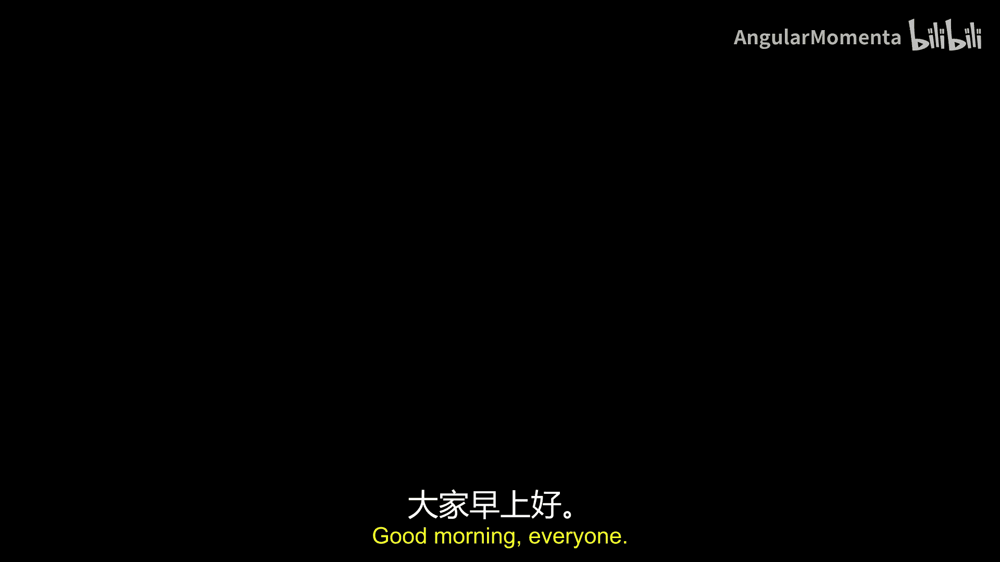
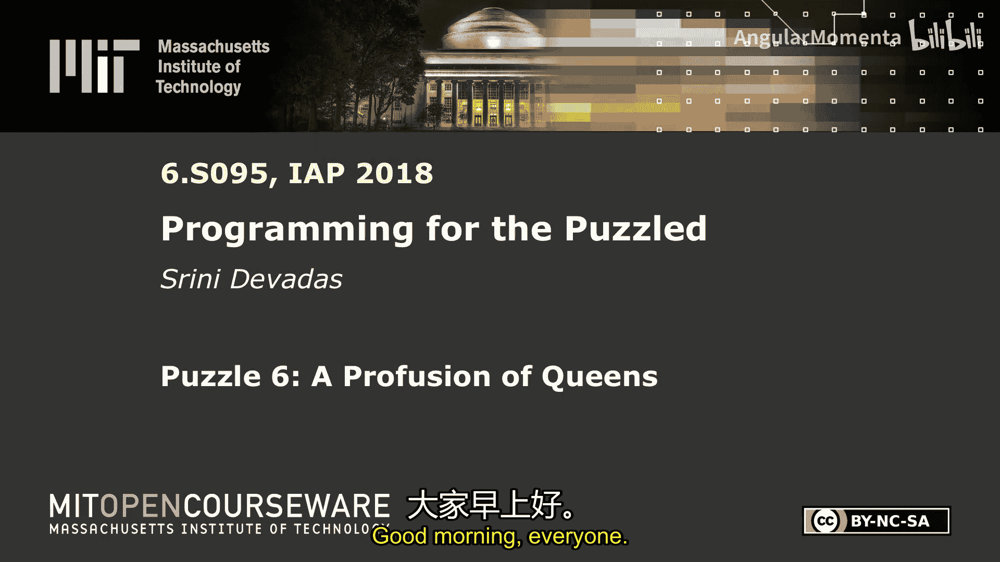
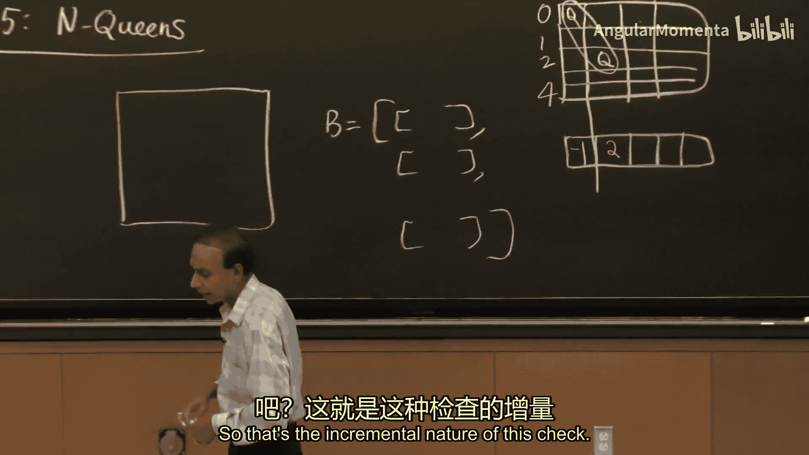
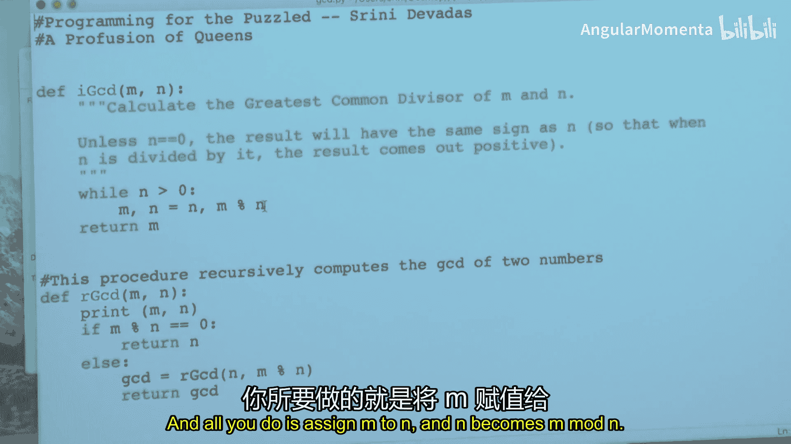
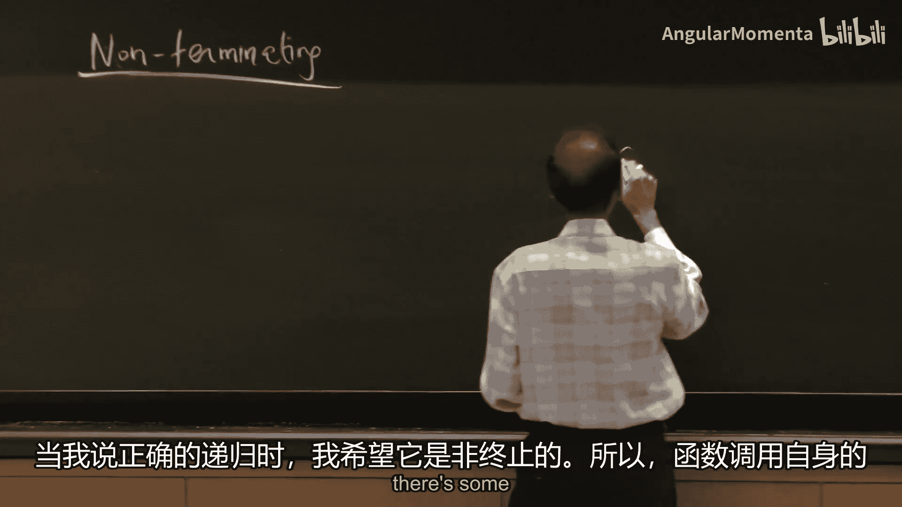
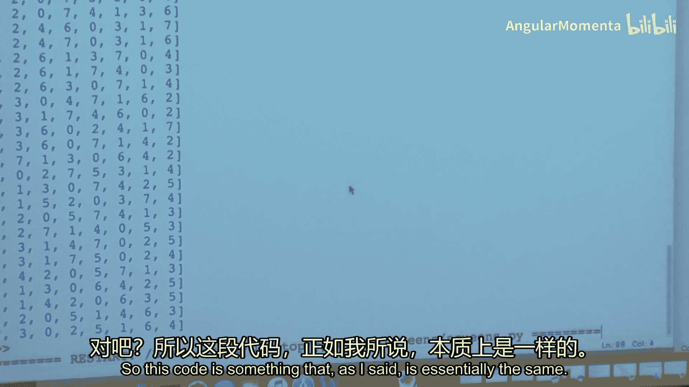
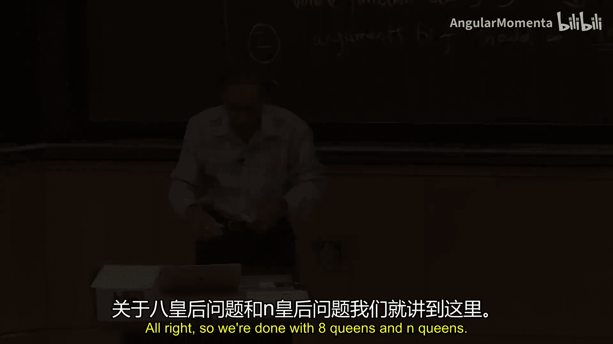
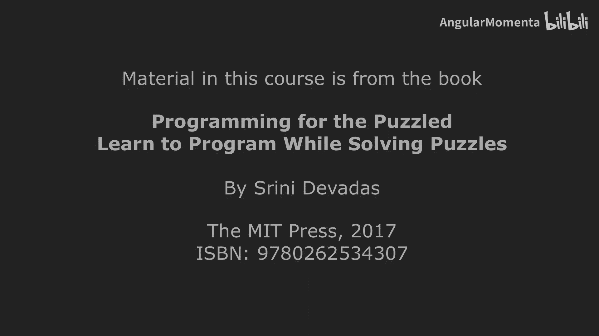

# 【麻省理工】为困惑的人编程-｜-MIT-6.S095-Programming-for-the-Puzzled,-IAP-2018-p06-谜题6--众多的皇后--BV1qp7LzeESm_p6-

Good morning， everyone。Thanks for coming in on a Friday morning。

 especially with the long weekend coming up。We're gonna pick up， pick up where we left off yesterday。

And so。If you recall， we were looking at an iterative。Approach to solving the eight queens problem。

And。In case you've forgotten in the， I guess， intervening 20 hours， the， the eight queens problem。

 which is a specific instance of N queens is you have a chess board。

 And I want to draw out all the squares where which is obviously an 8 by8 board and you want to place eight queens on this。

 on this board such that no two queens attack each other。

And we looked at the different data structures to solve this。

 the naive data structure would be to represent the board as。A two dimensional list。

And so you end up having an8 by8。If you have a chess board for the8 queens problem。

 we'd looked at 4 by 4 for starters。 And， and then after that。

 we looked at compressing that representation down to。

One dimensional list where let's say you had a 5 by 5 boat because I got five entries here。

 You essentially think of。You exploit the fact that they can be at most one queen on any given column。

And you say I'm going to represent the position of that queen using a single number that varies from。

 in this case， 0 through 4， big if you have a 5 by 5 mode。 And you put that in here。

 So a -1 would represent this being empty A  two would represent a queen in the。

 in the second column，In this position over here。Et cetera， et cetera。

 So with this more compact representation。It turns out that the conflict check becomes pretty straightforward。

 And if you remember， our conflict check is incremental in the sense that what you're going to do is assume that that queens have already been placed in some number of columns。

 I mean it could be  zero。 In this case， it's two。 and you can you。

 you're gonna to try and check to see if when a third queen is placed on this third column number two。

 whether it conflicts with the existing queens， but you don't have to worry about the checks associated with the existing queens。

 because you've already taken care of that， right， So that's the incremental nature of this check。

 And I won't go over this code again。

But this does the check associated with。Ensuring that when you place a queen on a on a given column。

 it it checks the diagonals。 That's the most interesting part。 And put you put a queen here。

 you need to check this and you need to check that。 And in this case， obviously， there's a conflict。

 And because there are two diagonals。 That's why you have the A B， S， the absolute value over there。

 And you're exploiting the fact that the diagonal is a diagonal of a square。

 And how much you move up should be， how much you move to the right or down left。 what have you。

And the other check is simply ensuring that when you look at the particular column and you see the the number current is particular column。

 the number associated with that particular column shouldn't be repeated in some other column。

 because that would imply that you if you if you saw a two and and a two here。 obviously。

 that would imply that you have you have two queens on the same row。 Okay， and you can't have that。

 So so that's the story。 And we decided to use iteration because at this point in time， you know。

 nothing else in terms of control flow。 I know that's not the case。 But we assume that And。

 and so you end up having this， this ugly code associated with88 loops，8 nested loops。

That does this incremental enumeration。 So board 0 being one implies that you're putting。I'm sorry。

 Bo 0 being I implies that you're taking the first column and you're iterating the positions of the queen in the rows of the first column and so on and so forth。

 And if you go ahead and run this， which we did last time。

 you end up getting 92 different solutions to the8 queens problem。 And as I mentioned。

 there's only 12 distinct ones。 if you take rotation and reflection into account。

 And each of these is a legitimate solution that needs to be translated into the picture that you see here by essentially taking this data structure that you see7 becomes the queen in the corner。

 left corner， etc。 So we absolutely do not want it。Pub well， we wouldn't want to publish this code。

 I guess I'm in effect I'm doing it， but you would not want to claim authorship of this code。

 especially if you know about the programming technique that's called recursion。

 So that's really what we're gonna do today。 We're going to look at a couple of different puzzles。

 we finish up with the N queens puzzle fairly quickly。 And we look at how we could use recursion。

 which is an algorithmic paradigm， as well as the programming paradigm to solve challenging problems。

 And there's really two classes at least of recursive algorithms。

 And you're gonna see both of those today。 The first one is N queens。

 And I'll get to the second one when we get to the second one。Alright。

 so our goal now is to take that ugly code and make it pretty。And before I get into that。

I want to show you a simpler example of iteration versus recursion。 Okay。

 and this is about as simple as it gets while still being interesting from an algorithmic standpoint。

 So greatest common divis。 the Euclids age old algorithm to compute the greatest common divisor And you see that two line。

 three line。 What have you iterative algorithm up there that corresponds to taking the pair of numbers。

 obviously， M and N that have that you need to compute the greatest common divisor for。

 And all you do is assign M to N and N becomes M mod N。

 And this is I'm not gonna to explain why this algorithm is correct or anything like that。

 I'm not particularly interested in that。 What I'm much more interested in is。😊。

Ensuring that you understand that the iterative algorithm is， is the same as the recursive one。

 But the recursive one gets you the correct answer。

 If you assume that the iterative algorithm is correct and vice versa。

 And that's really what this is about， right so， so。We won't argue if Euclid is correct or not。

 But the point here is you could have translated well。

 you did translate this iterative algorithm into a recursive  one。

 And theres a couple of things I want you to keep in mind。 when you look at recursive code。 or when。

 and certainly when you write recursive code。 And it's much easier pointing this out in a simple example like this。

 So that first off， when I say， when we say recursion。

 I shall probably said this a little bit earlier。Recursion is something calling itself。

 So you can say a function F。Calling itself， that's kind of the simple case。

 We also consider if you have F calling G。Which calls F。Then， you know， that is recursive as well。

 And so you could have arbitrary structures that correspond to nested recursion。

 Were really only going to be looking at functions in at least in this lecture where you have a single function F calling itself。

 right， which is exactly the case for RGCD， the recursive of GCD that you see here。

 You see a call RGCD inside of RGCD。 And you know， this function is recursive。

 Sometimes you may look at a function。 And you don't see that immediate syntactic。

Evi that the function is recursive， but it may be recursive because of nested recursion。F calling G。

 more complicated recursion。 right， So this is clearly a recursive function。 RGCD。

 And two things that you need to。Look for if you want to write correct recursion。 I mean。

 this is not sufficient to write correct recursion， but necessary。 And in particular。

 when I say correct recursion， I want to be non terminating。So。

The problem with something calling itself is you think of it as， you know there's some sort of cycle。

 and you absolutely need to break out of the cycle。 Otherwise， you'll be in the cycle forever。

 you could call something which calls something which calls something that goes on your program isn't going to terminate So you always want to be careful when you write recursive code that there's a base case right。

 there's a termination condition。 So there should be some part of the code where if certain conditions are satisfied。

 you're not making a recursive call。 Allright， that is what I would consider the base case。

 that really comes from induction and from the mathematics of recursion。

 you want to have a base case。 And then the recursion is really the inductive step。right。

 if that doesn't make too much sense。 Don't worry about it。

 you can think of it syntactically look for a path in the code where you don't see RGCD inside of RGCD and you can clearly see that in the if M。

Mod n equals equals 0。 return n。 So that's really the。

 So you want to have what we'll call the base case。Where。Functioned returns。

That's not enough because you don't quite know if you're going to get to that base case or not。

 You're going to call this function with some arguments。

 and you want to get some sense that the arguments are shrinking as you go。

 and it could even be the other way around， the arguments may may increase and once you go beyond the certain threshold。

 you fire off on the return without making the recursive call So so so this this notion of the arguments becoming smaller is very common in the case of the algorithmic paradigm that we'll be following in this class where we're going to take large problems like8 queens or n queens and go to n-1 queens and n-2 queens and divide and conquer。

 which is other paradigm that we look at as you can see from the name is taking a big problem and making it smaller So really for the most part。

 you're going to essentially have a situation where。You're going to。say that the arguments。

to the function。I should。Be smaller。In some sense。And smaller could mean bigger。 Okay， I mean。

 it's just a definitional thing。 I mean， the point is， when you get to the base case。

 usually you're saying， as you can see in this base case。

 you're saying when when it comes down to the fact that a particular condition is satisfied in this case。

 it's a relationship between M and N。 And if that's zero， then we return n。 but in other cases。

 it just might be when you get to a one queen problem， you're done right， I mean。

 you put you have no choice， you got this one by one word you got to put your queen on it and。

 obviously that might create a conflict but you're done right， I mean， there's nothing。

 There's no two things about it。 if you have a one queen problem。

 there's only one step you put your queen down right。

 So that's kind of where we're at with respect to the puzzles that we're going be doing in this class。

 where you're going to shrink things down So in that sense， know。

 smaller makes would mean smaller's not necessarily in quotes。 So that makes sense。

 any questions at all about。Syntax or anything that you see on the board here。Alright， good。

 So now I I'm ready to show you。嗯。What the， the N queens code looks like。 one of the other problems。

 of course， with the the A queens code。Is that。it only works for 8 queens， and it doesn't work for 9。

 right， and。That's annoying。So you'd like to have a procedure that takes n as an argument。

And works for n equals 4 n equals 8。 And eventually， I mean， we could run this on n equals 20。

 and it'll finish。 I'll show you。 but there is an exponential relationship between run time and n。

 okay， because it's just a complicated problem。 There's a lot of combinations。

 So you do not want to run this code for more than n equals 25， right it hasn't completed。

 I think at some point， I did analysis on how long it would take for n equals 30 and you know wasn't something I wanted to wait for I mean。

 my computer would have would have gotten an old and died before。

 the program came back right So which is reasonable experiment。 to carry out， but I like my computer。

 I'm kind of annoyed with it because it's because of the new operating system。

 but I generally like it。 So you can see that we're gonna to use exactly the same framework。

 we're going to use the same conflict routine， No conflicts routine。😊，There's no change there。

 no change in data structures。 there's no change in really even the incremental strategy that we are following。

 but we can take that iterative code and turn it into this pretty code that is about five lines right or seven lines。

 What have you。Right and so you can see again that if you look at that code。 I mean。

 it's not that much more complicated。 there's more going on in there。

 It is there's more going on because it's a more interesting problem at some level than GD but it has the same characteristics in terms of having a base case and it's actually an easy one to look at and also has property2 here where the argument to the N queens is going to be one less than what the call or function has as its argument。

 right， because you're going column by column and you're taking away in this case。

 you're not necessarily going to 7 by 7， really it's not that you're going from 8 by 8 to 7 by 7。

You're going from 8 by 8 to 7 by 8， right？ you have， you have one less column。

 You still have to work with other al rows， right， So， so that's really what's going on out here。

 if current equal size So what what's happening is current is actually incrementing right。 So you。

 you're moving and what is remaining is becoming smaller。

 And current starts with So if you look at N queens here it says n queens size And our queens。

 which is this routine here。 it it sets。Current to be to be 0 and sizes， of course。

 whatever you gave n queens， which could be 8 or 20。 And finally。

 if you look at this part of the code。 you get to the point where you run out of columns when current equals size。

 And at this point， you you put all the queens down。 And that things haven't fallen apart。

 you haven't returned falls and therefore you're done right So when you get to that you know9 column you're off the board and and you're done and all of the existing queens。

 the eight queens that were put on the board didn't conflict with each other。

 that's kind of how it works。 And then over here， you've taken your eight loops that were in the eight queens problem or the four loops in the four queens problem。

 And and you've gone off and and turned it into one loop。

 But the reason that works is because our queens is calling our queens out here。

 So that's your recursive。Right so and then the argument here is current plus one。

 and it's getting closer and closer to size as you go around。

 which means that it's effectively getting smaller。 Okay。

 what you're working with is getting smaller right so if you。

 if you kind of look at what happens here， this is you can trace the execution of this。

 And this is worthwhile doing。 and I'll put， I'll put this in the notes and you can look at it for a4 by4。

 But in general， it's if you're confused about recursion。

 so absolutely worthwhile to trace the execution for small arguments and and figure out exactly when things are terminating and when when things are being called recursively。

 and this is simply a single call， if you look at or looks like it's a single call。 But how many。

How many because there's only one instance of our queens， but if you look at the code。

 how many calls would I possibly make if if I were sitting with an eight queens problem。

And and I started with with size equals 8。 Then in that very first。

 I I invoke our queens with with current equals 0 and size equals 8。

 How many R queens calls will the first R queens make。

How many how many times would would potentially make that that。

 So if I look at the branching here and， and I say this is our queens。 and this has current equals 0。

And size equals 8。The way you want to think about this from us。

 from a tracing standpoint is is you're making calls。 So our Q， our queens is calling our queens。

 right， and obviously， there， there's our queens in the middle of that， of that code over there。

 And so what， what is the breadth here in terms of the， the number of calls。什么。

How many trace the code。 So I in range 8， which means 0 through 7。 And then then I'm gonna go off。

 And it's the very first one。 So so no conflicts is going to constantly return It's the first queen。

 right？ So no conflicts is gonna constantly return true。

 right So I'm going go inside of the if right， And， and I'm gonna make that R queen's call right So。

 so I'm going have eight different calls associated with each of the positions that corresponds to the queen on that first column right And。

 and then each of these you know， potentially make eight different calls。 now， potentially， I said。

 because as you get deeper in the recursion， the no conflicts is going to fire false。

 And I may not make the call。 right？ But obviously the very first one。 You're gonna make8 calls。

 right so。Recursion is scary from a performance standpoint to some people and rightly so。

 because things could explode on you。 And this goes back to what I said about 25， you know。

 running this with in our size equals 25 and so on and so forth。

 And one of the things that is worth doing。 and you have to do this type of analysis in classes like606。

 not a lot of this， but because we don't do exponential algorithms but you you can look at this tree that is being generated by these recursive calls and you do want to get some sense of how large this tree is going to become。

 And we're gonna look at a different class of algorithms。

 Most of the algorithms we're gonna look at that are recursive for the rest of this this course including the next one that we'll get to in a few minutes aren't as bad as this one in terms of in terms of computational complexity。

 But but N queens is a hard problem。Needs exhaustive search。 And there's a lot of combinations。

 And so it's not， it's not an efficient algorithm。 Effic means polynomial time。

 something like n squared， quadratic， n cubed and so on。 And this is not efficient。

 And and the reason for that is this explosion in the number of recursive calls。

 right So it's easy to write code，5 lines of code that takes forever to run。 It will terminate。

 It's not that it had an infinite loop in it。 But the number of combinations explodes on you， right。

 because of 8 and then 8 again， for each of these。And， and then， you know。And so on。

 So you can see that gets， gets pretty large， pretty quick。 right， So alright， so at this。

 this code I is， is something that， as I said。is is essentially the same。

 It's sitting there computing in Queens 20。 Okay， that's why it's this is not a problem with my laptop。

 At least as of this moment， I don't think it's a problem with my laptop。 Okay， and so there you go。

 So N Queens 20 gave you with this representation that that representation that we chose。

 you can try and convince yourself that this， in fact， is correct。 right， I haven't。

But but that code is so straightforward at this point that it would be if there was anything wrong with it。

 it would be catastrophically wrong。 Okay， it would just crash or it would it wouldn't return anything。

 And so that is one solution。 There's many， many solutions。

 Unlike the8 queens case where I I ran it to completion and all the 92 solutions got printed out。

 there's millions of solutions here。 So if I just took out a return statement and let it run。

 you know， you would get screens screenfuls of solutions to the 20 queens problem because were not exploiting rotational or even if you did that。

 it would be a lot of solutions。 but especially given that we're not exploiting rotational symmetry and and reflections there's a lot of solutions。

 Okay， But that's one of them。 So there you go。 Allright， Yeah question。😊，No， there's no。

 there's no close form solution。 No， it's even for the 12 is a concrete number that and 92 and 12 were were enumerated。

 right， So now you could obviously write a computer program that counted。 I mean。

 you didn't have to print this out。 you could count the number of solutions to the 20 queens problem。

 And， you know， you can find that out。 but then if you want to do rotations and reflections。

 You'd have to start shaving things off。 Yeah， back there。No。

 because you're doing significant pruning。 Great question。

 So some of these things get truncated because you end up doing this。 And then at this one。

 you don't have to go any further， right。 So， so at the moment。

 So it's not end to the end simply because you don't have to。

 you never have to to put it put down another queen。

 if the first two queens conflict with each other。Right。

 so so so youre like we did actually went back on Thursday about this time yesterday。

 we were kind of going over the4 by four and we would put one， we didn't even put a queen down。

 We kind of went over and we said， oh， this this clearly can't work because because thiss a queen on this row already。

 You know， this clearly can't work because there's a queen like one away， right。

 So there's no reason to go deeper。 you would go N race to N。

 if you only did the conflict check after you put a after you put N queens down right。

 if you put all n queens down， sort of close your eyes。

 put N queens down and then ran a conflict check then and then did that over and over over and over。

 it would be end race to N。 But that's not what we're doing。

 what we're doing is if if you look at the code， we are saying if this is， this is an important。

A statement， actually， Thanks for the question。 that is pruning your search。

 And that is making it significantly less than end race to n。 A nice exercise， right。

 remember what I said about opportunity for homework when when I get questions。

 a nice exercise is to go to88 race to 8 and then figure out what whether it's 8 race to 8。

 I'm sorry， go to the 8 queens problem and figure out what that number is in terms of the number of times you're actually checking for no conflicts。

 count the number of times， not the number of solutions。

 because but the number of times no conflicts is being called and you'll find that it' significantly less than 8 race to 8。

 Okay， because you're pruning the search the way what technically it's called pruning the search。

 high up in the tree。 Okay， that's that's the technical term for it。😊，All right。Good。

 any other questions？Allright， so we're done with with a queens and N queens。

