# 【麻省理工】为困惑的人编程-｜-MIT-6.S095-Programming-for-the-Puzzled,-IAP-2018-p07-谜题8-你不会再想玩数独了--BV1qp7LzeESm_p7-

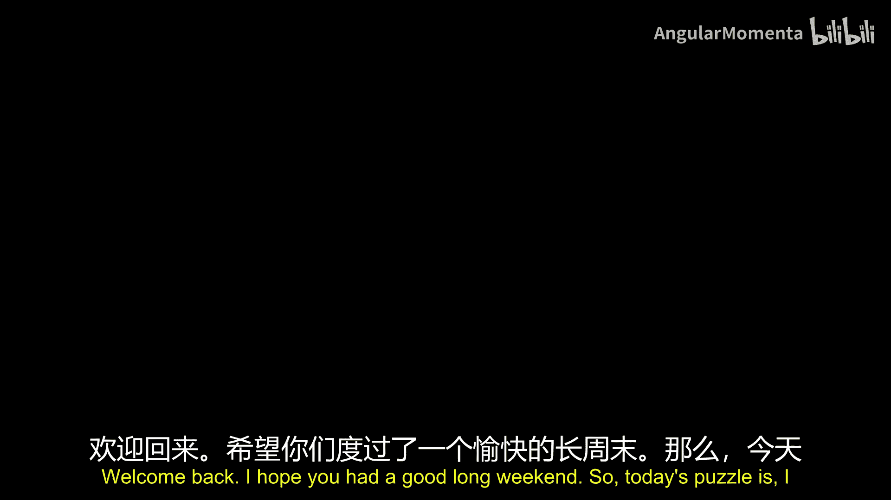

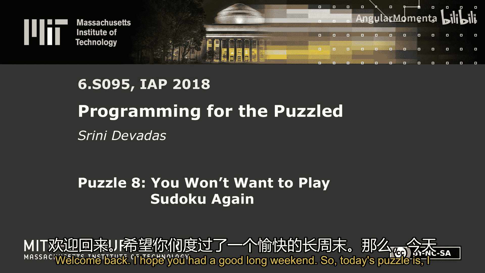

Good morning， everyone。嗯。Welcome back。 I hope you had a good， long weekend。So today's puzzle is。

 I guess a classic puzzle。 It's， it's Sudoku。I've never actually successfully managed to complete a Sudoku puzzle by myself because I've they fall into two categories for me。

 either it's easy， they're easy and， and I get bored and I stop， or they're too hard， and I get lazy。

 and I stop。But what I have done is write a computer program that essentially solves any pseudodoku puzzle that is put in front of it in。

 in seconds。Maybe there exist puzzles for which it would take minutes。

 but I haven't discovered such puzzles。 And what we're gonna do today is talk about Sudoku compare and contrast。

The human way of solving Sudoku puzzles against a brute force way and then try and integrate the two together。

 You know， perhaps this is the closest we're going to get to AI in this class where were going to try and marry an exhaustive search method with some smarts and back。

 I think when we were doing the end queens puzzle， one of you asked a question about what the number of possibilities where。

 you know， for an eight queens puzzle was it eight race to 8。And I said， well， no。

 you can prune the search by figuring out that particular partial configurations that correspond to perhaps two queens being placed on the8 by 8 board already does not correspond to solution because the two queens conflict with each other。

 And you can then shrink this8 race to 8 substantially。 So that's exactly the。

Methodology that we're going to follow here in trying to take our brute force solver。

 which will work and know， given enough time on arbitrary sudoku puzzles。

 but we may not want to wait that long。 And we're going to take this strategy of pruning the search to try and improve the solver。

And one last thing before I get started on the rules of Sudoku。

 we're gonna to have to have a way of measuring performance。

 just like we can measure eight race to eight or four race to four or what have you we want to have a way of measuring outside of the particular machine that's being used。

 we could obviously measure real time in terms of seconds。

 but that's not as precise you want to measure more precisely what the number of combinations are。

 and so we could certainly instrument our code with the appropriate counters that will allow us to measure this performance。

 And so then it won't matter if our code runs on a fast machine or a slow machine。

 we can compare it with another piece of code or another variant of the code and say， oh。

 this new variant is slower or the new variant is faster according to this metric So without further ado。

 let's dive into Sudoku how many of you have never seen Sudoku。played Sudoku。Alright， so that's fine。

 I it's only going take me about 30 seconds to explain what the rules of Sudoku are。

 And then we can dive into trying to at least partially solve this puzzle。

 I I do not want to completely solve the puzzle because， as I said， you know。

 it's either too simple or it's too hard。 And I'd rather write computer programs。

 And so so the rules of Sudoku are simple。 So this is classic Sudoku。And it's 9 by 9。

 There's many variants of Sudoku。 In fact， a couple of the exercises talk about two variants。

 diagonal Sudoku and odd even Sudoku。 I think there's probably odd Sudokus as well that add even more constraints to the basic constraints of Sudoku。

 that I'm going to write up here。 And this is 9 by9 Sudoku。And the numbers are 1 through 9。

And the rules are simple。Each row。Has all the numbers。

Which means that no numbers could be repeated because this， theres 9。Columns and 9 rows。

 So there's 9 numbers on each row。Each column。Has all the numbers。Same thing。

So there's nine rows and nine columns。And then， each sector。Which is。At3 by tree grid。

 And so that's why I。Have these overhangs here corresponding to pointing out what the nine sectors are in Sudoku。

 So this is a sector。 That's a sector。 this middle one， which is completely blank right now。

 is a sector， etc。So， each sector。Has all the numbers。You can grow the size of the puzzle。

 It gets more difficult。 You can add more constraints。 As I mentioned。

 diagonal Sudoku might say something like both of the diagonals， the large diagonals。

 the full size diagonals。 I have all nine numbers on them， etcter。

 so that makes the puzzle different。 you may have a solution to the 9 by9 original Sudoku puzzle。

 but it may not be a solution to the diagonal a puzzle， obviously。

 the other the way around works because the diagonal puzzle only has more constraints。

 And so what we do here is try and use implications right So we have these rules and we first forget about computer programs and try and solve this the way。

People do and they just have a paper and pencil and they have the puzzle in front of them and they try and use these rules to discover empty positions。

 and it's kind of hard to do anything with this sector here。

 you could use the row and column constraints， obviously。

 even for this sector because you have you have constraints on these three based on the fact that you have9 and 7 and one and 6 on this row。

 etc。 But usually you go with sectors that have a few numbers in them。

 you go with rows that have a few numbers in them and you go with columns that have a few numbers in them and then you can try and shrink the possibilities right So just because I don't want to go overboard with respect to looking all over the puzzle。

 let's focus in on on8， the number 8。 and one if you tell me。

I can imply something based on the locations of 8 on the top third of this puzzle。Right。Yeah。

 go ahead。The top。Tom Middle square， what's your name？Ki。

 so Kai says top middle squared should be an8。Right here right or the top。 Okay yeah。

 that clearly can be an eight because this is an8 here。

 but good so so this this the claim is this is an8。 And Kai， how did you figure that out。

Right can eliminate this because8 can be here because of this8。8 can be here because of this8。

 you need to have an8 in here somewhere because8 doesn't exist in this sector So that would imply that I need to put an8 up here okay So this is what's called a horizontal scan right the only thing that chi did here was scan horizontally and you can imagine that so you did not chi did not use in order to imply the8。

 And so this word implication imply is something that we're going to use in a more technical sense。

 but as well when we write our code but an implication essentially says these rules imply the location of the8 right and we didn't do a vertical scan。

 we did not use the fact that in this particular implication we did not use the fact that a column needs to have all numbers on it and therefore all of the numbers on a column have to be unique。

Right， take a look at。呃。Take a look at this part here， and。Let let's look at one。

And try and use a more sophisticated form of implication。

Cresponding to both horizontal and vertical scans to imply the position of a one somewhere on the puzzle。

Can someone do that？Yeah， back there。It in the top right。Okay， so so the one can' be here。

 the one cant be here， right and the one cant be here， so it has to be over here。

 right puts your name。George， so George says the one has to be here and he used both vertical scanning as well as horizontal scanning in order to imply the one。

 so it's a little more sophisticated。😡，Okay on top of that。

 obviously sectors are going to give you some implications as well right and there's no end to this。

 honestly， there's combinations there's also a little bit of look ahead where the hardest puzzles are the ones where you run out of the eights and the ones in terms of the examples that we have here where we've just sort of implied without guessing。

 we've implied the location of a number and then because of that our puzzle got smaller in the sense that there's fewer blank locations。

 blank squares。 and then that helps us move forward So the easy puzzles are the ones where fairly straightforward implications like the ones we did here。

 always exist are easy to find sometimes you have to search a little bit。

 look at the top look at the bottom， look at the middle and and then you fill things in and because you fill things。

In something else now is in play， right， It becomes viable in terms of an implication。

 The fact that I put an aid in there implies that the aid is now taken know its location And so now obviously。

 there's only four left here And the fact that there's an aid here implies that all of these can't have an aid in them。

 these7 locations underneath can't have an aid in them， right， because of the constraints。

 So this shrinking of possibilities is something that a human does。

 and you can kind of go through this process it's an iterative iterative process that you that you go through And you get stuck then you can't do an implication that gives you a number。

 and some of the a harder puzzles you have to， you have a couple of choices and only one of them is going to be a correct one going forward。

 but you don't know。at that moment so you now have to guess and perhaps you put an aid over here or an8 over there。

 and then you say I'm gonna to go with an aid over here and then you go a little bit further and then you realize wait a minute there's no way I can solve this puzzle because I need to put two sevens into the sector and then you go back and there's actually a bit of backtracking that happens wrong guess and you need to go backwards and it's very hard to do for us it's very hard to do for us with pencil and paper keeping things in our head or writing down notes on the side of the paper whereas it's very easy to do that for the computer program and we kind of did that already in in the eight queens。

 but we're gonna to do that in a much more systematic way over here So you kind of weigh these two ways of approaching this problem one of which is I'm just going to blast through the different combinations having a giant a tree structure in my head where this might imply that particularly。

gridrid location grid Ij equals8 this might imply that grid Ij equals 7 and you know there's obviously a huge number of combinations corresponding to which of these squares that I pick and what value I assign to those squares and then once I do that there's another set and this explodes on you very quickly and so if you just did this in a completely brutish way there's no way your program would ever end even on a simple puzzle but thanks to these。

Rules， it turns out a fairly straightforward program that's 20 lines of code is going to solve most problems。

 at least the ones that I've looked at in in a reasonable amount of time。 And， and then， you know。

 it's just interesting from a rhythmic standpoint and and an efficiency standpoint to look and see how we can take that。

Fairly naive approach， which does have some pruning， but it's， it's exhaustive and and improve that。

 Allright， so that's kind of where we headed。Makes sense。 any questions about what we have so far。

Allright， so what we're going to do is go ahead and look at at code for Sudoku that all you need to think about now for the next few minutes because we're going to move into exhaustive search mode and code things up in a computer is just those rules。

 So you don't have to really think about horizontal scans and implications or vertical scans。

 know that's going to come a little bit later and we're going to vary that up as well。

 but we're going to do kind of what we did for the N queens problem。

 which is set up a recursive search that is going to explore all of these different possibilities and the equivalent of no conflicts for for the a queens or the N queens problem which said there's no conflicts here because none of the queens attack each other we're going to have something that essentially say。

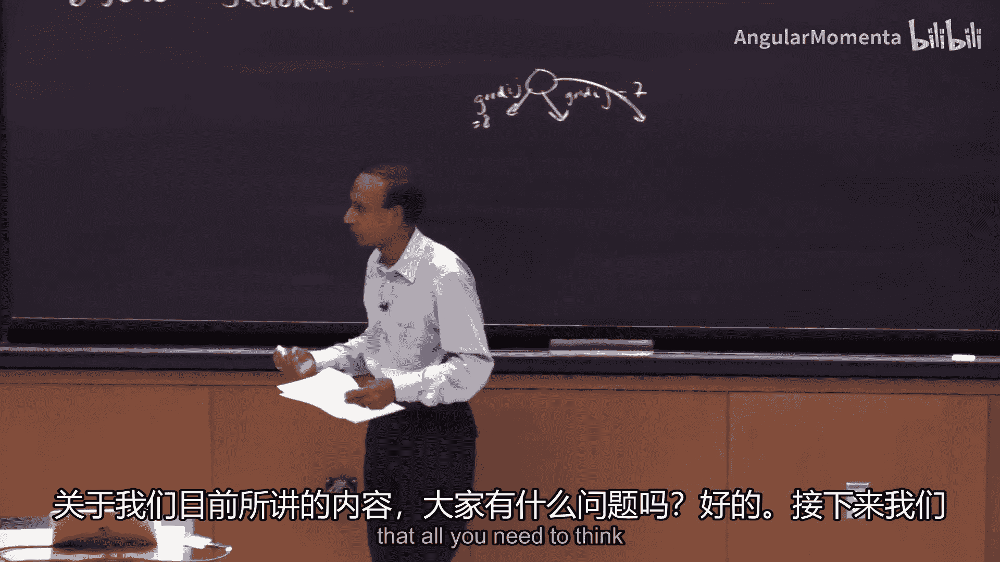

This is valid so far。 None of the rules of Sudoku corresponding to these three rules that I have up on the board are going to be violated。

So let's take a look。 And so this structure， hopefully， given that we've done。And Queens。

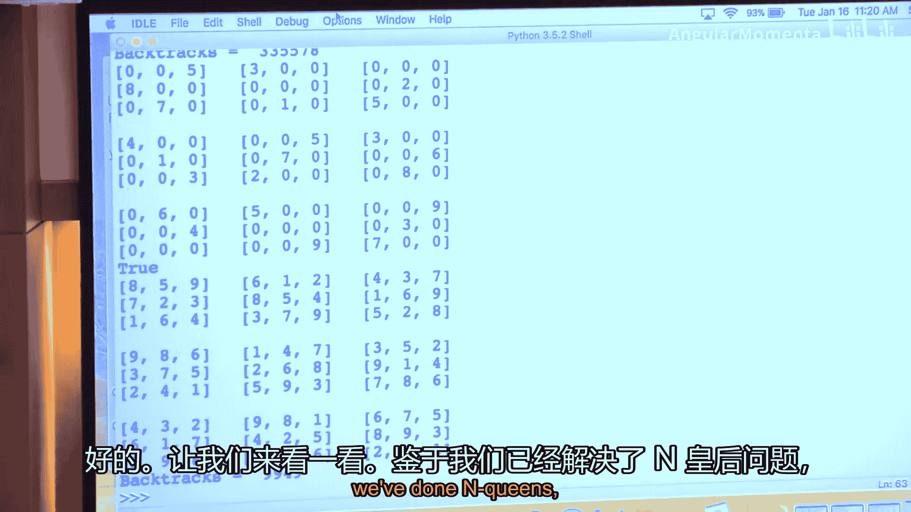

I should be a little bit easier。To understand。嗯So。When we did a queens or N queens。

 we decided to start column by column。 we could have done row by row。

 but we decided to start column by column and it was fairly straightforward puzzle。

 There's obviously no real change in an a queens puzzle。

 I mean you're solving the same puzzle as I am。 But if I give you Sudoku puzzle there's more variety to it in the sense that depending on what I fill up hard puzzles are the ones that are kind of intermediate in the sense of they're not obviously fully filled and they're not empty if it's completely empty。

 then it' it's trivial to solve a sudoku puzzle， you can take any solution to a sudoku puzzle and present it as a solution to the empty puzzle。

 And then if if it's everything is is full except for two things。

 I mean it's kind of obvious what those two things are assuming that the puzzle had a valid solution。

 So really it's puzzles like this where maybe a third are full。

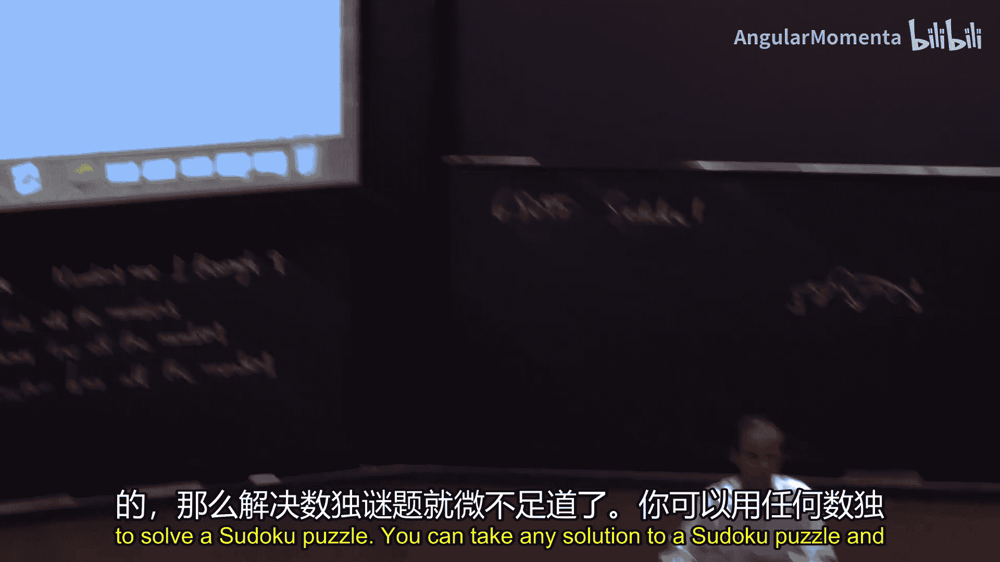

are more difficult right and it's kind of a separate school a little community that designs puzzles and tries to create hard puzzles and they try and make the humans hard Im sorry humans problem harder by making this requirement of look ahead like I mentioned right so。

Good， so let's take a look at the code here。 So what I want to do here。 And the first part here is。

 is as I said， we went column by column in the case of and queens， And the question is。

 where do I start， I want to do something in a fairly naive way。

 And what I'm going to do is I'm going to do some sort of scan。 know， I'm gonna scan like that。

 and I'm going to find， as I do the scan， I'm going to find the the next empty grid location。

 and I'm going say that is going to be something that I'm gonna to try and fill in。 Okay。

 so it's not going to be I discovered this 8。 in the in in the it was。

 if you count in terms of the empty locations。 if I went this way。

 it was the fourth empty location and decided to fill that up。 But here I'm just in in this code。

 I'm going try1，2，3，4，5，6，7，8，9 here。😊，And the first part of the code here that says what is the name of the procedure says find next cell to fill。

 you know it means what its name is。 find the next cell， find the next grid location to fill。

 and it simply goes for x and range 0 through 9 for y and range 0 through 9。

 I'm assuming that since 0 is not a valid entry here， I could use 0 to signify empty okay。

 it's only one through 9。 So0 can signify empty。 And this just returns x and y corresponding to the first empty location。

 So in this case it would just return 0，0。 Okay And then if this were full。

 then it it would go obviously it x changess and when。Exchanges。

 you're going over to the to the right。 And so you would get10 back。

 if this were filled the next time around， I'd get this great location， etc ceter。 it doesn't matter。

 just like I could go column by column by row by row。

 As long as I have a deterministic way of discovering the empty location and usually you want to have the same way of discovering the empty location。

 but even that is not a requirement。 as long as there's an empty location and your fine next cell to fill finds that empty location and returns it to you。

 you're good and the rest of our code is going to work but no reason to get more complicated than what I have up there So fine nextel to fill make sense。

 good with that。 Allright， and generally with exhaustive search the key procedure is always you。Have。

A a valid solution or not。 And you may not have a complete solution。

 Think of it as a partial configuration， right， So this is a partial configuration that is valid。

 it's not a complete solution to the sudoku puzzle。

 it's a partial configuration that's valid in the sense that it satisfies all of the constraints。

 You know， if I put another aid in here， it would not be a valid partial configuration。

 It would be partial， but not valid， right， And I need to grow this。

 I need to grow this into a solution。 And when I say solution， I mean。

 all the constraints have to be satisfied。 right， a configuration could be invalid or or valid。

 A solution is always valid。 right， that's just terminology。

And so I want to be able to to look high up and be able to trunnccate the search and say。

 you know what grid I J equaling 8， because I put an8 in that sector which already had an8 in it is。

 is， is something that should not be explored and I I don't have to worry about any of the branches that come here because immediately I've violated the constraint。

 right？ So in general， I can always check whether partial configurations violate the three constraints I have or not。

 right， And that is what this piece of code does。 and it's also straightforward it perhaps。

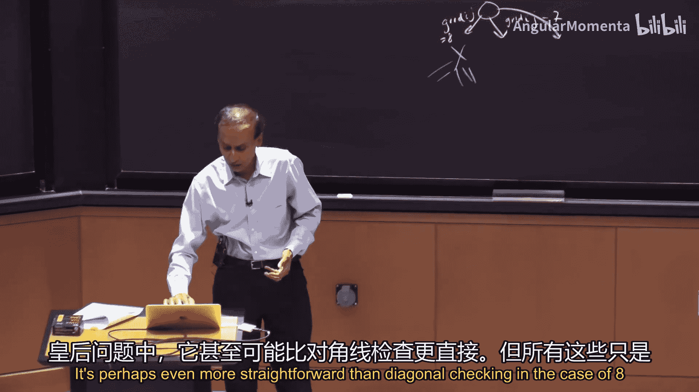

Even even more straightforward than diagonal checking in the case of a queens。

 But all this does is use the construct that says I'm going to look at。

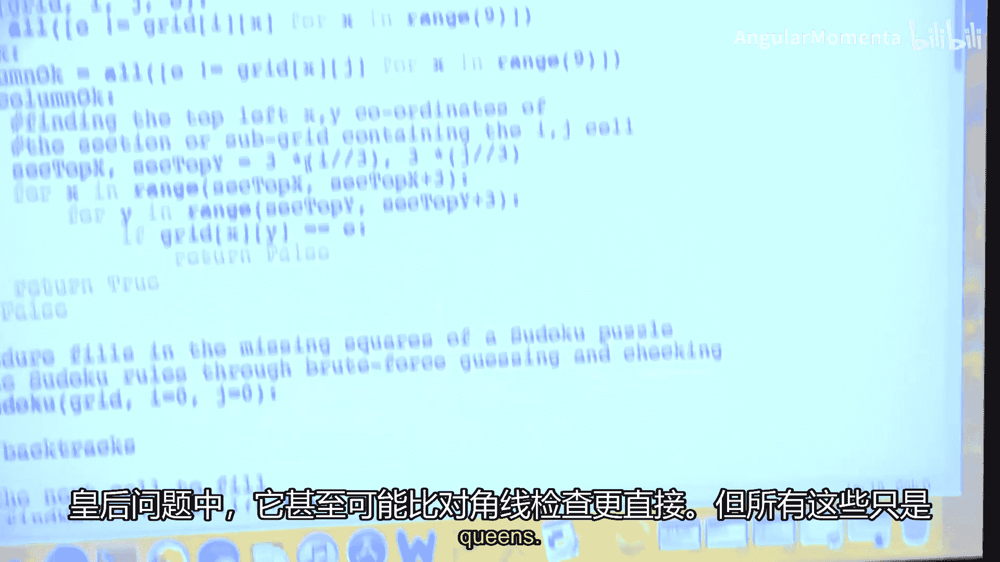

essentially， this is something that is list comprehensions in Python。

 the four comes after this predicate here， but effectively what you're saying is for x in range 9。

 check that grid IX is not equal to E okay and you're just looking at E So is valid grid I JE takes the grid which looks like this one。

 let's say。 and so it's got zeros in all of the empty places and it's got a bunch of non-zero entries in all of the places that you see here。

 and in addition， you have perhaps0，0 and let's call it one。Right， and so， so this is I。

 and this is J。 and that is E。 Okay， and so let me write that out here。 I， J and E， where I is1 0。

 I'm sorry。 I is 0。J is 0 and E is1。 So that would mean putting putting a one up here。

 And that obviously is going to violate one of our constraints。 But that's fine。

 We're gonna to check that。 And it's essentially doing incremental checking， just like we did。

 So it's not checking to see that that all of the existing。gridrid I J values are conflicting or not。

 It's just saying I'm haven't I'm gonna be writing something into this grid into an empty location。

 it happens to be 0，0， having the value1。 And I'm going to check whether the introduction of a1 into this square is going to cause problems or not thats solid that it's doing incremental。

 just like we had with with a queens and that check is relatively easy to do because I just need to go and and I look at the row corresponding to to I in this case is the top row。

 I look at the column corresponding to j， which is the leftmost column And then I look at the sector corresponding to 0。

0， which is this top left sector。 And I check to see for each of those three things。

 whether there's a problem or not。 And the first two will actually I have a problem with with the row。

And I would also have a problem with the with the sector。

 I wouldn't have a problem with the with the column， but one of them is bad enough。

 And so I'm going get a false back。 So row， okay is going to be false。

 And so I'm going to return false out here。 Alright， that makes sense。So those are the three things。

 And this， this is really not that much here beyond taking those constraints and， and codifying them。

Right， any questions。Yeah，法。all is essentially a Python built in function that is going to essentially say that it's going to it's。

 it's a conjunction that says I'm getting a bunch of booleions that correspond to the generation of this list comprehension where E not equal to grid I X is is going to give me true or false。

 And I need all of those things to be true。 alright。Yeah。

 that whether all of the elements of an think it is an an。 even if one of them is false。

 the and is false in order for the an to be true than all of them need to be true。

 Allright So it's it's just a convenient construct。

 which is applicable in in sort of a perfect the perfect application is is what you see here。

 It's not the most sophisticated of applications。 but it works very well in this case。 Now。

 for the sector， I can' actually do that And so's a little bit more work because I cant this only works when I can put least comprehension in here like this and generate all the bulloleions for the sector。

 I end up having to do something a little bit different。 I mean。

 you could do things more convoluted than and use all in here as well。 but it's not worth itright。

Okay， that makes sense， good。So here's the core routine that corresponds to the search and ignored this global variable here。

 I'll explain that in a minute。 that's going to be our metric。

 Our backtracks is going to be our metric for computing performance and it's going to be quite interesting。

 it's going to produce some interesting results for us when we run this on various different examples。

 but but this core procedure looks a lot like the end queen search in the sense that you have a for loop and a recursive call and in this case。

 the for loop is going to be something that ranges through the different values you find location that you want to to put something into which is the next empty location in your current configuration and then you need to go put in one through 9 in there and it's bruish。

Yeah you're gonna to put in one and you're gonna check conflicts and and then you'll put in two and you're gonna check conflicts。

 if you put it in a one and you don't get a conflict， then you get to recur。

 and you now move into something that is another partial configuration potentially but but obviously has one location filled from the from the call configuration and then you go look for the next cell。

 So it's certainly possible that I go when I put in a one here that fails。

 but if I put in a two here it's not going to fail。

 a two is not going to fail here because if I just look at those constraints a two is okay。 Allright。

 so I'm going to put in a two here， and then I'm going to recur， and I'm going to go out here。

 and and I'll try and put in a one here， and a one is going to fail because of this and that a two is going to fail because of that three is a three gonna to fail。

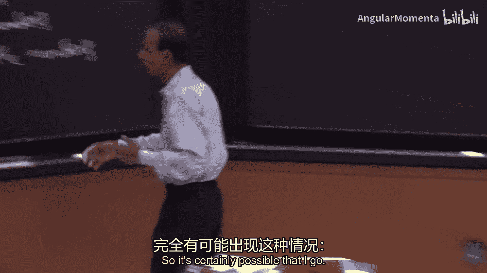

No， not immediately。 So I could put in a three here。

 and then I recur and go to the next one and so on and so forth。 right， And for each of these things。

 obviously， I have。To do a bunch of search underneath and， you know。

 thank goodness for fast computers， right， because otherwise， I'm in gone。 I mean。

 can you imagine the amount of paper we generate if you were doing this and putting two and 3。

 And I want a new sheet of paper for the four， etc cetera， etc ceter。 I mean。

 we can count the number of backracks。 That's how many sheets of paper you'll need。 Okay， So so what。

 what you see here， again， ignore the backs， I'll get to that in just a second。

 is just a way of counting the number of calls。 And this thing here essentially says you know， if。😊。

I'm gonna be returning。 I'm gonna as long as I get through and find a solution。

 I want to return true right So if solve Sudoku grid I J is true， then I'm gonna return true。

 and then I'm gonna pop up all the way to the top。 assuming I got I go all the way down to the bottom and I get to the point where I have a solution that returns true。

 which is a completely full configuration that returns true right but if not。

 then I need to go try the other combinations and I'm only going I'm only going to make that recursive call if the if obviously I J E corresponding to this is is valid and that checks the constraints。

And the only other thing I have to worry about is essentially something that says。

 you know reset your grid location and make sure that that your that you're setting it back to zero after you're done and so I've just made a choice here。

 grid Ij equals E if I look at this line occurred here。

 this is resetting the grid Ij equals z and saying it's empty because if I've failed in all of these and I haven't returned true in all of these then obviously I want to change this and you could argue that the next time around if I and J are exactly the same because I and J are set up here then I'm going to overrite the E from a 1 to a2 etca。

 etc ce and so that is in fact correct but I do need I do need to reset this outside of the loop。

If not inside of the loops。 it's not like I can get away with this line of code。 in general。

 if you ever backtrack， you have to go back and undo your decision and you have to erase the three。

 And that's essentially what that grid I J equaling 0 is doing。

 right you just need to undo that decision。And you can you can do this a few different ways。

 But the biggest thing to remember when you do recursive search is to get your。

 your the undoing of your decision， which is what we call backtracking to be correct。

 And if you ever leave a mess。 then you， you， you'd have a problem。That was。

 that's also true in in the case of the end queens problem。So I'm going to go ahead and。

 and this is just a print routine。 So this is not exactly the Sudoku that I have up up there。

 the Sudoku puzzle that I have up there， But it's kind of roughly similar in complexity。

 And I can go ahead and and run。The Sudoko program。 And for each of those different。sdoku problems。

 it's it's producing solved puzzle。 So this is a solved puzzle。

 You can check this puzzle just real quick。 and you'll find that that all of the constraints are satisfied。

 And then， and I'm gonna explain back trackracks in a second。 So true says that this solution。

 The number of back tracks was 579 for the second puzzle which was a little bit harder。

 The number of back tracks was 6，3，63。 I'm sorry， this is just scrolling。 And for the fourth one。

 it was 335000。 And I'm sorry for the third one。 And for the fourth one was 9，9，4，9。 Okay。

These last two puzzles， hard and diff。 there was a Finn guy called or there is a Finn guy called Artto Inkala who designs puzzles。

 And he claimed that this hard puzzle in 2006 was the hardest puzzle ever design in Sudoku。

 And then in 2010， he came up with this a more difficult puzzle according to him that required a lot of look ahead from a standpoint of the human being。

 like you know we went back to what I said you can't quite do this implication。

 you have to kind of make a guess and then you have to go further and further down。

 and I think the claim was that the hard puzzle required like five levels of look ahead and then the difficult puzzle required six levels of look ahead。

 And obviously given that look ahead this puzzle has to have an initial configuration that's solvable。

 So it's not a trivial thing to create puzzles。 But now people are using computer programs and doing things like were doing。

Here to find difficult puzzles and interestingly enough， the 2006 puzzle。

 at least for this naive computer program， takes 335000 backtracks。

 the one that that was supposedly made more difficult into 2010。

 which which now only takes about 10000 backracks right so obviously there's a difference between the way this program behaves and how you or I would behave or that you would behave if you try to solve this puzzle。

So let me just explain backracks。 and I'll stop to see if there's any questions about the kilt so。

When you make recursive calls and you want to count the number of recursive procedure calls。

 you want to do something inside each of the recursive procedures。

 and you want to sort of cumulatively or collectively keep some information。

 one way of certainly doing it is to pass arguments and then you have to return the argument because when you pass an argument and you modify it。

's not like that is going to be that modification， if it's not if it's just an integer。

 if it's not a mutable if it's not a mutable variable。

 it's not going to be seen by the call procedure。 And so when you do recursion and you want to do some counting。

 the notion of global variables is a convenient construct to have and global variables essentially say that theres exactly one memory location associated with this variable and we're going to go ahead and anytime are mutating this variable and you're modifying it。

 you're going to see the effect of that in that memory location。Okay， so。

 so what you have here up here is I set backracks to be 0。 Okay， and that's my global variable。

 The fact that I put backracks equals 0 here doesn't make this a global variable just yet。

 the fact that I have global backracks inside of salt Sudoku now says that there's a single copy of backracks。

 And it doesn't matter whether I'm you know， at the top level of recursion or the bottom level of recursion。

 it's just that memory location corresponding to the backts。

 the name backts that is getting incremented。 And this could be， you know， 10 levels deep。

 It could be 40 levels deep， given that I've called things you know，40 levels in。

 but it's just the one backts。 Okay So as you can see， what backts does is。

Anytime you have a valid location and you've gone ahead and and essentially you don't you failed。

 the reason it's out here is salt Sudoku did not return true when Sal Sudoku actually returns false is that's when you you come out and you increment backtracks。

 So so it meant that you you had to do some undoing。 know， when you set grid Ij to be0。

 that's when you're undoing your your guess， right。

 So backtracks makes sense from a standpoint of I need to backtrack and go in a different fork in the road。

 Okay And so that's why I have backtracks plus equals1 right when I'm undoing my decision that I made right So this kind of gives you a sense for how many wrong guesses that this program did。

 And as you can imagine the more the number of wrong guesses。

 the more the computation and the longer it takes。 So it is definitely a proxy for。

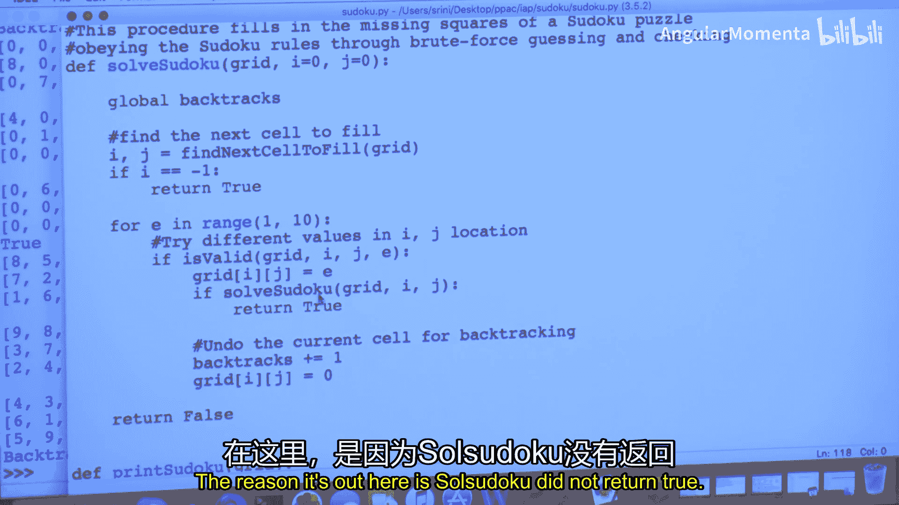

Performance， but it's， it's a platform independent proxy that's more algorithm related as opposed to the speed of the computer。

 because if this computer were twice as fast。 I mean， I just see things running faster。

 even though the the algorithm isn't any better， right That makes sense。

 So it's a very simple use of global。 you don't want to use global variables。

 except in certain constrain settings。 This is a fine use of global variables， right。

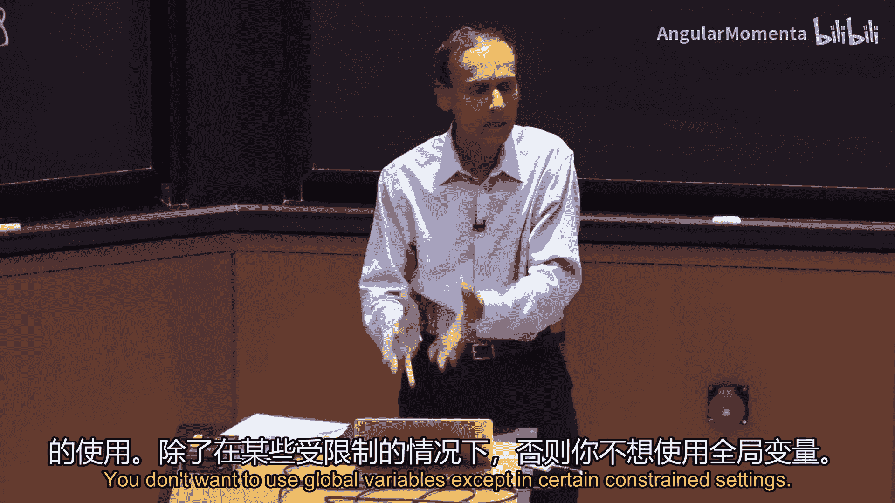

Cool， good。 So any questions about this code。嗯。So what I've done here is I just have the naive code。

 and I happen to have different numbers of backtracks， because I have different inputs。

 unlike the N queens problem， which is kind of boring in some sense， because once you've solved it。

 there's nothing left in the case of Sudoku， I could change my input。

 my starting point and give you a different different problems。 right And so。

 so the reason we had many different kinds of backts was was simply because numbers of backtracks was because we had four different inputs to the Sudoku puzzle。

 Allright。So are we good here。 People understand this code。 You're gonna have to modify it， right。

 Not， not necessarily this code， depending on the exercise you do。

 But this is certainly something that hopefully you feel comfortable with potentially modify。

All right， so what I'm going to do now is。At first。

 I'm going to go ahead and show you some code that corresponds to something that is the original code。

 except that I'm going add some smarts to it。 Allright。

 What I'm going to do is at any given point of time。

 I'm going to try to do some implications without actually doing any guessing right。

 So the way I'm going to integrate the human approach into this exhaustive search approach at top level is I'm going take my configuration。

 And before I do an arbitrary guess before I call find nextel or maybe I have a particular location here that I'm eventually going to guess。

 So I do know that。 But before that， I'm going to try and see whether the current grid values imply anything or not。

 by using the rules in exactly the same way or roughly。

 I should say the same way that we did right when we began the lecture。 Allright。

 So we're going try and use。Some implications and maybe imply the8 or imp something different associated with some other location right So this is not a backtrack right in the sense that this is going to be。

 I can take this to the bank assuming I haven't done any guessing up until this point and assuming that the initial configuration that was given to me corresponds to a valid solution But I'm actually going to do this at different points in the search。

 So it might be that I'm just going to arbitrarily choose a two here。

 Okay and and so I go through and and I'm going to take this for argument's sake。

 and I'm going to put a two down。 and then I have not the initial puzzle that was given to me。

 but something that I've kind of hacked in the sense that I've stuck a two in there。

 and that may not correspond to the solution because I just sort of put the two down there。

 But now given the two。 I'm going to try and do some implications。

 Okay and I'm going to try and see whether there's things that that are valid or not。あ？

The important thing is that because I put a two down。😡，In an arbitrary way。

 without using implications， the two could have been incorrect。 I mean。

 that's exactly why we have all of these backtracks， correct。

 because I've put down incorrect guesses and then I've had to backtrack。 So once I put a two down。

 and then I fill in a bunch of things with implications。 know， I may even put an eight up there。

 I may put a6 out here， etc。 etc。 and I go deep in。 and then I realized。

 you know that two was a mistake。 Okay， the two should really shouldn't have been in there。

 Okay Now I have to clean up everything。 I have to clean up all of the guesses that came after two。

 and all of the implications that came after two。 Allright。

 that's the biggest thing that I want you to take away from this integration of implications with the exhaustive search。

 It's clean up your mess， clean up your bad guesses the fact that you say， oh。

 but the implications was was something that was deterministic。

It was exactly following these rules na na it was deterministic。 all of that is true。

 but you made a wrong guess and therefore everything that you did from then on out is in question。

 And if you in fact find a contradiction， you got to go all the way back and clean up everything and then go back and erase everything that you had and then go take this two and maybe turn it into a three or what have you。

Alright， so before I show you the code that does the implications。

 and you can kind of imagine there's many ways if you could do implications。 we did that manually。

 I want to show you this part looks exactly the same as before。 No change。

 Find Excelel to grid is exactly the same。😊，I valid is exactly the same right There's a large make implications procedure and an undue implications that I'll get to in a second。

 but this part here looks almost exactly the same except that I've replaced grid I J equals E with make implications。

Okay。And this is something that not only what make implications is going to do is it's going to set whatever I had up here。

 It's going to set to up here。 And on top of that， it's going to go use these things to go fill in a bunch of different values in here。

 So it's one extra step。 This is the integration that I talked about。

 So the idea is that now you could do this for the original the original as well。

 But the point is once you made a guess， you always want to check to see whether that guess does certain implications or not。

 that's the whole purpose of this exercise。 Even humans do this in the very difficult puzzles。

 They make a guess。 And then they see whether there's some implication or not。

 and maybe there's a contradiction and they have to go back and and undo all of that damage they caused and change the guess But in general。

 when you have a configuration and you add to it。 it's possible。

 certainly that they will be other things that are implied by the。The one change that you made to it。

 So grid I J equals E in the original code got replaced with this procedure that we'll talk about。

 which I don't want to spend a whole lot of time on， but it's。

 it's essentially something in terms of details， but it's essentially something that puts in different values in the different locations。

And grid I J equals 0 is replaced by undue implications。

 which is cleaning up all of the incorrect guesses and incorrect implications。

 And the reason the implications are incorrect， because it came from an incorrect guess， okay。And so。

 so that's it。 Undue implications is trivial。 It just sets all of the implications。

 And I'll tell you what the data structure is in a second。 But think of it as， as making everything0。

 going back to a clean slate。 right， I mean， clean slate in the sense that all of the incorrect implications and guesses are cleaned up。

 Allright， So that's all there is over here。Make implications is you can do anything you want。

 you can do vertical scans， you can do horizontal scans。

 can if you go look at Sudoku literature and you look at know ways of playing Sudoku。

 this books written on how you can become a better Sudoku puzzle solver and you could take that and you could code that in and you could replace。

 make implications with those fancy techniques that are up there But we've established， I'm lazy。

 And so I only write a certain amount of code。 And then I get tired。

 And so I wrote about 20 lines of code corresponding to a fairly straightforward implications。

 just to give you a sense of of how this would work。

 But the most important thing in here is not the details of make implications。

 And I'll give you some sense of that before we're done。

 but it's really this structure that is that is the most important。

 The fact that Ive done make implications here and undo implications here。

 it's the correctness requirement that is important。😊，To exhaustive search， okay。

So if I do this and I do kind of the implications that we had right at the beginning of lecture。

 and I go ahead and run it。😡，Just take a look。 I won't write this out。

 but remember what the backtracks are for these things， roughly speaking， for the original Sudoku。

 I'm sorry， I need to go to the shell。 and it was it was 335 what is it。 the 5，79，6，3，63，33509，9，4，9。

 Okay， So if I go off and I run Sudoku optimized， which is doing these implications like I described。

 And and I go ahead and run that。 the first one goes from 579 to 33 backtracks。 Okay。

 so that's pretty good。 because it's not a bunch of implications。 It's still。

 it it's not super smart。 I mean， that is a simple enough puzzle that a human being would not backtrack。

 I mean， a human being would not backtrack in that first puzzle right。

 and you should you should check check that。 and oh， this thing finished in the middle。

 so it went to 33。嗯。only had three of them。What what do I have here in Sdoko opt。Oh， I see。

 I only ran。Oh， wow。 Okay， so I ran into too hard and difficult。 So it really went from 6，3，6，3。

To 33， it went from 335000 to 24000。And then it， it went to 72 from 9，9，4，9 to 726。 I mean。

 the details aren't aren't the numbers aren't super important。 Don't hang your hat on them。

 Obviously， if I change the code， those numbers change。

 But you can see that there substantial gains to be had in terms of implications not making these dumb guesses that clearly are are incorrect。

 and that you， you can fill in， if you take away some of these empty squares。

 then the depth of the recursion that you have to go through become substantially smaller。

 And that's why your your backracking is is simpler。So I want to leave you with a couple of things。

 I want to give you some sense for what particular implication that strategy that we used。

 And so I'll just put up make implications and give you some sense for how this works。

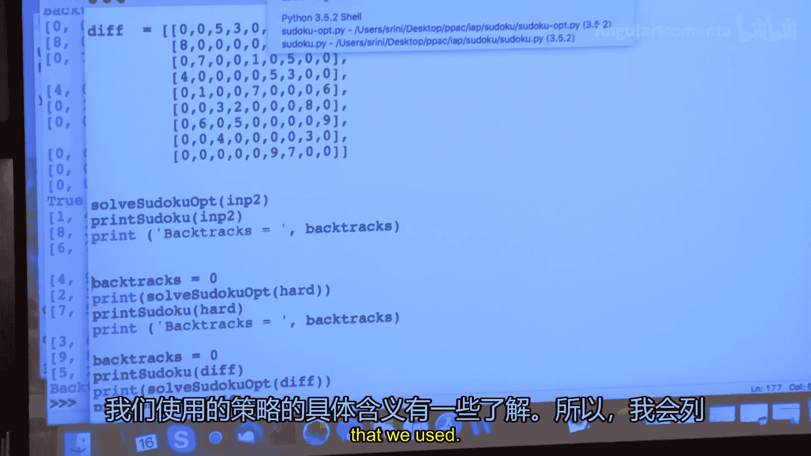

So the basic idea is that what I'm doing here is I'm looking at a particular sector。 and。

 and I've created a data structure that says the， the missing elements here。 if I put a two in here。

 let's just say I go ahead and put a two in here。 The missing elements here are are the set is three。

4，5，6，7， and 9。Right， so this could be 3，4，5，6，7，8，9。 This could be 3，4，56，7，8，9。

 and this is quite dumb right now。 but each of these different squares could be 3，4，5，6，7，8，9。 Okay。

 possiblyright and then I say， so that's the first part of the code。

 And then I say I'm going attach essentially a copy of the set to each of the missing squares。

 and then I'm going to go through and find the missing elements。 So so this thing here can be a 9。

 because I see a9 here。 it can be a three right and so I can take this thing here and I take away the the9 and I take away the three and and I can do the same thing with that obviously I can also take away the the eight isn't there。

 but I can take away the7 and I could take away the three， the six and the one。

 So I go ahead and I take away the six。 and and the three was already take taken out。

 and I keep doing this。 and I try and shrink the possibilities corresponding to this。

Particular square that that has the set of different possibilities。 And if I ever。

 so when can I make an implication。What is the condition that is going to let me make an implication when I take this set of numbers and I start shrinking them down using these rules that I have over on the。

😡，The， the right hand side there。 what， what is an implication， What does that correspond to。

In relation to the in relation to the set， right， Yeah behind your rh。 That's exactly right。

 If you have one element in this set。 then that's an implication。 if I have two elements in the set。

 it's notplication because I don't quite know what to do there。 But if I had one element in the set。

 that's an implication。 And that's it。 That's know this code is not complicated。

 check if the v set is a singleton， is a single element。

 and I'm going go ahead and append to this implication。

 which is a very straightforward data structure that says this is the grid location I grid location J。

 and this is the value that was implied by that。 Allright， So not only do I have I J E。

 which is which is the original guess that I have， I also have know kind of a bunch of other tus corresponding to different coordinates know K coordinates and the value call it V associated with that。

 And these are all the different im that I can collect together in this list。

 And I can just add those things into make。😊，And then I keep going。

 And then if I ever realize I'veve， I've made a bad guess。

 I have to undo everything by zeroing them all out， which is making them all empty， alright。

So one thing that this code does and you can you can take a look at it and I would encourage you to do the first exercise。

 which is taking these implications and making them a little more powerful by adding like three or four lines of code to this code and exactly what you have to do in this exercise and I'll show you what the results should be in just a minute but let me just spend 30 seconds explaining to you how you could do a little bit better than what this code does。

 So what I've described to you really is get this set， you know， imply， get a singleton etc。

 And then you can do this obviously for each of these sectors and that's what this does。

 you had a four loop up there that does it for each of the sectors right grab a sector and go ahead and do an implication for that sector。

Now， this code just runs through the sectors， you know，1，2，3，4，5，6，7，8，9。

 and then discovers the implications。 if they exist。

 adds them to the imp list and then throws up his hands and says， I'm tired。 I'm done。

 I don't want to do anymore。 Okay， What could you do， That's an improvement。

 given what we have described and what I've told you so far。

 What is an incremental improvement over going over these sectors once and doing these implications and storing them and moving on。

 What is an incremental improvement。Good once we get all the singletons。

 we can set those as since those are determined。can set those into the original grid and say that you run through run for it again。

 exactly。 you don't have to stop， right， there's no reason to stop if you're implying right Once you put something in here and you've gone through 1。

2，3，4，5，6，7，8，9 got the implications， you can put them into the grid。 And then start over again。1，2。

3，4。 That's what humans humans put something in and they don't stop。

 they just keep going until they get to the end right now， first。

 all of these implications could be incorrect if that first guess was incorrect。

s there's no change there。 But there's nothing thats stopping you from turning this this little thing。

 there's a loop here that simply corresponds to making a pass over the sectors but you can put this whole thing into a loop and and you keep going through the loop until you you basically have no change that happens in your in your grid。

 Okay so that's four lines of code。 And I'm not going to show you what those four lines look like。

 So close your eyes in case you。呃。And this is the solution to that code。

 And I'm gonna go ahead and run it。 And you saw what those numbers were with with respect to to the backracks。

 But if you do this extra implications， the 33 went down to2。 Okay， for that example。

 So this is not optimal because I wanted one， So if I wanted to be a human being that took this easy puzzle and just sort of went all the way without making any incorrect guesses。

 I would be doing implications and that would go all the way。

 and I got close with with two and I didn't print out intermediate ones。

 But the 24000 went down to 11000 and I forget what the last one was it went down So with four lines of code and with the optimized code that I'll put up you should be able to get those numbers in in your first exercise。

 or you could solve diagonal Sudoku or even Sudoku。

 or you could spend the rest of the coding whatever you want， whatever。 Allright， See you next time。

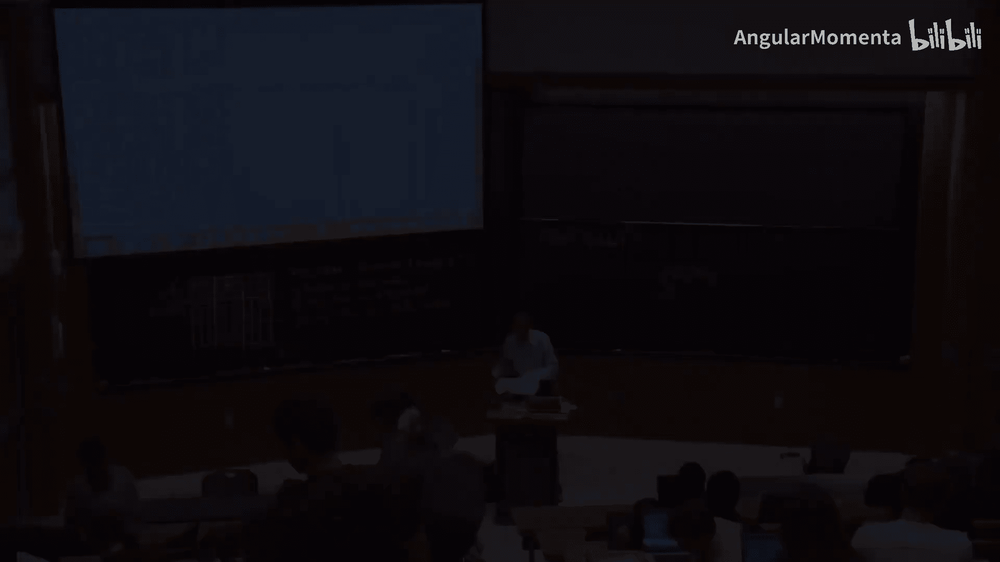

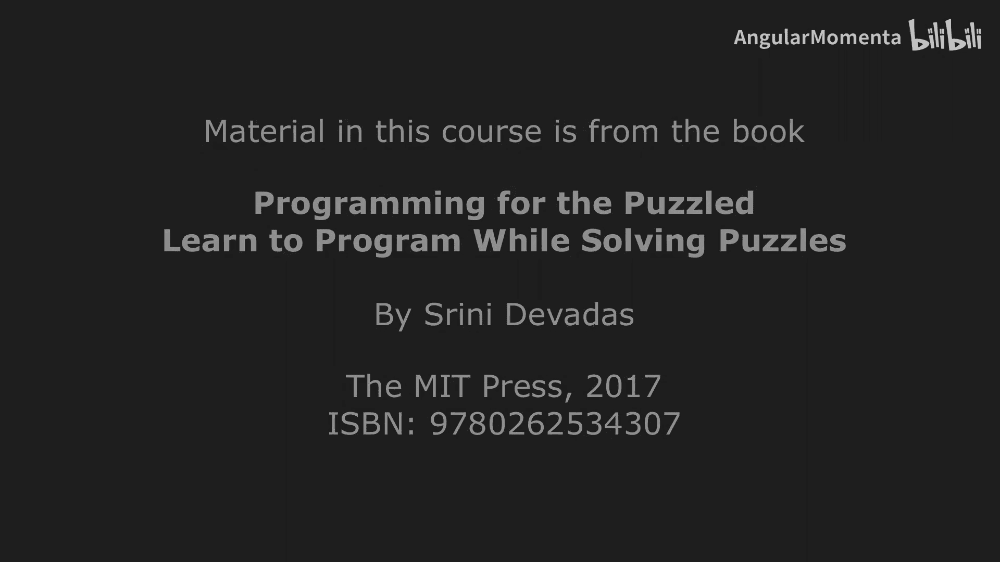