# 【麻省理工】为困惑的人编程-｜-MIT-6.S095-Programming-for-the-Puzzled,-IAP-2018-p08-谜题9-杂乱无章的修理工--BV1qp7LzeESm_p8-

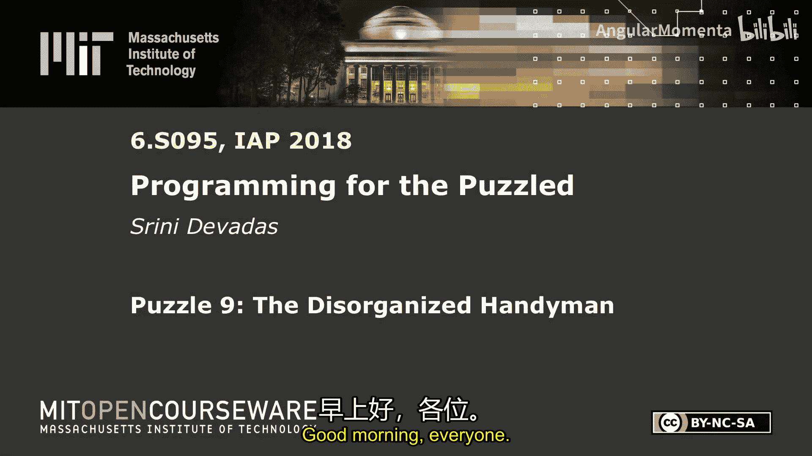

Good morning everyone。 Thanks for making it here through the snow and Sleet。

 You will be quote unquote， rewarded。With， with a cool little puzzle that has。Both。

 both recreational value， as well as a deep connection to the most popular sorting algorithm。

 or at least the most commonly used sorting algorithm called Quicksort。And so what we have up here。

Is what I call the disorganized handyman puzzle。 This is not a puzzle of my invention。

 but I called it this because I think at some point when I read this。

 it was a carpenter who had a bunch of nuts and bolts in his bag and they were all mixed up。

 So so rather than having these the nuts attached to the bolts he was disorganized and the nuts and bolts were separate and then they all got mixed up together in a bag。

 Okay now obviously all puzzles are a little bit contrived。

 And so we're going to assume here that there's100 different nuts and100 associated bolts。

 And these 200 objects are all mixed up into this one bag that。

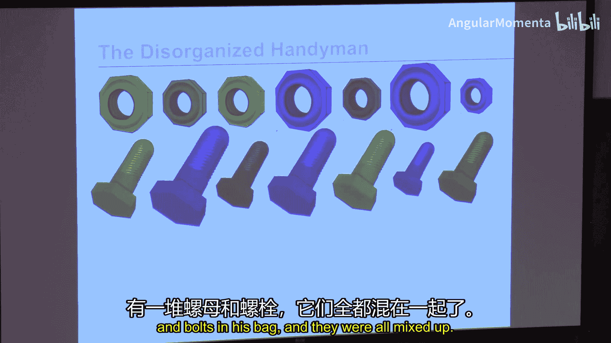

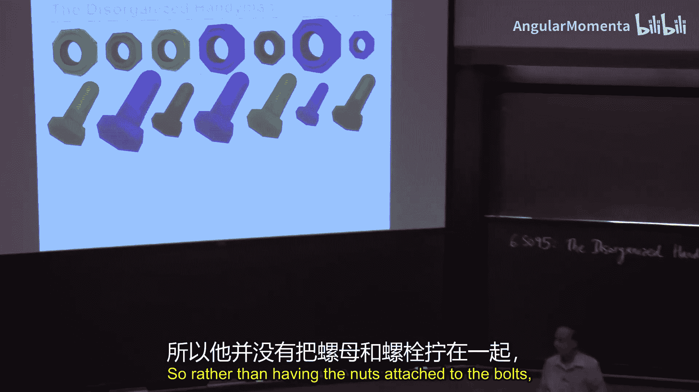

Carpenter scaring。And not only that， each of the bolts is unique in terms of its size。

 and as I mentioned， there is an associated knot associated with each unique bolt。

And so as you can imagine， the goal of this puzzle is going to be finding the most efficient way of。

Creating some organization in this bag by attaching each nut to the corresponding bolt or vice versa。

RightAnd you can assume that there's no ambiguity because of the uniqueness of the nuts and the bolts and there's 100 pairs waiting to be discovered。

 and you can try to make that process as efficient as possible as with all of the puzzles that we look at here。

 there's going to be naive slash straightforward way of doing this。

 we're going to go ahead and figure that out pretty quickly we're going to analyze the complexity of that or how long it takes for a specific example of 100 nuts and 100 bolts。

 And then we're going to scratch our heads and try and do better。 And as I mentioned。

 obviously there's going to be some programming associated with this。

 And we're not going to represent you know， nuts and bolts in programs or codes we're gonna switch gears and and talk about sorting once we're done with this puzzle。

Good， the only way that you are the carpenter， if you're the carpenter's helper have of checking。

To see that a nut attaches to a bolt is to try it out。😡，Okay。

 and the nuts and bolts are different enough in size that even if you had your eyes closed or it was a dark room。

 you could if the nut attaches to the bolt， it would screw on perfectly if it is if the bolt is smaller than the nut。

 it would just go through and it would be obvious that the bolt is smaller than the nut。

 And if the nut is smaller than the bolt， it will also be obvious because the bolt you know wouldn't go through it。

 which makes perfect sense from a physical standpointpoint， right， we've all tried this before。

 we've had maybe not all of you， but I've certainly had occasion to to discover pairs of of nuts and bolts。

 though it was never， you know 100 of them， right But so that's kind of a little bit contrived。

 as I said。 Allright， good。 So the setup is clear。Reig good on the setup， excellent。

 So what is the straightforward way of doing this。Someone。Right， we could choose a knot at random。

 try every different bolt or choose a bolt at random and try every different nut right and we're guaranteed in this case that there is a pairing and so after we do that we can put this paired nu bolt aside and we've shrunk the problem down to one less than the original problem if I started out with100 pairs that are not paired together but there's 100 knots and 100 bolts then I get one pair which is a correct pair and I have 99 knots left and 99 bolts left and I keep going perfectly reasonable way of doing things and let me show you how that would work these slides were made by my daughters many years ago back when they listen to me I have fat chance of getting them to do any work for me anymore but they are busier than they were I guess years ago。

At least they pretend to be and there you go， you end up in this particular example。

 which obviously has many fewer than 100 nuts and bolts。

 you end up checking this and in the worst case how many comparisons would I had to do would I have had to do。

If I had 100 nutss and 100 bowls。In the worst case， I would have to。

I have to do all 00 because I might just have gotten unlucky。 like， like I said， I mean。

 we're not eyeballing this at all。 you could probably prune the search a little bit with respect to。

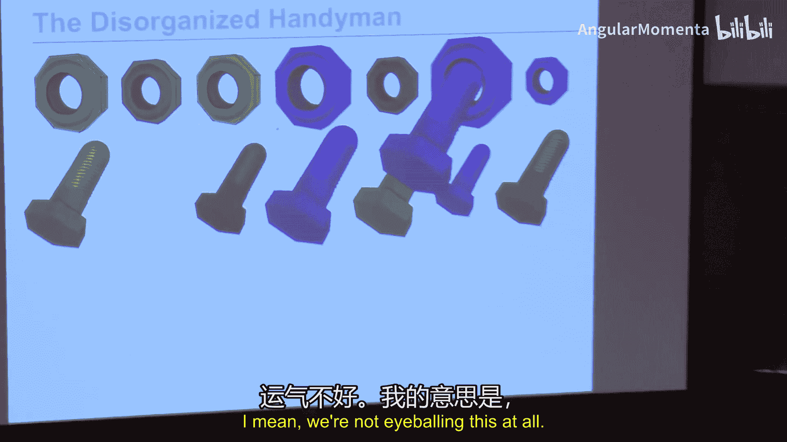

Putting aside not having to do an exact comparison。

 but let's just say that even looking at and nu as opposed to even touching it with the bolt that you've chosen is。

 in fact， a comparison。 You know， youre just eyeballing it as opposed to physically touching the bolt and nut together。

 and we're gonna call that a comparison。 And if you do that。 And if you make that assumption。

 then obviously， you're going to have to look at all 100 nuts。

 if you have a random bolt in the worst case。 Okay， you might get lucky on on average。

 it might be only 50。 you're not going to do that type of analysis here。So， so that's good。

 And what is the complexity in terms of the growth rate of this。

 this particular algorithm if I had N。嗯。Nuts and bolts。Then I do N comparisons。In the worst case。嗯。

To find the first pair。And when I say first pair， I mean。

 the correct pairing that is associated with the nut in the bolt。 And you know what happens Yeah。

 Kevin， you have a question。可重新发言。You have。That's exactly right。

 It's it's absolutely less than n square in the in terms of numerics。

 the the growth rate is a slightly different question， right， it's related obviously。

 And so if you do this and you get the first pair you now have a problem that that is of size n-1。

 right？ And so in this case， how many comparisons am I going to make when I have n -1 nuts and n -1 bolts in the worst case。

I'm going to do n -1 comparisons。Right。And then I keep going down and and you could argue that at the at the very end when I have two nuts and two bolts。

 one comparison。 if I assume that this was a perfect set of nuts and bolts that we had all pairs right at the beginning。

 you you could argue that that that small problem corresponding to two nuts and bolts can be solved using one comparison And you immediately know which nu pairs with which bolts and the other one as well。

 But you know， let's call it a confirmation comparison and essentially say you need two comparisons here。

嗯。And， and one here， I you can obviously shave a number a little bit out out of out of this。

 But this goes back to Kevin is right。 It's less than n square。 If you look at it numerically。

 but the growth rate is。N square， because we know that n plus n -1 plus n -2 dot 2 plus 1 is n times n plus1 divided by2。

 And sure， you could you could take this one off。 and this would become n times n -1 big divided by 2。

 but that growth rate is n square grows。As n squared。Right so if you had 100 nuts and 100 bolts。

 you're talking about something of the order of 5000 comparisons， right。

 if you want to do it numerically， and it grow as n squared。

 if you had 1000 then it would be 1000 times 1000 which is a million divided by 2。 That's 500000。

 So that is astronomical in terms of its growth， you don't want to do that obviously a contrived problem。

 but n square in general， when you talk about manual labor is generally not very good So if we'd like to improve this。

 right and we've been talking about recursion， we've been talking about divide and conquer this is not divide and conquer in the true sense in that you're going to a smaller problem admittedly。

 but recall I said divide and conquer is usually used when you break the problem up into。Fal pieces。

 okay， which means in merge sort， for example， we took or of the tiling puzzle。

 we took the courtyard and we broke it up into four courtyards。 So essentially。

 we had four quarters in the case of the tiling puzzle we had two halves in the case of merge sort here。

 we are solving basically one。Not in bolt in the original puzzle。

 And then we're going from n to n -1。 And so there's many more steps。 right。

 the one thing to remember， when you think about complexity is that when you go n to n divided by2 to n divided by 4 and then you keep going and you go all the way down to one this。

 of course， when you go like this， there's a linear number of steps， But when you do that。

 how many steps do you have to get all the way to one， in relation if if you start with n。

 how many steps do you have。If I had， if this were， this were 64 or let's just take a simpler one。

 If this were 4， how many steps would I have。I would have。Two steps。 If this were 8。

 I'd have three steps。 And so what's that formula。Loarithm loggged to the base2。Right。So。

 that's the power of fractional sizes。 And this is actually a very fundamental notion that is going to appear over and over。

 if you do any algorithms work or take any algorithms classes that divide and conquer is very efficient because the number of steps in order to get down to small problems。

 is relatively small。 Its， it's a logarithm。 Now， if you broke this up into into three parts and you went to n over three。

 etc。 then this would be logged to the base， something else in log to the base 3。

 So log the base 2 came because we broke it up in and we went down to half half the size。 right Now。

 remember， of course， I mean， it's not that the complexity here is just logarithmic。

 It's that you do have two problems。This is a function。Of the， the particular。

Specific algorithm that corresponds to divide and conquer。 But in the case of mergear。

 it's not that we just went from n to n over2。 Well， we went to N from n to n over2。

 but there were two n over two size problems。 And， but the beauty of of divide and conquer is。

 if I magically。If I magically broke up。The N size problem。 And let's go back to our nuts and bolts。

Into。2 problems。Of size。And over 2。 So each。A problem has n over two knot and n over two bowls。 Okay。

 each problem has， I'll repeat that。 N over two knot and and over two bowls。Then if I used and。

 and this is magical， right， I don't quite know how to do that yet。 But if I did that。

Then I think about what happens with respect to these comparisons。 So I said when n was 100。

I needed 5000 comparisons。For this naive algorithm。 But now if I did this and I got two n over twos。

 then I have 50。 So I'll call that M equals 50。 and then I have another one， which is M equals 50。

 And so roughly how many comparisons would I need if I had as problem of size 50。

50 nuts and 50 bolts using our original naive strategy。Roughly。1225， right， roughly。

 And this would be 1225。And so， so that is 2500。 So， of course。

I I don't haven quite told you how to do this。 This is still magic， but I was upfront about it。😊。

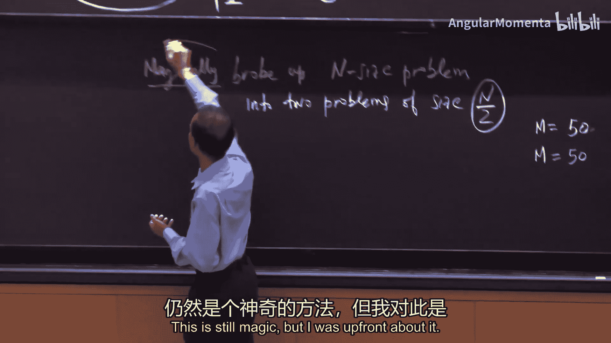

But clearly， I've gotten an improvement if I have this magic。Okay， and so let's talk about that。

 Let's turn this nuts and bolts puzzle or the solution to this puzzle and try and figure out a divide and conquer strategy。

 which is distinctly different from the brute force strategy that just reduce by one。Alright， now。

 Villa。This is just going on。 So the comparisons in the worst case is what I just said。

 and it grows as n square。 So big O n square means it just grows as n square。

 right That's asympttic notation that we won't go into。 But you get。

 you understand what that means now。So， if I do。A straightforward divide and conquer。

 like I did with merge sort， where I just took the ray， and I split it in half。Right。

 if I take these nuts and bolts and I take separate the nuts out， you know， put it。

 put 50 on this side，50 on the other side， take the bolts。

 put 50 on this side and 50 on the other side。 is that gonna work。No， that's not gonna work。

 And the reason is if I do this arbitrary partition。

 then let's say that I take this and the two of you get together。

 your friends and partners and you say， let's do this in parallel。 and save some time。

 You're still going to be counting the number of comparisons， And so obviously。

 you also would like to reduce the number of comparisons。

 but you can't even use a helper here in the sense that if you split this up， obviously。

 this was not 50 and 50， but three nuts in three bolts on one side and  four and4 and the other side。

 as you can see from this example， you had a situation where the matching not was in one pile on the left for a bolt that was on the right hand side。

 And that could happen not just for one， which would kill the process。

 but could happen for many not bolt pairs so we can't do that We cannot use。

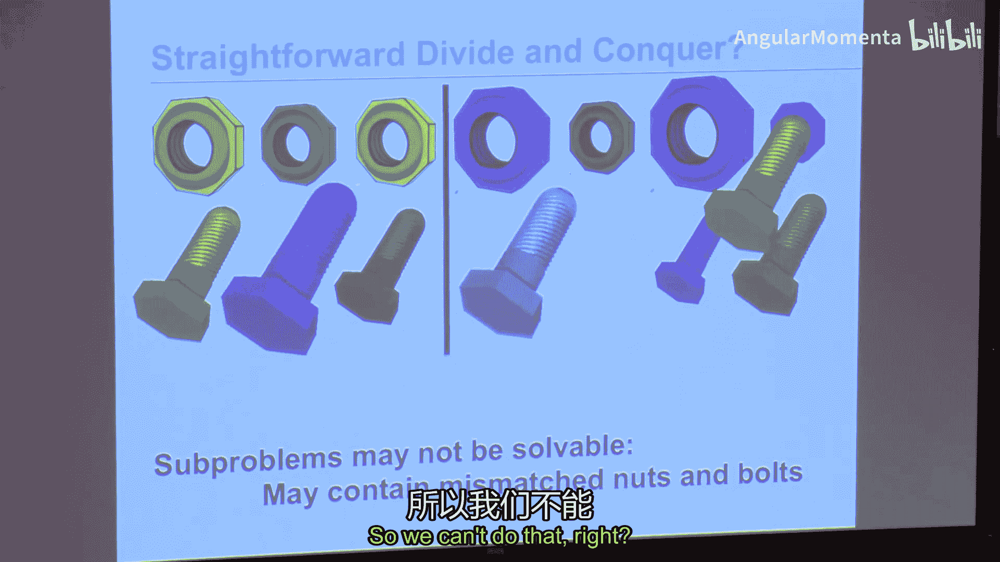

The straightforward divide and conquer approach。 So。

 so this comes to the first interesting question that we have here， which is how do we。

Exploit the fact that all of you are going to help me。 So I'm the disorganized carpenter handyman。

 And， and， and I'd like to。Break this up first， into two piles such that I can go off and send one or more of you off and and say。

 okay， I can guarantee that this is a sub problem in the sense that the original problem had all of the bolts that matched all of the nuts that were in my pile。

 I want to break it up into two problems this is the magic that we have。

 we need to figure out this magic that such that if I give you 50 nuts and 50 bolts。

 and I keep 50 nuts and 50 bolts that you can solve that problem。 It is a problem。 I mean。

 there there's a massing there right for those 50 nuts。

 you have the 50 bolts in your pile Sam thing with me， So how do I do that。😊，Yeah， go ahead， Josh。

 I have a question。 Yeah， you compare the size of nuts to each other。 No， you cannot。 Yeah。

 good question。 So you， you， the only thing you can do is， you know， you have。

 you have and not and you have a bolt and it it goes through then the the knot is bigger if it doesn't。

 then the the bolt is bigger。 And then if it fits exactly you have a match。 Alright， great。 So yeah。

 go ahead upper。 So once get you can use that。😊，これでやろ。Because it fits in perfectly right。

 it fits so all the ones that you just go through all of them and if it goes through just the whole。

Then you know those are smaller， although they're bigger。It doesn't fit the。 you know that right。

 great， excellent。 So Grattra has discovered this notion of。Pivoting。And。

Pivoting is essentially something that is best described a here in animation。

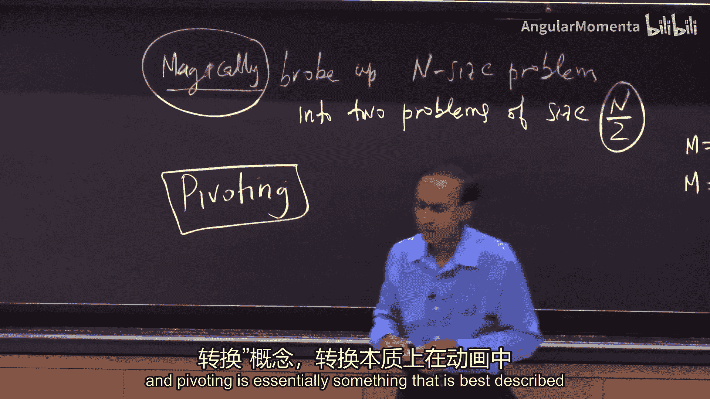

That gives you a divide and conquer strategy right now I answer Joshua's question。

 and that is a key question。 and I'm not going to violate the answer to that question by using some other strategy that that does not correspond to this nu bolt check right So the only thing I can do in this puzzle is a nu bolt check。

 But I do get three potential possibilities whenever I do a nut bolt check。

 I do get the information about a perfect match whether the nu is smaller or whether the nu is bigger right and that's all I need in order to do pivoting right And so what's gonna happen here is I go ahead and I choose an arbitrary bolt And if I don't even actually need to find the match before I start this process。

 So it's a small variant on what。Gatra said， but it's really a pretty small variant。

 And when I see that this is not a match。 And， in fact， the nut is bigger。

 then I put the nut on the right hand side pile。 Okay， when I see that the nut is smaller。

 then I put the nut in the left hand side pile。And I see a match。 I just put that aside。

 I don't put it in either of the piles because I'm going to actually。

 it turns out I'm not going to get a pile of 50 and 50。 or in this case。

 Im I'm actually going to get something like3 and3， because I'm going to get one match out of it。

 right So in the case of in general， I I don't necessarily。

 I'm not necessarily going to get equal size piles。 So that's actually a little bit of an issue。

 And we'll get back to that maybe later。But I will get a matching， and I'll get a pile on the left。

 That is a perfect problem， perfect subproble there I can hand it off to any of you。

 and you can go off and solve it。 and itll work。 And I'll get a pile on the right。

 Sam thing for that。 right So this was a match， but I don't stop。 I。

 I don't put the nut in either of the two piles。 It's just going stay up there。

 And then I keep going。😊，And I， I make up my right pile and my left pile。 right。

 now I'm not quite done yet。 What do I do now。Yeah， back there。因为。That's right。 So remember。

 I kept the， I kept the。I guess you used a different term here。

 I you you used I said bolt use its screw。 That's fine。 But we're talking about a nu here。 So。

 so let's go with a nut， and this nut that I put aside。 I'm going to now compare that。

 not with this pivot bolt that I picked。 which is now set aside and never have to use that again。

 but I'm going to put that aside。 And I'm going to compare each of the bolts with this this pivot nut that I have。

 So the pivot bolt。😊，Was picked。 And I discover。The， the associated pivot nu。

And now I'm gonna use that pivot nut， which is。The that I have up here。The light green 1。

 And then I'm going to do the same thing。And all of this does not violate the answer to Josh's question。

And it's going to do exactly the right thing。In terms of giving me。

 giving me two piles that are beautiful。Problems that are going to be solvable。 alright。

There's nothing that's stopping me。

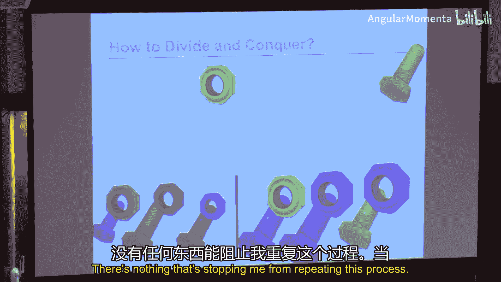

From repeating this process， when we talk about divide and conquer。

 usually we talk about recursion and we talk about repeatedly doing divide and conquer。

 when I wrote this up here。In terms of。The n size problem turned into two n over two problems。 Well。

 each of those n over two problems could turn into two n over four problems。

 so I could have four and over fours and so on and so forth。 And so I could clearly do that。

 and especially if n is large， then I want to get at reduction in comparisons。 and get this to grow。

 by the way。 and we won to do this analysis。 But rather than growing as n square。

 youd you'd like it to grow。As N log n。Right。And that's kind of。

The asymptotic analysis that you'll have to do if you take a class like 606。

 but the general sense that you should take away from this is that you're gonna have a logarithmic number of steps and obviously that doesn't imply a logarithmic number of comparisons because the number of subpro in each of those steps is doubling。

 initially you had a problem， then you have two sub problemsble and then you have four sub problems。

 Each of them are are small in size。 but together assuming these problems are n over two and n over two。

 then you can get something that's substantially smaller than n square namely n log n okay and you can do that numerically and I don't want to get into that too much。

 but be happy to talk to you about this after lecture during office hours。

There's a couple of caveats。 One of them is， there's no guarantee here。

 If I pick a random pivot bolt that I'm actually going to get n over  two and and over  two。

 It's gonna be one less than that。 Maybe it'd be n over two and over two two -1。

 I could get something。 if I picked a large pivot bolt， I might get a very skewed。pairair of piles。

 right， One of them could have 80 in them，80 nuts and bolts in them。

 and the other one could have 20 nuts and bolts in them。 Okay so so that's something to worry about。

 And we won't worry about that。 But we'll talk about it when we move to sorting。

 which is what we're gonna do in just a couple minutes。

 So people buy the solution to the nuts and bolts puzzle。

Clearly it's gonna to give you some efficiency。 if you pick a middling size a bolt。

 maybe you can eyeball that。 It's a little bit of a violation of what we've talked about。

 but but you you could clearly， I mean you let's assume that that you can make out the difference between something that's as thick as this in a finger and then you pick something in the middle。

 and then you can get two large piles that are roughly equal in size from the original really large pile。

 And at least in the beginning， you could probably get in the context of this puzzle piles。

ARough similar in size， right， And after that， it doesn't really matter once you've broken things up。

 So N is not 100， but you know， n is more like 5 or 10。 at that point。

 it doesn't really matter what strategy you use because the numbers aren't very different depending regardless of the strategy。

Okay。So， so good。 Alright。 So I promised you a relationship to sorting。 And obviously。

 we want to do some programming here。 And it turns out that just like we had merged sort。

 which was a divide and conquer algorithm。😊，It turns out this pivoting strategy。

 turns into a strategy for divide and conquer that is quite different from merge sort。

 but is equally applicable to sorting numbers。 Okay And so let me remind you what merge sort was。

 And then I'm going to contrast merge sort with quick sort。 which is a pivot based sorting algorithm。

 right so forget about nuts and bolts， were now down to boring numbers integers and we want to just sort these numbers in ascending order。

 Okay， So if I have a bunch of numbers。And I want to sort this in ascending order。Merzart would say。

 I'm going to go ahead。And break it up into hals。 Okay， And let's just do one level of recursion。

 You know， with all of these things， you can always do more。

 but these problems aren't large enough that you really want to do that in this example。

 And the important thing is you just broke it into half。 You know， it was easy。 The split was easy。

 you slice the list， slicelic the list。 What have you right。

 And you assume that somehow you can sort this in ascending order。 in this case， it you need to go。

To that。 And then you start this in ascending order。 So you go。Like that。

 And then you need to do merge。And we used what we call the two finger algorithm。

To do the merge that essentially says I'm， I'm going to assume that this array is sorted and this array is sorted。

And I'm going to put pointers up at the beginning of these two arrays。 And I'm going do comparisons。

 And I'm essentially going to assume that I have an， a blank array。Of size six。

 blank list of size six。And I'm gonna be writing into this blank array。

 the result of the comparison that is which one is less in the comparisons。 So I'm gonna get -31。

 And then I compare 0 with -4。 and I'm gonna get -4，0， etc， etc ce。 right So that was our merge。

 And the importanting thing to remember is that our merge algorithm was had an easy divide step and it had a more difficult step that correspond to taking the sub arrays that was sorted and。

 and the work was all in the merge。 Okay， putting the things together because the divide obviously is just like ch。

Right， now， as you can see from the nuts and bolts。Division was non trivial， right。

Division required pivoting， Okay， but there was no real merge after that。 I mean once I handed off。

 let's say to Guatra， these 50 nuts and bolts。 after I did the work in pivoting。

 and I kept 50 nuts and bolts as well。We were done。 I mean， just know。

 maybe I wanted the nuts and bolts back。 you I don't wanted to run away with it。

 but it wasn't like I had to process anything that he gave me back， right， If he paired them up。

 then I didn't have to process that， right？ So this is Merz。The quick sort algorithm。

 which I'll now describe to you。嗯。Is divide and conquer two way to divide and conquer same as Marzart。

 but it kind of flips them。The work。 And it does more work up front before the division。

 And then this little or no work at the end。 right。

 So what happens here is the way we're going to think about quick sort is we're going to choose a pivot。

You can have some array here， and I can go ahead and just call these AB，C， D， E， F， G。

And I'm going to choose a pivot。And。In the code that I'm going to show you。

 we're just going to go ahead and choose the last element。 We assume that this is in random order。

 We're going to choose the last element of this array as the pivot right。

 And what did we do with the pivot back in our nuts and bolts example， we。

Someone what we to do with the pivot？Yeah， go ahead， Ron。Yeah， you basically spliced around it。

 You compared it with we took the pivot bolt and in this case， of the puzzle。

 you compared it with the nuts here， we don't have nuts and bolts。 We just have numbers。

 And so you're gonna take that pivot and you're gonna start comparing it with other numbers and you're exactly right in that we're gonna get to the point where we have to splice around it。

 which isn't your standard know Python splicing because that requires contiguous locations But what you want to do is you want to get to a situation where you have something like this where you have G somewhere in the middle and all elements less than G are to the left and let's assume they're all unique elements all elements greater than G R to the right。

😊，Okay， so this is exactly pivoting around G， right， So this is。It's referred to as pivoting。Around。

G。Okay， now the nice thing here when you do this is that you can go off and。

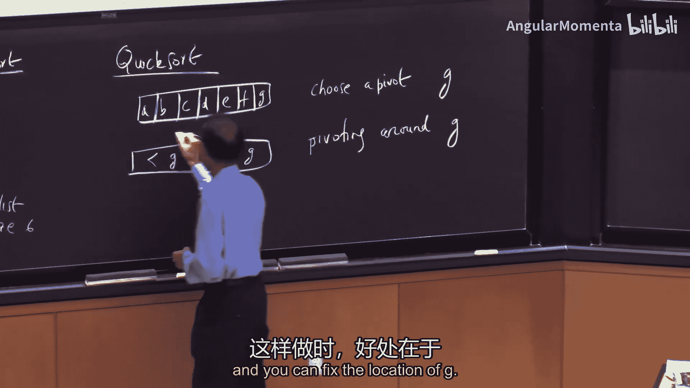

You can fix the location of G， in fact。G's location。Just like the pear， the nuball pair。😡，我是。

Corsding to the pivot nut and the pivot bolt was determined during the pivoting step。

 And you never had to check whether you never had to discover that pair again。

 You can put that pair aside。 The location of G， the pivot chosen in the final sortded array is determined by this pivoting step。

Okay， that makes sense。And so， so this location， whatever that indexes， you know。

 it might be right in the middle。 It might be a little bit skewed。 but that location is determined。

 And if you did this with roughly equal。Pileles， if you will， or equal sides。

 If there were 100 elements here， you might see you know，50 odd here and， you know，40 odd over there。

 right， now， of course， if G happened to be the largest number。

 then G would be all the way to the right。 right？ So， so there's that to worry about。 And So。

 but this is the divide step。 So the divide step is the pivoting step。

And then you can go off and sort its。Each of those subs， right。

 because those less than G are not necessarily in ascending order。 right。

 You just you know dump them。 Theres still work to be done。 And then the greater is G， likewise。

 they're not necessarily in ascending order。 But you know that theres 42 elements in corresponding to less than G。

 And you can go sort that array。 And those are going to be the first 42 elements of your final array。

Right， and the G is going to be at the 43rd position。

 And then the ones that are greater than G are going to be to the right of that。 all makes sense。

 right。Yeah， go ahead， so like if we were veryy and each which the's gonnad that's right。

 So that's pathological。 Now it turns out that amazingly in order to avoid that situation。

 when people use quick sort in practice， which is essentially this algorithm that I described。

 they take the array that they're given。 they actually randomize it。

 they actually make it they shake it up。 right's it's like you get these nuts and bolts and you want to close your eyes and you want to pick up and midddling in size。

 and you know maybe all the small ones are up at the top and the big ones are down at the bottom。

 you want things in the middle。 So you go shake， shake。

 shake know you randomize and then you stick your hand in but halfway through the pile and pick up a nu or pick up a bull。

 right That's kind of what happens here。 So so quick sort， it turns out and I'll just say this。

 And if this doesn't make sense， ask me later， But it should give you some intuition。😊。

The random randomized quick sort where you have this random input and you have some probabilistic guarantee that you're picking a pivot that is midddling in size in terms of an integer size is going to be n log n in complexity but the worst case complexity of quick sort is exactly as you said。

 it's n square but know that's really not something that you need to understand deeply to understand well either the puzzle or the rest of this lecture。

 you do get a sense of as long as you have a sense of if you pick something in the middle and these piles are roughly equal in size。

 I'm going to get some improvement the guarantee that the piles are roughly equal in size。

 all the way down to the depths of recursion is a difficult one to achieve in a deterministic way。

 but it's not hard to achieve in a probabilistic way by doing this randomization right。

Another question。 Yeah， then why do we use this more than that's exactly。

 So that is the rest of the lecture。 Okay， which is only 10 minutes left。 But okay。

 so that's the that's the rest of the lecture。 right， So one of the things that I said here。

 I said a blank list of size 6。 Okay， So what merge sort requires in order merge sort to be efficient。

 you needed auxiliary storage that corresponded to the size of the list because right at the first level of recursion when you got two arrays that were n over two and n over two and they were both sorted and you had I had to merge the two together to create the final result corresponding to the sortded array。

 you ended up requiring storage that was n in size。

 in order to actually do this two finger algorithm and compared the-31s with the zeros and then write them into this array right now the obvious way。

Of taking this and going to here is code that I'm going to show you that is easy to write。

 And it requires a blank list as well。 Okay， you're just， I mean， the easy way to do that。

 And I'll just show you the code because it it's easier to show you the code as opposed to waving my hands here。

嗯。And potentially confusing people。 But let me show you first， the quick sort divide and conquer。

 which is absolutely trivial。 I mean， just like merge sort was。

 but pivot partition is this step here。 this is the pivoting step and this is what that procedure does right So we'll get to that in just a second。

 But the rest of it is simply I'm going to go ahead and once I do the pivot partition。

 I have something that looks like this。 And then I just go off and run quick sort on this and quick sort on that。

 and I'm doing that on the array itself， it's just like I have this array。

 and I'm just saying I'm going to call quick sort with the indices that are associated with the beginning and the end of this array。

 and then I'm going to call quick sort with the indices that begin with the beginning and the end of this array。

 And as long as and that same array is going to。my final output， right。

 So everything is done and the term that's used here is in place， right。

 So in place sorting and insertion sort， which is also n square。

 and a few other things are in place sorting algorithms which essentially say， look。

 I need to sort all of you know in some some ran some way right， know。

 perhaps by age or something And know， I don't want I don't want another room， I don't want to say。

 who's the youngest here and then go over to that room and then know who's the next youngest and go over to the room。

 etc。 I just want you to start swapping positions here。 And we're all gonna be in this room。

 And somehow， you know we're gonna get sorted right So that's in place。

 And when I have an an array that corresponds to integers。

 I don't want another blank list or blank array and use that storage。

 And so that answers your question at the top level as to why quick sort is used And it's used because the memory requirements of quick sort are substantially less than the memory requirements of merge sort。

 And in fact。😊，You can do this a pivoting step using one integer as storage。

 you need the original array， of course， but you needed that to store all of the numbers。

 and the auxiliary storage。 The extra storage that you need is exactly the storage for one integer that you stored the pivot and I'm going to show you the naive way。

 which is regular quick sort。 and and that is a trivial pivot partition。 It's not the clever one。

 which essentially says， look， I'm going to go ahead and I'm going to create a new array and in fact。

 I have two arrays that are less and more or two lists together。

 the sizes of less and more are going to be the size of the original maybe -1。

 but I'm adding to less and adding to more depending on whether the element is less than the pivot or greater than the pivot。

 And then I'm good。 So there's there's that algorithm， which would just be oh yeah。

 I'm going to create a new list year。

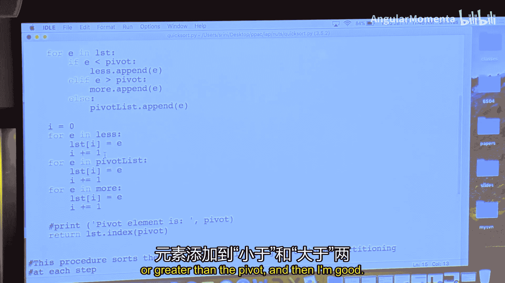

And I'm going compare A to G。 And， and then I'm going compare you know， B to G， et cetera， et cetera。

 So this does not give you anything。 This is an uninteresting algorithm。 sorry， implementation。

 This is an uninteresting implementation。 Okay， it is much more。嗯。s you need to be much more clever。

I don't need this anymore。To do this in place。 Okay， so what I want to do is。

I'm going to take an example here。😡，I wanted， I wanted be to take this。Aray。

And I'm going to not talk about the recursive sorting or anything like that， because that's easy。

 right， We kind of know how to do that。 What I want to do is I want to choose this。As the pivot。

And I want to translate that somehow into the final pivoted。output， which is going to be 0-31。1。To。

65。99。Whoops。so I have， I have something wrong here。 So this should be the other way around 83。

 right， Okay，Oh， I'm sorry。 I'm sorry。 This is fine。 This is fine。 I just need it to。

 I don't need it to be sorted。 Okay， good who。Allright。 I。

 I had this I I just thought I found the first bug in my book。 Okay。

 so there's probably many bugs in the book， but I don't want to know。Don't。Right。

 so I don't need this to be sorted。 Yeah， so a 0-31。

 So the key is that I've discovered this and everything to the left of that is less than one and everything to the right of that is greater than one。

 And that's the only requirement that I have。 and and as I said， I mean。

 I said this to begin with and then I forgot。 I said we're not going worry about the recursion。

 So clearly I have to do more work here with respect to taking this set of numbers and and sorting them in a sending order。

 etc。 But what I've done here。 is I know that one is fixed in place and one will never move right And I just have I've turned this into -31 and 0。

 and I have to do some reordering here。 But one is fixed in place。

 Okay Now the algorithm that I have that I'm going show you， I'm going to show you the code。

 and it' probably code that you won't be able to。Pase， at least in minutes。Or seconds。

 and this code is in place pivoting。Okay， it's clever code。

 And what it does is it has one additional。Variable worth of storage that we're going to call the。

 the， the pivot。Right， so that you see the variable pivot there。

And just using that one additional integer storage。

 it manages to transform this array using a linear number of steps into into this array。

 Allright So you can see that this is not trivial I need to I need to move from here to there without having this extra storage。

 If you had extra storage， it would be easy， we know how to do that。

 But if you didn't you you need this this code that has an outer while loop， you see while not done。

 and then it's got two inner while loops in it。 and it's got a couple of counters。

 a couple of pointers， I should say， to indices and you go left and right and you magically get this answer。

 but there's no magic here。 because we have the code up and we can run it and computers aren't smart。

 So clearly that code is doing something clever and we just need to understand that。 Allright。

 so I'm gonna in the couple of minutes I have left this is the last thing I want to do is I want to tell。

😊，how this code works，And it's really pretty code。 And it's， it's clever code。

 So what I have is I have two pointers top and bottom。

 So I'm gonna essentially say that top is all bottom is 0。It initially is -1。

 but we go ahead and increment it and top is 8， right？ And so how many I have。9，1，2，3，4，5，6，7，8，9。

 So， so so so top is pointing to the pivot。 So this is this is pointing to the pivot。

 which is top is 8 and and bottom is pointing to to the first element。

 right So these two while loops are essentially going from the left of the array and going this way from the from the right of the array。

 So what we're going to do。 And and don't worry about exactly how the code does this。

 I'm gonna show you the way this array is transformed。 And the way these。

 these pointers are are changed。 And then you'll get a sense of how the code works。

 And obviously this transformation happens in one of those while loops。 All。

 So we have the pivot corresponding to one and bottom equals 0 and top equals 8。

 What I'm going to do is。I'm going to start moving。left word。

From this would be the second inner wide loop。 I'm going start moving。小。Oh， I'm sorry。

 I'm going to start。 I， I'll start with with with bottom。 I'm gonna increment。

 bottom is initially -1。 I increment it to 0 and。I start moving rightward from the left of the list and try and find an element that is greater than one right。

 And that is immediate。 I realized that four is greater than one。 Okay。

 so when I realized that four is greater than one。 I'm going to copy over4。

And this doesn't mean that I'm copying the entire array。 I'm just going to copy over4。

 but I'm writing what the array looks like， but that's important over to here。Right。

 and you might say。Pivt equals  one。 You might say， oh， but I overrote the location 1， and I'm like。

 don't worry about it。 I do have。1 stored in my pivot。 So my， my pivot has one in it。Okay。

 so I haven't lost anything here。 It's not like I threw away any locations。

 I do have that extra location， right， So I did this rightward move going from the left。

Now I'm going to go leftward。From the。From the from the right。

 And I'm going to look for something that is less than one。 And I'm going to try and move it。

 So basically， what this algorithm does is it it tries to find things that are if A is is greater than G。

 it moves a to the right most part of the array。 if if and the same thing if D is less than G then it moves it to the to the left part of the array。

 So depending on whether the comparison to G is greater or less。

 you want to end up in the edges of the array。 And you're going to try and get the edges of the array to be correct in the in the sense that they have elements on the left that are less than the pivot and the elements on the right that are greater than the pivot and you try and get to the middle。

 And when you， when your two pointers converge your top and bottom pointers converge， you are done。

 Allright， So let's do a couple more steps and and and and close this lecture。So I did the。

 the right step。 Now I'm going， going rightward。 and now I'm gonna to go leftward。

 What is the first element that is less than one。No， less than one。0。哎。Yes， but I'm going this way。

Yeah， I I'm going。 yeah， I'm glad you pointed that out。 I needed to make sure So I went。

 I went right word the first time， and I want to go leftward this time。 So， so this would be， So I。

 I come here and I see， I see 0。 when I see 0。 what I'm going do is I'm going to transform the ring。

 I'll write this out to make sure I get this right。😊，And。So right now， I have 4，65，2，-31，0。

 etc ceter。 And I'm going to go this way。 and I'm going to put when I see the 0。

 I'm going to copy over 0 over here。And。Leave the zero in here for a second。

And there's no problem here。😡，Because4 was copied over here。 And so now I overrote 4 with 0。 Okay。

 now you kind of see maybe get us some sense of how this algorithm works。

 This is the first interesting step where I took 0。 And because 0 is less than  one。 As I mentioned。

 I want to jam it all the way to the left。Okay， just put it all the way to the left。

 And I'm cool with losing four because four is being put all the way to the right。 Okay。

 now at this point， my bottom and top。😊，I'm going to get modified。 My bottom is still 0。

But the top is 4 because I moved top was 8， and I decremented a top all the way to the point where it became 4。

 And I realized that0 was less than 1。 And then I copied over that value over to the to the bottom。

 You can kind of see the code up there。 this is actually an output of that code。 And I put。

 I put a0 in here。 So that's what my counters look like。 And it's only a couple more steps。

 we're gonna to go and I'll go right。 And I'm going to go do this again。

 except that0 is already taken care of。 So now I see 65。 clearly。

I'm going to have a situation where if I go this way，65 is， is greater than the pivot， right？

 So I'm gonna go 0，65。To。-31。 And because 65 is greater than the pivot。

 I'm going to write it into what the talk was， which obviously got copied over that way。

 So I'm gonna to have 65 in here，99，83，7，82 and 4 right。 So now after this step。Bottom。Equals  one。

 And the reason for that was 65 was in the location on one and top equals。4。And then the next one。

 someone want to tell me what the， the， the next one is going to be。If I go left word。

I'm going start from here。 Top was 4。 So I was pointing at 65。 and I'm looking for。

 looking for something that。when I go， when I go this way。I saw 65 greater than one。

 Now I'm looking for something that is less than1。 and-31 is less than1。 correct， When I go this way。

 I'm looking for something that's less than。 So， so given that it's -31。

 I'm going to copy over -31 to what top was pointing to。 So I have -31 to-31。65， 99。83。7，8，2， and 4。

 And at this point， I'm going to have。Bottom equals 1 and top equals 3。Keep going。 One more。

And I get to the point where I see 2，2 is greater than 1，0 and -31 are less than1。 And so I take two。

 and I copy copy it over here。Alright， and now at this point， when I do an in increment。

 I realize that top bottom is 2。And top is 3。And in the very next step， bottom will equal top。

 and I'm sitting up here。 And so I copy， I make to。

 Id write the pivot into the location that corresponds to that bottom after it top got decremented And in that case。

 both bottom and top are 2。 and that index0，1 and 2， the pivot gets written into it。

 And so that's exactly what I had which I wrote right at the beginning。So。I would say。

 this is probably the most。AComplicated code from a control flow standpoint that I've ever shown you this algorithm is an inplace algorithm that does not require any extra storage。

 And that that's exactly why it's so popular。 People are sorting billions of elements in list。

 and you can't use gigabytes of storage during the sorting process。

 right And what this clever strategy tells you is you don't need all of that storage。

 you can do things in place。 And as long as you choose the pivot reasonably well。

 you get your average case and log n complexity， which is the same as the worst case complexity of merge store。

 So you have to be a little bit careful about that。

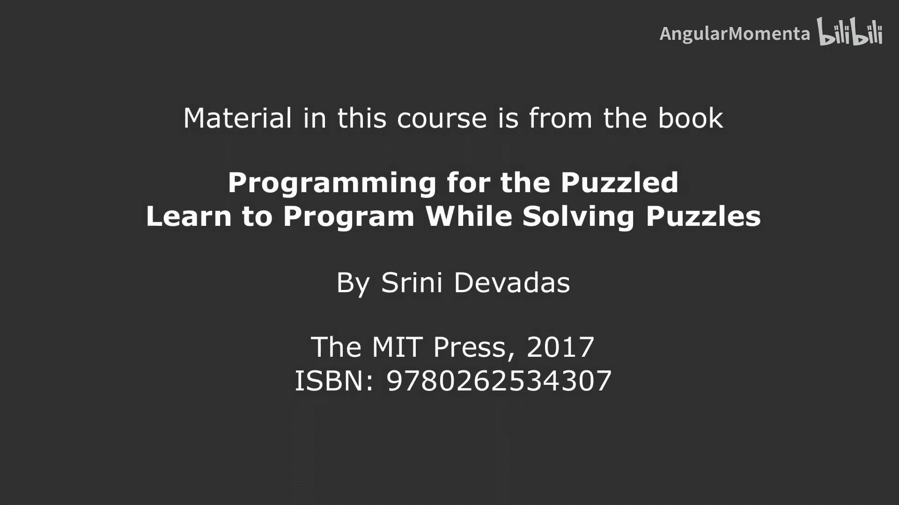

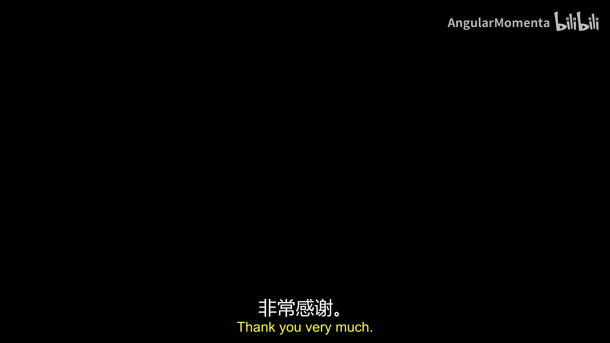