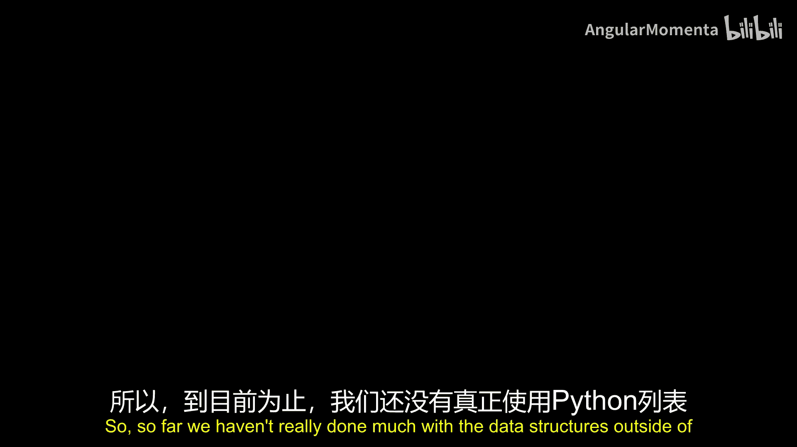
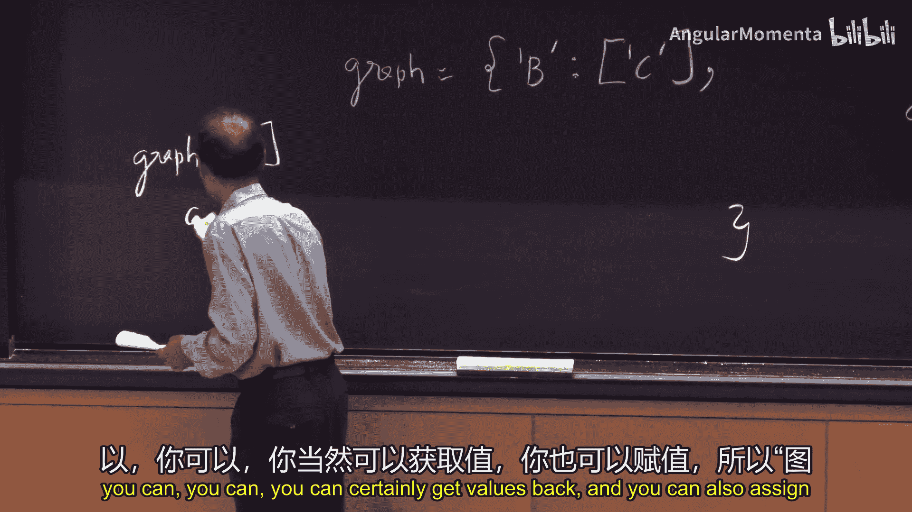
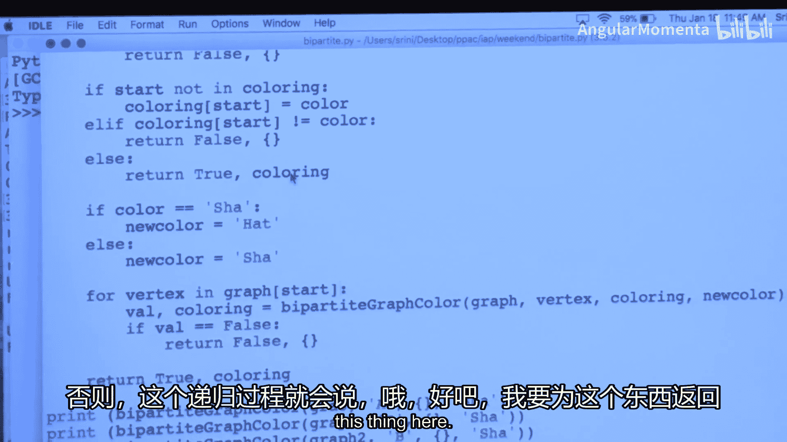

# 【麻省理工】为困惑的人编程-｜-MIT-6.S095-Programming-for-the-Puzzled,-IAP-2018-p09-谜题10-难忘的周末--BV1qp7LzeESm_p9-

So。So far， we haven't really done much with data structures outside of Python lists。

 We looked at two dimensional lists， but you know， there's still a lists。

And so this particular puzzle that we're gonna do today。I has a graph structure associated with it。

 So for the first time， at least in this class， we'll be looking at traversing graphs。And。

We're going to do this in a recursive way。And also we'll have a graph representation using dictionaries。

 So most of you have probably seen dictionaries。 if you haven't。

 I'm gonna explain them they're essentially ways that you can index into lists not just using non-zero integers you know。

 indices0 through n or what have you。 but things like strings or tus And so theyre just more general and they're more general data structure then than Python lists。

 and so they're very convenient when when it comes to representing graphs and traversing graphs。

So the， the puzzle we can look at， is， as always said， a little bit contrived。

 It's about weekend dinner scheduling。 So you have a bunch of friends。And。Let me draw。

Your social network here。Or someone's social network。 So if we want name， names。

But each node in this graph。It represents。A friend。And。A couple more。

And so that's the set of friends， A through H。 And it won't be particularly interesting as a graph。

 if it just had nodes， you want to add edges to it。 what do these edges represent？ Well。

 you like all of your friends， but your friends don't necessarily like each other， And so an edge。

Between nodes。So， so nodes are。Friends。And， an edge between a pair of nodes implies。

A dislike relationship。All right。So B dislikes C。 and it's symmetric。

 you could argue that dislikes is not necessarily symmetric。

 but we just call it that that implies that C dislikes B as well。

 So this is not necessarily a directed graph， some of the time。

 especially when you're doing route planning， going from point A to point B。

 you have to take into account one way streets。 And so you have directed graphs。

 but many a time you can get away with undirected graphs。

 So you just the existence of an edge between B and C implies that in a traversal。

 you can get from B to C or C to B。 And there's no direction there。

 And so I'm going fill in the rest of this。And then get to the question that we want to answer。

And so that's your your friend graph。 and it also has these 6 or 7 dislike relationships and your job。

Is to， well keep all your friends happy。and the way you're gonna do that is by。

 is by having a couple of parties on the weekend。 So this is a regular weekend。 You know。

 let's call it Friday and Saturday。😊，Friday and Saturday night parties。 And the only constraint。

Actually， there's two constraints。 the， the two constraints that you need to follow are satisfied when you have these two parties。

So you have your。Friday party and your Saturday party。Is you can't leave anybody out。Right， so。

You effectively， the constraint is。Each friend。Comes to。Exactly one party。No one gets left out。

 No one comes to both。So， that's fair。And then the second constraint， as you can probably guess。

 is no pair。Of friends。We dislike each other。They're not friendly， they're your friends。

Can be invited on the same day。And so you want an algorithm。That is going to give you a schedule。

 And obviously， the schedule is not necessarily unique。 I mean， if you had。A bunch of happy。

 lucky low overhead friends。 you know， they all like each other。

 and you can just randomly break them up into two groups。 you can think of it as a partition。

 a partition is is a grouping where when you have anything a set of nodes， for example。

 and you partition it you're essentially saying you're breaking it up into two groups。

 such that each node is an exactly one group。😊，And each node And then maybe have another property associated with the partition that corresponds to the edges between these nodes。

 But we'll get to that in just just a minute。 Yeah， go ahead。

How are we gonna deal with the the D F H， Because we only have two parties and those that's。

 that's exactly right。 So， so the purpose of disposal puzzle is to determine。

Whether you can actually do this or not。 And so youre certainly welcome to when you write a computer program or when we write a computer program here。

 it might say， no can do you， find a different set of friends or maybe identify a problem case。

 you know， this one person who dislikes all of your other friends maybe you should drop that person。

 right And so so you can imagine that that you would not necessarily be able to satisfy these two constraints for all graphs。

 right And so that's really the essence of the puzzle for what kind of graphs this。

 it turns out that a fairly famous kind of graph does does this puzzle have a solution， right？

 And so you you you have to look at this and you kind of go。

 And the first thing that occurred to you was hey， if I had if。😊，G and H， if I invite。If on Friday。

 I have to invite G and H on Saturday。 but then G and H don't like each other。Right。

 so that's a problem， right？ And so in this particular case。

 you've identified this cycle that indicates that this problem is not solvable。

 But let's say that somehow you've placated G。 and you' patch， they've patched up。Allright。

 so so you end up having， a fairly complex graph structure that looks like this。Right。

 and now what happens now is there， is there a solution to this problem to this particular puzzle。

I mean， A can come on any day。 So let's ignore A。 A is easy。suppose you invite。

 you could try and figure this out by saying， let's， let's go ahead and invite invite B on。

 on Friday。 So what does that imp。That immediately implies that。C is on Saturday， right。

 What does that imply。D is on Friday。 So you， you see how this is going to go。 What does that imply。

E and F are on。A on Saturday。 So I have E And F on Saturday。 Okay， and then what does that imply。

The F， F F being on Saturday implies that G， H and I have to be on， on Friday。Right。

 and then I don't forget A。 So let's just stick a in here to even things out。Alright。So。

 so we kind of did an algorithm here。 We executed an algorithm， right， and it， it。

 it turns out that graphs that can be partitioned in this manner。have a special name。

They're called biPite graphs。Bibpartid graphs， I'll write it out。啊。

And the reason they call bipartiteize graphs is。If you have a bipartite graph。

 you can always draw it。In this fashion。Where you have。A C， EF。And then you have BD。GHI。Such that。

You never see edges。Like this or like that。 All the edges go from left to right or right to left。

 They're undirected。 Okay， so that's really a bipartite graph。 And if I draw this out。啊，我。

Don't need that。C goes to B And D。 A goes nowhere。 E goes to D。

And F goes to a bunch of different places， yeah。So you're allowed to have。

 this would still be about I won't。 this is not the graph that we had。

 but it's not that the edges can't be crossing edges。 Okay。

 if they just all have to go from left to right。 You just can't have an edge between A and C or C And A。

 you can't have an edge between D and H etc。 right， so you， you want。

 you have to be able to separate out the nodes such that。And there are no edges in this set of nodes。

 no edges between this set of nodes and no edges between that set of nodes。

 And this is just a topological property。That corresponds to bipartite graphs。

 And there's another property that essentially is equivalent to our puzzle。

 which says bipartite graphs are too colorable。 And it's obvious。

 as to why a bipartite graph is too colorable。 And what does it mean to be too colorable。 Well。

 you need to color。Each node with two colors， in this case， Friday and Saturday。Such that。

No pair of nodes。With。An edge between them。Have the same color。

So exactly equivalent to what we've talked about here。So our goal now is to。

Discover whether a bipartite graph or a given graph excuse me is bipartite or not。

 Once you know that a graph is bipartite， you know， it's too colourable。 you know。

 it's a solution to our to our problem to our puzzle problem。 okay， and of course。

 in order to do this。 And if you had a graph with you had thousands of friends and perhaps tens of thousands of edges。

 and you need to discover it's not your dinner problem。

 maybe but you need to discover whether the graph is too colorable or not。

Then you need to write a computer program for this。 You need a graph representation。

 You need to do this traveral， etc cetera， etc cetera。 Go ahead， Josh。too colorable。

 is it always bipart？Yes， there are equivalent definitions。 Absolutely right。

 because what would happen is if you could color it。

 then it means that you can take all of the red colors。

 you red could be equivalent to Friday and and in blue could be equivalent to Saturday and all of the red colors could be placed on the left and and the the the blue on the right。

 funny。😊，A graph with no edges is one color bowl that is also by definition picture by context。Yes。

 that's it。 that's。 There's always pathological cases。

 And theyre usually things that get swept under the rug。 But one colorable is。

 is it is considered two colorable， you can color it with two colors。 That's really what it is。

 Let's talk about cycles to get a sense for this property。 So immediately。

 I think you recognize that when you have something like I forget what it was exactly FGI or FGH。

 whatever。 that if you had a cycle like this。That a graph is not bipartid， right， A three cycle。

Is not。Bpartid。Is any cycle a problem？If I have a cycle in the graph， which means that I can。

Go from one node back to the same node through a sequence of edges and obviously traversing nodes。

 do I have a problem is that can be immediately declared that the graph is not bipartid。 Yeah。

 go ahead， Julia， why not Well like can even cycle。For example， a。Beautiful。

 that's exactly what I wanted to bring up。 So if I had something like A， B，CD。Right。

 that's clearly a cyclical graph。 And I， I could put。OnA and C。Out here。And B And D up here。

And clearly， there's no edge between A and C。 There's no edge between B And D。

 There's an edge between A And B。 There's an edge between C and D。

There's also an edge between A And D and C And B。 So as I mentioned， you're allowed crossing edges。

 they all have to go from left to right right to left， whichever way you're looking at it。

So interestingly enough， mean， this is too colorable。But when you get to。When you get to odd cycles。

 So I'll draw one out here。In the in the middle。 And let's say I want mark these nodes。With names。

 But let's say that you have a five cycle now。Right， if you have a five cycle， think about it。 you。

 you， you're going to go color this red。So let me just go ahead and and say this is red。

 which means this needs to be blue。 That needs to be blue。 This blue implies this needs to be red。

 which now implies that this needs to be blue。 and it's like， whoops， That's a problem。Right， so。

 interestingly enough。Od evenness or the parity of a cycle。

Determines whether a graph is biparted or not。 It doesn't mean that that that a graph that only has four cycles in it。

Is。is is is is necessarily biparttheid because they， they could be。

Other reasons for it not to be biparttheid。Because， you know。

 you don't know about the the other cycles in in the graph。 I mean。

 they could be you say it's only up to four cycles。 Well， there could be a three cycle in it。

 And and things get pretty complicated when you have things like like that。

 there's a lot of cycles in here。 This is a cycle like that， there's a cycle like this。

 And the moment you put an edge in here， now you're saying this goes over here， goes like this。

 there's a three cycle here。 But even if this didn't exist， there would be a five cycle， etctera。

 etc ce。 So there's a lot of cycles in graphs， right。

 And your algorithm essentially needs to ensure that that every cycle is an even cycle。 Okay。

 and that is exactly equivalent to coloring it with two colors。Okay， so the。

Obviously and need to have a way of stopping here in the sense that when you have a cycle you're gonna to come back and the cycle may may be fine because it's an even cycle but you obviously can't keep going around the cycle without terminating in a computer program。

 So we're going to have to do recursive search which has interesting termination conditions。 know。

 as opposed to the divide and conquer or or even the iterative enumeration that we did where it was pretty clear what the termination condition was that the base case was fairly straightforward because you came down to a list of length1 or you had something where you broke things up to the point where you had really small problems and that corresponded to your base case but cycle detection。

 especially when you're doing recursive traversal can be pretty tricky And we also， of course。

 as I said， initially。We have to be able to to represent this graph structure right mean you could represent it as a matrix right you could say。

 well， I hate dictionaries。 I love list and that's all I'm going to use for the rest of my life。

 right not a good idea。 but if you did that。 you could certainly represent graphs as as a matrix or a two dimensional list。

 it's called an adjacency matrix representation， and I won't write it out。

 but effectively your rows are all the nodes and your columns are all the nodes and you have a one or a0 in the appropriate location based on whether there's an edge between the row node and the column node。

 And you can certainly do that。 And its。Most， for most cases， in most cases。

 it's a painful representation。To deal with graphs are much easier to deal with。

 especially when you want to do traversal。 So we'll stick with the graph structure。All right。So。

 let's talk algorithms。I want to take a slightly different example of it's similar to what we have here。

And I want to talk about exactly how an， an algorithm would work。 We kind of did that。 So actually。

 let， let's run it。On this one。 and then I'll write out what the pseudocode for the algorithm would be。

嗯。I'm going ignore a here。 You could imagine that this particular algorithm would be run on this degenerate case that corresponds to a。

 and youd， you'd end up coloring this red or blue。 So I'm。

 I'm just going go ahead and and color this red。 And I'm not done with my problem。

 but I'm done with the particular graph that corresponds to a because a can't reach any other node in the graph。

 So you ought to be a little bit careful and the code I'm going show you would need to be generalized to take into account this this forest of graphs。

 Okay， because there's really a bunch of different graphs that are disconnected that are part of the overall problem。

😊，But if I start with B， then I get connectivity to all of the remaining edges。And so I'm good there。

 So let me go ahead and and color this red。 And so the way we described it。

 we we say I'm going to look for the neighbors of B。 And so B is connected to just C in this case。

 And when I， when I traverse an edge。 What do I do with respect to the color。I flip the color， right。

 I change the color。 There's only two colors。 So I can think of it as flipping the color。 right。

 So I I go when I traverse an edge， I need to flip the color to， to， to blue， right。

 And then I get to see And when I， I get to see I then start traversing edges。

 But when I traverse an edge， I need to flip the the color。 So this goes to R。In the case of D。

 I can go to two different places。 and so I need to go ahead and traverse to E。

 And just for the heck of it， I'm going to add another edge there because now you're going to see how the code is going to get a little more complicated with respect to the termination condition that I described to you and the checks that we need to perform with respect to the fact that we want this graph to be two colorable so when the way the way this code is going to work is is I'm going to get to D and with that color red and I'm going to now see for the first time。

 this is an interesting case for the first time I'm going to see that D has two neighbors now I need to traverse both of these edges that correspond to these two neighbors in sequence。

 I'm going to pick one and go with that。 and then I'm going to pick the other one right in general。

 there's two strategies that you can follow and one of which is called depth first search。

Other is called breakfast search。 Okay， so I'm， I'm not gonna。

 you're gonna see effectively a depth first algorithm。 And I'm happy to tell you about breakfast。😊。

In detail。offline， but I'll mention what the differences here。

 So you get a sense of what the differences are。 And there are two fundamental search techniques。

 universal techniques。 And the depth first technique says I'm going to。take D。

 and I'm going pick one of its neighbors。 And I'm going to go ahead and say that effectively that that's the only only neighbor。

 And I'm going to explore everything that I can get to from that neighbor。

 And then once I'm all done。 And there some termination condition that happens。

 I'm going to come back。 and I'm going to look at this other neighbor correspondinging to F。 So。

 so what would happen here in depth first search is the following。 D would go to E。

 and when I go through an edge。 I need to flip the color。 right， So I get a be here。 at this point。

Unlike what we did early on， when we did this particular example or something similar。

 what I did was when I saw R here， I colored F and and E both blue。 that's effectively what I did。

 Remember that right But now I'm actually doing something different This is a different execution corresponding to depth first search。

 right when I looked at all of my neighbors， including the F case。

 I remember we we had some color for this。 And then we immediately took G H and I and we colored them right。

 that is bread search。 Okay， that is looking at taking one step in all directions that you can take and essentially it's a frontier based approach where I'm taking the frontier of my neighbors and pushing it outward one step at a time。

 contrasttrat that with what we're doing here。 you are going to take this the neighbor E corresponding to D。

And then you're not going to go to F。 You're， in fact。

 going to go ahead and pick one of the neighbors of E， right？

 And you might even have in your representation E's neighbor being D， because you know。

 E D has E as an neighbor。 and so does E having has D as a neighbor。 But youll say， oh， look， look。

 I don't need to go look at D now in my depth first search because D is already been colored right。

 So you check that And then you say， oh， what is not been colored。 I has not been colored。

 And and when I traverse an edge， I need to flip the color。

 and I'm gonna to go ahead and put R in here。 Allright。

And it's not that you even go back to F now from D。 You don't go back to D at this point。

 You know look at I and you do another recursion corresponding to I and you say， okay。

 what about I's neighbors， Well， E maybe be first， but you've already done with the。

 I'm going go ahead and I'm going to get to F and you do the flip and you get B over here。😡，Right。

 you still don't go go back to to D。 you look at F and you say I'm going to now look at the the neighbors of F。

 and maybe you get H。 and you say this is R。 Then you go back and now for the first time。

 you're going to look at exhausting the neighbors of a node that you've actually reached and you've gone to one neighbor for。

 And so， so at this point， you go and you make this R。 So now you come back and you say。

 have I exhausted。F's neighbors， yes， in the sense that all the neighbors that I needed to look at because they didn't have colors have been exhausted。

 And， of course， F had D and I as neighbors and they already had colors。 So I'm cool with that。

 right I don't need to I don't need to touch them。Now， at this point。

 I'm popping up because I've exhausted F's neighbors。 I'm going to go back to where I came from。

 How did I get to F。 I did not get to F from D。 I actually got to F from I。Right。

 so I'm going to go to I。 But the fact of the matter is that I is done because I didn't have to deal with E。

 and I've already， I'm already done with F。 Then I go back to E same thing。 right， Then finally。

 I get back to D。 and I say， oh， now I mean to go look at F。 And I go， and I say， oh。

 F is already colored。 So therefore I'm done。 This is the simplest representation that I can think of for a graph that's also very efficient。

So I I've messed with this graph quite a bit。 So I want to claim that that dictionary representation that says graph equals open curly brackets。

 and then eventually close curly brackets correspond to that。

 But it kind of roughly corresponds to that， right And I can certainly write out any graph representation。

In Python for， for any topological representation that you give me。 But if you look at what。

 what's up there， the important thing is， I want to show you。Or tell you about。嗯。

The constituents of this rep。 So graph is a dictionary。 Okay， a dictionary is。

A set of key value pairs。You represent sets in Python using curly brackets。

 and each of the key value pairs is represented using some key colon vow。

And you see a set of key value pairs because you see these commas between them。

 And so what you see here is the key。 and the keys could be strings。 They could be tus。you。

 you could have many possibilities for keys。 And the key comes first。 And in this case。

 the key is the is the string B。Okay， and so that represents the name of the node B and the value。Is。

Is usually a list。And in this case， you have a list that has a single entry in it because B only has one edge。

That goes to C right And so a more interesting case， as you can see up there is D。

 and D connects to C F and E。 And so you see D with C E and F So that's exactly what the point here is right this algorithm would run differently if you had a representation that was equivalent from a topological standpoint。

 there is no order in the topology but I chose CF know it got typed somewhere C E F。

 and so the order of neighbors is C followed by E followed by F。

 now that is if you took this list of neighbors and you went from 0，1。

2 in terms of indices of that list there's nothing that's stopping you from going to10 in which case you would go F E right or you could do some you know crazy random ordering for the list itself but it's all entirely。

Up to you It's deterministic。 It's entirely up to you。

 but now you see how the order of the values that correspond to these lists that give you the neighbors for every node。

 affects the execution of the algorithm Now you do not want the result of the algorithm。 Yes or no。

 this graph is bipartite or not， to be affected by the order that you see there。

 because when I draw a graph like this， I mean， this graph is effectively something that doesn't have order。

 you cant really say anything about the order of G H and I in relation to F。 I mean。

 that one is to the kind of the left of it。 They're all two of them at the bottom。

 but that's not what this is about。 And so obviously， that graph。

 regardless of whether I I drew it like this。All right I drew it like that。Should be bipartid。

 Both of those graphs that I that correspond to H and G with their names slipped are either bipartite or not bipartite。

 right So you absolutely cannot have the algorithm being affected by the order in which you see C EF or what have you。

That makes sense。So you can do a lot of operations on dictionaries。

 It's probably something that you want to look at by looking at the code that we have here and。

 and looking at code from。From graph analysis algorithms and I'm happy to point you to other literature。

 But the way you access a dictionary is。It lookss a lot like accessing a list。

 So you can say something like graph a。And when you say something like graph A。

 if a is not a key in the graph， it would give you an error。 Okay， and but you can， you can。

 you can certainly get。

Values back。And you can also assign values。 So graph A B would would give it， would give you。

This list， C。And you can go off and you can say something like graph A B， dot append。

And you could say， D。And if you did that， if you did graph A B dot pen D。

 then that's effectively taking this and adding。Adding D to it。

So you could mutate the graph if you wanted。 you don't have to do that in our code for bipartite graph checking because we are not mutating the graph。

 we're just traversing the graph。 but you could certainly do that。

 So dictionaries that are pretty cool representation。 encourage you to learn about them。

 and they're useful in in many instances clearly they replace lists because you can certainly have keys as integers You could also have negative numbers as keys。

 There's nothing that's stopping you from doing that。

 and you don't have to represent the negative number as as a string。 I mean。

 you could just have keys that are that that go from-22 to 27。 What have you。

So hopefully you have some sense of what this code is going to look like。

 both from a standpoint of the algorithm， which we executed a few times and from the standpoint of this structure。

 the representation of the graph right So let's take a look and at about 10 lines of code that corresponds to bipartid graph coloring。

 So it fits on a screen。Okay， and so this is a pretty tight code。 It。

 It does exactly what we want to do in the sense of it's going to determine whether a graph is bipartite or not。

 And it has a bunch of arguments。 A graph is what you imagine it to be。 It's the input graph。

 We have to start from somewhere。 This graph has a list of key value pairs。

 The keys happen to be the nodes。 You should never depend on the keys being stored in a particular order。

 There's ways of saying， you know， you can say things like graph dot keys。

And this is going to give you back。A list of keys。 And it's possible that when you say graph dot keys at one point in the program。

 you get the keys in a particular order。 And when you say at a different part of the program。

 you get the keys in a different order。 but all the keys won't change if there's no bugs in your program。

 you'll get the same set of keys。 but they may be in different order。

 so you obviously want to start with some node in the graph and you're gonna color it with a particular color colored red。

 I think I had shaded and hatched here。 So Shaw stands for shaded and hatch stands for hatched。

 but you can use what you want。 so if you see the invocation here。

 bipartite graph color graph3 starts with a node。 this is an is coloring as a dictionary And so we are also representing not only the graph as a dictionary。

 but we're also representing the mapping that we get namely the node B was's colored with red。

So B is the key in this coloring dictionary and R red is the color。

 That's the value so you can represent mappings。 key values are mappings So so the coloring of a node is also a dictionary。

 And so that's essentially what we have。 So I'm going to start with with none of the nodes are colored。

 So that's why this is empty。 And I'm going to start with a and I'm going to start with the color shaded。

 which means that a is going to be colored shaded or a is going to be shaded and this is going to return true or false。

 depending on whether the graph is biited or not。 And if it's true。

 then I'm going to get something interesting with respect to the mapping of nodes to colors that's my dictionary coloring And otherwise I get false back which an empty dictionary because when I have something that's false。

 I mean you could imagine saying well， there's a problem case here， you can color all of。

These different nodes， but I'm kind of stuck here because of that five cycle。

 but that's kind of indeterminate in terms of what the colors need to be。

 And so unless you were actually going to go off and mutate the graph and remove a node and and say this is the friend。

 you want to dump today。 And then the rest of them are going to be invited for dinner， in that case。

 you could obviously return a coloring dictionary， even in this case of the graph original graph not being bipartite。

 But most of the time you're probably in a situation where if it's not bipartite you don't return anything other than false。

 So let's take a look at what each of these things do。

 And then you' also get a sense of how we manipulate dictionary structures。

 So I'm just going to explain very quickly each line of code here。

 So this pair of lines of this pair of lines of code essentially say。Something like， well。

If you've given me a starting node， iss just a check on the input。

 If the starting node is not in the graph。 It's not a key in the graph。

 then I'm throwing up my hands here。 This is not a graph。 It's not a bipartite graph。

 I can't give you a coloring。 right， So easy check， not much there。This is an interesting check。

 This essentially is going to check to see whether the particular node that you have。

 this is going to be done recursively。 So anytime you arrive at a node。

 you have to check whether there's already a color there or not。 if there's no color。

 then you move forward and you color it and you also move forward in the sense that you probably go ahead and if it has neighbors。

 you will traverse their neighbors right But if it has a color if it's already in coloring。

 that means it already has a color right because the keys that correspond to the coloring dictionary are exactly the same in the sense that their graph nodes。

 and they're also in the graph dictionary right the mapping completely different and the coloring dictionary is being grown as we speak or as we execute。

 but the graph dictionary is is actually not mutated。 It's static okay。😊。

And so this check here says that I'm going to go ahead。 and if it's not in coloring， Oh。

 that's great。 I'm going to go ahead and whatever color I have。

 I'm going to go ahead and color it with that。 right， That's what coloring start equals color does。

It just colors the node， Okay， and then that effectively is adding the key value pair start comma color to the coloring dictionary。

 That's what it does。 Otherwise， well， I got two cases here。 right。

 This thing has already been colored， but I have two cases。 I。

 I want to color it with something different from what it's already been colored。 That's a problem。

That's a problem。 That's exactly when we get a five cycle and we throw up our hands。

 So we're done here。 We just say doesn't matter what we've colored so far。 It's all garbage。

 You know， this thing can be colored with two colors given the constraints I have。

 So I'm just going to return false and an empty dictionary， right。

 So anything that coloring had in it。 I mean， it's gone， right， because it's bogus。Otherwise。

 this recursion would say， oh， well， I'm going to return true for for this thing here。

 and I'm going to it's it has been colored which means that you know。

 have I don't wantan to do any more work on it。 I mean， I got this node here。

 It's already it's already colored and was consistently colored。

 So if I don't want to get into infinite loops。 I better not you know start traversing nodes from this node because I've already seen it before。

 right So the fact that it's already colored correctly is a termination condition。 This is important。

 that it says that I don't want to keep repeating myself。

 That is like going through the cycle over and over， right， if you didn't have that， right。

 that makes sense。

That's important。So now， well， this is flip。 So this is， this is there's no recursion。

 There's no procedure calls here。 This is just flipping the color。Does that makes sense。

 So now the last part， which is the the part where I'm actually doing depth for search is the part which says。

 okay， I got to the point now where。I'm essentially haven't done any returns here right I've's colored this with color and and I've flipped the color right so these two lines are executed。

 No returns these lines are executed。 And now I've clearly already colored start and I've flipped the color。

 and I'm going go ahead and make the recursive call corresponding to the neighbors of start and all I have to do to look at the neighbors of start is to return the list corresponding to the value of graph start。

 Remember I said graph a or graph start is going to give you this list and I can go ahead and and append to it and I'm not going mutate but I could have done that。

 and so that is going to give me my list and I'm just going to go through enumerate that list in whatever order that it came to me and start with I'm going to call the first element vertex because that's also。

A vertex or node synonymous。 And I'm gonna send in vertex here。 Gph stays the same。

 vertex stays the same。 I've modified colorings。 I want to pass that over。 and obviously。

 I'm gonna to pass new color here because I've done the flip right And if I ever I get something that's false。

 that means I've found it an odd cycle and I return false。 And then if everything works out。

 I return true in the coloring。 okay。So if I go ahead and run that。

If my machine hasn't gone to sleep， doesn't do very much the first graph it was not colorable。

 you can check these results by yourself。 but this is more the reason I'm putting this up is to give you a sense of what the coloring dictionary looks like So just so you get some more exposure to these things。

 So in this case you get a non-emp coloring dictionary for the second run。

 So I ran it four times on four different graphs。 you get a non empty coloring dictionary it's true。

 the graph is bipartid and I notice that the order in which this coloring dictionary was was was created was clearly a function of the execution of the algorithm but this order might actually change if I keep running this algorithm。

 And if my machine had different loads and so on and so forth。

 but you would always get true for any graph representation that is bipartid or two colorable but。

You have no control over whether F hat comes first or E hat comes first。 those could be flipped。

right， So never depend on the order of keys in a dictionary。

 Okay but certainly the existence of keys in a dictionary。

 you can or the nonexistence you can depend on。All right， good。 So that's really all I had to say。

 Any questions。Allright， excellent。I want credit for finishing one minute early。

