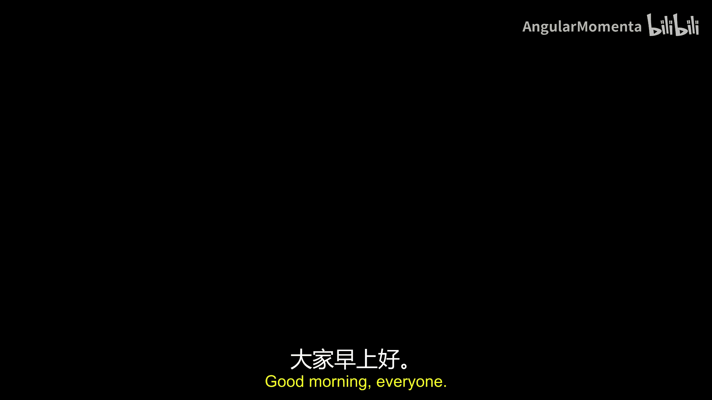
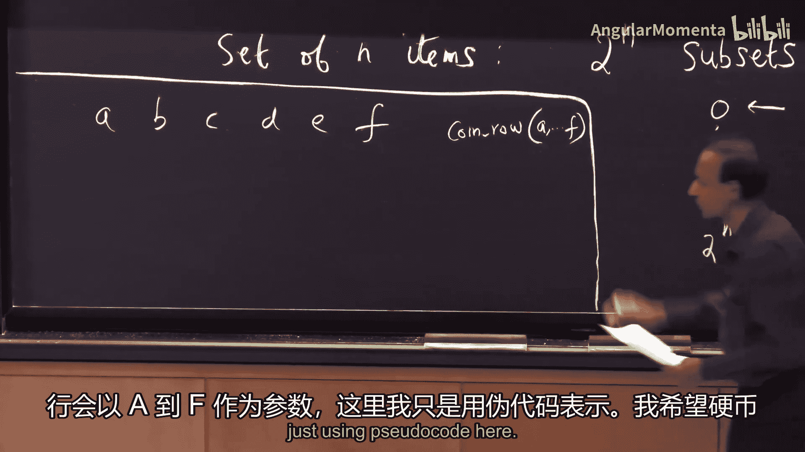
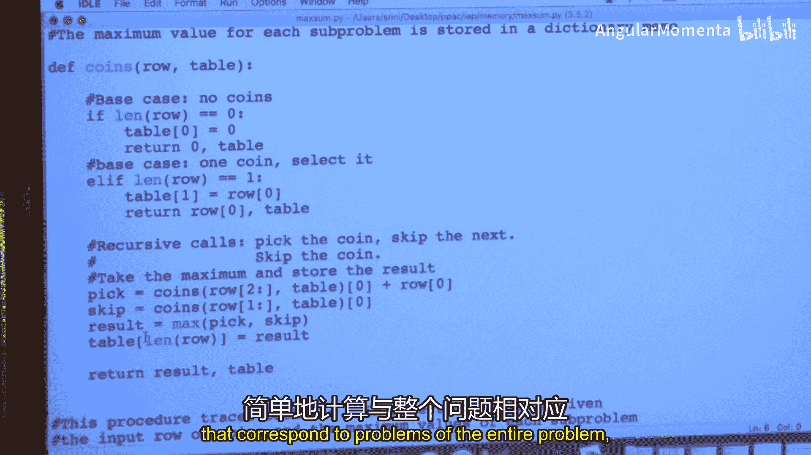
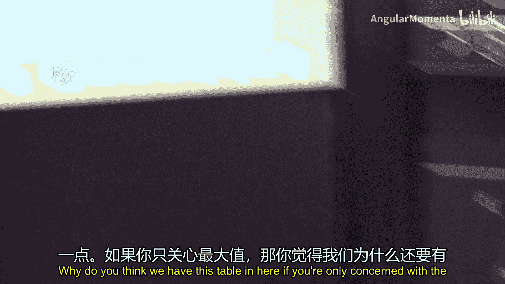
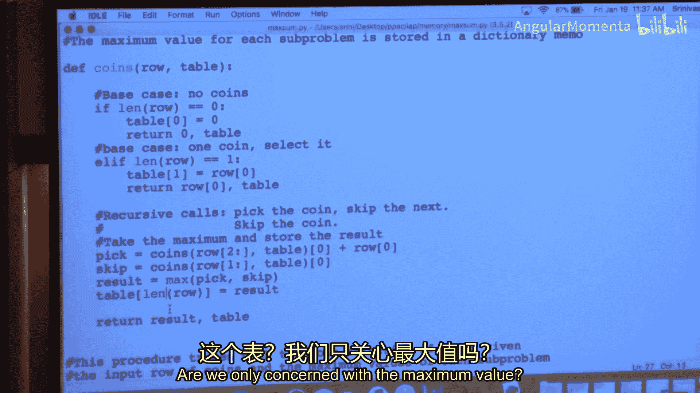
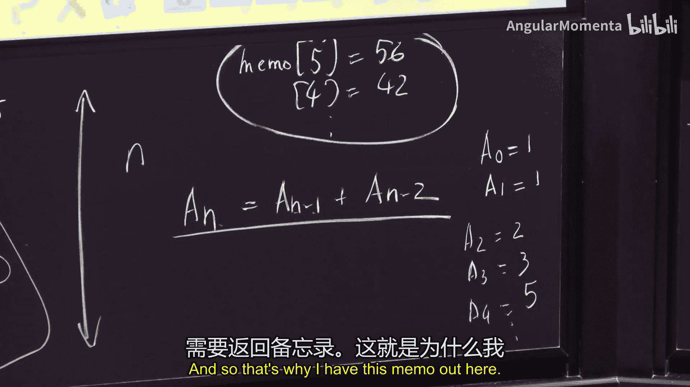
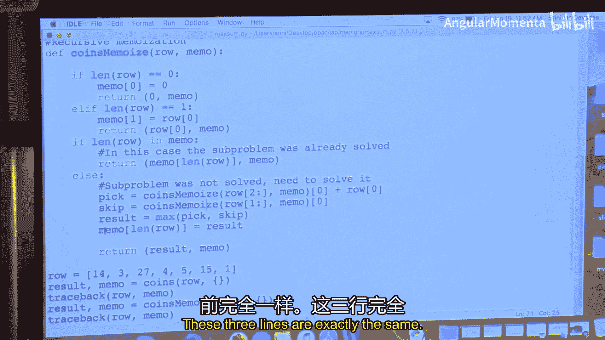
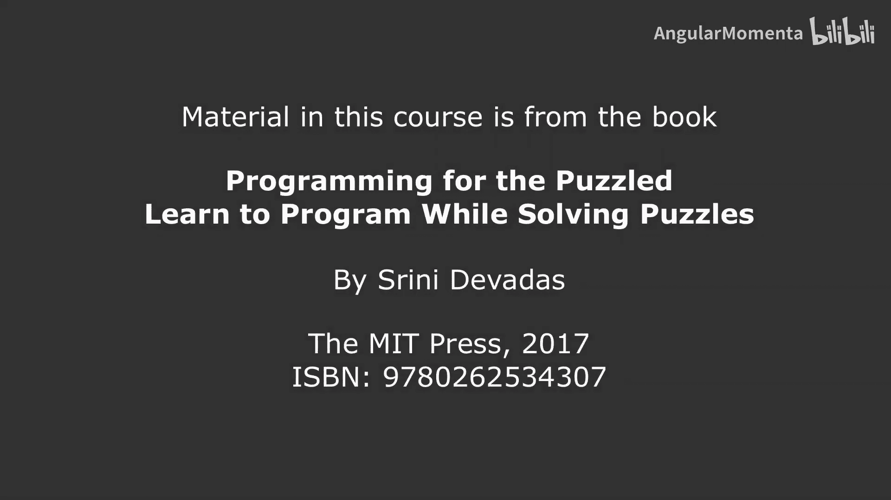

# 【麻省理工】为困惑的人编程-｜-MIT-6.S095-Programming-for-the-Puzzled,-IAP-2018-p10-谜题11--记忆对你很有帮助--BV1qp7LzeESm_p10-

Yeah。Good morning， everyone。 So we come to the end one last lecture and puzzle。 Today。

 we're going to look at a little coin row game and talk about obviously an algorithm to solve the game。

 code the algorithm。 and I'm going to introduce this notion of dynamic programming， to you。

 which is an algorithmic technique that's going to be useful in this game。

 though it's not essential to solving it。😊，It's going to be important in improving the efficiency of this first algorithm that we come up with。

So the game itself is very straightforward。 You have coins。In呢。In a row given to you。

So each of these has different。Values。And you can think of all of them as being positive。

 but it doesn't really matter。And your job is to。Big。Coins。To maximize。Total value。And， obviously。

That's not very interesting。 You just pick all of them。 if they're all positive and if they had。

 if some of them happen to be negative， you wouldn't pick those。

 So that's not particularly interesting， but it becomes much more interesting。

If you add the constraint。That。If you pick a coin。You can't pick the next one。The immediate next one。

Allright， so。If I pick 3， I can't pick 27。 If I pick 14， I can't pick 3， but I could pick 27。

 So clearly， I can alternate。because I could pick， skip， pick， skip， etc ceter。

 But I just can't pick， pick。But I could go pick， skip， skip， pick if I wanted。

A value that corresponds to that fourth location。 So there's nothing that's stopping me from doing 14 and 4。

 I mean， the only thing that's stopping me from doing that is I dropped this 27。

 which is a large value。 and it seems like a bad idea。 But on the other hand， if I。

 I mean you can think of a different situation where you wanted 27 and 15。

And so maybe you want to skip 4 and 5， right？ So what is the maximum value for this particular puzzle that you can come up with and what are the coins that you would pick。

In this case。什么。56， How did you get 56。常一是。You went 1427， and then you went skip， skip。

 You didn't want to pick 5。 You could have picked 5。 You can't pick 4。

 but you decided that 15 was was， was much better。 So you ended up picking15， right？ And if， in fact。

 you had something like。11 here。So， so let me just write that first。 So if you did that， it's 56。

And you're picking 14，27。And 15。Right， so， so is that right。How do you get， Is that 56， Yes。

 that is 56。 good。 But if I had something slightly different。

Someone else tell me what I should pick here。What's the maximum value and what should I pick in terms of coins。

Yeah， go ahead， Josh， the maximum value is 57。 if you just pick every other。So that if you go 14，27。

 that's 41。 Now you want to pick 5。 And so that's 46。 And then you can't pick 15。

 but you get to pick 11。 And so you go 50， I'm sorry， 57。Yeah， so this one was。Alernnation。

 pretty much strict alternation。Right， so， well。So you guys are getting good at this。

So I'll give you a hard one。Is that enough or us should we go for more。Allright。

 this was the final question。 Fi exam。😀You got 10 minutes， seconds，10 seconds。😊，So clearlyly， I mean。

 this is not something you want to do manually。 It's going to take a while。

There's a lot of combinations here。Right， there's a lot of combinations here。 And if you do this。

 you're gonna go， well， you， you can do it in a greedy way。 you can say I'll just do alternation。

 And so， you know， you got 3 plus 17 you guys gonna have help me here because these numbers are gonna get large。

 but that's 20。 And then I can't pick 23。 So I go 20 plus 11， which is 31，31 plus 4，35，35 plus 17，52。

52 plus34， check my math please86，86 plus 18， is 10，4，104， plus 12 is 1，16。Is a possibility。

But you you know， at this point， you you have no idea。 I I know。

 So I have some idea that whether 116 is the highest or not， right， And I'll let you。

 I'll tell you that it's not。 okay， it's not the highest。 you can do better。 okay。

 and you can maybe go and see if you can twiddle things here a little bit。

 But remember that if you you obviously just don't want to drop something。

 but if you just drop something， you want to pick something up because if you just drop something and you you'd lower 116。

 and if you want to do better than 116， you absolutely have to pick something up。

 But especially when you're alternating。 I mean， clearly you could have done， I mean。

 can you do a little bit better。 my last thing that I picked was 12。And because of that。

 you know what happened。 So can I do a little bit better than 1，16。Yeah。

 by dropping 12 and grabbing 15。 and I get a plus 3。 and you might think that 119 is is the optimum。

 but it turns out that's not even the optimum。 Alright， And so there's a lot of combinations。

 And I just looked at something local here to try and improve things。 but you know， maybe you know。

34 it's probably was good that I picked the 34 but I don't really know that。 I mean。

 it's possible that if I hadn't picked the 34 that I could picked the 23 and and the 17 and that is 40。

 right， So so maybe you know， that was better。 right， So so this is nontrivial。 I mean。

 this is very simple at least to describe a puzzle， but its nontrivial in terms of finding the opt。

The longer， the row gets longer。 The numbers being large is not really the issue。

 it's the number of numbers。 That's the issue， right？ So how are we going to solve this， what。

 what can we do， And let's not worry about efficiency。嗯。How， how could we solve this And obviously。

 we've been talking about recursive algorithms and we've solved N queens。

 which has lots of combinations。 Suuddoku， even more combinations。

 There's a lot of combinations here。 but honestly， the number of combinations。

 is dwarfed by the number of combinations we've already handled in these other puzzles。 right？

 So yeah， so someone wants to give me some sense of how this could be done。😊，Right。Go ahead，ddy。

 So if I choose numbers here， we know that at least there's going to be a gap between at least a gap of one number between any two consecutive numbers。

Yeah， you want a gap of at least one。 And so what we can do is that we can iterate， for example。

 if we like we are example we have seven numbers that and we have that we have。

At most four numbers would be。Or for example， if you have a more more numbers。Have。

The we can do is that we can vary。Like the gap size between each two numbers and iterate over that and see what combination gives。

 Yeah， you're basically trying to trying to create some sort of exhaustive search。

 What your algorithm that was iterating over the gaps。 and there's many gaps， by the way， you know。

 you have a gap of one， at least and and another gap of one another gap of one。

 if I had the strict alternation。 and you have to vary， you know， one of the gaps to 2。

 and that obviously impacts the numbers you picked even for the the gap might stay the same for the next pair of numbers。

 but the numbers would be shifted in the coin sequence and it's fairly complicated。 Okay。

 if you are willing to give up efficiency， and you have。A set of n items。

Then how many different ways， How many different subsets of n items do I actually have when you have n elements。

 you might have learned this in set algebra， But if you haven'tll， we'll go over here real quick。

 But you know， how many combinations， How many subsets do you have。

 when you have a set of n elements。You had to count the empty set and and the entire set right So if I have if I have a a set of one element。

 then the empty set is a subset of the one element set。

 And then obviously the one element set is a subset of itself。 So that's two。 right？

 And then if I had two elements。 then you know A and B， then it's empty A B and A B。 that's4。

 So you get a pattern here。Right， so it's true to the n。 right， So， so if I。

 I could generate the two to the n subsets。That corresponds to the n element set。

 And there's actually library functions in Python power set that lets you do this。

 But that's cheating for this class because you can't use libraries。 Okay。

 real programmers don't use libraries。 That's actually not true at all， that is。

 that is probably the most dishonest statement I've made in this course。

 but real programmers actually exploit libraries。 but introductory programmers should learn programming by programming from scratch。

 right。😊，嗯。And so， but you can generate the two to n subsets for example， by， just， I'm not gonna。

 I can show you code for this offline by running through and incrementing an integer to go from 0 to two race to n。

 You know， the two race to n could be a million， which is not that bad。 And then this。

 you could encode as you turn it into binary。 So if there if n happens to be4， then this turns into。

0，0，0，0，0，0，0，1， and each of these is a distinct subset。Right。

This means none of the elements are in there。 This means that the last elements is in there。

 This means that all four elements are in there。 And somewhere in here。

 if you have something like this， the second one is in there and the fourth one is in there。 right。

 So you could essentially use iteration to generate all of the subsets and you're not done yet。

 What do you have to do now Now that I've given you all the subsets It's2。

3 lines of code to solve our problem。 Someone tell me what those two。

3 lines of code are from Shapoint of。Operations required， right， I'm， I'm。

 I'm now looking at each of the subsets。 What do I need to do for a given subset。Yeah哥还专。

do the subset and find the sum of all the value。That's right。

 I could reiterate through the subset and find the sum of second plus4。 I do that for， do I。

 do I do that for all the subsets or and， and pick the maximum。

 or do I do that for a subset of the subsets and pick the maximum。what happens with this one？ I mean。

 this is picking every， every number。So。I mean， this is obviously going be bigger than all of the other ones。

So did I have to enumerate all of them， What， what is， what is wrong with this picture here。

 What is wrong with， what I just said。What is someone other than Gratra。

 What is wrong with with this with this solution， which depictts all the numbers。It's on the。

 it's on the board。The answer is on the board。 Yeah， go ahead， Ryan。 violate Yeah。

 violates the constraint。So not all of the subsets。 I mean， if all of the subsets work。

 then you don't have to enumerate all the subsets。 you would just pick the numbers， all the numbers。

 right， so you have to now check that and that is， that is some code。 So I lied。 I guess I Im。

 I mean you know， finished with my dishonesty。 But it's not 23 lines of code。

 It's a little bit more than that to check。That a particular subset。

 whether it violates the constraints or not， right？ And so you never see， And so what is the check。

 I mean it's going to be four or five lines of code。

 What is the simple check if I give you a bit string。

 What is the simple check that you need to perform。

 in order to check the violation of the constraint。In terms of zeros and wants。Yeah， go ahead。

 There is two consecutive ones。 Yeah， you have not do consecutive ones， right。

 If you ever see two or more consecutive ones， you got a problem， right， So that's。

 that's easy to check。And this constraint is。No， to。Conecutive once。Okay。

 so you can imagine coding this up。 And if you coded that strategy up。

 it turns out that this particular thing。It's， it's reasonable strategy。 If N is small。

 and it turns out that it would tell you that you want to pick 15。23。4。Interestingly enough。1734。

 So a double skip over there because you would really wanted to get to 17 this 34。And18。

And you want 15。 That makes sense。 You don't want 12。 And so this ends up adding up to 126。

 which happens to be the optimal。Okay。So you can certainly do that。嗯。You can， as I said。

 use the power set to save yourself some trouble， but you still have to code the violation of constraints。

 right， we want to do substantially better than this， because if N happens to be a 50。

2 race to 50 is way too large a number， and we don't want to be enumerating all of these subsets。

 In fact， there's a way of doing this。In certainly in polynomial time。

 And it's going to be something where we're going to be able to run this。

 this algorithm in linear time。 We can kind of make a pass through this list。And get that 1。

6 number blazingly fast。 Okay， using the notion of memorization and dynamic。

 which is related to dynamic programming。 And so this is a powerful algorithmic technique。

 that you'll see over and over， especially if you take classes like double06 and046。

 that gives you exponential improvements in runtime。

 rather than two race to n growing as two race to n。 you grow as n， Okay， which is a huge difference。

 obviously。😊，Now， usually when we talk about dynamic programming， we。

 we start with a recursive strategy， not this enumerative subset strategy to generate。

the different solutions。And one of the problems with this is you're generating a lot of solutions。

 a lot of incorrect， invalid subsets。Right， because 1，1，1，1 is an invalid subset。

 and there's a lot of them that are invalid。 a better approach， which it would still be exponential。

 but it's better than in terms of numbers than two race to N is to only generate recursively the legal。

Combinations， and then pick the。Best legal combination。 And the legal combination， of course。

 in this case， as we described， was no two consecutive ones， right， And so now we've done recursion。

 We've looked at recursive code。 So the key thing， when you write recursive code。Is remember。

 you want to get sub problems that look like the problem that you're solving， right。

 They look exactly like the problem you're solving because then you can invoke yourself as a procedure with different arguments。

 right？ And we kind of went through this a couple of times， right？

 So this problem is actually is is less complicated than the tiling problem。

 it is's basically a row of numbers。 And。You， you're going to have， let's just say you have numbers。

 A，B，C， D， E， F。嗯。Try to think of a recursive strategy。That says， I want， you know。

 let's call it coin row。And coinrow is going to。Have a through F as an argument。 That's the list。

 I'm just using pseudocode here。

And I want coinrow to do some computation。 And it's going to call coinrow。Maybe multiple times。

 But the key thing is。What are the arguments？That you have inside of those recursive calls for coinndro。

And that's the biggest question。 The easier question to answer is what happens when you have the base case。

And you， you end up essentially saying， you got。1。Coin on the row。 So you got a one coin problem。

 right， What happens then， What is the base case， What do you do。You'll pick the coin， Okay。

 because if you had two of them， if you happen to choose the base case to be2。 and in this case。

 E And F， what would you do in that case。Compare the two and pick the bigger one， right？

 But you have to be a little bit careful here because when you make the recursive calls， obviously。

 you， you can't have。 would this work you， if you picked a， if I did something like this。

 I do a plus。Coin row。So inside here， I do a plus coin row。V through F。

If I wrote this code as a plus coin row B through F。What would happen。

What would happen if I had coinrow， And then I said， I'm going to return a plus。Coin row B through F。

 And then I have a base case that says that if I have a single， I I still need a base case。

 This is just a recursive step。 I need a base case。 So this would complete。

 And then I say that if I ever have an argument of length 1， I'm going return that argument。

Right so what would happen with this code。Any ideas。Go ahead， Ka。 It would pick all the coins。

 It would is it would totally pick all the coins because it would go A plus and then it would go B through F。

 The constraint hasn't been encoded in here， right， So we would just pick all the coins， right？

 So that doesn't make sense， right？ So I have to I have， I have some choices here。 And so this was。

 this is it was a giveaway that this would not work because it's not doing any choices。 I mean。

 it's just picking all the coins， right？ So what happens if I pick。A。

 what what does it mean If I pick a， what does that mean， What does that mean to my value。

That I want to return， which is which eventually needs to be the maximum value。

 And what does it mean with respect to。The sub problems。Right， so the first question is easier。

 What does it mean with respect to my value。I need to add it to the value。 right？ Okay。

 the second question is， what happens to the， if I pick a。

 what happens to the coin row problem that remains。

 What can I say about the coin row problem that remains that is's going tell me about if I picked a。

 So this might be picked。The first one， Pick first。In this case， which is which is a。

And I'll just put that in brackets。 So what， what do I need to send as an argument to coinrow as is as one possibility。

 What do I need to send as an argument to coin row。Right。Someone who hasn't answered。This should。

Use the constraint。 Use the constraint。 What do I need to send as an argument to coin row。Yeah。

 go ahead。 I saw chi first C through C through F， exactly。 I cannot pick D， right？ So。

 so I encode the constraint in the recursive call by saying that if I picked a， then I encode this。

As C， du dot F okay。I'll just say C dash F。Right， and let me go ahead and。

raiseise this to give myself a little bit more room， but I'm not done yet。

 So is that if I I ended up picking a and I go， if I don't write any more code。

And I ended up picking up a plus the value that I get from coin row C through F。

 And if I don't write any more code， what does that correspond to in terms of an algorithm。

We've actually used that algorithm。WhatWhat does that correspond to if I only make one recursive call and I pick a and I go C through F。

 What does that correspond to with respect to an algorithm。上方。Someone who hasn't answer。

This is your last chance。As lecture。Right。Yep， you're thinking about it。 Go ahead。Right。

 so Shaliaiani， right。So she Taani says， you know， basically it's an alternation algorithm， right。

 You know， you're gonna end up picking a and then C and then E and then A。

 I'm sorry you can't pick F because you have to skip F。 So it's alternation。Right，I mean。

 we did this alternation algorithm。 we said we knew it wasn't going to be optimal。

 So clearly it's not a solution to our problem algorithmically speaking。

 because it's only going to give you the alternating coins and that might work out。

 but it didn't work out in the case of our longer problem， right？ We got the what was it。

 the116 right？ So so that doesn't work。 But so what what what else do I do。

 What is the other case that corresponds to what I have here。I can pick the coin， and。

I could skip the coin。 I could pick the coin， and I could skip the coin。Skip first。A， aha。

 what now can I pass into the coin row argument。What can I pass into the coin argument if I skip。啊，A。

Go ahead， Ryan。 B through F， exactly。 So it's different。B through F。 That's it。 That's our algorithm。

Right， this is now four lines of code in terms of recursive calls。 Okay。

 one last thing I did these two things。 I'm going get values back。For each of these。

 because I'm going get a value back。 It's， you know。

 that's essentially what I'm doing when I'm picking， I'm going to add the value A。

 and then I'm going to add it to the return value corresponding to coin row C through F。

 And then in this case， I'm going to get simply the value corresponding to B through F。

 What do I do with Val 1 and Val 2。What do I do with these two values？ Do I look at them。Do I。Y。what。

 what is the value for the original， What is the value that I want to return for the original problem。

 just like with all of the things we've done， we've taken values of sub of sub problems solutions to sub problems。

 And we've actually done something with them to return the value or solution for the original problem。

 So what do I need to do， What line of code do I need to write to return a value for the original coin row problem that had a through F as its arguments。

It's one line of code。 What is that line of code。 go ahead， Josh， the on the max。

 That's exactly exactly right。You return。Max。Well one。Well， too。Alright。

And so let me show you the code for that， right。So this is a little bit better。Then。

The subset solution。That we describe。But as it turns out， it's not a。wholehole lot better。

 And we'll talk about that。 But this code now should not be surprising to you。Right。

 because we talked about it。 and effectively， collectively， we wrote it。 right。

 That was there was a collective coding exercise called cooperative coding。Not really。

 but close enough。 And so you see what I have up there。 And there's。

 there's only one thing that I didn't describe to you。Which is something that。

IWe're gonna get to you in a second。 But you see something called table in there。

 which is essentially something that keeps。The the maximum value corresponding to the smaller problems that we're looking at right So it keeps keeps that around。

 And so but you can see that there's a base case。 if you forget table and this reason the table is in here。

 And I'm gonna ask you why in a minute。 But forget about table for a second。 if then is 0。

 you're gonna return 0。 That's a base case if then is one， you're gonna return that coin。

 that's also another base case and you might you know end up with one or the other because obviously you're skipping coins right。

 So it's possible that you need to need to take into account both of these base cases。 You say。

 why do I need two base cases Well， you're taking away coins。

 So you might end up with something that's empty right So you need both of those base cases。

 And then pick equals coin row table this thing over here is is picking the coin and then two column says that you're dropping the。

In in our case， we picked A， we would drop B and start with C and skip is you're skipping it。

 So you just skippped it and you go row1 colon makes perfect sense。

 right And I don't know if you guys have ever returned I think you have in exercises。

 if you return multiple values in in the return statement。

 And so the this thing over here is the0 says that I'm gonna to look at the first value。

 not the table because that's a value。 And I'm gonna add two values up。

 And I'm only concerned with this value here。 But I'm actually returning this table thing。

 and the table thing， as you can see from here is simply computing。

The the optimum values that correspond to problems of， of， of the entire problem。

And essentially， the， the， the problems that are that are smaller。 And so when you， you end up。

 you're skipping from the beginning。And so when you look at the table L row -1。

 that is effectively since you're going from the beginning of the list。

 that is telling you what the optimum is Land row -1 sorry Land row -1 yeah， that's right。

 Land row the number of entries in the table is is L row plus one。

 the total number of entries in the table is is starts with0 always。 So is Land row plus one。

 And so table L row is is the entirety， that's what you want for the original thing and Land row -1 looks at the optimum for that skipping the first one and and so on right So youre you're skipping from the beginning。

 So remember that Why do you think we have this table in here if if you're only concerned with with the maximum value are。

Are we only concerned with the maximum value？ What did I do when I， when I got these numbers up。

 What else did I do other than pointing out these numbers。I also gave you more information， right。

Right， I mean， I just said126， if I just told you it was 126。 what would you believe me。

Can't check it。Well， I mean， it's very hard to check。 I mean。

 it made it was it was credible because I said 126。

 And then I told you by circling them what the numbers were。

 right So if you don't have this table stuff in here。

 it turns out that you can actually you don't have enough information to figure out what coins were picked。

 you'll get the correct answer。 I mean， it's guaranteed to be a correct answer。

 But you don't have the information about 1523 skipping 11 and 3 and getting four and so on and so forth。

 right So we need other more code that takes this collection of sub problemsble that each have been solved。

 So if you actually solved all of the sub problems corresponding to picking this and picking that and then picking this and so on and so forth。

 and you need to use those values in order to discover using a traceback procedure what what the coins are。

 or you could do more work in here。 I chose to you'll see why I chose to do it。

This way where I'm collecting up everything into table。

And I'm going to eventually and we'll talk about this code if at least briefly。

 but this code traced back is taking the original problem。And a table。

 And it's just iteratively going through。 There's no enumeration here。 This is very efficient。

 It's iteratively going through row and and table and discovering what the selected coins are， okay。

 and。So that's that's something that we'll look at in just a minute， actually not just a minute。

 But after we go back to this and， and I'm going to tell you or ask you about this in terms of its computational complexity。

 okay。So anyway， so assume that we've done raceback and it's not hard to do if we have the table of results。

 Then let's go back to this。 And let's talk about the recursive calls。

And let's take a look at what's going on here with respect to。How many recursive calls are made？

And then we'll get to memorization。And。Dynamic programming。 So let me just say， if I had coins that。

This is， this is a number of elements。So I have five。 Then I'm going to， you know， call coins。4。

And I'm going to call。Coins 3。And so I， I'm here I skipped the first one here。

 I picked the first one， and therefore I had to skip the second one。 So I have three here， right。

 That makes sense。 And then over here。What， what can I， what I。

 What do I need to write here if I follow exactly the pattern。I'm going to write。Coins 3， right。

So I have coins 3 over here。And here it's coins 2。And here I'm just going to write the numbers down to。

1。And again， I got two。1。And so on。 Now， the， the base case might， you might keep going， you know。

 even after two， because the base cases are you go one。0。one。0， right。

 What do you see in here That's a little bothersome。嗯。What。

 what do you see here that's bothergersome。嗯。What is that。Symbolically。

 if I had some number of elements N elements， what do I put here。It's end， right。

And what do you see here。It's getting very， pretty big。Getting pretty big。

 So down here is getting pretty big， right， So that's the problem， right。

 And one of the reasons is' getting pretty big is because you're doing。Work over and over。

 You see coins 3 here， a couple of places， coins 2 in three places。 And if this were larger。

 you'd see a lot of。Sub problems being solved over and over。

 So this code that you see up on the screen is in incredibly inefficient because it's solving the same problem over and over。

Okay， in particular， if you had， it would solve coins for exactly once， but coins 3 twice。

 coins2 three times。 And， and if I just sort of went up。And made this 10 coins 10。

 Then you'd see things that are solved tens of times。 And eventually。

 you'll see things that are solved hundreds of times。 Okay， you're just repeating work over and over。

You can actually write a recurrence relationship。That says that。If you had an N。Element。

Coin row problem。Then。Your recurrence is your recurrence corresponds to the number of calls that are made。

 number of operations， therefore， that are performed as A N equals A N -1 plus A N -2。

 And then the base cases are， you know， a 0 equals 1。And a 1 equals1。

 because you're just picking that。 And so if you look at what a2 would be， a 2 is 2。

 but then a3 is 2 plus it initially it grows fairly slowly。 But then when you get to a 4。

 it becomes 5 and so on And people see this number。 have you seen this number before。

 this recurrence relationship before， it's called Fibonacci right It's called the Fibonacci recurrence。

 And this， this actually shows up here。 So this has a relationship to Fibonacci。

 And it's the number of computations in a recursive Fibonacci is exactly the same as。😊。

As in this problem。 But if I told you to compute the Fibonacci number。F of N。Can you do that quickly。

I mean， you just do that。 if I wanted for you to compute the Fibonacci number。

 then you would just do that iteratively like I'm doing here， right， the numbers would get bigger。

 but there's no reason to do exponential work for Fibonacci But here， of course。

 we're doing something much more sophisticated than just Fibonacci in the sense that we're working with a coin problem。

 But this should give you a sense of the efficiency that is possible here by thinking about the relationship between recursive Fibonacci that would look a lot like the structure that you see here。

 just calling fi of n and fi sorry for fi n， you're calling fi n-1 and you're calling fi n n-2 recursively you're adding them up and the base cases are exactly the same as you have here returning the zero for the zero case F0。

 you're returning one and so on and so forth。 And even Fibonacci would you end up having redundancy in thecur。

Of formulation， which is exactly the redundancy that you see here。 Okay， And so basically。

 it turns out that if you want to go exponential to linear。 And you kind of see where this is going。

 The recursive was exponential。 the iterative in the case of Fibonacci is linear。

 So two things one you can take take this and you can turn it into duration and make it linear。

 But you know， that is actually a more。呃。Dramatic transformation of the code。

 You can do something that is equivalent in efficiency to the iterative version both for Fibonacci and for our coin row problem。

 And we'll do it for our coin row problem that corresponds to， as I said。

 a more local modification of this code that eliminates redundancy that eliminates redundant computations。

 Okay， and all of these things are equivalent。 and they're all part of dynamic programming。

 And you know， we have four lectures on dynamic programming in double06。

 So in 10 minutes or 15 minutes。 You're just going get some sense for what this is all about。 Okay。

 and so this is really a preview or an elevated pitch perhaps a trailer so you end up。

 essentially doing equivalent work in the recursive。

 memorized version of this code that I'll show you in just a minute that adds three lines of code to this and makes the comp。

😊，go from exponential to linear and all you do in this code that makes this complexity equivalent to the iterative。

 And you know， that's very efficient is you remember the results。

 you memorize the results of the computation and you remember that you've solved coins 4。

 which doesn't really help you in this particular instance。

 but you remember that you've solved coins 3。 And so you don't end up doing all of this work。

You end up kind of just saying， okay， I mean， it depends on。

 I'm sorry depends on which direction you went。 Let's say that you for argument's sake that you went in this in this direction first。

 Okay it totally depends on which direction you went first。

 And since I drew this out and I don't want to change it。

 let's just assume that you went in in terms of coin 3 first， which in fact。

 is correct in terms of the code， because if you see what I have there。

 I went in the pick direction first， which meant that I would go ahead and pick that that first value and then Id go in the right direction。

 the righthand side direction。 So if I did all of that， I did I do all of this work。

 now there's also memorization going on inside of here。 So it's not like I'm doing all of this work。

 I'm not only getting just a factor2 in terms of improvement。

 but definitely once I do this and I get the value， I can just return that value here。

 and I don't have to do all the work underneath this。 That's why I put this in a square。

 And remember that this is being done。curursively， okay， so I'm going to do it for coins too。

 And so if I had multiple coins sts， then， you know， I wouldn't have to do that。 And then over here。

 if I had a longer coin row problem to begin with， there's a lot of memorization that goes on and you end up only solving。

 This is the key。 You end up only solving each subpro， How many times。Once now， the aha moments。

How many sub problems are there。How many coin row problems are there。

 given an N element coinrow problem。Howmony。All of you together。How many qua problems are there？N。

 that's it。 There's only N coinro problems。Okay， it's like you had A through F。 You had B through F。

 You had C through F。 You had D through F， You had E F and F。 So if you only solve。

A coinro problem once。 And there's only N。Coin row problems。

 the complexity clearly cannot be exponential。 It's going to be linear because whatever work you did for that problem is all that you have to do。

 And so maybe there's a constant factor。 But let's say that the number of operations。 Obviously。

 there's just a max。 I mean， it's not complicated。 We know what that is， right？

 So it would be the complexity of solving。a sub problem。Times the number of sub problems。

 the complexity of solving a sub problem is constant。 You know。

 it's just a smaller number of operations。 And the number of sub problems is， is linear。

 So it's linear time， which is exactly the same as the iterative version。 Okay。

 this is an incredibly powerful notion。 you know， which is why there's classes on this topic， right。

 just this very topic。 And we spent a lot of time on this in double0 6 as well as046。😊。

So what I'm gonna do for the， the main thing I want to do is show you this code。

That is an incremental modification of the code I showed you before that takes this complexity and turns it from exponential to linear。

 right using this notion of memorization。😊，And then I want to tell you a little bit about the traceback code because that's interesting。

 But from a standpoint of just getting the value back。

 you're all good right with audience even understanding traceback。So all I've done here。

Is taken table。And I've turned it into a。A dictionary。Okay。

 and I have to do a little bit of work here with respect to。The memorization。

 right So so if if I look at the base cases， it's pretty much exactly the same。

 I just have a memo instead of table and all of these are essentially the same I'm sorry。

 all of these up here are essentially the same。 And then I'm looking at when I'm looking at a particular problem。

 Im I see whether the memo table that I have， if L row in memo。

 then if it's in the dictionary that means I've already seen this problem before。

 And I just return the the value stored in that dictionary。

 and the value stored in that dictionary is is essentially a pair which corresponds to not just the the value of the problem。

 but also I'm storing I'm sorry I take that back。 So memo itself is just like table。This。

 this is just this memo here is， is simply because overall。

 I want to return both the value and the memo table。 Okay。

 so this memo table is exactly like the original table。

 It's simply a set of key value pairs that go a memo。5， you know， equals 56， memo 4， maybe equals 42。

 etc。 So that's just that's just a simple memo table。 And I just need to return the memo。

 And so that's why I have this memo art here。 And this looks exactly the same as it did before。

 these three lines are exactly the same。 this is an important line。

 right So these lines were added because I want to memoize and look up what I solved before。

 and this line was added well added in the sense that it's added for memo。

 but I already had it for table。 So it's just a simple replacement。

 So perhaps I shouldn't have said added。 but this is important because I'm I'm putting it into the memo table and and it's really this if statement That's the key。

 don't do redundant work。 So if you get to this if statement you're obviously getting to a return。

 which means you're not making these recursive calls。

 which is exactly going over here and remembering that you solved coins 3 and returning the value of coin。

3， the moment you say it。All right。That makes sense。 Everybody's good with that。 Excelt。

 Let's just run this。And I want to show you what this gives you。

Just so you get some sense of what's going on。 You're getting up。

 there's a couple of different problems。 and I'm running them with different code。

 And so you're getting the same answers。 That's just for verification purposes。

 So if you focus in on on what's what happens here。

 this is essentially solving our first smaller problem And it's telling you that if you have the entire problem with the seven coins。

 which is what I have up there， the first problem here。Then what you have is 56。 And if， in fact。

 you ended up dropping you're looking at the sub problem that goes from 3 to 1 and you drop 14。

 the optimum value for that is 42 okay And then if you drop both 14 and 3 and you went with that then you need to go backwards from here。

56，42 it's still 42。 and even if you so if you drop 14 is 42， if you drop 3。

 it's still 42 because 27 and 15 you know， give you your 42 and that makes sense。

 and so you can see that And then this other thing here is the bigger problem it says table equals sorry。

 ys。Python shell。Let me just point with the cursor。 This large thing here is our bigger problem。

 And you can see the table for this 126。 If you drop the first one， you still get 126。

 But then if you drop the first two3 and 15， you get obviously a smaller result and so on and so forth。

 And this table that I'm getting back which is basically the the original table that could you think of as a list that turned into a dictionary。

 when I wanted to memorize because I want to look it up very efficiently。

 I could have left it in this case， as a Python list， I did not need to use a dictionary。

 because I can always I didn't need the generality of a dictionary where the indices to a list can be strings or negative numbers right I mean。

 I'm just indexing into this。 So the dictionary is is a bit of a red herring。

 I just happen to use it。 in general， you used。ctionaries。

 because you may have to look up things that are more complicated than just integer values。

 But here I could just number the upper problems，0 through 7。

 what have you and then just look it up right So the bottom line is， I need that information。

 in order to compute or figure out what coins were selected。

 And so that last thing that I will show you。 is the traceback routine。

 which I just put up there briefly。 But I just want to spend one minute on this。 and we will close。

 And this traceback routine is taking the values that you saw。

 and figuring out whether you picked a coin or not。

 So what it does is it looks at the entire thing and it knows that the entire thing is 56 And then it says if I drop the first one。

 and I get 42 and it compares 56。42 and says， wait a minute。 the difference there is 14。

 And that is exactly the the value of the first element， right。

 So what this tells me is that if I had the original problem， I got 56。 If I drop the first one。

 I get 42。 right as optimal。 So that implies that for the original problem。

 I picked the first coin Okay， because 56 minus-42 is 14。 That's it。

That's pretty much all you have to do。 You just have to do that over and over。

 And it's a little bit more complicated than that only because you don't want to get into negative indices for tables。

 And so the only reason that first line table render row minus I equals equals row I is there is for the corner case where you have a single element list and you don't want to get into a situation where this thing here。

Cannot be negative。If this is negative， then the program crashes。

 So you don't want to get to this statement。 It becomes negative。 and it's a degenerate case。

 and you don't want to get there。 This or takes care of that。

 You essentially check for the singleton equality and then you don't fall through the second。

 if this part of the statement is true。 then this doesn't get computed。

 So if table lend row I equals equals row I is true。 then you don't compute that。

 you don't get a negative index and everything works out。 But it comes down to 56-42 is 14。

 and you're all good to go。 Allright， good， Allright， so that's all I had。 Well。

 for this lecture for the class。 I'm gonna be colecturing 66 next semester。

 I notice that some of you were preregistered。 So I guess it's not goodbye。

 But it doesn't have to be goodbye for the rest of you。

 You know where I sit happy to talk algorithms in computer science。

 thanks for being an attentive audience。

