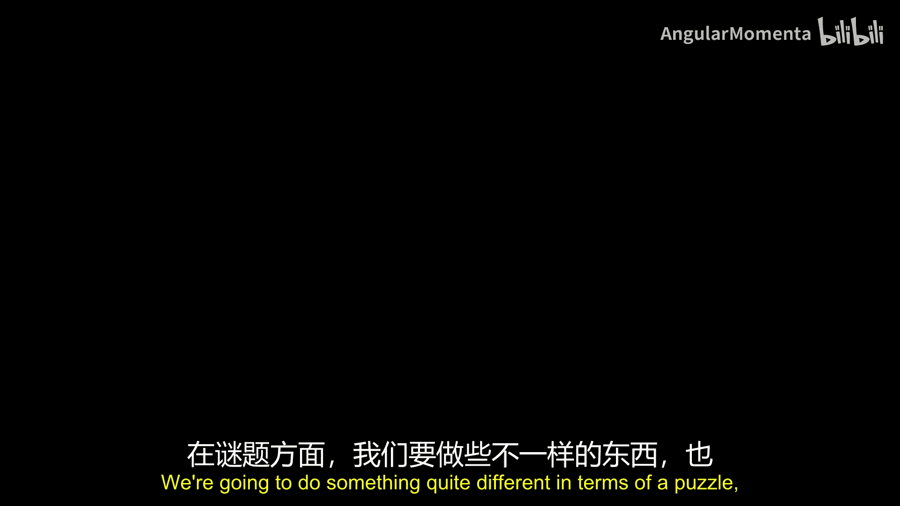
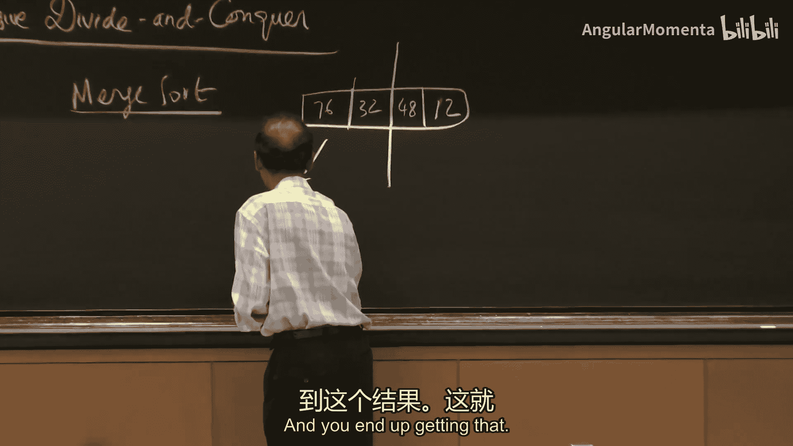
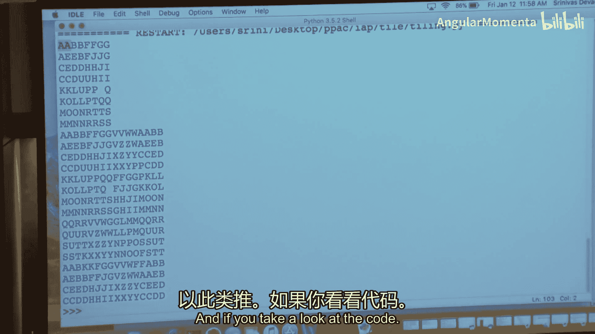
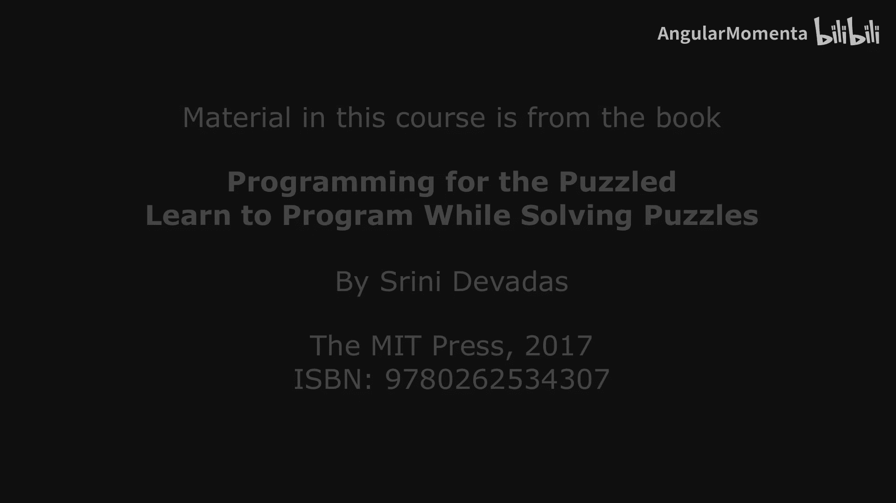

# 【麻省理工】为困惑的人编程-｜-MIT-6.S095-Programming-for-the-Puzzled,-IAP-2018-p11-拼图7，请铺上庭院--BV1qp7LzeESm_p11-

We are going to do something quite different in terms of a puzzle and， and while' recursive。

Recursive puzzle， or it's going to。Play out to be a recursive solution。

 It looks quite different from from the from the end queens puzzle。 right。

 And so this is going to be a tiling puzzle。And so I'll set up the puzzle。

 And then we're going to take a little segue off into into a canonical recursive algorithm called merge sort。

 Al right， because I think it it's good for you to see that algorithm before you dive into solving this particular puzzle because it kind of shows you the way。

 Allright， And， but， but I'll set up the puzzle I guess I didn't have to erase this square。

 It's it's a courtyard。😊，That。It has a bunch。 its tile。 You're supposed to tile it。

 and it's all square tiles。And I'll just make it。8 by 8。Like a chessboard。And in general rule。

 we're going to say that。This is a two race to end。By two race to end。Courpyard。All right。And。

I want to。I want to tile this courtyard。So this is a three child。 some people call it a tro。

 You can think of it It's really an L shaped tile。And it can be oriented in any different way。

 I mean， it could be an inverted L， etc cea。 And you're。

 you're supposed to tile this courtyard using L shaped tiles or。Tminos。

And they call it trominos because there's three tiles in there，3 squares in there。

And so so that's your， that's your job， right， I guess kind of a weird job。 But you this is a puzzle。

 And so you' you're out there with two race to end by two race to end。

 And all you have are these L shaped tiles。 and youre not allowed to break them。 I mean。

 if you break them， then that's not considered a valid tiling。 that's bad。

 and that's that's your job。 right So is this oh， and and obviously this is it needs to look like this。

 It needs to look like the floor。 maybe you you're allowed to to see the the markings because these are tiles after all。

 but you can't have something that is uneven。 You can't have a tile on top of another tile。 I mean。

 that's definite no， no。 And you can't not have a tile in any part of the courtyard。

 right So that's I think that was kind of obvious。 But it's worth explicitly stating just so we don't we don't get confused here。

 right So so that's。That's the question that we're gonna to try and answer。 But as I said。

 I want to talk about something a little bit different for about5 or 10 minutes and actually show you some code because I want to introduce this notion。

 That's a little bit different。 from the N queens recursive paradigm， it is recursive。

 but it's called recursive divide and conquer。 alright。

 and usually when we use the term recursive divide and conquer， you。

 you might think that it's applicable even to the N queen's recursive code。

 but from a technical term standpoint， when we say recursive divide and conquer。

 we're really saying that we're taking the problem and we're dividing it up。Into smaller problems。

 So you， you take the problem and you divide it into two problems that are half the size or three problems that are a third of the size。

 etc cea， right， which is not what happened in the case of the n queens problem。 right I mean。

 what in the case in the N queens problem， you， you took a column And you。

 you actually did iterations on the column。 So potentially exploded on you。

 And then you had a problem that was slightly smaller than the n queens。

 It was n effectively n -1 queens right， And so so it's not n over two or n over2 are three n over threes in the case of three way recursive divide and conquer。

 So there's a qualitative difference。 And there's also a quantitative difference in the sense that。

These kinds of algorithms are going to be efficient in that they're going to run in very quickly in polynomial time。

 You know， perhaps quadratic time。 we can do some analysis for both the the merge sort that we're going to do now and for the tiling puzzle once we get to that。

 But that's something to， to keep in mind。 Alright， So merge sort is the canonical。

A recursive divide and conquer approach。 and I I'll put up code for it。

 but I'm not going to show it to you。 You can look at it in the website。

 but I'm going to describe the algorithm to you。usingsing a trivial example。

 And so I want to sort these numbers。In。Ascending order。All right。

So I have these four numbers that I want to sort in ascending order。 And obviously。

 I could do this many different ways。 we looked at selection sort。 but this is a large array。

 and I want to do something more efficient than a quadratic algorithm and then squared algorithm。

 and merge sort， which is recursive divide and conquer， fits the bill。 And what merge sort says。

 is I'm going split the array。 I'm just going take this array。

 and I'm going split it up into two two sub arrays。 And I could do this recursively。

 But let's just talk about the first step。 right， So I'm going to go ahead and split this array up。

 and I have 76 and 32。 And I'm going to call merge sort。😊，On on this on this， this smaller array。

 And the first thing that that Merar does is split the array up into something smaller。

And you end up getting that。So so this， this is， this is the first thing。 And that's the first split。

 And then you end up splitting 48 and 32。 And I'm sorry， at 12。At76，32，48，12。 yep。

 I got got that right。And so so far， you have done nothing。 I mean。

 you just sort of broken things up and turned this into four one arrays or one lists。

 or what have you right？ But then the fund starts where after you do the split。 after you return。

 And so 76 a singleton is trivially sorted。 So there's no work to do。

 So there's no more splits that you could do。 there's nothing that says you can， I mean。

76 is a monolithic element in the arrays。 So you can do anything with it。

 And so you just leave it be and the same thing with 32 and so on and so forth。

 But after your two calls return， you have to you have to merge the two together right And the way you merge the two together。

 what you the invariant here is that when you merge the two together。

 they have to be sorted in the order that you want the overall array to be sorted。

Which is ascending order。 right， So in this case， you have down at the bottom。

 It's trivial code because you have two singleton lists。

 And you just decide which order they go into。 Okay。

 so that the merge in this case would simply be produced。 would produce 32 and 76。 Okay。

 and in this case， the merge would produce 12 and 48。Alright， so at this level。

 you're going to return 32 and 76 back。 You're gonna return 32 and 76 back。

 And here you're gonna return 12 and 48 back。 Okay， now it gets a little more interesting。 Okay。

 now it gets a little more interesting because now you have 32 and 76 and 12 and 48。

 And those are both sorted in ascending order and you need to merge them together。

 right And so if you had128 element list。 you would go above all the way down。

 and then you would do some merging come up all the way。

 and then the the most time consuming step really would be taking2。

64 element lists that are that you know， the left one is an ascending order and the right one is an ascending order。

 and and then you need to merge them together。 So the result is in ascending order。

 right that makes sense。And so in this case， what the way we're gonna do this is if you have。

 and I can do this for， for this example or or a different example。

 But you know what I'll just stick with bit 32。76。 and this could be larger。 This is 12 and 48。

 So I need to merge these two to produce an ascending order。

 And we use a straightforward algorithm that's called it the two finger algorithm。

 which says I'm going to start with my fingers pointing to the beginning of the two arrays。

 and I'm going to choose the element that's smaller。 And I'm going to write it into my output array。

Right， so I'm going compare 32 and 12，12 is smaller。 So I'm gonna to write 12 down。

 And because I picked 12 from this array。 and I didn't pick 32。

 I'm going leave my top finger where it is。 and I'm gonna move my bottom finger。

 my right hand finger over to the next element right And then I'm going compare 32 with 48 because this finger didn't move。

 And I'm going to figure out which one is smaller。 and it's 32。 And I'm going to put that over here。

 And then I'm going move this finger because I took away 32。 And then at this point，48 is smaller。

 And then I'm off this array assuming the array ended here。 But if it didn't， I keep going。

 And then the last thing I do is put 76 down。Okay。So that is a recursive divide and conquer algorithm。

 right It's the simpleplus algorithm I can think of that is still interesting and you can I'll show you code for it。

 I'm not going to explain it， but it's worth it's worth looking at the overall code and then the merge。

 which is the two finger algorithm is actually the most amount of code。 but the split itself。

 as you can see， is you see as with our recursion， we say we want to have a base case。

 And so when the length of the list becomes two， I'm just going to do that little flip this is a sorting algorithm that only works for a list of length2 right but the beauty of this is that I can keep going down to get smaller and smaller list such that the sorting algorithm actually works。

 and this is it this is fine sorting algorithm for a base case and we do have a base case here。

 We also have the other property that I'm actually calling。 I'm making two recursive calls。

Significantly smaller problems。 In this case， I'm using list splicing to get the first part of the list and the second part of the list。

 And I'm just calling merge sort on those two lists。 right And then finally。

 this is the the workhor in merge sort is the merge step。

 This two finger thing that I just described to you， right That is this merge thing。

 And this merged thing， as you can see。 I'm just not a lot of code。 But it's its it's doing this。

 this movement and the comparisons and that's essentially what you have there。😊，Alright， so。

 so given that context。 Allright， given that context， let's go back to our tiling puzzle。

 And let's talk about this tiling puzzle， and， and how we could， we could solve this tiling puzzle。

Alright， so， so you're going to break this courtyard up clearly。

 because that's really what I've been trying to tell you in terms of recursive divide and conquer。

 right， First question， should look at this two race to end and two race to end and look at this tree tile I'm gonna ask you the question。

 is there a solution。That is， is a perfect tiling with no overlapping tiles and。

 and no no squares with holes in them。Is is someone。

F had had up first governor if we look at one two by two courtyard it's impossible back that But in the general case。

 then well have two to the。To the two as。And every time we're adding 3，3，3。 So， yeah。

 number number can be a multiple of three correct。 So so2 to the two n。

 and Josh probably had the same answer2 to the two n is not a multiple of three。 I mean。

 the only thing that divides it is 2， right。Alright， So okay， So are we gonna to change the problem。

 Alright， we're going to say that there's a statue of your favorite person。That is that that。

 that is going to be out here。And so you don't need to。 You don't need to tile that。Okay。

 so now I I you have two ways to end。Two days to2 n，-1。Let me write that word properly。

Two days to 2 n， -1 squares。Now， can you do this。For all land。Clearly。

 it works for for n equals  one right， And then for n equals 2， you have what two raiseds to 4。

 which is 16-1，15。 that seems to work。 And then you get up to I think8 what is it2 raised to 6。

 would be 64。 And so that would be 63。 That works too。 in general， does it work。It does， right。 So。

 so it turns out if you think about it， if you have， you can write this out as two race to n-1。Times。

 two days to n plus one。And。You know， in the middle there you。Pretend that there's two race to n。

 So you have three consecutive numbers。 And when you multiply three consecutive numbers。

 and it is a consecutive， doesn't matter what the numbers are。

 the product is always going be a multiple of three。

 right because one of those things is going to be a multiple of three。

 And you know the two race to n is not a multiple of three。

 this is not a product of three consecutive numbers。

 But if it were and you pretended that two raised to n was in here。

 either this one is a multiple of three or that one is a multiple of three So this is good So so we know that at least from a standpoint of volume our surface area。

 if you will， that this is going to work whereas the original problem didn't work from a surface area standpoint。

 Allright， So so it comes down to how am I going to solve this problem using recursive divide and conquer。

 And so I can break this up and you want to have a similar feel to the merged sort where when you got down to the base case。

Of mergear。You had this sort of trivial problem to solve。 That's the beauty of divide and conquer。

 It becomes obvious when you have such a small problem， like one queen or I mean。

 that's not technically not divide and conquer， but you do get to the smaller part。 But clearly。

 in this case， this is a classic divide and conquer algorithm a merge sort。

 And you can see that the first2 or three lines of code are the trivial case， right。

 of two two elements that needed to be sorted。 right So let's go back and forget that。

 let's look at this picture。And， and think about how youd break this up。 right。

 How would I break this up。So think two dimensionally。A mergear was a single dimension。Okay， think。

 think two dimensional。 This is two dimensional。 This is a two dimensional problem。

 It's in that sense， closer in Queens。 But Muzar was was was was simply a single dimension。Right。

All right， I see Kevin had father has his hand up。 Kevin has a hand up， someone else。All right。

 go ahead， Kevin。Qus good。 Okay， yeah， So all right， So let's， let's， let's， okay， let's do that。

 Let's， let's do that。 You're on the right track。Right。And by the way， this， this。

 this particular thing。You know， could be over there。 And I'll。

 I'll just do this just to make sure you you it your your algorithm needs to work regardless of where that statue is。

 So maybe the the statue is over here。 maybe the statue is over there。

 there's only one statue that is covering one square but it's not necessarily in the other center。

 It could be even be you know， anywhere。 You need， you need a general purpose scheme that would work regardless of where the statue is。

 you know， as long as it only occupies one square right， that's the only constraint we have。

 So you're on the right track。 Kevin someone else or orddy， you want to add to that。So I mean。

 it's something that's similar to the merge sort， so you got de quarters and then we reached it a base base and we filed that obviously with a that's exactly right。

Yeah， so but there's one thing that's missing。 And what both you and Kevin have put up。

 The thing with mergear was I had exactly the same problem to solve。 It was exactly the same problem。

 It was just smaller。 I needed to sort the smaller array in ascending order。 And I had two of them。

 and it was exactly the same problem。 But when I split this up into four quarters。

 like yours you guys are suggesting， do I have exactly the same four problems to solve。😊，In fact。

Can I even solve this， this 16 problem。With L shaped tiles， I can。 So at some level。

 I have three problems that I can't solve。 And then a smaller problem that I don't quite know how to solve rather than maybe splitting it up even more。

 which is kind of interesting， which is good。 right， But then the next time。

 if I do go ahead and split that then Im wonderful。

 I will find one problem that's two by two that I can solve。 right， but that doesn't solve my puzzle。

 Okay， so so I have to do one more thing， you know。

 in order to make this look like merge sort or or any recursive divide and conquer。

 one of the paradigms of recursive divide and conquer is you're not creating new types of problems。

 you're creating the same type of problem except smaller。 and therefore eventually easier。 Okay。

 so I have to do one more thing， and this is an a moment here。

 that I'm hoping I I don't want to take an answer yet because I want you to think about it。

 and and perhaps arrive at it。 But know， it's one of those things where you' gonna go， oh。😊，You know。

 mean if， if you don't know the answer， but， but it's worth you spending another minute。 Okay。

 another minute， each of you are thinking about it， right， how am I going to set it up。

 So these quarters， So all of this is good。 We're gonna split it up into quarters。

 But I want all four problems。To look exactly the same in the sense that in。

 in the sense that they look， I mean， this obviously looks different from these other ones where there's a tile missing here。

 but there's no tile missing over in the other three， right？

 So how do I make all problems look the same。Okay， I don't know。 you know， but we need more。

I'll give you 30 more seconds， and then I'll give you one more hand， alright。All right， the hint is。

 place one tile。Place 1 L shape tile。All right。 yeah， go for it know with those has to go。Yes， yeah。

 that's right。 So you， you set it up。 So you， you tile。The reason I picked up。

 picked this L shape this way is because this was the statue。Right， so I wanted to remove a tile。

From each of the other three quarters。I'm sorry to remove a square。 right I I a tile is L shaped。

 And so this was a missing square， which， which clearly， you know。

 was part of the specification of the problem。 It has nothing to do with the tile。

 It's just a missing square because it's a statue on it。

 But what I could do is if I oriented the tile in this way。 now I have this。

beinging a smaller problem， which is one quarter of the size of the original problem with one square missing。

 This one is one square missing。 This one is one square missing。 This one is one square missing。 Now。

 that makes all of the problems look the same。 now of firsts。

 they're not exactly the same in the sense that the missing square is in a different position。

 But you know， there's some generality that we need in our algorithm that says that eventually。

 if I keep breaking this up in this fashion I just need to orient my L shaped tile in the appropriate way。

 right， So there's only four different ways that that that an L shaped tile。Is going to be oriented。

 right， It could be oriented like this。And I want ro all of them。 It could be oriented like that。

 And you know， it could also be。That's the same。 So what else is there， Oh， it could be。

fliplip this way， right， yeah。Like that。 And， you know， the the， the fourth one。

 So that's what I did here。 This one is what I put up there。 And then as I break this up。

The let's just say that now I'm gonna make four recursive calls。 I'm going place one tile。

1 L shaped tile。 and， and I'm gonna mark off these things。

 And I'm gonna make four recursive calls to， to basically myself。

 except that the arguments are different。 right， It's the same code。 obviously， So when I go up here。

 I go like that。 And I hopefully this will become clear。 if you gonna to do a tileling here。

 I'm gonna I'm gonna go focus on the top left， And I'm going to do this。

 What am I going to do with respect to this this particular quarter of the courtyard。

 How am I going to orient the L shaped tile for this one。Point with your fingers。Exactly right。

 So it is the same as this。 I'm going to go ahead and do that。Okay， so， so now I have this problem。

 So I'm gonna mark that with a different。Different color。

So I'm focused on this problem and I've done that break and now I have now I'm good because I have four2 by2 courtyards and each of these four has has one square missing in each of these four little2 by2 courtyards。

 So， I can solve that And so once I solve that， I can solve I move on to this one and I move on to this one。

 whatever order you want。 That's it。 And so the code for this is is from a control flow standpoint from from a standpoint of the overall algorithm。

 It's extremely straightforward。 It it's almost exactly like merge sort。

 except that you have four way recursion because you end up getting it's two dimensional and you end up getting quarters。

 And the only thing that's annoying about this code to write。 and also to understand。

 which you guys will I'll put this up and I'll show you what to look for is how you。

Psent this such that you get all the values right。 So so you get an arbitrary square to begin with that is missing。

 And then you have to go to the to the to the middle。

 that's clear you're going to go to the middle of this courtyard and you're gonna split it。

 and you're going decide which way this L shaped tile is oriented。

 And then you got to do the splitting again。 And so it's just bookkeeping。 I mean。

 that's really what this is all about。 It's not algorithmically interesting。

 it's just bookkeeping in terms of the orientation of these these L shaped tiles。

 So if you look at the code。 And if you ignore you know a bunch of these indices of these different variables。

 let me show you well， first， I'll show you what what happens when you run the code。

 I'm running it for two different kinds of courtyards。 And I've used a through I guess。

 something like S in this case。To signify a tile。 So you see A A A here。 A A A is an L shaped tile。

 BBB is an L shape tile。 FFF is an L shape tile， etc ceter。

 The original specification of the problem。 This is just simply an a by8 problem had this tile that you see here that's a blank that I've covered up that was missing。

 I'm sorry the square missing。 And and then I broke this up into two or4，4 by fours。

 and then I went all the way up。 and then the first tile that I placed I pretended to to placed this u tile over here。

 I could have placed it and then called it the a tile。

 But this this is essentially what you think of the one in the center exactly the way this is oriented。

 that's your u tile over here。 And then you go all the way down and explicitly it's just the a tile that's placed first。

 And then the B tile and so on and so forth。 And if you take a look at the code。

What's the best place to start。 So this is the base case at same thing as we've talked about before。

 you always need to have a base case。 the base case is a two by2。

 and this code places one L shaped tile on a two by two yard okay this is going to make four recursive calls。

 as you can see from range 4。 And this two different kinds of recursive calls in the sense that they're both calling recursive tile but the arguments to recursive tile are different for this recursive call because it already had the the missing square in it and these three recursive calls that are going to have the missing square in one of that corners。

Okay， so， so that's why you see the the if and theels。

 if the original for the recursive call that already had the missing square。

 because it had the statue on it。 that's the if statement。

 And the other ones are the ones that are in the in the in the corners。 So the the first things。

 it would be this would be a corner of this one， This is a corner of that one and that's the corner of that one。

 Allright， So， so that's pretty much all I all I had。

 this code is is you need to gaze at it for a few minutes to figure out that I got all the arguments correct。

 But from a standpoint of said the control flow and the algorithm。

 it is hopefully completely clear to you at this point。

 if not ask me questions come to office hours have a good long weekend。

