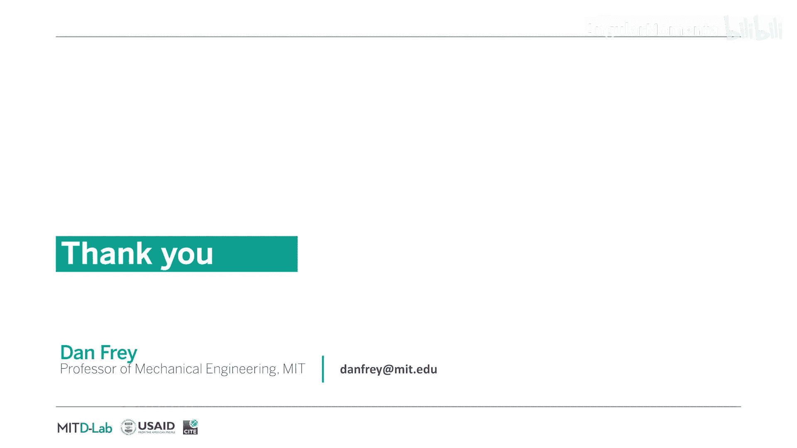

# 【麻省理工】机器学习公平性探索-｜-MIT-RES.EC-001-Exploring-Fairness-in-Machine-Learning,-Spring-p01-01-机器学习伦理导论--BV15MtGzCENW_p1-

Hello， I'm Dan Fry and I'm the Fy research director at MIT's DLb。

 I'm also principalip investigator for the Comprehensive Iniative on Technology Evaluation。

 which we refer to by the acronym site。The site program was established in order to assess and evaluate technologies and products so that we can better understand which ones perform the best。

And also which ones provide the best value given the context。

And better information about products and technologies also helps us to best implement those technologies in an international development setting。

Now， this topic is especially important in machine learning。

We understand that these exciting new technologies can sometimes cause or else。

Proroppagate certain inequities or biases。And there are a number of techniques that are now emerging from the research community that can help us to mitigate those problems by adjusting the algorithms or else modifying data sets in order to provide better。

 more equitable and more fair outcomes。Now， we hope that you'll engage with us very deeply in this course and that we'll be able to provide knowledge that can help you to better implement these techniques in your own professional endeavors。

Thanks for joining us in this course。

