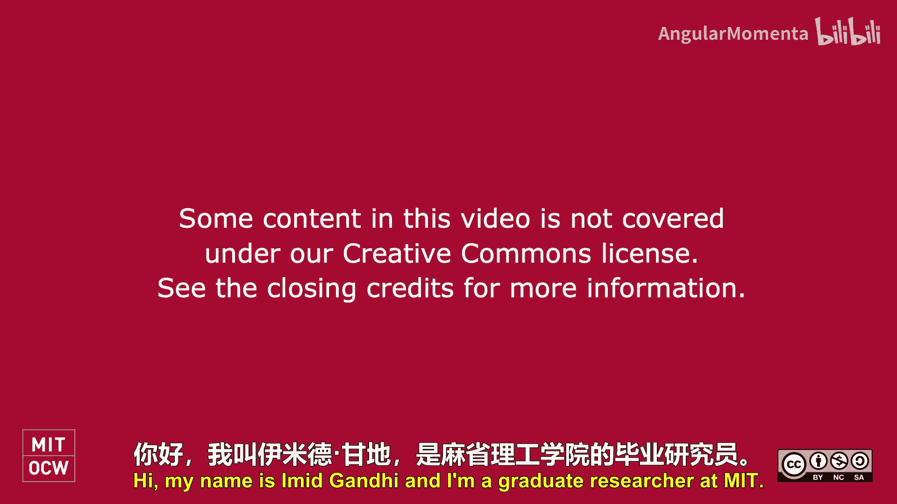
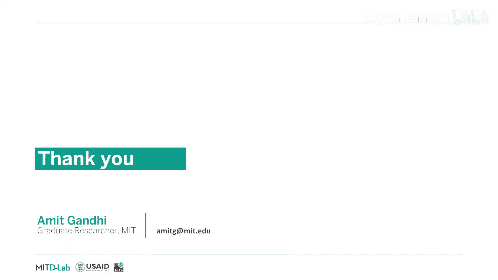
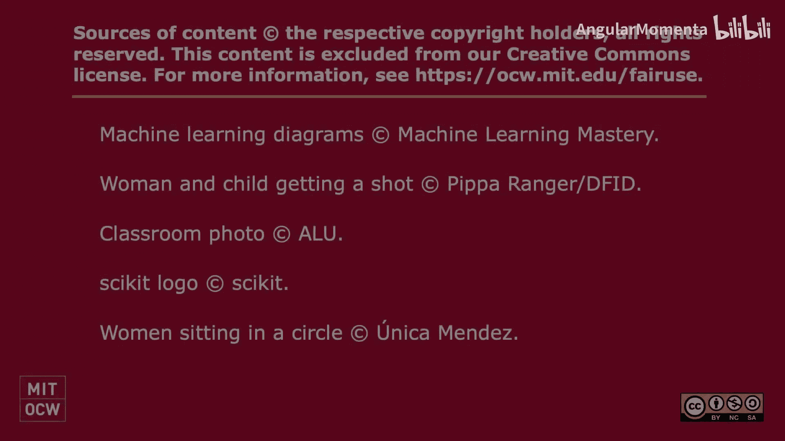
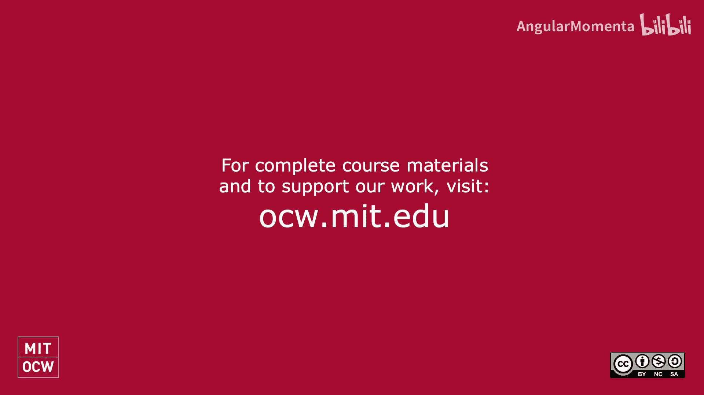

# 【麻省理工】机器学习公平性探索-｜-MIT-RES.EC-001-Exploring-Fairness-in-Machine-Learning,-Spring-p02-02-探索机器学习中的公平性：背景--BV15MtGzCENW_p2-

🎼Yeah。Hi， my name is Aid Gandhi and I'm a graduate researcher at MIT welcome to this course on exploring fairness and Ma learning for international development I'm going to present the motivation for this course。

 why is important to pay attention to ethics and appropriate use and the topics we will be covering。

Let's start with an introduction to how machine learning is being used in international development as a brief review。

 machine learning is a branch of artificial intelligence in which software learns how to perform a task based on experience as opposed to being explicitly programmed。

As a result， this emerging technology is widely applicable across many fields and can leverage the power of data in ways that were previously impossible。

Some application areas for machine learning include medicine。

 workforce development and financial inclusion。In the next few slides。

 I will talk about some of the ways machine learning is being used and we will go more in depth about ethical usage of machine learning in later modules。

In the healthcare sector， significant advances in machine learning have allowed for rapid diagnostics of medical conditions。

 Several organizations are developing tools ranging from sensors to smartphone apps for community health workers to collect patient data。

 get novel insights into patterns of disease spread and occurrence and perform diagnostics away from hospitals and clinics。

 significantly increasing the access and quality of medical care available to individuals in remote areas。

In workforce development， machine learning can reduce unemployment rates by pairing skilled individuals with appropriate jobs。

 for example， in India hiring managers pay more attention to credentials and skills。

 making it difficult for uncredentialed people to get hired or promoted。

Aspiring Minds is an Indian company that has developed a computer test that determines applicant strength and connects them to better paying jobs。

In financial inclusion， several organizations are using machine learning to determine credit worthiness of individuals in areas where other formalized credit systems may not be available or accessible。

 These companies are deploying pay as you go services。

 ranging from solar lighting systems to agricultural inputs and are generating and gathering nontraditional data on user assets and repayments。

This data can be used to determine credit worthiness using machine learning。

 enabling individuals to access loans or financing that were otherwise inaccessible。

Machine learning techniques have been around for decades。

 but have increased in usage in recent years。 over the past decade。

 the technology has become more accessible。 Machine learning is being taught at many universities across the world and several data analysis platforms have released machine learning libraries and toolboxes。

 for example， with Psyit learn and open source Python library。

 someone familiar with programming can get started with training machine learning models within a few days。

While the applications of machine learning are great。

 it is also important to acknowledge its limitations。

 the impacts of machine learning on society are still not well understood。

 Without careful attention to these issues， we run the risk of applying systems that are not only ineffective。

 but could also harm people by reinforcing existing patterns of social inequity and exclusion。

There is a large community of research in this area in developed countries such as the fat or AI Now groups。

 A well known example is about gender differentiated credit scoring。

 Low income women in developing countries often lack credit histories and formalal income。

 despite evidence showing that these women default on loans less than men。

 the lack of data makes it difficult for lending organizations to provide these women loans。

 As a result， taking predatory loans from informal lenders is a common practice。

While many of these concepts translate to ethics and machine learning。

 research about fairness in machine learning specifically for issues relevant to international development is at an early stage。

 ongoing efforts to ensure ethical usage of this technology will be discussed in the next video we will cover content from an appropriate usage F developed by the Center for Digital Development at the US Agency for International Development。

In the second set of modules， we will present case studies of organizations that are currently using machine learning in international development and discuss potential ethical issues that may arise in these examples。

At a high level， we will present approaches on how to address these issues and what the outcomes could mean。

In the third set of modules， we will present a framework for addressing ethical challenges。

 content will include protected attributes， fairness through unawareness。

 choices and fairness criteria， and techniques for mitigating bias。In the fourth set of modules。

 we will present case studies from organizations with examples of how machine learning could be implemented appropriately。

Thank you for taking the time to watch these videos and we hope that you will continue to watch the rest of the series。

