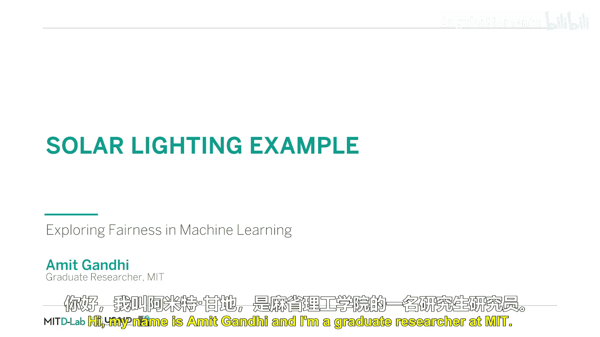

# 【麻省理工】机器学习公平性探索-｜-MIT-RES.EC-001-Exploring-Fairness-in-Machine-Learning,-Spring-p04-04-太阳能照明示例，探索机器学习中的公平性--BV15MtGzCENW_p4-

🎼Yeah。

Hi， my name is Amit Gandhi and I'm a graduate researcher at MIT。

 Welcome to this series on exploring fairness in machine learning for international development In this module。

 we will have an example of how an organization would go about implementing machine learning and what some of the ethical challenges that may arise are。

This module primarily focuses on decisions that are made at the organizational level。

 but it is important for both organizational decision makers and machine learning implementers to consider these interactions。

In this case study， we will be taking the role of a chief technology officer of a social enterprise that provides solar lighting products in East Africa。

 The mission of the company is to provide affordable lighting solutions to people living in poverty。

 and the company started off by providing high quality inexpensive solar lights that were replacement for kerosene lanterns。

Over time， the company has grown and increased its product offering to include large solar home systems and along the way。

 has implemented pays you go models so that households can afford to purchase these larger systems。

The way pays you go models work are that you provide the solar lighting infrastructure as a loan asset to individuals。

 and they pay you back over time through mobile money payments until the full value of the asset is recovered。

The company has been meticulous about keeping records from transactions from their user base。

 and as a result you have access to both demographic information and payment history for all of your clients。

The information you have from your users includes age， gender， occupation， location。

 and household income。As you look at expanding the social impact of your enterprise。

 you realize that this data can be analyzed to determine a credit worthiness metric for your customers。

Additionally， you can provide this information to banks or microfinance institutions so that they can leave loans to your client base。

Machine learning is a powerful tool that you can use to implement this credit scoring metric。

 However， you do not have data scientists or machine learning experts within your team that can implement this solution。

You also do not know how accurate or powerful an algorithm you develop could be。

 so you do not want to spend the resources to build a full team and opt to run a small pilot with some of your users in Uganda。

As a resourceful company with engineering staff， you could either have some of your engineers implement a machine learning solution using off the shelf product or work with a third party company to implement the solution for credit scoring。

Let's pause this case study for a second and examine the pros and cons of the decisions that need to be made。

 it is important to consider perspectives from both the machine learning implementer。

 as well as the organizations to understand the thoughts and complexities that go into developing a solution。

Doing it in house without a trained data scientist will likely involve the implementation of a black box solution。

While someone with no background in machine learning could get a solution up and running fairly quickly。

 there are several nuances in the design that may get overlooked。

Allowing a third party consultant to implement your solution would solve many of these issues。

 though you may lack both in house capabilities to understand how your model is being implemented and maintain it moving forward。

Let's assume that one way or another， the credit scoring algorithm gets built without paying attention to fairness in the setup。

 several issues may arise。 First， you may find that as you analyze your historical data that certain groups of people have different default rates than others。

For example， women may have a lower default rate than men。

 and you may decide that as an organization， you want to be fair and gender blindin in your loan determination。

The slide shows an example of what different differing loan rates look like for men and women。

To implement fairness， a naive implementer may first try to use fairness through unawareness。

 which means that you simply hide gender information when building your models。

Depending on correlations within your data and how relevant gender is to default rates。

 your models could still predict gender new set in the model。Second。

 since your data shows the difference in default rates。

 you have to actively decide how to correct for that。In the case of loans。

 different approaches to implement fairness may have a trade off with the accuracy of your algorithms。

Third， the type of algorithm the implementer uses could have trade offs as well。

 Some algorithms may be faster at the cost of accuracy。

 Others may be more accurate at the cost of explainability or understandability。

I won't go more in depth on these topics because we will discuss them more in future modules。

 However， I do want to highlight a couple of important concepts。First。

 implementing a machine learning algorithm is not an objective process in your implementation you are both designing a technology and making decisions。

 both of which introduce your biases into the system。

To think that outcomes from a computer are objective is just a fantasy。Second。

 open communication between you and the implementer on your values as an organization and decisions that they are making are critical。

Third， you need a way to audit your data and your algorithms if you want to have a fair system。

Let's move on assuming you're able to work with a consultant to build a satisfactory solution to your algorithm。

 and you're able to demonstrate significant success with your pilot in Western Uganda。

You now want to scale your model to other parts of Uganda and East Africa。At this point。

 it is important to pay attention to the representativeness of your data。

Are there large differences between the types of users you have in Western Uganda and Eastern Uganda？

How about the users in Uganda and Tanzania， you need to make sure that you are collecting representatives data as you scale your solution。

 which involves significant testing and auditing。Additionally。

 you want to make sure that changes within your population do not suddenly affect your results。

 for example， if a careee tax were imposed by the government， would your model no longer be accurate。

 how could you build in support within your organization to make sure you can react to changes？

Thank you for taking the time to take this course。 We hope that you'll continue to watch the rest of the modules in the series。

😊。

