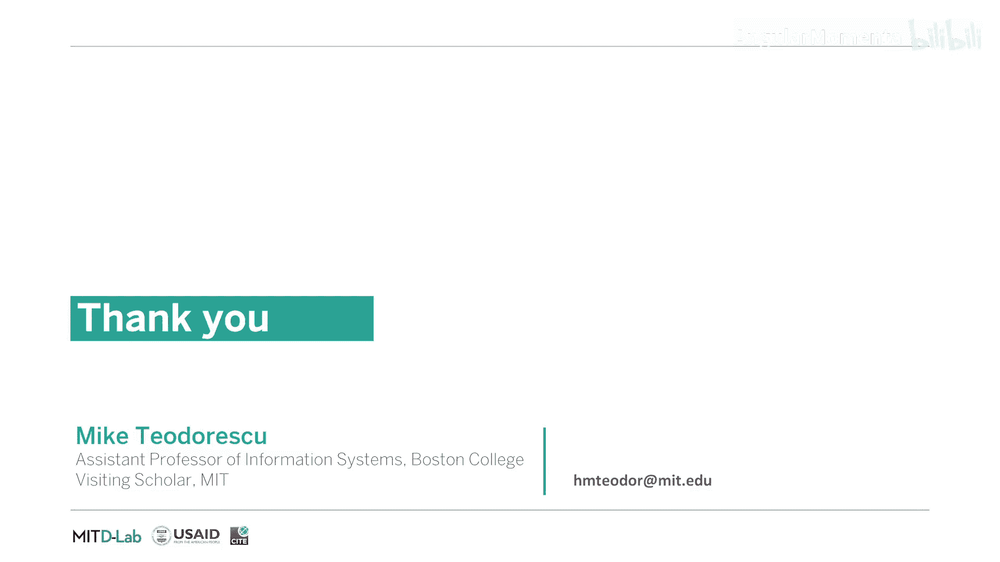

# 【麻省理工】机器学习公平性探索-｜-MIT-RES.EC-001-Exploring-Fairness-in-Machine-Learning,-Spring-p05-05-公平性标准，探索机器学习中的公平性--BV15MtGzCENW_p5-

Hello and welcome to module on Choice and fairness criteriater name is Mike Theoddoesco I'm assistantant Prosor Information System at Boston College as well as a visiting scholar MITD La while covering this module will be the concept of confusion matrix as well as three popular examples of fairness criteria。

 demographic parity， equal odds and equals opportunity。

Some countries have laws that protect specific groups of people from discrimination based on certain attributes。

As we have in the previous video， these are called protected attributes。

Some examples are on the slide。Regardless of legal landscape。

 machine learning has the potential to produce unfair outcomes for syn groups of people。

As an elegantgo designer， one should make clear choices about fairness criteria。

Some criteria will be reviewed in the next few slides。

The previous video we also discuss case of Fairness to awarenessness。

 which refers to leaving out the protect attributes out of your model。

 and we also explain why this is not a good choice。

 specifically you may end up with other attributes that are correlated with protect attributes and you may end up discriminating inadvertly nonetheless。

In order to go into additional fair criteria， we need to discuss some additional concepts。

Consider you have a binary classifier。For example， you're looking at a decision of higher or not hired or to lend credit not to lend credit If we were to look at the predictions for a model。

 they would do such a binary classification， we would look at the predicted values you could bucket them in four categories。

 two positives， which would be correctly classified as positive， two negative。

 correctly classified as negative， false positives which would be values were incorrectly classified as positive by the algorithm false negatives。

 which would be values incorrectly classified as negative。

And if we were to add the two positives to two negatives and divide that by all four。

 we would end up with the value of the accuracy of the model in this example where accuracy is this。

 an accuracy of 0。5 is the same as a random classification。

Now we should look at accuracy carefully and see that it doesn't tell us anything about the prediction of negatives。

 it could mislead us if the two classes were imbalanced， for example。

 if 90% of the sample is positives and 10% of negatives for that。

 we have other additional criteria we could go into deeper such as MCC score and AUC score。

The two positives， two negatives， false positive， false negatives are oftentimes presented in a two by two matrix form called the confusion matrix。

This is simply an easier presentation for us to see the behavior of the classifier。

The first additional famous criteria is called demographic parity。

It's a criterion for what's called good level fairness。

This criteria specify that the outcome which here is denoted by Y hat is independent of the protected attribute A。

For example， the probability of being hired is independent of the gender。

There are multiple problems with demographic parody。

One would be the definition that we just discussed would not hold if we had individuals who would be members of multiple protected groups。

 by enforcing group level fairness for one attribute。

 we would still violate the group fairness for other attributes or combinations of attributes such as subgroups of the population。

Furthermore， while enforcing group level fairness， for example。

 the same hiring grade for females and males， that could still be unfair to individuals。

 it could force the algorithm to drop otherwise qualified individuals just to achieve independence of outcome with the attribute。

Fairness at the group level could potentially be unfair at the individual level。For example。

 if we have a high rate of false positives， we could end up in a low rate of false negatives。

 it could still end up being unfair to individuals in that we could hire people who are without married at the disadvantage of other individuals who could be qualified and should be hired。

 but due to the group level fairness criterion， we have to hire some who are not qualified from one of the groups。

The sweet spot would be low false negatives and low false positives。

 which would be fair potentially to both individual and a group level。

We could also end up in the top right corner which would be the worst case scenario， low accuracy。

 unfair to individuals， but potentially fair for the group where we have high false negatives and high false positives。

The strict criterion is equalized odds， which means matching both the two positive rate and the false positive rate for different values of the protected attribute。

This is much harder to achieve than demographic pary。

 but is one of the higher levels of algorithmic fairness。In this case。

 rather than predicting the same average risk across subgroups of protected social attributes。

 like in demographic parity， equalize as a stricter in that it forces equality only among individuals who reach similar outcomes。

In the hiring example that we've discussed in the previous video。

This implies that the probability of a qualified applicant to be hired and the probability of an unqualified applicant to be incorrectly hired should be the same across genders。

A milder version of equalized odds is equalized opportunity where we're only concerned with treating fairly those who are determined to be worthy of acceptance。

 I dependent variable is equal to one， or they are worthy of being hired。

 worthy of being admitted and so on。Equal as opportunity is not considered with rejectjecting people fairly across protected coups。

So speak， the false positive rates and the two positive rates do not both need to be equal across the protected categories。

 we only need the two positive rate to be equal across protected categories。In a way。

 equal opportunity is less interventionist than equal odds。

 and it may be more achievable depending on your individual situation and implementation challenges。

In the example of hiring， we only are concerned with individuals who are worthy of being hired， I。

e the actual qualified applicants and out of the rejectedjected applicants we may be sometimes ejecting out fairly。

Here's some of you questions for the last two videos， what is demographic parity？

What is famous to awareness？Hes famous at the group level always the best。What is a confusion matrix？

What is the quality of our crion and when might you want to use it？

This course is sponsored by the USAID Gr through the MITD La。

And this is joined to work with my faculty colleagues。

 Lily Mor and Gerald Kane for Boston College and registered assistantist the Yaziita Wat for MITD La。

If you would like to learn more about this， please consult the following references。

Thank you so much for watching this video， We hope you find it useful and you'll continue watching the rest of the class。

