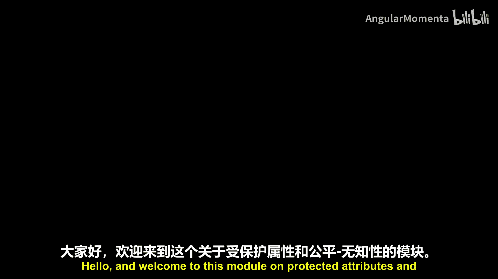
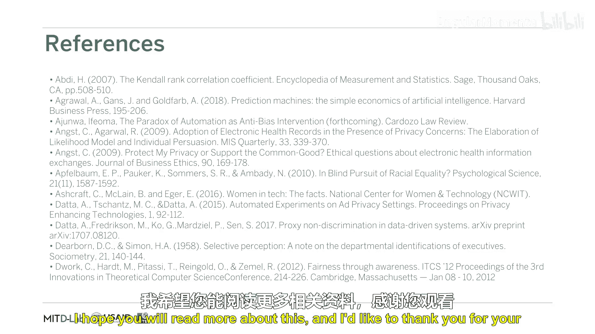
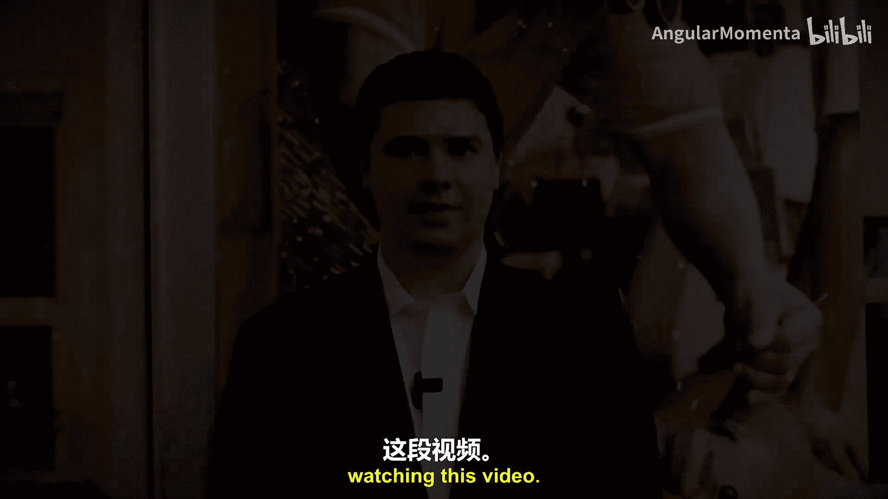
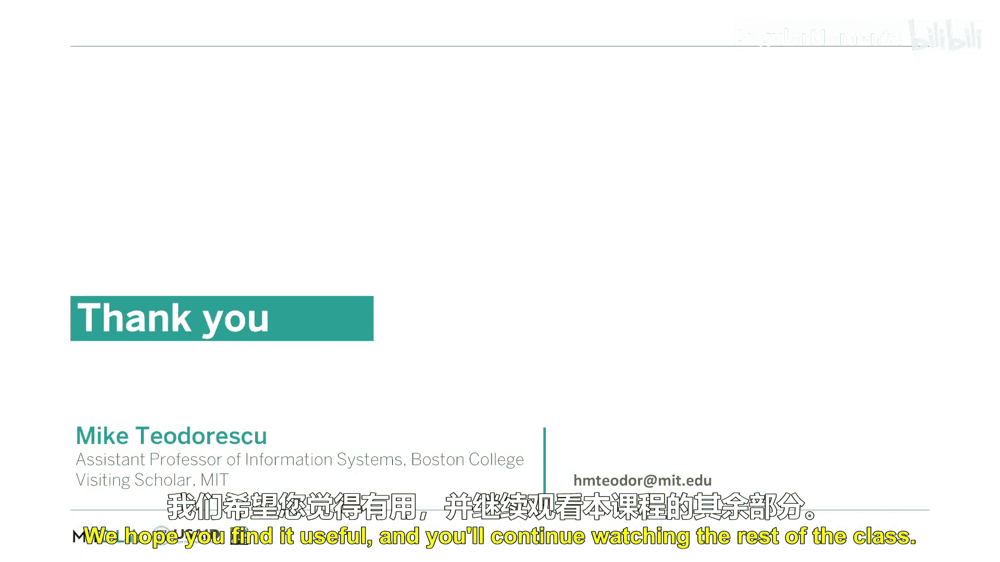

# 【麻省理工】机器学习公平性探索-｜-MIT-RES.EC-001-Exploring-Fairness-in-Machine-Learning,-Spring-p06-06-受保护属性与“通过无意识实现公平”——机器学习中的公平性探讨--BV15MtGzCENW_p6-

Hello and welcome to module on Protect Atbuts and fairness Sw awareness My name is Mikeo Doesrow I'm an assistant professor of Information System at Boston College as well as a visitinging scholar at MITDLb。

 but this module will cover will be examples of laws that cod protected attributes as well as the base case scenario for fairness in machine learning which is called fairness Sw awareness。

The use of machine learning presents both risks and opportunities。

Machine learning can reduce costs by automating repetitive tasks， but could also induce biases。

Certain individual attributes are commonly labeled as protected attributes。

As they can be sources of social bias。These are race， religion， national origin， gender。

 marital status， age and socioeconomic status。In the United States。

 discrimination based on these protected attributes in housing， lending and employment is illegal。

 Some of the laws are listed here for your reference。However， regardless of legal framework。

 machine learning still has a potential to intentionallybed bias。In this lecture。

 we look at a few examples。 The next lecture will explore some approaches to mitigate high intentional bias。

Even large companies could not discriminate。 For example。

 Amazon used the machine learning algorithm to screen resumes and later found out that the algorithm is discriminating against female applicants。

In another example， they from the criminal justice system。

 machine learning is used to determine the risk of acididivism。

This system has been questioned in a variety of studies。

 in particular with the reference to the protecting attribute of race and gender。

In another example of a large organization。Employing machine learning this time display ads。

Facebook has been named a suit over alleged violations of the Faire Housing Act。Therefore。

 even large organizations like Amazon and Facebook find machine learning fans challenging。

We hope this course will be helpful in preparing software engineers to better address machine learning fairness。

Generally speaking， before you implement a machine learning algorithm。

You to collect data to train algorithm。This dataset set would have your outcome variable in this figure。

 why。For example， decision to hire or not to hire。As well as all of the predictors。For example。

 features collected from resumes。This complete asset would then have to be split in a training set on which the model would learn in a test set on which we would determine the model performance。

There are other details like cross validation， which will not cover here by encourage you to eat more。

F starts for a good quality training set。Low quality data。

 generally speaking leads to bad predictions。The individuals labeling the data， for example。

 managers labeling a resume as a hire or a no hire may carry biases which are then picked up by the machine learning algorithm。

Training data may not be representative or groups， which could lead to bias。

And there may be hidden correlations input data， for example。

 you a protected attribute another predictor。They can also lead to bias。

Individuals labeling attain they had made mismber pass situations。

 a phenomenon known as selected perception， which may itself become a source of bias。

The default fairness methode machine learning is fairness one awareness。

Famous one awareness refers to leaving out protected attributes such as gender race and other characteristicss 16 deemed sensitive。

And why it was thought。To erase inequality， it was found actually to perpetuate it。It may do so by。

 for example， having other attributes that are correlated with the project attributes in the data。

 which by ignoring the project attributes， so we could just。S include in our model。

This could actually perpetuate inequality。When race， gender。

 and other sensitive variables are is protected， other variables such as college attended。

 hometown or other resume indicators that we may not protected may still be highly correlated with these protected attributes。

Thus， ignoring the protected atoms altogether may not reveal these hidden correlations and data。

 This is called a Uundingcoding。In one example， the Cits accounting of Bell University found that gender。

Cause an unintentional change in Google's advertising system。

 such as Ading target for users seeing high income jobs were presented to men and nearly six times a age they present to women。

This may be an example of fair one awareness。Here are some of your questions about this material。

What are the sensitive attribute in the context in which you work？

Do you think that the current list of protected attributes is exhaustive？

What is fairness to un awareness？What variables might lead to bias predictions for machine learning hiring system in your country。

What are some risks to an organization choosing an awareness？

I'd like to thank my coauth Li Morrisris Gerald Kane and Yazida Wad for a study that helped me put together all of these slides。

As well as USAID for a grant on appropriate use of machine learning developing countries and the Cal School Management across in College for research funding。

I'd also like to thank everyone who helped contribute with feedback to these videos as well as the accompanying manuscripts。

I'd like to share with you some reference I found helpful and I was saying this material。

 I hope you will read more about this， and I'd like to thank you for your attention in watching this video。

 Thank you so much for watching this video。 We hope you find it useful and you'll continue watching the rest of the class。

🎼Okay。

