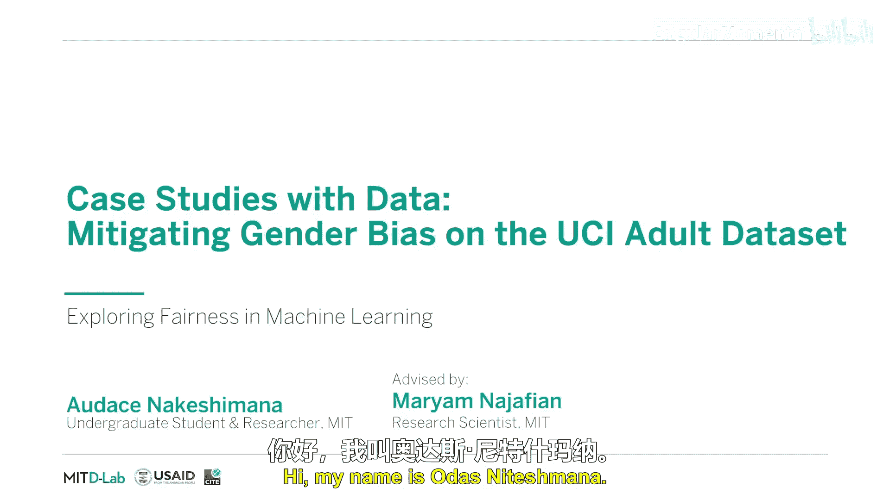
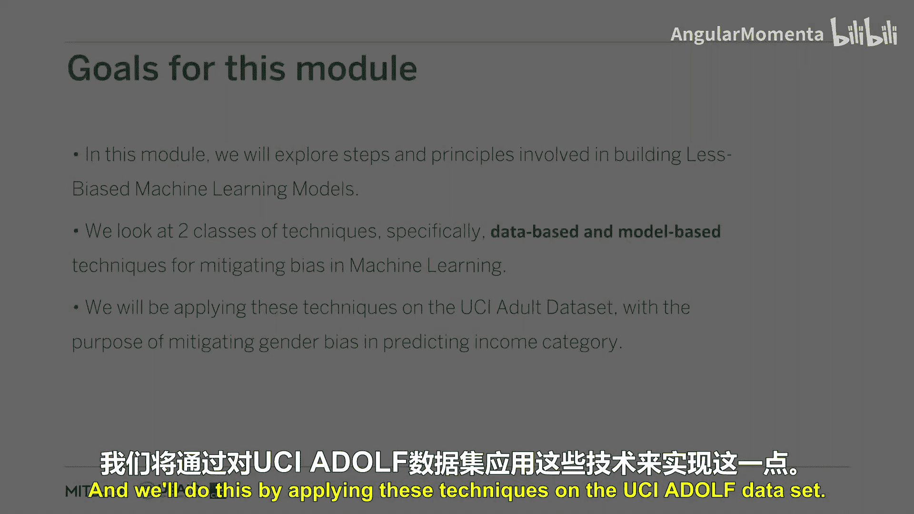
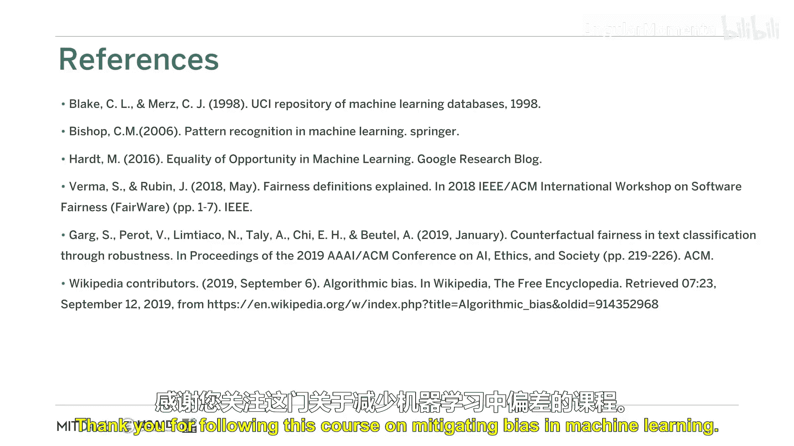

# 【麻省理工】机器学习公平性探索-｜-MIT-RES.EC-001-Exploring-Fairness-in-Machine-Learning,-Spring-p07-07-数据案例研究：缓解-UCI-成人数据集中的性别偏见--BV15MtGzCENW_p7-

🎼Yeah。

Hi， my name is Oas Nashmana， I am an undergraduate student and researcher at MIT。

In this video we'll continue exploring fairness in machine learning by looking at techniques for mitigating bias Through the course we'll start by illustrating bias in machine learning。

 then we look at techniques for mitigating bias specifically we'll explore two types of techniques。

 the database techniques that where we look at how to calibrate and augment our data to mitigate bias in machine learning and then we look at Mobased techniques in which we explore different model types and architectures that help us to get to LS biasased model and we'll do this by applying these techniques on the UCI adult dataset。

In this module we will explore different steps and principles involved in building less biasas machine learning applications we look at two main classes of techniques specifically data and Mo based techniques for mitigating bias in machine learning we will be applying these techniques on the UCI adult data with the purpose of mitigating gender biasas in predicting income category。

This module is comprised of seven main parts In part1。

 we're going to look at an overview of algorithmic bias In the second part we will explore the UC of dataset set in the third part we look at different data preparation steps for machine learning In part4。

 we're going to look at an example of gender bias and in part5。

 we're going to look at different database approaches for mitigating gender bias and in part 6 we're going to look at different model based approaches and in the last part we'll conclude by looking at the possible next steps。

Recommended prerequisites for this module have familiarity with the fields of data science。

 statistics or machine learning， and familiarity with the programming tools that well be using。

 these are Python， panndadas and the Psychic Learn library。In part one of this module。

 we will start by understanding algorithmic bias， we will define it and look at its sources and implications。

Throughout the module， we will use the term bias， algorithmic bias or model bias to describe systematic errors in algorithms or models that could lead to potentially unfair outcomes。

 we will identify bias qualitatively and quantitatively by looking at model errors disparities across different gender demographics and note that throughout the module we will use gender to describe biological sex at birth。

So what are some potential sources of algorithmic bias First， bias can come during data collection。

 and this could happen when the data that we collect already contains some systematic biases or stereotypes about some demographics。

 This could also happen if different demographics in our dataset set are not equally represented。

 The second example of how bias could come in machine learning is in the training process when our models are not penalized for being biased。

Algothmic bias is a problem because of different reasons。

 it leads to unfair outcomes towards some individuals or demographics and leadss to further bias propagation。

 creating a feedback cycle of bias。In the second part of this module。

 we'll explore the UCI Adult dataset by establishing familiarity with the dataset and looking at different distributions in the dataset。

The UCI Ad dataset is one of the most popular machine learning datasets。

 it is available on the internet on the UCI Ma learning repository。

The dataet is comprised of more than 48，000 data points that was extracted from the 1994 Census database in the United States。

Each data point in the dataset is comprised of 15 features， these include age work class， education。

 relationship， race， sex， salary， and others。If you look at the gender distribution in the dataset。

 we can see that about 16，000 individuals identify as female and about 32。

000 individuals identify as male； if you look at the race distribution we can see that slightly more than 40。

000 individuals identify as white。And about 4 to 5，000 individuals identify as black。

 the rest is other minorities。If we look at the distribution of income category in the general population。

 we can see that about 37，000 individuals earn less or to $50，000 and only about between 12。

000 and 13，000 individuals earn more than 50，000。By looking at the income level distribution across different levels。

 we can see that the ratio of male individuals that make more than $50，000 is about a third。

 but for the female demographic， this ratio drops to about 20%。

An important observation from what you've seen so far is that the number of data points in the male population is significantly higher on the number of data points in the female population。

 exceeding it by more than three times in the higher income category。

 therefore it is very important to think about how this representation disparity might affect predictions of a model trend from this data。

In the third part of this module we are going to explore different steps involved in transforming our data from row representation to appropriate America or categorical representation in order to be able to perform machine learning tasks an example of transformation to be made is the conversion of native country from row representation to binary In this example we decided to assign a binary level to individuals who come from the United States and another binary label to individuals who come outside of the United States。

We apply the same transformation to the sex and salary attribute。

 since each one of these attribute has two possible values in the dataset。

 therefore making binary representation appropriate。

There are more than two possible values that the relationship attribute can take； therefore。

 for this attribute we use one hot encoding， which is more powerful than binary encoding because it can encode an alphabet of any size。

We apply the same transformation from row representation to binary or oneHs to all other categorical attribute in most cases we chose binary coding for simplicity。

 but this often a decision that has to be made on case by case basis depending on the application it is also important not that converting features like work class to binary can be pramatic if individuals from different categories have systematically different levels of income on the other hand。

 not doing this might be a problem if one category has very few people in needs that we can generalize from。

In the fourth part of this module， we are going to illustrate gender bias。

 we will apply the standard machine learning approach to our data and then evaluate the bias in the task of predicting income category。

We start by splitting the dataset into the training and test data。

We then fit MLP classifier on training data， then use the model to make prediction on the test data。

In case you're not familiar with the multilaya perceptron or MLP classifier。

 this model belongs to the class of fitvo neural networks。

 each node uses an nonlinear activation function， giving the model ability to separate nonlinear data。

 the model is trained using back propagation technique however a few downsides is that the model suffers over a feeling and it is not easily interpretpreable。

Before we evaluate our model， let's start by establishing some terminology throughout the rest of the module where we refer to the positive category as a group of individuals that earn more than $50。

000 year or the high income category， and we will refer to the negative category as a group of individuals that earn $50。

000 year or less， we also refer to it as the low income category。

Now that we dis this important terminology let's look at different error metrics for the model that we trained previously across different gender demographics If you look at accuracy you can see that the accuracy for the male demographic is about 0。

8 all the accuracy for the female demographic is about 90% or 0。

9 if you look at the positive rate and the trueositive rate you can see that both of these metrics are higher for the male demographic than for the female demographic however if you look at the negative rate and the true negative rate you can see that this metrics are higher for the female demographic than for the male demographic instead。

😊，The metrics that we just so indicate consistent disparity in error rate between the male and the female demographic this is what we will define as gender bias mitigating gender bias in this case is equivalent to using different techniques to minimize this disparity and this will be the focus of the rest of the module。

😊，In part5 of our module， we are going to explore different database the biasing techniques。

 more specifically， we will look at different ways we can recalibrate or augment our dataset in a way that makes predictions less biased。

The motivation behind this is from a hypothesis that the gender bias could come from anti representation of male and female demographics in our dataset。

 we therefore make an attempt to recalibrate or augment the dataset with the aim of equalizing gender representation in our training data。

The first database technique that we're going to explore is called debaing by an awareness。

 and in this technique， we mitigate gender bias by removing gender from the attributes that we train on。

 The code snippet shows our implementation。By looking at the results for our debasing by anNS technique。

 we can say that although there was not significant improvement in reducing the gap for accuracy。

 we are able to reduce the gap for ametric like the positive rate， the negative rate。

 the true positive red and the true negative rate， and this is an example of how a debassing technique might not be able to achieve an improvement in all the metrics。

 although it might see a significant reduction in the gap for ametric of interest。

De biasasing by an can be one approach to mitigate genderbi to some extent， as we saw in our results。

 however， studies have shown that this method can be ineffive。

 especially if there are the features in the dataset sets that have some correlation with the protected attribute that we are dropping。

This type of attributes are referred to as proxy variables。

The second database technique that you are going to explore is equalizing the number of data points。

 and in this approach we will attempt to equalize representation by using number or e ratio of male and female individuals in a data or within each income category。

We will start by attempting to equalize the number of dataap points per gender category and in this approach we are going to draw a sample in which there is e number of dataap points from the male demographic and from the female demographic feel free to post the video to understand the implementation。

These are the results that we get from training an MLP classifier on a data in which there is an equal number of data points per agenda category。

 feel free to post the video to understand the results in more detail。

The next attempt will be to equalize the number of data points per income level in each data category。

 and what this means is that the number of high income and low income earners is the same in the male and the female demographic for the sample that you are going to use to train。

Here are the key metrics from a model that was trendd on a sample of the dataset in which there is an equal number of data points per income level in each data category。

One downside to this methodology of equalizing the number of data points per demographic is that the size of the resulting data set depends on the size of the smallest demographic。

 therefore if the smallest demographic has a very small number of data points。

 you're going to end up with a very small training set therefore in some cases you might find that equalizing the ratio instead of the number of data points per demographic can lead to a higher resulting sample size and that's what we're going to look at in the next approach。

In this methodology of equalizing the ratio of the number of data points per income level in each category。

 we equalize the ratio of male individuals with high income to male individuals with low income and we do this for the female demographic as well this results into a highest sample and to see how this is the case I encourage you to look at the notebook for this work。

This is the plot for the results of this methodology。

 and you can see that although there is some gap for the accuracy and tripositive rate。

The gap is way smaller for positive rate and negative rate or true negative rate。

The next technique that we're going to look at is counterfactual augmentation and in this approach for each data point Xi with a given gender。

 we generate a new data point Yi that differs with XI only at the gender attribute and we add YI to our training dataset。

I encourage you to pause a little bit and convince yourself that the resulting data from counterfactual augmentation will satisfy all the following constraints shown here。

The code snippet shown here shows our implementation of counterfactual augmentation on the dataset。

By looking at the results of counterfact augmentation on our dataset。

 you can see that the gap for all the metrics that we're looking at for the male and female demographic is pretty much gone。

 and this is what we want and expect from a fair machine lining model。

So let's compare all the metrics of interest on all the approaches that we've carried out so far。

By looking at the metric of overall accuracy， you can see that some techniques like e number of data points per gender or counterfactual augmentation lead to higher degrees of accuracy。

 but you can see that some techniques like gender and awareness do not always guarantee higher accuracy。

By looking at accuracy across gender， you can see that the counterfactual augmentation technique still has the smallest gap between male and female。

 but you can see that some techniques like Nnda and Arenes still have a significantly higher gap between the accuracy in male versus female demographics。

The plots shown here show the comparison between the positive rates across gender and the comparison between the negative rates across gender。

The plots shown here show the comparison between true positive rates across gender and the comparison between true negative rates across gender。

 for all the techniques that we covered so far。In this part。

 we are going to explore Mo based thebiasing techniques。

 and specifically we will look at different mo typess and architectures and examine how each one of them performs for the male versus female demographic。

The motivation for this is that we should expect different models to have different degrees of bias；

 therefore by changing the model type or architecture。

 you can observe which ones tend to be inherently less biased and these are the ones that we are going to choose in our application。

We start by examining single model architectures， and for each of the model families shown here。

 we picked one model and trend it on the data that we have。

This cut snippet shows different models and parameters that we used。For simplicity。

 we use default parameters for different models， but in a practical setting。

 we would have to use a technique like cross validationation or hyperparameter search to find the best parameter to use for each model。

We also examined multimod architectures in this approach we train a group of different models on the same data and then make a final prediction based on consensus we compared two types of consensus。

 the hardvoing consensus is the one in which the final prediction is the majority prediction among all models and in the softvoing consensus。

 the final prediction is the average prediction across all models in consideration。

We use PsychicL Vo classifier to combine single models and trend them all at once。

 the code snippet shown here shows the models that we used and how we trend the voting classifiers on our data。

Let's now evaluate and compare the metrics of interest on all model types and architectures that we've trend on so far。

This plot shows results for overall accuracy。 You can see that the random forest classifier has the highest degree of accuracy。

 which is about 94%。 You can also see that the Gouchian knife base model has about 72% of accuracy。

 and you can also see that all the other models fall in between。

This plot shows accuracy across gender。And you can see that there are different levels of the gap between the male and female demographic。

 depending on the model type， and this is an example that indicates that different models inherently have different levels of bias。

These plots show the positive and negative rates across gender if you look at the plot for the positive rate。

 you observe that the positive rate is always higher for the male demographic than the female demographic for all the models that we've looked at。

 and this can be pramatic if we deploy any of these models in the real world because you end up in a scenario in which the model just systematically predicts more of every outcome for the male demographic than the female demographic。

These plots show the true positive and true negative rates across gender If you look at the plot for the true positive rate。

 we observe that the true positive rate is always higher for the male individuals than female individuals。

 and if you look at the plot for the true negative rate the other way around the true negative rate is always higher for the female demographic than for the male demographic and this can special be pragmatic because it shows that a modelss have learned how to better classify high income male ans than high income female ans and to classify low income female honors than low income male ans which means they could be widening the gap between the male ans and the female honors。

To account for randomness， we ran the previous experiment five more times in order to get a better idea of the average model behavior。

To compare the metrics across multiple training sessions。

 we created five instances of each model type and we trend each one of them on the data。

 then for each one of these instances we evaluated the absolute value of the difference in each metric of interest between the male and the female demographics from the test data。

If you look at the plot for the accuracy disparity comparison。

 you can see that models like Lo regression or Had votinging or SVC have a significantly lower accuracy disparity than Gosian knife based or random forest。

We see a similar trend by looking at the positive and negative rate disparity If you look at models like logistic regression or SVC or hard voting。

 you can see that they have significantly lower disparity than G and B。

Surprisingly we see a significantly different result by looking at the true positiveitive and true negative rate disparity If you look at a true positiveitive rate disparity。

 you can see that models like logistic regression or SVC now have high disparity and higher variability than models like GNB。

 but if you look at the plot for the true negative rate。

 you can see that it tends to follow the previous trend way logistic regression and SVC have lower variability and lower disparity than GNB It is therefore very important to see that these models have different inherent behaviors when it comes to bias。

😊，In the last part， we conclude by looking at possible next steps that will allow us to strengthen our understanding and application of ethics in machine learning from the technical perspective。

Now that you've gone through the entire module we invite you to check out our GiHub repository。

 this will help you deepen your understanding of the work that's being done in addition we also encourage you to explore more advanced thebiing techniques and we also recommend sharing and discussing these across your team organization or community and of course we all need to take action by applying what we learned in what we do every day。

Finally， here are the references to the materials that we consulted while making the module。

Thank you for following this course on mitigating bias in machine learning。

 and I hope that this helps you build less biased machine learning applications in the future。

