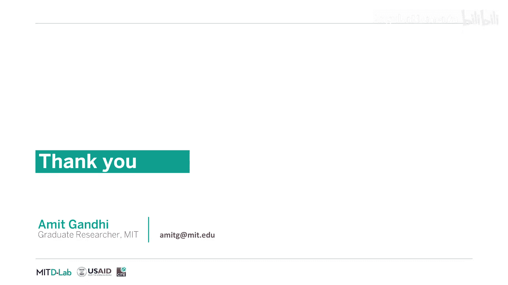

# 【麻省理工】机器学习公平性探索-｜-MIT-RES.EC-001-Exploring-Fairness-in-Machine-Learning,-Spring-p08-08-肺健康案例研究：偏差探索，机器学习中的公平性探讨--BV15MtGzCENW_p8-

Hi， my name is Aid Gandhi， and I'm a graduate researcher at MIT。

 Welcome to this course on exploring fairness in machine learning for international development In this video。

 we will examine bias in machine learning models through a pulmonary health diagnostic case study。

 In particular， we will explore the influence of representative data on accuracy when building a model。

Pulmonary diseases， including asthma， COPD， allergic rhinitis， and others。

 can have significant detrimental health impacts if undetected。

In remote areas with limited access to health care， they can often go undiagnosed and untreated。

The motivation for this work was to develop the screening tool for community healthcare workers to determine if patients who were presenting symptoms of pulmonary disease actually have pulmonary disease。

To develop the tool， data was collected from 303 patients who sought medical care at health clinics between 2015 and 2018 in Pue。

 India。Patient data was collected at health clinics from two exams administered by researchers。

 a mobile health diagnostic kit developed by Dr。 Fletcher's group and a set of measurements from a pulmonary function test lab。

Health diagnoses were performed by medical staff with a focus on asthma， allergic rhinitis， and COPD。

The overall disease distribution among the patients is shown in the plot。

 the data included 175 patients with pulmonary diseases and 87 healthy patients。

Patients may also have multiple pulmonary diseases， For example， asthma and COPD。

The exploration of representative sampling on accuracy was conducted across two protected variables。

 gender and income。The population distributions for the two variables can be seen in the slides for income considerations。

 patients were categorized as either low income or high income。

The overall approach to the B study was to divide the data into a larger training data superet in a test dataset set。

A logistic regression model with L2 regularization was used to make predictions on disease。

To train the model， training data subsets were randomly sampled from the superet that intentionally introduced imbalances along protected variables。

For example， with regards to income， training data subsets range from 50% high income and 50% low income to 87。

5% high income and 12。5% low income。To account for stochastic error。

 this process was run a thousand times for each test。

The area under the curve of the receiver operating characteristic curve was used as a metric for accuracy。

Starting with gender bias analysis， our training data sets and test data set were divided as shown。

Male female representativeness was varied from 5050 to 87。5 to 12。5。

The results for predictive accuracy for allergic rhinitis， asthma and COPD are shown on the slide。

The data shows no significant decrease in algorithm accuracy as gender imbalances are introduced in the data。

This may be surprising considering how we have highlighted the principle of representativeness and data throughout this course。

 However， it is important to note that protective variables do not necessarily affect outcome variables。

 and the lack of representativeness may not always introduce bias or unfairness into models。

Looking at our results， we also noticed that our algorithm is more accurate at predicting COPD in women than met。

Exploring the results further， we look at other variables in their correlation with gender。

In our data set， we found that smoking heavily correlated with gender。

55% of men reported that they were non smokers， whereas 100% of women reported that they were non smokers。

 As a result， the population of women was more homogeneous， allowing for higher predictive accuracy。

Moving on to the income bias analysis， the training data sets and test dataset sets were divided as shown。

Similar to the gender study， representativeness based on income was varied for the training dataset set。

The results for predictive accuracy for allergic rhinitis， asthma and COPD are shown on the slide。

 Again， we see very little difference in accuracy as we change representativeness within the sample。

CO OPD is the most sensitive to socioeconomic status。

 with a 4% difference in model accuracy for high income and low income populations。

Asthma allergic rhitis show no difference in performance。In summary。

 we found that representativeness across the protected variables of gender and income do not play a large role in model accuracy。

 for this example， on pulmonary diseases in India。As part of building a machine learning model。

 it is always important to check what effects， if any protected attributes may have on the model in the real world。

 it will be impossible to find perfectly balanced data sets and tests such as the one described can be used to check for the effective representativeness across protective variables on data and model accuracy。

It is important to understand these trade offs so that you can make informed decisions when building models。

Thank you for taking the time to watch this case study。

 and we hope that you'll watch the other content in the series。

