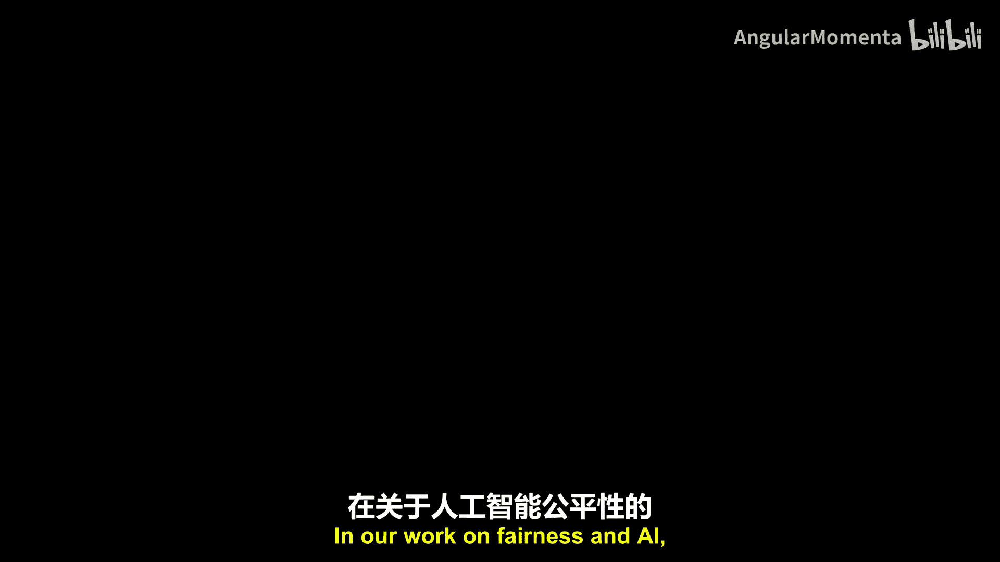
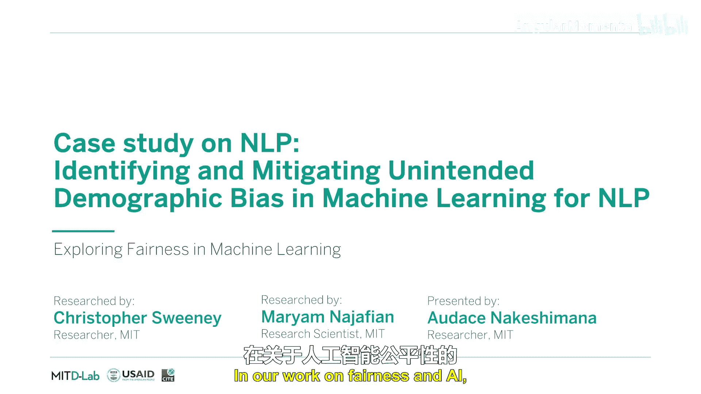
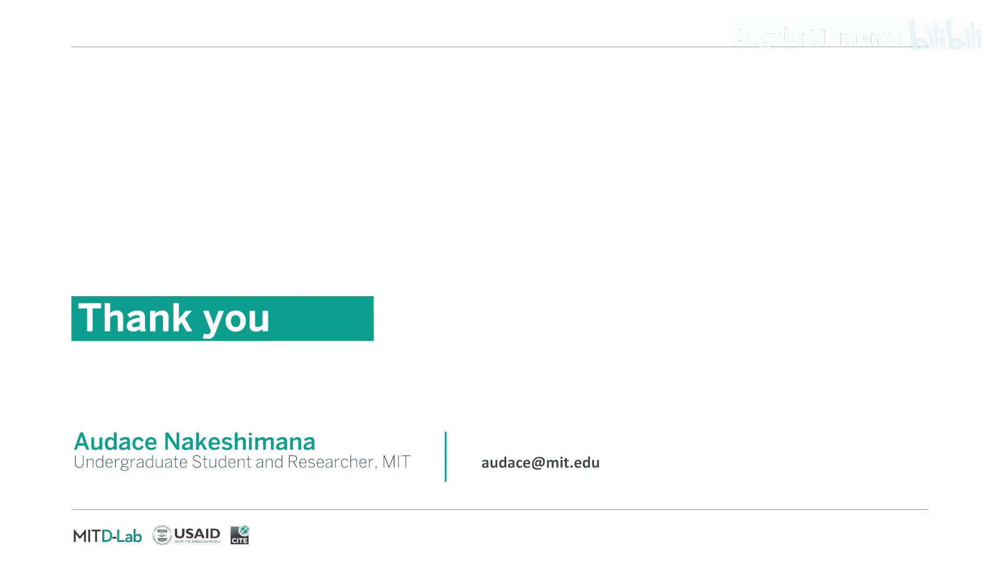

# 【麻省理工】机器学习公平性探索-｜-MIT-RES.EC-001-Exploring-Fairness-in-Machine-Learning,-Spring-p09-09-案例研究：识别并缓解自然语言处理机器学习中的非预期人口统计偏见--BV15MtGzCENW_p9-

🎼Yeah。

In our work on fairness and AI， we present a case study on natural language processing。

 title identifying and mitigating an intended demographic bias in machine learning。

Well break down what each part of the title means。 This is the work that was done jointly by Chris Sweeney and Mariam Nafian。

 My name is Odas Nashmanna， I am a research at MIT and I'll be presenting their work。

 The content of the slides present a high level overview of thethsis projects that was done throughout a course of their It will be released soon on MIT this space。

AI has the power to impact society in a vast amount of ways， for example， in the banking industry。

 many companies are trying to use machine learning to figure out if someone will default on a loan given the data about them。

Now， because machine learning is used in the high stakes applications。

 errors that cause it to be unfair could cause discrimination。

 preventing certain demographic groups from gaining access to fair loans。

This problem is especially important to address in developing nations。

 where there may not be existing sophisticated credit systems。

 those nations will have to rely on machine learning models to make these high stake decisions such as alternative credit scoring mechanisms that are possibly going to be involving AI more and more。

This work focuses on applications of machine learning in natural language processing NLP is important to study fairness in AI because it is used in many different domains from education to marketing。

Furthermore， there are many sources of an intended demographic bias in the standard national language processinging pipeline here we define the NLP pipeline as a combination of steps involved from collecting natural language data to making decisions based on the NLP model's trend on resulting data。

Lastly， the F natural language processing systems is easier to get。

Unlike Tular systems from banking or healthcare， via companies may be reluctant to reduce data due to privacy concerns。

 NLP data， especially in widely spoken languages like French or English。

 is available from different sources including social media and different forms of formal and informal publications。

 making it more effective to use in research on how to make NLP systems more fair。

We now break down what unintended demographic bias means the unintended part means that this bias comes as an adverse side effect。

 nor the liberty learned in a machine learning model The demographic part means that the bias translates into some sort of inequality between demographic groups that could cause discrimination in a downstream machine learning model and finally bias is an artifact of natural language processing pipeline that causes this unfairness biasas is an avoid term therefore it is important that we center on a specific form of bias that causes unfairness in typical machine learning applications in gender-based demographic bias for example。

 a machine learning model might associate specific types of jobs to a specific gender just because is the way it is in the data used to trend the model。

Within an intendedtend demographic bias， there are two different types of bias that will focus on initial language processing applications。

 these are biass in sentiment analysis systems that analyze positive or negative feelings associated with words or phrases and toxicity analysis systems designed to detect derogatory or offensive terms in words or phrases。

Sentiment bias refers to an artifact of the machine learning pipeline that causes unfairness in sentiment analysis systems。

 and toxicity bias is an artifact of the pipeline that causes unfairness in systems that try to predict toxicity from text in either sentiment analysis or toxicity prediction。

 it is important that our machine learning models doesn't used sensitive attributes。

 describing someone's demographic to inform them whether sentence should be positive or negative sentiment or toxic or less toxic。

Toxicity classification is used in a variety of applications。 For example。

 it can be used to sense online comments that are too toxic or offensive Unfortunately。

 these algorithms can be very unfair。 For example， the decision of whether a sentence is toxic or non-toxic can depend solely on the demographic identity term such as American or Mexican that appears in the sentence。

 These unfairness can be caused by many different artifactacts of the national language processing pipeline for instance。

 certain nationalities and ethnic groups are specifically more frequently marginalized。

 and this is reflected in the language usually associated with them。 Therefore。

 training NLP algorithms on resulting dataset sets could result into a certain form of unintended demographic bias。

We want to drive home the point of unintended demographic bias versus unfairness。

 unintended demographic bias can enter a typical machine learning pipeline from a wide variety of sources from the word corpaus to the word embuing。

 the data set to the algorithm and finally from the thresholds used to make decisions。

 the possible unfairness or the discrimination comes at the point where is machine learning model meets society and actually causes harm This work addresses mitigating and identifying an intended demographic bias at each stage in the national language processinging pipeline from the word corpas to the decision level。

Our big goal here is to find ways to mitigate the bias that we might inherently find in the text corpora or the types of data representation that are used to build NLP applications for this module。

 we cover measuring an intended demographic bias in word embeddings and using adversarial learning to mitigate word embedding bias。

The corresponding thesis goes farther and covers techniques for identifying and mitigating an intended demographic bias at other stages of the NLP pipeline。

We now cover the work at measuring word embedding bias。

Wor embeddings encode code text into vector spaces where distances between words describe a certain semantic meaning This allows one to complete the analogy of man is to woman as king is to queen Unfortunately。

 researchers told thatbai and others found that even for word embeddings trend from Google news articles。

 there exists bias in word embedding space where the analogy becomes man is to woman as computer programmer is to homemaker。

 In another word for housewife， this is concerning given that word embeddings could be used in actual language processinging applications devoted to predicting whether someone should get a certain job however。

 it is difficult to quantify the bias just based on the vector space analogies。In this work。

 researchers Sweeney and Najafian develop a system to measure sentiment bias in war embeddings to a specific number the way they do this is they take the bias to one embeddings and use them to initialize an unbiased levelward sentiment dataset they train a logistic regression classifier on this dataset。

 and they predict negative sentiment for a set of identity terms， for example， in this case。

 this is set of identity terms describing demographics from different national origins。

 they analyze the negative sentiment for each identity terms and predict a score that describes the bias in war embeddings。

This score is the divergence between the set of probililities for negative sentiment for national origin identity terms and the uniform distribution。

 the uniform distribution describes a perfectly fair case where a demographic is receiving adequate equal amounts of sentiment in the word em bending model。

Now that we have a grasp on the word embedding bias。

 we can start to figure out how to mitigate some of this bias。In the thesis。

 Sweeney and Rafian describe how they use adversarial learning to the as word embeddings Different identity terms can be more or less correlated with positive or negative sentiment For example。

 words like American， Mexican and German can have more correlations with negative sentiment subspecs and positive sentiment subspecs because in the dataset set used。

 they might appear to be more frequently associated with negative or positive sentiments。

 This is concerning if a downstream machine learning model picks up on these correlations。 Ily。

 we want to have each of those identity terms to an extra point between negative and positive sentiment subspeces without distorting their meaning within the vector space。

 so that the word meding model can still be useful。

They use an adversarial learning algorithm to achieve this；

 More details of this algorithm are described in the corresponding thesis。

I now present some of their work in evaluating how adversarial learning algorithms can dev what embeddings and make the resulting natural language processing system more fair。

We focus on realistic systems in both sentiment， analysis and toxicity prediction for each application。

 Sweeney and rafian define furnace metrics to let us know whether the biased water beddings are actually helping。

These fairness metrics often come in the form of a templated dataset researchers have created these dataset to sometimes tease out different biases with respect to different demographic groups。

 for example this set is meant to tease out biases between African American names and European American names when substituting each name out in the same sentence。

Similar template datasets have been created for toxicity classification algorithms。

 where about different demographic identity terms within a sentence and compare differences in the overall toxicity predictions。

Sweney and thefian use these template datasets to compute fairness for a real old toxicity classifier。

 This graph shows per term aus distribution for a CNN convolutionary network though trained on a toxicity classification dataset。

 the X axis represents each demographic group where the templates dataset has that identity term subine for each sentence。

 Each dot describes a particular training run of the CNN。

The way axis describes the area under the curve accuracy for this template dataset set。

 one can see that there is a lot of disparity between the accuracy for different demographic groups。

Ideally， we would want the variant in different training grants to be compressed as well as the differences between each demographic group in the AUC scores to be smaller。

 Sweeney and Jafian show that a toxicity classification algorithm that uses their biasas word em meings creates better results。

This slide shows results for per term Aus distributions for the CNN with different Dbias treatments。

 Sweeney and Araphan measure how the award embedding the biasasing compares to other state of the art techniques。

Further discussion and evaluation of these graphs are presented in the corresponding thesis。

To wrap up， we describe some key takeaways from this project first， there is no silver bullet。

 There are many different types of applications and various types of biass to correct for when trying to make NLP systems more fair。

 Second， biasas can emanate from any stage of the machine learning pipeline。 Therefore。

 having tools to identify and mitigate bias at all stages of the machine learning pipeline is essential。

 Finally， we focus on solving this problem within an academic context for national language processing pipeline。

 but this cannot all be solved in academia。For example。

 much of the unintended bias in the dataset set like the text corus could come from decisions made upstream in their collection。

Furthermore， an intended bias could come from decisions made when deploying the model into society。

 when the model is used in a way that does not resonate with how the data was collected in the first place。

 This could cause discrimination。An example of this is when the data collected from a specific demographic population is used to make predictions that affect other demographics that were not taken into account during data collection Finally。

 it is important to have efficient channels of feedback for these machine learning models。

The work presented in this module highlights why fairness is a very important concept。

 it is therefore critical for data scientists and engineers to measure and understand performance of their modelss。

 not just through accuracy， but also through fairness。

