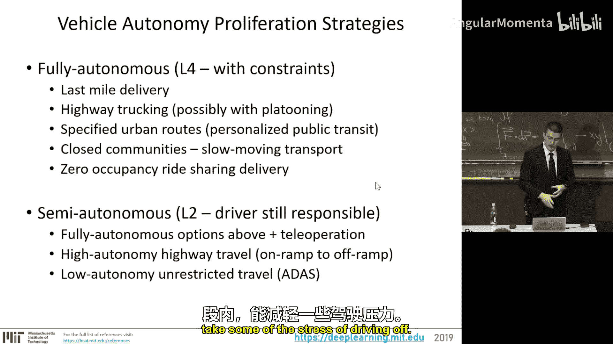
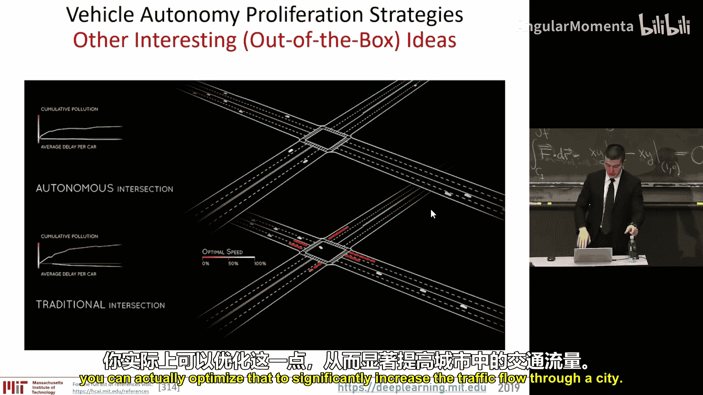
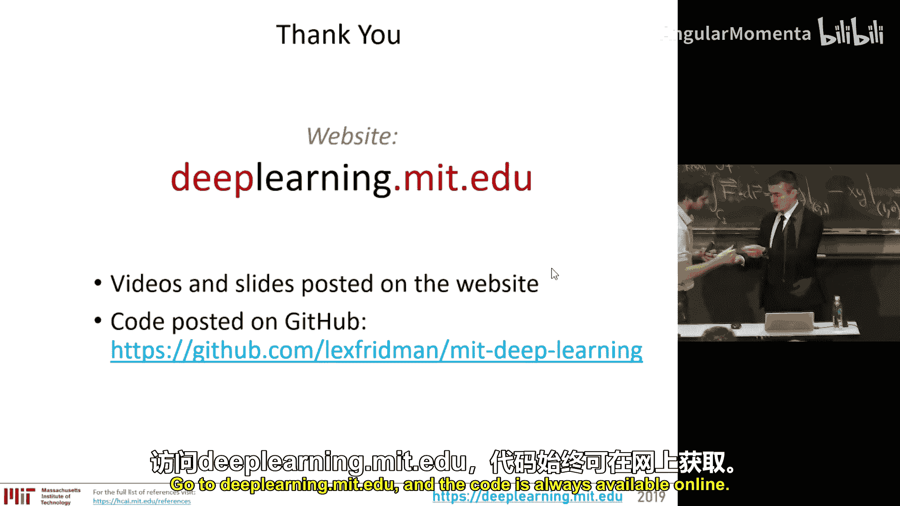

# 【麻省理工】自动驾驶汽车-｜-Self-Driving-Cars-p01-01-自动驾驶汽车：技术前沿（2019）--BV13tq2B3EMH_p1-

Today， I'd like to talk about the state of the art of autonomous vehicles， how I see the landscape。

 how others see the landscape， what we're all excited about。

 ways to solve the problem and what to look forward to in 2019 as we also get to hear from the different perspectives from the various leaders and industry and autonomous vehicles in the few next couple of weeks and the next few days。

So the problem， the mission， the dream， the thing that we're trying to solve。For many。

 it may be about entrepreneurial possibilities of making money and so on。 But really。

 it's about improving access。To mobility， moving people around the world that don't have that ability。

 where they has to do with age or purely access of where you live。

We want to increase the efficiency of how people move about。

 the ability to be productive in the time we spend in traffic and transportation。

One of the most hated things in terms of stress and motion。

The thing in our lives that if we could just with a snap of a finger remove is traffic。

 so the ability to convert that into efficiency into a productive aspect into a positive aspect of life and really the most important thing。

 at least for me and for many of us working in the space is to save lives。

 prevent crashes that lead to injuries， prevent crashes that lead to fatalities， here's a counter。

 every 23 seconds， somebody in the world dies in a car， auto crash。It should be a sobering。

It is for me， thing that I think about every single day。 You go to bed， you wake up。

 you work on all the deep learning lessons， all the all the different papers we're publishing。

 Everything we're trying to push forward is really to save lives at at the beginning。 And at the end。

 that is the main goal。So with that groundwork， with that idea。

 with that base of mission that we're all working towards from the different ideas and different perspectives。

I would like to review what happened in 2018。So， first。

Waimo has done incredible work in deploying and testing their vehicles in various domains and having October reached the mark of 10 million miles German autonomously。

 which is an incredible accomplishment， is truly a big step for fully autonomous vehicles。

In terms of deployment。And obviously it growing and growing by day。

 and we'll have Jaer here from Waymo to talk about their work there。 then on the L2。

 on the semiautonommous side， that's the pair， that's the mirror side of this equation。

The other incredible number that's perhaps less talked about is the 1 billion mile mark reached by Tesla in the semi-autonomous driving of autopilot Now autopilot is a system that's able to control its position in the lane。

 center itself in the lane is able to control the longitudinal movement。

 So not follow a vehicle when there's a vehicle in front and so on。

 But the degree of its ability to do so is the critical thing here is the ability to do so for many minutes at a time。

 even hours at a time， especially on highway driving。 that's the critical thing。

 And the fact that they've reached 1 billion with a B miles is an incredible accomplishment。

 All of that from the machine learning perspective is data。

That's data and all of the autopilot miles are driven with the primary sensor being a camera。

 that says computer vision。And how does computer vision work in the modern day？

Especially with the second iteration of autopoo hardware。 there's a neural network。

 There's a set of neural networks behind it。 That's super exciting。 That is probably the largest。😊。

Deployment of neural networks。In the world that has。A direct impact and a human life。

That's able to decide， that's able to make life critical decisions many times a second。

 over and over。 That's incredible。 You go from the step of image classification on INe and you sit there with a Tensorflow and you're very happy that you're able to achieve a 99。

3 accuracy with a state of the R algorithm。 you take to take from that a step towards。

 there's a human life。😊，Your parents。Driving your grandparents， driving this your children。

 driving this system， and there's a neural network making the decision of whether they live。

 so that1 billion mark is an incredible accomplishment。And on the sobering side。

And from various perspectives， the fatalities， there's been two fatalities that happened in March of 2018。

One in the fully autonomous side of things with Uber in Tempe， Arizona， hitting a pedestrian。

And leading to a pedestrian fatality。And on the semi autotonnomous side with Tesla autopilot。

 the third fatality that Tesla autopilot led to。And the one in 2018 is in Mountain View， California。

 when Tesla slammed into a divider killing his driver。Now。

 the two aspects here that are sobering and really important to think about as we talk about the progression of autonomous vehicles。

Proliferation in our world is our response as a public。

 is from the general public to the engineers to the media and so on。

 how we think about these fatalities。 And obviously。

 there's a disproportionate amount of attention given to these fatalities。

 And that's something as engineers， you have to also think about that the bar is much higher on every level in terms of performance。

So in order to success， as I'll argue， in order to design successful autonomous vehicles。

 those vehicles will have to take risks。And when the risks don't pan out。The public。

If the public doesn't understand。The general problem that we're tackling， the goal， the mission。

 that those risks when they don't the the risks that are taken。

Can have significant detrimental effect to the progress in this autonomous vehicle space And so that's something we really have to think about That's our role as engineers and so on Que yeah so the question was do we know the rate of fatalities per mile of vehicle driven which is at the crudeest level how people think about safety so there's about 8090100 million miles driven in manually controlled cars at every fatality so one fatality per depending on which numbers you look at 80 to 100 million miles and the Tesla vehicle for example。

 is the fatality is well we can just take the 1 billion and divided by three。Now。

's it's apples and oranges in comparison。 And that's something actually that we're working on to make sure that we compare it correctly。

 compare the the aspects of manual miles that directly。Are comparable to the autopilot miles。

 so autopilo is a modern vehicle that's much safer。

 Tesla is a modern vehicle that's much safer than the general population of manually driven vehicles。

 autopilo is driven on only particular kinds of roads on the highway， primarily most of the miles。

 the kinds of people that drive autopilot all these kinds of factors need to be considered when you compare the two。

 but when you just look at the numbers， Tesla autopilo is three times safer that manually driven vehicles。

But that's not the right way to look at it。 and for anyone that's ever taken a statistics class。

 three fatalities is not a large number by which to make any significant conclusions。Nevertheless。

 that doesn't stop the media， the New York Times and everybody from responding to a single fatality。

Which PR and marketing aspects of these different companies are very sensitive to。Which is。

 of course， troubling and concerning for an engineer that wants to save lives。

But it's something that we have to think about， okay， 2018 in review continued。The。

 there's been a lot of announcements or。Rather， actual launches of public testing of autonomous taxi services。

 So companies that on public roads。Have been delivering real people from one location to another Now there's a lot of caveats in many of these cases。

 it's very small scale， just a few vehicles， in most cases it's very low speed and a constraint environment in a constrained community and almost always really always with a safety driver。

 there's a few exceptions for demonstration purposes。

 but there's always an actual driver in the seat。Some of the brilliant folks representing these companies will speak in this course。

Theres voyage doing in an isolated community， awesome work they're doing in villages in Florida。

 Opimus ride here in Boston， doing and the community and Union Point。Drive AI in Texas。

 main mobility expanding beyond Detroit， but really most operations in Detroit。

 Waymo has launched its service， Waymo one that's gotten some publicity in Phoenix， Arizona。

That Ne doing zero occupancy deliveries of groceries autonomously。

 So we didn't say has to be delivering humans， delivering groceries autonomously。 Uber is。

Quietly or not so quietly resumed its autonomous vehicle， taxi service testing in Pittsburgh。

In a very careful constraint。Way， active。After acquiring。Carling Yma is in Utonomy。

Has been doing extensive， large scale。Taxi service testing everywhere from Vegas to Boston here to Pittsburgh and in Singapore。

 of course。Aurora， that。Spoke here last time the head of Tesla Autopilo that launched Aurora and Chris Hermsson behind this young upstart company is doing testing in San Francisco in Pittsburgh。

 and then Cruz Kyle will be here to talk from GM is doing testing in San Francisco。

 Arizona and Michigan。So when we talk about predictions。

 I'll talk about a few people predicting when we're going to have autonomous vehicles。

And when you yourself think about what it means， when will they be here？

When will autonomous vehicles arise， such that that Uber that you call will be autonomous and not with populated by a driver。

The thing we have to think about is what we think about how we define autonomous。

 what that experience looks like。And most importantly， in these discussions。

 we have to think about scale。So we here at MIT， our group， MIT Human centered Autonomous vehicle。

 we have a fully autonomous vehicle that people can get in if you would like and it will give you a ride in a particular location。

But that's one vehicle。 It's not a service， and it only works on particular roads。

 It's extremely constrained。 In some ways， it's not much different than most of the companies that we're talking about today。

Now scale here， there's a magic number， I'm not sure what that is。

 but for this the purpose of this conversation it says 10。

000 where there's a meaningful deployment when it's truly going beyond that prototype demo mode。

To where everything is under control， to where it's really touching the general population in a fundamental way。

 scale is everything here。 And it starts， let's say， at 10000， just to give you for reference。

 there's 46000 active Uber drivers in New York City。 So that's what 10000 feels like some you know。

25，30% of the Uber drivers in New York City， all of a sudden are。becomee。Passengers。

So the predictions。I'm not a marketing PR person， so I don't understand why everybody has to make a prediction。

 but they all seem to。Although major automakers have made a prediction of when they'll have when they will be able to deploy autonomous vehicles。

Tesla has made in early 2017。A prediction that will have autonomous equals 2018 in 2018。

 theyve now adjusted the prediction to 2019， Nissan Honda。

 Toyota have made prediction for 2020 under certain constraints in Highway， Uban。

 Hyundai and Volvo has in 2021 with BMW and Ford， Ford saying at scale。

 so a large scale deployment in 2021， and Christ in the 21 and Diler saying in the early 20s。

 so there is the。The predictions that are extremely optimistic， that are perhaps driven。

By the instinct that the company has to declare that they're at the cutting edge of innovation and then there is many of the leading engineers behind the leading these teams。

 including Carl and Yama and Gil Pratt from MIT who injects a little bit of，Caution and grounded。

Ideas about how difficult it is to remove the human from the loop of automation。

 so Carl says that basically teleoperation kind of gives this analogy of an elevator， you know。

 and the elevator is fully autonomous， but there's still a button to call for help if something happens。

And that's how he thinks about autonomous vehicles。

 even with greater and greater degree of automation。

 there's still going to have to be a human in the loop。

 There's still going to be a way to contact a human to get help。 And Gil Pratt and Toyota。

 and they're making some announcements A C yes， basically saying that the human in the loop is the fundamental aspect that we need to approach this problem and removing the human from consideration is really。

 really far away。And Guil， who's historically and currently。

 is one of sort of the great roboticists in the world that defined a lot of the DARPA challenges and a lot of our progress。

 historically speaking up to this point。So they really the full spectrum。 we can think of it as the。

The Elon Rodney spectrum of， of optimism versus pessimism。 the Elon Musk。

 who's extremely bold and optimistic about his predictions。

I often connect with this kind of thinking because sometimes you have to believe the impossible is possible in order to make it happen。

And then there is Rodney， one also one of the great roboticists。

 the former heads of C cellll of the AI laboratory here， is a little bit on the pessimistic side。

 so for Elon， the fully autonomous vehicle will be here in 2019 for Rodney。

 the vehicles are really fully autonomous or beyond 2050。

 but he believes in the 30s there will be a significant。

A major city will be able to allocate a significant region of significant region of that city where manual driving is fully banned。

 which is the way he believes those vehicles autonoous vehicles really proliferate when you ban manuallyly driven vehicles in certain parts and in the 40s。

 2045 or beyond。Majority of US cities will ban manually driven vehicles。 Of course， the。

 the quote from Elila Musk in 2017 is that my guess is that in probably 10 years。

 it will be very unusual for cars to be built that are not fully autonomous。

 So we also have to think about the long tail of。The the fact that many people drive cars that are 10 years old。

20 years old。 So even when you have every car is built that's fully autonomous。

 it's still going to take time for that dissipation of vehicles to happen。 And so my own view。

 beyond predictions。To to take a little pause into the ridiculous and the fun to explain the view。

Yes， that is me playing guitar in our autonomous vehicle。Now。

 the point of this ridiculous video and embarrassing I should never played it。Yeah， okay。

 I think it's going to be over soon。Now， for those of you born in the 90s， that's classic rock。

So the point I'm trying to make beyond predictions is that autonomous vehicles will not be adopted by human beings in the near term in the next 1015 years because they're safer。

 safety is not going to they may be safer but they're not going to be so much safer that's going to be the reason you adopt It's not going to be because they get you to the location faster。

 Everything we see with autonomy is they're going to be slower until majority of the fleet is autonomous。

 They're cautious and therefore slower and therefore more annoying in the way we think about actually how we navigate this world we take risk we drive assertively with speed over the speed limit all the time that is not how autonomous vehicles today operate so they're not going to get us there faster and for every promise every hope that they're going to be cheaper really they're still significant investment going into them and there is not good economics in the near term of how to。

Make them obviously significantly cheaper。What I think Uber and Lyft has taken over the taxi service because of the human experience in the same way autonomy will only take over if not take over be adopted by human beings。

 if it creates a better human experience， if theres something about the experience that you enjoy the heck out of。

This video and many others that we're putting out shows that the natural language communication。

 the interaction with the car， the ability of the car to sense everything you're doing from the activity of the driver to the driver's attention and being able to transfer control back and forth in a playful way。

 but really in a serious way， also thats personalized to you， that's the human experience。

 the efficiency of the human experience， the richness of the human experience。

 that is what we need to also solve。That's something you have to think about because many of the people they'll be speaking at this class and many of the people that are working on this problem are not focused on the human experience。

 It's a kind of afterthought that once we solve the autonomous vehicle problem。

 it would be fun as hell to be in that car。I believe you first have to make it fun as hell to be in the car and then solve the autonomous vehicle problem。

Jointly。So in the language that we're talking about here。

 there are several levels of autonomy that are defined from level 0 to level 4， levels 0。

 no automation，4 and 5， level 3，4 and 5， increasing automation。

 So level 2 is when the driver is still responsible。 Level 3，4。

5 is when there's less and less responsibility， but really in 3，4，5。

 there's parts of the driving where the liability is on the car。 So there's only really two。

 as far as I'm concerned levels。Human centered autonomy and full autonomy。

 Human se means the human is responsible。 full， Full autonomy means the car is responsible。

Both on the legal side， the experience side and the algorithm side， that means。Full autonomy。

Does not allow ferity operation。So it doesn't allow for the human to step in and remotely control the vehicle。

 because that means the human is still in the loop。

It doesn't allow for the 10 second rule that it's going to be fully autonomous。

 but once it starts warning you you have 10 seconds to take over。 no。

 it's not fully autonomous you cannot guarantee safety。In any situation， it has to be able to。

 if the driver doesn't respond in 10 seconds， has to be able to find safe harbor。

 it has to be able to pull off to the side of the road without hurting anybody else to find safety so that's the fully autonomous challenge。

And so how do we envision these two levels of automation， proliferating society。

 getting deployed at a mass scale， the 10000，10 million beyond。On the fully autonomous side。The way。

To think about it。With the predictions that we're talking about here is there's several different possibilities of how to deploy these vehicles。

One is last mild delivery。Of goods and service like the groceries。

 they uses zero occupancy vehicles delivering groceries or delivering human beings at the last mile。

 what the last mile means is it slow movingov transport to the destination where most of the tricky driving along the way is done manually and then the last mile delivery in the city in the urban environment is done by zero occupancy autonomous vehicles。

Trucking on the highway， possibly with platooning， where a sequence of trucks follow each other。

 So in this， what people think about as a pretty well defined。

Problem of highway driving with lanes well marked， well mapped routes throughout the United States and globally on the highway driving is unmable。

 The specific urban routes， kind of like what a lot of the these companies are working on， defining。

This taxi service and a personalized public transport there's certain pickup locations you're allowed to go to。

 there are certain drop off locations that's it it's kind of like taking the train here。

 but as opposed to getting on the train with 100 other people you're getting or bus。

 you're getting on a car when you're alone or with one other person。The closed communities。

 something Oliver Cameron with Voyage is working on defining and defining and optimous ride。

 defining a particular community that you now have。A monopoly over that you define the constraints。

 you' define the customer base， and then you just deliver the vehicles， you map the entire road。

 you have slow moving transport that gets people from A to B anywhere in that community。And then。

 there's the。The world of zero occupancy ride sharing delivery。

 so the Uber that comes to you as opposed to having you drive it yourself and it comes to you autonomously with nobody in there。

And then you get in and drive it。 So imagine a world where we have empty vehicles driving around。

 delivering themselves to you。 Se autonomous side is。

Thinking about a world where teleop plays a really crucial role where it's fully autonomous under certain constraints in the highway。

 but a human can always step in。High autonomy on the highway。

 kind of like what Tesla is working towards most recently， is' on ramp to all ramp。

 Now the driver is still responsible， liability wise and in terms of just observing the vehicle and algorithmically speaking。

But the autonomy is pretty high level to a point where much of the highway driving could be done fully autonomously and low autonomy unrestricted travel as a driver assistance。

 advanced driver assistance system， meaning that the car kind of like the Tesla of the VolvoS90s or the super crews in the Cadillacs。

 all these kinds of L2 systems that are able to keep you in the lane， you know。

 10 to 30% of the miles that you drive and some fraction of the time take some of the stress of driving off。

And then there is some out there ideas。RightThe idea of connected vehicles。

 vehicle to vehicle communication and vehicle to infrastructure communication。

 enabling us to navigate， for example， intersection efficiently without stopping。

 removing all traffic lights， so here shown on the bottom is our conventional approach of there's a queuing system that forms because the traffic lights that turn red green and yellow and without traffic lights and with communication to the infrastructure between the vehicles。

 you can actually optimize that to significantly increase the traffic flow through a city。

Of course， there's the boring solution。Of tunnels under cities。Layers of tunnels under cities。

Tnels all the way down。Autonomous vehicles。Basically， by the design of the tunnel。

 constraining the problem to such a degree that anomy I mean。

 the idea of autonomy just is completely transformed。

 that you're basically a car is able to transform itself into a mini train into a mini public transit entity for a particular period of time。

 so you get into that tunnel， you drive a 200 miles an hour and not necessarily drive。

 be driven 200 miles an hour and then you get out of the tunnel。Of course， there's the flying cars。

 personalized flying car vehicles， I will not， I mean。Rodney， as I mentioned before。

 does believe that we'll have them in 2050， there's a lot of people that are seriously actually thinking about this。

 this problem is there's a level of autonomy obviously that's required here for a regular person。

Like， I don't know， somebody without a pilot's license， for example， to be able to take off and land。

 you know， making that experience。Accessible to regular people means that there's going to be a significant amount of autonomy involved。

 one of the people really one of the companies really seriously working on this is Uber with the Uber elevate。

 Uber Air， I think it's called and the idea is that you would meet your vehicle not on the street。

 but at roof take elevator I at the roof of the。Of a building， this this video is from， from Uber。

 and they're seriously addressing this problem。Many of the great solutions to a world's problems have been laughed at at some point。

So let's not laugh too loud at these possibilities。Back in my day， we used to drive in the street。

10000 vehicles。If that's the bar， I sort of out of curiosity， asked to a little public poll。

3000 people responded。Asked who who will be first to deploy 10000 fully autonomous cars operating。

On public roads without a safety driver。And several options percolated with Tesla getting 50%。

 57% of the vote， and Waymo getting 21% of the vote and 14% someone else and 8% the Caruddgegens and the engineers saying no one in the next 50 years will do it。

And again， in 1998， when Google came along， the leaders of the space were Ask Jees and the infose and excite all services I've used and probably some people in this room have used LO Yahoo。

Obviously， they were the leaders in the space and Google disrupted that space completely。

 so this poll shows the current leaders， but it's wide open to ideas and that's why there's a lot of autonoous fe companies some companies are taking advantage of the hype and the fact that there's a lot of investment in the space but some companies like some of the speakers visiting this course are really trying to solve this problem。

 they want to be the next Google the next billion multi-billion next trillion dollar company by solving the problem so it's wide open but currently Tesla with the semi-eatonnomous vehicle approach working towards trying to become fully autonomous and way most starting with a fully autonomous working towards achieving scale at the fully autonomous are the leaders in the space。

Given that。Ranking in 2019， let's take a quick step back to 2005 with the DRPA challenge when this story began。

 The race to the desert when Stanley from Stanford won a race to the desert。

That really captivated people's imagination of what's possible。

 And a lot of people have said that the autonomous vehicle problem is solved in 2005。

 They really said， you know， the idea was especially because in 2004， nobody finished that race。2005。

 four cars finished the race。 It was like， well， we cracked it。 This is it。

And then you know some critics said that urban driving is really nothing comparable to desert driving desert。

 it's very simple， there's no obstacles and so on， it's really a mechanical engineering problem。

 it's not a software problem， it's not a fundamentally it's not really an auto timeous driving problem as it would be delivered to consumers and of course in 2007。

 theRP DARPA put together urban Grand challengell and several people finished that with CMUs boss winning and so。

The thought was at that point， that's it， we're done as Ernest Rutherford a physicist said that physics is the only real science。

 the rest is just stamp collecting all the biology chemistry， certainly boy。

 I wouldn't want to know what he thinks about computer science。

 it's just all the stupid sillyity details， physicsic is the fundamentals and that was the idea with the DARPA Grand challenge in solving that that we solved the fundamental problem of autonomy and the rest is just for industry to figure out some of the details of how do we make an app and make a business out of it。

So that could be true in the underlying beliefs there is that driving is an easy task that you know it's solvable the thing that we do as human beings that it's pretty formalizable。

 it's pretty easily easy to solve with autonomy that the other idea is that humans are bad at driving。

 this is a common belief not me， not you， but everybody else， nobody in this room。

 but everybody else is a terrible driver， that kind of intuition that we have about our experience of traffic leads us to believe that humans are just really bad at driving。

 and from the human factors， psychology side， there's been。

Over 70 years of70 years of research showing that。Humans are not able to monitor， maintain vigilance。

 monitoring a system。 So when you put a human in a room with a robot and say watch that robot。

 they they start texting like 15 seconds in。 So that's the fundamental psychology。

 There's thousands of papers on this。 people are they tune out， they overtrust the system。

 they misinterpret the system and they lose vigilance。 Those are the three underlying beliefs。

 They very well could be true。But what if it is not， so we have to consider that it is not。

The driving task is easy because if you think the driving task is easy and formalizable and solvelvable by autonomous vehicles。

 you have to solve this problem。The subtle vehicle to vehicle。

 vehicle to pedestrian and nonverbal communication that happens here in a dramatic sense。

 but really happens in a subtle sense。Millions of times every single day in Boston， subtle。

 nonverbal communication between vehicles。You go， no， you go。

You have to solve all the crazy road conditions where in a split seconds。

 you have to make a decision about， so in snowy， icy weather， rain， limited visibility conditions。

 you have 100， 200 milliseconds to make a decision。

 your algorithm based on the perception has to make a control decision。

And then you have to deal with the nonverbal communication with pedestrians。

these unreasonable irrational creatures， us human beings。

 you have to not only understand what their the intent of the movement that that's this anticipatedated。

 So anticipating in the trajectory of the pedestrian。

 you also have to assert yourself in a game theoretic way as as crazy it might sound。

 you have to threaten yourself。 you have to take a risk。

You have to take a risk that if I don't slow down， like that ambulance didn't slow down。

 that the pedestrian will slow down。Algorithmically， we're afraid to do that。

The the idea that a pedestrian that's moving， we anticipate their trajectory based on the simple physics of the current velocity of the momentum they're going to keep going with some probability。

 the fact that by us accelerating we might make that pedestrian stop is something that we have to incorporate into algorithms and we don't to date so that and we don't know how to really。

So if driving is easy， we have to solve that， too。 and of course。

 the thing I showed yesterday were the coast runners and the boat going around。And all the。

Ethical dilemmas from the moral machine to the more serious engineering aspects that from the unintended consequences that arise from。

Having to formalize the objective function under which a planning algorithm operates。

 there's any learning that， as I showed yesterday， a boat on the left or by a human wants to finish the race。

 the boat on the right figures out that it doesn't have to finish the race。

 it can pick up turbos along the way and gets much more reward so if the objective function is to maximize the reward。

 you can slam into the wall over and over and over again and that's actually the way to optimize the reward and those are the unintended consequences of an algorithm that has to be formalizable into the objective function without a human in the loop。

Humans are bad at drivings as showed yesterday。Humans， if they're bad at anything。

 it's about having a good intuition about。What's hard and what's easy？

The fact that we have 540 million years worth of data on our visual perception system means we don't understand how damn impressive it is to be able to perceive and understand the scene and split second。

 maintain context， maintain an understanding of performing all the visual localization tasks about anticipating the physics of the scene and so on。

And then there's a control side that humans don't give enough credit to ourselves。

 We're incredible a state state of the art。Soccer player on the left。

And the state of the arts robot on the right。嗯。Yeah。I think， I think there's。Like。

Four or five times his scores。All right。And that's all the movement and so on involved with that。

 Of course， here， that's the human robot。 that's a really incredible work that's done for the DARPA robototics challenge with the human robots on the right and incredible work by the the human people doing the same kind of tasks。

 much more impressive tasks， I would say， so。😊，That's where we stand。

 and the ones on the right are actually not fully autonomous。 There's still some human in the loop。

 There's just noisy， broken communication。 So that humans are incredible in terms of our ability to understand the world and in terms of our ability to act in that world。

And the fact that humans， the idea， the view， the popular view grounded in the psychology that humans and automations don't mix well over trust。

 misunderstanding， loss of vigilance derement， and so on。That's not an obvious fact。

 It happens a lot in the lab。 Most of the experiments are actually in the lab。

 This is the difference。 you put， you put many of you。

 you put an undergrad grad student in a lab and say， here。

 watch this screen and wait for the dotto here。They， they'll tune out immediately。

 But when it's your life and you're on the road， it's just you in the car。

 It's a different experience。 It's not completely obvious that vigilance will be lost。

 and it's not a complete。When it's just you and the robot。

 it's not completely obvious what the psychology， what the intentional mechanism。

 what the vigilance that it looks like， So one of the things we did is we instrumented hear 22 Teslas and observe people now over a period of two years of what they actually do when they're driving on a pilot driving these systems in red shown manually controlled vehicles in Can。

Showed vehicle control autopilot。 Now there's a lot of details here。

 and we have a lot of presentation on this。 but really， the fundamentals are， is that they drive 34%。

 large percentage of the miles in autopilot。And in 26，000。Moments。Of transfer of control。

There you are always vigilant。 There's not a moment once in this data set where they respond too late。

To， to a critical situation， to a challenging growth situation。 Now， the data set，22 vehicles that's。

Po1% or less than the full Tesla fleet that has autopa。 but it's still an inkling。

 It's not obvious that it's not possible to build a system that works together with a human being。

And that system essentially looks like this， some percentage， 90%， maybe less， maybe more。

When it can solve the problem of autonomous driving， it solves it， and when it needs human help。

 it asks for help， that's the trade off， that's the balance。On the fully autonomous side。

 On the right， it has to solve here with citations。And there's reference as always on the bottom。

All the problems have to be solved exceptionally， perfectly。

From mapping localization to the scene perception to control to planning to being able to find safe harbor at any moment to also being able to do external HMI communication with the other pedestrian as a vehicles in the scene and then there's teleop vehicle to vehicle vehicle to eye。

 you have to solve those perfectly if you want to solve the fully autonomous problem， as I said。

 including all the crazy things that happen in driving， and if you approach the shared autonomy side。

 the semi-autonnomous where you're only responsible for a large percentage but not 100% of the driving。

 then you have to solve the human side， the human interaction。

 the sensing what the driver is doing the collaborating and communicating with the driver and the personalization aspect that learns with the driver。

we as I said， you can go online we have a lot of demonstrations to these kinds of ideas。

 but the natural language， the communication I think is critical for all of us as we're tweeting as all of us do。

在对。对。So it's as simple as so this is just demonstration of vehicle taking control when the attention over time。

The driver is being this。Okay， we got it， thank you。And。Okay， so basically smartphone use。

 which has gone up year by year。 And we're doing a lot of analysis on that。

 it's really what people do in the car is they use their phone。

 whether it's manual or autonomous driving or semi autotonommous driving。

 So being able to manage that to communicate with a driver about when they should be paying attention。

Which may not be always， you're sort of balancing the time when is it a critical time to pay attention when it's not and communicating effectively。

 learning with the driver， that problem is a fundamental machine learning problem。

 there's a lot of data， visible light， everything about the driver。

 and it's a psychology problem So we have data， we have human complicated human beings and it's a human robot interaction problem that deserve solving。

But as you'll hear on the。Beyond the human side， looking， looking out into the world。

 people that are trying to solve the fully autonomous vehicle。

 It's really a two approach consideration。 One approach is vision， cameras。And deep learning。

Collect a huge amount of data。 So cameras have this aspect that they're the highest resolution of information available。

 It's rich texture information。And there's a lot of it， which is exactly what neural networks love。

 right， So to be able to cover all the crazy edge cases。The vision data， camera data。

 visible light data is the exactly the kind of data you need to collect a huge amount of to be able to generalize over all the crazy countless he cases that happen。

It's also feasible， all the major data sets， the in terms of cost， interest， scale。

 all the major data sets of visible light cameras。That's another pro and they're cheap and the world as it happens。

Whoever designed the simulation that we're all living in made it such that our world。

 our roads and our world is designed for human eyes。Eyes is the way we perceive the world。

 and so the land market is also on as visual most of the road。

Ts that you use to navigate to drive are visible are made for human eyes。

 the cons are that without a ton of data and we don't know how much they're not accurate you make errors because driving is ultimately about 99。

99999% accuracy， and so that's what I mean by not accurate。

 it's really difficult to reach that level。And then the second approach is LiDar。

Taking a very particular constrained set of roads， mapping the heck out of them。

 understanding them fully into of different weather conditions and so on and then using the most accurate sensors available。

 a sweetest sensors， but really Liar at the forefront， being able to localize yourself effectively。

 The pros there that it's consistent， especially when machine learning is not involved。

 it's consistent and reliable。And it's explainable。 if it fails。

 you can understand why you can account for those situations。

 It's not so much true for machine learning methods。

 It's not so much explainable why it failed in a particular situation。

The accuracy is higher as we'll talk about， the cons of LiDar is that it's expensive。

And most of the approaches in perceiving the world using LIDar primarily are not deep learning based and therefore they're not learning over time。

 and if they were deep learning based， there's a reason they're not。

 it's because you need a lot of you't need a lot of LiIDar data and there's only a tiny percentage of cars in the world quite obviously are equipped with LIDAR in order to collect that data。

So quickly running through the sensors radar。Is the。It's kind of like the offensive line of football。

 They're actually the ones that do all the work， and they never get the credit。

So radar is that it's always behind to catch to actually do the detection in terms of obstacle。

 the most critical， safety critical obstacle avoidance is cheap。

 it does extremely well it does well in extreme weather but it's low resolution so it cannot stand on its own to achieve any kind of degree of high autonomy now on the lighter side it's expensive。

 it's extremely accurate depth information， 3D cloud point cloud information， it's resolution。

 it much higher than radar but's still lower than visible light and there is depending on the sensor 360 degree visibility that's built in。

So there's a difference in resolution here， visualized LiDAR on the right。Radar on the left。

 the resolution is just much higher and it's improving and the cost is going down and so on Now on the camera side is cheap Everybody got one。

 the resolution is extremely high in terms of the the amount of information transferred per frame。

And everybody， you know really the scale of the number of vehicles that have this equipped is humongous。

 so it's ripe for application of deep learning。And the challenge is it's noisy。

 it's bad a depth estimation。And it's not good in extreme weather。

So if we kind of use this plot to compare these sensors， to compare these different approaches。

 so LiDar works in the dark variable lighting conditions has pretty good resolution。

 has pretty good range， but it's expensive。It's huge。And。

It doesn't provide rich textual contrast information。

And it's also sensitive to fog and rain conditions Now ultrasonic sensors catch a lot of those problems。

 they're better detecting proximity， they' high resolution and objects that are close。

 which is why they're often used for parking， but they can still also be integrated in the sensor fusion package for an autonomous vehicle。

 they really catch a lot of the problems that radar has， they complement each other well。

And radar cheap。Tiny。Detect speed。And it has pretty good range。But has terrible。Resolution。

 there's very little information being provided。And then cameras。A lot of rich information。

 they're cheap， their small range is great， the best range actually of all the sensors and works in bright conditions。

 but doesn't work in the dark in extreme conditions and it's just susceptible to all these kinds of problems and doesn't detect speed unless you're doing some tricky。

Structure from motion kind of things。 So here's where sense of fusion steps in。 and you。

everybody works together to build an entire picture。 if that's how this plot works。

 you can stack it on top of each other。 So if you look at a suite that， for example， Tesla is using。

 which is ultrasonic radar and camera and you compare it to just Liar and see how these paths compare that actually the suite of camera radar and ultrasonic are comparable to Lidar。

So those are the two comparisons that we have， you have the costly non-machine learning way of LIDar and you have the cheap but needs a lot of data and is not explainable reliable in the near term vision based approach and those are the two competing approaches now of course Wayvos it will talk about they're trying to use both but ultimately the question is who catches who is。

The fail safe。In the semi autotonnomous way， when there's a camera based method。

 the human is the faila。When you say， oh， crap， I don't know what to do， the human catches。

In the fully autonomous mode， is what Waymo' is working on。In others， the fail safefe is LiDar。

 fail safefe is maps。That you can't rely on the human。

 but you know this world so well that if the cameras freak out。

 if there's any of the sensors freak out that you're able to， you have such good maps。

 you have such good accurate sensors that the fundamental problem of obstacle avoidance。

 which is what safety is about is can be solved。 The question is what kind of experience that creates And in the meantime。

 as the people debate try to make money start companies， there's just lots of data for F150。

 still the most popular car in America manually driven cars that' still happening。

 So there's a lot of data happening， semiautonommous cars。

 every company is not releasing more and more。Semi autotonnoommous technology。 So that's all data。

And what that boils down to is the two paths they're walking towards is vision versus LDar L2 versus L4 semieatonommous versus is fully autonomous Tesla on the semitonnomous front has reached 1 billion miles。

 way mod the leader on the autonomous front has reached 10 million miles the pros and cons have outline them one。

 the vision1， the on I'm obviously very excited about and machine learning research is excited about。

 which is fundamentally relies on huge data and deep learning。

 the neural networks that are running inside Tesla and new as it's kind of the same kind of path as Google is taking from the GPU to the GPU Tesla is taking from the NviDdia drive PX2 system sort of more general GPUbased system to creating their own AsI and having a ton of awesome neural networks running on their car。

 that kind of path that others beginning to embrace is really interesting to think about from machine learning engineers。

then people that are maybe more grounded and actually want to really value safety。

 reliability and sort of from the automotive world。

 I think while we need machine learning is not explainable， it's difficult to work with。

 it's not reliable， and so in that sense we have to have a sensor of suite that's extremely reliable。

 those are the two paths。Y， question the， the question is。

There's all kinds of things you need to perceive。 stop signs and traffic lights。

 pedestrians and so on。 Some of them， if you hit them。It's a problem。

 some of them are a bag flying through the air and all have different visual characteristics。

 all have different characteristics for all the different sensors。

 some so LiDar can detect solid body objects camera is better detecting as last year Sasha Arnu talked about I think fog or smoke these are interesting things they might look like an object to certain sensors and not to others。

 but the traffic light detection problem luck with cameras is pretty solved at this point so that's luckily the easy part。

The hard part is when you have a green light and theres a。

DrunkDr drowsy or distracted the4 Ds that knits outlined pedestrian trying to cross what to do。

's that's the hard part。 So the road ahead for us。As engineers， the scientists。

 the thing I'm super excited about the possibility of artificial intelligence having a huge impact is taking this step from。

😊，Having these。Even if they're large。Toy data sets， toy problems， toy benchmarks。

Of imagenet classification in Coco， all the exciting deepR stuff that we'll talk about in the future weeks。

😊，Really， are toy examples， the game of go and chess and so on。

 But taking those algorithms and putting them in cars where they can save people's lives and they actually directly touch and impact our entire civilization。

 That's actually the defining problem for artificial intelligence in the 21st century is。😊。

AI that touches people in a real way。 And I think cars。

 autonomous vehicles is one of the big ways that that happens。 We get to deal with the psychology。

 the philosophy， the sociology aspects of it， how we socially think about it to the robotics problem to the perception problem。

 It's a fascinating space to explore。 And we have many guest speakers， exploring that different ways。

 And that's really exciting to see how these people have tried to change the world。 So。😊，With that。

 I'd like to thank you very much， go to Deep learningarning。mT。edu。

 and the codetiol is available online。

