# 【麻省理工】自动驾驶汽车-｜-Self-Driving-Cars-p02-02-德拉戈·安格洛夫（Waymo）---麻省理工学院自动驾驶汽车--BV13tq2B3EMH_p2-

Alright， welcome back to 6 S0，9，4， Deep learning for self driving cars。 Today， we have Drago Anguov。

 principal scientist at Waymo。😊，Aside from having the coolest name in autonomous driving。

 Drago has done a lot of excellent work in developing。

 applying machine learning methods to autonomous vehicle perception and more generally in computer vision and robotics。

 He's now helping Waymo lead the world in autonomous driving 10 plus million miles achieved。

Autonomously to date， which is an incredible accomplishment。

 so it's exciting to have Drago here with us to speak， please give him a big hand。Hi。

 thanks for having me， I will tell you a bit about our work and the exciting nature of self driving and the problem and our solutions。

So my talk is called Taming the Long Ta of Autonomous driving challengesllenges。

 My background is in perception in robotics so I did a PhD at Stanford with Daphne Cuer and worked closely with one of the pioneers in the space。

 Professor Sebastian Thrron who spent eight years at Google doing research and perception。

 also working on Streetview， developing deep models for detection neuralNe Archs。

I was brieflyed at Zuxs， I was heading the 3D perception team at Zx who built another perception system for autonomous driving。

 and I've been leading the research team at Waymo most recently。

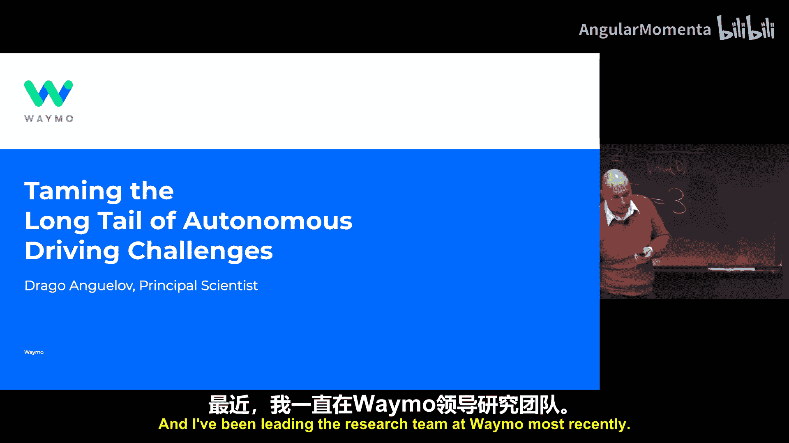

So I want to tell you a little bit about Waymo， when we start。

 Waymo actually this month has its 10 year anniversary。

It started when Sebastian Tan convinced the Google leadership to try an exciting new moonshot。

And the goal that they set for themselves was to drive 10 different segments that were 100 miles long。

And later that year， they succeeded and drove an order of magnitude more than anyone has ever driven。

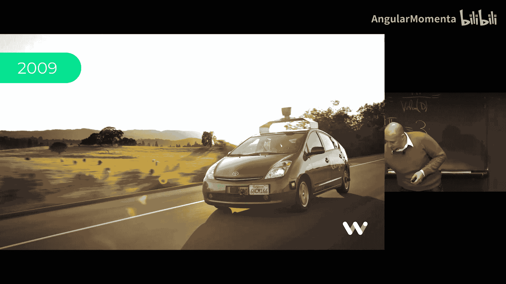

In 2015， we brought this car to the road， it was built ground up as a study in what fully driverless mobility would be like。

In 2015， we put this vehicle in Austin and it completed the world's first fully autonomous ride on public roads and the person inside this car is a fan of the project and he is blind。

So we did not want this to be just a demo fully driverless experience。

 we worked hard and in 2017 we launched a fleet of fully self driving vehicles on the streets in Phoenix Metro area。

And we have been doing driverless， fully driverless operations ever since。

So I wanted to give you a feel for what fully driverless experience is like。여。Yeah。也许。🎼Okay。Yeah。哎。

勉強し。

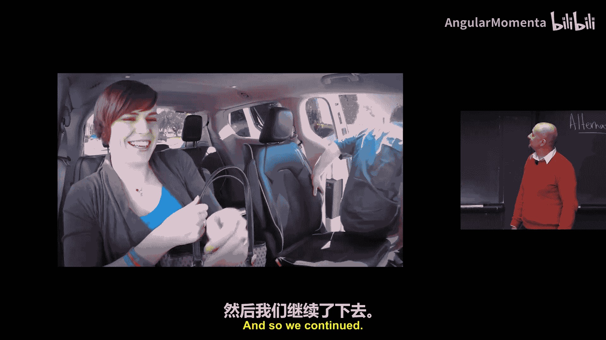

And so we continued。 Last year， We launched our first commercial service in the metro area of Phoenix。

😊，There people can call away on their phone， it can come pick them up and help them with errands so go to school。

And we've been already learning a lot from these customers。

 and we are looking to grow and expand the service and bring it to more people。

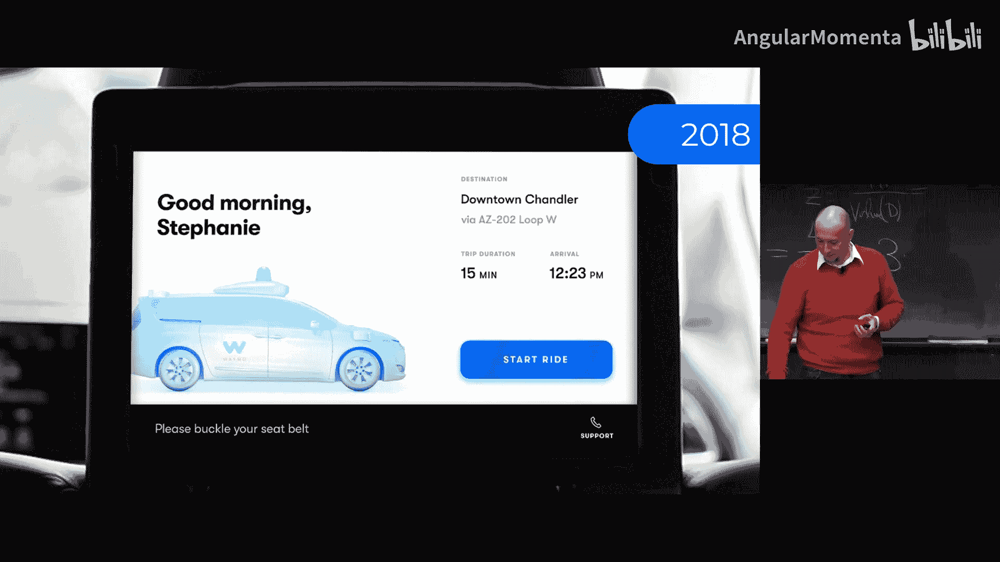

So in the process of drawing the service， we have driven 10 million miles on public road， as Le said。

And driver Lely and more also with human drivers。To collect data。

 and we've driven all kinds of scenarios cities。Capturing a diverse set of conditions and a diverse set of situations on which we develop our systems。

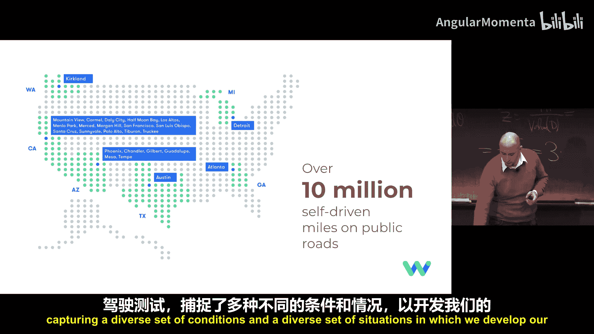

And so in this talk， I want to tell you， I mean， about the long tail of events。

This is all the things we need to handle to enable truly self driverless future and I guess all the problems that come with this and offer some solutions and show you how AM has been thinking about these issues。

😊，So as we drove 10 million miles， of course。We still find scenarios。

 new ones that we have not seen before and still keep collecting them。

 right And so when you think about self driving vehicles， they need to have the following properties。

 First， a vehicle needs to be capable。 It needs to be able to handle the entire task of driving。

So it cannot just subset and remove the human operator from the vehicle。And also， all of these tasks。

 obviously need to do well and safely。And that is the requirement to achieving cell driving at scale。

And when you think about this now， the question is， well。

 how many of these capabilities and how many scenarios do you really need to handle well。

 it turns out， well， the world is quite diverse。😊，And complicated。

 and there is a lot of rare situations， and all of them need to be handled well。

And they call this the long tail。The long tail of situations。

 it's one type of effort to get yourself driving for the common cases。

 and then it's another effort to tame the rest and they really， really matter。😊。

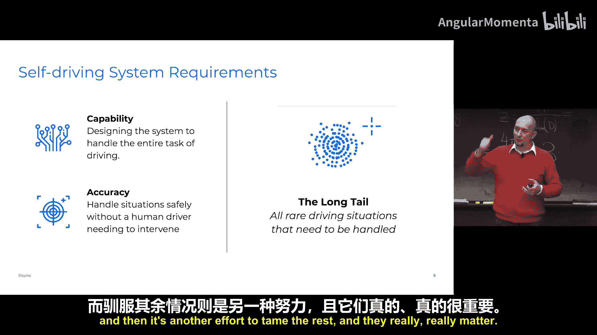

And so I'll show you some。For example， this is us driving in the street。😊。

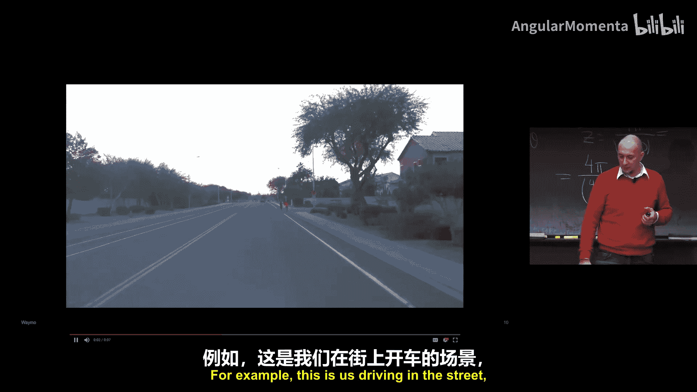

And let's see if you can tell what is unusual in this video。

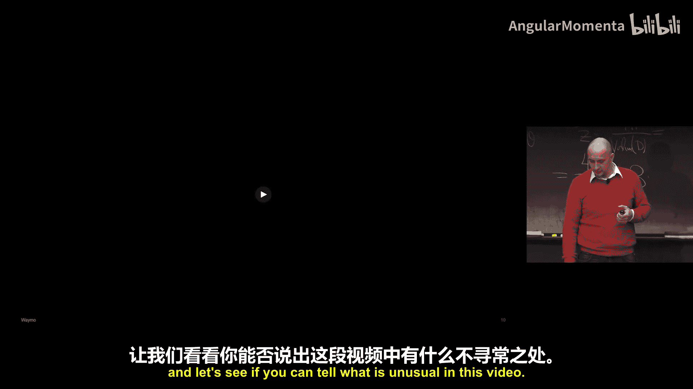

Just see so there's I complete one more time。So there' is a bicyclist and he is carrying a stop sign。

And I don't know where he picked it up， but it's certainly not a stop sign we need to stop for。

 unlike others， right， And so you need to understand that。

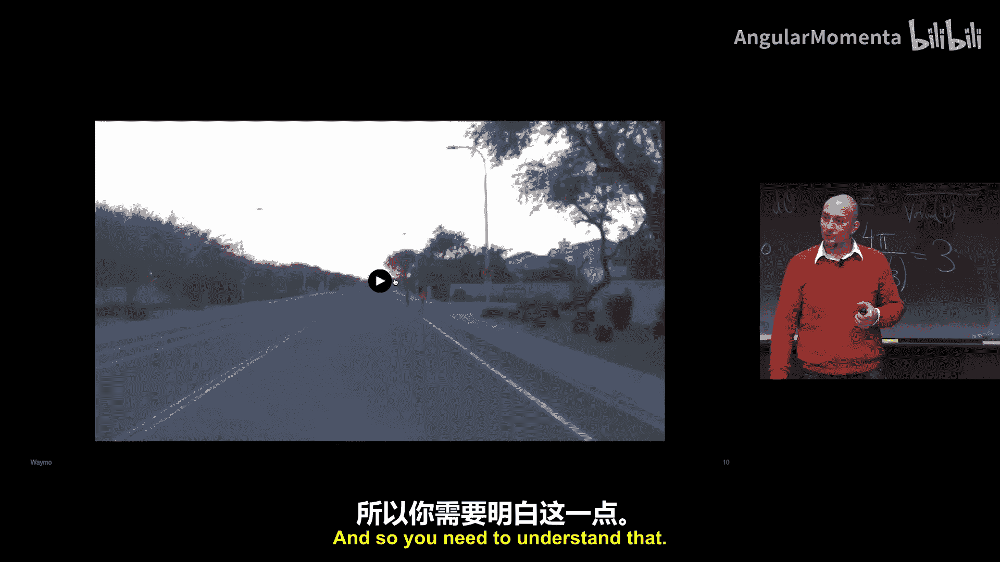

Let me show you another scenario， this is another case where we are happily staying there and then the vehicle stops and a big pile of pulses comes our way right and you need to potentially understand that and learn to avoid it。

😊，Generally， well， different types of objects can fall on the road。 It's not just thoses。

 Here's another interesting scenario。 This is happens a lot。 It's called construction。

 And there's various aspects of it。 One of them is。Someone changed， closed the lane。

 put a bunch of cones， and we'll learn， and this is our vehicle correctly identifying where it's supposed to be driving between all of these cones and successful executing it。

So yeah， we drive for a while。And this is something that is happens fairly often if you drive a lot。

Another case。

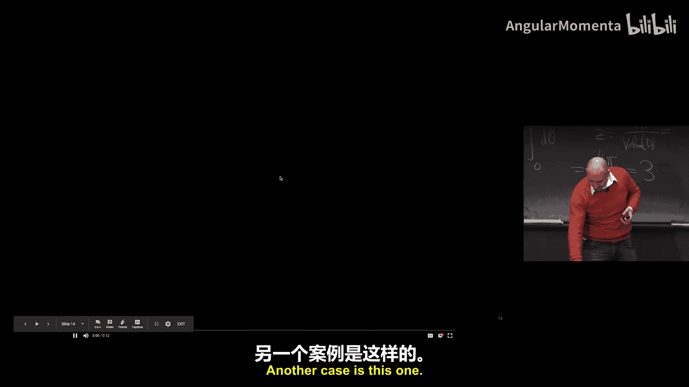

Is this one。I think you can understand what happened here and you can notice actually- so we hear the siren。

So we we have the ability to understand sirens of special vehicles。

 and you can see we hear it and stop， and some guys are much later than us。

Breaking at the last moment， letting the emergency vehicle pass。And here's another scenario。

 potentially， I want to show you。 Let's see if you can understand what happened。So。

Let me play one more time。Did you guys see。So we have stopped that there's a green light。

 we're about to go， and someone goes at high speed running a red light without any remorse。Right。

 and we successfully stop and prevent issues。And so sometimes you have the rules of the way and you have your road and people don't always abide by them。

 and that's something that I don't want to just directly go in front of that person even if they're breaking the law。

So hopefully with this， I convince you that the situations that can occur are diverse and challenging。

 and there's quite a few of them， and I want to take a little bit on the tour of what makes this challenging and then tell you some ways in which we think about it and how we're handling it。

😊，And so to do this， we're going to delve a little bit more into the main tasks for subdriving。

 which is perception， prediction and planning， so I'll tell you a little bit about those。

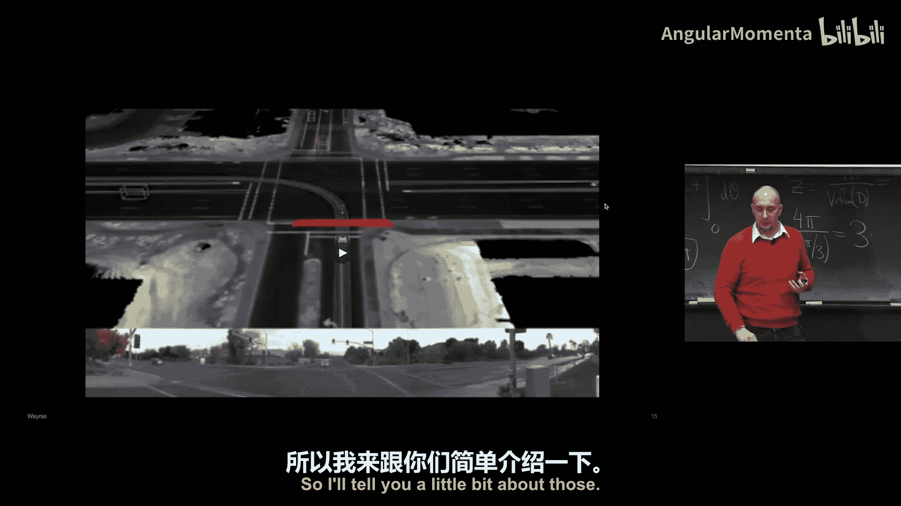

And perception。😊，These are the core AI aspects of the car usually this task there's others。

 we can talk about others as well in a little bit， but let's focus on these first。

 so perception is mapping from sensor inputs and potentially prior knowledge of the environment。😊。

To a senior presentation， and that senior presentation can contain objects， it contains in semantics。

 potentially you construct a map， you can learn about object relationships and so on。😊，And。

Perception， the space of things you need to handle in perception is fairly hard。

 It's a complex mapping， right So you have sensors， the pixels come。

 lighter points come or radar scans come， and you have multiple axis of variability in the environment。

 So obviously， there is a lot of objects。😊，They have different types， appearance pose。

 I don't know if you see this well， there are a bunch of people dressed as dinosaurs in this case people generally are fairly creative in how they dress vehicles can also be different types people come in different poses and we have seen it all right so that's one aspect。

😊，There's different environments that these objects appear in。 So there are times of day， seasons。

Day night， different， for example， highway environment， suburban street and so on。

And then there's a different variability axis。 And this is a little more， slightly more abstract。

 There are different objects can come in these environments in different configurations and can have different relationships。

And so things like occlusion， there's a guy carrying a big。😊，Board， there is reflections， there is。

 well， people riding on horses and so on。And so why am I showing this。

 because I just want to show you the space right So in most cases。

 you care about most objects and most environments in most reasonable configurations。

 And that's a space that you need to map from from the sensor inputs to a representation that makes sense。

 and you need to learn this mapping function or represent it somehow。Right。

And so let's go to the next step， which is prediction。

 So apart from just understanding what's happening in the world。

 you need to be able to anticipate and predict what some of the actors in the world are going to do。

 the actors being mostly people。 and people is honestly what makes driving。Quite challenging。

 This is one of the aspects that do so its you know a vehicle needs to be out there and be a full fledged traffic scene participant。

And this anticipation of agent behavior sometimes needs to be fairly long term。

 So sometimes when you want to make a decision， you want to validate or convince yourself。

 it does not interfere what anyone else is going to do。

 and it can go from one second to maybe 10 seconds or more。 You need to anticipate the future。

So what goes into anticipating the future。Well， you can watch it past behavior， someone' say。

 I'm going this way， maybe I will continue going there。

 maybe I'm very aggressively walking and maybe I'm more likely to do aggressive motions in the future。

High level in semantics。 Well， I'm in a presentation room。 I'm sitting here at front giving a talk。

 I'll probably stay here。And continue， even though stranger things have happened。And。Of course。

 there's subtle appearance skillss。 So for example。

 if a person is watching our vehicle and moving towards them。

 we can be fairly confident theyre paying attention and not going to do anything particularly dangerous。

 If someone's not paying attention or being distracted or。You know。

There is a person in the car waving at us， various gestures， cus， the blinkers on the vehicles。

 these are all signals and subtle signals that we need to understand in order to be able to behave well。

And last but not least， even when you predict how other agents behave。

Agents also are affected by the other agents in the environment as well。

 so everyone can affect everyone else。And you need to be mindful of this。

 so I'll give show an example of this。😊，I think this is one of the issues that really needs to be thought about。

 We are all interacting with each other。

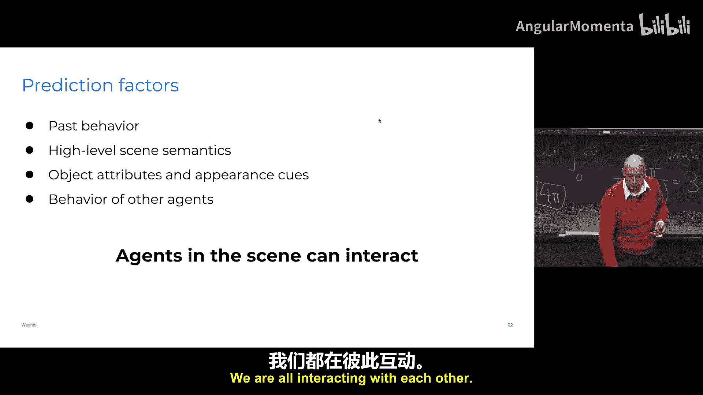

So here's the case our waymo vehicle is driving。😊，And there is two bicyclists in red。

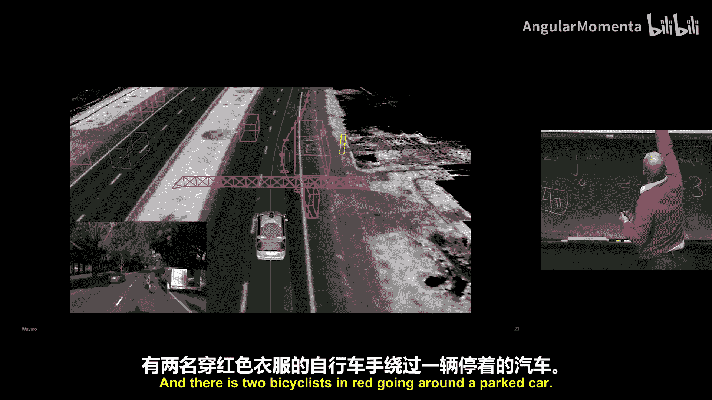

Going around a parked car。And what happens is we correctly anticipate that as they bike。

 they will go around the car and we slow down and let them pass right so we're reasoning that they will interact with the parked car this is the prediction our most likely prediction for the rear bicyclists。

 we anticipate that they will do this and we correctly handle this case so this illustrates prediction。

😊。

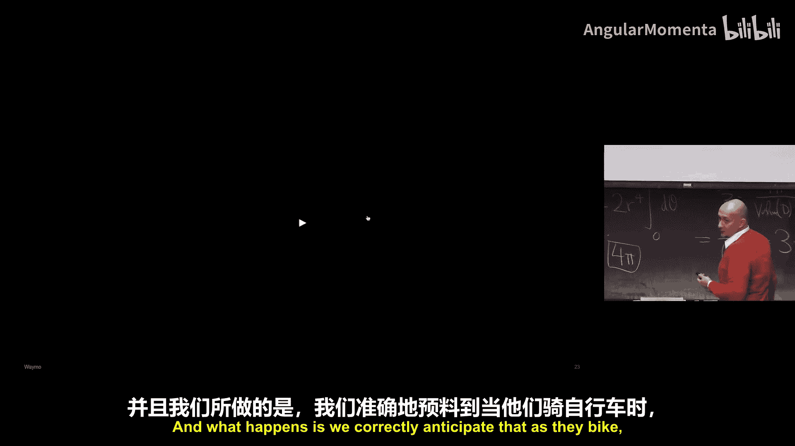

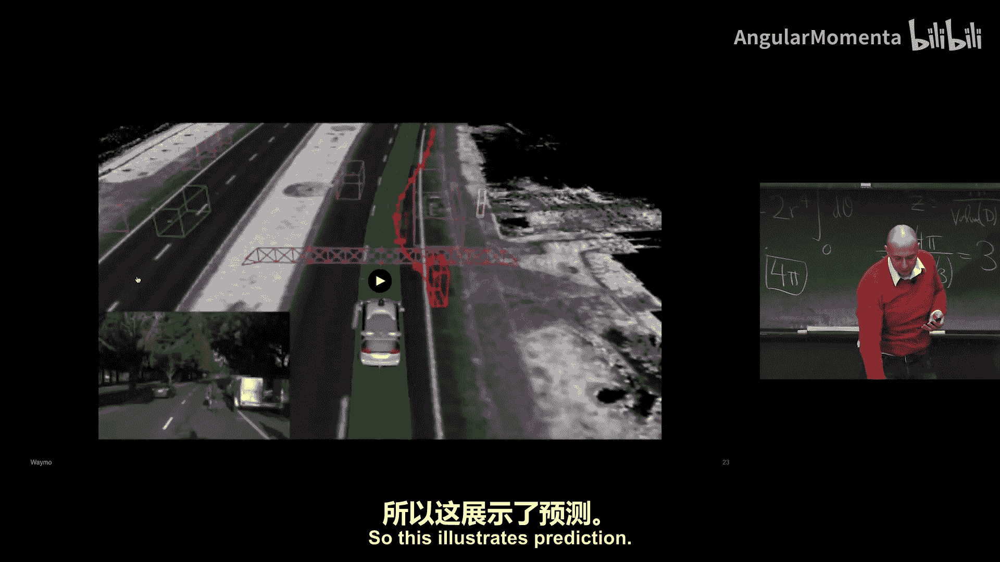

And we have planning。 this is our decision making machine。 It produces vehicle behavior。

 typicallyyically ends up in control commands to the vehicle， accelerate， slow down， steer the wheel。

And you need to generate behavior that ultimately has several properties to。

 And it's important to think of them， which is safe。 Safety comes first。

Comfortable for the passengers。And also sends the right signals to the other traffic participants。

 you because they can interact with you and they will react to your actions so you need to be mindful。

And you need to， of course， make progress。 You need to deliver your passengers。

 So you need to trade all of these in a reasonable way， right， And it， and it can be。

Tly sophisticated reasoning in complex environments。 I show you just one scene。

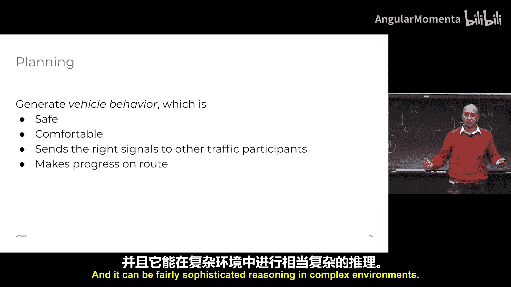

This is this is a complex， I think school gathering， there's bicyclists trailing us。

 vehicles really close the hand within us， a bunch of pedestrians and we need to make progress and here is us we're driving and reasonably well。

😊，In crowded scenes。 And that is part of the prerequisite of bringing this。Technology too。

 the dense urban environments， being able to do。

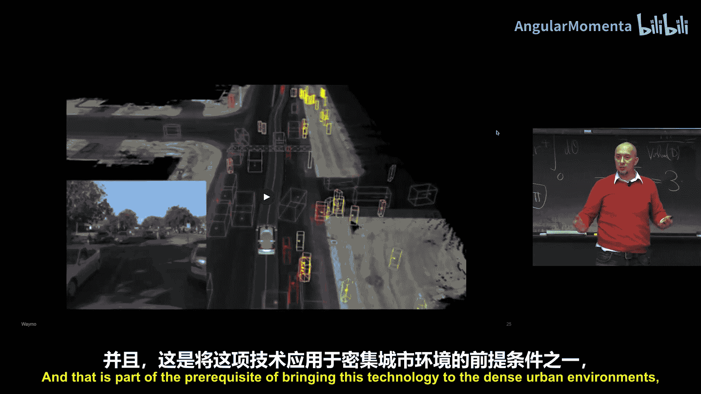

So how are we going do it， I I gave it up， I'm a machine learning person。

 I think when you have these complicated models and systems。

Machine learning is a really great tool to model。Complex actions， complex mapping functions。Features。

RightAnd so we're going to learn our system and we've been doing this， I mean we're not the only one。

 so obviously this is now a machine learning revolution and machine learning is permeating all parts of the way Must stack。

 all of these systems that I'm talking about， it helps us perceive the world。

 it helps us make decisions about what others are going to do， it helps us make our own decisions。😊。

And machine learning is a tool to handle the long tail。 and I'll tell you a little more on this， how。

So I have this allegory about machine learning that I like to think about。

 So there is a classical system， and there is a machine learning system。And to me。

 a classical system， and I've been there， I've done well。

 early machine learning also systems also can be a bit classical。 You're the artisan。

 you're the expert。 you have your tools and you need to build this product and you have your craft and you go and take your tools and build it right and it can fairly quickly get something reasonable。

 but then it's harder to change， It's harder to evolve if you learn new things。

 now you need to go back and maybe the tools don't quite fit and you need to essentially keep keep tweaking it and it starts becoming the more complicated the product becomes the harder it is to do。

😊，And machine learning， modern machine learning。It's like a factory。So machine learning。

 you build the factory。Which is the machine learning infrastructure。

And then you feed data in this factory。And get nice models that solve your problems， right。

 And so kind of infrastructure is at the heart of this new paradigm。You need to build a factory。

Once you do it， now you can iterate， it's scalable， just keep the right data。

 keep feeding the machine， keeps giving it good models。😊。

So what is an ML factory for cell driving models？Well， roughly it goes like this。

We have a software release， we put it on the vehicle。 we are able to drive。 we drive。

 we collect data。😊，We collect it， and we store it。And then we select some some parts of this data and we send it to labelers。

And the labelers label parts of the data that we find interesting。

 And that's a knowledge that we want to extract from the data。 These are the labels， thenotations。

 the results we want for our models。There it is。And then what we're going to do is we're going to train machine learning models on this data。

After we have the models， we will do testing and validation validate that they're good to put on our vehicles。

 And once they're good to put on our vehicles， we go and collect more data。

And then the process starts going again and again。 Allright， so you collect more data。 Now。

 you select new data that you have not selected before，you add it to your dataset。

 youd keep training the model and you iterate， iterate， iterate。 It's a nice scalable setup。

Of course， this needs to be automated， it needs to be scalable itself， it's a game of infrastructure。

😊，Right， and at Waymo， we have the beautiful advantage too。

Be really well set up with regards to the machine learning infrastructure。

 and I'll tell you a bit about its ingredients and how we go about it。

So in one is compute and software infrastructure and we are part of Albet。

 Google and we are able to first of all leverage TensorFlow， the deep learning framework。

 we have access to the experts that throw TensorFlow and know it in depth。

 we have data centers to run large scale parallel compute and also train models we have specialized hardware for training models which you know make it cheaper and more affordable and faster so we can iterate better。

😊，Inreedient2 is high quality label data。 We have the scale to collect and store hundreds and thousands and more miles to millions of miles。

 and just collecting and storeing 10 millions miles is not necessarily。The best thing you can do。

 right， because there is a decreasing utility to the data。

 So most of the data comes from common scenarios and maybe already good at them。

 And that's where the long tail comes， right so it's really important how you select the data。

And so this is important part of this pipeline。 So while you're only release on the vehicle。

 we have a bunch of models， we have a bunch of understanding about the world。

 and can we annotate the data as we go， and we can use this knowledge to decide what data is interesting。

 how to store it， which data we can potentially even ignore。😊，So then once we do that， again。

 we need to be very careful how to select data， we want to select data for examples that are interesting in some way and complement。

 capture these long tail cases that we potentially may not be doing so well on。

 and so you know for this there is we have active learning and data mining pipelines。

 given exampleemprs find the rare examples， look for parts of your system which are uncertain or inconsistent over time and go and label those cases。

😊，Last but not least， we also produce auto labels。 So how can you do that？ Well。

 when you collect data， you also see the future。For many of the objects， what they did。

And so because of that， now knowing the past end the future。

 you can annotate your data better and then go back to your model that does not know the future and try to replicate that with that model。

😊，哎。And so you need to do all of this as part of the system。 ingredient number three。

 high quality models。 We are part of larger alphabet and Google and Deep Mind。 and generally。

 Albet is a leader in AI。 When I was at Google， we were very early on the deep learning revolution。

 I happened to have the chance to be there at the time。😊。

It was 2013 when I got on to do deep learning and a lot of things were not understood and we were there working on it earlier than most people and so through that we had the opportunity and the chance to develop some of the in my time。

 the team I managed to re inventedvent neural net architecture like inception。

 which became popular later we invented at the time， the state of the art object detection。

 fast object detector called SSD。And we won the imageagenet 2014 and now if you go to the conferences Google in Deep Mind。

 the leaders in perception and reinforcement learning and smart agents。

 and there is like state of the art， say semantic segmentation network pose estimation and so on。

 object detection of course goes without saying， and so we collaborate with Google and Deep Mind and projects improving our models。

And so this is my factory for self driving models。 and I want to tell you something that kind of captures all of these ideas。

 infrastructure， data and models in one。😊，This is a project we did recently and today we put online in our blog about automatic machine learning for tuning and adjusting architectures of neural networks。

 so what did we do？So there is a team at Google working on AutoM， automatic machine learning。

And usually networks themselves have complex architecture。 They're crafted by practitioners。

 to artisans of networks in some way。And sometimes， you know。

 we have very high la constraints in the models。 We have some compute constraints。

 The networks are specialized。 It takes often people months to find the right architecture。

 that's most performant， low latency and so on。And so there' is a way toload this work to the machines。

 You can have。Machines themselves， once you pose the problem。

 go and find your good network architecture that's both high low latency and high performance。

RightAnd so that's what we do。 And we drive in a lot of scenarios。

 And we as we keep collecting data and finding new cities or new examples。

 the architectures may change and we want to easily find that and keep evolving that without too much effort right so so we worked with the Google researchers and they had a strong work where they invented well。

 they developed a system that searched the space of architectures and found a set of components of neural networks。

 It's a small subnet called NAS cell。 and this is a diagram of a NAS cell。

 It's a set of layers put together that you can then replicate in the network to build a larger network and they discovered in a small vision data set。

 It was called CR 10。 it's from the early days of deep learning。

 It was a very popular data set and you can quickly trade models and explore the large search space。

😊，So the first thing we did is we took some problems in that we have for our stack。

 one of them being lighter segmentation， so you have a map representation and some lighter points。😊。

And you essentially segment the latter points， you say this point is part of a vehicle。

 that point is part of vegetation and so on。😊，This is a standard problem。

 So what we first did at Waymo is， we explored。Several hundred NAS cell combinations to see what performs better on this task。

And we saw one of two things happened for the various versions that we found。

 one of them is we can find models with similar quality， but much lower latency。😊，And less compute。

 And then there is models that a bit higher quality at the same la。

 essentially we found better models than the human engineers did。

And similar results were obtained for added problems， lane detection。As well。

With this transfer learning approach， of course you can also do intent architecture search。

 so there's no reason why what was found on C4 10 is best suited for our more specialized problems。😊。

And so we went about this。More from the ground up， so let's find exactly a deeper search much much larger space。

Not limited to the NA cells themselves。 And so the way to do this is because our networks are trained on quite a lot of data and take quite a while to converge and it takes some compute。

 we went and define the proxy task。 This is a smaller task simplified but correlates with the larger task and we do this by some experimentation of what would be a proxy task and once we established a proxy task now we execute the search algorithms developed by the Google researchers and so we train up to 10000 architectures with different topology and capacity。

😊，And once we find the top  hundred0 models， now we train the large networks on those models all the way and pick the best ones。

Right。And so this way， we can explore much larger space of network architectures。 So what happened。

 So on the left， this is 4000 different models spanning the scale and latency and quality。😊。

And in red was the transfer model， so after the first round of search actually did not produce a better model than the transfer。

 which already leveraged their insight。So then we took the learnings in the best models from this search and did the second round the search which was in yellow which allowed us to meet it and third0 is。

 we also executed a reinforcement learning algorithm developed by the researchers on 6。

000 different architectures and that one was able to significantly improve on the red dot。

 which also significantly improves in house algorithm。😊，So that's one example where infrastructure。

Data and models combine and and shows how you can keep automating the factory。 That is all good。😊。

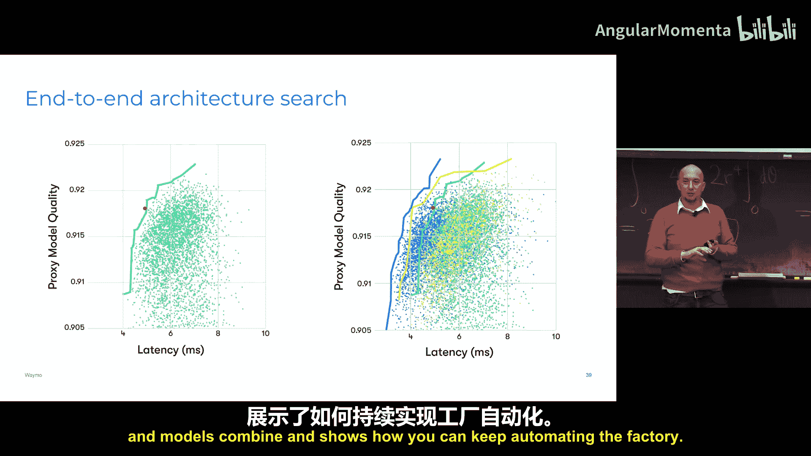

But we keep finding new examples in the world。 And for some situations。

 we have fairly few examples as well。 right And so there are cases where the models are uncertain or potentially can make mistakes。

And you need to be robust to those。 I mean， you cannot put the product and say， well。

 our network just don't handle。Some case。 And it's， so， so we have designed a system to be robust。

 even when M L is not particularly confident and how do you do this。 So one part is， of course。

 you want to done that in complementary sensors。

So we have given 360 degree field of view on our vehicles。

 both in camera lightR and radar and they're complementary modalities。 First of all。

 you know an object is seen in all of them。 second of all。

 they all have different strengths and different modes of failure。😊。

And so whenever one of them tends to fail， the others usually work fine。

 And so that that helps a lot。 make sure we do not miss anything。Also。

 we've designed our system to be a hybrid system。And this is the point I want to make， right？ So。

 I mean， some of these mapping problems or you know。

Problems in which we apply our models are very complicated。

 They high dimensional image has a lot of pixels。 Lier has a lot of light points， right。

 The networks can end up pretty big， and。It may not be so easy to train with very few examples with the current state of the art。

 And so the state of the art keeps improving。 of course。

 So this is their zero short and one shot learning。 But we can also。

 while the state of the art is improving in the models， we can also leverage expert domain knowledge。

 And so what does that do， So humans can。Help develop the right input representations。

 they can put in expert bias that constrains the representation to few parameters that already describe the task and then with that bias。

 it is easier to learn models。😊，With fewer examples。And there is， also， of course。

 experts can put in their knowledge in terms of designing the algorithm。

 which incorporates it as well。 right And so our system is this hybrid。

And so an example of what that looks for perception is。Well。

 no matter if there's cases where the machine learning system may be not confident。

 we still have tracks and obstacles from Ler and radar scans and we make sure that。

We drive relative to those safely。And in prediction and planning， if we are not confident。😊。

In our predictions， we can drive more conservatively。 And over time。

 as the factory is running and our models become more powerful， of course。

 improve and we get more data of all the cases， the scope of al grows。😊，Right。

And the set of cases that you can handle。With it increases。

 And so there's two ways to attack the tail。 You both protect against it。

 but you also keep growing M and making a system more performant。

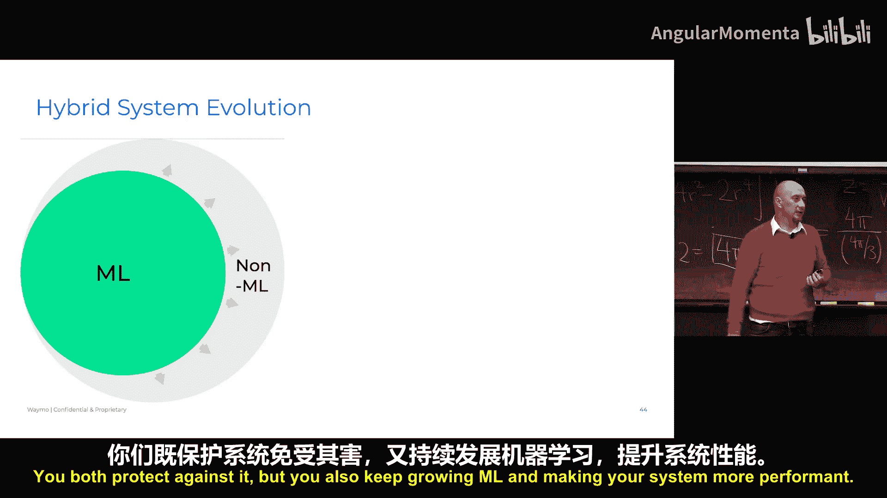

I'm going to tell you now how we deal with large scale testing。Which is another key problem。

 it's very important in the pipeline and also in getting the vehicles on the road。

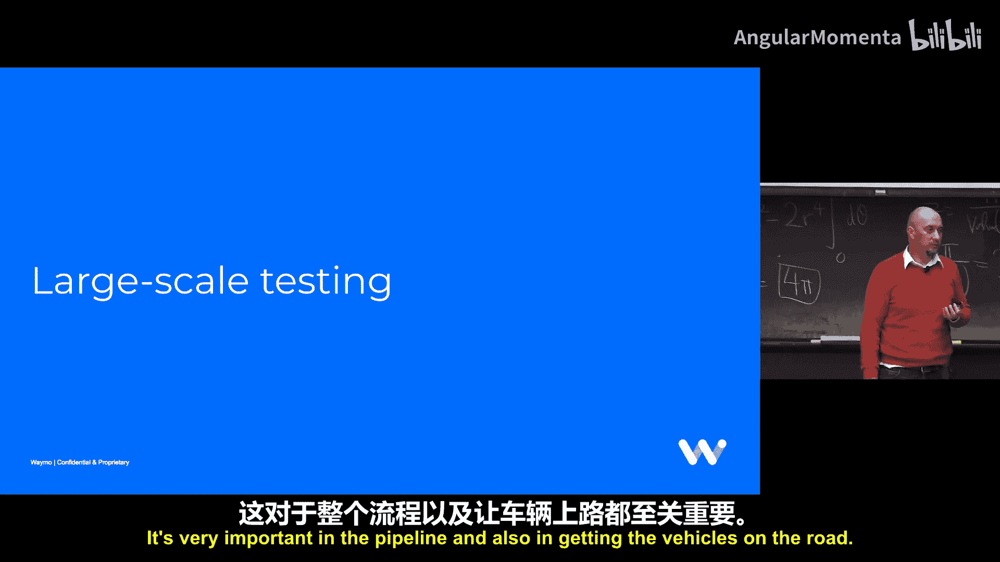

So how do you normally develop a self driving algorithm， Well。

 the ideal thing you're going to do is you make your algorithm change。

And you would put it on the vehicle and drive a bunch and say， now it looks in great。Alright。

 let's make the next one。 The problem is， I mean， we have a big fleet。We have a lot of data。

 but some of the conditions and situations occur very， very rarely。😊，And so if you do this。

 you're gonna to wait a long time。Furthermore， you don't just want to take your code and put it on a vehicle。

 you need to test it even before that， you don't want to like you want very strongly tested code in public streets。

So you can do structure testing， we have a 90 acres Air Force base place where we can test very important situations and situations that occur rarely。

It's an example of。Such a situation and so you can do this as well。

 so you can select and deliberately stage safely。😊，Conditions you care about。Now again。

 you cannot do this for all situations。So what do you do。A simulator。All right。😊。

How much they need to simulate。Well， we simulate a lot， so we simulate the equivalent of 25，000 cars。

 virtual cars driving。10 million miles a day。And7， over 7 billion miles simulated。

It's a key part of our release process。So why do you need to simulate this much？Right， well。

 I hopefully I convinced be there is a variety of。Cases to worry about that you need to test right through so far。

And furthermore， it goes all the way bottom up， so as you change perception， for example。

 slightly different segmentation or detection， the changes can go through the system and you know the results can change significantly and you need to be robust to this you need to test all the way。

😊，So。What to simulate。One thing you can do is。We can create unique scenarios from scratch。

 working with safety experts， NA and analyzing water conditions in which typically lead to accidents。

 so you can do that， Of course you can do it manually， you can create them。What else could you do？

Or you want to leverage your driving data。You have all your logs。

 you have a bunch of situations there。Right。So you can pick interesting situations from your logs。

And furthermore， what you can do is you take all these situations and you。

 and you create variations of these situations。 so you get even more scenarios。😊。

So here's an example of a log simulation。 I'll play it twice， first time look at the image。

 This is what happened in the real world the first time。😊，So in the real world。

 we mostly stayed in the middle lane。And stop。If you see what happened in simulation， simulation。

 our algorithm decided this time to merge to the left lane。😊，And stopped。 And everything was fine。

 Things were safe。Things were happy。

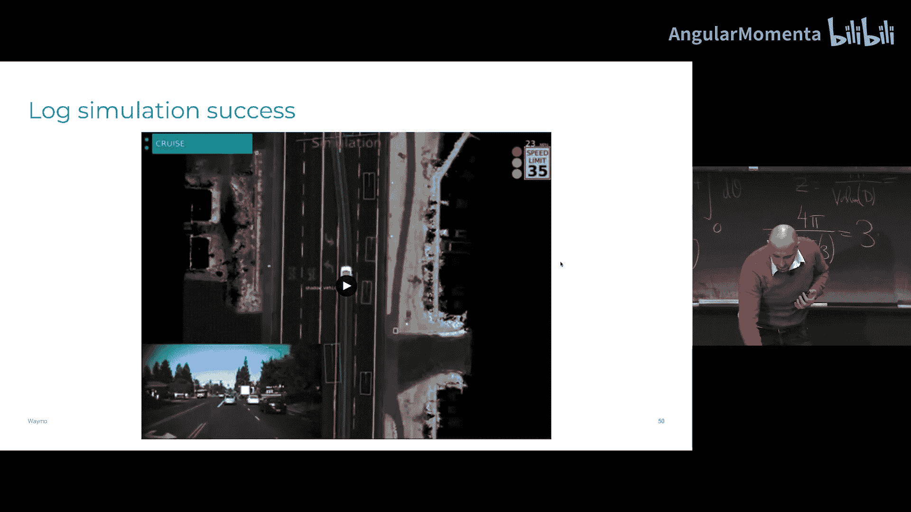

What can go wrong in simulation。From logs。Well， let's say this is another scenario。

 slightly different visualization。 Our vehicle， when it drove the real world。

 was where the green vehicle is。😊，Now in simulation。

 we drop differently and we have the blue vehicle。Right。And so， we're driving。B。What happened？ Well。

 there is a purple agent over there， Pesky purple agent who in the real world saw that we passed them safely。

😊，And so it was safe for them to go， but it's no longer safe because we changed what we did。

 So the insight is in simulation， our actions affect the environment and it need to be accounted for。

😊，So what does that mean？

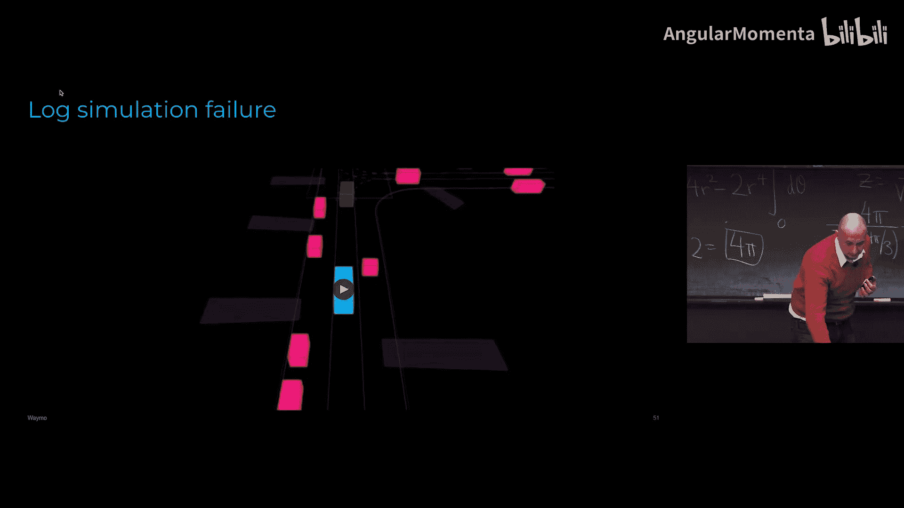

If you want to have effective simulations on a large scale。

 you need to simulate the realistic driver and pedestrian behavior。

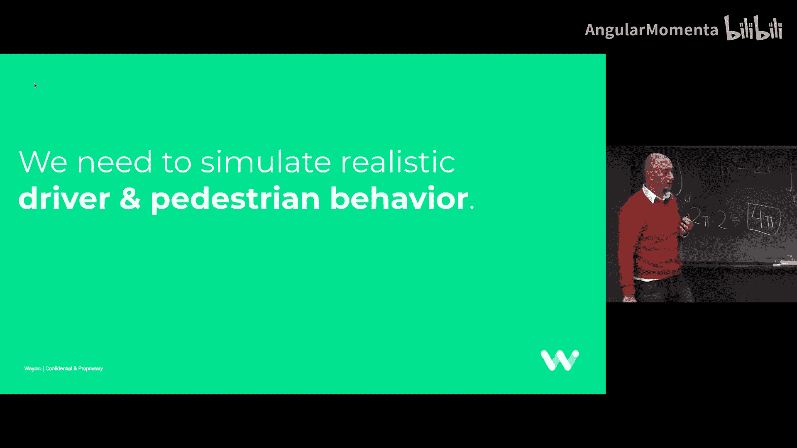

So， you know， you could think of a simple model。 Well。

 how do what is a good proxy or what's a good approximation of a realistic behavior。 Well。

 you can do a break and s model。😊，So you just say， well， there is some normal way reactions happen。

 You know， I have a reaction time and breaking profile and maybe a sving profile。 So if。

 if an agency see someone in front of them， maybe they just apply it as an algorithm。

So hopefully I convinced that behavior can be fairly complicated and this will not always produce a believable reaction。

 especially in complex interactive cases such as merges lane changes， intersections and so on。😊。

Right， so what could you do？You could learn an agent。From real demonstrations。

 well you went and collected all this data in the world。

 you have a bunch of information of how vehicles pedestrians behave。😊。

You can learn a model and use that。Okay， so what is an agent， let's look a little bit。

An agent receives sensory information in maybe context about the environment。😊。

And it develops a policy。 It develops a reaction。 It's a driver agent and applies。

 acceleration is steering， then gets new sensor information， new map information place in the map。

 and it continues。 And if it's our own vehicle， then you also have a router。

 that's explicit intent generator， which says， Well， the passenger wants you to go over there。

 Why don't we try to make a right turn now。 So you also get an intent。😊，And this is an agent。

 you know it could be in simulation， it could be in the real world。

 roughly this is the picture and this is an end to end agent end to end learning is popular right。

 to its best approximation if you learn a good policy this way。

 you can apply it and have very believable agent reactions right。😊。

And so I'm going to tell you a little bit about work we did in this direction。

 So we put a paper on archive about a month ago， I believe。😊，We took 60 hours of footage of driving。

And we try to see how well we can imitate it。Using a deep neural network。Right。

And so one option is to do exactly descent to antigen policy。 But we wanted to make our task easier。

How， well， we have a good perception system at Amo， so why don't we use its products。

For that agent also can simplify the input representation a bit。 That is good。

 It big task becomes easier。Controllers are well understood。 We can use an existing controller。

 So no need to worry about acceleration and toque。 We can generate trajectories。Now。

If you want to see in a little more detail to understand the representation is so we have。

 this is our agent vehicle， which is subdriving vehicle in this case。

 but could be a simulation agent。😊，And we render an image with it at the center。

 and potentially we augment it with some we can generate a little bit of rotation to the image just so we don't overb the orientation in a specific way。

And it's an 80 by 80 box， so we roughly see about 60 meters in front of us and 40 meters to the site in the cell。

And now we render a road mapap in this box， which is the map like which lanes you're allowed to drive on。

 there's traffic lights， and generally at intersections。

 we render what lanes allowed to go and what lanes and how the traffic lights permitted or do not permit。

Then you can render their speed limits。The objects。A result of a perception system。

You render your current vehicle where it believes it is。And you render the post history。

 So you give an image of where the agent's been in the last few steps。And so you want and lasting。

 but not least you render the intent。 So the intent is where you want to go。

So it's conditioned on this intent and this input。 You want to predict the future waypoints for this vehicle。

 right， So that's the task。 And you can phrase it as a supervised learning problem。Right。

 just learn to learn a policy with this network that approximates what you're seeing in the world with  six hours a day。

Of course， learning agents， there is a well-known problem identified it's called paperper dagger by Stean Ross。

 who is actually at Waymonow and Dnell， so it's easy to make small errors over time。

 even though in each step if you do a relatively good estimate if you string 10 steps together。

 it can end up very different from where agents have been before。Right。

 and there is techniques to handle this。 right One thing we did is synthesize perturbations。

So you have a trajectory。And we synthesized the formula of trajectory and force the vehicle to learn to come back to the middle of the lane。

So that's something you can do。 That's reasonable。 Now， you know。

 if you just have direct limitationation based on supervision。

 we are trying to pass the vehicle in the street and it's stopping and never continuing。

 So now we did perturbations and。😊，Well， it kind of ran through the vehicle。Right。

 so that's not enough。 So we need more。 right， It's not actually an easy problem。

 So in addition to having this agent R N， which essentially takes the past and keeps creates memory of its past decisions and keeps iterating。

 predicting multiple points in the future。 So it predicts a trajectory piecemeal in the future。😊。

How about we also learn？About collisions and staying on the road and so on。

 So we augment the network。 And now the network starts also predict predicting a mask for the road。

 And now we have a loss here。 I don't know if I can point。So here you have a road mass class you say。

 hey， if you driver generate motions that take outside the road， that's probably not good。Hey。

 if you ever cost collisions where your perception network。

 which takes takes the other object and predicts their motion， so predict here our motion。😊。

Where the road is and the other agents' motion in the future and they're trying to make sure there's no collision in that we stay on the road。

 so you add this structural knowledge that adds a lot more constraints to the system as it trains。

 so it's not just limited but what it's explicitly seen。

 it allows it to reason about things it has not explicitly seen as well。😊。

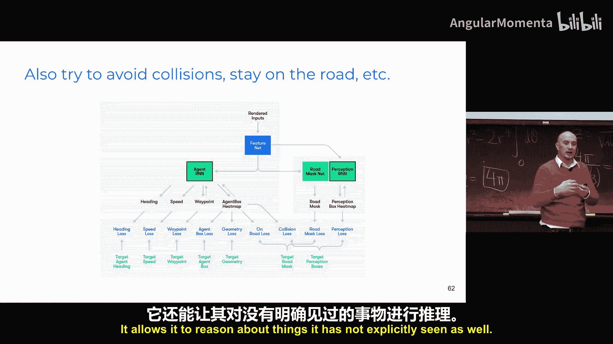

And so now here's an example that I was driving with this network。

And you can see that we're predicting the future with the yellow boxes and we're driving safely through intersections and complex scenarios actually handles a lot of scenarios very well if you're interested I welcome you to go read the paper。

😊，It handles most of the simple situations fine。 So now we have our past two approaches。

 the passing apart car。 One of them stops and never restart。 The other one hits the car。😊。

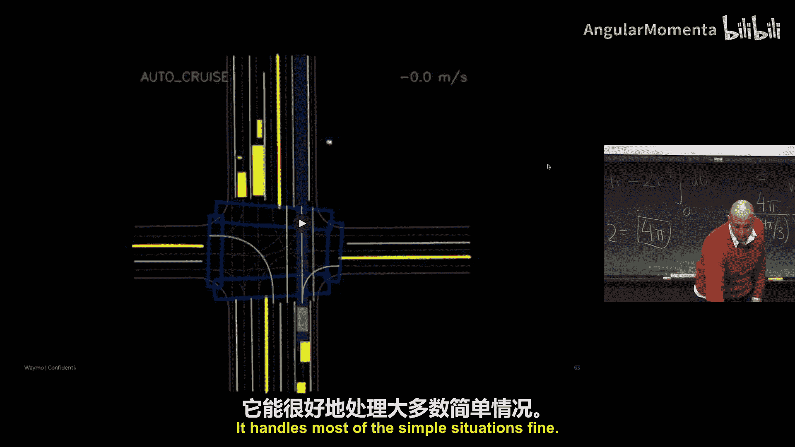

Now it actually handles it fine。And beyond that， afterwards， we can stop at the stop sign happily。

 which is the red line over there。 And it it does all the disops。

 And what we did beyond this is we took the system has learned on imitation data。

 and we actually drove our real way of car with it。😊，So we took it to Ca。

 therefore based staging grounds， and this is it driving a road it's never seen before and stopping at stop science and so so that's all great。

 We could use it also an agents im world and we could drive a car with it。

 but it has some issues so let's look on the left。😊，So here it is driving。

And then it was driving too fast， so because our range is limited。

 it didn't know it had to make a turn and it overran the turn。 So it just drove off the road。

 That's one thing that can happen。😊，So you know， one area of improvement， more range。

 here it is another time。😊，So yellow is by the way。

 what we did in the real world and green is what we do in the simulation in that example。😊。

And here we're trying to execute the complex maneuver U turn， and we're sitting there。😊。

And we're going to try to do it。 And we almost do it， but not quite。

 And at least we end up in a driveway。And there is other interactive situations when they get really complex。

 this network also does not do too well，😊，And so what does that tell us Well。

 long tail came again in testing right theres again。

 you can learn a policy for a lot of the common situations。

 but actually in testing some of the things you really care about is the long tail you want to test to the corner cases。

 you want to test in the scenarios where someone is obnoxious and adversarial and does' something not to cuer。

😊，Alright。So one way to think of it is this。This is the distribution of human behavior。

 and of course it goes in multiple axises。 it could be know。😊，Aggressive and conservative， right。

 And then somewhere in between， you could be super expert driver and super inexperienced and somewhere in between and so on。

😊，So like our end end model， it's fairly it's an un representation。

 meaning it could in theory learn any policy， right， I mean。

 you see everything you want to know about the environment by and large。But it's complex。

 and this is similar a bit to the models as well。 Some of the models we talked about before。

 you can end up with complex model if you have complex input。

 this is images that are 80 by 80 with multiple channels， it's a large input space。

 the model can have tens of millions of parameters。

 Now if you have an if you have a case where you have two or three examples in your whole 60 hours of driving there's no guarantee that your 10 million parameter model will learn it well right。

😊，And so it's really good when you have a lot of examples， it's really trying to do well in those。

And then you have the long tail。So what do you do， Well， we can improve the representation， You know。

 we can improve our model。 This is， you know， there is a lot of room to， to keep evolving this。

 And then this area will keep expanding。 right， And that's one good direction。

 there is a lot of interesting questions how to do that。

 And we're working on a lot of them is actually some exciting work。 Hopefully。

 I get to share with you another time。 Something else you can do。

 If you remember from my slide about the hybrid system。 When you go to the long tail， you can。

 you can do。😊，Essentially a similar thing， which is simpler biased expert design input distribution that is much easier to learn with few examples。

 you can also of course use expert design models。And so in this case。

 you still will produce something reasonable by inputting this human knowledge。😊。

And you could have many models， I mean， there's not one。

 you could just tune to various aspects of this distribution。

 you can have little models for all the aspects you care about， you can mix and match。

 so that's another way to do it。So let me tell you about one such a model。😊。

So the trajectory optimization agent。 So we take inspiration from a motion control theory and we want to plan a good trajectory for the vehicle。

😊，The agent vehicle， and that satisfies a bunch of constraints and preferences， right？😊。

And so one insight to this is that we already know what the agent did in the environment last time。

 So you have fairly strong idea about the intent。 And that helps you when you specify the preferences because you can say。

 okay， well， I have， give me a trajectory that minimizes some set of costs。

 which are preferences on the trajectory， it typically called potentials。What is the potential， Well。

 at different parts of the trajectory， you can add these attractor potential saying， well。

 try to go where you used to be before， for example， and that's the benefit of in simulation。

 you have observed what was done。 So this is a bit simpler。And of course。

 it can have repeller potential， don't hit things， don't run into vehicles。

 So to first approximation， that's what the roughly looks like。And so now where is the learning。

 right， Well， it's still a machine learning model。 There is a presentation。

 These potentials have parameters。 It's the steepness of this of this curve。

 There is sometimes they are multidimensional， right， there's a few parameters。 typicallyically。

 we're talking a few dozen parameters。😊，Or less。And you can learn them too。

 So there is a technique called inverse enforcementment learning。😊。

You want to learn these parameters that produce trajectories that come close to the trajectories you've observed in the real world So if you pick a bunch of trajectories that represent certain type of behavior。

 you want to model the parameters to behave like it。

 and then you want to generate reasonable trajectories continuous and all feasible that satisfy these and this is part of the optimization you can solve this actually so then you can tune these agents。

😊。

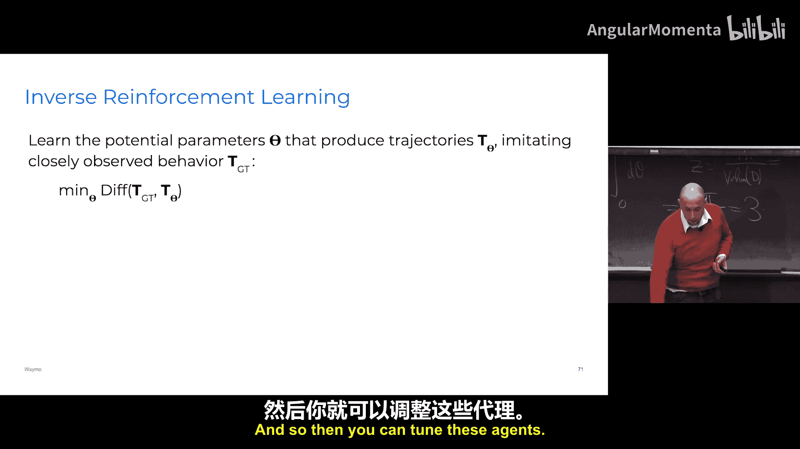

AndSo here's some agents I want to show you。 So this is a complex， interactive scenario。To be con。

You can see， on the left is。On the right is the aggressive guy。 Blue is the agent。

 red is our vehicle。 We're testing in simulation。😊，And so let me play one more time once this sense。

 essentially on the left is the conservative driver， on the right is the aggressive driver。😊。

And they pass us。And they induced very different reactions in our vehicle。

 So the aggressive guy went and passed us。😊，And push this further into that lane and we merge much later in the other case。

 when you have a conserv driver， we are in front of them and theyre not bugging us and we execute much earlier can switch into the right lane where we want to go。

😊，Right， so this is agents that can test your system well。 now you have。Different scenarios。

And in this case， depending what agent you put in。And I'll show you a little more scenarios。

 So it's not just a two agent game。 I mean， we can do things like merging from one side of the highway to the next。

 and。😊，This type of agent can generate fairly reasonable behaviors。

 It slow slowed down for a knowing slow vehicle in front。

 LED the vehicles on the side pass you and still completes the mission。

 and you can generate multiple futures with this agent。

 So here's an example again on the right will be an aggressive guy。😊，Right。

 and on the left was the more conservative person， the aggressive guy。

 found a gap between the two vehicles and just went for it， right？

And you can test your stuck this way。 And one more I wanted to show you is an aggressive motorcycle driving。

 so you can have an agent that tests， you can test the reaction to motorcycle that are weaving in the lane。

 right。😊。

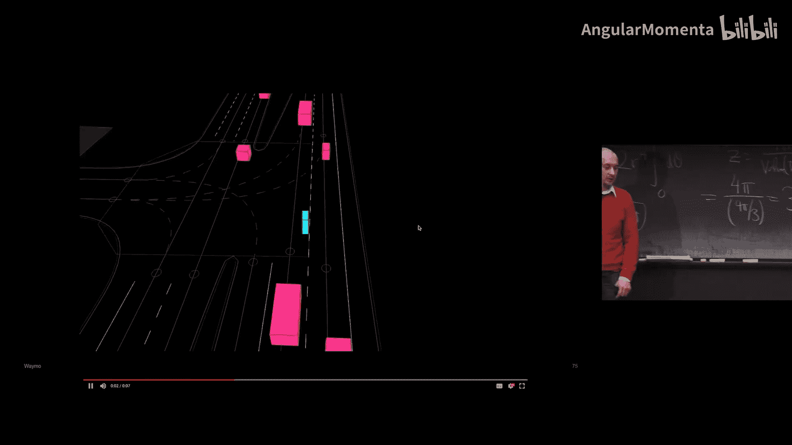

So I guess what's my takeaway from this story about testing in the long tail。

 You need them manager agents at the moment， right， so。

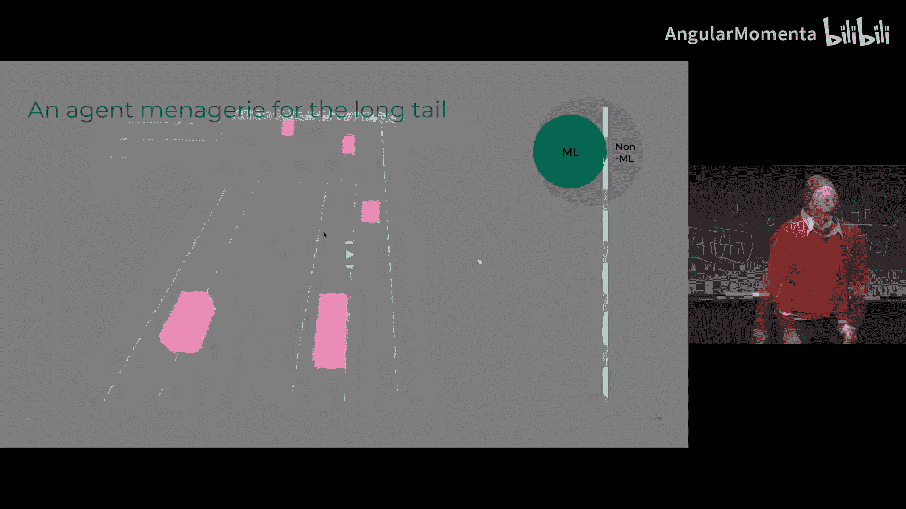

If you think of it。and learning from administration is key。You can encode some simple models by hand。

 but ultimately it's much better， the task of modeling agent behavior is complex and it's much better learned。

And so here's the space of models so you can have not learned。

 you can just replay the log like I showed and you can hand design trajectories for agents to for this reaction。

 do this， for that reaction， do that， then you can have the brake and s model that mostly if there's someone in front of an agent just does a deterministic break。

😊，Tjector optimization， which I just showed now our mid to mid model and potentially and to end top down model。

 top down， meaning you have like a top view of the environment。

 There's many other representations possible。 This is a very interesting space。 Ultimately。

 I wanted to show you there's many possible agents and they have different utility。

 and they have different number of examples in need to train them with。

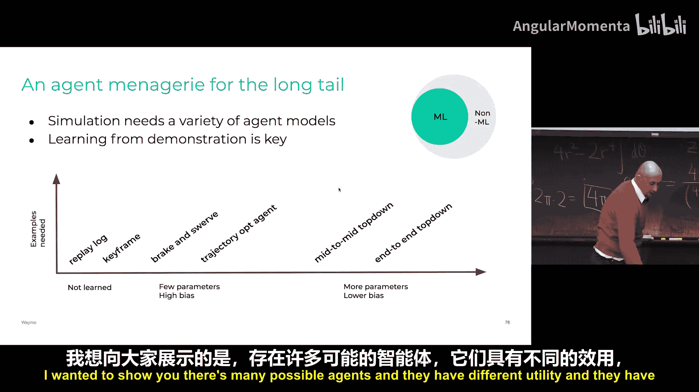

So one other takeaway I wanted to tell you is smart agents are critical photo them。 it's scale。

This is something I truly believe working in the space。And this line of direction is exciting。

 and ultimately one of the exciting problems that there's still a lot of interesting progress to be made。

😊，And why， well you have accurate models of human behavior of drivers and pedestrians。

 and they help you achieve several things。 First， you will do better decisions when you drive yourself。

You'll be able to anticipate what others will do better， And that will be helpful， second。

You can develop a robust simulation environment with those insights， also very important。Third， well。

 our vehicle is also one more agent in the environment。

 It's an agent we have more control than the others， but a lot of these insides apply。😊。

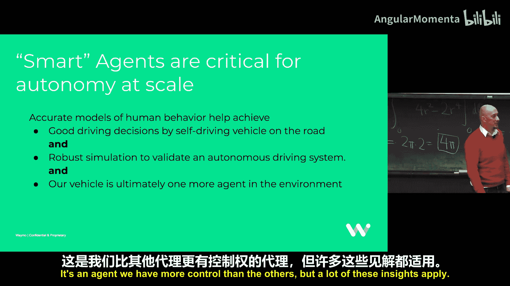

And so this is very exciting and interesting。So I wanted to finish the talk just maybe as a mental exercise。

 right， when you think of a system that is tackling a complex AI challenge like selfdriving。

 what is the good properties of the system to have and how do you think of a scalable system。

And to me， there's this mental test， right， We want to grow and handle and know bring our service to more and more environments。

 more and more cities。 How do you scale to dozens or hundreds of cities。

So as we talked about the long tail， each new environment can bring new challenges。

And they can be complex intersections in cities like Paris。

 there's our Lombard Street in San Francisco。 and from there。

 there's narrow streets in European towns。 There's all kinds as the long tail keep keeps coming as you keep driving environments in Pittsburgh。

 people drive the famous Pittsburgh cliff。 They take different precedents than usual。

 the local customs of driving of behaving。 all of this needs to be accounted for as you expand。

 And this makes the system potentially more complex or easier， harder to tune to all environments。

 right But it's important because ultimately， that's the only way you can scale。 So how do you。😊。

What should the scalable process do？So in my mind， you。

 let's say have a very good self driving system。I mean， this very much parallels the factory analog。

 I'm just going to repeat it one more time。 you take your vehicles。

 we put a bunch of way of cars and we drive a long time in that environment with drivers。

 maybe 30 days， maybe more， at least that long。😊，And you collect all the data。Right。

 and then your system should be able to improve a lot。On the data they had collected。All right。

Drive a bunch。 obviously don't want to train the system too much in the real world while it's driving。

But you want to train it after you've collected data about the environment。

 So it needs to be trainable on collected data。It's very important for a system to be able to quantify or have an notion to elicit from it。

 whether it's incorrect or not confident。Because then you can take action。

And this is important property that I think people should think of when they design systems。

 how do you list this？Then you can take an action。You can ask question to rate。 That's fairly legit。

 Typically， active learning is a bit like this， right， So。

 and it's usually based on some amount of low confidence or surprise。😊。

That's the examples you want to send。And even better。

 the system could potentially directly update itself。 And this is an interesting question。

 how do systems update themselves in light of new knowledge。

 and we have a system that clearly does this， right。😊，嗯。And typically you do it with reasoning。

And what is reasoning， right？So。I have an answer。 It is one answer。 There is possibly others。

But one way is you can check and enforce consistency of your beliefs。

 and you can look for explanations of the world that are consistent。

And so if you have a mechanism in the system that can do this。

 this allows the system to improve itself without necessarily being。Fed purely labeled data。

 It can improve its cell phone， just collected data。

And I think it's interesting to think of systems where you can do reasoning in the representations that these models need to have。

And last and not least。We need scalable training and testing infrastructure。

This is part of the factory I was talking about。 I'm very lucky at Waymo to have wonderful infrastructure。

😊，And you know， it allows this viruous cycle to happen。Thank you。

Up here， Ki Strble thank you so much for the talk， I really appreciate it。

 So if you were to train off of image and LiDarR data synthetic image and LiDarR data is there would you weight the synthetic data differently than real world real world data when training your models So there's actually a lot of interesting research in the field that people train on simulator but also train adaptation models that make simulator data look like real data。

Right， so you essentially you're trying to build consistency or at least you're training on simulator scenarios。

 but if you learn a mapping from simulator scenes to real scenes， right。

 you could potentially train on the transformed simulator data already that's transformed with models。

 there's many ways to do this ultimately， right， So achieving realism in simulator is an open research problem。

 right。😊，I assume there is a lot of rules that you have to put into a system to to be able to trust it。

 you know， And so how you find the balance between this automatic models like not only work when you're not quite sure what they would do and rules where you sure it was。

 but it's not scalable。 I mean， through lots and lots of testing and analysis right。

 So you keep you keep keeping track of the performance of your models and you see where they come short。

And then those are the areas you most need expert to complement。

RightBut the balance can change over time， and it's a natural process of evolution。

So evolving a system as you go， I mean， generally the ML pie grows as the capabilities in the data sets grow。

So you stressed at the end of both the first half and the second half of your talk。

 the importance of quantifying uncertainty and the predictions that your models are making。

 so have you developed techniques for doing that with neural nets or are you using some probabilistic graphical models or something。

So a lot of the models on neural nets。There is many ways to capture this actually I'm just going to give a general answer I' not commenting on specifically what way may may not be doing。

 I think first of all， there's techniques in neural nets that can predict where they can predict their own uncertainty fairly well right either directly regrets its uncertainty for certain products or using samples of networks or dropout or techniques like this that also provide。

Measure of uncertainty。 Another way of doing uncertainty is to leverage constraints in the environment。

 So if you have temporal sequences， right， you don't want， for example。

 objects to appear or disappear or。Generally and reasonable changes in the environment or inconsistent prediction in your models a good areas to look I'm just wondering。

 do you guys train and deploy different modelss depending on where the car is driving like what city or do you train and deploy a single model that adapts to most scenarios？

Well， ideally， you would have one model that adapts to most scenarios。

 then you know you complement is needed。 Yeah so first off， thanks for your talk。

 I find the simulator work really， really exciting and I was wondering if you could either talk about talk more about or maybe provide some insights into simulating pedestrians because as a pedestrian myself I feel like my behavior is a lot less constrained than a vehicle and I imagine I mean there's an advantage in that your're sensing from a vehicle and you kind of know your sensors are like first person from a vehicle but not from a pedestrian and that's correct。

 I mean， so if you want to simulate pedestrians far away in an environment right。

And you want to simulate them at very high resolution right and you've collected log data you may not have the detailed data on that pedestrian right at the same time。

 the subtle cues for that pedestrian matter less at that distance as well because it's not like you observe them or reacted to them in the first place so there is an interesting question at what fidelity do you need to simulate things。

Right and there is levels of realism。In simulation that at some level need to parallel what your models are paying attention。

Thank you for the talk。 It was very interesting since you， you know。

 titled and talked about it long tail。 It makes me wonder is。The bulk of the problem， solve。

Do you think， well， we're going to have this figured out And within the next couple of years。

 there can be self driving cars everywhere， or do you think it's closer to。You know， actually。

 it could be decades before we've really worked out everything necessary。

 What are your thoughts about the future， It's a bit hard to。 That's a good question。

 It's a bit hard to give this prognosis， I think。I mean， I'm not completely sure。

I think one thing I would say is it will take a while for self driving cars to roll out at scale。

 right。So this is not a technology that just a crank and appears everywhere right。

 there's logistics and algorithms and all this tuning and testing needed to make sure it's really safe in the various environments。

 so it will take some time。When you were talking about prediction。

 you mentioned looking at a context and saying if a person or if someone is looking at us。

 we can assume that they will behave differently than if they're not paying attention to what we're doing。

 potentiallyten I that something you're actively doing。

 Do you take into consideration if pedestrians or other participants in traffic are paying attention to your vehicles。

So I can't comment on our model designs too much， but I think this is generally cu one needs to pay attention to the very significant。

 I mean， you know， even when people drive， for example。

 there's someone sitting in the vehicle next to you waving， keep going right。

 and these are actual interactions in the environment。That， you know， is。

Something you need to think about。In one of your first of all。

 thank you it's a really cool talk In one of your last slides。

 you talked about resolving certain uncertainties by the means of establishing a set of beliefs and checking to see if they were consistent in the that's my own theory。

 by the way， right， but I feel that。The concept of reasoning is underexplored， in deep learning。

And what it means， right？ So if you read firstkanneman， type 1， type 2 reasoning。

 we're really good at the instinctive mapping type of。Tasks， right， so like。

Some low to mid to maybe high level perception up to point。

 But the reasoning part with neural networks， right， and generally with models。

 that's a bit less explored。 And I think it's。Long term， It's fruitful。That's my personal opinion。

 right？I guess the question I was going to ask is if you could elaborate on that concept in connection with the models you guys are working with。

 but I guess that's so they I'll take you an example from current work right and there is a lot of work on weekly supervised learning Sure and that's kind of been a big topic in 2018 and there were a lot of really strong papers including by Google Brain and Nelia Anglo and her team and so on。

And essentially， if you used to read the books about treeD reconstruction in geometry and so on。

 right， there is a bunch of。Rs that can encode geometric expectations about the world。

 So when you have video and when you have 3D outputs in your models。

 there is certain amount of consistency。 One example is egomotion versus depth estimation。

 There is a very strong constraint that if you predict the depth and you predict the egomotion correctly。

 then you can project certain things and they will look good right and that's a very strong constraint。

 that's a consistency。 and notice this about the environment you expected。

 this can help train your model right And so more of this type of reasoning may be interesting。

 you mention expert design algorithms and I was wondering from your perspective almost from wayless perspective how important are those say non-machine learning type algorithms or non-machine learning type approaches to tackling the challenges of autonomous driving could you say more how important is which aspect of them of expert design algorithms every now and then you just you sprinkle and like we can try expert design algorithms。

Because we actually understand some parts of the problem。

 and I was wondering what is really important for the challenges in autonomous driving outside of the field of machine learning？

I mean， generally the problem is you want to be safe in the environment。

 and that makes it such that you don't want to make errors in perception， prediction and planning。

Right and the state of machine learning is not at the point where it never makes errors provided the scope that we are currently addressing。

 and so throughout your stack with the current state of machine learning it needs to be complemented。

And so we've carefully done it， and I think machine learning as it improves。

 I think there'll be less and less need to do it。😊，It's somewhat effort intensive bringing。

 especially in an evolving system to do that， to have a hybrid system。

 but right now I think this is the main thing that keeps you able to do complex behaviors in some cases for which is very hard to collect data and you still need to handle then it's the right thing to do so the way I view it I'm a machine learning person I like to doing better and better。

 that's it we are not religious it should not be， we just need to solve the problem and right now the right mix is a hybrid system is my belief。

We're really excited to see what Waymo has in store for us in 19， so please give Dr a big hand。

