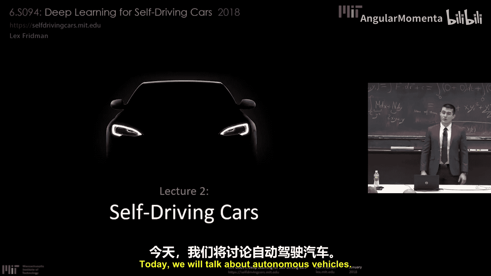
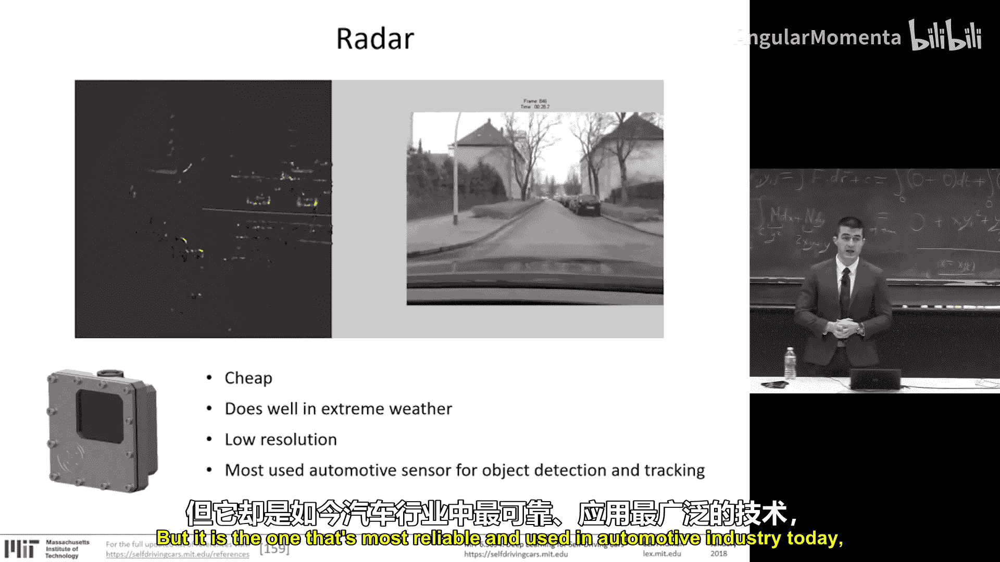
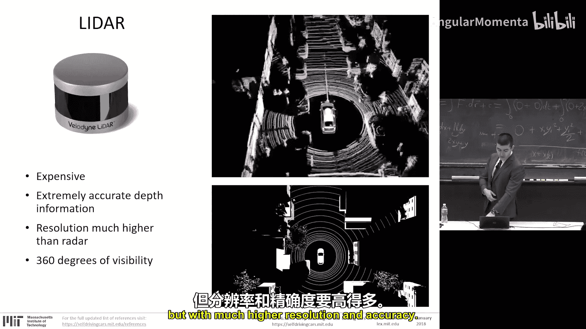
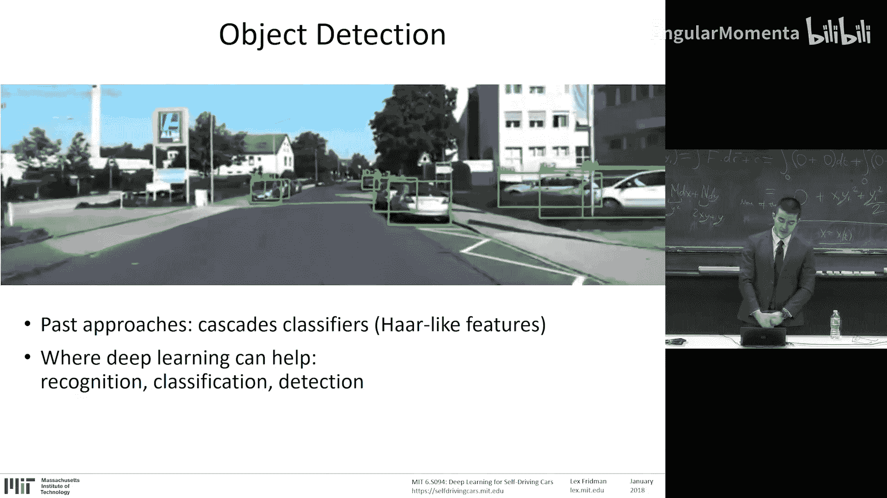
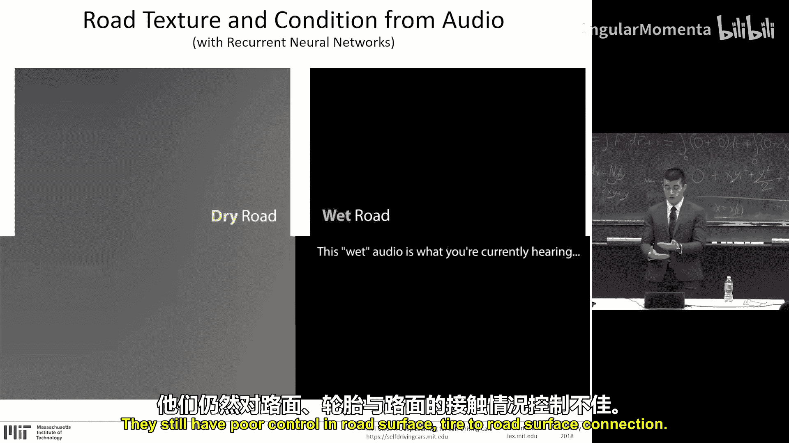
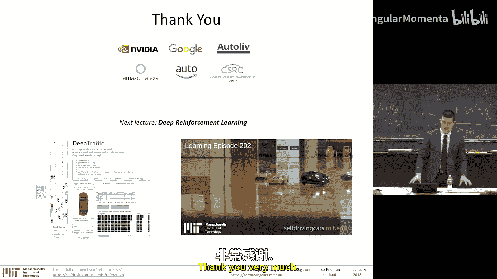

# 【麻省理工】自动驾驶汽车-｜-Self-Driving-Cars-p03-03-MIT-自动驾驶汽车-(2018)--BV13tq2B3EMH_p3-

Welcome back to 6 S 094， deep learning for Sa driving cars。Today。

 we will talk about autonomous vehicles。

Also referred to as driverless cars， autonomous cars， robotbocar。First， the utopian view。

Where for many autonomous vehicles have the opportunity to transform our society。

Into a positive direction。1。3 million people die every year and the automobile crashes。Globally。35。

38，40，000 die every year in the United States。So the one opportunity that's huge。

 that's one of the biggest focus for us here。And MIT， for people who truly care about this。

 is to design autonomous systems， or artificial intelligence systems that saves lives。

And those systems help work with， deal with or take away what NetzA calls the4 Ds of human folly。

Drunk， drugged， distracted and drowsy driving。Autonomous vehicles have the ability to take away drunk driving。

Distracted drowsy。And drugged。Eliminate car ownership， so taking shared mobility to another level。

Eliminating car ownership from the business side has the opportunity to save people money。

And increase mobility and access， making vehicles。Removing ownership makes vehicles more。Accessible。

 because the cost of getting from point A to point B drops an order to magnitude。

And the insertion of software and intelligence into vehicles。Makes those vehicles。

 makes the idea of transportation， makes the way we see moving from A to point B a totally different experience。

Much like with our smartphone， it makes it a personalized， efficient and reliable experience。😊，Now。

 for the negative view， for the dystopian view。Eliminate jobs。Any technology throughout its history。

 throughout our history of human civilization， has always created fear that jobs that rely on the prior technology will be lost。

This is a huge fear。Especially in trucking。Because so many people in the United States and across the world rely work in the transportation industry。

 transportation sector。And the possibility that AI will remove those jobs has potential catastrophic consequences。

嗯。Idea。One that we have to struggle with in the 21st century。

Of the role of intelligence systems that aren't human beings。

Being further and further integrated into our lives is the idea that a failure of an autonomous vehicle。

 even if they're much rare， even if they're much safer。

 that there is a possibility for an AI algorithm designed by probably one of the engineers in this room will kill a person。

Where that person would not have died if they were in control of the vehicle。

 the idea of intelligence system， one in direct interaction with a human being。

 killing that human being is one that we have to struggle with on a philosophical。

 ethical and technological level。Artificial intelligence systems。In popular culture。

Less so in engineering concerns。May not be grounded， ethically grounded。At this time。

 much of the focus of building these systems， as we'll talk about today and throughout this course。

 the focus is on the technology。 How do we make these things work？But of course， decades out。

 years or decades out， the ethical concerns starts arising。For Rodney Brooks。

One of the seminal people from MIT， those ethical concerns will not be an issue for another several decades。

 at least five decades。But they're still important。 It continues the thought。

 the idea of what is the role of AI in our society。

When that car gets to make a decision about human life。What is it making that decision based on。

 especially when it's a black box， What is the ethical grounding of that system。

 Does it conform with our social norms。Does it go go against them。 And there's many other concerns。

 Security is definitely a big one。A car that'。Not even artificial intelligence base。

 the car that's softwareer based as they're becoming more and more millions。

 most of the cars on road today are run by millions of lines of source code。

The idea that those lines of source code written again by some of the engineers in this room。

Get to decide the life of a human being means that a hacker from outside of the car can。

Manipulate that code。To also decide the fate of that human being， that's a huge concern。For us。

From the engineering perspective。The truth is somewhere in the middle。

 we want to find what is the best positive way we can build these systems to transform our society to improve the quality of life of everyone amongst us。

But there's a grain of salt to the hype of autonomous vehicles。We have to remember。

 as we discussed in the previous lecture， it will come up again and again。

 our intuition about what is difficult and what is easy for deep learning。

For autonomous systems is flawed。If we use if we use ourselves this example。

 human beings are extremely good at driving。This will come up again and again。

Our intuition has to be grounded in the understanding of what is the source of data。

 what is the annotation and what is the approach， what is the algorithm。

 so you have to be careful about using our intuition。

 extending it decades out and making predictions whether it's towards the utopian or the dystopian view。

And as we'll talk about some of the advancements of companies working in the space today。

You have to take what people say in the media， what the companies say。

 some of the speakers that will be speaking at this class say about their plans for the future and their current capabilities。

I think us a guide that can provide。Is when there's a promise of a future technology。

The future vehicles that are two years out or more。That has to be。That's a very doful prediction。

One that is within a year， as we'll give a few examples， today， is skeptical。The real proof comes。

In actual testing on public roads or in the most impressive， the most amazing。😊。

The reality of it is when it's available to consumer purchase。I would like to use Rodney Brooks as a。

So it doesn't come from my mouth， but I happen to agree。His prediction is no earlier than 2032。

 a driver's taxi service in a major US city will provide arbitrary pickup and drop off locations fully autonomously。

That's 14 years away。And by 2045， it will do so in multiple cities across the United States。

 So think about that that a lot of the engineers work in this space。

 A lot of folks are actually building these systems agree with this idea。 And that is the earliest。

I believe this will happen， and Rodney believes。But。As all technophobes have been wrong。

 it could be wrong。This is a map on the X axis， a plot on the X axis of time throughout the 20th century and the adoption rate on the Y axis from zero to 100% of the various technologies。

 from electricity to cars to radio to telephone and so on， and as we get closer to today。

 the technology adoption rate， when it goes from zero to 100%。

The number of years it takes to adopt that technology is getting shorter and shorter and shorter as a society。

 we're better at throwing away the technology of old and accepting a technology of new。

So if a brilliant idea to solve some of the problems we're discussing comes along。

 it could change everything。Overnight。So let's talk about different approaches to autonomy。

We'll talk about sensors afterwards。We'll talk about companies， players in this space。

And then we'll talk about AI。And the actual algorithms and how they can help solve some of the problems of autonomous vehicles。

Levels of autonomy。Here's a useful。Texonomization。Of levels of autonomy。

 useful for initial discussion， for legal discussion and for policy making。And for blog posts。

 the media reports。But it's not useful， I would argue for design and engineering of the underlying intelligence。

And the system viewed from a holistic perspective， the entire thing。

 creating an experience that's safe and enjoyable。 So let's go over those levels。😊，The five。

 the six levels。This is presented by SA AE Report J3，0，1，6。

 the most widely accepted taxonomization of autonomy。No automation at level zero。

 level 1 and level 2 is increasing levels automation， Lel1 is cruise control。

 level 2 is adaptive cruise control lane keepingeping level3， I don't know what level 3 is。

 there's a lot of people that will explain that level 3 is conditional automation meaning it's constrained to certain geographical location。

I will explain that from an engineering perspective， I'm personally a little bit。

Confuse of where that stands。I'll try to redefine how we should view automation。

 Level 4 and level 5 is high Full level automation。

 Level 4 is when the vehicle can drive itself fully。For part of the time。

 there's certain areas in which you can take care of everything no matter what no human interaction input。

Safekeeping is required。Level 5 automation is the car does everything。Everything。

I would argue that those levels aren't useful for designing systems that actually work in the real world。

 I would argue that there's two systems。But first， a starting point that every system。To some degree。

 involves a human。It starts with manual control from a human。Human getting in the car。

And the human electing to do something。 So that's the manual control。

 What we're talking about when the human engages the system。

When the system is first available and the human chooses to turn it on。

 that's when we have two AI systems。Human centered autonomy， when the human is needed， is involved。

And full autonomy， when AI is fully responsible for everything。 from the legal perspective。

 that means。A2 full autonomy means the car， the designer， the AI system， is liable， is responsible。

 and for the human centered autonomy， the human is responsible。What does this practically mean？

For human centered autonomy。And we'll discuss examples of all of these。

When the human interaction is necessary。The question then becomes is how often is the system available is it available in traffic conditions。

 so for traffic bumper to bumper is available on the highway， is it sensor based。

 like in the Tesla vehicle， meaning based on the visual characteristics to the scene。

 the vehicle is confident enough to be able to control to make control decisions perception and control decisions。

The other factor。Not discussed enough， and I think poorly imprecisely discussed when it is is the number of seconds given to the driver。

 not guaranteed but provided as a sort of feature to the driver to take over in the Tesla vehicle in all vehicles in the road today that time is zero。

 zero seconds are guaranteed zero seconds are provided， there is some theres some room。

 sometimes it's hundreds of milliseconds， sometimes it's multiple secondsd。

 but really theres no standard of how many seconds you get to say， wake up， take control。Then。

Tyup operation， something that some of the companies will mention are playing with is when a human being is involved remotely。

 controlling the vehicle remotely。 So being able to take over control of the vehicle when you're。

When you're not able to control it。 So support by a human that's not inside the car。

 That's a very interesting idea to explore。But for the human centered autonomy side。

All of those features are not required， they're not guaranteed the human driver。

 the human inside the car is always responsible at the end of the day。

 they must pay attention to a degree that's required to take over when the system fails and no matter under this consideration under this level of autonomy。

 the system will fail at some point， that is the point that is the collaboration between human and a robot is the system will fail and the human has to catch when it does。

And then full autonomy。Is AI is fully responsible Now， that doesn't again。

 as we will present some companies in the marketing material and the PR side of things。

 they might present that there is significant degrees of autonomy。

 if you're talking about L3 or L4 or L5， you have to read between the lines。

You're not allowed to have teleoperation。If a human is remotely operating the vehicle。

 a human is still in the loop。 A human is still evolved。 It's still a human center autonomy system。

You don't get the10 second rule， which is。Just because you give the driver 10 seconds to take control。

 that somehow removes liability for you。 If you say that that's it as an AI system， I can't take。

Can't resolve， can't deal， can't control the vehicle in this situation。

 And you have 10 seconds to take over。 That's not good enough。 The driver might be sleeping。

 That driver may have had a heart attack。 They're not able to control the vehicle。

Full autonomous systems might must find safe harbor。

 They must get you full stop from point A to point B。

 That point B might be your desired destination or might be a safe parking lot。

 but it has to bring you to a safe location。 This is a clear definition of the two systems。

And the human， of course， as far as our certain current conception of artificial intelligence in cars today is a human always overrides the AI system。

 so we should， in the general case。The human。Gets to choose to take control。

 The AI can't take control of a human， except when danger is imminent。

 meaning sudden crashes like in AAB events。 We're not yet ready for AI systems to say as a society to say。

 no， no， no， you're drunk。 you can't drive。So beyond the traditional levels， from level 0 to level 5。

 the starting point is level 0。 No automation。 All cars start here。 levelvel 1。

 levelvel 2 and level 3， I would argue， fall into human centered autonomy systems， a 1。

Because they involve some degree of a human。 And L 40 5。

 to some degree that some crossover fall into full autonomy。Even though without four with Wemo。

 as you can ask on Friday。And anyone Cruise Uber playing in this space。

 there's very often a human driver involved。One of the huge accomplishments of Waymo。

Over the past month， incredible accomplishment where in Phoenix， Arizona， they drove without the car。

 drove without a driver。😊，The meaning there was no safety driver to catch。 There was no engineer。

 staff member。There to catch the car。A human being that doesn't work for Google or Waymo got into that car and got from A to point B without a safety driver。

 That's an incredible accomplishment。 And that particular trip。😊，Was a fully autonomous trip。

That is full autonomy when there's no human to catch the car。No AI presentation is good without cats。

So full autonomy， A2 system。Is when you do nothing but right along。Human se autonomy system。

Is when you have some control。I'm sorry I had to。So the two paths for autonomous systems。

 they1 and a2。And blue on the left is a one human centered。 on the right is a  two full autonomy。

And then blue is from the artificial intelligence perspective。Is easy， easier。

 and then red is harder。Easier meaning。We do not have to achieve 100% accuracy。Harder means。

Everything that's off of 100% accuracy。No matter how small has the potential of costing human lives。

And huge amounts of money for companies。So let's discuss。

 we'll discuss later in the lecture about the algorithms behind each of these methods and the left and the right。

But this summarizes the two approaches， the localization mapping for the car to determine where it's located。

For the human centered autonomy， it's easy。It still has to do the perception。

 It has to localize itself within the lane。 It has to find all the neighboring pedestrians and the vehicles in order to be able to control the vehicle to some degree。

 But because a human is there， it doesn't have to do so perfectly。 when it fails。

 a human is there to catch it。Seecen understanding。

 perceiving everything in the environment from the camera from whether it's Liar or radar。

 ultrasonic。The planning of the vehicle， whether it's just staying within lane or for adaptive cruise control。

 controlling the longitudinal movement of the vehicle。

 or it's changing lanes of the Tesla autopilot or higher degrees of automation。

 all of those movement planning decisions can be made autonomously when the human is there to catch。

 it's easier because you're allowed to be wrong， rarely but wrong。

The hard part is getting the human robot interaction piece right。That's。Next Wednesday lecture。

As we'll discuss about how deep learning can be used to interact。

 first perceive everything about the driver and second to interact with the driver。That part is hard。

Because you can't screw up on that part。 You have to make sure you help the driver know where your flaws are so they can take over if the drivers not paying attention。

 you have to bring their attention back to the road back to the interaction。

 you have to get that piece right because for a flawed system， one that's rarely flawed。

 the rarity is the challenge， in fact。Has to get the interaction right。

And then the final piece is communication。The autonomous vehicle， a fully autonomous vehicle。

 must communicate extremely well with the external world， with the pedestrians， the Jaywalkers。

 the humans in this world， the cyclists。That communication piece。

 one at least that it's part of a safe and enjoyable driving experience is extremely difficult on the a way more vehicle。

 I wish them luck if they come to Boston from getting from point A to point B because pedestrians will take advantage A vehicle must assert itself。

In order to be able to navigate Boston's streets。And that assertion is communication。

That piece is extremely difficult。For a Tesla vehicle， for， for a human centered autonomy vehicle。

 L2， L3。The way you deal with Boston pedestrians is you take over。Roll down the window。

 yell something， and then speed up。Getting the piece for an artificial intelligence system to actually be able to accomplish something like that。

 as we'll discuss。On the ethics side and the engineering side is extremely difficult。That said。

 most of the literature in the human factors field in the autonomous vehicle field。

Anyone thats studied autonomy and aviation。And in vehicles。

 is extremely skeptical by the human Senate approach。 They think is' deeply irresponsible。

 Its deeply irresponsible。Because is， as argued， because。Human beings。

 when you give them a technology which will take control part of the time， they will get lazy。

 they will take advantage of that technology， they will overtrust that technology。

 they'll assume it'll work perfectly always。This is the idea。That this。

This idea extended beyond further and further means that the better the system gets。

 the better the car gets driving itself， the more the humans will sit back and be completely distracted。

 it will not be able to reengage themselves in order to safely catch when the system fails。

This is Chris Imsson， the founder of the Google Sedriving Car Program。

And now the cofounder of one the other cofounder is the speaker， this class on next Friday。

 Sterling Anderson of a company called Aurora， a startup。He was one of the big proponents。

Or the I should say， opponents。The idea that human centered autonomy can work。They tried it。

Publicly has spoken about the fact that Google as in the early self driving car program。

They've tried shared autonomy， they've tried L2。And it failed because their engineers。

 the people driving their vehicles， fell asleep。对。And that's the belief that people have。

And we'll talk about why that may not be true。 There's a fascinating truth in the way。

Human beings can interact with artificial intelligence systems that may work in this case。

 as I mentioned， is the human robot interaction， building that deep connection between human and machine of understanding。

Of communication。This is what we believe happens。 So there's a lot of videos like this。 There it's。

 it's fun， but it's also representative of what， what society believes happens when automation。😊。

Is allowed to enter the human experience and driving where human life is at stake。

That you can become completely disengaged。It's kind of。It's kind of a natural thing to think。

 but the question is， does this actually happen？What actually happens on public roads？

The amazing thing that people don't often talk about。Is that there is。

Hundreds of thousands of vehicles on the road today。Equipped with autopilot。Tesla， autopilot。

That have a significant degree of autonomy。That's data， that's information。

So we can answer the question， what actually happens。

So many of the people behind this team have instrumented。25 vehicles。

21 of which are Tesla autopilot vehicles， now with over collected。

Recording everything about the driver， two cameras， two HD cameras on the driver。

2 cameras on the one camera on the external roadway and collecting everything about the car。

 including audio， the state， the pulling everything from the caus， the kinematics of the vehicle。

 IM U， GPS， all of that information over now over 300000 miles， over 5 billion。Video frames， all。

 as we'll talk about， analyze computer vision。 you extract from that video of the driver of everything they're doing。

The level of distraction， the allocation of attention， the drowsiness， emotional states。

 the hands on wheel， hands off wheel， body pose， activity， smartphone usage， all of these factors。

 All of these things that you would think would fall apart when you start letting autonomy into your life。

 We'll talk about what the initial reality is that should be inspiring and thoughtprovoking。

As I said， three cameras。Singleboard computer recording all the data。

Over a thousand machines in Holy O。In distributed computation。

 running the deep learning algorithms that I have mentioned on these five plus billion video frames。

Going from the raw data to the actionable， useful information。The slides are up online。

 If you'd like to look through them。 I'll fly through some of them。And this is the video。

Of one of thousands of trips we have in autopilot in our data。

 a car driving autonomously a large fraction of the time on highways from here to California。

 from here to Chicago， to Florida and all across the United States。We take that data。

And using the supervised learning algorithms， semisupervised。The number of frames here is huge。

For those that work in computer vision，5 billion frames is several orders of magnitude larger than any data set that people are working with。

In computer vision。Actively annotated。So we want to use that data for understanding the behavior of what people are actually doing in the cars。

And we want to train the algorithms that do perception and control。A quick summary， over 300。

000 miles，25 vehicles， the colors are true to the actual colors of the vehicles。Little fun fact。

 Tesla， Model X， Model S， and N Model3。500500 plus， sorry， miles a day and growing。Now。

 most days in 2018 are over a thousand miles a day。

This is a quick GPS map in red is manual driving across the Boston area in blue。

 Cyan is autonomous driving。 This is giving you the sense of just the scope of this data。

 This is a huge number of miles。With automated driving。

 several orders of magnitude larger than what Waymo is doing， that what cruiseise is doing。

 that what Uber is doing。The miles driven in this data with autopilot。

Confirming what y a Musk has stated。Is 33% of miles are driven autonomously。

 This is a remarkable number for those of you who drive。

 And for those of you who are familiar with these technologies。

 that is remarkable adoption rate that 33% of the miles are driven in autopilot。 That means these。

Drivers are getting use out of the system。 It's working for them。 That's an incredible number。

It's also incredible because under the decades of literature from aviation to automation and vehicles to Chris Armsson and Waymo。

 the belief is such high numbers are likely to lead。To crashes， to fatalities， to， at the very least。

 highly responsible behavior。Drivers over trusting the systems and getting in trouble。

We can run the glance classification algorithms。 Again， this is for next Wednesday discussion。

 the actual algorithm。 It's the algorithm that tells you the region that the driver is looking at。

 and it's comparing road， instrument cluster left， rear view， center stack and right。

 Does the allocation of gland change with autopilot。Or with manual driving。

It does not appear to in any significant noticeable way， meaningan you don't start playing chess。

 You don't start， You don't get in the back seat to sleep。

You don't start texting in your smartphone and watching a movie， at least in this data set。

 there's promise here。For the human centered approach。The observation to summarize。

This particular data is that people are using it a lot。 The percentage of miles。

 the percentage of hours is incredibly high， at least relative to what was what would be expected from these systems。

 And given that there's no crashes， there's no near crashes in autopilot。

The road type is mostly highway， traveling at high speeds。The mental engagement looked at。

8000 transfer of control from machine to human， so human beings taking control of the vehicle saying。

 you know what， I'm going to take control now I'm not comfortable with the situation for whatever reason。

 either not comfortable or electing to do something that the vehicle is not able to like turn off the highway。

 make a right or left turn， stop or stop sign， these kinds of things。Physical engagement， as I said。

 glance remains the same。And what do we take from this。

 It's something that I'd like to really emphasize as we talk。

 as we talk about autonomous vehicles in this class and the guest speakers who are all on the other side。

 So I'm representing the human center side。 All our speakers are focused on the full autonomy side。

Because that's the side roboticists know how to solve。 That's the fascinating algorithm nerd side。

And that's the side I love as well。 It's just my belief stands that the solving the perception control problem is extremely difficult and two。

 three decades away。 So in the meantime， we have to utilize the human robot interaction to actually bring these AI systems onto the road to successfully operate and the way we do that counterintuitively。

Is。We have to have， we have to let the artificial intelligence systems reveal their flaws。

One of the most endearing things to human beings。Can do to each other， friends。

Its revealed their flaws to each other。Now， from a automotive perspective。

 from a company perspective， it's perhaps not。Appealing for an AI system to reveal what it sees about the world and what it doesn't see about the world。

 where it succeeds and where it fails。But that is perhaps exactly what it needs to do in the case of autopilot。

 the way the very limited， but I believe successful way is's currently doing that is allowing you to use autopilot basically anywhere so what people are doing is they're trying to engage。

 they're turn on autopilot in places where they really shouldn't。

ural ruralural roads curvy with terrible road markings in heavy rain conditions with snow with lots of cars driving at high speeds all around。

 they turn autopilo it on to understand to experience the limitations of the system to interact that human robot interaction is through its tactile by turning it on and seeing。

 is it going to work here， how is it going to fail， and the human is always there to catch it。

 that interaction， that's communication that intimate understanding is what creates successful integration of AI in the car before we're able to solve the full autonomy puzzle。

Learn the limitations by exploring。It starts with this guy and hundreds of others。

If you search on YouTube first time with autopilot。

The amazing experience of direct transfer of control of your life to an artificial intelligence system。

 In this case， given control to a Tesla autopilo system。

 This is why in the human centered camp of autonomy， I believe that。😊。

Autonomous vehicles can be viewed as personal robots with which you build a relationship where the human robot interaction is the key problem。

 not the perception control。And there， the flaws of both humans and machines must be clearly communicated and perceived。

Perceived because you used the computer vision algorithms to detect everything about the human and communicated because on the displays of the car or even through voice。

 it has to be able to reveal when it doesn't see different aspects of the scene。

From the human centered approach， then。We can focus on the left， the perception and control side。

 perceiving everything about the external environment and controlling the vehicle without having to worry about being 99。

99999%， correct。Approaching 100% correct。Because in the cases where it's extremely difficult。

 we can let the human catch the system。We can reveal the flaws and let the human take over。

When the system can't。So let's get to the sensors。The sources of raw data that we get to work with。

There's three。There's cameras， so image sensors。RGB， infrared。Visual data， theres radar。And ultrasi。

And there's Liar。Let's discuss the strengths。First， discuss really what these sensors are。

 the strength and weaknesses， and how they can be integrated together through sense of fusion。

So radar is trusted， the old trusted friend， the sensor that's commonly available in most vehicles。

That have any degree of autonomy。On the left is a visualization of the kind of data on high resolution radar that's able to be extracted。

It's cheap。Both radar。Which works with electromagnetic waves。And ultrasonic。

 which works with sound waves， sending a wave， letting it bounce off the obstacles。

Knowing the speed of that wave， being able to calculate the distance to the obstacle based on that。

It does extremely well。In challenging weather， rain， snow。

The downside is this slow resolution compared to the other cs we'll discuss。

But it is the one that's most reliable and used in automotive industry today。

 and it's the one that's in sense of fusion is always there。

Lightar。Visualize on the right。The down size is， it's expensive。

But it produces an extremely accurate depth information and a high resolution map of the environment。

That has 360 degrees of visibility。It has some of the。Big strengths of radar in terms of reliability。

 but with much higher resolution and accuracy。

The downside is cost。Here's a quick visualization comparing the two of the kind of information you get to work with。

 the density and the quality of information with LiIDar is much higher。

And Liar has been the successful source of ground truth。

The reliable sensor relied upon on vehicles that don't care about cost。And camera。

 the thing that most people here should be passionate about， because machine learning。

 deep learning has the most ability to have a significant impact there。 Why first is cheap。

 So it's everywhere。 Second is the highest resolution。 So there's the most。

 the most highly dense amount of information。Which means。

Information is something that could be learned and inferred to interpret the external scene。

So that's why it's the best source of data for understanding the scene。

And the other reason it's awesome for deep learning is because of the hugeiness of data involved。

It's many orders of magnitude more data available for driving in camera。

 visible light or infrared than it is in LIDar。啊，这。And our world is designed for visible light。

 Our eyes work in similar ways， the cameras。At least crudely so， the source data is similar。

The lane markings， the traffic signs of traffic lights， the other vehicles。

 the other pedestrians all operate with each other in this RGB space。

In terms of visual characteristics， the downside is cameras are。Bad a depth estimation。

 It's noisy and difficult， even with stereo vision cameras to estimate depth relative to Lidar。

And they're not good in extreme weather， and they're not good。

 at least visible light cameras at night。So let's compare the ranges。

Here's a plot in meters on the x axis of the range。An acuity。On the Y axis。With ultrasonic， Lidar。

 radar and。Camera， passive visual sensor， plotted。The range of cameras is the greatest。

 This is looking at。We're going to look at several different conditions。 This is for clear。

 well lit conditions。 So during the day， no rain。No fog。

 Lidar and radar have a smaller range under 200 meters。

And ultrasonic sensors used mostly for park assistance and these kinds of things and blinds by warning has terrible range。

 as designed for extremely close as high resolution distance estimation for extremely close distances。

Here a little bit small， but looking at up top is clear well lit conditions the ply we just looked at and on bottom is clear dark conditions。

 so just a clear night day， no rain。But it's night。 and on the bottom right is heavy rain。

 snow or fog。Vision falls apart in terms of range and accuracy。Under dark conditions and in rain。

 snow or fog。Radar， our old trusted friend， stays strong。

The same range just under 200 meters and at the same acuity。Same with sonar。Ler works well at night。

But it does not do well with rain or fog or snow。One of the biggest downsides of Lidar。

Other than cost。 So here's another interesting way to visualize this that I think is productive for our discussion of which sensor will win out。

 Is it the El Musk prediction of camera。Or is it the way more prediction of Lidar？

For LiDar in this kind of plot that would look for every single sensor。

The greater the radius of the blue， the more successful that sensor is at accomplishing that feature with a bunch of features。

Lid up around the circle。 So range for lighter is pretty good， not great， but pretty good。

 Resolution is also pretty good。 It works in the dark。 It works in bright light。

But it falls apart in the snow。It does not provide color information， texture information， contrast。

It's able to detect speed， but the sensor size， at least to date， is huge， the sensor cost。

 at least to date is extremely expensive。And it doesn't do well in proximity。Where ultrasonic shines。

Speaking of which ultrasonic， same kind of plot does well in proximity detection。 It's cheap。

 The cheapest sensor of the four。And sensor size， you can get it to be tiny。

It works in snow and fog and rain。But its resolution is terrible， its range is nonexistent。

And it's not able to detect speed。That's where radar steps up，'s able to detect speed。

 it's also cheap。It's also small。But the resolution is very low。

 and it's just like Lidar is not able to provide texture information， color information。Camera。

The sensor cost is cheap， the sensor size is small。Not good up close。 proximity。

 The range is the longest of all of them。 resolutionsolution is the best of all of them。

 It doesn't work in the dark。 It works in bright light， but not always。

 one of the biggest downfalls a camera sensors is the sensitivity to lighting variation。It works。

 It doesn't work in the snow， fog， rain。So it suffers much like Lidar from that。But it provides rich。

Interesting textual information， the very kind that deep learning needs to make sense of this world。

So， let's。Look at the cheap sensors。Ultrasonic radar。And cameras， which is one approach。

Putting a bunch of those in a car， and fusing them together。The cost there is low。

One of the nice ways to visualize using this visualization technique。

When they're fused together on the bottom， it gives you a sense。

Of them working together to complement each other's strengths。

And the question is whether camera or LiDar will win out。For partial autonomy or full autonomy。

On the bottom， showing this kind of visualization for a LiDar sensor and on the top showing this kind of visualization for fused。

Radar， ultrasonic and camera。At least under these considerations。

The fusion of the cheap sensors can do as well as LidAR。Now。

 the open question is whether LiDA in the future of this technology can become cheap and its range can increase。

 because then LiDar can win out solidlid state LiDar and a lot of developments with a lot of startup LiDar companies are promising to decrease the cost and increase the range of these sensors。

But for now， we plow along。WithDedation on the camera front。

The annotated driving data grows exponentially。More and more people are beginning to annotate。

And study the particular driving。Perception and control problems。And the very algorithms。

For the supervised and semiupervised and generative networks that we use to work with this data are improving。

So， it's a race。And of course， radar and ultrasonic are always there to help。So。

Companies that are playing in the space。Some of them are speaking here。Weimmo。In April 2017。

They exited their testing， their extensive， impressive testing process。

And allowed a first rider in Phoenix， public writerer。In November 2017。

It's an incredible accomplishment for our company and for an artificial intelligence system in November 2017。

 no safety driver。So the car truly achieved full autonomy。Under a lot of constraints。

But it's full autonomy。 It's a step。 It's an amazing step in the direction towards full autonomy。

 much sooner than people would otherwise predict。End the miles。

4 million miles driven autonomously by November 2017 and growing。

 quickly growing in terms of full autonomous driving。If I can say so cautiously。

 because most of those models have。A safety driver。 So I would argue it's not full autonomy。

 but however they define full autonomy， it's 4 million miles driven。Incredible。Uber。

In terms of miles second on that list， they have driven 2 million miles autonomously。

By December of last year， 2017。The quiet player here。

In terms of not making any declarations of being fully autonomous。

Just quietly driving in a human centered way， L2。Over 1 billion miles in autopite。Over 300。

000 vehicles today are equipped。With autopilo technology， with ability to drive。

 control the car laterally and longitudinally。And if。Anyone believes。The CEO of Tesla。

 there will be over 1 million such vehicles by the end of 2018。But no matter what， the 300。

000 is an incredible number， and the1 billion miles is an incredible number。

Autopilot was first released in September 2014， one of the first systems on the road to do so。

Autopilot。And I call myself as one of the skeptics。In October 2016。

 Autopilot decided to let go of an incredible work done by Mobile Eye Now Intel。

With designing their perception control system， they decided to let go it completely and start from scratch。

Using mostly deep learning methods， the dry PX2 system from NviDdia and eight cameras。

 they decided to start from scratch。That's the kind of boldness。

The kind of risk taking that can come with naivety， but in this case it worked。Incredible。

Aauuddi A8 system is going to be released at the end of 2018 and is promising one of the first vehicles is promising what they're calling L 3。

And the definition of L3。According to Thorton Lioninhart。

 the head of the automated driving in Audi in Audi。Is when the function is operator as intended。

 if the customer turns the traffic jam pilot on， now this L3 system is designed only for traffic jams。

 bumper and bumper traffic。Under 60 kilometers an hour。

If the customer turns the traffic jam pilot on and uses it as intended。

 and the car was in control at the time of the accident。

 the driver goes to the insurance company and the insurance company will compensate the victims of the accident in an aftermath。

 they come to us， we will pay them。So that means the car is liable。The problem is。

Under the definition of L2 L3， perhaps there is some truth to this being an L3 system。

The important thing here is nevertheless deeply and fundamentally human centered。

 because even as you see here in this demonstration video with a reporter the car for a poorly understood reason。

 transfer control to the driver says， that's it I can't I can't take care of the situation。

 you take control。How。How much time do you have in terms of seconds before you really need to know to take over？

Well， this is the new thing about level3 with level3。

 the system allows the driver to give the prompt to take over vehicle control again ahead of time。

 which is in this case up to 10 seconds， okay？If the traffic jam situation clears up or。

And if failure in the system occurs everything you might think of。

 the system still needs to be able to drive automatically because the driver has this time to take over。

You might ask what is new about this？So why is Audi saying this is the first level three system worldwide on the market？

When talking about these levels of automation， there's a classification which starts at level zero。

 which is basically the driver is doing everything， there's no assistance， nothing。

And then it gradually becomes into partly automation and when we're talking about these assistance functions like lane keeping and distance keeping。

 we're talking about level two assistance function which is。嗯。Meaning that the driver is。

obliged to permanently monitor the traffic situation to keep the hands on the wheel。

 even though there's a support and an assistance。And to intervene immediately if anything is not quite right。

 so you know that from lane assistance systems when the steering is not perfectly in the right lane。

 you have to intervene and correct immediately and that is the main difference。

Now we got a takeover request So what so's let's talk about what。

That means this is still a human center system。 It still struggles。

 It still must solve the human robot interaction problem。

And there's many others playing in the space on the full autonomy side， Waymo Uber。GM Cruz， Utonomy。

The CTO， of which will speak here on Tuesday， Opimus ride。Its annuity， voyage。

The CEO of which will speak here next Thursday。And Aurora。Not listed。

 the founder of which will speak here next Friday。And the human centered autonomy side。

 The reason I am。Speaking about us so much today is we don't have any speakers。 I'm the speaker。

The Tesla Autopilot is for several years now doing incredible work on that side。

 we are also working with Volvo Pilot assistist as a lot of different approaches there。

 more conservative， interesting。The Audi traffic jam assist， as I mentioned。

 the A8 being released at the end of this year。The Mercedes drypoticist in the E class。

An interesting vehicle that I got to drive quite a bit is the Cadillac super cruiseise， the C T 6。

 which is very much constrained geographically to highway driving。😊，And。The loudest。

 proudest of them all， George Hts of the KaI Open Pi。I' just leave that there。So where can AI help？

We'll get into the details of the coming lectures on each individual component。

 I'd like to give some examples。The key areas， problem spaces。

That we can use machine learning to solve from data is localization and mapping。

 So being able to localize yourself in the space。 The very first question that our robot needs to answer。

 Where am I。Seecen understanding， taking the scene in and interpreting that scene。

 detecting all the entities in the scene， detecting the class of those entities。

In order to then do movement planning to move around those entities， and finally。

 driver state essential element for the human robot interaction。

 perceive everything about the driver， everything about the pedestrian and the cyclists and the cars outside the human element of those。

The human perception side。So first， the where am I visual autoometry using camera sensors。

Which is really where once again， deep learning is most the vision sensor is the most amenable to learning based approaches。

 and visual oometry is using camera to localize yourself to answer the where am I question。

The traditional approaches of s。Detect features in the scene and track them through time from frame to frame。

 and from the movement of those features are able to estimate thousands of features tracking。

 estimate the location， the orientation of the vehicle or the camera。

Those methods with stereo vision。First requires taking two camera streams on distorting them。

 computing disparity map from the different perspectives of the two camera computing。

 the matching between the two。The feature detection， the sift and fast。

 or any of the methods of extracting non-deep learning methods of extracting features。

 strong detectable features that can be tracked through from frame to frame。

 tracking those features and estimating the trajectory the orientation of the camera。

 that's the traditional approach to visualometry。In the recent years since 2015。

 but most success in the last year has been the end to end deep learning approaches。

 either stereo or monocular cameras， deep VO。Is one of the most successful。

The N to end method has taken a sequence of images extracting with a CNN from each image。

Essential features from each image， and then using RNN recurrent neural network to track over time the trajectory that pose of the camera。

Image to pose and to end。Here's the visualization on the Kidie data set using DVO。Again。

 taking the video up on the top top right as the input and estimating what's visualized is the。

Position of the vehicle in red is the estimate based again。

 end to end with the CNN and R and N the in red is the estimate in blue is the ground truth in the Kity dataset。

So this removes a lot of the modular parts of slam。A visual oometry and allows it to be end to end。

 which means it's learnable， which means it gets better with data。That's huge。

And that's vision alone。This is one of the exciting opportunities for AI or people working in AI is the ability to use a single sensor and perhaps the most inspiring because that sensor is similar to our own。

The sensor that we ourselves use of our eyes。To use that alone as the primary sensitive to control of a vehicle。

 that's really exciting and the fact that deep learning。

 that a vision visible light is the most amenable to deep learning approaches makes this particularly an exciting area for deep learning research scene understanding。

 of course， who can do a thousand slides on this， traditionally object detection。

 pedestrians vehicles， there is a bunch of different types of classifiers and feature extractions。

 heart like features， and deep learning has basically taken over and dominated every aspect of scene interpretation。

 perception， understanding， tracking recognition， classification detection problems。

And audio， you can't forget audio。That we can use audio as source of information。

 whether it that's detecting honks or in this case， using the audio of the tires。

 microphones on the tires。To determine， visualize there as a spectrogram of the audio coming in。

For those of you who have a particularly tuned ear can listen to the different audio coming in here。

Of wet road and dry road after the rain。 so there's no rain， but the road is nevertheless wet。

And detecting that is extremely important for vehicles because they still don't have traction control。

 they still have poor control in road to road surface， tired road surface connection。

 and being able to detect that from just audio is a very interesting approach。

Finally， or not finally， next for the perception control side。

 finally is the movement planning getting from A to point from point A to point B。

 traditional approaches。The optimization based approach。Determine optimal control。

 try to reduce the problem， formalize the problem in a way that's amenable to optimization based approaches。

There's a lot of assumptions that need to be made。But once those assumptions are made。

 you're able to determine to generate。Thousands or millions of possible trajectories and have an objective function to determine which of the trajectories to take。

 Here's a race car optimizing how to take a turn at high speed。With deep learning。

Reinforcement learning。The application of neural networks through reinforcement learning is particularly exciting。

For both the control and the planning side。So that's where the two of the competitions we're doing in this class come into play。

The simplistic two dimensional world of deep traffic。And the high speed moving。High risk。

World of deep crash。We'll explore those tomorrow。Tomorrow's lecture is on deeper enforcementment learning。

And finally， driver state。Detecting everything about the driver and then interacting with them on the left and green are the easier problems on the right and red are the harder problems in terms of perception。

 in terms of。How amenable they are to deep learning methods。

 Bo pose's estimation is a very well studied。Problem。

 we have extremely good detectors for estimating the pose， the hands， the elbows， the shoulders。

 every aspect， visible aspect of the body。Head pose， the orientation of the head。

We're extremely good at that。And as we get smaller and smaller in terms of size， blink rate。

 blink duration， eye pose and blink dynamics are getting more and more difficult。

 All of these metrics， all of these metrics extremely important for detecting things like drowsiness or as components of detecting emotion or where people are looking in driving where your head is turned is not necessarily where you're looking。

In regular life。Non driving life。 when you look somewhere， you usually turn your head。

To look with your eyes。In driving， your head often stays still or moves very subtly。

 your eyes do a lot more moving。It's the kind of effect that we describe as the lizard owl effect。

Some fraction of people， a small fraction are owls， meaning they move their head a lot。

And some people， most people， are lizards， moving eyes to allocate their attention。

The problem with eyes is from the computer vision perspective。

 they're much harder to detect in lighting variation in real world conditions。

 They get harder and we'll discuss how to deal with it。Of course。

 that's where deep learning steps up and really helps with real world data。

Cognitive load we'll discuss as well， estimating the cognitive load of the driver。

To give a quick clip， is this is the driver glance we've seen before。

 estimating the very most important problem on driver state side。

Is determining whether they're looking on road or off road？

It's the dumbest simplest but most important aspect。

 Are they in the seat and looking on the road or are they not？That's driver glance classification。

 not estimating the XYz geometric orientation where they're looking。

 but actually binary class classification on road or off road。Body pose estimation。

 determining if the hands are on wheel or not determining if the body alignment is standard is good。

For seat belt， for safety。This is one of the important things for autonomous vehicles。

 if there's an imminent danger to the driver。The driver should be asked to return to a position that is safe for them in case of a crash。

Drivever in motion。On the top is a satisfied。On the bottom is a frustrated driver。

They selfreport satisfied。 This is with a voice based navigation。

 One of the biggest sources of frustrations for people in cars is voice based navigation。

 trying to tell an artificial intelligence system using your voice alone where you would like to go。

Huge source of frustration。One of the interesting things in our large data set that we have from the effective computing perspective is determining which of the features are most commonly associated with frustrated voice-based interaction and that's a smile as shown there It's the counterintuitive notion that emotion in particularly emotion in the car is very context dependent that smiling is not necessarily a sign of happiness and the stoic。

Boorard look of the driver up top。Is not necessarily a reflection of unhappiness。

He is indeed a 10 out of 10 on terms of satisfaction with the experience。

If he has ever been satisfied with anything。happensapp to be Dan Brown。

 one of the amazing engineers in our team。Cognitive load。

 estimating from the eye region and sequences of images， on 3D convolutional neural networks。

Taking in a sequence of images from the eye， looking at the blink dynamics in the eye position to determine the cognitive load from zero to2。

 how deep and thought you are。Two paths to autonomous future。Again。

I would like to maybe for the last time。But probably not argue for the one on the left because our brilliant。

 much smarter than me guest speakers will argue for the one on the right。

The humancented approach allows us to solve the problems of 99% accuracy of localization seen understanding movement planning。

 Those are the problems were taking on in this class。

 the scene segmentation that we'll talk about on Thursday。

 the control that we'll talk about tomorrow and the driver state that we'll talk about next Wednesday。

 these problems can be solved with deep learning today。

 The problems on the right solving them to close to 100% accuracy are extremely difficult and maybe decades away。

 because for full autonomy。To be here， we have to solve this situation。 I've shown this many times。

 A to Triph。We have to solve this situation。I' give you just a few examples。What do you do？

You have to solve this situation。A sort of subtler situation here is a。Is it busy crosswalk？

Where no autonomous vehicle will ever have a hope of getting through unless it asserts itself。

And there's a couple of vehicles here that kind of nudge themselves through。

 or at least when they have the right of way， don't necessarily nudge。

 but don't hesitate when a pedestrian is present， an ambulance flying by。

 even though if you use a trajectory so pedestrian intent modeling algorithm to predict the momentum of the pedestrian。

To estimate where they can possibly go， would then an autonomous vehicle will stop。

 but these vehicles don't stop， they assert themselves， they move forward。

Now for a full autonomy system。This may not be the last time I show this video。

But because it's taking full control， it's following a reward function， an objective function。

And all of the problems， the ethical and the AI problems that arise like this coastrunner problem will arise。

So we have to solve those problems。 We have to design that objective function。So with that。

I'd like to thank you and encourage you to come tomorrow because you get a chance to participate in deep traffic。

 a deep reinforcement learning competition。 Thank you very much。😊。

