# 【麻省理工】自动驾驶汽车-｜-Self-Driving-Cars-p04-04-萨沙·阿尔诺，Waymo工程总监---MIT自动驾驶汽车--BV13tq2B3EMH_p4-

Today， we have the director of engineering， head of perception at Waymo。

A company that' has recently driven over 4 million miles autonomously， and in so doing。

 inspired the world in what artificial intelligence。And good engineering can do。

 so please give a warm welcome to Sasha ournew。Thanks a lot， Le for the introduction。Well。

 it's a pretty packed house。 Thanks a lot。 I'm very excited。

 Thanks a lot for giving me the opportunity to be able to come and share my passion with self drivingiving cars and be able to share with you all the great work we've been doing at Waymo over the last 10 years and give you more details on the recent milestones that we've reached。

😊。

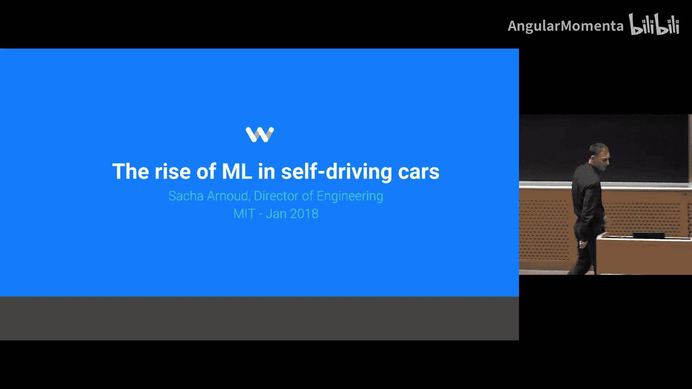

So as you'll see， we'll cover a lot of different topics。😊，Some more technical。

 some more about context。But。When I over the content。

 I have three main objectives that I'd like to convey today。

 so keep that in mind as we go through the presentation。My first one is to give you。

Some background around the safe driving space。And what's happening there and what it takes to build safed cars。

 but also give you some behind the scene views and tidbits on on the history of machine learning。

 deep learning and how it all came together within the big alphabet family from Google to Waymo。

Another piece， obviously another objective I have is to give you some technical meat around the techniques that are working today on our step driving cars。

 so I think during the class you hear a lot， you've heard a lot about different deep learning techniques。

 models， architectures， algorithms， and I'll try to put that in a current hall so that you can see how those pieces fit together to build the system we have today。

And last but not least， I think， as Le mentioned。It takes a lot more， actually。

 than algorithms to build a sophisticated system， such as our driving cars。And fundamentally。

 it takes a full industrial project to make that happen。 And I'll try to give you some color。

 which hopefully is little different from from what you've heard during the week。😊。

I'll try to give you some color on what it takes to actually pan out such an industrial project in real life and essentially productionize machine learning。

So we hear a lot of talk。 We hear a lot about save dropping cars。 It's a very hot topic。

And for very good reasons， I can tell you for sure that 2017。Has been a great year for Waymo。

 actually， only a year ago in January 2017， Waymo became its own company。

So that was a major milestone and a testimony to the。

 to the robustness of the solution so that we could move to a product productization phase。

 So what you see on the picture here is。Our latest generation， safe driving vehicle。

 so it is based on the Chrypher Pacifica。 you can already see a bunch of sensors come back to that and give you more insights on what they do and how they operate。

But that's， that's， that's the latest and greatest。

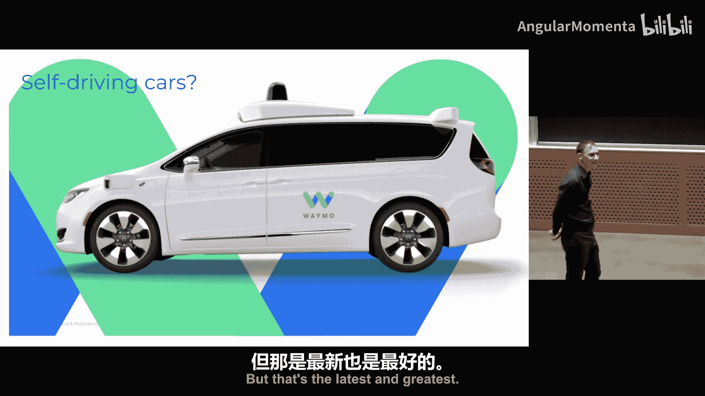

So self driving， indeed， is draws a lot of attention。 and for a very good reason。

I personally believe， and I think you would agree with me that self driving really has has the potential to deeply change the way we look about mobility。

And the way we move people and things around。So only to cover a few aspects here。

 obviously and I don't want to go into too many details， but。

Safety is one of is one of the the main motivations。94% of US crashes today involve human errors。

 A lot of those errors are around distraction and things that could be avoided。

So safety is a big piece of it。Accessibility。And access to mobilitybiity is also a big motivation of ours。

So obviously， the self driving technology has the potential to make it pretty available and cheaper for more people to be able to move around。

And last but not least， is efficiency， collective efficiency。

 So not only we spend a lot of time in our cars in in long commute hours。😊。

I personally spend a lot of time in longcom hours。And that time we spent traffic probably could be better spent doing something else than having to drive to drive the car in complicated situations。

Beyond beyond traffic， obviously， subdriving technology has the potential to deeply change the way we think about traffic。

 parking spots， urban environments， city design。 So that that's why it's a very exciting topic。😊。

So that's why we made it。 our mission at Wevo is fundamentally to to make it safe and easy to move people and things around。

So that's a nice mission。And we've been on it for a very long time。So actually。

 the whole adventure started close to 10 years ago in 2009。

 and at the time that starting under there on the umbrella of a Google project that you may have heard of called Chauffeur。

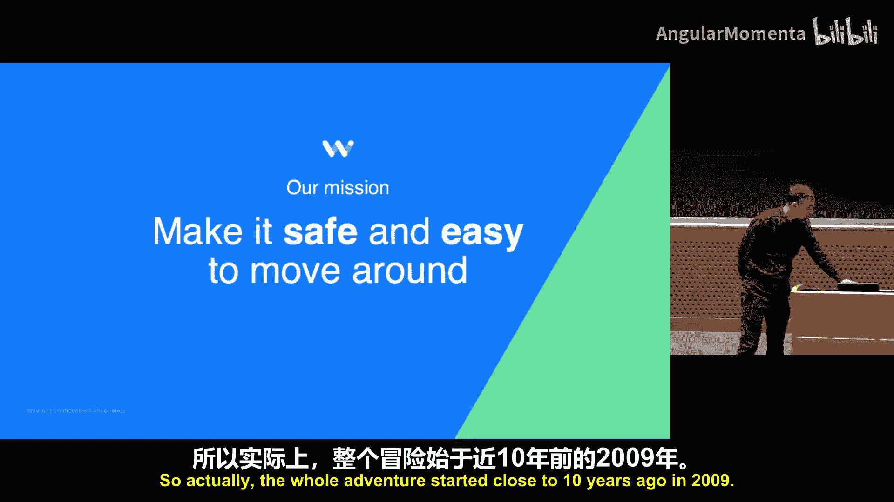

And back back， back in those days。 So remember， we are before the deep learninging days。

 at least in the industry。And so really back in those days。

 the first objective of the project was to try and assemble first prototype vehicle。

 take off the shelf sensors。Assemble them together and try to go and decide if self driving is even the possibility。

 right， It's like， it's one thing to， to have some prototype somewhere。

 But is that even a thing that that that is worth pursuing。

 which is a very common way for for Google to， to tackle problems。

So the the genesis for that work was to come up with a pretty aggressive objective。 So the team。

 the first milestone for the team， was to essentially assemble 10，100 mi loops。

In Northern California， around Mountain View。And try and figure out。

 So for a total of 1000 miles and try and and see if they could build a first system that that would be able to go and drive those loops autonomously。

So they weren not afraid。 So the team was not afraid。

 So those loops went through some very aggressive patterns。

 So you see that some of those loops go go through the， the Santa Cruz mountains。

 which is an area in California that， as you see， I'll show you a video that has very small roads and。

 and two way traffic and cliffs。😊，With negative obstacles and complicated patterns like that。

 some of those paths were going on highways so that in one of the bust highways。

 some of those routes were going around Lake Tahoe， which is which is in the Sierras in California。

 where you can encounter different kinds of weather and again， different kinds of roads conditions。

Those routes are going around bridges and the Bay Area has quite a few bridges to go through。

Though some of them were even going through a dense urban area。

 so you can see San Francisco being driven。 you can see Monrey。

 some of the Monrey centers being driven。 and as youll see on the video。

 those bring those truly bring dense urban area challenges。

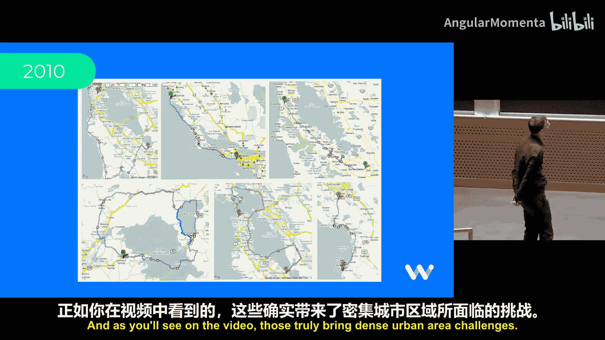

So since I promised it。 So here you're gonna see some pictures of of the driving。

 It's kind of working。 So here with better quality。

 So here you see the roads I was talking about on the on the Santa Cruz mountains driving in the night。

 animals crossing the street， freeway driving going through P。 that's the Mon area。

 that is Charlie dance， there's the aquarium there， a pretty popular one。

 That's the famous Lombat Street in San Francisco that you may have heard of。

 which and San Francisco always bring its unique set of tra between fog and slopes and in that case。

 even shop turnss。😊。

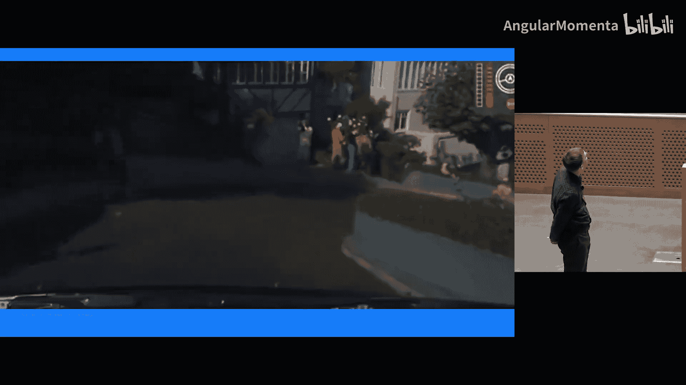

So that was all the way back in 2010。 So those 10 loops were successfully completed。

100% automously back in 2010。 So that's more than 8，8 years ago。

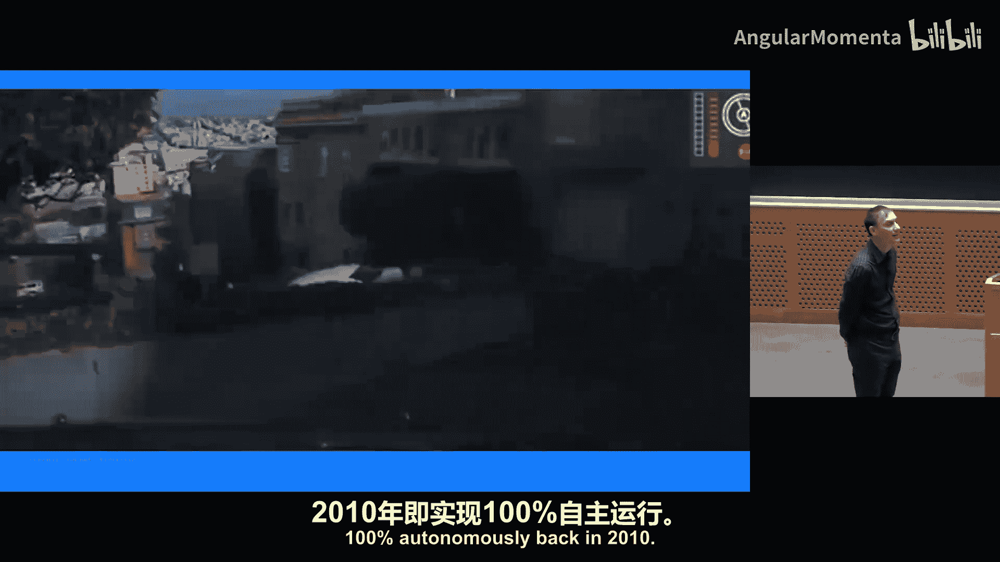

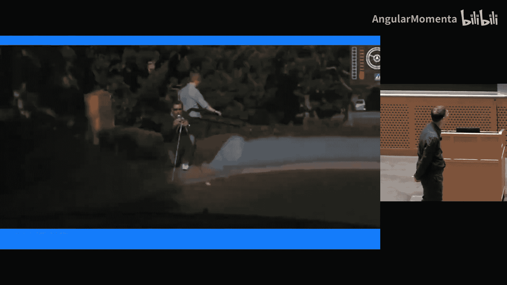

So on that， on the heels of that success， the team decided and Google decided that self driving was worth worth pursuing and move and moved forward with the development of the technology and and testing。

😊。

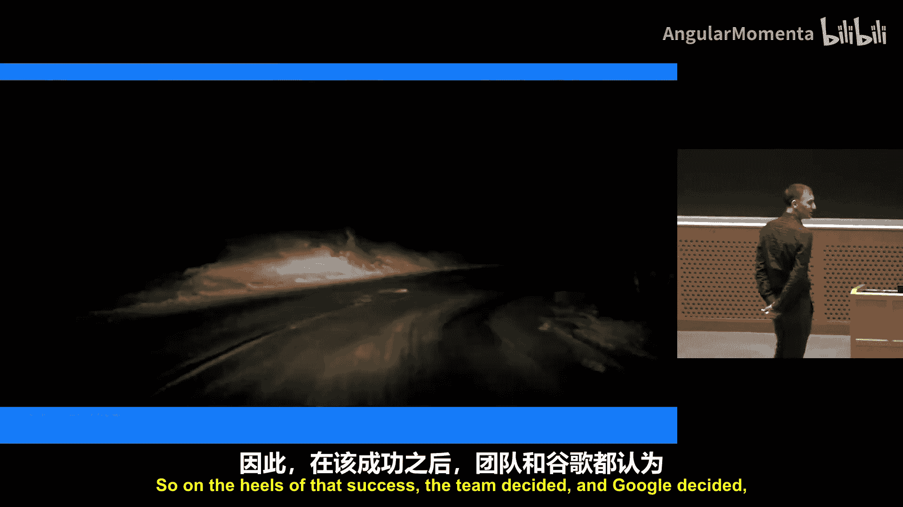

So we've been at it for all those years and have been working very hard on it， historically。

Waymo and and and I think all the other companies out there have been relying on what we call safety drivers to still sit behind the wheels。

 even if the car is is driving autonomously， you still have a safety driver who' is able to take over at any time and make sure that we have very safe operations。

And， and we've been a committed mind and knowledge and developing the system。

 many iterations of the system across all all those years。We reached a measure milestone。

 as Lex mentioned， back in back in November， where for the first time。

 we reached a level of confidence and maturity in a system that we felt confident and proved to ourselves that it was safe to remove the safety driver。

😊。

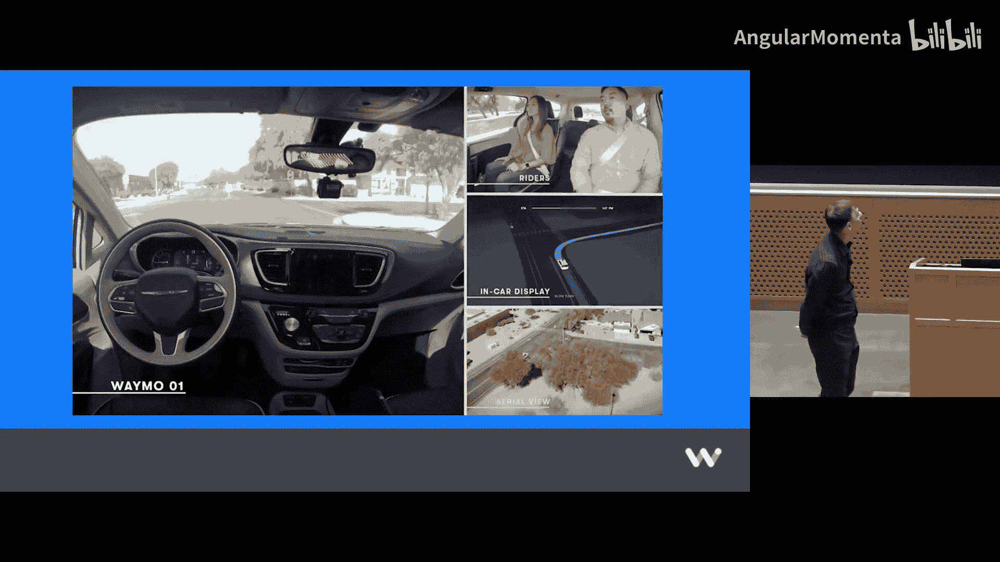

As you can imagine， that that's a major milestone because it takes a very high level of confidence to not have that backups solution of a safety driver to take over where something to arise。

So here， I'm gonna to show you a small video， a quick， quick capture of of that event。So that the。

 the video is from one of the first times we did that since then， we've been continuously operating。

Drriless cars， self driving cars in the Phoenix area in Arizona。To expand our testing。So here。

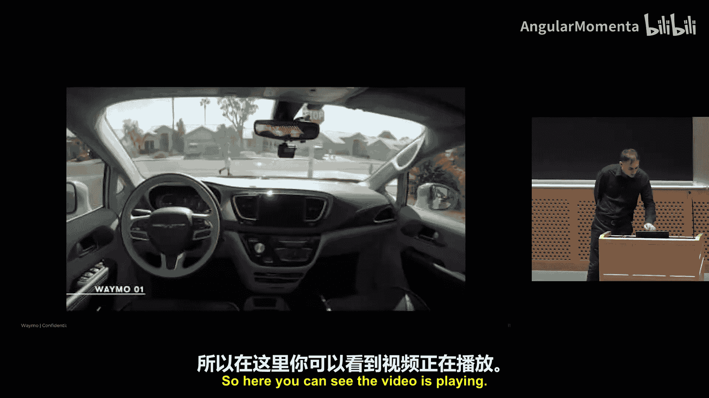

You can see the video playing， so you can see our Chrysler Pacifica。

 So here we have members of the team who are acting as passengers getting on a packed seat you can notice that there is no driver on the driver's seat。

😊，So here we are running car heading kind of service。 So the passengers simply press a button。

 The application knows where they want to go and the car goes。No， no one on the driver's seat。

So we started with a fairly constraint geographical area in Chandler， close to Phoenix， Arizona。

And we， we are hardworking to expand the the testing and the scope of our operating area since then。

So that goes well beyond a single car a single day， not only we did that continuously。

 but we also have a growing fleet of sub drivinging cars that we are deploying there all the way and looking for a product launch pretty quickly。

Okay。So he talked about 2010。And we are in 2018。 and we're getting there。 but took。

 it took quite a bit of time。So I think one of the one of the key ideas that I'd like to convey here today。

And that I will， I will go back to during the presentation。

Is how much work and how much work it takes to really take a demo or something that's working in the lab into something that you feel safe to put on the roads and get all the way to that to that depth of understanding that depth of perfection in your technology that that you operate safely So one way to say that is that when you're 90% down。

 you still have 90% to go right， So 90% of the technology takes only 10% of the time， right。😊。

In other words， you need to 10 x you need to 10x the capabilities of your technology。

 you need to 10x your team size and find ways for more engineers and more researchers to collaborate together。

 you need to 10x the capabilities of your sensors， you need to 10x fundamentally the overall quality of the system right and your testing practices。

 as you see and a lot of the aspects of the program。And that's what we've been working on。

So beyond the context of self driving cars， I want to spend a little bit of time。To give you kind of。

 kind of an insider view of the rise of deep learning。 So remember， I mentioned that back in 2009。

2010， deep learning was not really。Available yet in full capacity in the industry。

 And so over those years， actually， it took a lot of breakthroughs to to be able to reach that stage。

 And one of them was the algorithm breakthrough that deep learning gave us And I give you a little bit of of backstage view on what happened at Google during those years。

😊。

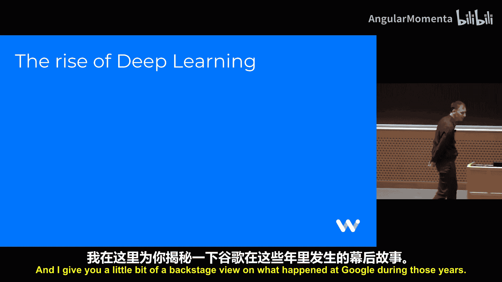

So as you know， Google has been has committed itself to machine learning and deep learning very early on。

 You may have heard of the Google brain， what we call In， the Google Bra team。

 which is which is a team fundamentally hard at work to lead the bidding edge of research。

Which is known， but also leading the development of the tools and infrastructure of the whole machine learning ecosystem at Google and Wemo to essentially allow many teams to develop machine learning at scale all the way to successful products So they've been working and pushing the deep learning technology has been pushing the field in many directions from computer vision to speech understanding to NLP and all those directions of things that you can see in Google products today。

 So whether you're talking Google assistant or Google Photos。

 speech recognition or even Google Maps you can see the impact of deep learning in all those areas。😊。

And actually， many years ago， I myself was part of the strategic team。

 and I was leading an internal program， an internal project that we call Streetmar。😊。

And the goal we had at Sweetsmart was to use deep learninging and machine learning techniques to go and analyze strictly imagery。

 And as you know that that's a very big and varied corpus so that we could extract elements that core to our mapping strategy and build and that way build better Google Maps。

So find sense of that picture so that that's a panorama or a piece of a panorama from Street view imagery and you can see that there are a lot of pieces in there that if you could find and properly localize would drastically help you build better maps so street numbers obviously that are really useful to map addresses。

 street names。😊，That when combine even on similar techniques from your views。

 will help you properly draw all the routes and give a name to them。

 and those two combines actually allow you to do very high quality address loopcaps。

 which is a common query on Google Maps。General text。And more specifically。

 text on business facades that allow you to not only maybe localize business listings that you may have gotten by other means to actual physical locations。

 whether also build some of those local listings directly from scratch。

And more traffic oriented patterns， traffic， whether it's traffic lights。

 traffic signs that can be used then for ETA， navigation， ETA predictions and stuff like that。

So that was our mission。One of the， as I mentioned。

 one of the hard pieces to do is to map address at scale。

And so you can imagine that we had a breakthrough when we first were able to properly find those street numbers out of the street dream imagery and out of the facade。

Sovlving that problem actually requires a lot of pieces。

 not only you need to find what where the the street number is on the facade。

 which is if you think about it， a fairly hard semantic problem， right。

 what's the difference between a street number versus another kind of number versus other other text。

But then obviously read it because there's no point having pixels if you cannot understand the number that's on the facade or the way to properly geolocizing it so that you can then put it on Google Maps。

And so。The first deeping application that that succeeded in production and that sold the way back to 2012 that that we had the first system in production was really the first breakthrough that we had across across alphabet on our ability to properly understand real scene situations。

So here I'm going to show you a video that kind of sums it up。

 so look every one of those segments is actually a view from starting from the car。

 going to the physical number of all those house numbers that we've been able to detect and transcribe。

 so here that's in Sao Paulo and where you can see that when all that data is put together gives you a very consistent view of the addressing scheme。

😊，So that's another example， say similar things， obviously we have that's in Paris。

 where we have more imagery， so more views of those physical numbers that when if you're able to triangulate。

 you're able to localize them very accurately and have very great maps。

So the last example I'm going to show is in a Cape Town in South Africa。W again。

 the impact of that deep learning work has been huge in in in terms of quality。

 So many countries today。Actually， have up to more than 95% of a map mapped that way。

So doing similar things， obviously you can see a lot of parallelism between that work on switch view imagery and doing the same on the real scene on the car。

 but obviously doing that on the car is even harder is even harder because you need to do that real time and very quickly with low latency。

😊，And you also need to do that in an embedded system。

 right So the cars have to be entirely autonomous。 You cannot rely on a connection to a Google data centers and first。

 we don't have the time in terms of latency to bring data back and forth。But also。

 you cannot rely on the connection to for the safe operation of your system。

 So you need to do the processing within the car。But very so that's a paper you can read that dates all the way back to 2014。

 where for the first time by using slightly different techniques。

 we were able to put deep learning at work inside inside that constrained real time environment and start to have impact and in that case around the pedestrian detection。

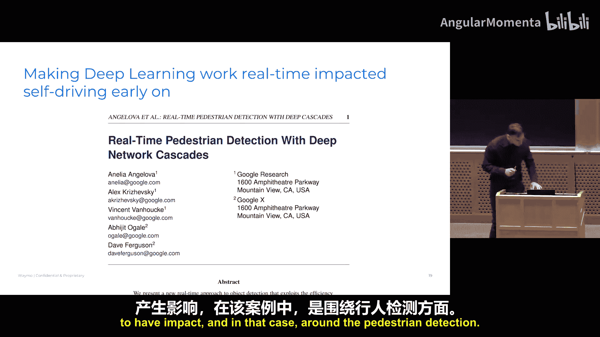

So as I said， there are a lot of analogies。 you can see that to properly drive that scene like Streetview。

 you need to find you need to see a traffic light。 you need to understand if the light is red or green。

 And that's what that's what essentially will allow you to to processing。 Obviously。

 driving is even more challenging beyond the real time。 And if you saw the cyclist going through。

 So we are stuff happening on the scene that you need to detect and properly understand interpret and predict。

 And at the same time he explicitly。😊，A nightight driving。

Example to show you that what you can choose when you take pictures of StudioD and do it in daytime and in perfect conditions。

 driving requires you to take the conditions that they are and you have to deal with it。

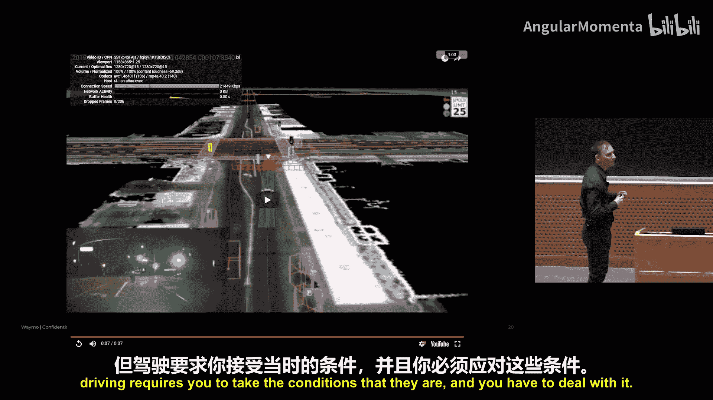

So there has been for from the very early beginning。

 there has been a lot of crossponization between the real scene work。 So here I。

 I took a few papers that we did in Streetview that obviously， if you read them。

 you'll see directly apply to some of the stuff we do on the cards。

 but obviously that collaboration between Google research and Waymo。

Historically went well beyond studio only and across all the research groups。

 And that still is a very strong collaboration going on that enables us to be to stay on the building edge。

 right， of what we can do。

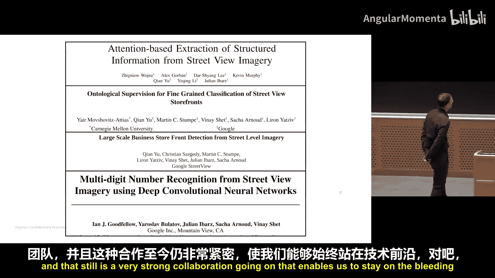

So not， we looked a little bit at how things happened。

I want to spend more time and go into more of the details of what's going on in the past today and how deep learning is actually impacting our current system。

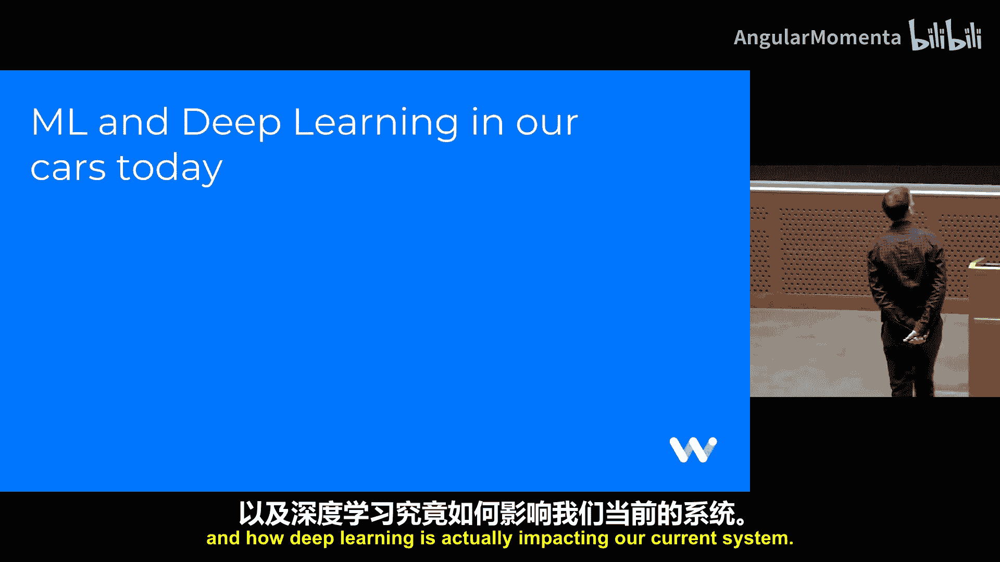

So I think during if I looked at the cursors properly， I think during the week。

 you went through the major pieces that you need to master to make a s car。

 so I'm sure you heard about mapping， local atization。

 so putting the car within those maps and understanding where you are with pretty good accuracy perception。

 scene understanding which is a high level semantic understanding of what's going on in the scene starting to predict what the agents are going to do around you so that you can do better motion planning。

Obviously you state as a whole robotics aspect at the end of the day， the car in many ways。

 acts like a robot， whether it's around the sensor data or even the controlling interface to the car and for everyone was deal with hollow and robotics。

 you will agree with me that it's not a perfect world and you need to deal with with those errors。

 other PC that you may have talked about is around simulation and essentially validation of whatever system you put together。

😊，So obviously， machine learning and deep learning have been having a deep impact in a growing set of those areas。

But for the next， for the next minutes here， I'm gonna focus more on the， on the perception piece。

 which is， which is a core element of， of what the self driving count is to do。So what is perception？

So fundamentally perception is a system in the car that needs to build an understanding of the world around around it。

And it does that using two major inputs。The first one is prior on the scene。 So， for instance。

 to give you an example。It would be a little silly to have to recompute the actual location of the road。

 the actual interconnectivity of the intersections of every intersection once you get on the scene。

 because those things you can precompute。You can precompute in advance and and save your onboard computing for other tasks that are more critical。

 So really， so that's often referred to as as the mapping exercise。 But really。

 it's about reducing the computation you're gonna have to do on the car once it drives。

The other big input， obviously， is what sensors are going to give you once you get on the spot。

So sensor data is the is the the signal that's going to tell you what is not like what you map and the things is the traffic light。

 red or green。 where Where are the pedestrians， Where are the cars， What are they doing。

So as we saw on the initial picture， we have quite a set of sensors on our self driving cars。

 So they go from vision systems。Radar and later the other three big families of sensors we have。

One point you note here is。Is that they are designed to be complementary。

 So they are designed to be complementary first in their in their localization on the car。

 So we don't put them in the same spot because obviously blind spots is is a major issues。 And。

 and you want to have good coverage of of the field of view。

The other piece is that they are complementary India capabilities。 So， for instance。

 to give you an example， cameras are going be very good to give you a dense presentation。 right。

 It's like it is a very dense set of information。😊，It contains a lot of semantic information， right。

 You can， you can see， you can really see。ABig number of a large number of details。 But for instance。

 they are not really good to give you depth。 it's much harder Comp and computationally expensive。

To get depth information out of camera systems。 So systems like Liar， for instance。

 will give you very good， very good when you hit， when you hit objects will give you a very good depth estimation。

 But obviously， they're gonna lack a lot of the semantic information that you will find on camera systems。

 So all those sensors are designed to be complementary in terms of their capabilities。😊。

It goes without saying that the better your sensors are。

 the better your perception system is going to be， right。

That's why at Waymo we took the path of designing our own sensors in house and enhancing what's available of the share today because it important for us to go all the way to be able to build a selfding system that we could believe in。

嗯。And so that's what perception does。 Take those two inputs and build a representation of the scene。

 So at the end of the day， you have to realize that that。In nature。

That work of perception is really what differentiates， deeply differentiates。

What you need to do in a subject system， as opposed to。A lower。

 lower level driving assistance system in， in many cases。

 find if you do speed control speed crews or if you do。A lot of lower level driver assistance。

 a lot of the strategies can be around not bumping into things。 if you see things moving around。

 you group them， you segment them appropriately in blocks of moving things and you don't hit them。

 You're good enough in most cases。When you don't have a driver on the driver's seat。

 obviously the challenge totally changes scale。 So to give you an example， for instance。

 if you're on the lane and you see a bicyclist going more slowly on on the lane right of you and there's a car next to you you need to understand that there's a chance that that car is going to want to avoid that bicyclist is going to swerve and you need to anticipate that behavior so that you can properly decide whether you want to slow down。

 give space for the car or speed up and have the car go behind you。

 those are the kinds of behaviors that go well beyond not bumping into things and that require a much deeper understanding of the world that's going on around you。

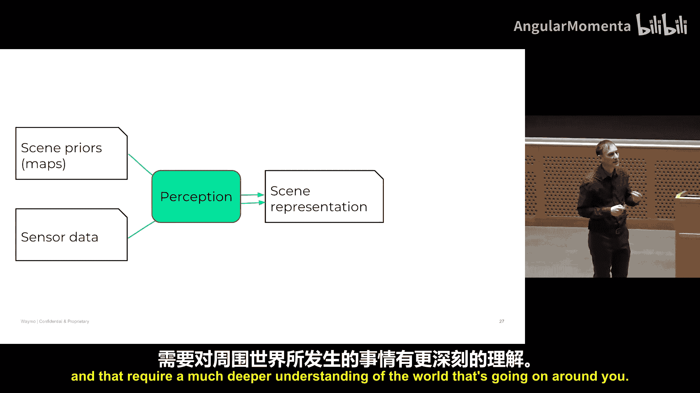

So let me put it in picture and we'll come back to that example in a core case so here is a typical scene that we encountered at least so here obviously you have a police car pulled over probably pulled over someone there。

 you have a cyclist on the road， moving forward and we need to drive through that situation。😊。

So the first thing you can do。 you have to do， obviously， is the basics， right。

 So out of your sensor data， understand that a set of point clouds and pixels belong to the cyclists find that you have two cars on the scene。

 the police car and the car parked in front of it。Understand the policeman as a pedestrian。

 So basic level of understanding。Obviously， you need to return more than that。

 You need to go deeper in in your semantics。 Obviously， you need。

 if you understand that the the flashing lights are on。

 you understand that the police car is is becoming an E V and and is performing something on the scene if you understand that this car is parked。

 which see that's a very piece of information。 That's gonna to tell you whether you can pass it or not。

Something you may have not noticed is that there are cell cones。

 so there are cones here on the scene that would prevent you， for instance。

 to go in and drive that pathway if you wanted to。Next level of of getting closer to behavior prediction。

 obviously， if you， if you also understand that actually the， the police car has an open door。

Then all of a sudden， you can start to expect a behavior where someone is going get out of that car right and the way you swerve。

 even if you are to decide to swerve or the way someone getting out of that car with impact the trajectory of the cyclist is something you need to understand in order to properly and safely drive。

And only then， only when you have that depth of understanding。

 you can start to come up with realistic behavior predictions and trajectory predictions for all those agents on the scene so that you can come up with a power strategy for your planning control。

So， so how is deep learning playing into that whole space and how is deep learning impacting used to solve many of those problems。

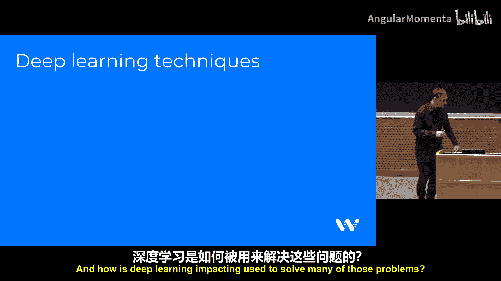

So。Remember， when I said when you're 90% down， you still have 90% to go。

So I think that that stop to beat us。I also talked about how robotics and having sensors in real life is not a perfect world。

So actually is a big piece of the puzzle。 So I wish sensors would give us perfect data all the time and would would give us a perfect picture that we can do reliably use to do a deep learningwn。

 but unfortunately that's not how it works。😊，So here， for instance。

 you see an example where you have a pickup truck， so the imagery doesn't show it。

 but you have a smoke coming out of the exhaust and you have exhaust that's triggering lightar laser points。

 right。Not very relevant for your for any behavior prediction or for your driving behavior。

 So those points， obviously， and it's safe to go and drive through them。 right。

 So those are very safe to to ignore in terms of syn understanding， right So filtering。

The whole whole bunch of data coming off your sensors is is a very important task because that reduce is the computation you're gonna have to do。

 But's also key to do to operate safely。 A more a more subtle one。

 but important one around reflections。So here are driving a scene there's a car here on the camera picture the car is reflected in the bus。

 and if you just do na detection， you're gonna especially that if the bus moves along with you and everything which is very typical and everything moves。

 then you're gonna have all of a sudden you're gonna have two cars on the scene and if you take that car too seriously all the way to impacting your behavior。

 obviously you're gonna make mistakes So here I showed you an example of reflections on the visual range。

 but obviously that affects all sensors in slightly different matters。

 but you could have the same effect， for instance， with a lightA data for instance。

 you you drive a freeway and you have a road sign on top of the freeway that will reflect in the back window of the car in front of you and then showing a reflected sign on the road。

You' better understand that the thing you see on the road is actually your reflection and not try to swerve around and trying to avoid that thing on the 65 mice per hour trajectory。

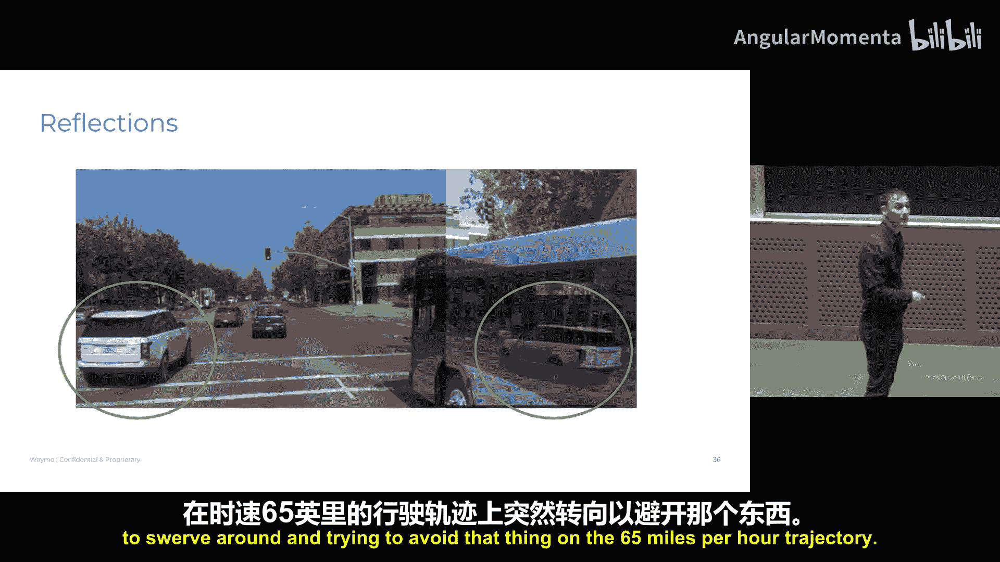

So that's a big， that's a big complicated challenge。 But assume we， we are able to get to proper。

Sensor data that we can start to process with our machine learning。So by the way。

 a lot of the signal processing PC actually already use machine learning and deep learningning to。

 because as you can see find something the reflection space， you need to at the end of the day。

 you can do some tricks to understand the difference in the signal。

 but at the end of the day at some point for some of them you're going have to understand to have a higher level of understanding of the scene and realize it's not possible that the car is hiding behind the us given by field of view。

 for instance。But assuming you have good sensor data， filter out sensor data。

 the very next thing you're going to want to do is typically is apply some kind of convolution layers on top of that imagery。

So the if you're not familiar with conversion layers。

 so that that's a very popular way to do computer vision because it relies on on connecting neurons with kernels that are going run that are going learn layer after layer features of the imagery right So those kernels typically work locally on the sub region of the image and they're going understand they're gonna understand lies。

 they're going understand contours and as you build up layers are going understand higher and higher levels of feature representations that ultimately will tell you what's happening on the image。

So it's a very common technique and much more efficient， obviously than fully connected layers。

 for instance， that wouldn't work。 But unfortunately。

 a lot a lot of the state of the art is actually in 2D convolutions So again。

 they've been developed on imagery and typically they require a fairly dense input So for imagery are great。

 It's great because pixels are very dense。 you always have a pixel next to the next one。

 there's not a lot of void。 if you were， for instance。

 think if you were to do plain convolutions on the very sparse laser points， for instance。

 then you would have a lot of holes and those don't work in nearly as well。😊，So typically。

 what we do is to first project sensor data into 2D planes and and do processing on those。

 So two very typical views that we use。 The first one is is top down So broad views。

 which gonna give you a Google mapps kind of view of the scene。 So it's great， for instance。

 to map to map cars and and objects moving along the scene。

 but they don't it's harder to put imagery pixels。 imagery you saw from the car into those top down views。

 So there's another famous one common one that that is the driver view So projection onto the plane from the driver's perspective that are much better at utilizing imagery because essentially that's how imagery imagery got captured video un used drone。

😊，So here， for instance， you're going to see how you can if your sensors are properly registered。

 how you can use both LiDar and imagery signals together to better understand the scene。

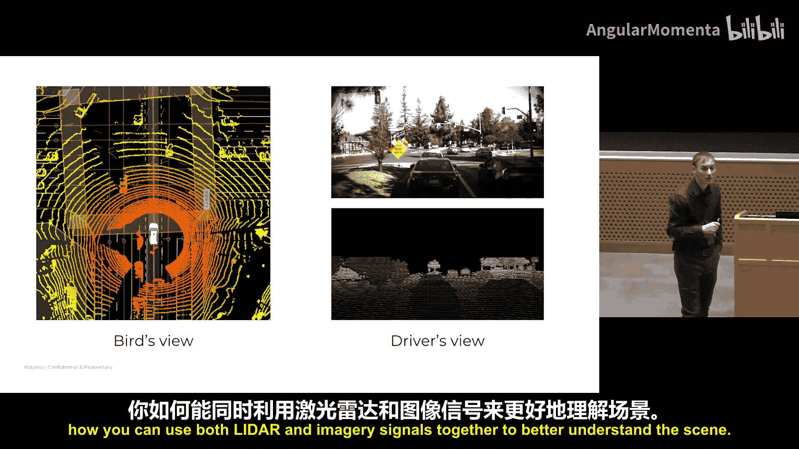

So the first kind of processing you can do is what is called segmentation。

So once you have pixels or laser points， you need to group them together together。

 into objects that you can then use for better understanding and processing。So unfortunately。

 a lot of the objects you encounter while driving don't have a predefin shape。

 so here I do the example of snow， but if you think about vegetation or if you think about trash bags。

 for instance， you can't come up with a prior understanding on how they're going to look like and so you have to be ready to have any shape of those objects。

So one of the techniques that works pretty well is to build a smaller convolution network that you're gonna slide across across the project of your sensor data。

 So that's the sliding window approach。So here， find instance。

 if you have a pixel accurateate snow detector that you slide across the image。

 then you'll be able to build a representation of those patches of snow and drag appropriately around them。

So that works pretty well， but as you can imagine， is a little expensive computationally because it's like if you remember I know if you if you've seen them actually。

 it's like the old the old the matrix printing。s like you had that printer and it had to go and print a page point by point So it works pretty well。

 but it's pretty slow It's obviously but it's very analog to that。😊，But it works pretty well。 So。

 so that works pretty well。 but you obviously， you need to be very conscious on which area of the scene you want to apply to to to stay efficient。

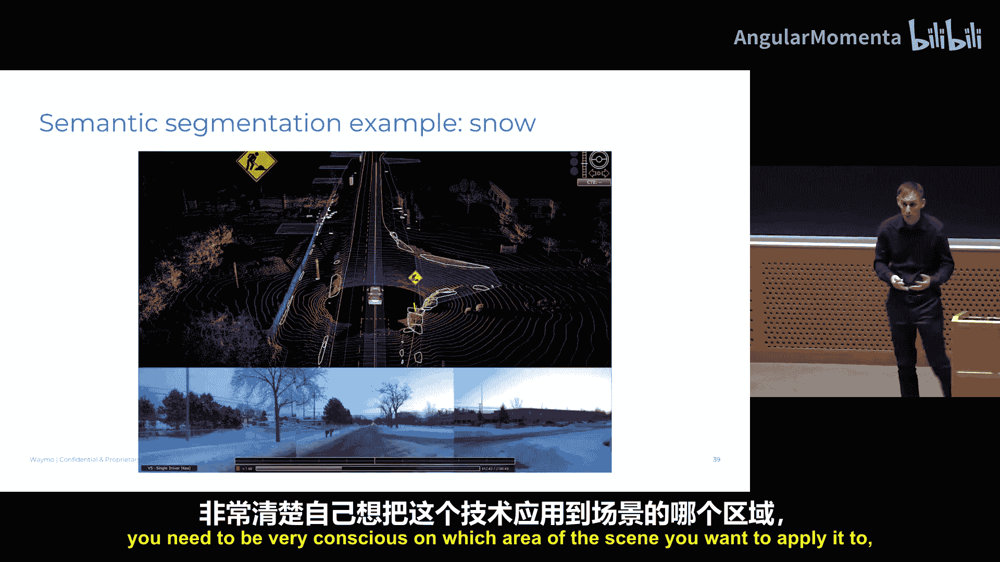

Fortunately， many of the objects you， you need， you care about have pretty fine priors。 So。

 for instance， if you take a car from the bird from the the top down view， from the bird's view。😊。

It's gonna be a rectangle。 you can take that chip prior into consideration in most cases。

 even on the lanes， on the driving lanes， they're going to go in similar directions。

 whether they go forward or the other way they're going go in the direction of the lanes same for adjacent streets So you can use those priors to actually do some more efficient deep learning that in the literature convey under the ideas of single short multibox ones so here again you would start with a convol towers。

 but but you do only one pass of convol in select it's the same difference between the matrix printer and and the press that would print the page at once。

 it's only an analogy but I think it conveys the idea pretty well So here you would train a deep net that would directly take the whole projection of your sensor data an output boxes that。

That encode the priorities you have。So here， for instance。

 I can show you how such a thing would work for cone detection。

 so you can see that we don't have all the fidelity of the per pixel cone detection。

 but we don't really care about that， we just need to know there's a cone somewhere and we take a box prior and obviously that image is also meant to show is that since it's a lot cheaper computationalary you can obviously run that on a pre wide range of space and even if you have a lot of them。

 that city is going to be a very efficient way to get that data。

So we talked about the member the flashing lights on on top of the police car。

 So even if you if you properly detect and segment cars， let's say on the road。

 many cars have very special semantics。 So here in on that slide I'm showing you many examples of EV emergency vehicles that you need obviously to understand。

 you need to understand first that it is an EV and two whether the EV is active or not。

 So school buss are not really emergency vehicles， but obviously whether the bus has lights on or the bus has a the stop sign open on the side carry heavy semantics that you need to understand。

So how do you deal with that back to the deep learning techniques。

One thing you could do is is take that patch， build a new convol tower and build a classifier on top of that and essentially build a school bus classifier。

 a school bus with lights on classifier， a school bus with stop sign open classifier。

 I'm pretty sure that would work pretty well if see that would be a lot of work and pretty expensive to run on the car because you need to and convol layers typically are the most expensive pieces of a neural net。

😊，So one better thing to do is to use to use embeddings。 So if you're not familiar with it。

 embeddings essentially are vector representations of objects that you can learn with deep nets that will that will carry some semantic meaning of of those objects。

 So， for instance， you given given a vehicle。You can build a vector。

That's going to carry the information that that vehicle is a good bus， whether the lights are on。

 whether the stop sign is open。And then you you're back into a vector space which is much smaller。

 much more efficient that you can operate in to do further processing。

 So those embeddings have been actually historically。

 they've been more closely associated with a word embeddings So in a typical text if you were able to build those vectors with word out of words So out of every word in a piece of text you beat a vector that represents the meaning of that world and then if you look at the sequence of those words and operate in the vector space。

 you start to understand the semantics of those sentences So one of the early projects that you can look at is called a word tove which was which was done in the NNP group at Google where they were able to be such things and they discovered that that embedding space actually carried some interesting vector space properties such as if you took the vector for king minus the vector for man plus the vector for women actually you ended up with a vector where the closest word to that vector。

would be queen， essentially so that's to show you how those vector representations can be very powerful in the amount of information they can contain。

😊。

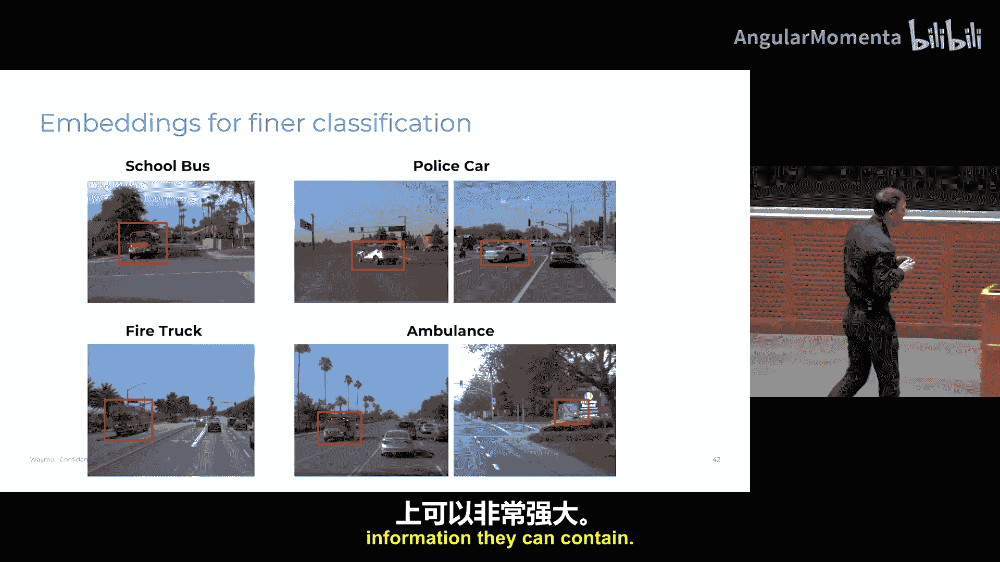

Let's talk about pedestrians。So， we talked about。Semantic segmentation， remember。

 So the ability to go pixel by pixel for for things that that that don't really have a shape。

 We talked about using shape priors。But pedestrians actually combine the complexity of those。

 of those two approaches。For many reasons， one is that obviously they are deformable and pedestrians come with many shapes and posesies。

 as you can see here， I think here you have a guy someone on a skateboard。

 crouching more unusual posesies that you need to understand。😊。

And the recall you need to have on pedestrians is very high。

 And pedestrians show up in many different situations。 So， for instance， here。

 you have occludeed pedestrians that you need to see because there's a good chance when you。

 when you do your behavior prediction， that that person here is gonna jump out of the car and you need to be ready for that。

😊，So last but at least。😊，Predicting the behavior of pedestrians is really hard because they。

 they move in any direction， a car moving that direction。 it can safely， but it's gonna。

 it's gonna it's not gonna drastically change and goal in in in in moment's notice， right。

 But if you take children， for instance， it's a little more complicated， right。

 so they may not pay attention， They may jump in any direction and you need to be ready for that。

So it's harder in terms of shape prior， it's harder in terms of recall。

 and it's also harder in terms of prediction and you need to have a fine understanding of the semantics to understand that。

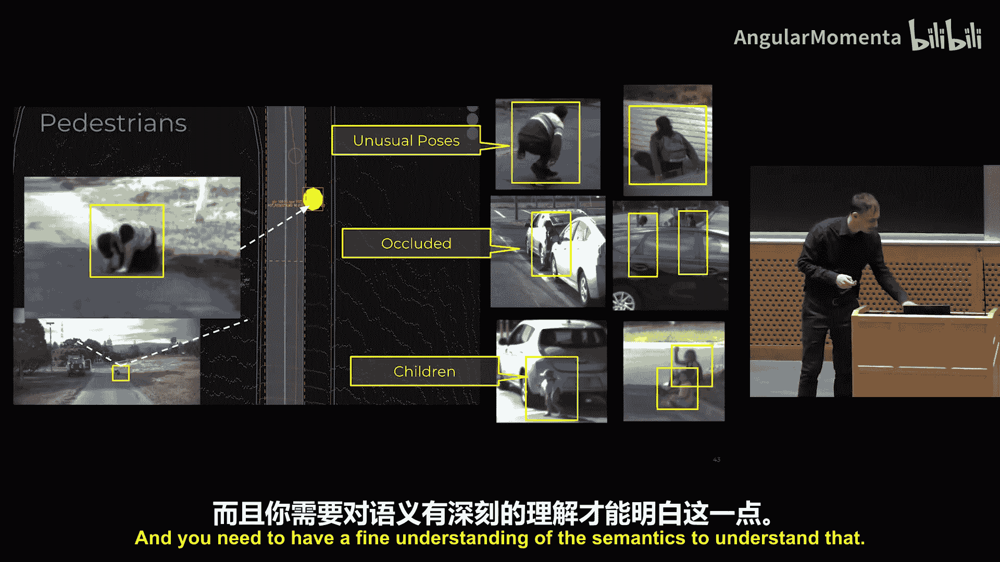

Another example here is that we encountered is you get to an intersection and you have a visually impaired person that's jawalking on the intersection。

 and you obviously need to understand all all of that to know that you need to yield to that person pretty clearly。

 So person on the road。 Maybe you should yield to it to to him。' not easy。 So， for instance here。

 So there is actually， I don't， I don't。 I don't know if it's a real person or a。

A manin or something。 So but here we go， something that， frankly。

 really looks like a pedestrian that you should probably classify as a pedestrian， but lying on the。

 on the， on the， on the bed of a pickup truck。So， and obviously。

 you shouldn't yield to that person right， because if you。

 if you were to and yielding to a pedestrian at 35 miles per hour， for instance。

 he is hitting the brakes pretty hot right with the risk of we are we are we are collision。

 So obviously， you need to understand that that that person is traveling with a truck and he's not actually on the road and it's okay to not yield to to him。

So those are examples of the vision of the semantics you need to understand。 Obviously。

 one way to do that is to start and understand the behavior of things over time。

 Everything we talked about until now in how we use deep learning to solve some of those problems was on a pure frame basis。

 But understanding that that person is moving with a truck versus the jawalker in the middle of the intersection。

 obviously that kind of information you can get to if you observe the behavior of a time。

Back to the embeddings。 So if had vector， if you have vector representations of those objects。

 you can start and track them over time。So a common technique that you can use to get there is to use recurrent neural networks that essentially are networks that would build a state that gets better and better as it gets more observation。

 sequential observation for your pattern So for instance。

 coming back to the world's example I gave earlier you see you have one word you see is vector representation another word in a sentence you understand more about what the author is trying to say third word fourth word at the end of the sentence。

 you have a good understanding and you can start to translate one instance So here's a similar idea。

 if if you understand if you have a semantic representation and codeineian em badding for the pedestrian and the car under it and track that of a time and build a state that gets more and more meaning as time goes by。

 you're gonna get closer and closer a good understanding of what's going on in the scene So my point here is those vector representation combined with。

Recommening neural networks is a common technique that can help you figure it that out。

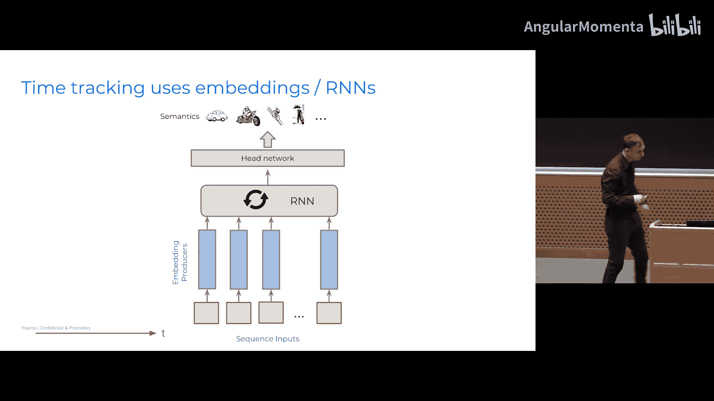

Not to the point。When you are 90% done， you still have 90% to go。

And so to get to the last leg of my talk here today。

 I want to give you some appreciation for what it takes to truly build a machine learninging system at scale and industrialize it so up till now we talked a lot about algorithms as I said earlier。

 algorithms have been a breakthrough and the efficiency of those algorithms has been a breakthrough for us to succeed the safe driving task。

 but it takes a lot more than algorithms to actually get there。

嗯。The first piece that you need to an X is， is around the labeling efforts。

 So a lot of the algorithms we talked about are supervised。

 meaning that even if you have a strong network architecture and you come up with the right one。

They are superviseding a sense that you need to give in order to train that network。

 you need to come up with a representative set， highqu set of label data that's going to map some input to predict the outputs you wanted to predict so that's a pedestrian。

 that's a car， that's a pedestrian， that's a car and the network will learn in a supervised way。

 how to build the right representations。So there's a lot。 Obviously。

 the unsupervised space is a very active domain of research。

 Our own team of of research at Waymo and and collaboration with Google is around that domain。

 But today， a lot of it still is supervised。😊，So to give you orders of magnitude。

 so here I represented in a logarithmic scale the size of a couple data sets。

 So you may be familiar with INe， which I think is the 15 million of such labels range that guy jumping represents a number of seconds from birth to college creation probably coming soon。

😊，呃。And so that's more of an historical tidbit。 but the first remember find the the street number on the facade problem。

 So back in those days， it took us a multibillion label data set to actually teach the network。

 So those were very earlys today， we do a lot better。 obviously。

 but that's to give you an idea of scale。 So being able to put to have labeling operations that produce large and high quality label data sets is key for your success。

 And that's a big piece of the puzzle you need to solve。😊，So we today we do a lot more better。

 not only we require less data， but we so can generate those data， much more efficiently。

 You can use machine learning itself to come up with labels and use operators and more importantly use hybrid models where you use labelers to more and more fix the discrepancies or the mistakes and have to label the whole thing from scratch So combining so that's a whole space of active learning and stuff combining those techniques together obviously you you can to completion faster。

 It's very common to still need in the millions， millions range kind of samples to train a robust solution。

😊，Another piece is around computation computing power。

 So again that's kind of a historical tibit around the street number models so here it's the detection model and here is the transnscribeber model。

 so obviously comparison is not is only worth what it's worth here but if you look at the number of neurons or number of connections per neuron which are two important parameters of any neural net。

 that gives you an idea of scale obviously it in many others of many to the way from what the human brain can do。

 you start to be competitive and even in some cases in the mammal space right。😊，So again。

 historical data， but the main point here is that you need a lot of computation and you need to have access to a lot of computing to either train or infer those train models on real time on the scene。

And that requires a lot of very robust engineering and infrastructure development to get to those scales。

But Google is pretty good at that。 and obviously we at Waymo have access to the Google infrastructure and tools to essentially get there。

So I know know if you heard so the way the way it's happening at Google is around the TensorFlow。

 so maybe you've heard about it as more of a programming language to program machine learning。

 and and then code network architectures but actually TensorFlow is also becoming orE is actually the whole ecosystem that can combine combine all those species together and do machine learning at scale at Google and Wamo so as I said it's a language that allow teams that allows teams to collaborate and work together that's a data representation in which you can represent your label data sets for instance。

 or your training batches that's a runtime that you can deploy onto Google data centers and it's good that we have access to that computing power another piece is accelerators so back in the audience。

s when we had CPUUs to run deep learninging models at scale， which is less efficient。

 and over time GPUs came into the mix and Google is pretty active into developing very advanced set of hardware accelerators so you may have heard about TUs Tensorflow processing units which which are proprietary chipsets that Google deploys in its data centers that allow you to train and infer more efficiently those deep learninging models and Tensorflowlow is the glue that allows you to deploy at scale across those species。

 very important pieces to get there。

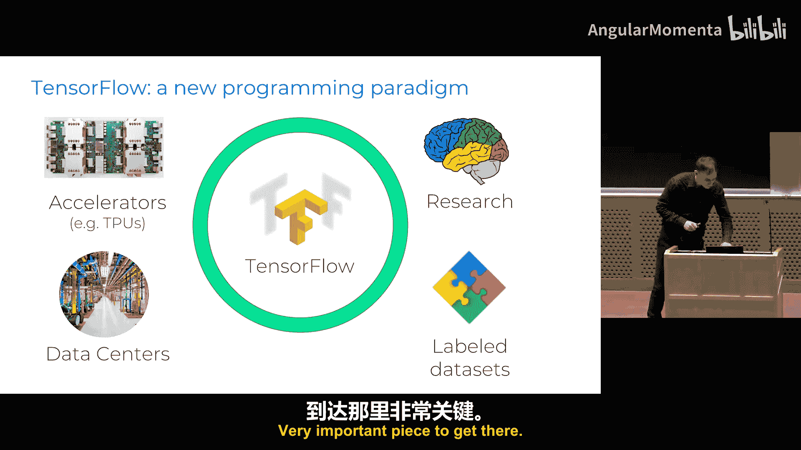

So it's nice。 you're smart， build we build a smart algorithm。 We were able to collect enough data。

 to train it。 great， ship it。😊，Well。S driving system is pretty sophisticated。

And that's a complex system to understand。 And that's a complex system that that requires extensive testing right And I think the last leg that you need to cover to do machine learning at scale and with a high safety bar is around your testing program。

So we have three legs that we use to make sure that our machine learning is ready for production。

 one is around realro driving， another one is around simulation and the last one is around structure testing。

 so I'll come back to that。

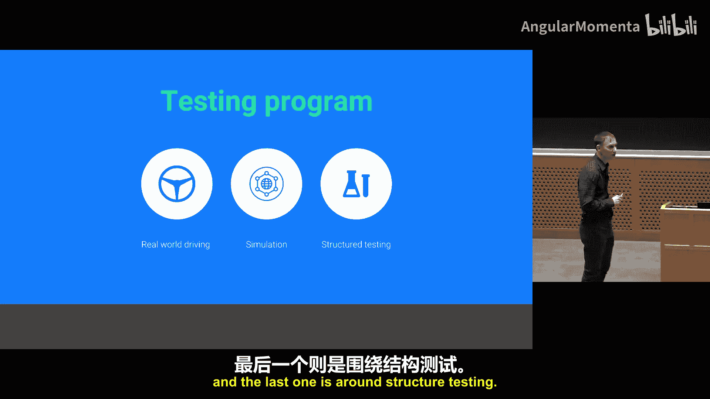

In terms of realro driving， obviously， there is no way around it if you want to encounter situations and see and understand how you behave。

 you need to drive。So as you can see the driving at Waymo has been accelerating over time still is accelerating so we crossed 3 million miles driven back in May。

 2017 and only six months later back in November we reached 4 million so that's an accelerating pace obviously not every miles is equal and what you care about are the mice that carry new situations and important situations。

 so what we do obviously is driving in many different situations so those miless got acquired across 20 cities。

 many weather conditions and many environments。Is form a lot。 So to give you another of magnitude。

 So that's1 over 60 times around the globe。 Okay， even more importantly。

 it's hard to it's hard to estimate， but it's probably around 300 years of human driving equivalent so in that data set potentially you have 300 years of experience that your machine learning can tap into to to learn what to do。

😊。

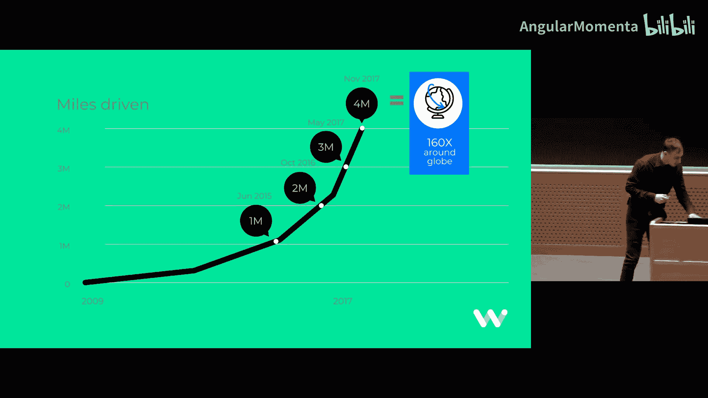

Even more importantly， is your ability to simulate。 Obviously， the software changes regularly。

 So if for each new revision of the software， you need to go and rerive4 million miles。

 it's not really practical。 and it's gonna take a lot of time。

 So the ability to to have good enough simulation that you can replay all those miles that you've driven in any new iteration of the software is key for you to decide if the new version is ready or not。

😊，Even more important。Is your ability to to make those miles more even more efficient and tweak them。

 So here is is a screenshot of an internal tool that we call a aircraft craft that essentially gives us the ability to fuuzz or change the parameters of the actual scene we've driven。

 So what if the cars were doing in a slightly different speed。

 What if there was an extra car that that was on the scene。

 What if a pedestrian crossed in front of the car。 So so you can use the actual driven mice as a base and then augment them into new situations that you can test your drive your self driving system against。

 So that's a very powerful way to actually drastically multiply the impact of any any miles you drive。

😊，And simulation is another of those massive scales project that you need to cover so a couple others of magnitude here。

 so using Google's infrastructure we have the ability to run virtual fleet of 25，000 cars。

 247 in data centers so those are those software stacks that emulate the driving across either raw miles that we've driven or modified miles that help us understand the behavior of the software。

 so to give you another of magnitude last year alone we drove 2。

5 billion of those miles in data centers right so remember 4 million driven miles total or the way to 2。

53 orders of magnitude of expansion in your ability to truly understand how the system behaves。

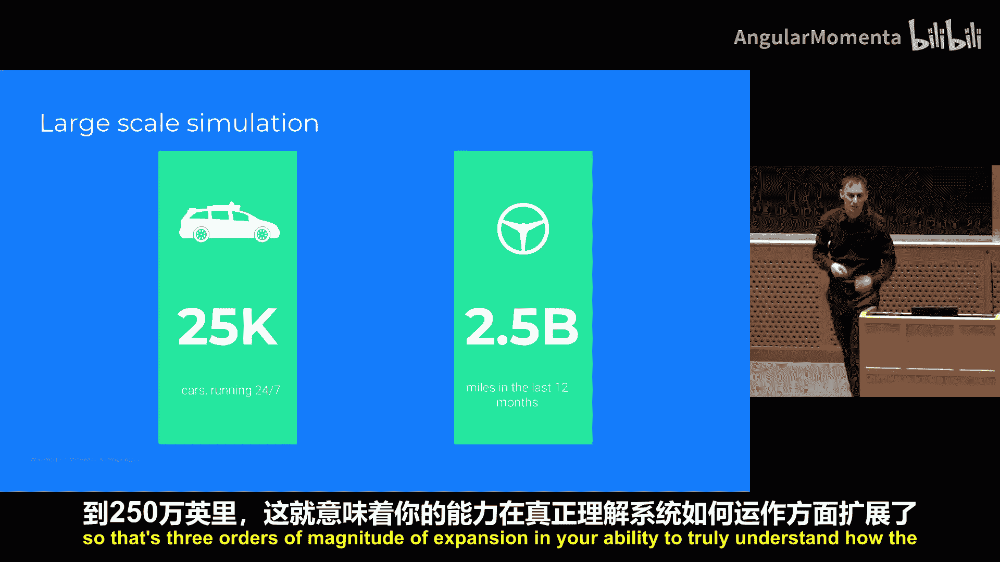

But there's still a long tail， there's a whole long tail of situations that will happen very rarely。

 so the way we decided to tackle those is to set up our own testing facility that is a mock of a city and driving situation so we do that in 90 acre testing facility on the former efforts Force base in central California that we set up with traffic lights railroad crossings I mean。

 truly trying to reproduce a real life situation and where we set up very specifics scenario IOs that we haven't necessarily encountered during Orular driving but that we want to test and again feedback into the simulation re augmentmat using the same augmentation strategies and inject into our 2。

5 billion miles driven。So here I'm going to show you two quick examples of such tests。

 so here just have a car backup as the search driving car gets closed and see what happens and use all those sensor data to reject them into simulation。

😊，Another example is going to be around people dropping boxes， so。Remember。

 try to imagine the kind of understanding segmentation you need to do to understand to understand what's happening there and cementing understanding you have and to make it even more interesting。

 note that the car that has been put on the other side so that swerving is not an option without hitting the car so driving complex situations that go from perception to motion planning。

 the whole stack and make sure that we are reliable even in those long longte examples。Are we done？

Looks like a lot of work， I wish， but no， actually。

 we have we still have a lot of very interesting work coming。

 so don' not have much time to go into too many of those details。

 but I'm just going to give you too big directions。😊。

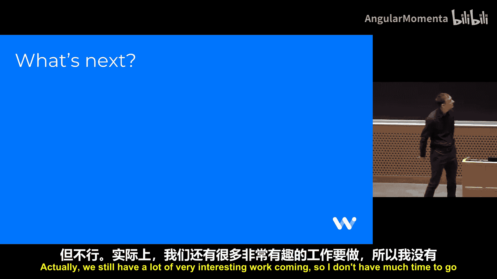

The first one is around growing our what we call ODD， so operating operating domain。

 operating design domain， so extending our fleet of driving cars not only geographically。

 so geographically meaning going into deploying into urban cores。

 deploying into different weather conditions so just as this morning or yesterday we announced that we're going to grow our testing in San Francisco。

 for instance， with Waymo cars that bringing urban environments， slopes， fog， as I said。

 and so that's obviously a very very important direction that we need to go into and where machine learning is going to keep playing a very important role。

Another area is around the cementing understanding。So in case yout haven't noticed yet。

 I am from France。 that's a famous roundabout in Paris， P Vito， which seems pretty cattic。

 but I've given it many times without any issues thatingwood but I know that it took a lot of semantics and understanding for me to do it safely。

 I have had a lot of expectations on what people do had a lot of communication。

 visual gestures to essentially get get through that thing safely right and those require a lot of a lot of a lot deeper semantic understanding of the scene around to to fossil Robca to get through So that's an example of a direction。

😊，So back to my objectives。I hope I covered many of those。 or at least you have。

 you have directions to for further reading and investigations。On those those three objectives I had。

 I had today。 First one was around context， context of the space。

 context of the history at Google and Wemo。And how and how deep the roots the roots are on the way back in time。

My second objective was to give you to tie in some of the technical algorithm solutions that you may have talked about during that class。

 into the practical cases we need to solve in the production system。And last but not least。

 really emphasize the scale and the engineering infrastructure work that needs to happen to really take such a project into nutrition in a production system。

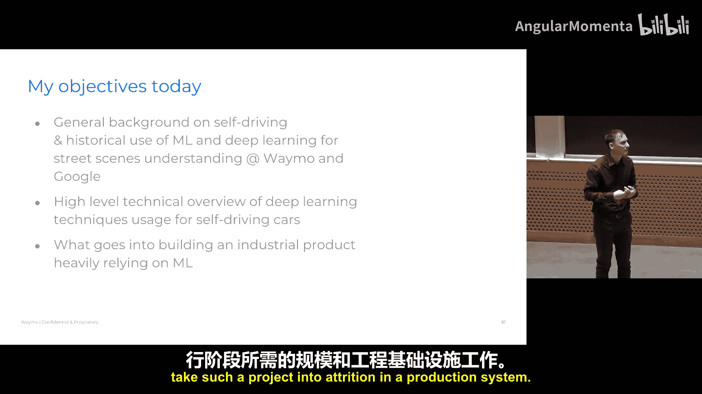

Last tweet。

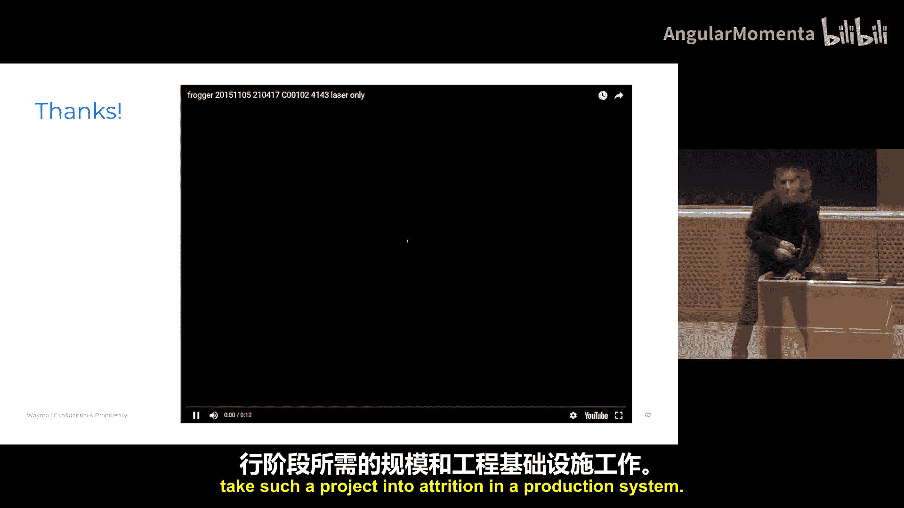

That's a scene with kids on jumping on bags as froger across the scene。

And I think we have time for a few questions。 So maybe a hand thank you。

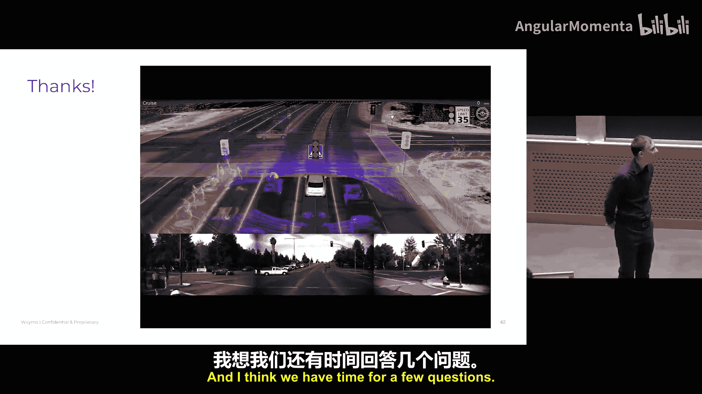

Yeah， I was wondering you showed your car simulation a little bit。 So from a robotic background。

 usually these systems tend to fail at this intersection between perception and planning。

 So your planner might assume something about the perfect world that perception cannot deliver。

 So I was wondering if you use the simulation environment also to induce these perception failures or whether that's really specific for scenario testing and whether you have other validation arguments for the perception side。

Very good question， so。One thing I didn't mention is that the simulator obviously enables you to simulate many different layers in the stack and one one of the hardco engineering problems is to actually properly design your stack so that you can isolate and test independently like any robust piece of software。

 you need to have good API and layers。 so we have such a layer in our system between the perception and planning。

And the way you're right， the way you would test perception is more by measuring the performance of your perception system across more of the real miles。

And and use and tweak the output of the perception system with its mistakes。

 So having a good understanding of the mistakes it make and reproduce those mistakes realistically in the new scenarios。

 you would come up with part of your simulator to realistically test your planning side of the planning side of the house。

 thanks very much。Hi you talked about the car as being a complex system。

 and it has to be an industrial product that is being consumed at scale and product produced at scale。

 Do you have a systematic way of。Creating the architectures of the embedded system。

 You have so many choices for sensors， algorithms。 Each problem you showed has many different solutions that's gonna to create different interfaces between each elements。

 So how do you choose which architecture you put in a car that's true for any complex software stack。

 So there's a combination of different things So the first thing obviously that I didn't talk too much here but is around the vast amount of research that we do at way more but we do in collaboration with Google teams to actually understand even what building blocks we have have at our disposals to even play with and come up with those production systems。

The other piece is obviously the one you decide to take all the way to production。 So you're right。

 So the two big elements here， I would say the first one the main element， frankly。

 is in your ability to so that that search actually takes a lot of people to get to。

Something I try to say is that to really part of the second 90% is your ability to grow your team and essentially grow the number of people will be able to productively participate in your engineering project and that's where the robustness we need to bring into our development environment our testing is really key to be able to grow that team at a bigger scale。

And essentially explore all those paths and come up with the best one， right。

 And at the end of the day。The， the robustness of testing is the judge。

 that's what tells you whether an approach works or not。 It's not a philosophical debate。

Thank you for your talk so the car is making a decision at every single stbt you know on direction and the speed and part of the reason why you have the simulation is so that you can test that those decisions in every possible scenario so once self-driving cars become you know production ready and out on the streets do you expect that the decision will be made based on prior understanding of every single situation which is possible or can the car make a new decision in real time based on its seen understanding and everything around it？

So at the end of the day， the goal of the system is not to build a library a library of events that you can reproduce one by one and make sure that you encode the analog and machine learning would be overfitting like if you encounter five situations I'm pretty sure you can hot code the perfect thing you need to do in those five situations。

 but the six one that happen if you don't generalize actually is going to fall through really the complexity of what you need to do is extract the core principles that make you safely drive and have the algorithms learn those principles rather than the specifics of any situation because as you said the parameter space of a real scene is infinite so we try to first that a little bit with the simulator but if the cause when a little faster。

But the goal is not to enumerate all possibilities and make sure we do well on those。

 but the goal is to bring more diversity to the learning of those general principles that would be learned by the system or would be coded in a system for the car to behave properly and generalized when a new system。

 a new situation occurs。Maybe a couple more questions， okay， okay。

Fantastic talk one of the questions I had was you mentioned the difficulty of identifying snow because it would come in many different shapes。

One of the things that I immediately thought of was I know was just an urban legend。

 but was that urban legend about the Iuit having like 150 different words for snow and you mentioned embeddings of objects。

 do you think one possible approach might be to create a much wider array of object embedding for things like snow。

 I mean， if you're，Many different types of snow could actually have pretty different impacts on driving。

 whether it be just like a flurry or if it were be the kind of like over the heavy blizzard like we just had。

Yeah， I think from， if you look at it from。From an greatmic point of view。That that may make sense。

Maybe something I'd like to emphasize a little more is the very hard line to walk is to walk the line of what's organicically possible。

 whethers computationally feasible in the car right I think so two points on your re。

 if we had the processing power to process every point or to a large level of understanding and had the computing power to do that。

 maybe that would be an approach， but that would be very expensive and that's a hard thing to do。

Even more importantly。Having， for instance， it wouldn't make sense to have a behavior prediction on every snowflake of the things you see on the side of the road。

 right and you need to group that's the whole point of segmentation。

 You need to group what you see into semantic objects that are likely to exhibit a behavior as a whole and reason at that level of abstractstruction to have a meaningful semantic understanding that you need to drive。

 essentially， right so。Yeah， it's an in between。Last question。 Make it a good one。

 Thanks for the talk。 So if you're using perception for your scene understanding。

 are you worried about like adversarial examples or things that have been demonstrated or do you not believe that thiss like a real world attack that could be used for perception based systems So generally speaking。

 I think I think even beyond even before guess regular attacks。Arrors， I mean， errorsors can happen。

 right， and errors happen in every mode。 So I think a prime example of that。

 which is not adversarial， is the reflection case。 It's like， yeah。

 you could as well have put a sticker on the car on the bus and say， you're confused。

 You think it's a car。 It's on the car。 but you dont need to put a sticker on the bus。

 It's like the real life already brings a lot of those examples， right， so。So really。

 the way out is two way。 The first one is to to have sensors that complement each other， right。

 So I try to emphasize that。 but really different sensors or different systems are not gonna make the same mistakes。

 And so they're gonna complement each other。 and that's a very important piece of relenancy that we we build into the system the other one is is also even in a reflectionction case is is ist the understanding。

 So so the way you as a human wouldn't be fooled is because you understand and you know。

 it's not it's not a thing as that can happen。 the same way， you know that cow reflecting in the bus。

There's no way you can see through the bus of a real car behind it。

 So that level of semantic understanding is what is what is going to tell you what is true and what is not or what is a mistake。

 an error in your stack， right， And so similar patterns apply。We would like to thank you very much。

 Sasha Aru for coming to MIT。