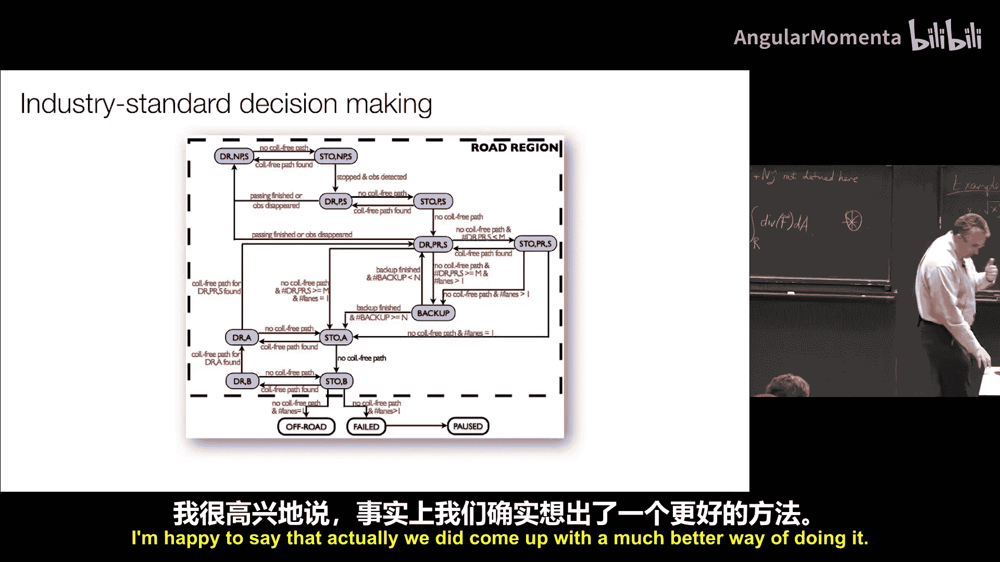
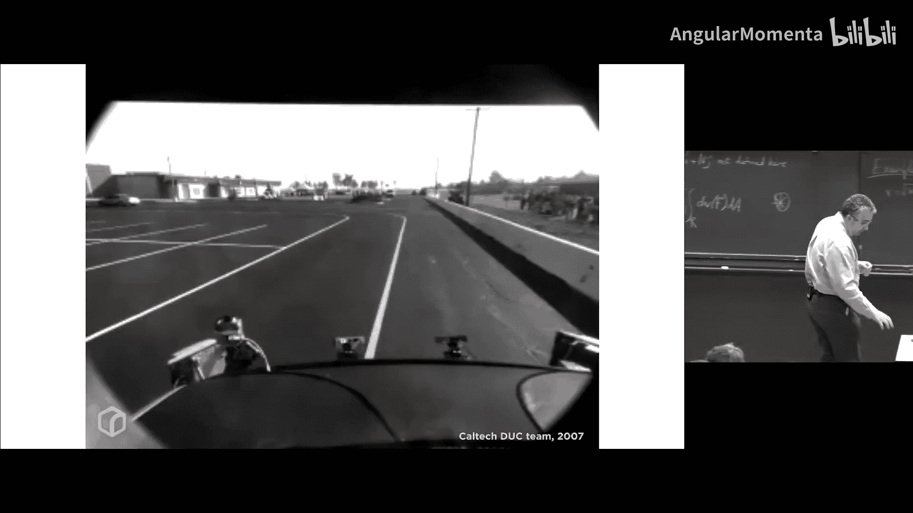
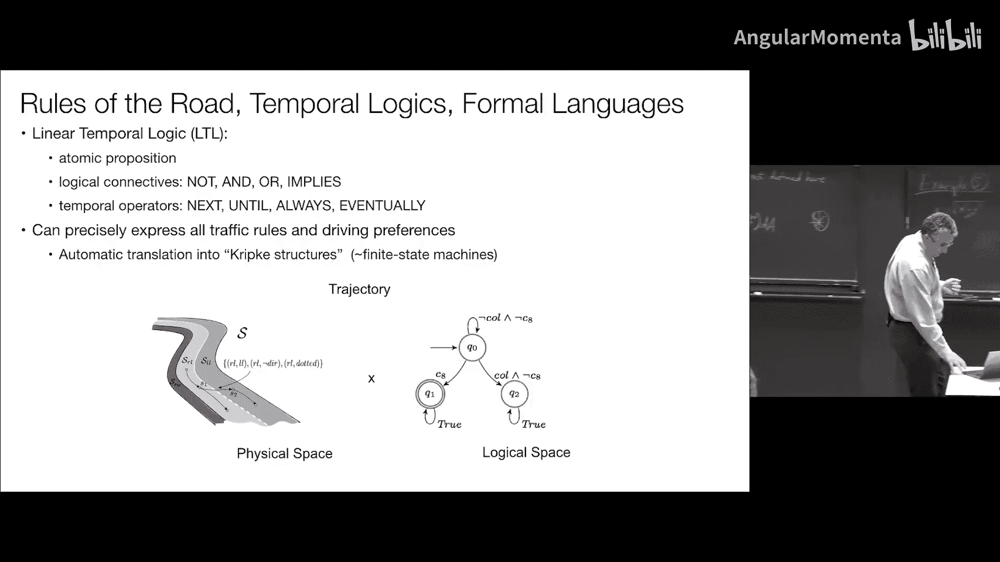
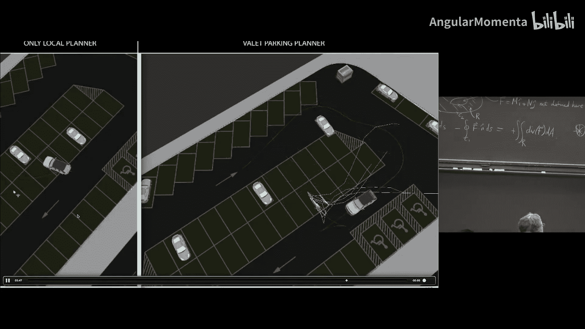
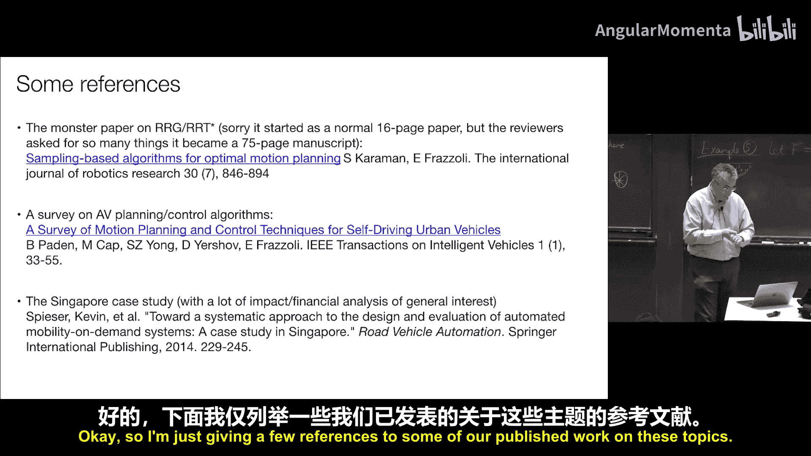

# 【麻省理工】自动驾驶汽车-｜-Self-Driving-Cars-p05-05-埃米利奥·弗拉佐利，首席技术官，nuTonomy---MIT自动驾驶汽车--BV13tq2B3EMH_p5-

Today we have Amelia Frizoli， he's the CTO of Netonomy。

One of the most successful autonomous vehicle companies in the world he's the inventor of the RRT ST algorithm。

 formerly a professor at MIT direct and research group that put the first autonomous vehicles on road in Singapore。

 and now he returns to MIT to talk with us， give him a warm welcome。Thank you， Le。

It's a great opportunity， it's a great pleasure to be back here。

 I spent 15 years of my life here at MIT first as a graduate student and then as as a faculty member。

😊，And this is where nottonomy， the company， essentially was born and we did a lot of the research that led us to start this company and eventually develop all this technology。

What I will talk about today is a little bit about， you know， our vision on autonomous vehicles。

 why we want to have autonomous vehicles， you know， some of the guidelines， you know。

 on the technology development， why we are doing things in a certain way。 let's get started。

 But and you know， I really would like to tell you， you know， a number of stories about。

Why I started doing this and why I think this is an important technology。

 why we ended up starting this company。So you know I've been a faculty member here for 10 years。

 and I was happily working with my UAVs and I was in Erastra。At some point around 2005。

 2000 there was these DARPAogram challenges that sounded cool right。

 so I started working on cars as well。but know that work that I was doing was mostly， you know。

 I was working on airplanes and cars to make them fly， drive by themselves because it was cool。

 you know， just look， you know， no hands， you know， it drives and as it controls guys。

 robotic is that's all I needed， right。But then in 2009。

 there was this new project that was starting was a team that was getting together to write a proposal for a project on future urban mobility in Singapore。

 okay？Not telling you the whole story， but essentially I got interested in that project just because I wanted to go to Singapore。

And then I called the person who was putting together the team and I said， okay。

 thank you for your interest， but what do you think that you bring to the table？

And we had just done the Dar Hon Cha， so I know how to make autonomous cars。So what。

 This is a project on future urban mobility。 So what do cars have to do with with urban mobility。

 autonomous cars， You know， what do they have to do with urban mobility。And， you know。

 there was the phone call， the five minute phone call that changed my life。 Okay。

 because she asked me this question。 that actually was Cindy Barnard， who is now a chanceancellor。

 right。And then I had to come up with an excuse right So why well。

 imagine that have a smartphone and then a smartphone app and then you use this app to call a car。

 the car comes to you， you get on the car， drive wherever you go want to go step off the car and the car you know goes to pick up somebody else。

 goes to park or something So this was 2009。 Uber was Travis Caric and the couple of guys and black cars in San Francisco right so and essentially she bought it。

 So I joined the team and and we started this activity。

 But you know the important thing is that I started thinking about。You know。

 there was something an excuse that they made up in those five minutes。 Okay， but then。

 you know what， I kind of。Sounds like a good idea。And they started thinking more about this and they started thinking more about why do we want to have selfdr vehicles okay so the number one reason that you typically hear is we want to have selfdr vehicles so that we make roads safer a very large number of people die on you on the road road accidents every year。

 what is people do not realize is that most of those people are actually you know fairly young。

 like in their 20s and 30s。Okay， and clearly the， you know。

 what people usually say is that you know Sebastian Truone， you know back in the day。

 he gave all these Ted talks of talking about his best friend from where he was young。

 who died in a road accident， right， And then he made a mission for his life to reduce road accidents。

 right。But anyway， so any idea is that most of the road accidents are due to human errors。

 you remove the human， you remove the errors right， and then you save lives。

 Okay so this is typically the number one reason that people mention when they talk about why you want to have selfd vehicles。

 Second reason is a convenience。 essentially if the car is driving by itself。

 you can do other things， you can sleep， you can read you can text legally to your heart's content。

 you can check your emails so on so forth， right This is also great。

Third thing is improved access to mobility， you people who cannot drive maybe because have some physical impairment or maybe they are too young。

 they are too old or maybe too intoxicated to drive right so then a computer can take them home。

Another thing is increased efficiency throughput in a city。

As cars can communicate beyond visual range， for example。Another one is reduce environmental impact。

 now these are all fantastic reasons you know why we may want to have several driving vehicles。

The problem with me is that if you think about this these are all you know good reasons。

 but these are all ways that you take the status quo。

 you know how cars are used today and you make it a little bit better。

 maybe a lot better but you do not make it different okay and really that is what I am mostly what I was mostly interested in can we you know use this technology。

 leverage this technology to change the way that we think of mobility okay。

So how do you compare all these different things， Okay。

 so this is you know a quick back of the envelope kind of calculation that you can do on your own。

You can question the numbers， but I think that the orders of magnitude are right， okay。So， you know。

 the first thing is， okay， so fine。 we heard that a big reason for self driving cars is to increase safety。

 you know， save lives。Great， now， how much is your life worth。Well， to yourself， to your loved ones。

 to your friends， your family is probably you know， priceless。

To the government is worth about $9 million。Okay， so this is what is called the。

This is what is called the cost of a statistical life。

There was a report that was released a few years ago probably you know there is an update now but I haven't seen it the economic cost of road accidents in the United States is evaluated to be about $300 billion a year the societal harm of road accidents is another all the pain and suffering。

 is evaluated to be another $600 billion a year so what we are getting to is about almost $1 trillion okay。

It's a big number， but let's look at where the other effects are。

What is the cost of congestion is an estimate $100 billion a year。

The health cost of congestion or the extra pollution， another $50 billion a year。

 so you see that these are a little just a small change， right？

The next effect is actually important right so what is the value of the time that we as everybody in society will get back from not having to drive okay simple calculation what I did is I multiplied one half the median wage of workers in the United States。

Wwhich is an embarrassingly low number multiplied by the number of hours that Americans spend behind the wheel and what you get is about you what was it $1。

2 trillion a year。So something that you may notice is that。

The value to society of getting the time back from having to drive is actually more than the value to society of increased safety。

Okay。Of course it's a little bit cynical， okay， so take it with a grain of salt and a grain of salt。

 but you start seeing how these things compare and what you may notice from this pie chart is that there is still half of that is missing。

What is the other half？The other half is actually the value that you provide to society to you know all individuals。

 okay by essentially making car sharing。Finally， something that is convenient to use affordable。

 reliable。 Okay， so for me， car sharing or you know vehicle sharing in general is a concept that everybody loves。

 but nobody uses。 okay， or not as many people as we would like to， you know。

 use this kind of services。😊，Examples when I was here at MIT， I really like using Haway， you know。

 the bicycle， you shedding。But you had to be very careful know if you wait too long in the afternoon sorry there are no more bikes on campus right or maybe very often you cannot find a bike or maybe you cannot find a parking spot for your bike so then you had to buy somewhere else and then walk so that defeats the purpose of using that bike same thing with cars right so typically with car sharing systems what you have is either you have like a two way which is essentially hourly rental or you have one way but in one way system then the distribution of cars tend to get skewed right and unless the company repositions cars in some clever way then you're not guaranteed that you will get a car where you need it and you're not guaranteed that you will get a spot a parking spot when you don't need a car anymore okay。

If you think of that， these are both like a friction points for using vehicle sharing and these are both pre friction points that are actually addressed by if the car can drive itself。

 okay。So。If you bring in all the economic benefits of a car sharing system that actually works。

 that's something that we estimated to be you know it's about $20 a year so you see that is actually has like a big chunk in this pie chart okay and that is using an estimate of what we call the sharing factor of four meaning that one of these shared vehicles can essentially substitute for four in privately owned vehicles okay there are some studies that you know get to this sharing factor up to 10 and of course the benefits are even more now every time I see a round number like that I get suspicious right you know10 is a little bit too convenient to be true right that anyway so that's something that you can find in the literature okay。

So。So this is really where I think that the major impact of autonomous driving or self driving cars will come from now if you I think also there is a lot of confusion in the community in the world about what a self driving car means now what I'm doing here I just listed this you know five levels essentially six levels of automation you know these are the society of Autotive engineers levels okay so level zero is no。

 that's your you great grandfather's car right driver assistance level1， there is。

 for example cruise control or you know some simple single channel automation。

Partial automation you have you know something like for example， lane keeping and cruise control。

 but you still require the driver to pay attention and intervene conditional automation level 3 driver is a necessity is not required to pay attention all the time but needs to be able to intervene given some notice okay and you know that some notice I think is。

是。They a like ill defined concept。 And then you have level 4 or level 5 that are like a highertonation。

 essentially， no driver needed。In some condition that is level  four and in all conditions that level5 okay？

Now。My first reaction， when I started seeing these levels and there was also a similar version by Ntzsan。

Is that this seem to me a horrible idea？And the horrible idea in the sense。

 because they're given numeric。Level， so you have level 0，1，2，3，5。

Whenever you have a sequence of numbers， you are led to believe that these are actually sequential。

 right， that you do level 0， then you do level 1， then you do level 2，3，4，5。😊。

I think this is like an enormously bad idea， because I think that level 2 and level 3。

 that is anything where you require the human to pay attention and supervise the automation and be ready to intervene with no notice or with some。

Abiguously defined， you know， like sufficiently long that are just go behind， you know。

 go against human nature。And， you know， this is especially painful for me as a formererautics and asronautics professor。

 where we saw in the airline industry that as soon as autopilos were being introduced。

And everybody thought that accidents would go down。

 I'm there were more accidents because now you have new failure modes induced by autopilots。 Okay。

 you have more confusion， pilots lose situation awareness。

 pilots lose the ability to react in case of an emergency。

Okay so the airline industry had to essentially educate itself on how to deal with automation in a good way and think of you know。

 pilots are highly trained professionals。Which is not the same that you can say about your everyday driver right so how do you train people who probably you know you the last time they sat with an instructor in a car was you know when they were 16。

 right？How do you train people to use the automation technology and do it safely。

 So I think that this is something that find very scary。On the other hand。

 I think that the full automation when the car is essentially able to drive itself。

 does not rely on a human to take over is something that in a sense is easier。

And know this is what we are doing， but the point is that not all it is easier。

 but I think that is essential to capture the value of the technology now if you think of it。😊。

So how do we realize the value of these self driving vehicles， Okay。

 so the first thing that people say is safety。I think it is true that eventually， asymptotically。

 cell driving cars will be safer than their human driven counterparts。However， at what point。

Can we be confident that that is the case， Are we there yet？Not sure。Okay， so。

So how do you demonstrate the reliability of these cell driving cars？We know， you know。

 they've driven their cars for 3 million miles， right， So with a gradually small number of accidents。

 if I remember correctly， only one was。Their fault， right， but。Actually， humans drive for many。

 you know， many times that without accidents。 or so how do you really make sure that even though the number sounds impressive。

It really doesn't have that much of a statistical significance right And then every time you make an update to a change to your system to your software。

 you really had to validate again right so I think that making the case for safety is actually is a very challenging issue and we may not be positive that these setraling cars are actually safer and the human counterparts you know until you know a fairly long time from now okay so safety for me remains kind over question。

 open question。And at this point。How do you get back the time value of driving？If you had。

 at least I'm speaking for myself， if I had to constantly pay attention to what the car is doing。

Excuse me， but I'd rather guide myself。Okay， because。You know， if the car is driving and you。

 this is the paradox， right， So the better the car drives。

The harder it is for me to keep paying attention。And this is where the whole problem is so so it would be very hard for me not to fall asleep or not to get distracted。

 so if I want to get the time back really the car must be able to drive itself without requiring me to pay attention。

Car sharinging again， is you know， in order to make car sharing really convenient and reliable and so forth。

 you need the car to come to you with nobody inside。And for， for that， you need level 4 or level 5。

 Okay， anything else just doesn't cut it。 You know， everything else for me is just a nice。

Gdget that you have on your car that you show off to your friends or to your girlfriend。

 Okay so that's about it right is not that useful。So my point is that level four or five automation is really essential to capture the value of this technology。

And in fact， the one game changing feature of these cars。

Is the fact that these cars now can move around with nobody inside。

 you know that's really the game changing feature okay。Good。

 and you know this is you know really what we' like to do now there are many paths that you can go after this target okay I usually show this this figure okay。

 so on this figure what I show on the horizontal axis is the scale or the scope of the kind of driving that you can do okay so on the left is like a small you know pilot maybe a close course on the right is driving everywhere okay。

On the you know like a complex environment， right？Mss deployments and so so forth。On the left。

 there is on the vertical axis is the level of automation now。Re，Really。

 what we would like to do is get to the top right corner， right。

 So we have millions of cars driving all over the world。Comptely you。

 completely in a completely automated way， okay。What I see is there are two different paths that the industry is taking okay what I show here is what I call this this is the OEM path okay so this is the automakers right so they are used to thinking of production production of cars in the orders of many。

 many millions okay。And essentially what they do is they make a lot of cars and they are adding features to these cars。

 you know， advanced driver assistance systems and so so forth， right。

And essentially theyre following this level 0，1，2，3，4，5 okay and you know today you can buy cars。

 which even though they claim fully autonomous you package for $5，000 plus another $4。

000 or something。In the fine print， they say it level 2 right so level 2 or level3 so you know Tesla and Ces think the Adi with the new Audi 8 is a8 thatre coming up we just kind of feature Cadilla。

 I think as a similar thing。The problem with that I seen that you had to cross this red band， okay。

 this red band where you're actually requiring human supervision of your automation system。😊。

Another path that people are following is this other path， okay， so this is what we are doing。

 what Waymo you know。Where these are all the indications or that Waymo is doing of course they're not telling me exactly what they do similar for Uber right so essentially what they' are doing is they're working on cars that would be fully automated from the beginning and they start with a small know maybe geoefence application and then scale that up that operations up right but always remaining at the full high full automation level okay。

😊，Another thing that is important that people make a lot of confusion and don't seem to realize the big difference is the following。

When people ask me， when do you think that we will see autonomous vehicles everywhere on the state where autonomous vehicles would be common？

I guess and okay， but you know what do you mean exactly by that right because if you ask me。

 when is it that you will be able to walk into a car dealership and get out with the keys to a car that you know you just push a button and it takes you home。

That is not happening for another 20 years or at least okay on the other hand。

 if you ask me when you will be able to go to some new city and sum on one of these vehicles that picks you up and takes you to your reation。

 that I thing is happening within a couple of years okay。What is the difference？

There is a big difference between autonomous vehicles cell drivingming cars as a consumer product。

Versus a service that you provide， you know， to passengers。 Okay， so， for example。What is the scope。

 where do these cars need to be able to drive okay？If it's a product and I pay you know。

$10000 for it。Then I want this thing to work everywhere， right so take me home。

 to be to this little all， you know drive me through the countryside。On the other hand。

 if I'm a service provider and I'm offering a service， I can decide。

 you know I'm offering this service in this particular location and by the way。

 I'm offering this service under these weather conditions and maybe under these traffic conditions。

So just the problem becomes much more， much easier。What are the financials， right？

 So if I have to sell you annomy a car with an autonomy package。How much can I cost。

What are my cost constraints on the autonomy package？If I sell it to you， you know， first of all。

 the cost of the autonomy package must be comparable to the cost of the vehicle。ok。

You will not buy a $20，000 car with a half a million dollar autonomy package， right？

Also you can do so another back of the envelope calculation that it did is okay。

 so let's say that what is the value to you as the buyer of this autonomy package。

 let's say that the value to you is the fact that now instead of driving you know for the rest of you know for the next 10 years you can have the computer driving for you what is the value of your time as you' are not driving right so do a quick calculations again。

 you know total number of hours that Americans spend behind the wheel。

Medn wage or you value of time What you get is you know what I get is that you know the net present value of the driver's time over the next 10 years is about $20000 okay so then you know a rational buyer will not pay more than that。

You know， to buy this autonomy package， right， So now you're constrained by $20000。 Okay。

 or actually， if you want to make a profit out of it， you know， you're constrained。

 your autonomy package cannot cost more than a few thousand dollars。Okay。On the other hand。

 if you are thinking of this as a service， then what you are comparing to is the cost of providing the same service using a carbon- based life form like a human behind the wheel okay so now you want to provide 247 service you need to hire at least say three drivers per car okay and then the cost is comparable of the order of 100 k a year okay so now I'm comparing the cost of my automation package to something that is going to cost me 100000 a year over the life of the car。

Okay， so now the cost of that ladderer or that， you know。

 fancy computer or that fancy radar or something doesn't matter that much。 Okay。

 so I have much more freedom in buying the sensor that I need。Infrastructure， for example。

 people talk about maps， HD maps， right？Now， again， if I want to sell it as a product。

 I need to and I had to sell it。 I want to sell it on a global scale where global could mean older the United States。

 for example， all of Europe。Then I need to have maps。

 HD maps of the whole of Europe or the continent or in United States or wherever I want to sell the cars。

If I'm providing a service， then I only need to map the area where I want to provide the service。

 And by the way， how do how does the complexity of the maps scale with the。

Customer base that you're serving。If you think of uniform people density。Okay。

 so then actually you think that the complexity and the cost of generating maps scales with the length of the road network。

Then the cost of the maps scales with the square root of my customer base。

 meaning that will become manageable as I serve more people okay so HD maps yes。

 it's a pain in the neck to collect them and to maintain them。

 but it much less of a pain in the neck thats actually operating the logistics of a fleet serving the population of a city。

 okay。And servicing and maintenance。You know， how would you calibrate your cameras and your sensors。

 You know， that's not something that you would do as a normal consumer， right。

 we are not used to that when I was little， I was used to my father， you know。

 he was tinkering with the car all the time， you know， checking the， you know。

 the timing belt or changing the oil or。You don't do any of that nowadays， right。

 So you just sit in the car switch it on。 if the yellow light， you know， check engine comes up。

 you take it to the dealership。 that's all you do。 Now， imagine。That you know now you have。

 if you want to use your autonomy package， you had to calibrate the sensors every every time you go out or。

 you know， you have to upload know like a new version of the drivers and things like that。

 So you don't want to do that。 On the other hand， in the service model。

 I have the maintenance crew that can take care of it in a professional way。

 Okay so a big difference between the two models。 So there are a couple of important takeaways。

 right So one thing is that the cost of the autonomy package， is not really an issue。 Clearly。

 the cheaper I can make it， the better it is， right。

 But that is not really the main driver in particular， if you need a lighter sensor， for example。

 to detect a big truck that is crossing your path。By the ladder sensor。 Okay。

 so that is not making the difference and maybe can save some lives。 Okay。

 Any reference to other things is intentional。嗯。The other thing is HD mapps that people worry about very much today。

From my point of view， H mapps， my expectation is that H mapps within a few years will be a done dozen。

 okay。What is complicated， what is expensive now in generating all these HD maps。

 the mapping company need to put these sensors on a car on you know and send these cars around now imagine that I have a fleet of 1000 cars with these sensors on board and these cars are just running around the city all the time。

 They're generating gigantic amount of data that I can just use to make and maintain my H maps。

 So I think that you know especially from the point of view of the operators。

 the providers of these mobility services it will be very easy to collect data to essentially you know make and maintain their own maps okay。

So if you need H maps， that's fine because as soon as you start offering this service。

 you'll be able to collect all the data you need to generate this H generate and maintain the H maps。

 by the way， this is showing an animation showing， you know， like a simulation of a。😊，Fleet off。

 I think it's。Its a couple hundred vehicles in Zurich in New。

 right so that's where I was based until a few days ago。And as you see essentially。

 you have vehicles that going through go through most of the city every few hours， okay？In there。

 for example， the Uber fleet goes through 95% of Manhattan every two hours or so。Cost advantages。

 you of course most of the cost of taxi services nowadays is the driver。

 you it's about half of course you remove the driver from the pitch you don't have to pay them。

 of course the automation costs you a little bit more servicing costs a little bit more。

 but you see that you still have you can get like a really significant increase in the margin right。

 meaning that you can pass some of those savings to customers but also you can make a very strong business case。

However， this is also misleading。 Now， if you think of it。Okay。

 so typically what the reaction that you get is the following。Oh， my goodness。

Now you make this thing and then all taxi drivers， all truck drivers will be out of a job。Okay。

And in fact， one day I was summoned by the Singapore Ministry of Manpower， and I was  terrified。

 oh my goodness， they're going to shut me down because they're afraid that I will put all of their taxi drivers on a street on a street in the sense of being unemployed。

Conact was the opposite。What most people do not realize is that actually mobility services worldwide are actually manpower limited。

In Singapore， they would like to buy more buses。But they don't have enough people who are able and willing to drive the buses。

Okay， this is true pretty much same for tracking， same for taxes。Now。

 there's another back of the envelope calculation that you can do on your own。Now， imagine。

So as we know， Uber has been wildly successful， very high valuation。

A lot of this valuation is predicated on the fact that everybody in the world will eventually use Uber。

 right or something similar。Now， something that you know， people don't think about is the following。

 Now， if everybody in the world uses Uber for their mobility needs。

How many people in the world need to be drivers for Uber？Do the calculation。

 what you see is that one person out of seven must drive for Uber if Uber is serving the whole world。

Do you see that happening No way， right， So people still need to be， you know， teachers， doctors。

 you know， policemen， firemen， you know， or， you know， some people need to be kids。 you know。

 so that is something this cannot happen。How are we facing this paradox in a sense， right。

 So you know today， what you have is people who drive around。

But what is happening today is that we are all doubling up as drivers for ourselves， and in fact。

 we do spend about1， seventh， one，8 of our productive day behind the wheel very often。

Okay so you know for me you know the big change will be more on the supply of mobility rather than on job loss。

 I mean of course if you increase supply of mobility you know the cost of mobility to you know you will probably go down wages for drivers will go down right so that that that is an issue but you know maybe added you know will be balanced by like added value in service or other things that you can imagine。

InAnother thing about truck gathers， something that I recently learned。

25% of all job related deaths in the US are actually by truck drivers is the the single most dangerous industry that you can be in so。

Maybe if you can take some of those people out of those tracks and maybe supervise。

 remotely control a truck sitting in their office instead of sitting in the truck。

 that may be actually benefit to them。Back to the question of when will autonomous vehicles arrive。

 And， you know， in a sense， this is what， you know， what our prediction our vision is， right。

 So what we will see is that what we think is that we will have a fairly rapid adoption of。

Seve driving vehicles in these mobility as a service model。 okay。

 as the fleet of shared autonomous vehicles that people can use， you know， to go from point to point。

 right， rather than own。Of course， eventually you know people will be able to buy these cars and maybe own them if they really want。

 but know that is something that is much later in time for a number of reasons some which I discussed okay so this is what we expect in terms of the timeline for this。

Now。What is the state of the art for autonomous technology today？

You do see a lot of demos for from a number of companies， you know doing a number of things， right。

 but。But a lot of the things that you see are not too much different from this video。

I don't know if any of you recognizes this video， but you know， look at the cards。

This was actually done by Ernest Dickmans in the late 90s in Germany。Okay。No fancy GPUs。 no。

 it was just cameras and some you know basic computer vision algorithms。

 but essentially he was able to drive for hundreds of miles on the German highways。Okay。

If you're not showing something that goes beyond that。You have not made any progress， you know。

 over the over the past 20 years。Okay， yeah， you're using fancy deep learning and GPUs and things nowadays。

 but you're doing what people were doing 20 years ago。 you know， come on。

 so you see or know created that is a lot of hype in these things。

 but you if you see something like that。😊，I don't think it's very impressive， okay。

 people knew how to do that for a very long time。Something that I find a little bit and maybe biased clearly。

 but this is something that I find a little bit more exciting。

 This is actually footage from you know， our daily drives in Singapore。 Okay。

 this is four times a real time。 We don't drive that fast okay。😊，嗯。

But essentially what we are doing in Singapore， we are driving know in public roads， normal traffic。

😊，What you will see is not so， but you know if we have you know construction zones， intersections。

 traffic， you know， like you know， both sides， we will get to a pretty interesting intersection。Okay。

 so it's a red light。We'll turn to green in a second。嗯。

Keepive me mind Singapore the drive on the left， right。

 so making the right turn is what is hard because you had to cross traffic。

And here you have a lot of traffic and you know the car is making the right decision。

 you know all of this is without any human intervention right so I think that in this day and age。

 if you're not showing the capability of driving in traffic，In an urban situation like that。

 you're not really showing any advance over what people were able to do 10 years ago， okay？嗯。And。

 you know， I mean， as you can see， right， So the intersection， other cars， pedestrians， you know。

 all kind of like crazy interactions， you know， you know。

 cars park in the middle of the street that you had to avoid， go to the other lane， you know。

 things like that。 Okay， so this this is what you had to do every day。

And this is what we are doing every day in Singapore， we are doing every day here in the Sport area。

 I don't know if you're aware of， but I know we are driving you know cars。

 we are allowed by the city of Boston to drive our cars autonomously in the seaport area。

So what are the technical challenges， Okay， so actually this is a slide that I。

That I am fairly reusing from a talk that Amno Shara， the founder and CEO of Mobile。

 gave here at MIT a few months ago。So this is what he said， Okay， so this is not what I say。

 what he said is that the big challenges are sensing， you know， perception， mapping。😊。

And then is what he called driving policy right that I would call more like a decision making， okay。

Now， what he said is that sensing perception is a challenge。

But it is a challenge that we are aware of。 And then we are making rapid progress on getting better and better sensing perception algorithms。

 okay。Second， HDD maps， what he said is that it a huge logistical nightmare。

 so he didn't want to deal with that。 know， like amobile tries to avoid that。From my point of view。

 as I said， you know， for me， H maps， it is a big pain in the neck to get those maps， but。

In a few years， maps will be a da dozen， okay， so we'll get all the mapping data that we want and we need。

So the B problem is driving policy。Okay， so the remaining problem is driving policy。

 so how do you deal with that？And you， this is a typical example of things that we encounter in。

 you know， in any urban driving situation。 So you will see a video。

 So this is a case where we are a traffic light。 We are stopping the traffic。 know。

 the light turns green。 We are making the turn。 There is a pedestrian crossing the street。

 waypo theestrian， go through it。 and then we see that there is a truck that is park in the middle of our lane。

 So we need to go to the other lane， which is in the opposite direction。 There is a excuse me。

 motorcycle coming。 So we had to handle all that kind of situation。 right。

 So how do you ride your software in such a way that your car is able to deal with this kind of complicated situation by itself。

😊，Okay。And my point is that you this is not really about negotiation， it's not about policy。

 why do you have rules of the road？My claim， I have not proved it mathematically yet。

 but my claim is the following actually the rules of the road were introduced exactly to avoid the need for negotiation。

😊，When you drive。Okay， when you're walking as a person， you're just walking down the hallway。

 you know， walking down the infinite corridor。 And there is a person coming in the other direction。

 There's always that awkward moment， right the where youre trying to， I go left， I go right， right。

With cars you don't do that right so in cars decide everybody go right or in other places everybody go left period and you don't negotiate that okay。

You get to an intersection。 the light is red， you stop， you'll say， but know I'm really na rush know。

 do you mind if I go， no， you don't do that right， So it thread and you stop okay。

So the roots of the road have been invented by humans in order to minimize the amount of negotiation。

Okay。And you know you know， in particular， so this is， I mean， this is actually very old video。

 but I kind like it。 So now our car is a little bit more aggressive。

 But you know what you see here is in this case， know this is how the car behaved in that particular situation。

 So you see it's raining red light turns green， theres a pedestrian crossing our path。

 So we yield to the pedestrian You see that there is you will see that there is a truck that is parked on the on the left lane in the middle of the lane。

 So we had to go around it。 but there is a motorcycle that is approaching。

 So we had to be careful in go into the other lane。 so we squeeze through the through the motorcycle。

 know， we try to go very slowly next to squishy targets， But then as soon as we pass the truck。

 the truck driver decides to get moving。😊，Okay， so then what we do is we wait for the track to get。

 you know， to get going and then go back to our lane。 Now， imagine writing a script， you know， or。

 you know， if then as if there is a track， But the track is moving and then do this just the nightmare。

 So you know't what to do that， right， So how do you handle this kind of situations。 Okay。

 so the industry standard， you know， this approach to this was to。And by the way。

 this is what we did at the time of the Darward One challenge。 Okay。

 so we had a lot of if then else statements or you know fan machines or some logic that was encoded by。

 so some fan machine kind of kind of things。The problem with that is。

It's very hard to come up with this logic。And it's essentially impossible to debug it and verify it。

 right， So I spent many miserable months。Sitting。In the naval airbase in Weymouth， right， So here。

 in a rental car， just plain interference with our autonomous car。

 trying to adjust all these logic and parameters and things。

 So I vowed that I would never do it again。 Okay， It was just miserable experience。

I'm happy to say that actually we did come up with a much better way of doing it。 and by the way。

 this is a video from the Caltech team and the Darfurban Challenge。😊。

As you can see though they were trying to go to an intersection。

 they decide to go then for some reason they decided actually to back up out of the intersection。

 So the director of DARPA， Tony Tetter at the time， he was there， he went like that。

 so they were out of the race okay so as soon as Cio saw that。😊，What happened here。

 that was essentially a bug the logic。Caltech you know team of very smart people， very capable。

 dedicated people worked on this for months， they didn't catch this bank， this bank。

 they were out of the race right so it's very easy to make mistakes and it's very hard to find those bug。

Okay， so as a reaction to that， you know， there is this new。Is it possible to cut the sound。啊。

 thank you。U。So now what， what you hear people saying is， well， there are too many rules of the road。

 It's impossible to code all of them correctly。So。Let's not do that。 Just feed the data， you know。

 feed the car a lot of data and let the car learn by itself how to behave， okay。嗯。Okay。

 and this is what you see in， you know， there are a number of startup appss and other efforts that are trying to use all these you know。

 deep learning or learning approaches to， to get for end to end driving of of cars。 Okay。

 so you see video from N video。嗯。Okay。I understand this is a course on deep learning for cars， right。

 But so so I don't want to sound too negative on the other hand。

I will try to be honest in what I think， okay。So there are a number of problems， right。

And that' way this happened to us， right， So one of our developers， you know， you know。

 super bright lady from， you know， you know， Caltech and。😊，You know。

 the first version of the code for dealing with traffic lights， essentially， the reaction that。

 you know， that that they had for， for the yellow light was， if you see a yellow light speed up。

As I was looking at， what the heck？Oh， this is what my brother does。 Okay。

 so there is always the danger that you learn the wrong thing。 Okay， the， the wrong behavior。

 in a sense。 Of course， there are some situations in which。

Accelerating when you see a yellow light is actually the right response。

 but it is not always the case， right， So there are some other features of the situation that you need to examine。

 right， Also， the other things as the cartoon， right， So you know。

 you want to be able to explain why the car did something。 And I would say that more than explaining。

 because now you also see articles in which people say， oh。

 we have found a way of explaining why the runar network in the car decided to do something， right。

 And what they show you is some， okay， so these are the neurons that were activated。😊，Okay。

This is just saying that you know what if I do an fast MRI of the brain and they see what neurons。

 what areas of the brain are activated when I watch a movie， then I know how the brain works， No。

 I have no idea okay。The point is that yes you want to trace the reason the cause for why the car behave in a certain way。

 but you also want to be able to revert the cause right so you want that information to be actionable in some sense right so you want to know that okay this happened because of this reason and this is how I fix it and the other thing that this something that is hard to do with purely based learning algorithms。

On that other hand， you can let me actually skip that in the interest of time， okay。

The reality is the following that。It is simply not true that there are too many rules of the road。

 in fact， any 16 year old in the States can go to the DMV， get the booklet， study the booklet。

 do a written test and be given a loiness permit。Okay， and actually。

 this is what we require of every single license driver in the United States。Okay。

 we don't say just drive with your dad or mom for a few thousand miles and they we'll give you the license now we asked them。

 you know， show me that you study the rules and you understand the rules。Okay。U。

So how many are the rules of the road actually went through the exercise of counting， okay？

And what I did， I kind of like cluster them。 So essentially， you have rules on who can drive。

When and where， what can be driven when and where， you know。

 at what speed in what direction who yields to whom how you use your signals， active signaling。

 How do you interpret the signals that you see on the road， right。

 and where you can park where you can stop。 That's essentially it。 You know， this is。

 these are all the rules。 So not that many is call like 12 categories。What is true is that。

The number of possible combinations of rules and the instantiation of the rules。

 given the context of the scenario where other actors are and pedestrians are and where other cars are。

 that is a humongous number。Okay， so you don't want to code。

 you don't want to be to essentially any generative model that gives you what is the right response to all possible combinations of rules and instantis of actors。

That is something that is just combatorarily you know untractable。 you just cannot do that。

 But the point is that not only it is hard to code the good behavior。

 what to do in every one of these situations。I claim that it' is also hard to learn the good behavior because now you have。

 you need to have enough training data for every possible combination of rules and instantis。

Good luck with that。Okay。On that hand。It is very easy。To assess what is a good behavior。

 And that's why I was showing these slides on MP hardness， right。

 So what is a problem that is MP hard。The problem is NP hardware。

If you have a non deterministic system that is generating a candidate solution。

Then it is very easy to check whether or not that candidate is actually a solution of your problem and that's something that you do in polynomial time。

Okay。So in a sense， what I claim is that if you have an engine that is able to generate a very large number of candidates。

And all you do is checking， and then what you do is checking whether or not each one of those candidates is good with respect to the rules。

Then that's all you need。And it turns out that you know the algorithms that I worked on during my academic career were exactly generating that very large number。

 you know RRT RRT star， these are algorithms that work by generating a very large graph exploring all potential trajectories。

 reasonable trajectories that a robotic system that can take and then what you do is you check them。

For， you know， whether they satisfy the rules or not。

You see that it' very different from given the rules， generate something that satisfies everything。

Rather than giving a candidate。Check whether or not these candidate satisfies the rules。

Degenerating rules， degene candidates given all the constraints is a combinatorial problem。

Checking a single candidate for compliance with a number of rules is a linear operation in the number of rules。

 so that's something that you can do very easily okay and that's essentially what we have in our cars。

we are using these formal methods。 Okay， so essentially we write down all the rules in in a formal language。

 you know， you know very precise， you know like a syntax。

 And then what you can do is you can verify whether your trajectories satisfy all these rules written these language that is automatically that can be automatically translated into something look like a finite machine by computer。

 okay but there's not something that you do by hand is something that is done automatically and then what happens is that what we have is we generate trajectories。

 these trajectories are you know， you can think of this as trajectories that now are not all the trajectories in the physical space and time。

 but are also trajectories evolving in this logical space， telling me whether or not。

 and to what extent I satisfy the rules。 and that's all there is。😊。

Okay， so this is， you know， for example， like a little example。

So initially what we are doing is work。Very early days on autotonomy。

 where we're still working on research projects with industry with customers。

 So our customer in this case wanted us to do an automated parking application。

 And then what you see on the left is is our planet original planet that is just trying to。

 to park the car， right， avoiding hitting other cars。

 But you see is kind of ignoring the fact that you have lanes and directional travels， right。

 So you put the rules And what you see is what is on the on the right。

 where now what the car is doing is not all fine in the trajectory to go park， but it does so。

Obeing all the rules that are imposed on that particular parking structure。

他。Siness is very important， and this is something that we as humans do every day is to deal with andasibility okay？

So， very often， you're。Doing your planning， you're trying to plan your trajectory。

 You have a number of constraints。 And well， sorry， but it turns out that there is no trajectory。

 There is no possible behavior that you can do that will satisfy all the rules。So what do you do。

 the computer returns， sorry does not compute and feasible。Still driving this car。

 I need to do something right， so you do need a way of dealing with invisasibility okay。

The way that we approach this problem is having this idea of。Herarchy of rules。 Okay。

 and my claim is that all。Bodies of rules generated by humans are actually organized hierarchically。

 Typical example is the three laws of robotics by asino， right。

 So the first lower robotics is a robot will not harm a human。

Right or cause a human to come to to arm。 Second law is a robot will obey a human orders by a human。

 a human unless they violate the first law and the third law is a robot will try to preserve its own life or preserve itself unless it violatelays the first two laws。

 right， same thing in in when you drive， right， So there are some routes that are more important than others。

 right， So， for example， do not hit people， do not hit other cars。 And then you know。

 lower priority level is maybe driving your lane， a lower priority level is maybe maintain the speed。

 you know， something like that。 Okay， and then what we do is come up with。

Now we have this product graph of trajectories in the physical and logical space on top of that you can give them a cost right what we need is essentially a total order what we use a less inographic ordering okay where we have violating an important rule even by a tiny amount is much worse than violating a less important rule by a large amount okay so that gives a total order structure to the cost and then essentially what we do is we solve a short path problem on this graph。

Okay， which is exactly what you do in robots 101 when you try to you know。

 do any kind of machine planning， okay。And well， and you know this is in a collection of a few interesting things。

 So here we need to go to the other lane， but you see that there is the other vehicle coming。

 so technically we could not go to the other lane， but you see that you know as long as it is safe to do so。

 the car will go into the other lane。mOkay， you know， and again， you have like a lot of， you know。

 like difficult situations that the card was able to handle by itself without any scripting or without any like a special instruction for that particular case。

O。嗯。So what is the problem here？The problem here is that okay。

 so you can do all of this right and but then you know assuming that everybody is running this minimum violation planning you know editing will be okay。

 The problem is that humans introduce a lot of uncertainty in the whole thing okay。嗯。

Now you can think of this as asking the question。 So when I was young a naive that is two years ago。

 I thought that I take all the rules of the road and you convert them to this formal language。

 you put them in your software and you're done and and then you go and look at these rules of the road and then you see that they're a mess okay these rules are just not a sound theory in the sense they're not complete。

 do not cover every possible case and they're not consistent know they can like tell you to do different things in different cases。

My my favorite rule is this one is actually called the fundamental norm in these Swis rules of the road。

😊，Look at that。All road users must behave in such a way not to pose an obstacle of danger to other road users。

That behave according to the rules。Do you see a problem there？Okay。

 that doesn't mean that if I see somebody who is violating the rule， I can just hit them， right。

 So you can imagine that you have a fleet of vigilantes， you know。

 autonomous cars that just go around。 And if you run the red light， B， gonna kill you， right。I mean。

 technically the you know the autonomous cars would be you know would be right right。

 so the other the other guy would be you know they want to blame right。

 but you know do we really want that， probably not right？In defense of this Wiis， they actually have。

 you know that rule continues to say special care must be exerted in case you have evidence that other people are not following the rules。

 but still doesn't tell you what you are supposed to do when somebody else is violating the rule。

 okay？And you have trolley problems， right， So probably you've heard， you know。

 you hear about all these trolley problems to no end， right， And most of these I find， you know。

 Iiently stupid， know， in the sense， it's like a big waste of time。In the sense that， yeah。Sorry。

 I think it's extremely unlikely that you will be given the choice of killing either mother。

 Teresa or Hitler， right？I mean for sure， that will never happen， right。

 but anything remotely similar will never happen again。On the other hand。

There are versions of the trolley problem which are actually meaningful。 Okay。

 so this is one that you know my collaborator and the chance came up with。 Okay， look at this case。

 So you're driving down the road and you see a pedestrian that is jawalk in front of you okay if we stay the our current course。

 we will。Killed the pedestrian before B1。Okay， but it's not our fault。 Okay， it's his fault that。

 you know， his or her fault that they stepped in the road when they shouldn't have。On the other hand。

 what we could do is we can try to swerve， right， but then with some probability P。

 we may kill another person who had nothing to do with this thing， you know。

 they were just walking around， you know， peacefully， right。

So the reason why I like this is because this problem actually has clear solutions in the two extreme cases right so if p is one okay in the sense that if his were we killed somebody else。

 then we clearly killed the guy who was just working。if p is0 that is。

 I'm sure that I'm not killing anybody if I serve， then clearly I will serve。😊，Where is the boundary。

 So I know that the solution exists for p equal 0 I know the solution exists with p equal 1。😊。

By some continuity argument， you know， I must have some value of P at which the solution changes。

What is that value。Nobody knows。How do you evaluate that P， nobody knows？

But you know these are the kind of questions that we actually need to answer somehow。

 so it's a more you know a little bit more sophisticated case。😊。

Now what we I know this is what happens every day in our cars， right。

 So when our computer vision system is telling me that there is a pedestrian in front of us。

Is not telling me that there is a pedestrian for sure， right。

 So it's telling me that I think that there is a pedestrian in front of us。 And you know， I'm。

 you know 80% confident， you know， some probabilitybity Q okay now。

The whole combination of probability on the pedestrian actually been there and my probability of killing somebody else would as worth right so because if Iwer and kill somebody because just a ghost you know like a false positive and there'll been serious trouble right so how do we explain that Well I thought there was somebody in front of me there's nobody there right So again。

 you know you do have solutions for some extreme cases。

 but then you have this whole two-dimensal domain now which you had to know there would be a boundary where do you put the boundary and this is something that somebody will need to answer。

Okay， I don't think it should be me， you know， of course I can't come up with an answer when I write my code。

But I actually think it should be you right in the sense this should be a community effort in which the community agrees on how the car should behave or you know in these kind of situations。

 So let me conclude by saying you know when people ask me what do you think is the biggest challenge in autonomous vehicles and something that I've come to realize only recently is that I think that the biggest challenge in the development of autonomous vehicle technology is that we do not understand in a very precise way。

 rigorous way， how we want。Vehicles in general， including human driven vehicles to behave。Okay。

 a lot of these rules of the road are just like a giant pile of。I wouldn't say garbage。

 but almost it's very uncertain language， very no rigorous。Laws， right or rules， for example。

 a lot of the rules are predicated on a concept of right away。Yeah。I looked everywhere。

 There is not a single definition of what right away means in mathematical terms。

 I know that it has something to do with distance， has something to do with reality speed。

 maybe with absolute speed。But I don't know what are the values I don't know what are the numbers if I had to write a function so if you see this car approaching and this car is farther away than this distance and the relative speed is more than this then stop otherwise go there' is nobody who is telling me what that relationship should be and I think again what we need is we need to develop a sound theory for this rules of the road okay that cover precisely any kind of situation and tells me you know any kind of situation what is the right behavior。

 what is the wrong behavior or。ALi bit more maybe what is if behavior if you have two behaviors。

 which one is better， I need to be able to do the comparison。Now we can use formal methods。

 I think that there is a lot of room here for statistical or learning based methods， you know。

 like look look at what people actually do and what you know。

 at what point will people honk at you right rather than they feel that that you're cutting them off versus you know they feel that you yielded to them okay so we need to develop this sound theory。

 we need to be assess the behaviors on realized space and time trajectories。

What you thought that you had seen， that doesn't matter。Okay。I， you know， because if you say， well。

 if I， if I didn't see the pedestrian， then it's not my fault that I hit them。 Well。

 then people will start removing sensors， right， So if you don't see anything。

 you can hit anything you want。 you're not to blame， right。嗯。

But I really think that you know the compliance of the rules。

 once we have these precise rigorous rules will actually derive a lot of requirements for the sensing perception system for the planning control system okay so from my point of view。

 the main message today is what I think is the biggest challenge is that we don't know how precisely how we want human driven vehicles to behave。

Okay， once we answered that question， I think that also designing automated vehicles will be much。

 much easier。 Okay， so let me stop here。 Okay， so I'm just giving you know a few references So some of our you know。

 published work you know， on these topics。

And you， let me just conclude， you know， okay， so this is you know the company。

 what we are trying to do。Allow me， you know you're also hiding so if anybody's interested。

 you know feel free to send me an email contact us we want to double our size in the next couple of years so we' are hiring a couple of hundred people。

Okay， thank you for that Thank。