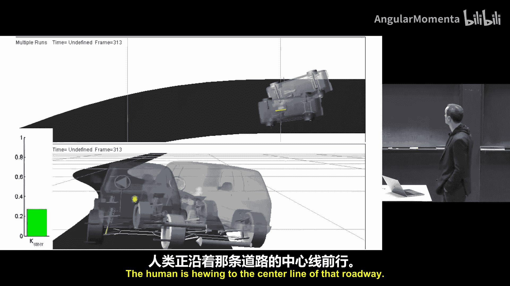
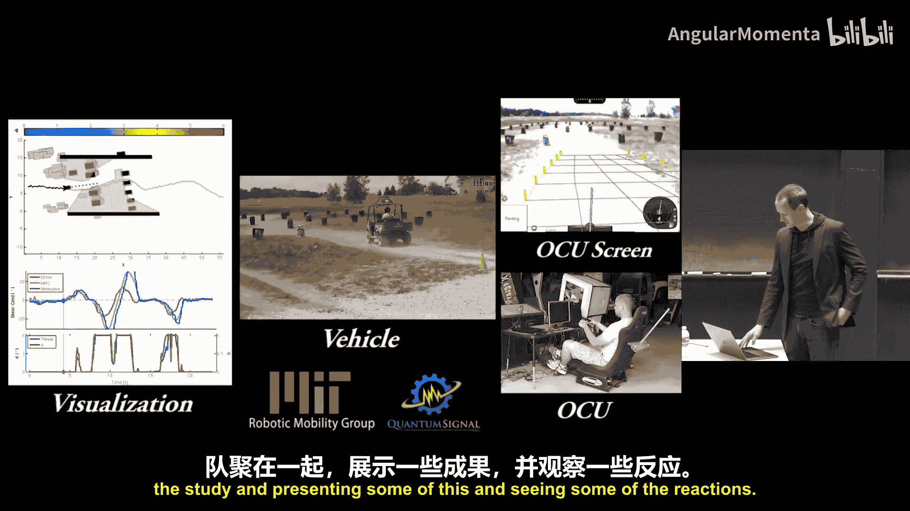
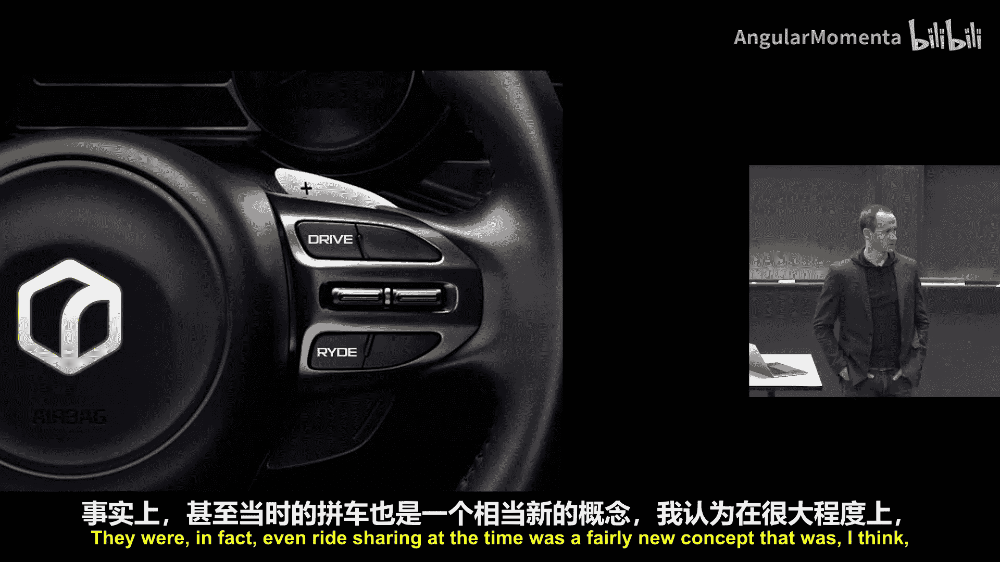
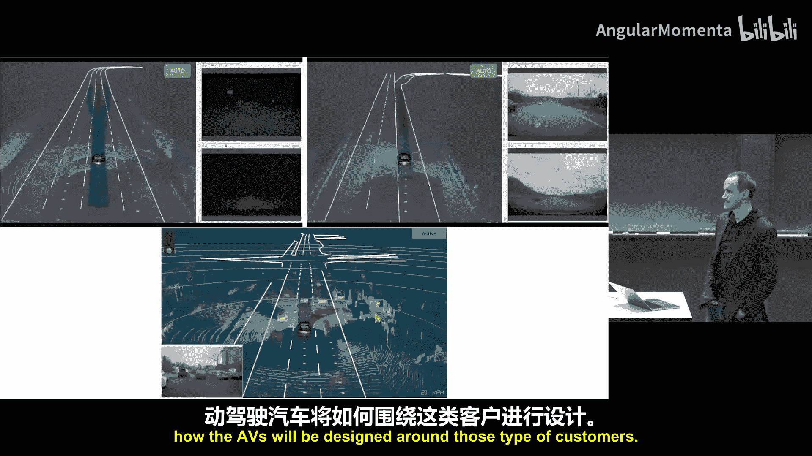

# 【麻省理工】自动驾驶汽车-｜-Self-Driving-Cars-p06-06-斯特林·安德森，联合创始人，奥罗拉---麻省理工学院自动驾驶汽车--BV13tq2B3EMH_p6-

Today we have Sterling Anderson he the co-founder of Aurora。

 an exciting new self-driving car company previously he was the head of the Tesla autopilot team that brought both the first and second generation autopilot to life Before that he did his PhD at MIT working on shared human machine control of ground vehicles。

 the very thing I've been harping on over and over in this class。

 and now he's back at MIT to talk with us， please give him a warm welcome。Thank you。

 it's good to be here， I was telling Lex just before I think it's been a little while since I've been back to the Institute and it's great to be here。

I want to apologize in advance。 I've just landed this afternoon from Korea via Germany where I've been spending the last week。

 and so I may speak a little slower than normal， please bear with me if I become incoherent or slur my speech。

 somebody flag it to me and we try to make corrections So tonight I thought I'd chat with you a little bit about my journey over the last decade。

 It's been just over 10 years since I was at MIT。 a lot has changed。

 a lot has changed for the better in the self-tririving community。

And I've been privileged to be a part of many of those changes。

 and so I wanted to talk with you a little bit about some of the things that I've learned。

 some of the things that I've experienced。And then maybe end by talking about sort of where we go from here and what the next steps are both for the industry at large。

 but also for the company that we're building that， as Le mentioned， is called Aurora。

To start out with。There are a few sort of key phases or transitions in my journey over the last 10 years。

As Le mentioned， when I started at MI T， I worked with Carl Anma， Emmeo Fazoli， John Leonard。

 a few others on some of these sort of shared。Adaptive automation approaches。

 I'll talk a little bit about those。From there， I spent some time at Tesla where I first led the Model X program as we both finished the development and ultimately launched it。

 I took over the autopilot program where we introduced a number of new both active safety。

 but also sort of，You know， enhance convenience features from auto steer to a cruise control that we're able to refine in a few unique ways。

 and we'll talk a little bit about that。And then from there in December of last year of 2016。

 I guess now， we started a new company called Aurora， and I'll tell you a little bit about that。

So to start out with， when I came to MIIT was 2007。

 the DARPA urbanban challenges were well underway at that stage。

And one of the things that we wanted to do is find a way to address some of the safety issues in human driving。

Earlier than potentially full cell driving could do。

And so we developed what became known as the intelligent coilent。

 what you see here is a simulation of that operating。

 I'll tell you a little bit more about that in just a second。

But to explain a little bit about the methodology， the innovation。

 the key approach that we took that was slightly different from what traditional planning control theory we're doing。

Was instead of designing in path space for the robot， we instead found a way to identify， plan。

 optimize， and design a controller subject to a set of constraints rather than paths。

And so what we were doing is looking for homatotopies through an environment。

 so imagine for a moment an environment that's pockmarked by objects， by their vehicles。

 by pedestrians， etc cea。If you were to create the Vooronoid diagram through that environment。

 you would have a set of each unique set of paths or homomatotopies。

 continuously deformable paths that will take you from one。One location to another through it。

If you then turn that into its due， which is the delanite triangulation of set environment。

 presuming that you've got convex obstacles， you can then tie those together rather trivially to create a set of homomatotopies and transitions across which those paths can stake out。

 sort of a given set of options for the human， it turns out humans tend to this tends to be a more intuitive way of enosing certain constraints on human operation rather than enforcing that the ego vehicle stick to some arbitrary position within some distance of a safe path。

 you instead。Look to enforce only that the state of the vehicle remain within a constraint bounded and dimensional tube in state space with those constraints being spatial imagine for a moment edges of the roadway or you know circumventing various objects in the roadway imagine them also being dynamic right so limits of tire。

Tire friction imposed limits on side slip angles。And so using that。

 what we did is found a way to create those homomatotopies forward simulate the trajectory of the vehicle。

 given its current state and some optimal set of control inputs that would optimize its stability through that。

 we use model predictive control in that work。And then taking that forward simulated trajectory。

Computing some metric of threat， for instance， if the objective function for that minimize the or maximize stability or minimize some of these parameters like wheel side slip。

Then wheel side slip is a fairly good indication of how threatening that optimal maneuver is becoming。

And so what we did is then use that in a modulation of control between the human and the car。

 such that should the car ever find itself in a state where that forward simulated optimal trajectory is very near the limits of what the vehicle and it can actually handle。

We will have transition control fully to the vehicle to the automated system so that it can avoid an accident and then it transitions back in some manner and we played with a number of different methods of transitioning this control to ensure that。

That we didn't throw off the human mental model which was one of the key concerns。

 we also wanted to make sure that we were able to arrest accidents before they happened。

 what you see here is a simulation that was fairly faithful to the behavior we saw in test drivers up at in Deborn。

 Michigan， Ford provided us with Jaguarsite to test this on。And what we did。

 so what you see here is there's a blue vehicle and a gray vehicle， both in both cases。

 we have a poorly tuned driver model in this case， a pure pursuit controller with a fairly short look ahead shorter than would be appropriate given this scenario on these dynamics。

The gray vehicle is without the intelligent copit in the loop。

 you'll notice that obviously the driver becomes unstable， loses control and leaves the safe roadway。

The coppilot remember， is interested not in following any given path。

 it doesn't care where the vehicle lands on this roadway。

 provided it remains inside the road in the blue vehicle's case。

 it's the exact same human driver model now with the coppiott in the loop。

You'll notice that as this scenario continues， what you see here on the left is in this green bar is the portion of available control authorities being taken by the automated system。

 you'll notice that it never exceeds half of the available control。

 which is to say that the steering inputs received by the vehicle and up being a blend of what the human and what the automation are providing。

And what results is a path for the blue vehicle that actually better tracks the humans intended trajectory than even the coppilot understood right again。

 the coppilo is keeping the vehicle stable is keeping on the road the human is hewing to the center line of that roadway So there were some very interesting things that came out of this。

 there were a lot of we did a lot of work in understanding what kind of feedback was most natural to provide to a human our biggest concern was if you throw off a human's mental model by causing the vehicle's behaviors to deviate from what they expected to do in response to various control inputs that could be a problem so we tried various things from you know adjusting。

 for instance， one of the key questions that we had early on was。

If we couple the computer control and the human control via planetary gear and allow the human to feel actually a backwards torque to what the vehicle is doing so the car starts to turn right。

 human will feel the wheel turn left， they'll see it start to turn left is that more confusing or less confusing their human and it turns out it depends on how experienced that human is。

 some drivers will modulate their input space on the torque feedback that they feel through the wheel and for instance a very experienced driver expects to feel the wheel pull left when they're turning right。

 however， less experienced driver in response to seeing the wheel turning opposite to what the car is supposed to be doing that's rather confusing experience so there are a lot of really interesting human interface challenges that we were dealing with here。

嗯。We ended up working through a lot of that， developing a number of。

Sort of micro applications for it， one of those at the time GilPratt was leading a DARPA program focused on what they call at the time maximum mobility manipulation。

We decided to see what this system could do in application to unmanned ground vehicles。

 so in this case what you see is a human driver sitting at a remote console as one would when operating an unmanned vehicle。

 for instance， in the military。What you see on the left。

 top left is the top down view of what the vehicle sees， I should have played this in repeat mode。

With bounding boxes bounding various cones and what we did is we set up about 20 drivers。

 220 test subjects。Looking at this， this control screen and operating the vehicle through this track。

 And we set this up as a race with prizes for the winners as one would expect。And。

Penalize them for every barrel they hit if they knocked over the barrel。

 I think they got a five second penalty， if they brushed a barrel。

 they got a one second penalty and they were they were cross the field as fast as possible when't they had no line of sight connection to the vehicle and we played with some things on their interface we caused it to drop out occasionally we delayed it as one would realistically expect in the field。

And then we either engaged or didn't engage the coppit to try to understand what effect that had on their performance and their experience。

And what we found was not surprisingly， the incidence of collisions declined。

 it declined by about 72% when the copi was engaged versus when it was not。

 We also found that you know，Even with that 72% decline in collisions。

 the speed increased by I'm blanking on the amount， but it was 20 to 30 percentage。Finally。

 and perhaps the most interesting to me， after every run。

 I would ask the driver and again these were blind tests。

 they didn't know if the cop pilot was active or not， and I would ask them。

 how much control did you feel like you had over the vehicle？

And I found that there was a statistically significant increase of about 12% when the copi was engaged and that is to say drivers reported feeling more control the vehicle。

 12% more of the time when the coppi was engaged than when it wasn't。

And then looked to the statistics， it turns out they actually the average level of control that the copilot was taking was 43%。

 so they were reporting that they felt more in control when in fact， they were 43% less in control。

 which which was interesting and I think bears a little bit on sort of the human psyche in terms of。

You know， they were reporting the vehicle was doing what I wanted to do。

 maybe not what I told it to do， which was kind of fun observation and fun to I think the most enjoyable part of this was getting together with the whole group at the end of the study and presenting some of this and seeing some of the reactions。

So from there， you know we looked at a few other areas my Carl Yanim and I looked at a few different opportunities to commercialize this again。

 this was years ago and the industry was in a very different place than it is today。

 we started a company first called Gimblet than another called Ride。

This is the logo that may look familiar to you。 We turned that into we at the time。

 it intended to roll this out across。You knowV automakers in their operations at the time。

 very few saw self-driving as a technology that was really going to impact their business going forward。

 they were in fact， even even ride sharing at the time was a fairly new concept that was I think to a large degree viewed as unproven。

嗯。So as I mentioned， December of last year。I cofounded Aurora with a couple of folks who have been making significant progress in this space for many years。

 Chris Emmerson， who formerly led Google self-driving car group drew back now as a professor at Carnegie Valley University exceptional machine learning in applied machine learning was one of the founding members of Uber's self-driving car team and led autonomy and perception there。

 we felt like we had a unique opportunity at the convergence of a few things。

 one the automotive world， has really come into the full on realization that self-driving and particularly self-driving and ride sharing and vehicle electrification are three vectors that will change the industry that was something that didn't exist 10 years ago。

Two， significant advances have been made in some of these machine learning techniques in particular deep learning and other neural network approaches in the computers that run them and the availability of low power GPU and TU options to really do that well in sensing technologies in high resolution radar and a lot of the LiIDAR development。

 so it's really a unique time in the self-driving world。

 a lot of these things are really coming together now and we felt like by bringing together an experienced team。

 we had an interesting opportunity to build from a clean sheet。A new platform。

 a new self driving architecture that leverage the latest advances in applied machine learning together with our。

Together with our experience of where some of the pitfalls tend to be down the road as you develop these systems because you don't tend to see them early on。

 they tend to express themselves as you get into the long tail of corner cases that you end up needing to resolve。

So we've built that team， we have offices in Palo Alto， California， and Pittsburgh， Pennsylvania。

 we've got fleets of vehicles operating in both Palo Alto and Pennsylvania， a couple of weeks ago。

 we announced that Volkswagen Group， one of the largest automakers in the world。

 Hyundai Motor company also one of the largest automakers in the world。

 have both partnered with Aurora， we will be developing and are developing within a set of platforms ultimately will scale that our technology on their vehicles across the world and one of the important。

One of the important elements of building Lex， I asked Lex before coming out here what this group would be most interesting。

 hearing one of the things that he mentioned was what does it take to build a self-driving。

 build a new company in a space like this？One of the things that we found very important was a business model that was non threatening to others。

We recognize that our strengths and our experience over the last， in my case。

 a decade in Chris's case almost two， really lies in the development of the self-driving systems。

 not in building vehicles， though I have had some experience there。

 but in developing the self-driving and so our feeling was if our mission is to get this technology to market as quickly as broadly and as safely as possible。

That mission is best served by playing our position and working well with others who can play theirs。

 which is why you see the model that we've adopted and as now you'll start to see some of the fruits of that through these partnerships with some of these automakers so at the end of the day our aspiration and our hope。

iss that this technology that is so important in the world in increasing safety in improving access to transportation。

 in improving efficiency and the utilization of our roadways in our cities。

This is maybe the first stock I've ever given where I didn't start by rattling off statistics about safety and all the other things。

 if you haven't heard them yet， you should look them up。

 they're stark right the fact that most vehicles in the United States today have an average on average three parking spaces allocated to them。

 the amount of land that's taken up across the world in housing vehicles that are used less than 5% of the time。

The number of people， I think in the United States。

 the estimate has been somewhere between  six and 15 million people don't have access to the transportation they need either because they're elderly or disabled or one of many other factors。

And so this technology is potentially one of the most impactful for our society in the coming years。

 it's a tremendously exciting technological challenge。

And you know at the confluence of those two things。

 I think is a really unique opportunity for engineers and others who are not engineers who really want to get involved to play a role in changing our world going forward So with that maybe I'll stop with this and we can go to questions。

All right， let's give。Serling。Hi and Wayne Ni， thanks for coming I have a question a lot of self drivingriving car companies are making extensive use of LIDar。

 but you don't see a lot of that with Tesla， I wanted to know if you had any thoughts about that。

Yeah， I don't want to talk about Tesla too much in terms of our specific anything that wasn't public information I'm not going to get into。

 I will say that for Aurora， we believe that the right approach is getting to market quickly。

And you get to market and doing so safely， and you get to market most quickly and safely if you leverage multiple modalities。

 including layer。These are all just to clarify what's running in the background。

 these are all just aurora videos of。Our cars driving on various test routes Yeah Luke from the S School a lot of so a lot of customers have visceral type connections to their automobile I was wondering how you see that market to the car enthusiast market being affected by AVs and then vice versa how the AVs will be designed around those type of customers Yeah it's a good question thanks for asking Luke I am one of those enthusiasts。

😊。

I very much。I appreciate being able to drive a car。In certain settings。

 I very much don't appreciate driving it in others。 right I remember。Distinctly several evenings。

 almost literally pounding my steering wheel sitting in Boston traffic， on my way to somewhere。

 I do the same in San Francisco。I think the opportunity really is to turn sort of personal vehicle ownership and driving into more of a sport and something you do for leisure。

 I see it a gentleman，Some time ago asked me to talk， hey。

 don't you think this is a problem for the country。

 I think you met the world if people don't learn how to drive。

 that's just something a human should know how to do my perspective is it's as much of a problem as people not intrinsically knowing how to ride a horse today。

 if you want to know how to ride a horse go ride a horse， you want to race a car。

 go to a racetrack or go out to you know a mountain road that's been allocated for it。

 ultimately I think there is an important place for that。

 because I certainly agree with you I'm very much a vehicle enthiasts myself。

 but I think there is so much opportunity here in alleviating some of these other problems。

 particularly in places where it's not fun to drive that I think there's a place for both。Yeah。Great。

When you do I need to get， Yeah， yeah。Congratulations on the partnership that was announced recently I think so I have a two part question the first one is so we heard last week from I think there was a gentleman from Wemo talking about how long they've been working on this autonomous car technology and you seem to have ramped up extremely fast so is there a licensing model that you've taken I mean how are you able to commercialize the technology in one year？

So just to be clear， we're not actually commercializing， just to distinguish。

 we are partnering and developing vehicles and we ultimately running pilots as we announced a week or two ago with the Moya shuttles we are however。

 I will distinguish that from broad commercialization of the technology。

 and I don't want to get too much into know the nuances of that business model。

I will say that it is one that's done in very close partnership with our automotive partners。

Because you at the end of the day， they understand their cars， they understand their customers。

 they have distribution networks， they you know our automotive partners are fairly well positioned。

 and provided they have the right support in developing the self-driving technology。

 they're fairly well positioned to roll it out at scale。So the second part of my question is again。

 looking at this pace of adoption and the maturity of technology。

 do you see like an open source model for autonomous cars as they become more and more？Unclear。

 I'm not convinced that an open source model is what gets to market most quickly。In the long run。

 it's not clear to me what will happen， I think there will be a handful of successful selfdiving stacks that will make it nowhere near the number of self drivingriving companies today。

 but a handful， I think。Yeah。Two questions， one is invariably in new product development。

 there's typically two types of bottlenecks， there's a technological bottleneck and an economic bottleneck right so technological bottleneck might be hey you know the sensors aren't good enough or the machine learning algorithms aren't good enough and so on。

 I'd be interested to hear and it'll shift obviously over time so I'd be interested to know what you would say is the current thing that if hey if this part of the architecture was 10 times better we would and then on the economic side I'd be interested to know you know gee if sensors were 100 times cheaper then so it'd be interested to hear your perspective on it that's a great question let me start with the economic side of it and just to get that out of the way because a little bit quicker answer the economics of operating a self-driving vehicle in a shared network today would close that that business case closes even with high cost of sensors。

That is not what's stopping us。And that's part of why the gentleman earlier who asked。

Should you use LiA or not if your target is to initially deploy these in fleets。

You would be wise to start at the top end of the market。

 develop and deploy a system that's as capable as possible as quickly as possible。

 and then cost it down over time and you can do that as computer vision precision recall increase today they're not good enough right。

And so so economically， depending on your model of going to market。

 and we believe that the right model is through。You know mobility services。

You can cost down you'll cost down this and inevitably you know there's no unobtainium in LDAar units today。

 there's no reason fundamentally that a should cost of a LDAR unit will lead you to a $70。

000 price point right however if you build anything in low enough volumes is going be expensive many of these things will work their way into the standard automotive process they'll work their way into tier1 suppliers and when they do the automotive community has shown themselves to be exceptional driving those costs down and so I expect them to come way down。

To your other question， technological bottlenecks and challenges。

One of the key challenges of self driving is and remains that of forecasting the intent and future behaviors of other actors。

Both in response to one another， but also in response to your own decisions in motion。

That's a perception problem， but it's something more than a perception problem。

 it's also a you know prediction and you know there are a number of different things that come together to that have to come together to solve this we're excited about some of the tools that we're using and interleaving various modern machine learning techniques throughout the system to do things like project。

Our own behaviors that were learned for the ego vehicle on others and assume that they'll behave as we would had we been in that situation。

 like an expert system kind of approach， right， Yeah， yeah。

 you assume nominal behavior and you guard against the off nominal， right， But it's very much。

 it's not a solved problem。 I wouldn't say。It's very much as you get into that really long tail of development。

When you're no longer putting out demonstration videos。

 but you're instead just putting your head down and eking out those final nines。

 that's the kind of problem you tend to deal with。Thank you。

 so this question isn't necessarily about the development of self-driving cars。

 but more like an ethics question， when you're putting human lives into like the hands of software。

 isn't there always the possibility for like outside agents with malicious intent to use it for their own gain and how do you guys。

 if you do have a plan， how do you intend to like protect against？thatSo security is a very real。

Aspect of this that has to be solved。It's a constant game of cat and mouse。

And so I think it just requires a very good you team and a concerted effort over time I don't think I don't think you solve it once and I certainly wouldn't pretend to have a plan that solves it and is done with it we try to leverage best practices where we can in the fundamental architecture of the system to make it less exposed in particular key parts of the system less exposed to nefarious actions of others。

 but at the end of the day it's just a constant。It's a constant development effort。

Thank you for being here so I had a question about what opportunities self-driving cars open up since driving has's kind of been designed around like a human being at the center since the beginning。

 if you put a computer at the center， what you know society wide differences and maybe even like with an individual car differences that open up like could cars go 150 miles an hour on the highway and get places much faster。

 would cars be look differently when a human doesn't need to be paying attention and stuff like that？

🤧I think the answer is yes and that's that's something that's very exciting， right， So one of the。😊。

I think one of the unique opportunities that automakers in particular have when self-driving technology gets incorporated into their vehicles is they can do things like differentiate the user experience。

 they can provide services augmented reality services or you location services many other sort of it opens a new window into an entirely new market that automakers haven't historically played in。

 and it allows them to change the very vehicles themselves as you've mentioned。

 the interior can change。As we validate some of these self drivingriving systems and confirm that they do in fact reduce the collision。

 the rate of collisions as we hope they will， you can start to pull out a lot of the extra。You know。

Mas and other things that we've added to vehicles to make them more passively safe， right。

 roll cages， crumpple zones， airbags， you know， a lot of these things。

Presumably in a world where we don't crash， there is much less need for passive safety systems。

So yes。I have a question about the Go nogo test that you conduct for certain features。

 like you mentioned， the throttle control where you slow down the throttle。

 assuming that the driver has pressed the wrong pedal when you test。

 when you decide to launch that feature， how do you know it's definitely going to work in all scenarios because your data might not be it's a statistical evaluation every case right？

You're right。This is part of the art of self driving vehicle development is you will never have comprehensively captured every case。

 every scenario that is。some of you may want to correct me on this， I think that's an unbounded set。

It may in fact be bounded at some point but I think it's on and so you'll never you'll actually have characterized everything what you will have done hopefully if you do it right is you will have established with a reasonable degree of confidence that you can perform at a level of safety that's better than the average human driver and once you've reached that threshold and you're confident that you've reached that threshold。

I think the opportunity to launch is real and you should seriously consider it。

So thank you for your talk today first and my question is selfdriving seems to be able to ultimately take over the world to some extent。

 but just like other technologists today that open up new opportunities but also bring in adverse effects。

So how do you respond to fear and negative effects that may come in one day and specifically what do you see as the positive and negative implications of future day self driving？

Casitive and negative implications。So the positive ones I kind of listed and。

Go find your favorite press article and they'll list them as well。The negative ones in the near term。

 I do worry a little bit about the displacement of jobs， not a little bit， this will happen。

 it happens with every technology like this。I think it's incumbent on us to find a good way of transitioning those who are employed in some of the transportation sectors that will be affected。

Into better work right there are a few opportunities that are interesting in that regard。

 but I think it's an important thing to start discussing now because it's going to take you know a few years and you know by the time we've got these self-driving systems on the roads really starting to place that labor I'd really like to have a new home for it。

Hi， I'm Kasha from the Sloan School my question was more about your business model again with partnering with both VW and he and Day and your just perspective on how you were able to effectively do that did not one of them want to go sort of exclusive with you and what was your sort of thought process about that Yeah so our mission as I mentioned is to give the technology to market broadly and quickly and safely。

We are have been and remain convinced that the right way to do that is by providing it to as much of the industry as possible。

To every automaker who shares our vision and our approach。

 we were pleased to see that both Volkswagen group。

And I'm assuming you all know the scope of Volkwagen， right？This is a massive automaker。

Hundai motor also very large across Hyundai Kia and Genesis。

They both shared our vision of how we should do this， which was important to us。

 they both shared you know a keen interest in。Making a difference at scale through their platforms。

 Volkswagen has you know I think a very admirable set of initiatives around vehicle electrification。

 a few other things Hyundai is doing similar things。

 and so you for us it was important that we enable everyone and that was kind of what Aurora was started to do。

Hi， I had a question now that I see a lot of companies are coming up with self drivingiving cars right so most of the cars are pretty much all the technology is bound only to the car so would we see something like an open network where car communicate with each other regardless of which company they come from and would this in any way increase the safety of the performance of vehicles and stuff like that Yeah I think you're getting it vehicle to vehicle vehicle infrastructure type communication their efforts ongoing in that and it certainly it's only positive having that information available to you can only make things better the challenge is historically bandwidth with vehicle the vehicle in particular vehicle to infrastructure or vice versa it doesn't scale well one and two it's been slow it's been much slower in coming than our development and so when we develop these systems we develop them without the expectation that those communication protocol。

Available to us。We' certainly protect for them and it will certainly be a benefit once they're here。

 but until then many of the hard problems that I would have welcomed 10 years ago。

To have a beacon on every traffic light that just told me at state rather than having to perceive it。

 I would have certainly used those 10 years ago。Now。

 they're less significant because we've kind of worked our way through a lot of the problems they would have solved。

 Thank you for your talk。 My question is， what's your opinion about the cooperation of selfdriving vehicles。

 So maybe I think if you can control a group of selfdiving vehicles at the same time。

 you can achieve a lot of benefits to the traffic。 Yes。

 that is where one of the that is where a lot of the benefits come from in infrastructure utilization。

 right， is in ride sharing with autonomous vehicles。 and， and specifically you know。

 the better we understand demand patterns， people movement， goods movement。

 the better we can sort of optimally allocate these vehicles at locations where they're needed。

So yes， certainly that coordination， this is where as I mentioned。

 these three vectors of vehicle electrification， ride sharing and autonomy or mobility as a service and autonomy really come together with a unique value proposition。

Okay， thank you。Thank you so much for a great talk on being here。

