# 【麻省理工】自动驾驶汽车-｜-Self-Driving-Cars-p07-07-塞尔塔奇·卡拉曼（麻省理工）谈复杂世界中的运动规划---麻省理工学院自动驾驶汽车--BV13tq2B3EMH_p7-

First， we have shirts and we'll give those all tomorrow and Friday。If you're here for the shirts。

If you're here for the knowledge。Today our speaker is Ctj Carman。

He is a professor here at MIT in the Aero Asster department。

He builds and studies autonomous vehicles that move on land and in the air。

That includes ones that have 18 wheels and two wheels and everything in between。

Robots that move fast and aggressively and robots that move slowly and safely。

He takes both the formal optimization based approach and the data driven deep learning approach to robotics。

He's a mentor to me and many other researchers here at MIT and beyond。And while he is。

One of the leading experts in the world in building autonomous vehicles。For the nerds out there。

 he still programs， he programs on a Kinesis keyboard， uses EMX， which is how you know he's legit。So。

 please。Thanks， please give a warm welcome to Sertesh。👏Thank you。

Yeah， thanks a lot。 Thanks a lot， Lex。 I really had the pleasure to work with Lex for some time。

 And it seems like this class is him and the Ts have put together some amazing class。

 I'm really happy to be here。 Thank you so much for joining。

 He gave me the title past present future of motion planning or something。

 hopefully that's not quite exactly what you were expecting。

 So I took a whole bunch of slides from different talks and put them together。

 And I am hoping to just kind of go through all know。

 as much as I can to tell you some of the interesting things。

 I think in the domain that's happening and touch upon motion planning at some point。😊。

Maybe a good starting point would be to tell you a little bit bit about my background。

 It is exactly a decade， probably today that I shook John Lener's hand， who you've met before。

 I shook John Lener's hand as a graduate student and joined the DARPA Urban Challge team。

 It's been exactly a decade。 off of it。 We worked through it with a number of people。

 Some of them are in the audience。 I can count some。

 and at the time that we were doing these kind of things back in the day， it was an academic project。

 You can look at the DARPA Urban challengege teams and youll recognize they're all university teams at least all the finishers。

😊，And it came from an academic project to the thing that's going to change the world in 10 years。

 So I hope to give you a bit of a history and and some， some thoughts on that as well， okay。

Let me start with my background。 so I started graduate school with this。

 we built these beast that I'm going to talk to you about a little bit。

 I wonder if John N talked at all， but I'll give you some details this was our entry to the darker urban challenge it was a land over R3 that we made autonomous that navigate it through that course and it was one of the six finishes a number of my friends you know went out and they their own careers with a number of others we stayed here at MIT we built a number of other autonomous vehicles let me show you one thing that we've done that I was kind of doing I was demomotion playing lead for was this autonomous forklift it was a forklift that you could literally take a megaphone and speak to。

 you could say forklift， go to X Y Z and it would go to that location。

 here' trying to go to receiving， which happens to be an area where trucks pull up with pellets on it so that you can kind of pick this pellets up and you can put a elsewhere。

 So it's going to go there has a front camera it looks through that camera。

 It beams that camera image to a handheld tablet that I made by Nokia。Back in the day。

 there was a company called Nokia。 They would make these phones and handheld devices。

 so you could see what it's seeing。 You would circle。

 so you didn't have tapping back then you had these pan gestures。 You could circle something。

 and the thing would scan it and take a look at it。 You could。So， you know， it'll。

 let me just kind of go through this because it's kind of a bit slow。

 So it'll scan through the palette。 It'll pick it up。

 But one thing I would like to show you guys is that once that's done， you can。

You can also talk to a tablet， the tablet would recognize your voice。

 and then it would command a robot to do that kind of thing this was before autonomous cars。

 before iPhone， before， I don't know， Alexa， before Siri and things like that okay。

So I spent like a couple years kind of doing this type of project that really shaped up my PhD teases and later when I started as a faculty I also worked on a number of things。

 so let me show you one， we built like autonomous golf carts in's NUS national universities Singapore campuses to go there and do mobility on demand and so on。

The one thing that I ended up doing there was throughout these projects I focused mainly on motion planning that you were expecting。

 The one algorithm that I was working on was called rapidly exploring random tree。

 The idea is quite simple。 So you're starting in the middle of So this is the area that you're looking at there is that orange dot that you're starting from want to go to the magenta goal region there's this red obstacles。

 you want to find the path that starts from the initial condition goes to the goal。

 That's the very basic motion planning problem。 turns out this problem is computationally pretty challenging。

 especially as the number of dimensions of this problem is two dimensional。

 But if you increase the number of dimensions， you can prove that any complete algorithm。

 meaning any algorithm that returns a solution random one exists and returns failure otherwise will scale exponentially。

 It's computation time。 So at some point you're going to run out of memory or time to do these things。

 The algorithm that I was working on was called rapidly exploring random tree。

 the idea is simple you just land on a bunch of samples。 every time you put。Like a random sample。

 you connect it to the nearest node in a three of trajectories that you're building。 And in this way。

 you sort of rapidly explore the state space to find a whole bunch of paths。

 Some of these paths may reach the goal。 So those that's the path that you pick。

 So it's going to run in a second。As you can see， it's just sampling the environment。

 trying to build this set of trajectories that don't collide the obstacles。

 If your trajectory collide with an obstacle， you just kind of delete it。

 and you move on with other samples。 and then you would build this kind of a， okay。

It's an algorithm that's kind of pretty widely used and it goes well beyond these kind of simple cases。

 For example， in our urban challenge kind of entry。 we were using this algorithm。

 So here you're seeing the algorithm in action。 So we're trying to park at a location during what dRPpa call the NQE event。

 So you can see a whole bunch of cars that our vehicle is seeing generating this map red are obstacles。

 black is the driver region。 it's going to try to park into it。 and then it's going to unpark。

 you're seeing something hairy here。 So that's a set of trajectories that are generated by the robot by the RRT algorithm。

 So it's trying to unpark now go there。 So as you can see the trajectories are going back and then going towards the obstacles。

 it's generating this tra is picking the best one。So we've used this algorithmga throughout the race。

 It worked O。 So you can see the performance as it's running。

 So this is a that video that's made about 30 times faster， kind of showing you how the thing works。

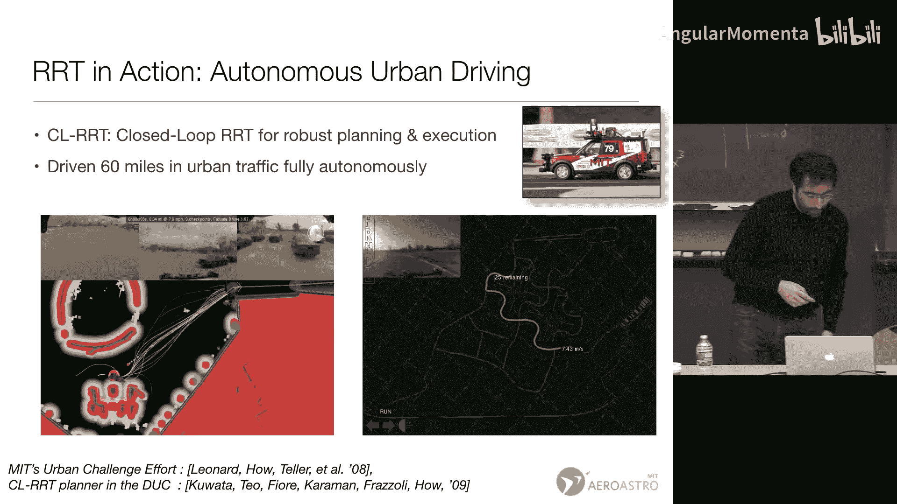

When we switch to the forklift kind of algorithm forklift platform。 I started working on this。

 And the one thing that we realized is that， you know。

 the forklift tries to go here to park in front of a truck。 and it finds this trajectory。

 at some point， it discovers there's an obstacle here。 And it finds this looping trajectory。 and。

 and it never gets out of that loop。 you would think that it's trying to minimize the pathway。

 So you would think that it would be easier to come up with something that just kind of turns left in align。

 But it turns out that once you have that loop， even if you add more samples to it。

 you're stuck with that loop。 And so you would never improve this type of trajectory。

So back in the day， Professor Seett Telleller， who passed away， unfortunately a couple of years ago。

 but he really pushed me， he was telling me this doesn't work。

 And every time it just makes this loop right in front of the Army general who are the sponsor and it just looks ridiculous。

 You need to fix this kind of thing and try and find the fix for it。

 we realized that the algorithm actually has some fundamental flaws in it。

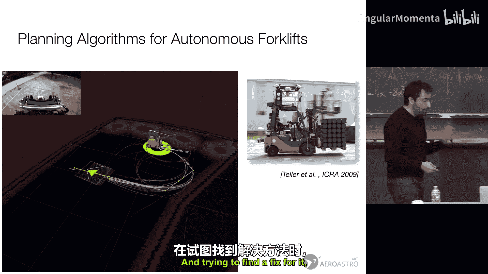

So specifically， we were able to kind of write down a formal proof that the RRT algorithm actually fails to conversege to optimal solutions。

 So this is kind of something interesting。 So you would think that if you add more samples。

 you would get better and better trajectories。 But it turns out that the first few trajectories that you found。

 it just constrains you。 So it closes the space that you want to search。

 and you're stuck with bad trajectories。 and this almost always happens。 Sometimes you're lucky。

 your bad traject is kind of good enough。 But most of the time it's pretty bad。😊。

We were able to come up with another algorithm that we called our RT star。

 which just does a little bit more work。But guarantees asymptotic optimality。

 meaning it will always converge to optimum solutions。 And the difference。

 computational difference between the two is very little。 If you were to run them side by side。

R T star 3 would look like this。 What it's doing is it's， it's just looking at the paths locally。

 and it's just kind of corrected them locally just a little bit。

 And that little bit correction is enough to converge to globally optimal trajectories。

So that turned out to be my doctor teas back in 2011。 and we applied it to a number of things。

 Let me show you one simulation scenario。 Imagine a race car coming into like a turn wants to turn very quickly。

It generates these trajectories。 So the right thing to do is to kind of slow down a little bit。

 start skidding， hit one end of the road， now start speeding up and go as fast as possible so that you hit the other end of the road and you complete the term。

These kind of things would come out just naturally， from the algorithm。O， you won't have to program。

 You have to do these kind of things， but you just run the algorithm。

 And these are that this is the best trajectory it finds。 It will be。

 It would be impossible to get something like this webinar。

We applied it to a number of other robots as well， I don't know。

 like PR2 type robots or these autonomous forklifts and got good results out of it。

So that kind of maybe gives you a bit of an idea of my background。

 meaning like my graduate school experience a little bit and the PhD。

 let me kind of tell you a bit quickly what my research group does。

So I always say sort of so we do a lot of things in a unfortunate and unfortunate way。

 So it's hard to find the focus sometimes admittedly。

 but I usually tell people that we work on autonomous vehicles。 The problem is quite interesting。

 both at the vehicle level， meaning how are you going to build these autonomous vehicles individually and also interesting at a systems level。

 When you think about it， most of the autonomous vehicle is most valuable if you put them into a system that they can work。

Let me give you some examples。 So a system autonomous vehicles would be， for example。

 thiski system scenario。 You know， nowadays， you buy something from Amazon。

 the way it you buy two books。 The way it's packed is that books are brought by robots to a picker。

 and the picker just puts them into the same box and sends it to you。

So this is done by 500 autonomous vehicles， for example， that would be a good example of a system。

Another one is that there are ports around there in the world， you know。

 that are working just completely with autonomous vehicles and cranes。

 If you project a little bit forward， you you can think maybe， you know。

 you can have drawn own delivery systems and， and they maybe don't have enough batteries that they have to delay packages to one another。

 So you need to build a system autonomous vehicles。 Or if you have， I don't know。

 like autonomous cars。 Maybe it's best to use them in like an Uber like scenario so you can autonomous taxis that they can work together and such。

So let me tell you a bit more on the vehicle level problems and the system level problems。

 Some of the crazy things that we try to do on the vehicle level。

 we're interested in all aspects of both perception and planning。

 Usually the challenges are sort of either complexity or either computational complexity。

 So it's very hard。 just computationally。 So you really need to inno it。

 or it's just the system becomes very complex。 So you need to figure that out。 for example。

 recently motivated by really fast and agile kind of vehicles， how we can build that。

 Like one thing that we were motivated for example， is。😊。

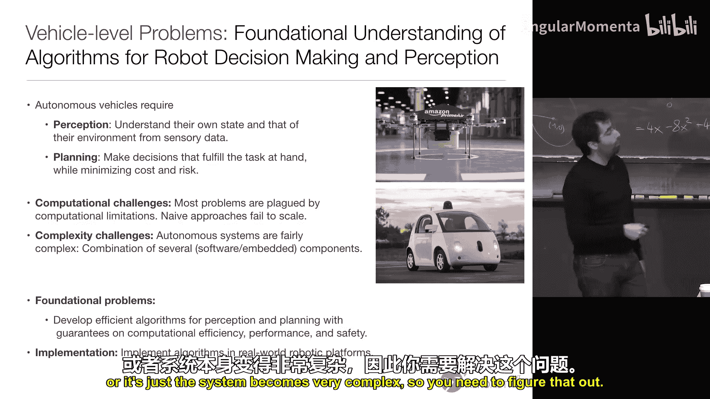

Sort of， like imagine， there's a drone flying。 and you wanna。You want to catch it in the fly。

 I wonder if this is going to play。

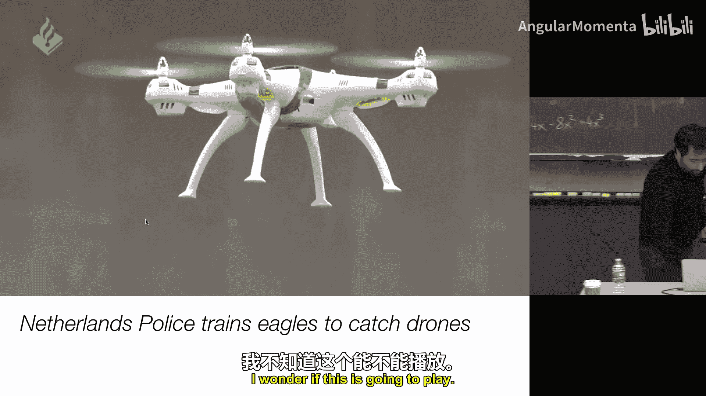

So， you know， it turns out that Netherlands police。

 some people fly your As around and you somehow want to take it down。

 It's not like you can shoot at it。 So people train eagles and things like that。

 So we thought it would be great to actually build these types of robots that we try to in our group。

😊，So you can， once you start to do these kind of things。

 you wonder like how much I can push the boundaries of very， very agile vehicles and systems。

 So here you're going to see a falcon diving for a prey。

 you're going to see a goose right at the last like a split second。

 So if you look at the scene from a 20 Htz camera， this is what you would see。

So they are definitely much faster。 They do very complicated， you know。

 planning and manuing to be able to do these kind of things。So， you know， in the research group。

 we look at a number of different perception problems where you have multi agents。

 you have ultra high rate cameras。 Like， for example， we have drones with 200 Hz cameras on them。

And so you're trying to understand the person that you're tracking， its dynamics， its intentions。

On the control level， you're trying to pull off really complicated maneuvers。

 like the one that you've seen in the race car。 you want to do it in real time at like a kiloherz。

 probably。 So how can you do these type of things。We use a lot high performance computing。So。

 for example， the drones that we have actually have GPUs on them。 They fly GPs。

 They fly like terof fl computers to be able to do these kind of things。 We also use them offline。

 like the deep learning computers that you would use normally。

 we have access to things like D G X1 and so on that we use that to compute controllers， for example。

Here's an example of， I don't know， like one GPU drone is kind of passing through Ra windowo。

 This is from a long time ago。 but these are the controllers that we would compute on supercomputers and we would deploy。

And on the perception side， for example， we're looking at things where like you can use visual martry。

 You can just have a camera and just look through the world from the camera and try to understand your own position。

 So we have certain algorithms to pick the features just right so that you can do these things with just like 10 features or something like that。

 So they're just computationally very efficient。On the systems aspects of things。

 when you put them together， yeah。What exactly do you mean by the micro computer controller？

Finding those best constant we forward。Yeah， so this is maybe kind of。Yeah， so the question was。

 what do you mean by sort of computing the controllers， Would you want to find the best constants。

So controllers are actually pretty complicated objects。 So you have a drone。 It has suppose it has 6。

 It has actually 12 degrees of freedom， but suppose it has 6 degrees of freedom。

It's a six dimensional space。6 dimensional space is very， very large。

 Suppose you discretize every dimension with 200 points。 So6 dimensional position and orientation。

200 points。200 to the6 would be thousands of trillions。 If you were to ride one bike。

For every point in the states， are you looking at the state space for every point in the state space。

 What's the action that I'm going to do If I end up at that position and orientation。

 what action should I do。If you use one B to write it in the memory， it would make 2。5 pets。

Of this controller， it's pretty large。When you think about it。You don't really need。

It would be very surprising if that maneuver really。

 to be able to describe it like an information theoretic terms， to be able to describe it。

 It would be very surprising if it requires thousands of trillions of parameters。 I mean。

 how complicated is it， really， So millions， maybe， but trillions seriously。So， what we do is。

To be able to compute these things， we take very simple controllers。 like， for example，0。

 don't do anything。We compress them， like isn in data compression。

 And then we work on the compressed versions。And then that compressed version grows at to a level that comes down to something like 2 MB。

 That's probably essentially what you would need rather than 3 TB， for example。We use kind of。

 you know， singular value decomposition type techniques to do compression。

 You may have done the same thing using images， for example。If you compress an image JPEG。

 you save an order of magnitude。No surprise， right， If you compress video， you save 2。

3 orders of magnitude because video is three dimensional。As you increase the dimensions。

 there is more to compress。So when you compress this way， this saves 10 orders of magnitude。

 which honestly is no surprise。 when you think about it a little bit。 So those are the control。

 like the planning and control algorithms that we use。 These vulnerable supercomputers still。

 So we compute them in。 I don't know 5 minutes that gives you a lookup table That's 2 MBby。

 You put in so that you can quickly execute it。 That lookup tables essentially。

 you want to do a kiloHz control。 You won't be able to compute a trajectory at that。Okay。

 that question came in。 and that's the whole talk in terms of。Present of motion planning。

 And I can show you some other stuff。And there's a lot to do。

 especially in terms of agility on the systems domain as well。 Like， I don't know。 I pulled up。

 this is not the kind of stuff that only stuff that we do。

 but I pulled up the most interesting thing。 I think， maybe the most crazy thing of my hard disk。

 Imagine you have a whole bunch of vehicles coming to an intersection。 Supp they're fully autonomous。

How would you make it so that they would pass through the intersection as fast as possible， okay。

So if you were to really utilize algorithms that would do that， here is what I would look like。

 So you would have vehicles coming in。And you could。 it looks like。

 so you probably don't want to sit in this vehicle。

 just sort of like just to understand the fundamental limits of the situation。

 just to understand how far you can push these things。

 You can see it looks like they're getting very lucky。 But really。

 what's happening is that they're just speeding and slowing down just so little so that they can avoid one another。

So you can actually sit down and do some math and try to understand， you know。

 given the dynamics like your exploration deeleration limits。How fast you can push these things。

 Maybe it doesn't immediately apply to self driving cars。

 but certainly you can use it in warehouses and things like that。

 which would actually improve operations quite a bit。

I wonder if any of you have seen Ki systems warehouses， you look at it。

 Most of the robots are stopped。 They are just sitting there。あ对。公安局。For example。

 you know like people that you go or end the back。They're even working。Yeah， so the question is。

 is are anyone sort of working on robustness aspects of distributed control。 Yeah。

 so that's a good point。 it's very right。 We have looked at things like from the theoretical perspective。

 it turns out that like even in this case， there's something like a critical density of these things。

 So below the critical density， things are very simple。 you're going to be robust。

 you're going to be able to find paths and you're going to be able to execute above the critical density。

 things are very hard it's very fragile。 Like if something fails。

 just kind of the whole system will crash into one another。嗯。And this is no surprise either。

 like this is kind of the physics of many。 you know， just like you see it everywhere。 I mean。

 it's the same thing as I don't know， you heat this thing。 there's a critical temperature above it。

 It looks different below it。 It looks like a liquid。

 You can use the same kind of thinking or theoretical arguments to come up with these types of things。

 And I know that a lot of people work on specific controllers for vehicle level to guarantee robustness and so on。

 Probably those are the kind of things that one needs to do before implementing these types of algorithms。

But we sort of like in the current existing like multi vehicle setups。

 like Ki systems or ports and things like that， we are far away from this kind of thing。

 the main problem。Some of it is control， like， we don't understand the control aspects。

 but we also don't trust our sensors and things like that。 So that's another big problem。

 So probably the more the research is on the not research， but implementation is on the sensor side。

 I'd say。Okay。So。嗯。Yeah， so we have been doing a number of other projects currently as well on autonomous vehicles。

 if you're interested in any one of them。Let me know。 I'm not going show you videos。

 but let me just kind of tell you with one slide and a few pictures。 This was several slides。

 but I felt really bad。 So， so if you have an autonomous tri， that may sound funny。

 but it's actually pretty hard to test with autonomous vehicles。So we currently have five of these。

 and we are hoping to build 30。So that we can put them in。

 They're currently in a little robot enclosed area in Taiwan。

 and they're just driving around collecting data so that we can， for example。

 you can feed them into deep learning algorithms。We also have in A B's warehouses。 We have these。

 we have one of these robots。 It's a warehouse robot。'm supposed to be kind of like， you know。

 I'm sure you know what we think robotics， like they make this robot arm。

 It's supposed to be very easy。 You can interact with。 So imagine a warehouse robot that way。

 You can just talk to it。 You can tell it stuff to do and it can do that。 You can show it。

 You can hop on it。 You can do it yourself type of thing。

I am also a EPI together with sort of working with Daniel Laus on MIT's effort with Stanford and Toyota to build safer vehicles。

And finally， I'm still a P on the MIT Singapore partnershipner。 right now from golf carts。

 we've moved into doing these electric vehicles and we're working on basically integrating a lot of electric vehicles together to make them kind of worked nicer。

 We've also kind of not looking into an autonomous kind of wheelchair。

 That's also in that project that I didn't show here。

 So my group works on like a number of other projects in this domain。 admittedmitly。

 my group is a bit more on the theory side as well。

 So maybe like half the group is a bit theory oriented。 The other half is more experimental。😊。

I usually say we have quite a spectrum in the group。

 so we would have mathematicians like I would have people who don't have any engineering degrees like。

 for example， we have one postdoc who is a mathematician by training， is a postdoc scholar here。

 We have two undergraduates， graduate students whose undergraduate degrees are from mathematics。

 On the other hand， we have sort of mechanical engineers and so on who would actually build these things throughout the group and we're funded by a number of people。

Through up。So， okay。There was supposed to be like a quick summary an entrance into what I was going to talk about。

 So let me kind of tell you maybe our darkA urban challenge effort so that I can tell you a little bit more about how we implemented these motion planning algorithms if time allows I could talk more broadly about motion planning algorithms。

 but I don't think we'll get a chance to okay。So I'm going to start with this effort。

 the DARPA Ur challenge。 I'm sure many of you have heard。

 People usually believe that it kind of just kickstarted of all this autonomous vehicles type onan that's been going on。

 let me introduce to you a little bit。 So this is was DARPA did things called DARPA Grand Challenge 1 and 2。

 I'll tell you in a second what they are。 But this is the third one， essentially。

 The idea is that you would take a street legal vehicle。

 You would instrument it with sensors and computers。

 and you would enter this race to drive 60 miles in under six hours in an urban traffic。 right。

 there's other vehicles driving around as well。So Dar proposed this back in 2006。

 They the race in November 2007。 It was pretty hard。 You know。

 you would have to do a lot of different things like U turns， K point turns。

 You have to be careful with stop signs and so on。 It's pretty complicated。 But if you win it。

 they would give you $2 million。 Its good incentive。89 teams entered the race。

 We usually say it's MIT's first serious entry， but。MI T's non serious entry was， I guess。

 the a team that later turned into cruise automation。

 which G M ended up buying for a billion dollars。So this is a serious one of our entries。

They just went there to have fun， I think， And then later。

 they continued their interest into the autonomous cars and built cruise automation， did a great job。

 We went after we were not directly connected to that team。😊。

Our team had mainly the M T faculty postdocs and students。

 So we had eight full time graduate students， kind of roughly。 I was one of them。

 You can see me right here。😊，I looked different back then。

We had a lot of support from Drapco Laboratory， mainly on the sort of system integration。

 vehicle integration and support。Some of them are in the audience。

And we also had some vehicle engineering support from Oing College。

 We had the first version of the vehicle our cables were coming out， and then Molin College came in。

 and they packaged it nicely。We built a vehicle。 It looked like this。 We took a land Roer on R3。

 Land Rover was one of the sponsors。But also， it was nice that the vehicle was pretty big。嗯。

We put an EMC driver wire system to it。 So this is kind of a driver wire system for people who are disabled。

 like， for example， if you can't use your legs， they would give you like a little joystick type device device so that you can actuate。

 you know， gas and brake。 So it came very handy。 We used it to make our vehicle driver wire。

We needed to put a lot of sensors on it。 So I'm going to say as I wish this wasn't recorded。 But hey。

 so I think our situation was the following。 There was a lot of other teams out there。

 and they were very experienced。 They had done the other urban。

 other grand challenges before and so on。We were not as experienced。

 I would say that our team was talented， but not experienced， and we had a lot of sponsors。

 So we had a lot of money。So our strategy turned into， if it fits on the vehicle。

 let's put it on the vehicle and we'll figure out a way to use it。If we don't use it。

 it's dead weight， we'll just kind of carry it。So with that mindset， we ended up with five cameras。

16 radars，12 planar laser scanners，1，3D laser scanner and one GPS M U unit。This was a lot of sensors。

 They generated a lot of data。 You had to process it。 So we had to buy a 40 CPU。

40 gigs Ram Q computer that normally at that time would run on like a Google server type thing。

 It was a server rack 10。Computers， essentially， that we had to put in。

So we used to joke that this was like the fastest mobile computer on campus or something like both in terms of speed and compute power。

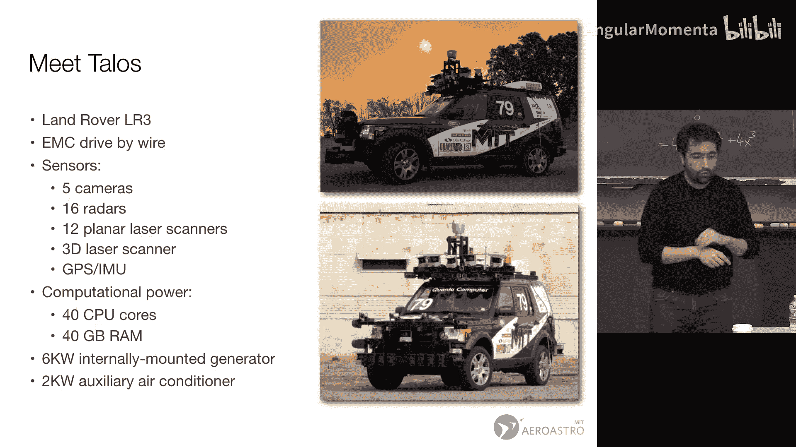

Now this required a lot of energy， so we put on an internal amount of generator Now this generates a lot of heat。

 So we put an air conditioner on top。 you can kind of see it here。 So that became our vehicle。

One thing to note， though， is that we just had。The number of sensors was or the number of computers was large。

 but， but the sensor suit was very similar to the other people who have finished。

 One important sensor was this 3D laser scanner that I'm going to show you in a second。

So this is the thing that sits on top of the vehicle。

 lookss like that Kentucky fried chicken type of bucket。

 And essentially what it has is that probably a lot of people here are familiar。

 but it has 64 lasers that measure range。 And those 64 lasers are stacked up on a vertical plane。

 and that plane will turn。And 15 Hz。 So it'll give you a 3D point cloud。

If you drive with it in Harvard Square， here is what the raw data will look like。

This is colored by height。 You're just looking at raw data and you can know easily pick up out on a bus here。

 another building， maybe a person， a bunch of others so that it gives you great data already。

 like you could work with this， right。So we taught。

 so other teams taught this sensor is made by a company called Vlodine。 It came。

Pretty much just in time for the urban challenge。 My guess is that if you didn't have this 3D point cloud。

 it would be pretty hard to complete that challenge。

 There was only one team that didn't have it and complete it。

 and they had a 2D laser scanner that was kind of turning like they essentially built their own meloine。

Okay。So we had also this sort of 12 planar laser scanners。

 You would need these kind of things to cover the blind spots of the vehicle。 The thing is on top。

 So you're not seeing kind of very nearby。We had five on the push roomss looking down and7 on the skirts。

 So this is kind of what it would look like。 So you're seeing the curbs here and you know。

 a bunch of other things。 and the vehicles are when the vehicles are very close to。

 you can still see them。We had 16 radars。 Greats are great。 They can see very far。

 like laser scanners would see 70m。 radards would see twice as much。😊。

The problem is that they have a very narrow field of view。

 so we needed 16 of them to cover 27 degrees around the vehicle，207 degrees around the vehicle。

27 degrees。So， you know， you can part somewhere and you can see this is meters per second。

 You can see a whole bunch of other vehicles kind of coming through helps quite a bit。And finally。

 we had five cameras in this configuration。 We were using cameras to actually look at lane marings。

 I think actually， we were the only finishing team that was using cameras for any purpose of any kind。

😊，The other vehicles were just kind of working with the laser scanner。I mean。

 we were mainly working with the laser scanner， but we were picking up lane markings with this。

And we bought this GPS MU unit。 It was an expensive thing， but it would give you your position。

 you would go with。The algorithmic stack， it gets pretty complicated。 I think by the end of the race。

 we would probably have。Like the active code that was running could be order hundreds of thousands of lines of C code。

 so maybe like 200000 could I mean I remember the forklift and that was about half a million lines of code。

 I think this was a bit less。 We had around like 100 processes that are running。

Sending messages to one another。On that。40 core system that you've seen。

So that would generate a huge software diagram。 So I simplified it for you。It turned into this。

You have some sensors， You get that data， You process it through perception algorithms。

 You generate a map of the environment。Close to the robot。And you have this3 tier stack。

 You have a navigator， much like your Google Maps。 It would compute a map to get to your next goal。

 which may be kilometers away。 And it would also give you the right。

 the next waypoint that you should hit that would hopefully be within your grid map。

And there's a motion planner that looks at the map， sees all the obstacles and everything。

 sees the goal point and finds it at to get to the goal point using the RRT。

And then once that trajectory is computed， it is passed to a controller that actually steers the vehicle that way。

So I've already shown you how the motion planner works。 It just kind of computes these things。

 So here's the goal point。 Our car finds the path to get there。

And you can run these things together to get like a good behavior。 It doesn't always go well。

 Let me show you what doesn't work in this kind of work。

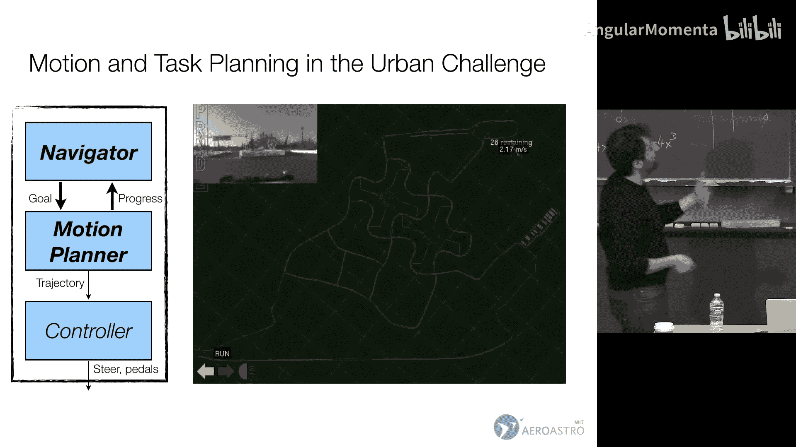

要述。被告。The algorithms performance。然后是当时。然。没你的啊。最の。第。Yeah， so we we had like honestly。

 here are a couple honest things。 So we had one thing that we had a pretty good simulation system going for motion planning and things like that。

 it helped a lot。 Like on the day of the on the sort of like the day before the race。 my 24。

7 job was to keep simulating our algorithms。 Like I had two computers kind of start simulation here。

 start there， look at it。 if one fails， log it and send it out。 So simulation really helped。😊。

We have done some testing。But I don't think we actually。

 I think the race itself was the furthest that we had driven without any human intervention。

Like before then we hadn't done that much。 I think this was like 60 miles。

 If I remember this correctly， we had done like a 20 mi stretch or something like that。

 but we hadn't。T as many。So admittedly， we didn't have too much on the testing front。going。

The only reason why was because it's just we didn't have time to do this kind of thing。 We， So。

 I mean， we started maybe a year before。That we put together some of the infrastructure like this message sending and things like that。

But the vehicle itself to test it in reality， the vehicle， I think， the race was in November。

We probably got this vehicle。 I mean， we had another vehicle before， but we got this one clean。

 I think it was April。And then we put the sensor zone or something like that。So really。

 it was just a summertime that we had to test and admittedly we couldn't test much。

And Draper Laboratory helped a lot with the testing。 If we didn't have。 We probably wouldn't as any。

 So we probably just kind fail out right or something。In this kind of thing。

 testing is very important。 It will be very important for future as well。

 Simulation will be very important。 Simulation has come a long way， actually。Like nowadays， I mean。

 you guys are working with simulators you can see， but there's a lot of other things that people are going to put out in the next year or two。

 and you know， like we can nowadays render things that you can show it to people。

 And it's very hard like people don't see that it's a rendering。Ours wasn't back then。

 I think that would be probably the right thing to do right now。

 But back then we had this one platform that， know， you could just run the whole software stack。

But if you start up as simulator， it would actually simulate all the sensor data and everything。

If you don't start a simulator， then the processes will be waiting for the data to come in so you could put it on a real vehicle or something。

 So back then， we thought that would be the best thing to do。The question was。

 was your simulated environment and your development environment separate or integrated？

They were very integrated。 Right now， I think you will do things differently。Any other questions？

Yeah， there's kind of a lot to talk about。 So I thought that it would be just kind of great to give you guys some ideas。

 given the。The course is autonomous vehicles。嗯。So here's an example of a case that we got into。

 So what's happening here is we arrive in our intersection。And there's another car。

 it's Cornell's car and they're just sitting right in the middle of the intersection。

 and they don't seem to be moving。 I think they've been sitting there for a few minutes before we even arrived。

 So DARPpa decided that they should let us go and we're probably going to take over and we'll do great and it's going to be an important moment in robotics history that for the first time。

 you know a robot takes another robot while the other robot is stuck and it's going to be great。😊。

So they decide to go forward with this。 So here is how we're seeing things from inside our car。

 Our car is right here， wants to go there。 R R T generates trajectories。 There's an object here。

 That's the car that we're seeing。 We're not seeing all of it， but we're seeing a fraction of it。

So we're going to play it a little bit。So， you know， like we're actually able to turn around it。

 So I think I need to stop it somewhere。 But let's look at here。 So weve seen the whole car。

The new goal point is further away。 Regenerating these trajectories looks great。

It turns out that this car is just somehow of stuck for some reason。

 So we wrote the paper together with them。 It's not unclear to them either。

 But my understanding is that they think that the obstacle is on top of the car。

And the way the algorithm is written is it just kind of generates a trajectory and asks if this trajectory is collision free or not。

RightThe collision checker doesn't say this part of the trajectory is in collision。

 It's just every time it passes that trajectory because the root is in collision， it just says。

 there's nothing there。They have another little piece where it just updates the map every time theres new information from the sensors。

 If there's no new information， there's no need to update。

So they ended up getting stuck on this obstacle and they're not refreshing their map because nothing is moving up until we move right next to them。

 They refresh again and they say， oh， I'm actually not sitting on an obstacle。 That was an error。

 So next time the pad comes going forward， It says this is a great pad。 Go forward with it。😊。

That happens right by we passing。 So if you look at this blob right now， as I play it。

The blob starts to move。So they are going in a direction that we are going。A quick thing will happen。

 So if， if our car。If our car at some point realizes that there is no paths。

 a collision is imminent and there is nothing to do about it。

 it generates its shoulderss that white circle around it。

 And that basically means that we are headed to a crash。 There' is nothing we can do about it。

 Were just going to slam the brakes and hope not to bad things happen。So it starts to do that。

I think at this time， this camera is more fun to look at。

 You can kind of take a look at it and sort of see what happened。😊。

And so this kind of like collision happens。 We collide with the car。 DARPpa。

 what they did is that they actually pulled the Cornell car back。 They started us。 We finished。

 They finished this well。 So both of the teams finished。

 But you can see some of the things that are a little bit hard。 For example。

 if you yourself were to arrive at an intersection that there's a car that's sitting there。

 you probably would stop your car， take out， go and ask if there's anything wrong。

 Even if you don't do that。 suppose you're not very decent of a human being。

 you don't decide not to do that。 You would still steer away from the car。

 You probably wouldn't get as close to this car as we did。

 So there are some problems that are at the inference level that we do without even thinking。

 And its actually kind of hard things for these types of cars to do。Especially if you're going fast。

 you're in a complicated environment。 You're not expecting things。

And you might collideiding into things。 We do different kinds of inference that we can't do a name。

 But you know， you look at the way a person walks on the sidewalk。And you can say， oh。

 this person is kind of dangerous or maybe we will walk into the street or not。You know。

 you make that decision。 and it's actually a pretty complicated thing for a robot to do。

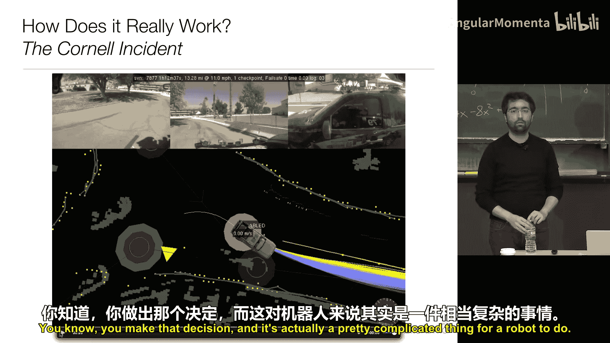

Okay， so， you know， this is kind of like the results of the race。

 I'm not gonna to go too much into it。 Basically， the idea is that 89 people started6 finished。

 We were one of the finishers。 CMMU came first， So they got the $2 million check。

 I believe Stanford came second。 They got a $1 million check。 Virginia Tech came third。

 They got half a million。 We came forth。 We didn't get any money。 but you know。

 we got a lot of experience。 It was great to be a part of it， I think。😊。

One note is that the Google card that you may have heard a lot was essentially sort of like a spinoff。

From this race。So if you look at the Google car， you will see that the sensing package is very similar。

 It's very laser scanner oriented。 has a couple of radars on it。

That it could utilize and is working somewhat with the cameras， but not so much。Essentially。

 Google engineered this thing that we built or all the other teams built independently。

 They engineered it for 10 years。 And that's the kind of thing that they utilize nowadays。

There's also like this whole Tesla brand of camera based cars or deep learning and so on that's coming in just very recently。

 Back 10 years ago， you know， we knew about deep learning and so on。 But it just。

 it just didn't work。The moment somebody figured out doing it on a GPU。

 it started working pretty well。

O， so there's a lot I can tell you about path planning。

 but I think here is kind of maybe what I should do if you do not mind。

 rather than telling you about RTs and making this into a lecture that I'm not sure if you're going to like it。

Let me talk maybe a little bit more about South driving vehicles。

 and I think that's something that we might enjoy better。

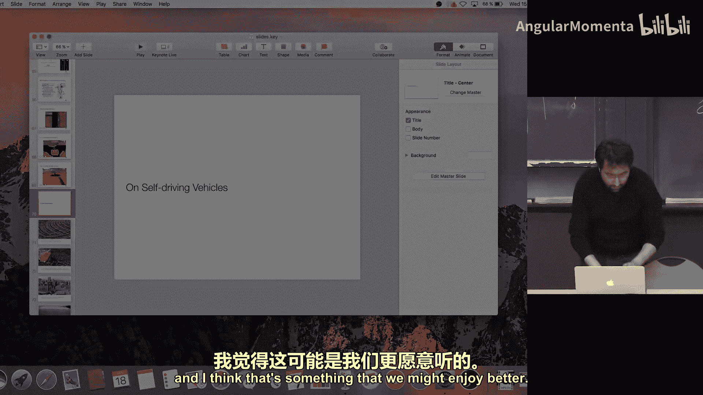

ご円。build的 subject代。他那不道。啊，什么关系的。What was the biggest challenge？😔，Right。はで。So the question is sort of。

Building it from scratch Web was the biggest challenge。 So I'm going to say。Admittedly。

 I was a junior student back。 So my challenge was to get these controllers and some parts of the RRT working。

 And I had simulation systems and things like that。 And life was good for me。I would think that。

 I mean， we ended up building pretty complicated hardware。 So that was one of the challenges。

And that probably all in college Draper， you know， they did all of that。 that was great。

 The other challenge that we had is that nowadays， there's like maybe you guys use it like robot operating system and so on。

 that infrastructure software。 We had none of that。 So we ended up building our own。

 I don't know if anybody uses， but there is this thing called lightweight communications and marshalling。

 LCM。😊，So that ended up being built for this。 and it just kind of got spun out。

That was another big challenge that we actually faced。

 So LCCM nowadays is utilized throughout the industry。 Like， for example。

 For autonomous cars will use it。 Toyota will use it。 Nutonomy uses it。

So it ended up coming out of this， this challenge。 And it was probably like the first， you know。

 I would say the first  six，7 months was kind of devoted to it。And， and for necessity， I mean。

 we just， we wanted to do other things， but we just couldn't because you needed something like this。

 So that was another big challenge， I would say。嗯。Testing was a big challenge， things like that。Yeah。

 so back then in the urbanr Challge Dave， it seemed like people were pretty collaborative。

As far as working on a five papers goes， the published papers， you publish a paper with。

Right for the collision。Other team and things like that。

 but now it seems like ours vehicle development becoming much more isolated like different companies。

I'm collaborating。can be well， I guess it's good and bad。 it's kind of hard to assess。

 So competition is always good。 So the question was that you know back in the day we were really collaborative like it's very interesting that we actually wrote a paper with Cornell about our collision just to teach the whole community why these kind of things happen but nowadays like everybody is just kind of doing their own thing and there's kind of going out。

 So there's there's a quick question there's a quick answer for that and there's a kind of a broader so the quick answer is that yeah。

 I mean， it became important there's a lot of you know sort of people invested a lot of money and they are expecting returns and things like that and that affects the environment that definitely draw it。

I think we're still， you know， trying to work on it in academia and trying to publish papers。

 but a lot of people are you know， worried about competing with these huge companies and things like that。

 which I think is not a big war because there's a lot to do still。嗯。So when you look at the industry。

 there's little competition。 But that， for some reason。

 the broader answer is that that became an norm， so。Back 50 years ago。

 you would look at the top company of the day。 This is like starting from a century ago。

 like with Bell， for example， they would form labs and they would publish and they do science and things like that。

 it will be very open。And nowadays， the big companies of the day。

 they kind of rather prefer secretive labs and things like that。

So that I think Microsoft was the last。Big company of the day to do that。Nowadays。

 Googles and Apples and things like that。 they don't do that anymore。 There's a bit of that， as well。

Good or bad。But it became that way。Sometimes competition is good honestly。

 It's a good thing that people feel like。You don't know what the others are doing？

And you want to compete。So that makes you better and better， even though the others maybe。

 I don't know。Okay， any other questions？あ one。そ。Make a vision only over a challenge。

Or something that raise the best。不是。Without driving engaged versus early。I'm not。

 I don't think it's really an industry problem because it it' still kind of it's quite complicated。

 honestly。So there may be things that people can do。 but I， I。

 I am wondering if DARPA would be interested in doing a challenge。

 So let's set DARPpa aside differently and and research otherwise。 like when you think about DARPA。

 DARPA is a defense agency。 And when they thought about the challenge。

 they had honestly defense problems in mind。 So， for example。

 they didn't allow you to go around and drive in the area with your sensors。

 the idea was that they would give you a map of the environment。24 hours in advance。

And then five minutes before， they would give you a mission。 like， hit this waypoint。

 hit that waypoint and so on。 So that's the military setting。They were really， really。

 the whole thing started with the US Congress mandate to get， you know。

 one third of combat vehicles autonomous by 2015， which didn't happen。

 but it was a more military setting。So DARP is usually sort of thatmined and they did the DRPpa robot challenge。

 The current thing is thing called fastlike autonomy。

 so the idea is to build a quadcoter that can fly here 20 me a second like 40 miles an hour indoor environments type of thing I think they'll do that but there may be other things like there may be other you know people kind of coming in pushing the boundary of research like something for example。

 just with cameras would be very interesting and I think we are just in maybe a couple years away from doing that very well。

系 think。And probably deep learning would be a lot of it。Okay。

 so I don't have much time and I don't want to hold you here， but sort of， you know。

 let me tell you a few things about autonomous cars in general and let's see if we can。

 you know in like 10 minutes we can fit something interesting。

Transportation is a very interesting thing。 It actually defines how you live quite a bit。

 So if you look at， for example， the kind of cities that you know。

 many of you may be living in today， they look like this。

And they are produced thanks to one invention that was the affordable car。

 which was about a century ago。 If you look at it， you know， throughout the last century。

 like in 1950s， cars were big and， and you would find。

 you know that everywhere these kind of suburbs were being constructed for the first time。

The reason was cities were dirty。 They were disease pronene。 So now you had the car。

 you could move away into a better living lifestyle， and it would improve it。

 than that was the 20th century invention that you had。Itd also change the cities quite a bit。

 I mean， like， for example， this is Boston sort of central Audrey that was built in， you know。

50s at around that time to kind of service the cars coming in and out of the city。

The cars kind of generated this kind of thing， you know， in some places at the extreme。

 like if you go to places like Los Angeles and the United States， you would see the suburban sprawl。

 it's very different in other places。 So places that didn't have the time to expand。

 that didn't have the resources to expand or just didn't have the place to expand。

 it caused many problems。 like here is the suburbia and in Mexico City。

 you can see the dirt that it generates in the distance。Even if you're rich。

 it doesn't really matter， you know， even in rich countries， this quick expansion。

 it just doesn't work and it creates， if anything just ugly environments and in some places it creates like you need to be dense and you need to be big and so you have the cars。

 but you just have to build big buildings that you cannot even serve with cars so you generate these type of things where there I think it's probably my I was just going to say it only led the congestion and pollution in the rest of the world。

 but you generate these kind of things where I don't know if you heard there was a traffic jam in China。

 it lasted like nine days and it was 100 miles long。So it generated this kind of thing。

 Its just a quick introduction of the affordable car。

 sort of what it did to the environment in the cities there。So pollution is one problem and so on。

 but if you look through it， it's actually pollution and energy consumptionized。

 a lot of it comes from the cars， especially inside the cities。嗯。

An interesting point is that if you look through the cars。

 the cars are actually pretty inefficient the way they sort of sit currently。 If you look through。

 for example， BMWs over the years， you would see that they get heavier and they get faster。

 This is very correlated。 if you get faster， you have to become heavier because you have to pass crash tests and things like that。

 So in order just to be faster。 So in order to pass pass the crash tests。

 you build structure and things like that and that makes the vehicle heavier ultimately。

 So like a BMW that you would buy in the 70s would weigh something like know 2500。 nowadays。

 it's like you know， like 4000， roughly。So it would， you know。

 if you look at the average passenger weight that it's carrying， it's about 25 times the。

 the weight of the passengers。And the size as well， you know。

 it's about 10 times the size of the passengers that it carries。In terms of parking spots。

 if you look through the cities， there are places in the， you know。

 usually what we have in the United States is that for every car， we have two parking spots。

So roughly that's the number。In some places， parking spots take up like half the city。

 So for example， in a way， on average， it's about one third。So you might ask the question like。

 this is the kind of thing， this is the kind of environment that cities created。

 and do you really want to live in this type of environment？And it's to kind of give you the idea。

 I mean， if， if you walk out a lot of the infrastructure。

 a lot of the things that you see are made by cars。 like， for instance。

 and it really kind of interferes with your thinking as well。 So， for instance。

 we never walk on the street nowadays。 like nobody Jaywalks。 Street are for cars。

 like cars go on the streets and we go on the sidewalk。 It wasn't like that 100 years ago。

 You could walk on the streets， however you wanted。 Cars came in and they took it over。

So they changed the urban landscape quite a bit。The point is that it seems like there's。

There's an opportunity today to actually kind of use 21st century technologies。

 This could be robotics， but a number of other things like online services。

 new business models and things like that， and so on， maybe high performance computer or whatever。

 and to kind of service the needs of people in the cities。三你经到可。I'm not sure。

 I don't think that the kind of the service aspects of it goes away。 So， you know。

 you will need to up my guess what would happen is that I think people could be more mobile。

 So I think they want to be more mobile， but they're just not。 if it was very accessible， very easy。

 I think they would be。So there be an increase in being mobile。 But at the same time， thats。

 you know， resources are spent on it。 You need to pay for it somehow， so。

You would still generate economic activity off of that。 In fact。

 you would probably generate more economic activity， for example， if。

The moment you change people's behavior。 there's the way that you generate like a new economic activity。

 So if there's a way， for example， transportation is more available， more affordable。

 and it changes your behavior。 It makes you more mobile。 Like， for example。

 you're fine with having a class here and then 20 minutes later， having a class at Harvard。

 Nobody would do that nowadays。 But if it was that easy to get there。 You would probably do it。

 And so that would make you more mobile。 And that's the way ultimately would generate more economic activity。

 rather than buying cars。 I mean the service is still there。 You need to pay for it somehow。

Any other questions？Yeah， so the point is that， you can use these type of technologies to do。

 for example， like other maybe like mobility on the， know， whenever you need to be mobile。

 you can be mobile or deliver things and so on。And I think that let me just kind of。

I was going tell you a bit the history， but I think that I'm just going to pass it and tell you a few things。

 So autonomous vehicles are sort of one thing that you can utilize and you can actually do these types of things。

 I think you can make this even better。 like for example， you can integrate a few things into it。

 One thing you can integrate sharing。 like so you can make it in an uber type scenario。

 you can use autonomy as well。 And finally， like electrification。

 especially if you're going a little bit slower So you don't have to pass pass crash tests and things like that。

 you could really reduce the cost of transportation。

Like to the point where you could imagine things like， like。

 you could go from anywhere to anywhere else for 99 cents in Boston。With like  five minute wait time。

 If you want to share your ride， it could be 50 cents。If you want to admit to like one stop。

 a lot of us do one stop。 You know， you can take a subway and then take a bus。

One stop makes your transportation much cheaper。If you were to take an airplane。

Suppose if you wanted to take one stop， you could pay 30 cents and you could go anywhere to anywhere else in Boston。

I think there's a good opportunity to kind of push for things and utilize technology to bring the cost of transportation to a point or availability of transportation to a point to like really just change a lot of things。

It's not very easy。The way I usually look at the technological landscape is that you can imagine sort of speed versus complexity。

 Spe is the speed of the vehicle that's being involved。 that's involved in this。

 And maybe complexity is the complexity of the environment that you're dealing with。

 like you can have。High speed， low complexity environments like highways。

 Theyre actually easy to work with。 We might actually conquer them like in the next， I don't know。

 three years or something like that。 Another thing would be like， for example。

 Parks or university campuses are something much slower。

 but much more complex like people walking around and and things like that。

 Full autonomous driving is probably pretty far。 But there is some opportunity to do some interesting things elsewhere very quickly。

😊，The one of the problems is that this is not just a technology problem， to be honest。

As you have seen earlier， there's a lot of involvement in like， for example， architecture。

 like how do you actually utilize the city the best and so on。

But one of the biggest problems ends up being this。Law and and insurance and regulations aspects。

There are good or bad things like， for example， sometimes you allow by the law to be able to do certain things。

But then is it really like， is it a safety hazard， Is it of an ethical to kind of allow people to just kind of test stuff around。

 So it's a bit of a question like whether or not this is the kind of thing。

I think sort of going forward， if I could say one thing to you guys， is that。This is。

 this is just not like just a problem in， in sort of technology。

But it's also like a problem in technology， sort of society， policy， architecture。

 low insurance and business as well。 Like you may need new business models and so on。

 So I personally think that it， it's right out that。

But I think that we still need just a bit of more like a better thinking to do。

 to be able to attack this problem and to really kind of enable it so that you can kind of do good and interesting things with it。

I might I could close with a couple things one thing is that I was going to talk a little bit more。

 but maybe I'll just kind of pass with one slide， I am a part of a new company。

 I've done a few companies outside so this is the latest thing that we've been working on。

 it's called Opimmus ride， it's working on autonomous vehicles it's currently in Stout mode。

 it' just raised like a little more than 5 million in seed Brown to kind of start its operations。

I am joined so the founding team includes a number of sort of friends， Ryan Chin， for example。

 I don't know if you guys have heard of the MIT Ci car， the Spaling car， that was his Dr。 Otiizis。

 he's been an MITPI for a while， he joined Opimus Albert Tuang is a friend of mine who we worked together in the urban Cha。

 he was later a sort of a chief architect， softwareft architect at rethink robototics。

 then the lead perception engineer at Google X for Project Wing and then he joined Opimus。

Rir Almediadia is a sort of a designer so he's a Le fellow from the Harvard Graduate School of Design has this Le fellowship。

 they would invite eight midcaer best midcareer designers so he has that kind of a background to also build keto's subway system raised 2 billion for it Jenny Laos Berlin is also a joint MBA and an urban planning masters from MIT she was the managing director of university campus operations of Zcar so we kind of started this kind of thing and thinking about these types of problems if you're interested send me an email would be happy to talk to you more about it。

 I also will tell you one more thing I am advising a team that's trying to do formula SAE autonomously they're doing it for the first time this year they're actually using a lot of deep learning type algorithms so I was telling them I'm not really sure if with deep learning you're going literally in it because people might come with all the heroes。

And things like that， but I think you know you may win it at people's hearts just that you're on the algorithms deep learning or something like that so they're doing that if you're interested please send an email to autonomous formula FSAE at MI3 and they're working on a number of things you're more than well I come to join them Thank you so much That's all I have It's exactly one another。

Yeah sure I'm here yeah， so maybe a few questions if anybody has questions so a lot of this class is about deep learning and in terms of autonomous vehicles。

 deep learning is mostly focused on the vision sensor and cameras so how far are we away from a car。

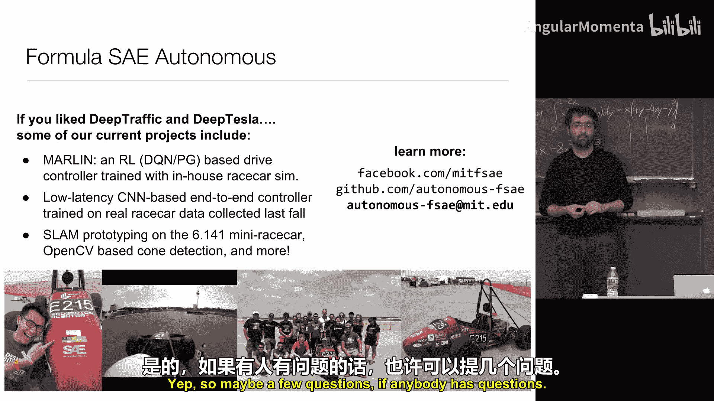

That safely navigates the streets of Boston without Lidar and without any mapping。

 So purely on the sensors， using the sensors and perception。

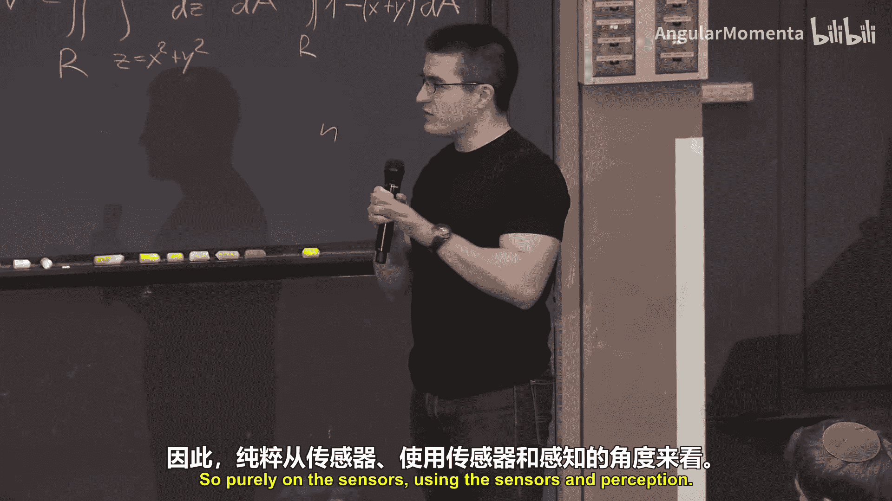

So it's a bit of a guest game， to be honest， it wast somewhat the slides that I kind of passed through。

 but I am a big believer in computer vision。And I， I do not think it's too far away。

 It just ends up being a bit of a guest game， but。It's not like I don't know how many of you have worked with cameras but。

Deep learning is one approach。 You can also use geometric approaches。

 like you can use a single camera and the motion of the car to build a 3D map。Of an environment。

 these are not too far away。 cameras are actually pretty good sensors。

 The only problem with cameras is that it's just a lot of data。 and there's little information in it。

 you need to fish it out。 So you eat computers to accompany it。

 It seems like the computers are coming out。 So it's still hard to know。

 but I like I would be surprised if in 10 years， you can't build a car that just has a bunch of cameras and navigates with cameras period。

 It would be very surprising to me。It'd be also surprising if it happens next year。

Like some people are saying， but in between these， I you know I would think you would be able to。

 so once you like what I would suggest is if any of you is working with cameras。

 I would suggest deep learnings and excellent techniques。

 So once you I think you're kind of using it here and I'm sure you're being surprised as it gives you the kind of information that you need try out model based techniques as well。

 they're also coming along pretty well。 So probably a solution that just integrates them。

As best as possible。Would be viable。 I would guess in three to five years。

 I'd be surprised otherwise。It's optimistic。

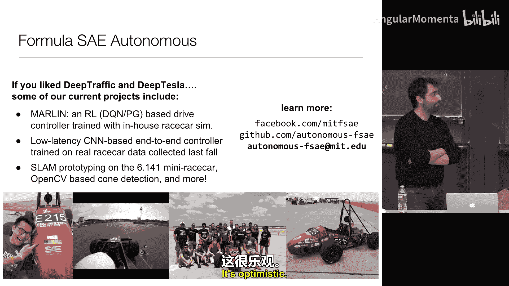

Okay， anybody have questions？Yes the question was in autonomous intersections about role the communication plays。

 if you wanted to do crazy things that like I shown you。

 you need to make sure everything communicates with everything else。

 that would break pretty badly if you don't do it。 I would actually imagine that one interesting things to quickly do would be to have cars communicate with each other to do some interesting things like not just maybe intersection but lane following and things like that。

 like there are a few things that you may see pretty quickly with autonoous guys back I mean 35 years。

 So this could be either V2V related So communicate with other vehicles。

 vehicle to infrastructure related。I mean， you could like the deep learning and things like that You could put up a camera on an infrastructure and people could tune into it。

 The biggest problems are cybersecurity， to be honest， to deploy these things。

And on the autonomous vehicles， and you could see things like maybe not with communication。

 you could see either sharing like， you know， you have a button you press your timeshare。

Or you can have sharing with。You know。Like， for example， you can use autonomy technology for safety。

 So it's a different type of sharing。 or you can find autonomous vehicles in isolated environments。

 So there's stuff that you can do with communication。

 I think you can quickly see lane following and maybe not intersections but things like that。

 And with autonomy， there are certain things that we might see。

 but they don't involve communication at all。I think that's what would happen。All right。

 let's give surta one more time。👏Thank you。