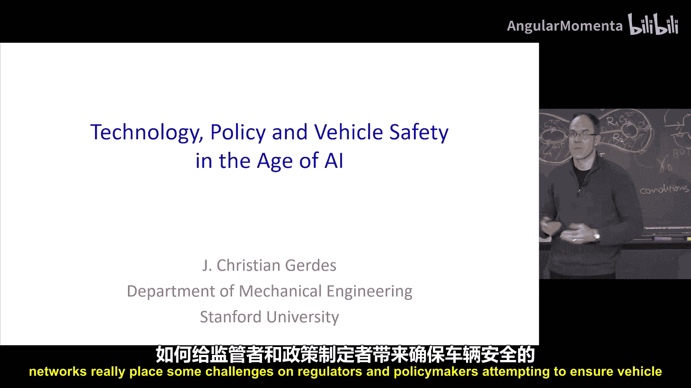
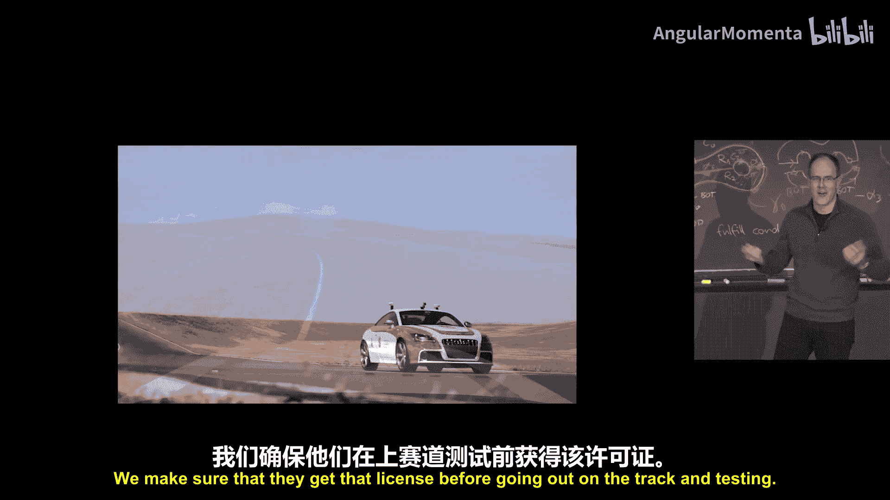
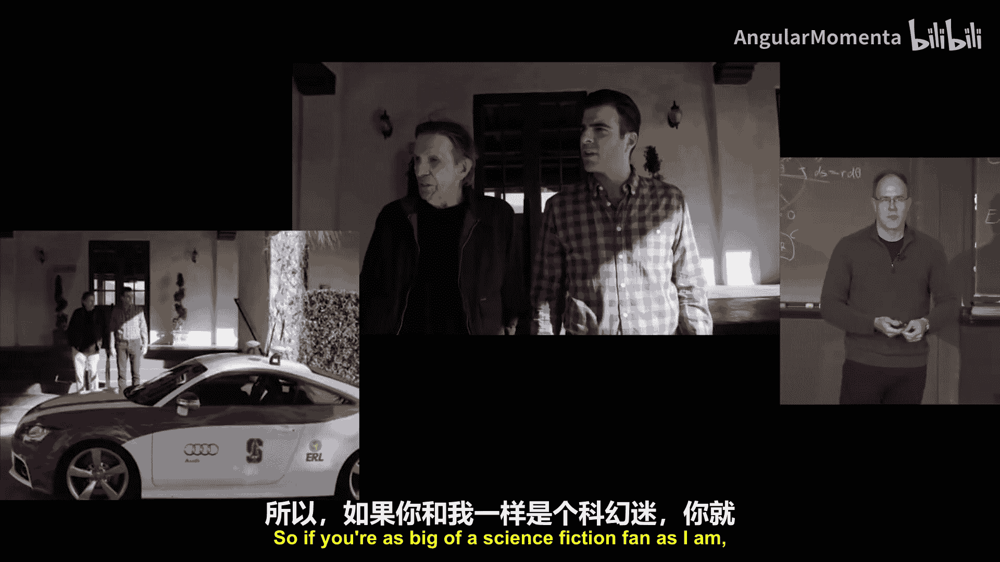
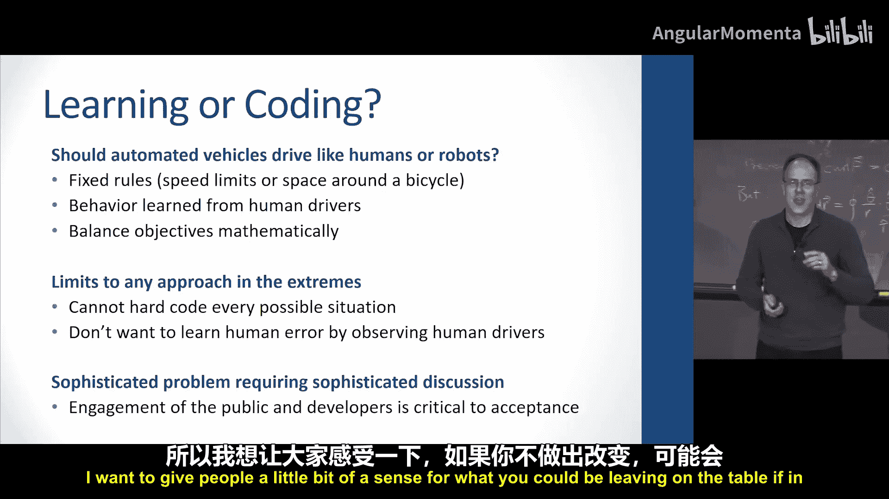
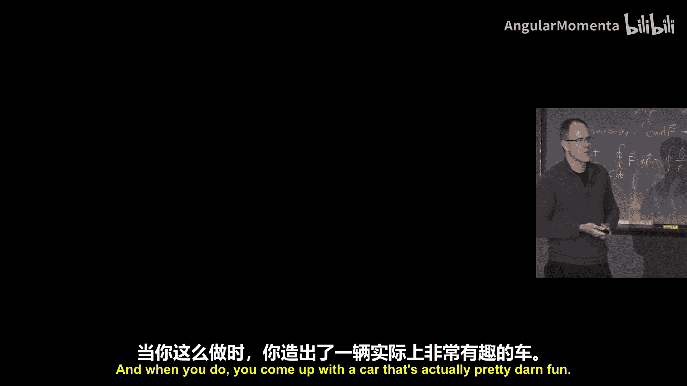
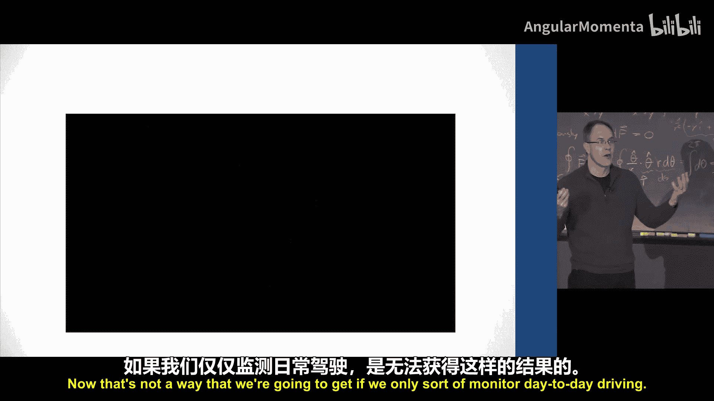
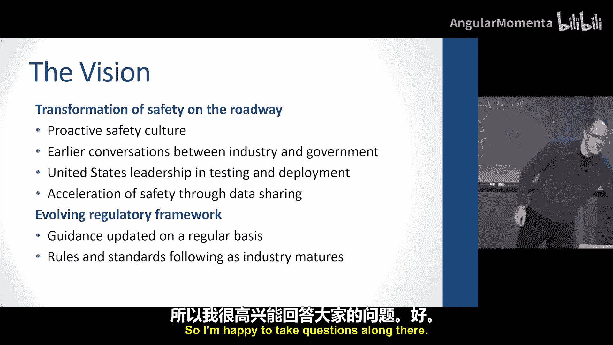

# 【麻省理工】自动驾驶汽车-｜-Self-Driving-Cars-p08-08-克里斯·杰德斯（斯坦福大学）谈技术、政策与车辆安全---MIT自动驾驶汽车--BV13tq2B3EMH_p8-

So today we have Chris Gererdys with us。He's a professor at Stanford University where he studies how to build autonomous cars that perform at or beyond human levels。

 both on the racetrack and on public roads。So that includes a race car that goes 120 miles an hour autonomously on the racetrack。

 this is awesome， he spent most of 2016 as the chief innovation officer at the United States Department of Transportation and was part of the team that developed a federal automated vehicle policy。

So he deeply cares about the role that artificial intelligence plays in our society。

 both from the technology side and the policy perspective， so he is now。

 I guess you could say a policy wonk， world renowned engineer， and I think oh is a car guy， yes。

 so he told me that he did a Q&A session with a group of three graders， third graders。

Last week and he answered all of their heart hitting questions。

 so I encourage you guys to continue on that thread and ask Chris questions after his talk。

 so please give a warm welcome to Chris。Great， Lex， thanks for that great introduction。

 And thanks for having me here to talk to everybody today。

 So this is this is sort of my first week back in a civilian role I wrapped up at USDt last week。

 So going no longer speaking and officially representing the department。

 although some of the slides are very similar to things that I use to speak and represent the department。

 So I think as of Friday， this was still fairly current。

 but I am sort of talking in my own capacity here。 So I wanted to talk about both the technology side and the policy side of automated vehicles。

 And in particular， how some of the techniques that you're learning in this class around deep learning and neural networks really placed some challenges on regulators and policymakers attempting to ensure vehicle safety。

 So just a bit about some of the cars in my background。

 I am a car guy and I've gotten a chance to work on a lot of cool ones。

 I actually have been working in automated vehicles since 1992 and the Lincoln town cars。😊。

The upper corner are part of an automated highway project I worked on as a PhD student at Berkeley。

 I then went to F lighter heavy trucks and Dwood Bens and worked with suspensions on heavy trucks before coming to Stanford and doing things like building P1 in the upper right corner there that's an entirely student builtil electric steer by wire drive by wire vehicle we've also instrumented vintage race cars electrifieded Delorian。

 which I'll show a little bit later and worked as like mentioned with Shelly。

 which is our self-driving Audi Tt， which is an automated race car in addition to the Stanford work I was a co-founder of Peloton technology。

 which is a truck platooning firm looking at bringing platooning technology So vehicle to vehicle communication。

 which allows for shorter following distance out on the highway。

 So these are some of the things I've had a chance to work with to give you a little bit of a sense this is Shelly going around the racetrack at Thunder Hill she can actually go up to about10。

And 20 miles an hour or so on that track， it's really just limited by the length of the straight。

 It's kind of fun to watch from the outside， a little disconcerting occasionally as you see there's nobody in the car。

 although from inside it actually looks all pretty chill。

 So Shelly we've been working with her for a while out on the track she's able to get performance now which exceeds the capability of anybody on the development team。

 many of us are amateur racers in fact actually most of my PhD students have their novice racing license。

 we make sure that they get that license before going out on the track and testing So Shelly can be in anybody in the research group。

 she actually can beat the president of the track David Vden now and we've had the opportunity to work recently with JR。

 Hilderbraandt， the Indie car driver who finished six this last year in the indy 500。 he's faster。

 but he's actually only about a second or so faster on a minute and 25 second lap so。

Approaching his performance and he's actually helping us get there。

 Now the interesting thing about this is that we've approached this problem really from one of physics for equals mass times acceleration。

 so the car is really out there calculating what it needs to do to break down into the next corner how much grip that it thinks it has and so forth as it's going around the track it's not actually a learning approach at its core。

 although we've added on top a number of algorithms for learning because it turns out that the difference between the car's performance and the human performance it's really getting that last little bit of capability out of the tires。

 humans drive instinctively in a way， the best humans at any rate。

 drive instinctively in a way which is constantly pushing to the limits of the car's capability And so if you sort of prejudge what those limits are you're not going to be quite as fast And so that's one of the things we've actually been working with learning algorithms on is to try to figure out well how much friction do I have in this particular corner and how is that changing as。

Tires warm up and as the track warms up from the course of the morning till the afternoon because these are the things that we need to be fast on the racetrack。

 but they' are also the things that you need to take into account to be safe in the real world because what we're trying to do with this project is understand how the car can drive at the maximum capability of the limits of the friction between the tire and the road。

Now race car drivers do that to be fast。 as they say in racing， if you want to finish first first。

 you have to finish。 So it's important that they actually be fast， but also accident free。

 So we're trying to learn the same things so that on the road when you may have unknown conditions ahead of you。

 the car can make the safest maneuver that's using all of friction in between the tire and the road to avoid ultimately any accident that the car would be physically capable of avoiding。

 that's our goal with that。 So we've had a lot of fun with Shelllly。

 we've gotten to drive the car up Pikes peak in the Bonoval Sal flats。

 actually Shelllly appeared in an Audi commercial with Zac Quinto and Leonard Nemoy And so at the end of the commercial。

 they both look at each other and declare it fascinating。

 So if you're as big of a science fiction fan as I am you realize that once your work has been declared fascinating by two spotocks there is nowhere to go So I had to take a stint and try something different in government。

 And so I spent the last year as the first chief innovation officer。😊。

At the US Department of Transportation， which I think honestly was the coolest gig in the federal government because I really didn't have any assigned day-to- day responsibilities。

 but I got to kind of dive in and help with all manner of really cool projects。

 including the development of the first federal automated vehicle policy。

 So it's a really great opportunity to sort of see things from a different perspective？

 And so what I wanted to do was you know kind of coming into this from an engineer give you a perspective of what is it like from somebody looking at the regulatory side on vehicle safety。

 And how are they thinking about the technologies that you're developing。

 And where does that actually leave some opportunities for engineers to make some big contributions to society。

😊，So let's start with what vehicle safety is like today。

 So today we have a system of federal motor vehicle safety standards。

 So these are rules there minimum performance requirements and each of them must have associated with it an objective test so you can tell does a vehicle meet this requirement or does it not meet this requirement。

 Now， interestingly， there is no federal agency that is testing vehicles before they are sold we rely in this country on a system of manufacturers self-certification。

 So the government puts these rules out there and manufacturers go， we got this we can meet this。

 and then they self-cerertify and put the vehicles out on the market。

 the National Highway trafficffic safety Administration can then purchase vehicles and test them and make sure that they comply but we rely on manufacturers selfcertification。

 This is a different system than in most of the rest of the world which actually has premarket certification where before you can sell it。

 the government agency has to say yes， we've checked it。Meets all the requirements。

 Aviation in this country， for instance， has that aircraftcraft require certification before they can be sold。

 Cars do not。 Now， where did that system come from？ So a little quick history lesson in 1965。

 Ralph Nader released a book entitled unsafe at any speed。

 and this is often thought of as a book about the Corve。

 it's not the Corve featured prominently in there as an example of a design that Nader considered to be unsafe。

 What was very interesting about this this book was that he was actually advocating for things like airbags and antilock brakes back in 1965。

 These technologies didn't come along until much later。

 His argument was that the auto industry had failed。 It wasn't a failure of engineering。

 but it was a failure of imagination。 And if you're interested in vehicle safety。

 I would really recommend you read this book because it's fascinating。

 They have quotes from people in the 1960s， basically saying that we believe that any。

Deion more than about 40 or 45 miles an hour is not survivable。 Therefore。

 there's no reason for seat beltts。 There's no reason for collapsible steering wheels。 In fact。

 there's a quote from somebody who made great advances in road safety saying。

 I can't conceive of what help a seat belt would give you beyond like firmly bracing yourself with your hands。

Those of you who have studied physics know that's kind of patently ridiculous。

 But there was a common feeling that there was no sense of doing anything about vehicle crashworthiness because once you got above a certain speed。

 it was inherently unsurvivable。 And I think it's interesting to look at that today。

 because if we were to be in a collision。 I think if any of us were to be in a collision around about 40 miles an hour in。

 in a modern automobile， we'd probably expect to walk away。😊，You know。

 we wouldn't really be thinking about our survival。

And so what this did is it led to a lot of Public outcry and ultimately the National Traffing and Motor Vehicle Safety Act in 1966。

 which established Mis and established this set of federal motor vehicle safety standards。 Now。

 the process to get a new standard made， which is a rulemaking process in government is very time consuming Opistally about the minimum time it can possibly take is two years。

Realistically。It's more like seven。And so if you think about going through this process。

 that's really problematic。 I mean， think about what we were talking about with automated vehicles two years ago or seven years ago。

 and think about trying to start seven years ago and make laws that are going to determine how those vehicles operate on the road today。

 It's crazy right There's really no way to do that。

 And the other thing is is that if you think about it。

 our system evolved from really this sense of failure of imagination。

 that the government needs to say， hey industry， do this， stop slacking off。

 these are the requirements， get there。 but I think it's hard to argue today with all the advances in automation that there is any failure of imagination on the part of industry。

 People are coming up with all sorts of ideas and concepts for new transportation and automation。

 tech companies， startup companies， large Os， there's all sorts of concepts being tested out on the road。

 It's hard to argue that there's still any lack of imagination。

 Now the question is are things like this legal。It's an interesting question， right。

 Can I actually legally do this， Well， from the federal level。

 theres an interesting report that came out about 10 months ago from the folks across the street at Volpe who did scan and said。

 well， what are the things that might prevent you based on the current federal motor vehicle safety standards from putting an automated vehicle out on the road。

 And the answer was， honestly， not much， if you have a vehicle。

 if you start and you automate a vehicle that is currently meeting all the standards。

 because there are no standards that relate specifically to automation。

 you can certify your vehicle as meeting the federal motor vehicle safety standards。 Therefore。

 there's nothing at the federal level that prevents in general an automated vehicle from being put on the road。

So it makes sense。 So if there isn't a safety standard that you have to meet。

 then you can put a vehicle out on the road that meets all the existing ones and does something new。

 And there's no federal barrier to that。 Now， there are a couple of exceptions。

 There were a few points in there that referenced a driver。 And， in fact。

 Na gave a an interpretation of the rule， which is one of the things that they can do is to say。

 well， we're gonna to give an interpretation。 It's not making a new rule。

 but basically interpreting the ones that we have。 And they said that actually。

 these references to the driver could， in fact， refer to the AI system。

And so that actually is now a policy statement from from the department that many of the references to driver in the Federal motortor Ve safety standards can be replaced with your self-driving AI system and the rules applied accordingly。

So， in fact， there's very little that prevents you from putting a vehicle out on the road if it meets the current standard。

 So if it's a modern production car， automate it。Federal motor vehicle safety standards don't stop that。

 Now， a lot of the designs that I showed though， things that wouldn't have a steering wheel or other things are actually not compliant because there are requirements that you have a steering wheel that you have petals。

 Again， these are best practices that evolved in the days， of course。

 when people were not thinking of cars that could drive themselves。

 And so these things would require an exemption by NsA， a process of saying that， okay。

 this vehicle is allowed on the road， even though it doesn't meet the current standards because it meets some equivalent and setting that equivalent can be a bit of a challenge。

Okay， so the question then is， well， all right， if the federal government is responsible and by the Traffic Safety Act is responsible for safety on the roads。

But it can't prevent people from putting anything out。 What do you do， right， One approach is to say。

 well， let's get some federal motor vehicle safety standards out there。 But as we already said。

 that's probably about a seven year process。 And if you were to start setting in best practices now。

 What would that look like。 So we've got this challenge。

 We want to encourage this technology to come out onto the roads。 and be tested。

 because that's the way you're gonna learn to get the real worldl data to get the real worldl experience。

 At the same time， the federal government is responsible for safety on the nation's roads。

 it can recall things that don't work So if you do put your automated system out on the highway。

 and it's deemed to present an unreasonable risk to safety。

 even if you're an aftermarket manufacturer， the government can tell you to take that off the road。

 But the question is， how can you do better。 How can you be proactive to try to have a discussion here。

 So we know standards are maybe not the best way of doing that because they're too slow。

 we'd like to make sure the public is protected， But this technology gets tested。

And so the approach taken to sort of provide some encouragement for this innovation while at the same time looking at safety was the federal automated vehicle policy which rolled out in September。

So this was an attempt to really say， okay， let's put out a different framework from the federal motortor vehicle safety standards。

 Let's actually put out a system of voluntary guidance。

 So what Nitsa is doing is to ask manufacturers to voluntarily follow certain guidance and submit to the agency a letter that they have followed a certain safety assessment。

Now， the interesting thing is， is that the way that this is set up is not to tell manufacturers how to do something。

But really to say these are the things that we want you to address and we want you to come to us to explain how you've addressed them with the idea that from this best practices will emerge。

 we'll be able to figure out in the future。 what really is the best way of ensuring some of these safety items。

 So this rolled out in September， we've got the MIt car here on the side。

 So you see you've got the Massachusetts license plates。 So thanks to Brian for bringing that。

 if you do put gotti stickers on your card， then you get closer to the center。

 So that's something to consider for future future reference。

 but this was was rolled out in Washington Washington D。

 C by the secretary and consists largely of multiple parts。

 But the think the most relevant to vehicle design is this 15 point safety assessment。

 So these are the 15 points that that our assessed。

 and I'd like to kind of talk about a few of these in some more detail。 and it starts with this。

Concept of an operational design domain and minimal risk or fallback conditions。

 And what that means is instead of trying to put a taxonomy on here and say， well， you're。

Automation system could be an adaptive cruise control that works on the highway。

 or it could be fully self driving， or it might be something that operates a low speed shuttle。

The guidance asked the manufacturers to define this。

And the definition is known as operational design domain。 So in other words。

 you tell us where your system is supposed to work， Is it supposed to work on the highway。

 Is it supposed to work in restricted areas， can it work in all weather or is this sort of something that operates only in daylight hours in the sunshine in this area of South Florida。

 All of those are fine， But it's incumbent upon the manufacturer or developer to define the operational design domain？

 And then once you define where the system operates。

 you need to define how you make sure that it is only operating in those conditions。

 How do you make sure that the system stays there？ And what's your fallback in case it doesn't。

And that fallback can be different。 Obviously， if this is a car， which is normally human drivenn。

 as you see here from the Volvo Driveme experiment。

 it might be reasonable to say we're going to ask the human driver to retake control whereas clearly。

 if you're going to enable blind passengers or you are going to have a vehicle that has no steering wheel。

 you need a different fallback system。 And so within the guidance。

 it really allows manufacturers to have a lot of different concepts of what they want their automation to be so long as they can define where it works。

 what the fallback is in the event that it doesn't work and how you have educated the consumer about what your technology does and what it doesn't do so that people have a good understanding of the system performance。

A few things if we go down， you see also validation methods and ethical considerations are aspects that are brought up here as well。

 and so validation methods are really interesting as it applies to AI so really the idea is that there's lots of different ways that you might test an automated vehicle you might go out on a test track and run it through a series of standard maneuvers you may develop a certain number of miles of experience driving in real- worldor traffic and figure out how does the vehicle behave in a limited environment there's questions about a test track obviously because you don't have the sort of unknowns that can happen in the real worldorld environment。

But if you test in one real world environment， you also have a question of is this transferable information？

So if I've driven a certain number of miles in Mountain View， California。

 does that tell me anything about how the vehicle is likely to behave in Cambridge， Massachusetts？

Maybe， maybe not。It's a little bit hard to extrapolate sometimes， and then finally。

 there's also the idea of simulation and analysis so if I can record these situations。

 if I can actually create a virtual environment of the sorts of things that I see on the road。

 maybe I can actually run the vehicle through many。

 many of these scenarios perturbed in some way and actually test the system much more robustly in simulation than I could ever actually do out on the road。

So the guidance is actually neutral on which of these techniques manufacturers take and allow manufacturers to approach it in different ways。

 And I think you， based upon conversations， when you think about the way customers or companies develop this they do take all these different approaches。

 a company like Tesla， for instance， which is recording all the data streams from all their vehicles basically is able to run ideas or technologies silently in their vehicle。

 they can actually test systems out， get real- world data and then decide whether or not to make that system active。

 companies that don't have that access to data really can't use that sort of development method and may rely much more heavily on simulation or test track experience。

 So the guidance really doesn't have a particular blend of this And in fact。

 it doesn envision that you might have over the air software updates in the future。

 So it is interesting， though， to think about whether you have data drivenriven approaches things。

like artificial neural networks or whether you actually start to program in hard and fast rules。

 because as you start to think about requirements on a system。

 how do you actually set requirements on a system which has learned its behavior and you don't necessarily know what the internal workings or algorithms look like。

There's another one that comes up， which is the ethical considerations。

 So I'm going to pick on MIT for a moment here。 So this is an area that I actually did a lot of work on with Stanford。

 together with。With some philosophers who join joined our group。

 And so when people hear ethical considerations in automated vehicles。

 it often conjures up the trolley car problem。 And， and so this sort of classic formulation here。

 about the fact that you have a self-driving car， which is heading towards a group of 10 people。

 And it can either plow in and kill those 10 people or it can divert and kill the driver。

 What do you do。And these are classic questions in philosophy。 you actually look， in fact。

 at the trolley car problem， which is I have a runaway trolley car and I need to either divert it to another track or it will kill somebody who's wandering across that track or the five people on the trolley car are killed。

 what do I do？ Well， in fact， this article points out， it's like。

 you know before automated vehicles can become widespread car makes must solve an impossible ethical dilemma of algorithmic morality。

 So if all this wasn't hard enough。 I mean you're understanding how tough the technology is to actually program this stuff。

 And then you have to get the regulations right。 And now we actually have to solve impossible philosophical questions。

 I don't think that's actually true。 And I think you know it's good for engineers to work with philosophers but not to be so literal about this。

 this is a question that philosophers can ask， but engineers might ask a number of different questions like who's responsible for the brakes on this trolley。

Why wasn't there a backup system， I mean， why am I headed into a group of 10 people without any capability to stop。

So an engineer would in fact have to answer this question but might approach it much differently。

 so if I look at the trolley car problem， I might say， okay， let's see my options are。

 I've got a trolley car which is out of control， first of all。

 I'd like to have an emergency braking system。Let's make sure that I have that。Well。

 there's a chance that that could break as well。 So if my emergency。

 if my base braking system goes and my emergency braking system goes。

 my next option would be to divert it to this side track。 Well， knowing that that's my option。

 I should probably put up a fence Well a warning sign that says， do not cross runaway trolley track。

Okay， now let's say that I've done all of that。The brakes fail。The emergency brakes fail。

 I have to divert the trolley， and somebody has ignored my sign and crossed over the fence and now is hit by the trolley。

 Do I feel a little differently about this whole scenario than I did at the beginning of just trying to decide who lived and who died。

 The solution was made， But by thinking of it as an engineer trying to reduce risk and not by thinking of levels of morality and who deserves to live or die。

 And so I think this is a very important issue， And the reason it's in the guidance is not to basically have everybody solve trolley car problems。

 But to try to think about these larger issues。And so I think ethics is is not just about these sorts of situations。

 which actually will be in automated vehicles， I think。

 addressed much more by engineering principles than by trying to figure out from philosophical merits who deserves to live and die。

But there's broader issues here， just any time that you have concern for human safety。

 How close do I get to pedestrians， How close do I get to bicycles。

How much care should I put in to other people in the environment。

 That's very much an ethical question。And it's an ethical question that manufacturers are actually already addressing today。

 If you look at the automatic emergency braking systems that most manufacturers are putting on their vehicles。

 they will actually use a different algorithm depending upon whether that obstacle in front of it is a vehicle or a human。

So they're already detecting and making a decision that the impact of this vehicle with a human could be far worse than the impact of this vehicle with a vehicle。

 And so they're choosing to break a little bit more heavily in that case。

 that's actually where these ethical considerations come in。

 And the idea of the guidance is to begin to share and how a discussion openly about how manufacturers are approaching this with the idea of getting to a best practice。

 where not only the people in the automated vehicles。

 but other road users feel that there's an appropriate level of care taken for their wellbeing。

That's one of the areas where ethics is important。 The other area where ethics is important is that we have different objectives as we drive down the road。

 We have objectives for safety。 We'd like to get there。 We have objectives for mobility。

 We'd like to get there probably pretty quickly。 And we also have the idea of legality。

 We'd like to follow the rules。 But sometimes these things come into conflict with each other。

So let's say you're driving down the road， and there's a van that's parked where it has absolutely no business parking。

 You've got a double yellow line。Is it okay to cross？Well， at least in California。

 there's no exception to the double yellow line。Representing the lane boundary for a vehicle that's parked where it has no business being parked。

So according to the vehicle code， you're supposed to kind of come to a stop here。

I don't think any of us would right， In fact， actually when you're in California and you're riding through the hills and you come upon a cyclist。

 virtually every vehicle on the road is deviating across the WL line to give extra room to the cyclist。

 That's also not what you're supposed to do by vehicle code you're supposed to stay on your side of the WL line。

 but slow to an appropriate speed to pass。Right， so there's behaviors where our desire for mobility or our desire for safety are outweighing our desire for legality。

 This becomes a challenge。 If you think about how do I program the self-diving car。

 Should it be based on the way that humans drive or should it be based on the way that the legal code tells me to drive。

 of course， the legal code was never actually anticipating a self-driving car from a human standpoint。

 that W yellow line is a great shorthand that says maybe there's something coming up here where you don't want to be in this other lane。

But if I actually have a car with the sensing capability to make that determination itself。

 is the yellow line actually all that meaningful anymore。These are things that have to be sorted out。

 speede limits being another one。 You know， if we're out on the highway。

 it's usually a little bit flexible。 Do we give that same flexibility to the automated vehicle or do we create these wonderful automated vehicle roadblocks of vehicles going to the speed limit when nobody else around them is。

 Do we allow them to accelerate a little bit to merge into the flow of traffic。

 Do we allow vehicles to speed if they could avoid an accident。

 It's our desire for safety greater than our desire for legality。

 These are the sort of ethical questions that I think are really important。

 These are things that need to be talked through， Because I believe if we actually have vehicles that follow the law。

 nobody will want to drive with them。😊，And so we need to think about either ways of giving flexibility to the vehicles or to the law in the sense that vehicles can drive like humans do。

So this brings up some really interesting areas， I think， with respect to learning and programming。

 And so the question is， you know， should our automated vehicles drive like humans and exhibit the same behavior that humans do or should they drive like robots and actually execute the way that the law tells them that they should drive。

 Obviously fixed rules can be one solution to this。

 behavior learn from human drivers can be another solution to this。

 we might have some sort of balance of different objectives that we do more analytically in terms of how much we want to obey the W yellow line when there are other things influencing it in the environment。

Now， what's interesting is that is you start to think about this。

 there's limits to any of these approaches in the extreme。 You know。

 as we found with our self-driving race car， if you're not learning from experience。

 you're not making use of all the data you're not going to do as well。

 And there's no way that you can possibly preprogram an automated vehicle for every scenario it's going to encounter。

 Some you have to think about interpolating somehow you have to think about learning。

At the same time， you could say， well， why don't we just measure humans well。

Human error is actually the， the cause or a factor， the primary factor in 94% of of accidents。

 It's either a lack of judgment or lack of perception on the part of the human。

 So if we're simply following humans， we're actually only learning。How well humans can do things。

 we're leaving a lot on the table in terms of the potential of the car。

 And so this is a really interesting discussion that I think will continue to be both in the the development side of these vehicles in the policy side。

 What is the right balance， What do I want to learn versus what do I want to program。

 How do I avoid leaving anything on the table here。😊。

So because it's the point where I've had a bunch of slides with words here。

 I want to give people a little bit of a sense for what you could be leaving on the table if in fact you don't adapt。

This is Marty。Marty is a Delorreian that we've been working with in my lab。

 Now Delorreians are really fantastic cars unless you want to accelerate， break or turn。😊。

It really didn't do any of those things terribly well there was no power steering。

 there's an underpowered engine and very small brakes all of these things are fixable in fact what's nice about the deloian is it separates quite nicely the whole fiberglass tub comes up。

 you can take out the engine， you can take out the brakes。

 you can make some modifications to the frame， stiffen the suspension， work with Renovo motortors。

 start in Silicon Valley to put in a new electric drive train。And put it all back together。

 And when you do， you come up with a car that's actually pretty darn fun。

 And when we've programmed to drive itself， this is Adam Savage from Mythbusters going along for a drive。

😊。

그 또 안。🎼And what you see is Marty doing something at a level of precision that we're pretty sure no human driver can meet。

 JR said there's no way he can do this。 You see， it's going into a perfect drift。

Doing a perfect donut around this cone and then it launches itself through the next gate。

🎼Sideways into the next cone。 Now it's doing this。 you see， it shoots through the gate。

 missing those cones and then launches into a tight circle around the next cone。

 It's actually doing this as sort of an algorithm similar to orbital mechanics。

 If you think about how it's actually orbiting these different points as it sets to trajectory。Now。

 the women on this is tires， as you can see， as it comes around here。

 the tires disintegrate into many chunks flying at the camera as we do this。

 but the the ability of the car to really continue。

 even as the tires heat up to execute this pretty nice trajectory here you see it going through the gates again and launching into a stable equilibrium。

Putting pretty much the tire tracks right over where they were in the previous run。And then finally。

 ending。So this is a sort of thing that I think is possible。 as you look at these vehicles。

 there's a huge potential out there for these things to not drive about as well as an average human。

 but to far exceed human performance in their abilities to use all the capabilities of the tires to do some amazing things。

 So maybe that's not the way that you want your your daily drive to go。

 although when we first posted of this some of this video， one of the commenters was like。

 I want this car that way I can like go into the store to buy donuts。

 Well it sits in the parking lot doing donuts。😊，Wasn't a use case that I had thought of。

 but but that's one of the things that we thought of is really how if you limit yourself to only thinking about what the tires can do before they get to the saturation of the friction of the road。

 you're only taking into account one class of trajectories。

 There's a lot more beyond that that could be very advantageous in some emergency situations。

 Wouldt it be great if the car had access to that。 Now that's not a way that we're going to get if we only sort of monitor day to- day driving。

 we're not going get that capability in our cars。

So one other aspect that came through in the policy。

 which I think is extremely important as we think about neural networks and learning is this idea of data sharing and there's a huge potential to accelerate the development of automated vehicles if we can share some information about edge case scenarios in particular。

 So if you think about trying to train a neural network to handle some extreme situations。

 that's certainly much easier if your set of training data contains those extreme situations。

 right So if if you think about the weird things that can happen out on the road if you had a database of those and those comprised your training set。

 youd have a head start in terms of being able to get a neural network and begin to validate that it would work in these situations。

 So the question is， is there a way for the ecosystem around self-driving cars to actually share some of this information So that different players can actually share some information about the critical situations and be able to make sure that if。

leearn something that yes， you can make your cars safer。

 but actually all the cars out on the road get safer。 Now， clearly。

 you need to balance this with some other considerations。

 there's the intellectual property concerns of the company。

 there's privacy concerns of any individuals who might be involved。

 but it does seem to me that there's a big potential here to think about ways of sharing certain data that can contribute to safety and。

This is a discussion that's going to be ongoing。 And I think academia can do a lot to sort of help broker this discussion because you know。

 the first level， people say， you know， data sharing， I don't know， companies aren't going to share。

 We're not gonna get the information we need。But most of the time。

 people stay in the abstract as opposed to saying， well， what information would be most helpful。

What information is really going to give people confidence in the safety of these cars It's going to let regulators understand how they operate。

 And the save time is going to protect the amount of development effort the companies put in there。

 I think there is a solution here。 And in fact， if you look at aviation。

 there's a really good example that already exists。 It's known as the Assis system。

 It started with only four airlines that decided to share safety information with each other。

 and this goes through mire， which is a federally funded R And D center。

 And it's actually now up to 40 airlines。 And if companies get kicked out of the mire project。

 They really try very hard to get back in。 Now this is anonymized data。

 It's anonymized data so that companies actually get assessment of what their safety record is like。

 and they can compare it to other airlines in the abstract。

 but they can't compare it to any identifiable airline。 So there's no ranking of this。

 It's not used for any enforcement techniques。 And it took people a long time to kind build。

upp and begin to share that。 But now there's a huge amount of trust。

 and they're sharing more and more data and looking at ways that they can perhaps actually start to code in things like weather in time of day。

 which had been removed for anonymization purposes in the original version of the system。

 So I think there's some good examples out there。 And this is something that's very important to think about for automated vehicles。

 And I think as this discussion goes forward。 Those of you who are interested in developing these vehicles using techniques that rely on data。

 are going to be an important voice for the importance of data sharing。😊，I think there's。

 there's a large role here to kind of make people aware that this actually does have value in the larger ecosystem。

So this is something that I was able to work on more broadly as well。

 So I was part I was the DOT representative on the National Science and Technology Committee's subcommittee on machine learning and artificial intelligence And this was one of the recommendations that was really pushed forward as well。

 because AI has tended to really make great advances with the availability of good data sets。

 and in order to make those sort of good advances in transportation。

 this group is also advocating that those data sets need to be made broadly available。

 So this is a little bit about the vision behind the automated vehicle policy。

 what the goal was to really achieve here， the idea of trying to move towards a proactive safety culture。

 not to necessarily put in regulations prematurely and try to set standards when honestly we don't know the best way to develop automated vehicles。

 but to allow the government to kind of get involved in discussions with manufacturers early。

AndBe comfortable with what's going out on the roadway and actually to kind of help the US to continue to play a leading role in this。

 obviously， if vehicles were going to be banned from the roads。

 it would be very difficult for the country to continue to be a place where people could could test and develop this technology。

 And then the belief really that there can be an acceleration of the safety benefits of this through data sharing。

 So each car doesn't have to encounter all the weird situations itself， but in fact。

 can learn from what other vehicles experience。 And the idea is that really this is meant to be an evolving framework。

 So it comes out as guidance， it really generates conversations it generates best practices。

 which can eventually evolve into standards and law。

 And there's a huge opportunity here because the belief isn't that the National Highway trafficffic safety Administration will be doing all of the development of these best practices。

 but that that'll really evolve from what。Companies do and what all of us at universities are able to do to sort of generate ways to solve these problems in creative manners。

 ways to actually keep the innovation going， but ensure that we have safety。

 So as you start to think about all of the AI systems that you're developing and you start to flip around a little bit and think about how is a regulator going get comfortable。

 that it's not gonna to do something weird。 These are great research questions。

 I think these are great practical questions。 And these are things that will will need to be worked out going forward。

 So I leave you with that as a challenge to think about to think as you take this course。

 not only about the technology that you're learning。 But how do you communicate that to other people。

 And where are the gaps that need to be filled， because I think you'll find some great opportunities for for research。

 startup companies and ultimately work with policy and government there。😊。

So thanks for the opportunity to talk to all of you。

 And I want to stop there because probably the things that you want to talk about are more interesting than the things that I wanted to talk about。

 So I'm happy to take questions along。😊。

we had a quick hand here yeah。In future， but we can solve a lot of these problems in accident rates for fully most part on the red are economy。

The accident rates are extremely low。Do you think some of these safety requirements may be rolled back。

 like maybe working on the airb， you see don？Because the accident rates are so low。Thank you。I do。

 I think that's a great question。 And okay， so the question， thanks for reminding me。

 So the question was whether in the future and when you have all vehicles automated。

 would we be able to actually roll back things like airbags and seatbels and other things that we have on there and what we might know as passive safety devices in vehicles。

 I believe that we will， and in fact， actually， one of the things that I think is most extraordinary。

 if you think about this from a sustainability standpoint。

 when you look at the average sort of mass of vehicles and average occupancy of vehicles in the US。

 know with passenger cars， we're using maybe about 90% of the energy to move the vehicle as opposed to moving the people inside。

 And one of the reasons for that is crashworthiness standards。

 which are great because that's what's enabled us to be surviving these crashes at 40 miles an hour。

 But if we do have vehicles that are not going to crash or if they are are going to have certain modes which might be designed with very carefully designed。

😊，Cush areas or things like this， we could potentially take a lot of that mass out。

 particularly if these are lowpeed vehicles which are designed only for the urban environment and they're not going to crash because they're going to drive somewhat conservatively or in some ways separated from pedestrians and I think you can get a lot of the mass out and then you start to actually have transportation options which from an environmental standpoint are comparable to cycling。

So I think that's actually a really good goal to strive for。

 although we either have to kind of limit the environment or think in the far future with some of those techniques。

is to make both youre a really， really vast on the track or is it to apply what you guys learned from her the understanding of physics and and writing to future it。

Good， yeah， that's a great question。 So what are we doing with Shelly。

 is our mission really just to drive as fast as possible and faster than a human or are we trying to learn from this something that we can apply to other automated vehicles。

 it really is a desire to learn from other automated for the development of other automated vehicles。

 and we've often said that the point where you the difference between Shelley's performance in the human driver you starts to be really mundane things like you know our shift pattern or something which isn't applicable we kind of lose interest at that。

 However， you know up to this point， every insight that we've gotten from Sheey has been directly transferable and we've programmed the car to do some emergency lane changes in situations where you don't have enough room to break and we've actually been demonstrating in some cases that the car can do this much faster than a human even an expert human's response can be。

 So there's certain scenarios that we've done。Like that。 And I would say from the bigger picture。

 what's really fascinating is that we originally started out with this idea of let's find the best path around the track and track it as close as we can。

 But in fact， when you look at human race car drivers， what they're doing is actually very different。

 They're pushing the car to the limits and then sort of seeing what paths that opens up to them。

 And it flips the problem a bit on its head in a way that I think is actually very applicable for developing safety systems out on the road。

 but it's not a way that people have looked at it to the best of my knowledge up to this point。

 And so you know that's really what we're hoping is that the inspiration in trying to reproduce human performance there leads us to better safety algorithms so so far that's been the case and when that ceases to be the case。

 I think we are definitely much less interested。Yeah。

 so so liability is a good question so who is liable if I can can sort of rephrase you know for an accident in an automated vehicle。

 on the one hand， that's kind of an open question。 On the other hand， we do have a court system。

And so whenever there are new technologies， these things are actually generally figured out in the courts and it can be different from state to state。

 so this is one aspect where you potentially some discussions so that manufacturers aren't subject to different conditions in different states would be helpful but the way that it works now is that it's usually not binary。

 have in the US the sense of joint in several liability and so you can actually assign different portions of responsibility to different players in the game。

 you have had companies like Volvo and in fact Google make statements that if there are vehicles are involved in accidents than they would expect to be liable for it so people have often talked about needing something really new for liability but I'm not sure that's the case we do have a court system that can ultimately figure out who is liable with new technologies and we have some manufacturers that are starting to make some statements about assuming product liability for that。

The one thing that really could be helpful， as I mentioned。

 is perhaps some harmonization because right now， insurance is something that is set state by state。

 and so the rules in one state as to who's at fault for an accident may be very different。

Yeah in another state。Yeah。If all the car companies。

 let's say they're sending you their internal regulations。

I really a huge call that we're trying to be。Actually， what happens if。

The industry gets to a standard that's not sufficient enough to let's say what the public would like。

the industry is okay with more dangerous。Okay， so what if companies， know。

 as they send in the safety letters are using criteria to set safety that may not be broadly acceptable to to the public。

 whether the public would like these vehicles to have greater safety。

 I think you know the nice thing about this process is， first of all， we would know that。

Right so we would have a sense that companies are developing with certain measures of safety in mind。

 and there could actually be a discussion as to whether that is setting an acceptable level it's a difficult question because it's not clear that people really know what an acceptable level is。

 does it have to be safer than humans drive now， know my personal feeling I would say， yes。

 and does it have to be much， much safer。啊。Well that， that's hard to say， you know。

 you start to then get into this situation of were。

 we're comfortable to a certain extent with our existing legal system and with the fact that humans could cause errors that have fatal consequences。

 Do we feel the same way about machines。You know we tend to think the machines really should have a higher level of perfection so we may as a society be less tolerant。

 people will often say well as long as the overall national figures go down that would be good but that's really not going to matter much to the families who are impacted by an automated vehicle。

 particularly if it' if it's scenario with very very bad optics and what do I mean by that if you think about the failures of mechanical systems because they're different than the failures of human beings they can often like look really bad right if you sort of think about a vehicle that doesn't detect something and then just continues to plow ahead。

 you know visually that's really striking and that's the sort of thing that you would get replayed and be in people's consciousness and raise some fears and so I think that's an issue that's going to have have to be sorted out。

说是。I vehicle global scale。We talked about the data sharing the potential for collaboration in terms of how it's talent。

Maybe policy is there anything know？Any sort of collaboration being different？啊，有。

You know between research different parts of the world， to Spanish。

You knowDifferent policies are a different。Techns。Where the。Yes。

 so that's a good question what's being done really from a global standpoint to sort of share ideas to share research and to kind of work through some of these things。

 particularly on the policy side so most of the auto manufacturers are global corporations and so a lot of the research in this is done in very different parts of the world so Reult Nissan for instance is doing a lot in Silicica Valley in Europe and in Japan and I think you see a lot of that with the different manufacturers。

 one of the cool things that I got to do as part of my role was to go with the Secretary of transportation to the G7 transportation ministers meaning in Japan and address the ministers about sort of the U policy on automated vehicles and one of the parts of that discussion was well the US has a very different set of rules so we have this manufacturer self-certification as opposed to premarket certification but testing for instance。

 is something that has to be done regardless。So either it's testing that's done by a manufacturer or it's testing that's done by。

 for instance， in Germany， the TuF and other agencies that are responsible for road safety。

 and so the idea is maybe we should be sharing best practices on testing so we have a set of standard tests and then manufacturers across the globe could test to a certain set of standards that might be translated differently according to the policies and regulatory environments in different countries so that was part of the idea that we advanced at the G7 and it seemed to kick off really well。

I never had a conscious decision on this。 I actually got a call from the White House one day。

You know， and you know I got this message this email。

 you know I'm reaching out from the White House where you give my call， you know。

 give me a call back。 So， of course， I called back immediately。

 And Pam Coleman on the other end of the line。 It's like I love doing that。 She's like。

 when you're calling from the White House everybody returns a call。 And and so honestly， she said。

 here's the situation We're looking at a lot of these areas in the Department of Transportation that seemed to hit upon your areas of expertise we want to talk about working with you in some way。

 the holy Gil would be for you to come out and work in D C for a while。

 And then I got a call from the Department of Transportation。 And they're like。

 we know you wouldn't want to come out to D C for a while。 my God， Try me， could I do you know。

 could I do cool stuff and could I make an impact。 And then I met with the secretary of Transport out in San Francisco。

 And know he assured me he's like you would be surprised。

 you would be very surprised at how much of an impact you could have。

 And this ended up being really true。 a lot of times this stuff moves quickly。

 and people who are involved in policymaking。😊，or may not have a technical background in this。

 they may have come through the campaign， for instance and then ended up in political roles。

 yet the folks that I worked with were really trying to get good information and make good decisions and so I just kept getting called in for advice on all sorts of things and I found that people actually really wanted to have that technical information and then used it。

So that's the way it happened。 It seemed like it was an opportunity to take things that I've worked on。

 as I mentioned， you know automated vehicle since 1992。

 and then to be part of this policy development， which went really quickly。

 it was a onep outline when I arrived in February and then in September， it rolled out。

 And along the way it was all sorts of editing and negotiations at the White House and other agencies fascinating。

 fascinating process。 so I kind of fell into this。 But you know， as Le mentioned。

 I think I'm emerging as a policy won here because it was it was a very fun experience。😊。

Let's see over here， what we got。With data sharing。

 you have a lot of companies that have somewhat of a monopoly a lot of data。

 especially like Google has so much more data available Yeah lot of smaller startups how do you incentensivize companies actually share their data how do youcentize companies to share their data when they have an awful lot invested in them in the gathering of that data and being able to process that data and I think the answer is to start small and to try to say are there's certain high value things that could again make the public comfortable make policymakers comfortable that really aren't going to be a burden on the company know so one of the know one of the things that from the Peloton standpoint that was bounced around at one point so our trucks actually use vehicle to vehicle communications as part of their link Well when you do that you discover that there's actually an awful lot of places where that drops out because cell phone towers which are not supposed to be broadcasting on that frequency。

Seemmed to create an awful lot of interference there。 Well。

 that could be very interesting from a public policy perspective to know， you know where our。

 you know we were sort of monitoring for incursions in in that frequency range everywhere we go。

 that， for instance， might be very useful piece of information to share with policymakers that wouldn't be any real proprietary issue to share from the company's perspective。

 And so I think the trick is to start small and find what are the high value data where there isn't a big issue of sharing。

 I mean， if you go to Google and say， all right， Google。

 what will it take for you to share all of the data you're acquiring from your entire self-driving car program。

 I guess Waymo now， I think that would be a very big number。😊。

And so I don't think that's a starting point， I think you start with what is the high value data that's of high value for the public policy sense and really minimal hassle to the companies。

I don't know how much longer， I'm happy to stay and answer as many questions。

 but I know you have a class to run， or are we maybe Okay， good， yes。

Are there any efforts that you know of to come up with standards for sharing？Map data， accident data。

 simulations。Good is there any effort underway for sharing map data。

 some of the edge case accident data simulation capabilities and things like that this is one of the next steps that NTsA outlined in the policy and so there are people at NITSA actually working on taking some of these next steps again in sort of a pilot or prototype modes so that's something that's currently being worked on in the department and you can probably expect to hear more from in the not so distant future。

Yes。Pal body learning from data， Yeah， driving in urban areas and driving in the highway and poor areas very different。

 Do you think the federal requirements to make like a standard data set for an entire company to execute before intend the car。

Our OD should be active。Okay so the question is that testing in urban and rural environments or even driving in and rural environments are very different。

 and should the government actually come up with a standard set of data that all companies have to attest to I think one of the reasons that the policy was designed the way it was was to make sure we have this concept of operational design domain So in fact if the only area that I've mapped and the only area that I want to drive is say in a campus environment or in one quarter square mile。

 then then the idea is that we would like the companies to explain how they handle the eventualities in that one quarter square mile。

 but they should really have no reason to handle other situations because their vehicle won't encounter that so long as it's been designed to stay within its operational design domain So I think in the short term know what you see is people often looking at hyperloc solutions or kind of the low。

fruitru for a lot of automation。 and even if you think about offering mobility as a service。

 if I'm gonna offer sort of an automated taxi， I'm probably going to do that in a limited environment to start with。

 And so if I'm only doing this in Cambridge。 Does it really matter if I can drive a mountain view or not。

 And so， you know I think the idea is to start with the definition of the operational design domain with a data that is appropriate for that operational design domain。

 And then as people's design domain start to expand nationwide。

 then I think you know the idea of common data sets starts to be starts to be interesting。

 although you know there is a sense that no finite data is really going capture every eventuality。

 And so you know people will be able to develop or sort of design to the test in some ways。

 is that sufficient， I think itll make people feel better。

 But I personally wonder how much value there is。 know it's same with test track testing。

 I can think of 20 different tests at automated vehicle。Will have to pass。

 and people will design ways to pass all 20 of those tests。 It may make some people more comfortable。

 but it doesn't make me all that much more comfortable that they'd be able to handle a real world situation。

One last question。All right， let's see one last hand up。

I'm interested in the idea of the open source scar。

 but right now open source cars aren't reality because there's a lot of regular。

I really existing thing。With your new regulatory system？

Would have a low enough regulatory burden to make impossible？Could you。

 could you make an open source car under okay， so the question is。

 could you make an open source car under the guidance provided by USD O T。The question would be。

You know， from a practical question， you're supposed to submit a safety assessment letter。

 which is supposed to be signed by somebody responsible for that。

 And so an issue if you were to open source would be， you know。

 do I use this module and who is actually signing signing off on that when I feel comfortable signing off on something which I then allow to be open source I you know。

Not a lawyer， but I would think that I don't think there would be anything that would prevent that if you had the development team that was doing that and people who were willing to sign off on whatever version of the software was actually used in an open source car。

 I will say that the guidance does apply to universities or to or to other groups that would be putting a car out on the road。

 And I think if you look through the 15 points they're not really meant to be overly restrictive。

 in fact， I would argue that pretty much any group that is going to sort of put real people at risk by by putting an automated vehicle out on the road should really have thought through these things。

 So I don't think I don't think it's a terribly high high burden to to meet。

 I think it would be it would be meetable by a group。

 just a question would be from the open source sense how do you sort of trace who's responsible and who's signing off on。

All right， I think we gave those third graders a run for their money Yeah absolutely thank you so much。

 let's give Chris a big hand。Thanks a lot。