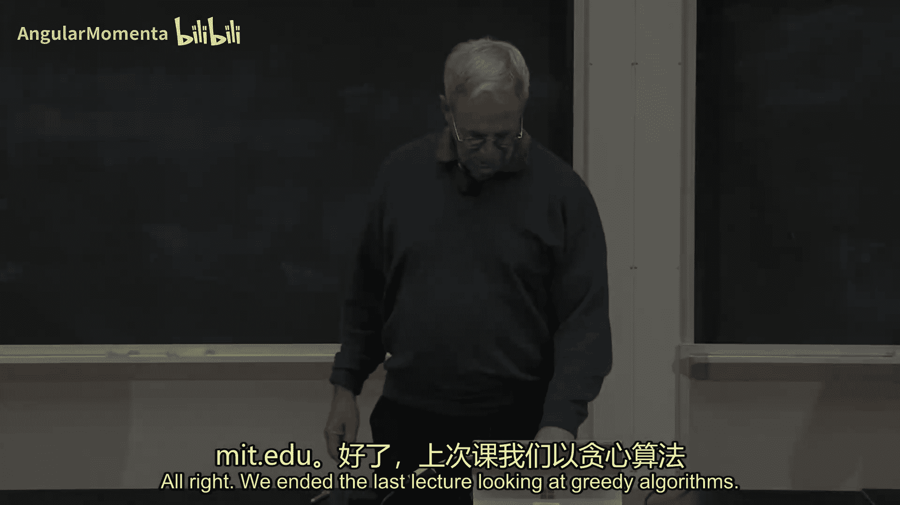
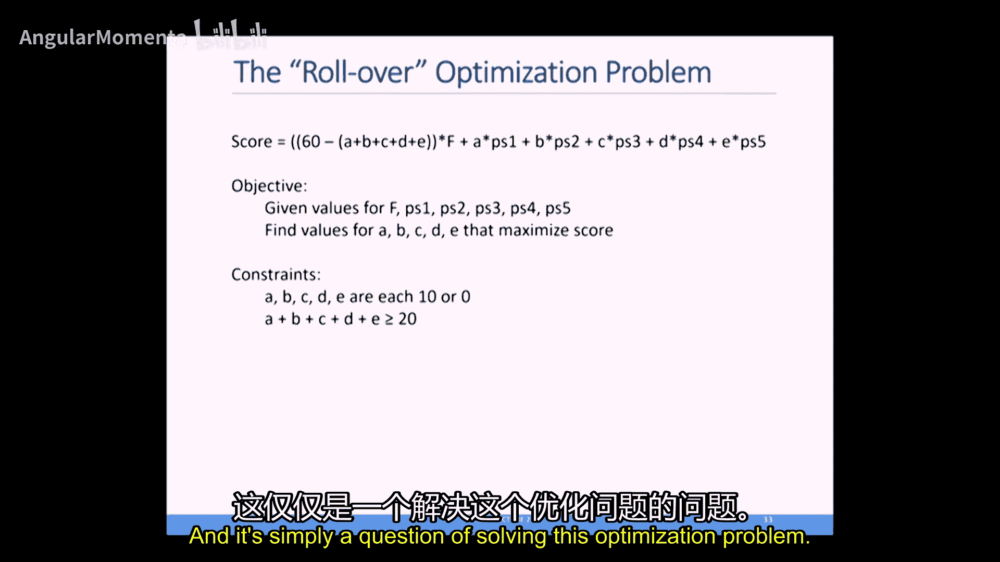

# 【麻省理工】计算思维与数据科学导论-｜-MIT-6.0002-Introduction-to-Computational-Thinking，Fall2016-p02-2.-优化问题--BV1zNjGzxEvk_p2-

The following content is provided under a C Commons license。

 Your support will help Mi T OpenCourseware continue to offer high quality educational resources for free to make a donation or to view additional materials from hundreds of MiT courses。

 Visit Mit Opencourseseware at O Cw Mt Eduu。All right。

 we ended the last lecture looking at greedy algorithms。

And so today， I want to discuss the pros and cons of greedy。 Oh， I should mention。

In response to popular demand， I have put the PowerPoint up。 So if you download the zip file。

 you'll find the questions， including question 1， the first question。Plus， the code。

 plus the PowerPoint。嗯。We actually do read Piazza。Sometimes at least pay attention。

 We should pay attention all the time。All right。So。What are the pros and cons of greedy？The pro。

 and it's a big pro is that it's really easy to implement， as you could see。

Also enormously important。 It's really fast。 We looked at the complexity last time。 It was M log n。

 quite quick。The downside。 and this can be either a big problem or not a big problem。

Is that it doesn't actually solve the problem。In the sense that we've asked ourselves to optimize something。

And we get a solution that may or may not be optimal。Worse。

 we don't even know in this case how close to optimal it is。 Maybe it's almost optimal。

 but maybe it's really far away。And that's a big problem with many greedy algorithms。

There are some very sophisticated， sophisticated greedy algorithms we won't be looking at that give you a bound on how good the approximation is。

 but most of them don't do that。Last time we looked at。An alternative to a greedy algorithm。

It was guaranteed to find the right solution。 It was a brute forest algorithm。

The basic idea is simple， that you enumerate all possible combinations of items。

Remove the combination whose total units exceed the allowable weight。

And then choose the winner from those that are remaining。Now， let's talk about how to implement it。

 And the way I want to implement it is using something called a search tree。

There are lots of different ways to implement it。In the second half of today's lecture。

 you'll see why I happened to choose this particular approach。So。What is a search tree？A tree。

Is basically。A kind of graph。 And we'll hear much more about graphs next week。

But this is a simple form where you have a root。And then children of the root in this particular form research C creates you of two children。

So we start with the root。And then we look at our list of elements to be considered。

That we might take。And we look at the first element in that list。And then we draw a left branch。

Which shows the consequence of choosing to shake that element。And the right branch。

 which shows the consequences of not taking that element。And then we consider the second element。

And so on， and so forth。Until we get to the bottom of the tree。So by convention。

 the left element will mean we took it， the right direction will mean we didn't take it。

And then we apply it recursively to the nonle children。 The leaf means we get to the end。

 We've considered the last element to be considered nothing else to think about。

So when we get to the code， we'll see that in addition to the description being recursive。

 it's convenient to write the code that way， too。And then finally。

 we'll choose the node that has the highest value that meets our constraints。

So let's look at an example。So my example is I have my backpack that can hold a certain。

Number of calories， if you will。 And I'm choosing between to keep it small， a beer。

 a pizza and a burger。3 essential food groups。So the first thing I explore on the left is take the beer。

And then I have the pizza and the burger to continue to consider。I then say， all right， let's take。

The pizza， now I have just the burger。 Now I taste the burger。

So this traversal or this generation of the tree is called leftmost。Depth most。

 So I go all the way down to the bottom of the tree。I then back up a level and say， all right。

 I'm now at the bottom。Let's go back。And。See what happens if I make the other choice at the one level up the tree。

So I went up and said， well， now let's see what happens if I。Make a different decision。

 as in we didn't take the burger。And then I work my way。 I。

 This is called backtracking up another level。 I now say， suppose I didn't take the piece of pizza。

Now， I have the beer only and only the burger to think about。So on and so forth。

Until I've generated the whole tree。You'll notice it will always be the case that the leftmost leaf of this tree。

Has got all of the possible items in it and the rightmost leaf， none。

And then I just check which of these leaves meets the constraint。And what are the values。

 And if I compute the value。And the calories in each one。 And if our constraint was 750 calories。

Then I get to choose the winner， which is。呃。I guess it's the pizza and the burger， is that right？

The most value under 7，50。Okay， all right， so that's the way I go through。And I do that。

 It's quite a straightforward algorithm。And I don't know why we draw our trees with the root at the top and the leaves at the bottom。

My only conjecture is computer scientists don't spend enough time outdoors。嗯。All right。

 so now let's think of the computational complexity。Of this process。Well。

 the time is going to be based on the total number of nodes we generate。

So if we know the number of nodes that are in the tree。We then know the complexity of the algorithm。

 the asymptototic complexity。Well。How many levels do we have in the tree。Just a number of items。

 right。Because at each level of the tree， we're deciding to take or not take an item。

And so we can only do that for the number of items we have。So if we go back， for example。

 and we look at the tree。Not that tree。That tree。And we count the number of levels。

 It's going to be based upon the total number of items。We know that because if you look at， say。

 the leftmost node at the bottom。It's， we've made three separate decisions。So here。

 it's counting the root。 It's 1，2。 It's n plus 1， but we don't care about plus one， right。

 when we're doing asymptotic complexity。All right， so that tells us how many levels we have in the tree。

The next question we need to ask is。How many nodes are there at each level。

And you can sort of look at this and see the deeper we go。The more nodes we have at each level。

 right。In fact， if we come here。We can see that the number of nodes at level I。

 depth eye of the tree is2 to the eye。That makes sense。

 if you remember last time we looked at binary numbers and we're saying we're representing our choices as either 0 or1 for what we take。

If we have n items to choose from， then the number of possible choices is 2 to the n。

 the size of the power set。And so that will tell us the number of nodes at each level。

So if there are n items， the number of nodes in the tree。Is going to be the sum。

From 0 to n of 2 to the I， because we have that many levels。And if you've studied a little math。

 you know， that's exactly 2 to the n plus1。Or if you do what I do， you'd look it up in Wikipedia。

 And you know it2 to the n plus1。Now， there's an obvious optimization， right。

 We don't need to explore the whole tree。 if we get to a point where the backpack is overstuffed。

 there's no point in saying， should we take this next item because we know we can't。Right。

 I generated a bunch of leaves that were useless because， the weight was too high。

So you could always。Aort early in saying， oh， no point in generating the rest of this part of the tree。

Because we know everything in it will be too heavy。You know。

 adding something cannot reduce the weight。It's a nice optimization。

 It's one you'll see we actually do in the code。But it really doesn't change the complexity， right。

 It's not going to change the worst coast cost complexity。All right， so。Exponential， as we saw。

 I think in Eric's lecture is a big number。 We don't usually like2 to the N。

Does this mean that brute force is never useful？ Well， let's give it a try。We'll look at some code。

Here's the implementation。嗯。So， it's Max Val。To consider an avail。And then we say。

 if two considers empty or a veil is。0ero。A veil is an index。

 We're going to go through the list using that to tell us whether or not we still have an element to consider。

Then the result will be the two0 and。The empty tuple。Okay。We couldn't take anything。

 This is the base of our recursion， right。Either there's nothing left to consider or there's no available weight。

The veil is the amount of weight is 0 or two consider is empty， All right。Well。

 if neither of those are true。Then we ask whether to consider sub zero， the first element to look at。

Is that cost is greater than availability。If it is， we don't need to explore the left branch， right？

Because it means we can't afford to put that thing in the backpack。An Napsackack。

 There's just no room for it。 So we explore the right branch only。

And so the result will be whatever the maximum value is。Of to consider of the remainder of the list。

 the list with the first element sliced off and availability unchanged。Alright。

 so it's a recursive implementation saying now we only have to consider the right branch of the tree。

Because we knew we couldn't take this element。 It just weighed too much or cost too much or was too fattening。

 in my case。Right， otherwise。Well， we now have to consider both branches。

So we'll set next item to two consider of0， the first one。And explore the left branch。

Now on this branch， there are two possibilities to think about。

Which I'm calling with vow and with to take。So I'm going to call max Val of to consider。

Of everything， except the current element。And pass in an available weight of aveil minus。

 whatever me。Widen this so we can see the whole code。

I it's not gonna let me widen this window anymore。Shame on it。

 Let's see what happens I get rid of the console。Alright， well， we'll have to do this instead。So。

We're going to call MaxV with everything except the current element and give it a veil minus the cost of that next item of two cons of 0。

 okay。Because we know that the availability available weight has to have that cost subtracted from it。

And then。Will'll add to with vow。Next item dot get value。 So that's the value。 If we do take it。

Then we'll explore the right branch。 What happens if we don't take it。

And then we'll choose the better branch。So it's a pretty simple recursive algorithm。We just。P。

We go all the way to the bottom and make the right choice at the bottom and then percolate back up。

Like so many recursive algorithms。Allright， And then we have a simple program to test it。

I better start a console now if I'm going to run it。And we'll test greedies on foods。 Well。

 we'll test greedies， and then we'll test Max Val。 So I'm building the same thing we did in Monday's lecture。

 the same menu。And I'll run the same test greedies we looked at last time and we'll see whether or not we get something better when we run the truly optimal one。

Well， indeed， we do。 You remember that last time。 and fortunately， this time， too。

 the best we did was a value of 318。But now we see we can actually get to 3。

53 if we use the truly optimal algorithm。So we see it ran pretty quickly。And。Actually。

 gave us a better answer than we got from the greedy algorithm。And it's often the case。

 And if I have time at the end， I'll show you an optimization program you might want to run。That。

It works perfectly fine to use this kind of brute forest algorithm on。All right。

 let's go back to the PowerPoint。So just going through the code again that we just ran。

 This was the header we saw。To consider is the items the corresponds nodes higher up the tree。

And avail， as I said， the amount of space。And again， here's what the body of the code looked like。

 took out the comments。啊。One of the things you might think about in your head when you look at this code is putting the comments back in。

I always find that for me， a really good way to understand code that I didn't write is to try and comment it。

And that helps me sort of force myself to think about what is it really doing？

So you'll have both versions。 You'll have the PowerPoint version without the comments and the actual code with the comments and。

You can think about looking at this and then looking at the power。

 the real code and making sure that you're understanding jobses。All right。

Should point out that this doesn't actually build the search tree， right？

We've got this local variable result。😡，Starting here。That records the best solution found so far。

Right， so it's not the picture I drew where I generate all the nodes， and then I inspect them。

I just keep track as I generate a node， I say， how good is this。

Is it better than the best I've found so far， If so， it becomes the new best。

And I can do that because every node I generate is， in some sense， a legal solution to the problem。

Not probably rarely。 Is it the final optimal solution。But it's at least a legal solution。

 And so if it's better than something we saw before。We can make it the new best。This is very common。

 And this is， in fact， what most people do when they use a search tree is they don't actually build the tree in the pictorial way we've looked at it。

 but。Play some trick like this of just keeping track of their results。All right。

 any questions about this？All right。We did just try it on the example from lecture one。

And we saw that it worked great。 It gave us a better answer。😊，It finished quickly。

But we should not take too much solace from the fact that it finished quickly。

Because2 to the 8 is actually a pretty tiny number。嗯。Almost any algorithm can is fine。

 Im working on something this small。Let's look now at what happens if we have a bigger menu。😡。

So here is some code to do a bigger menu。Since。As you will discover， if you haven't already。

 I'm a pretty lazy person。 I didn't want to write out a menu with 100 items or even 50 items。

 So I wrote some code to generate the menus。And I used randomness to do that。

This is a Python library。 we'll be using a lot。For the rest of the semester。

It's used for any time you want to generate things at random。And do many other things。

 and we'll come back to it a lot Here。 we're just going to use。A very small part of it。So。

To build a large menu。Of some numb items， we're gonna。

 and we're gonna give the maximum value and the maximum cost for each item。

We'll assume the minimum is。In this case， one。Items will start empty。

 and then for I in the range number of items。I'm going to call this function， random dot Rant。

That takes a range of integers。From one to actually， in this case， Max v -1。Or one to Maxwell。

 actually， rather in this case。 And it just chooses one of them at random。So when you run this。

 you don't know what it's going to get， right， Rand dot Rin might return 1。 It might return 23。

 It might return 54。 The only thing you know is it will be an integer。

And then I'm going build menus ranging from 5 items to 60 items。Build large menu。

 The number of items。With the minimum value。With a max valve of 90 and a max cost of 2，50。

Pleasure and calories。And then I'm going to test Max Val。On each of these menus。Alright。

 so building menus of various sizes at random， and then just trying to find。

The optimal value for each of them。All right， let's look at the code。It is。Well。

 let's comment this out。We don't need to run that again。So build a large menu。

And then we'll try it for a bunch of items and see what we get。So， it's going along。

Trying the menu with up to 30 went pretty quickly。 So that's even two to the 30 didn't take too long。

But you might notice it's kind of bogging down。 We got 35。And I guess I could ask the question now。

 it was one of the questions I was going ask as a poll。

 but maybe I won't bother is how much patience do we have。

 When do you think we'll run out of patients and quit。😔，Well。If you're out of patience。

 raise your hand。Well， some of you are way more patient than I am， so we're going to quit anyway。

All right。We were trying to do 40。 It might have finished 40，45。

 I've never waited long enough to get to 45。It just is too long。So that raises the question。

 is it hopeless。And in theory， yes。As I mentioned last time， it is an inherently exponential problem。

The answer is in practice， no because of something called dynamic programming。

Which was invented by a fellow at。I think the Ram Corporation called Richard Bellman。

A rather remarkable mathematician slash computer scientists。 he wrote a whole book on it。

 but I'm not sure why because it's not that complicated。嗯。So。When we talk about dynamic programming。

It's kind of a funny story。 at least to me， I learned it。

And I didn't know anything about the history of it。 And I was trying to。

 And I've had all sorts of theories about why it was called dynamic programming。You know how it is。

 how people try and fit a theory to data。And then I read a history book about it。

 And this was Belman's own description of why he called it dynamic programming。And it turned out。

 as you can see， he basically chose the word because it didn't a description that didn't mean anything。

Because he was doing mathematics。 And at the time， he was being funded by a part of the Defense Department that didn't approve of mathematics。

And you wanted to conceal that fact。And indeed， at the time。

The head of defense appropriations in the US Congress didn't much like mathematics。

 And he was afraid that he didn't want to have to go and testify and tell people he was doing math。

So he just invented something that no one would know what it meant。

And years of students spent time later trying to figure out what it actually did mean。Anyway rate。

 what's the basic idea？To understand it， I want to。

Temporarily abandoned the knapsack problem and look at a much simpler problem。Fbonacci numbers。嗯。

So you've seen this already。With cute little bunnies， I think， when you saw it。N equals 0 n equals 1。

 return 1。 Otherwise， fib of n -1 plus fib of n -2。 And as I think you saw when you first saw it。

 it's a。Takes a long time to run。Tb of 120， for example， is a very big number。

It's shocking how quickly Fibonacci grows。So。Let's think about。Iplement implementing it。

If we run Fibonacci， well maybe we'll just do that。So here's Fb of N。 And let's just try running it。

 And again， we'll test people's patience。And we'll see how long we're letting it running。

 I'm a try for I in the range 1，21，Print fib of I。Comes clumping along。

And it slows down pretty quickly。 And if you look at it。

 it's kind of surprising It's this slow because these numbers aren't that big。Right。

These are not enormous numbers， right， Fb of 35 is not a huge number。

 yet it took a long time to compute。So yeah， the numbers are growing pretty quickly。

 but the computation actually seems to be growing faster than the results。Right， we're 37。嗯。You know。

 it's going to get slower and slower， even though our numbers are not that big。So the question is。

 what's going on。Why is it taking so long for Fibonacci to compute these results。Well， let's kill it。

And look at the question。And to do that， I want to look at the call tree。

So this is for Fibonacci of6。Which was only 13， which I think we would most agree， most。

 is not a very big number。And let's look what's going on here。If you look at this， what。

 in some sense seems really stupid about it。What is it doing that a rational person would sort of not want to do if they could avoid it。

Well。It's bad enough to do something once， but to do the same thing over and over again is really wasteful。

And if we look at this， we'll see， for example， that Fb4 is being computed here。

And Tb4 is being computed here。Fib 3 is being computed here， and here。And here。

And do you think we'll get a different answer for Fib 3 in one place than we get it in the other place。

 You sure hope not， right。And so you think， well。What should we do about this？

How would we go about avoiding doing the same work over and over again。

And there's kind of an obvious answer。 And that answer is at the heart of dynamic programming。

What's the answer？Yeah。Exactly。And I'm really happy that someone in the front row answered the question because I can throw it that far。

😊，You store the answer。😡，And then look it up when you need it。

Because we know that we can look things up very quickly。Right， a dictionary。

Despite what Eric said in his lecture， almost all the time works in constant time。

If you make it big enough and it usually is in Python。

 we'll see later in the term how to do that trick。But so you store it。

 and then you'd never have to compute it again。And that's the basic trick behind。Dynamic programming。

 And it's something called memmoorization。As in you create a memo and you store it in the memo。

All right， so we see this here。Notice that what we're doing is trading time for space。

It takes some space to store the old results。But。Ngligible relative relevant related to the time we save。

All right， so here's the trick， we're going to create a table to record what we've done。

And then before computing fib of X， we'll check if the value has already been computed。If so。

 we just look it up and return it。 Otherwise， we'll compute it。

 It's the first time and store it in the table。So here is a fast implementation of Fibonacci that does that。

It looks like the old one。Except it's got an extra argument。Memo。Which is a dictionary。

The first time we call it， the memo will be empty。So it tries to return the value in the memo。

If it's not there， an exception will get raised， we know that。And it will branch to here。

Compute the result and then store it in the memo。And return it。

So it's the same old recursive thing we did before， but with the memo。Notice， by the way。

 that I'm using exceptions not as an error handling mechanism， really， but just as a flow of control。

To me， this is cleaner than writing code that says， if this is in the keys， then do this。

 otherwise do that。It's slightly fewer lines of code， And for me， at least easier to read to use。

 try except for this sort of thing。Alright， let's see what happens if we run this one。

We'll get rid of the slow fib。And will run fast Fib。Wow。We're already done with Fb 120。

Pretty amazing。 considering last time he got stuck around 40。Right。It really works。

 This memorization trick。You， an enormous difference。When can you use it， right。

 It's not that memorization is a magic bullet that will solve all problems。嗯。

You need the problems it can solve or can help with really， is the right thing。 And by the way。

 as we'll see， it finds an optimal solution， not an approximation。

Is when problems have two things called optimal， substructure and overlapping sub problems。

So what do these mean？We have optimal substructure when a globally optimal solution can be found。

By combining optimal solutions to local。Sub problems。So， for example， when x is greater than one。

 we can solve。Fib X by solving Fb x -1 and Fb x -2 and adding those two things together。Alright。

 so there's optimal substructure。You solve these two smaller problems independently of each other。

 and then combine the solutions。In a fast way。Allright。

You also have to have something called overlapping sub problems。This is why the memo worked， right。

 Finding an optimal solution has to involve solving the same problem multiple times。

Even if you have optimal substructureor if you don't see the same problem more than once。

Creating a memo。 Well， it'll work。 You can still create the memo。

 You'll just never find it anything in it when you look things up because you're solving each problem once。

Okay。So you have to be solving the same problem multiple times。

 and you have to be able to solve it by combining solutions to smaller problems。Now。

 we've seen things with optimal scrub structure before， right？In some sense， right， well。

 what merge sort worked that way， right？ We were combining separate problems。

 Did merge sort have overlapping sub problems。No， right。Because， well。

 I guess it might have if the list had the same element many， many times。

 but we would expect mostly not， right。Because each time we're solving a different problem because we have different lists that we're now sorting and merging。

So has half of it， but not the other。 So dynamic programming will not help us for sorting， you know。

 cannot be used to improve merge sort。Oh， well。Nothing is a silver bullet。All right。

 what about thenapsack problem。Does it have these two properties。So。

We can look at it in terms of these pictures。And it's pretty clear that it does have optimal substructure。

 right， because we're taking the left branch and the right branch and choosing the winner。

But what about overlapping sub problems。Are we ever solving in this case， the same problem。

At two nodes。Well， do you any of these nodes look identical。Well， in this case， no。So we could write。

A dynamic programming solution to the Napsack problem， and we will。And run it。On this example。

 and we get the right answer。 We would get zero speed up。Because at each node， if you can see。

 the problems are different。We have different things in thenapsack。Or different things to consider。

Never do we have the same contents and the same things left to decide。

So maybe it was not a bad answer。 if that was the answer you gave to this question。

But let's look at a different menu。So this menu happens to have two beers in it。

Now if we look at what happens。Do we see two nodes that are solving the same problem。The answer is。

What， yes or no？I haven't drawn the whole tree here。Well， you'll notice the answer is yes。This node。

And this node。Are solving the same problem。 Why is it， Well， in this node， we took this beer。

And still had this one to consider。But in this。Noode， we took that beer。

But it doesn't matter which beer we took。We still have a beer in the knapsackack and a burger and a slice to consider。

So we got there different ways by choosing different beers， but we're in the same place。So， in fact。

 we actually， in this case， do have。The same problem to solve one， more than once。Now， here I had。

Two things that were the same。That's not really necessary。Here's another very small example。

And the point I want to make here。Is shown by this。So here I've again drawn a search tree。

And I'm showing you this because， in fact， it's exactly this tree that we'll be producing in our。

Dynamic programming solution to the Napsackack problem。Each node in the tree is。

Start with what you've taken initially nothing。 the empty set， what's left。

 the total value in the remaining calories。 there's some redundancy here， by the way。

 If I know what I've taken， I could already always compute the。The value and what's left。

 But this is just so it's easier to see。 And I've numbered the nodes here in the order in which they get generated。

Now， the thing that。I want you to notice。Is when we ask whether we're solving the same problem。

We don't actually care。What we've taken。We don't even care about the value。All we care is。

How much room we have left in the knapsackack？And which items we have left to consider。

Because what I take next or what I take remaining。Really has nothing to do with how much value I already have。

 because I'm trying to maximize the value that's left。Independent of previous things done， right。

Similarly， I don't care why I have 100 calories left。😡。

Whether I used it up on beers or burger doesn't matter。

 All that matters is all I have is that I just have 100 left。And so we see in a large。

 complicated problem。It could easily be in a situation where different choices of what to take and what to not take would leave you in a situation where you have the same number of remaining calories。

And therefore， you're solving a problem you've already solved。At each node。

 we're just given the remaining weight， maximize the value by choosing among the remaining items。

 That's all that matters。And so， indeed， you will have overlapping sub problems。

As we see in this tree， for the example we just saw。

The box is around a place where we're actually solving the same problem。

Even though we've made different decisions about what to take， A versus B。And， in fact。

 we have different amounts of value in thenapsack，6 versus 7。

 What matters is we still have C And D to consider。And we have。Two units left。Alright。

 it's a small and easy step。 And I'm not going to walk you through the code because it's kind of boring to do so of how do you modify the max Val we looked at before to use the memo。

First， you have to add the third argument， which is initially going to be set to the empty dictionary。

The key of the memo will be a tuple。The items left to be considered。And the available weight。

Because the items left to be considered are in a list。

We can represent the items left to be considered。By。How long the list is。

Because we'll start at the front item and just work our way to the end。And then， the function。

Works essentially exactly the same way。 Fast Fb worked。嗯。

I'm not going to run it for you because we're running out of time。嗯。

You might want to run it yourself because it is kind of fun to see how really fast it is。😊，But。

More interestingly， we can look at this table。If we。

 this column is what we would get with the original recursive implementation。

WhereWe didn't use a memo， And it was therefore for two to the length， length of items。

And as you can see， it gets。Really big。 Or， as we say at the end， huge。

But the number of calls grows incredibly slowly。For the dynamic programming solution。

In the beginning， it's worse。Oh， well。 But by the time we get to the last number I wrote。

We're looking at 43000。Versus some really big number。 I don't know how to pronounce。18 somethings。So。

 incredible。Improvement in performance。And then at the end， you know。

 it's a number we couldn't fit on the slide even in tiny font。 and yet， only 703。Thousand calls。

How can this be？We know the problem is inherently exponential。

Have we overturned the laws of the universe。Is dynamic programming a miracle and a liturgical sense。

No。But the thing I want you to carry away is that computational complexity can be a very subtle notion。

The running time of fast Max Val is governed by the number of distinct pairs that we might be able to use as keys in the memo。

To consider and available。Well， the number of possible values of two consider。Is small， right。

 It's bounded by the length of the items。 If I have 100 items， it's 0，1，2， up to 100。

The possible values of available weight is harder to characterize。

But it's bounded by the number of distinct sums of weights you can get， right。

If I start with 750 calories left。What are the possibilities， Well， In fact， in this case。

 maybe we can say only 750。Because we're using with units。 So it's small。

 but it's actually smaller than that because it has to do with the combinations of ways I can add up the units I have。

Allright， I know this is complicated。 It's not worth my going through the details in the lectures。

 It's covered in considerable detail in the assigned reading。All right。

 quickly summarizing lectures1 and  two， here's what I want you to take away。

Many problems of practical importance can be formulated as optimization problems。

Greedy algorithms often provide an adequate， though， often not optimal solution。

Even though finding opt solution， an optimal solution is， in theory， exponentially hard。

 dynamic programming really。Often yields great results。It always gives you a correct result。

 And it sometimes， in fact， most of the times， it gives it to you very quickly。Finally。

 in the PowerPoint， you'll find。An interesting optimization problem having to do with whether or not you should roll over problem set grades into a quiz。

And it's simply a question of solving this optimization problem。

