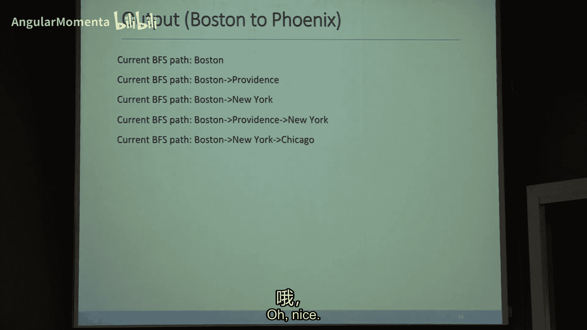
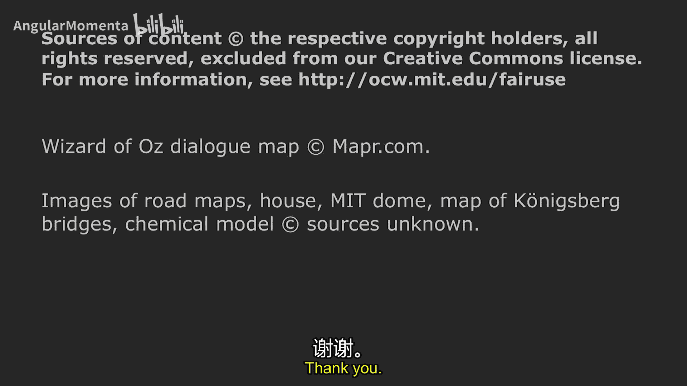

# 【麻省理工】计算思维与数据科学导论-｜-MIT-6.0002-Introduction-to-Computational-Thinking，Fall2016-p03-3.-图论模型--BV1zNjGzxEvk_p3-

The following content is provided under a Cative Commons license。

 Your support will help Mi T OpenCourseware continue to offer high quality educational resources for free to make a donation or to view additional materials from hundreds of MiT courses。

 Visit Mit Opencourseseware at Ocw。 Mt。 Eduu。Welcome back。

Over the last couple of lectures。We've been looking at optimization models。And the idea was。

 how do I find a way to optimize an objective function。

 that could be minimize or maximize it relative to a set of constraints。

And we saw our Professor Goodtag showed you that one of the ways that naturally falls out is by looking at trees。

 decision trees where you pass your way through a tree。

 trying to figure out how to optimize that model。So today。

 we're going generalize those trees into another whole broad class of。

 of models called graph theoretic or graph models。 And we're going to use those to gain look at how do we do optimization on those kinds of models。

Just to remind you， there is a great piece of of information in the text。

 Theres the reading for today。 And these， of course， be in the slides that you can download。

So let's take a second， just to reset again。What are we trying to do？Generally。

 we're trying to build computational models。So what does that mean？

The same way we could do a physical experiment or a social experiment or model。

 if you like a physical system and a social system。

 to both try and gather data and analyze it or to do predictions。

 We want to do the same thing computationally。 We'd like to be able to build models。😊。

In code that we can then run to predict effects between that and might test with an actual physical experiment。

And we've seen。For example， how you could take just the informal problem of choosing what to eat。

And turning it into an optimization problem。 In this case。

 it was a version of something we called anapsack problem。

And how you could then use that to find code to solve it。

And you've already seen two different general methods。

 You've seen greedy algorithms that just try and do the best thing at each stage。

 And you saw dynamic programming as an elegant solution to finding better ways to optimize this。

We're going to now look at broadening the class of models to talk about graphs。

So obvious question is， what's a graph。And graphra has two elements， two components。

It has a set of nodes， sometimes called vertices。Those nodes probably are going to have some information associated with them。

 It could be as simple as it's a name。 It could be more complicated。

 A node might represent a student record。 The grades。

 And a graph might talk about putting together all of the grades for a class。Associated with that。

 we can't just， should would say we could just have nose， but that's kind of boring。 We want to know。

 what are the connections between the elements of my system。

And so the second thing we're going to have is what we call edges， sometimes called arcs。

And an edge will connect。A pair of nodes。We're going to see two different ways in which we could build graphs using edges。

The first one， the simple one is an edge is going to be undirected。 And actually。

 I should show this to you。 So there's the idea of just nodes。Those nodes， as I said。

 might have information in them。 just labels or names。 They might have other information in them。

When I want to connect them up。The connections could be undirected。

If you want to think of it this way， goes both ways。 An edge connects two nodes together。

 and that allows sharing of information between both of them。In some cases。

 we're going to see that we actually want to use what we call a directed graph。

 sometimes called a digraph。In which case， the edge has a direction from a source to a destination or sometimes from a parent to a child。

And in this case， the information can only flow from the source to the child。Now。

 in the case I've drawn here， it looks like there's only ever a single unit director sorry。

 Direct edge between those。 I could， in fact， have them going both directions from source to destination and a separate directed edge coming from the destination back to the source。

 And we'll see some examples of that。But I'm going to have edges。Final thing is。

 those edges could just be connections。 But in some cases。

 we're going to put information on the edges。For example， weights。The white might there。

 the weight might tell me how much effort is it going to take me to go from a source to destination。

And one of the things you're going to see is I want to think about how do I pass through this graph。

 finding a path from one place to another， For example。

 minimizing the cost associated with passing through the edges。

 or how do I simply find a connection between two nodes in this graph。So graphs。

Composed of vertices or nodes。composed of edges are arc。So why might we want them？Well。

 we're going to see， and you can probably already guess there are lots of really useful relationships between entities。

I might want to take a European vacation。After November 8。

 I might really want to take a European vacation。So I'd like to know。

 what are the possible ways by rail I can get from Paris to London。Well。

 I could pull out the schedule and look at it。 But you could imagine。

 I hope thinking about this as a graph。 The nodes would be cities。

 The links would be rail links between them。 And then one of the things I might like to know is。

 first of all， can I get from Paris to London？ And then secondly。

 what's the fastest way to do it or the cheapest way to do it。 So I'd like to explore that。

Second example， as you can see on the list。Drug discovery。

Modeling of complex molecule in terms of the relationships between the pieces inside of it。

 and then asking questions like， what kind of energy would it take to convert this molecule into a different molecule。

 And how might I think about that as a graph problem。Third， and obvious one。Ancestral relationships。

 family trees。In most families， almost all families， they really are trees， not graphs。 Hopefully。

 you don't come from a family that has strange loops in them， but family trees are。

I know I'm in trouble here today。 Are't I family trees。 Stay with me。

 are a great demonstration of relationships， because there its directional edges， right。

 Parents have children。 Those children have children。 And like I say。

 it comes in a natural way of thinking about traversing things in that tree。And， in fact。

 trees are a special case of a graph。You've already seen decision trees in the last lecture。

 but basically， a special kind of directed graph is a tree。 And the property of the tree is。

 as it says there， any pair of nodes are connected if they are connected by only a single path。

There are no loops。 There are no ways to go from one node。

 find a set of things that brings you back to that node。

 You can only have a single path to those points。And Professor Gotag used this， for example。

 to talk about solving thenapssack problem。 A decision trees a really nice way of finding that solution。

Now， I drew it this way。 in computer science， we mostly use Australian trees。They're upside down。

The roots are at the top。 The leaves are at the bottom because we want to think about starting at the beginning of the tree。

 which is typically something we call the root in traversing it。But however。

 you use that trees are going to be a useful way of。

 of actually thinking about representing particular kinds of graphs。Okay， so。

We're to talk in a second about how to build graph。 Well。 Let's spend it just a second about saying。

 so why are they useful。And if you think about it， the world is full of lots of networks that are based on relationships that could be captured by a graph。

You use them all the time。Some of you are using them right now。Computer networks。

 You want to send an email message from。Your machine to your friend at Stanford。

That's going to get routed through a set of links to get there。

 So the network set up by a series of routers that pass it along。

 S something requires an algorithm that figures out the best way to actually move that around。

It's a great local company started by an M T professor called Akamai that thinks about how do you move web content around on the Web。

 Again， it's a nice computer network problem。😊，Bardi talked about this。

 we're going to do some other examples， transportation networks。Here， if you think about it。

 the obvious thing is make the nodes cities， make the edges roads between them。

 And now questions are， can I get to San Jose if you like old songs and what's the best way to get to San Jose。

 even if you don't like old songs。A network problem。 How do I analyze it。

Financial networks moving moneyny around， easily modeled by a graph。Traditional networks， sewer。

 water， electrical， anything that distributes。Content， if you like。

 and a different kind of content in this way around。

 you want to model that in terms of how you think about flows in those networks。

 How do I maximize distribution of water in an appropriate way。

 Given I've got certain capacities on different pipes。

 which would mean those edges in the graph would have different weights。And you get the idea。

 political networks， criminal networks， social networks。

One of the things we're going to see with graphs。Is that they can capture interesting relationships。

So here's an example that's from that little website you can see there。

 You can welcome to go look at it。And this is a graph analyzing the wizard of O。

What's been done here is the size of the node reflects the number of scenes in which a character shares dialogue。

So you can see， obviously， Dorothy is the biggest node there。The edges represent shared dialogue。

 So you can see who talks to whom in this graph。And then we this group has done another thing。

 which I'm going to mention。 We're not going to solve today。

 which is you can also do analysis on the graph。 And， in fact， the color here。

Is done something called a minflow or max cut problem。

 which is it's tried to identify which clusters in the graph。

Tend to have a lot of interactions within that cluster。But not very many with other clusters。

 And you can kind of see there's some nice things here， right， If you can read it。

 this is all the people in Kansas， This is Ginda and the Munchkins in that part of Oz。

 There's another little cluster over here that I can't read and a little cluster over there。

 And then the big cluster down here。But you can analyze the graph to pull out pieces on it。

You can also notice， by the way， the book is probably misnamed。It's called the Wizard of Oz。

 But notice there's the wizard who actually doesn't have a lot of interaction with the other people in this story。

It's okay， literary choice。But the graph is representing interactions。

 And I could imagine searching that graph to try and figure out things about what goes on in the Wiizard of Oz。

Okay， so why are they useful， We're going to see that not only do graphs capture。

Relationships in these connected networks。But they're going to support inference。

 I'm going to be able to reason about them。And I want to set that up。

 and then we'll actually look at how might we build a graph。

 And so here are some ways in which I might want to do inference。Given a graph， I might say。

 is there a sequence of edges of links between two elements。 Is there a way to get from A to B。

 What are the sequence of edges I would use to get there。More interesting question is。

 can I find the least expensive path， also known as the shortest path。

If I want to get from Paris to London， I might like to do it in the least amount of time。

 What are the set of choices I want to make to get there。

A third graph problem used a lot iss called the graph partition problem。Everything I've shown so far。

 actually， not quite。 The first example didn't have it。

 You might think of all the nodes having some connection to every other node。

 but that may not be true。There may actually be graphs where I've got a set of connected elements。

And another component with no connections between them。Can I find those。

 That's called the graph partition problem。 How do I separate the graph out into connected sets of elements。

And then the one that we just showed called the Min cut Max flow problem is is there an efficient way to separate out the highly connected elements。

 The things that interact a lot and separate out how many of those kinds of sub graphs， if you like。

 are there inside of my graph。All right， let me show you a motivation for graphs。

 and then we'll build them。I use graph theory every day。I'm a math nut。 It's O。

 but I use graph theory every day。 You may as well， if you commute。

Because I use it to figure out how to get from my home in Lexington down here to Cambridge。

 And I use a nice little system called Ways。 It's a great way of doing this。

 which does graph theory inside of it。 So how do I get to my office。😊，Well。

I'm going to model the road system using a directed graph， a digraph。

Direct to graphic of streets can be one way。 And so I may only have a single direction there。

And the idea is I'm going to simply let my nodes or my vertices be points where I have intersections。

There are places where I can make a choice or places where I have terminals。

 things are going to end up here。The edges would just be the connections between points。

 the roads on which I can drive。Some Boston drivers have a different kind of diagram in which they don't care whether that road is drivable or not。

 They just go on it。 You may have seen some of these。

 but I want to keep my graphs as real roads that I can drive on。

And I'm not going to go against the one way sign。Each edge will have a weight。

Here I actually have some choices。Right， the obvious one。

The one that Wes probably uses is something like， what's the expected time between a source and a destination note。

How long do I expect it to take me to get from this point to that。And then as you can see。

 I'm going to try and find overall， what's the best way to get around it。

You could pick just distance。What's the distance between the two。

And while there's a relationship here， it's not direct because it'll depend on traffic on it。

Or you could take something even funer。 Like， what's the average speed of travel between the source。

And destination note。And once I've got the graph。Then I'm going to solve an optimization problem。

 What's the shortest weight between my house and my office that gets me into work。

You can make a choice here。 As I said， a commercial system like Wa uses this one。

My wife and I actually have arguments about commuting because she's a firm believer in the second one。

 just shortest distance。I actually like the third one， because I get。Anxious when I'm driving。

And so as long as I feel like I'm making progress， I like it。 So even though， you know。

 I may be serpentining all the way through the back roadads of Cambridge。 If I'm driving fast。

 I feel like I'm getting there。 So I like optimizing this bottom one down there。😊。

And if you see me on the road， you'll know why I say that and then get out of the way。

Thinking about navigation through systems actually gives us a little bit of history because， in fact。

 the very first reported use of graph theory。Was exactly this problem。

Early 1700s is called the Bridges of Conigsburg。Coonigsburg is a city that has a set of islands and rivers in it。

 There are 7 bridges that connect up those islands。 And the question that was posed is。

 is it possible to take a walk。That traverses each of the seven bridges， exactly once。

So could you take a walk where you go over each bed exactly once。

I'm showing you this because it lets us think about how to， in fact， capture things in a model。

This problem was solved by a great sorry， great Swiss mathematician Lenhart Euler。

And here's what he said。Make each island a note。Each bridge is just an undirected edge。And notice。

 in doing that。He's abstracted away。Irrelevant details。You don't care。What the size of the island is。

 You don't care how long the bridges are。 You simply want to think about。

 what are the connections here。And then you can ask a question in this graph。

 is it possible to find a way to walk through it so that you go through each edge exactly once。

And as Euler showed， the answer is no。And if you're curious， go look it up on Wikipedia。

 there's a nice， elegant solution to why that's the case。But here's what we're going do。

 We're going use those graphs to think about these kinds of problems。In， in fact。

 the examples I' are going to show you are going to be shortest path problems。 So with that。

 let's turn to actually。Building a graph。And then thinking about how we're going to use it。

So we're going to start by constructing graphs。 And then what we're going to do is show how we can build search algorithms。

On top of those graphs。 And I hope that that flicker is going to go away here soon。 Here we go。

So to build a graph。Next， I shouldn't have put this slide up so fast。 I've got lots of choices here。

 If I'm thinking about maps， one way to build a graph would really to just be build something with latitude and longitude on it。

But as we've already seen， we'd like to extract things away from the graphs。

And so a natural choice is to say， let's represent the nodes in the graph just as objects。

 I want to use classes for these。So here's my definition of a node。 It's pretty straightforward。

I'm going to assume that the only information for now I store in a note is just a name。

 which I'm going to assume is a string。So I've got a class definition for node it inherits from the base Python object class。

I need ways to create instances of nodes。 So I've got ait function。

 And I'm simply going to store inside each instance。 In other words。

 inside of self under the variable name， whatever I passed in is the name。Of that note。Of course。

 if I got ways to create things with a name， I need to get them back out。

 So I've got a way of selecting it back out。 If I ask an instance of a node。

 what's your name by calling， get name， it will return that value。And to print things out。

 I'm just going to print out the name。 This is pretty straightforward。This， of course。

 lets me now create as many nodes as I would like。Edges。Well， an edge connects up two nodes。So。

 again， I can do a fairly straightforward construction of a class。G。

 it's going to inherit from the base Python object to create an instance of an edge。

 I'm going to make an assumption， an important one， which we're going to come back to。

 The assumption is that the arguments passed in source and destination are node。Not names。

The nodes themselves， the actual instances of the object class。And what will I do inside of the edge。

 I'm going to set internal variables for each instance of the edge。

 source and destination are going to point。To those nodes。

 to those objects that are created out of the node class。Next two， things are straightforward。

 I can get those things back out。And then the final piece is。

 when I want to print out what an edge looks like， I'm going to ask that it print out the name of the source and then an arrow and then the name of the destination。

 So notice what I do there。Given an instance of an edge。I can print it。

And it will get the source or the the node associated with source inside this instance。Get for that。

The get name method。And then call it。 notice the open closed pre there to actually call it。

What does that do， It says inside the edge， I've got something that points to a node。

 I get that node。 I take the method associated with it， and I call it。 that returns the string。

And then I glue that together with the arrow。 I do the same thing on the destination。

 And I just print it out。Pretty straightforward， hopefully。Okay。

 now I have to make a decision about the graph。 I'm going to start with digraphs， directed graphs。

 And I need to think about how I might represent the graph。I can create nodes that cr edges。

 but I've got to bring them all together。Soll remind you， a diagram is a directed graph。

 The edges pass in only one direction。And here's one way I could do it。

Given all the sources and all the destinations， I could just create a big matrix。

Called an adjacency matrix。The rows would be all the sources。

The columns would be all the destinations。 And then in a particular spot in the matrix。

 if there is an edge between a source and a destination， I'd just put a one。Otherwise， I'd put a0。

Note， by the way， because it's a directed graph。It's not symmetric。

There might be a one between S and D， but not between D and S， unless there are edges both ways。

This would be perfectly reasonable way to represent。A graph。But not the most convenient1。

 I'd have to go into the matrix to look things up。 It may also not be a very efficient way of representing things。

 For example， if there are very few edges in the graph， I could have a huge matrix with mostly zeros。

 And that's not the most effective way to do it。So I'm going to use an alternative。

Called an adjacency list。And the idea here is for every node in the graph。

I'm going to associate with it a list of destinations。 That is， for a node。

 what are the places I can reach。With a single edge。Okay。

 so let's see what that does if we want to build it。And yes， there's a lot of code here。

 but it's pretty easy to look through， I hope。Here's the choice I'm going to make。G， what's a graph。

 It's a set of nodes。 It's a set of edges。 I'm going to have a way of putting nodes into the graph。

 And I'm going to choose when I put a node into the graph to store it as a key in a dictionary。看。

When I initialize a graph， I'm just going to set this internal variable edges。

To be an empty dictionary。And the second part of it is when I add an edge to the graph between two nodes。

From a source to destination， I'm going to take that point in the dictionary associated with the source is's a key。

And associated with it， I'm going to just have a list of the nodes I can reach from edges from that source。

So notice what happens here。 If I want to add a node， get remember， it's a node， not an edge。

 I'll first check to make sure。That is not already in the dictionary。

That little loop is basic or that if is saying if it's in this set of keys， it'll return true。

 And I'm going to complain。 I'm trying to copy a note， or duplicate a note。Otherwise。

 notice what I do when I put a note into the dictionary。 I go into that dictionary edges。

I create an entry with the key。 That is the node。And the value I put in there is initially。

 an empty list。I'm to say one more piece carefully。 It's a note， not a name。And that's O。 in Python。

 It is literally the key is the node itself。 It's an object， which is what I'd like。Right。

 what if I want to add an edge， Well， an edge is going to go from a source to a destination node。

So I'm going to get out from the edge， the source piece。 I'm going to get out from the edge。

 the destination piece by calling those methods。 again， notice the open closed per。

 which takes the method and actually calls it because remember， an edge was an object itself。

Given those， I'll check to make sure that they are both in the dictionary。That is。

 I've already added them to the graph。 I can't make a connection between things that aren't in the graph。

And then notice the nice little thing I do。 Presuming I have both of them in the dictionary。

I take the dictionary。I index into it with the source node。 that gives me a key into the dictionary。

 I pull up the entry at that point， which is a list， because I created them up here。

 And I add the destination node with a pen into the list。 Stick it back in。

So this now captures what I said I wanted to do。The nodes are represented as keys in the dictionary。

And the edges are represented by destinations as values in the list associated with the key。

So you can see if I want to see， is there an edge between。A source。In a destination。

 I would look how at her source in the dictionary and then check in the list to see if the destination is there。

Okay， the rest of this then follows pretty straightforwardly。

 If I want to get all the children of a particular node。

 I just go into the dictionary edges and look up the value associated with that node。

 It gives me back the list。 I've got all the things I can reach from that particular node。

If I want to know if a node is in the graph， I just search。Over the keys of the dictionary。

He'll either return true or false。If I want to get a node by its name。

 which is going to be probably more convenient than trying to keep track of all the nodes。 Well。

 I could pass in a name as a string。 And what will I do。

 I'll just search over all the keys in the dictionary using the get name method associated with it。

 There's the call and checking to see if it's the thing I'm looking for。And if it is， I'll return in。

 I'll return the node itself。What about this thing here。It might bother you a little bit。

 Wait a minute。 That raise， isn't it always going to throw an error。No。

 because I'm going to go through this loop first。 And if I actually find a node。

 that return is going pop me out of the call and return the note。So I'll only ever get to this。 if。

 in fact， I couldn't find anything here。 And so it's an appropriate way to simply raise the error to say。

 if I get to this point， couldnn't find it， raise an error to say the node's not there。

The last piece looks a little funky， though you may have seen this。

 I like to print out information about a graph。And I made a choice。

 which is I'm going to print out all of the links in the graph。

So I'm going to set up a string initially here。 that's empty。And then I'm going to loop over。

Every key in the dictionary， every note in the graph。for each one。

 I'm going to look at all the destinations。 So notice I take the dictionary。

 I look up the things at that point。 That's a list。 I loop over that。

 And I'm just going to add in to result the name of the source and arrow。

In the name of the destination。Followed by carriage return。I'll show you an example in a second。

 But I'm simply walking down the graph saying for each source， what can it reach。

 Ill print them all out。And then I'll return everything。 but the last element。

 I'm going to throw away the last carriage return， because I don't really need it。

So let me show you an example here trusting that my Python has come up the way I wanted it to。So。

 I'm going to。Load that in。 ignore that for the moment。 And I'm going to set G to。

I've got something we're going to come back to in a second。It actually creates a graph。

And if I print out G。It prints out， in this case。All of the links， from source to destination。

Each one on a new line。Okay。So I can create the graphs。That was digraphs。

Suppose I actually want to get a graph。Well， I'm going to make it is a subclass of digraph。

And in particular， the only thing I'm going to do is I'm going to shadow the add edge method of digresss。

So if you think about it this， if I make a graph， if I ask it to add edges。

 it's going to use this version of add edge。And what am I going to do， I know in a graph。

I could have both directions work。So。Given an edge that I want to add into this graph。

 I'll use the method from the diegraph class， and I'll add an edge going from source to destination。

And then I'll just create an edge， the other direction。Destination becomes source。

 source becomes destination， and I'll add that into the graph。Nice and easy。 straightforward to do。

And this is kind of nice。Because in a graph， I don't have any directionality associated with the edge。

 I can go in either direction。 I've just created something like that。And you might say， well。

 wait a minute。 why did I pick graph to be a subclass of digraph， Why not the other way around。

Reasonable question。And you actually know the answer。 You've seen this before。

One of the things I'd like to have is the property that if the client code works correctly。

Using an instance of the bigger type。Should also work correctly when he's using an instance of the subtype substituted in。

Which is another way of saying anything that works for digraph will also work for a graph。

But not vice versa。And as a consequence， it's easier to make the graph a subclass of digraph。

Notice the other thing that's nice here。 One little piece of code。

 Just change what it means to make an edge。 Everything else still holds。And also。

 notice you've seen this before， how we nicely inherit。

The method from the subclass by explicitly calling it。 it says from the digraph class。

 get out the the addd edge method and apply it。Okay。So we can build graphs。

We're gonna do that in a second。AndThat's turned out of thinking about。

 I'd like to search on a graph。 And I'm going to start with the classic graph optimization problem。

 I'd like to find the best path home。 So what's the shortest path from one node to another。

And that shortest path initially will just be the shortest sequence。Of steps。

I hope I'm not having a little attack here。 You just saw that screen blank out， right。

 But the shortest path of steps with the property that the source of the first edge。

Thiss the starting point。The destination of the last edge is the thing I'm trying to get to。

 And for any edge in between， if I go in my first edge from source to say node one。

 the next edge has that destination as its source。 So there's simply a chain that says I can go from here to here to here to here to get all the way through。

And I'd like to find what's the shortest number of steps。

 Es like that thatll get me from source to destination。Ultimately。

 if those edges have weights on them。The optimization problem I'd like to solve is。

 what's the shortest weighted path， the shortest。Amount of work I have to do to get to those places。

 And if we can solve one， we'll see that we can solve the other one pretty straightforwardly。

And we've already seen examples of shortest path problems。Clearly， finding a route。 Navig is one。

 Designing communication networks is another great example of a shortest path problem。

 You'd like your message to get your friend as quickly as possible and not go as many times around the world before it gets there。

 So what's the shortest amount of time or the fewest links I have to use to get there。

Lots of nice biological problems that also captured this piece。So here' is an example。

 And we're going to use this to look at two different kinds of algorithms to solve this problem。

This is a little。Navigation problem from a set of cities。 Think of it as flight pass。

If you're from Arizona， my apologies， but once you get to Phoenix， you can't get out of there。

Unless you grow from the ashes， I guess。But you know。

 it's a way of dealing with how to get around in places。And to think about this。

 here's the representation。That we'd have in the graph。 the adjacency graph here。

 our adjacency list here is from Boston。 I can get to Providence。 I can get to New York。

From Providence， I can get to Boston。 I can get to New York。From New York， I can only get to Chicago。

Chicago， I can go to Denver or Phoenix。 Denver， I can go to Phoenix or New York。 And from L A。

 you can only come back to Boston and Phoenix。Has no exits out of it。 So there's that representation。

 I just want to let you see that， right， There are the keys in the dictionary。

 There are all the nodes。And there， each one of those lists is a set of edges from the source to the destination。

Okay。How would I build this？Well， this is the code I just ran。 I just want to show it to you。

 I noticed， by the way， in the slides that distributed earlier， this missing。

 the return G is missing there。 If you want to correct it。 I'll repost it later on。

I'm going to create a little functions。 going to build a city graph。

I'm going to pass in a type of graph， which I will then call to create it。

 so I could make this as a digraph。 I could make it as a graph。 I'm going to start off with it。

 as a digraph。And then notice what I do here。 I just run over a little loop with a set of names。

 creating a node with that name。And then adding it into the graph。Right， so node is a class instance。

 It creates a class definition。 It creates an instance。

 And once I've got that add node as a method on the graph， it will simply add it in。And then。

 this set here。Is simply adding in the edges。And I can do that。

 I'm capturing what I had on that previous slide。 I'm going give a name to get note。

 It will get out the actual note。And I use that coming out of the graph G。

 I do the same thing with the get note from graph G for Providence。

 And then I make an edge out of that。 And then I use the method from the graph to add the edge。

If this looks like a lot of code， yes， it's a lot of words， but it's pretty straightforward。

 I'm literally creating nodes with the names， using the appropriate methods， creating an edge。

 adding it into the graph。 And when I'm done， I'm just going to return the graph G。😊，O。

 now I want to find shortest path。And I'm going to show you two techniques for doing this。

First ones called depth first depth， e depth， first search。

It's similar to something Professor Goodtag showed you when you sort of took the leftmost。

 most depth first method in terms of a search tree。The one trick here is because I bought grasss。

 not trees。 There are the potential for loops。 So I'm simply going to keep track of what's in the path。

 And I'm never going to go back to a node that's already in the path。

 So I don't just run in circles going from New York to Boston to New York to Boston constantly。Right。

 so。Second thing I'm going to do here is I'm going to take advantage of a problem you've seen before。

Which is， this is literally a version of divide and conqueror。

What does that mean if I want to find a path from source node to destination node。

If I can find a path to some intermediate node from sourced to intermediate。

 and then I find a path from intermediate to destination。

 the combination is obviously a path the entire way。So recursively。

 I can just break this down into simpler and simpler versions of。That search problem。

So here's the idea behind depth first search。Start off at that source note， that initial note。

I'm going to look at all the edges that leave that node in some order。 However。

 order it was put into the system。And I'm going to follow the first edge。

I'll check to see if I'm at the right location。 If I am， I'm done。If I'm not。

 I'm going follow the first edge out of that note。So I'm actually creating a little loop here。

And I'm going to keep doing that until I either find the goal note or I run out of options。

So let me show you an example。I've got a little search tree here， very simple one。Here's my source。

 There's my destination。In depth first， I'm going to start at the source and go down the first path。

See if I'm at the right place， I'm not。So I'm going to take the first path out of here。

She might be that one。See if I'm in the right play。 Actually， let me not do it that way。

 Let me do it this way。Am I in the right place， I'm not。

So I'm going to take the first path out of this one。She gets me there。

 I'm still not in the right place。 So I'm going to take the first path。What did that one。

And you can see why it's called depth first。 I'm going as deep if you like in this graph as I can。

 from here to there to there to there to there。At this stage， I'm stuck。 There is no place to go to。

 So I'm going to go back to this node and say， is there another edge。 So in this case， there isn't。

 So I'll go back to here， There's not another edge。 Go back to here。 Theres not。

 There is another edge。 So I'm going to go。This direction。And from here。A look down there。G， notice。

 I'm now going depth first down the next chain。Nothing from here。 I backtrack。

 There's nothing from there。 I backtrack over to here。 There's no additional choices there。

 So I'll go all the way back to here。Follow that one。And then I'll go down this one again。Backtrack。

 backtrack。 And eventually。I find the thing I'm looking for。Depth first。

 falling my way down this path。So let's write the code for， yes， ma'am。

The question is which node door， which edge do I choose is， however I stored it in in the system。

 So since it's a list， I'm going to just make that choice。 I could have other ways of deciding it。

 but， but think of it as， yeah， essentially random which 1 I would pick。Okay， let's look at the code。

Don't panic。 It's not as bad as it looks。 It actually just captures that idea。

Ignore for the moment of this down here。 It just going to set it up depth first search。

 I'm going to give it a graph。A start note， an end note。And a path that got me to that start node。

 which initially is just going to be an empty list。

Something that tells me what's the shortest path I've found so far， which would be my best solution。

 And then just a little flag here。 If I want to print out things along the way。What do I do。

 I set up path to add in the start no。 So if path initially is an empty list。

The first time around is just， here's the note I'm at。I print out some stuff。 And then I say。

 see if I'm done。I'm just going to stay at home。 I'm not going to go anywhere。

Un unlikelyly to happen， But you'll see recursively why this is going to be nice。If I'm not done。

 then notice the loop。 I'm going to loop over all the children of the start note。啊。

Those are the edges I can reach The nose I can reach with a single edge。 I pick the first one。

And in answer to the question， in this case， it would be the order in which I stored in the list。

 I just picked that one up。I then say， let's make sure it's not already in the path。

Because I want to avoid loops。And assuming it isn't。

And assuming I don't yet have a solution or the best solution I have is smaller than what I've done so far。

Oh， cool。Just do the same search。So notice there's that nice recursion， right。I'm going to explore。

 I just picked the first option out of that first note。

 And the first thing I do is try and see if there's a path from that note using the same thing。

 So it's literally like， I picked this 1。 I don't care about those other edges。

 I'm going to try and take this search down。When it comes back with a solution。

 as long as there is a solution， I'll say that's my best solution so far。Right。

If there and then I go back around。 now this last little piece here is just， if， in fact。

 the node's already in the path， I'm just going to print something out that says。

 don't keep doing it because you don't need to keep going on。And I'm going to do that loop。

 D all the paths down until it comes back。And only at that stage。

 do I go to the next portion around this loop。The piece down here just sets this up。

 calling it with an initial empty。A list for path and no solution for shortage。

 So it's just a nice way of putting a wrap around it that gets things started up。

This may look a little funky。May look a little bit twisted。

So let's see if it actually does what we'd expect it to。And to do that。

 I'm just going to build a little test function。 I'm going build that city graph。

 I'm just going to call shortest path。 I'm going to print it out。 And I'd like to see。

 is there a way to get from Boston to Chicago。So let's go back over to my Python。And try that out。

And I've got a call for that。Oh， and it prints out it， I start off。

So I did it the wrong ways from Chicago to Boston。 Yes， Chicago to Denver， to Phoenix。

From Denver to New York。Comes back and says， I've already visited。

Basically concludes I can't get from Chicago to Boston。It's just printing out each stage。

 Let's actually look at that a little more carefully to see how it got there。So， there's my example。

There's the adjacency list。 And here's what happens。I start off in Chicago。 So that's my first note。

From Chicago， the first edge goes to Denver。Denver is not what I'm looking for。

 But since I'm in Denver recursively， I'm going to call it again。

 So the first edge out of there is to Phoenix。Game， sorry， if you're from Arizona in Phoenix。

 there's nowhere to go。 So I'm going have to backtrack。And that will take me back up to Denver。

 And I look at the next edge。 takes me to New York。From New York， I'd like to go to Chicago。 But， oh。

 that's nice because remember that first check it says， is Chicago already in the path。 It is。

 I don't want to loop。Because otherwise， I'm simply going to go around and around and around here。

 And it may be good for frequent flyer miles， but it's not a great way to get to where you're trying to go。

So I break out of it。And now what else do I have left， Chicago to Denver， I've explored。

 I look at Chicago to Phoenix。 from Phoenix。 There's nowhere to go。 I go back up to Chicago。

 There are no more paths。 I'm done。Okay。Now， turns out you can actually get somewhere in this graph。

 So here's just another example I'm simply going to show you if I want to go from Boston to Phoenix。

Notice the set of stages。 And you can see， notice how at each stage it tends to be growing。

 That's that depth。 First， I'm exploring the edges。I find a path。That's great。

But is it the shortest path？I don't know。 So having found that path， I try and take the next branch。

 which finds a loop。And I keep moving through this。

Finding paths until I look at all the possible paths。 and I actually return the shortest path。

You can try running the code on it。 But what I want you to see is again this idea that I can explore it。

 But， in fact， I'm going to have to explore it。In a particular order。But there's depth first search。

 It will find a solution for me。Alternative，s what's called breadth first search。

Sounds almost the same。 Again， I'm going to start off with an initial load。

 I'm going to look at all the edges that leave that node in some order。

 I'm going follow the first edge as before and see if I'm at the right place。If I'm not。

 I'm going to follow the next edge。And do the same thing。

So whereas this went down through the tree as deeply as I could to the graph。 in B first。

 I'm going to start off。Taking that edge as before， I'm not done。

 I'm going to keep track of that in case I want to explore more of it。

 But I'm going go back over here and follow that edge。I'm not done。 Again， I'll keep track of that。

 but I'll come back up here and explore that one。You oh， cool。I found a solution。In three steps。

 Ive reached the destination。And notice， because I'm exploring all the。

 the paths of length 1 before I get to paths of length 2， Once I find a solution。

 I can stop because I know it's the shortest path。Any other path through here would be longer than that particular solution。

So the loop here is a little different。I'm looking over all the paths of length 1。

 there are all the paths of length 2。 And the one thing I'm going to have to do is I'm going to have to keep track of。

The remaining options here in case I have to come down to them。

 because if I didn't find it at the first level， then I come down here and look at things of length。

 too。Okay。So let's build that code。Bread first first， B first search or B F， S。 Again。

 I graph a start in an end node， something that would just print things out as I go along。

My initial path。Is just a start point。But now I've got to keep track of what are the paths that I have yet to explore。

And so for that， I'm going to create something called a Q。And a queue is going to be a list of paths。

Remember， a path is a list of nodes。 A Q is going to be a list of paths。

 So the initial cu is just where I've started。And then as long as I've got something still to explore。

 and I haven't found a solution。I'm going to pop off the queue。 The oldest element。

 The thing at the beginning。That's my temporary path。 I'll print out some information about it。

And then I'll grab the last element of that path。 That's the last point in that path。

And I'll now explore。Is it the thing I'm looking for， in which case I'm done， I'll return the path。

Otherwise， for each node that you can reach from that point。

Create a new path by adding that on the end of this path。And add it into the queue。

At the end of the queue。So I'm going to keep looping around here until I either find a solution here。

 which I'll return。And if I get through all of it， I'm going to return none。And right there。

 there is that nice thing where once I find a solution， I know it's the shortest thing I can stop。

Okay， let's look at an example of this。I'm going to go back over to Python。

 where I got a version of this。 I'm going to。Comment that out。And down here in B first search。

 I've actually added a little piece of code that I don't have in the handout。

 That's going to print out the queue as well so we can see what happens when we call this。

So let's take a look at it。My initial call， there's one thing in the queue。 It's just Boston。

 started in Boston。So the best path the current path is to start in Boston。

I take that element off the queue， and I say， what are the things I can reach from Boston。Oh。

 nice And put two things in。I get from Boston to Providence。 I can get from Boston to New York。

The top things gone off。 the Q。 I popped it。 I've replaced it with two things。 are I take this。

And say， okay， from Boston to Providence， where can I get from Providence？ Oh， I can get to New York。

 So I put that in the queue。 This has gone off。 That one is still there。

And I do that because I haven't yet reached the thing I'm looking for， which was。

 I think Phoenix I was trying to get to。And you can see at each stage。

 I'm taking the top thing off the queue， asking for all the things that I can get to and adding them to it。

And notice， in some cases， it may be more than one。For example， which one do I want here right here。

 if I take Boston， New York to Chicago。From Chicago， I can get to Denver。 So there's one new path。

 I can also get to Phoenix。There's a second new path。Also， notice how。They're only growing slowly。

 as I build them out。And in fact， if we go back， we can see that nicely by looking at what happens if we were to actually trace this along。

So Boston to Phoenix， I start at Boston。 Then I look at that。And then that。

Those are all the paths of length 1。Having exhausted those， Oh， nice。 I'm looking at paths of length。

 too。

And then， paths of length 3。And then paths of length 4 until I found the one that I wanted。

And here's one other way of looking at it。Brett first says。I look at each path of length  one。

And then， oh， yes， I avoid the loop。I look at each path of length 2。Then， paths of length 3。

Until I actually find the solution。Subtle difference， different performance。Deepth first。

 I'm always following the next available edge until I get stuck in I backtrack。Breread first。

 I'm always exploring the next equal length option。

And I just have to keep track that cue of the things I have left to do as why I walk my way through。

What about weighted， shortest path？Well， as the mathematicians say。

 we leave this as an easy exercise for the reader。It's a little unfair。

 The idea would be imagine on my edges。 It's not just a step， but I have a weight。

Flying to L A is a little longer than flying from Boston to New York。

What I'd like to do is do the same kind of optimization。

 But now just minimizing the sum of the weights on the edges， not the number of edges。

As you might guess， depth first search is easily modified to do this。

The cost now would simply be once the sum of those weights。 And again。

 I would have to search all possible options till I find a solution。Unfortunately。

 Bret's first search can't easily be modified。Because the shortest weighted path may may have many more than the minimum number of loops。

 And I'd have to think about how to adjust it， to make that happen。But to pull it together。

Here's a new model。Graphs。Great way of representing networks。

 collectionions of entities with relationships between them。

There are lots of nice graph optimization problems。 And we've just shown you two examples of that。

But we'll come back to more examples as we go along。 And with that， we'll see you next time。

