# 【麻省理工】计算思维与数据科学导论-｜-MIT-6.0002-Introduction-to-Computational-Thinking，Fall2016-p04-4.-随机性思维--BV1zNjGzxEvk_p4-

The following content is provided under a C Commons license。

 Your support will help Mi T OpenCourseware continue to offer high quality educational resources for free to make a donation or to view additional materials from hundreds of MiT courses。

 Visit Mit Opencourseseware at O Cw Mt Eduu。So today。

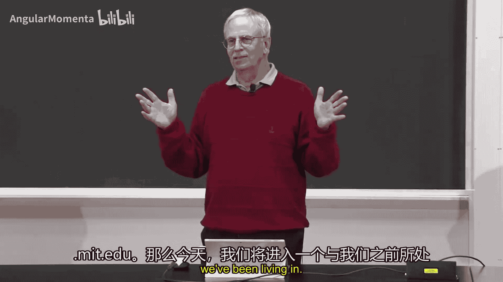

We're going to move on to a fairly different world than the world we've been living in。

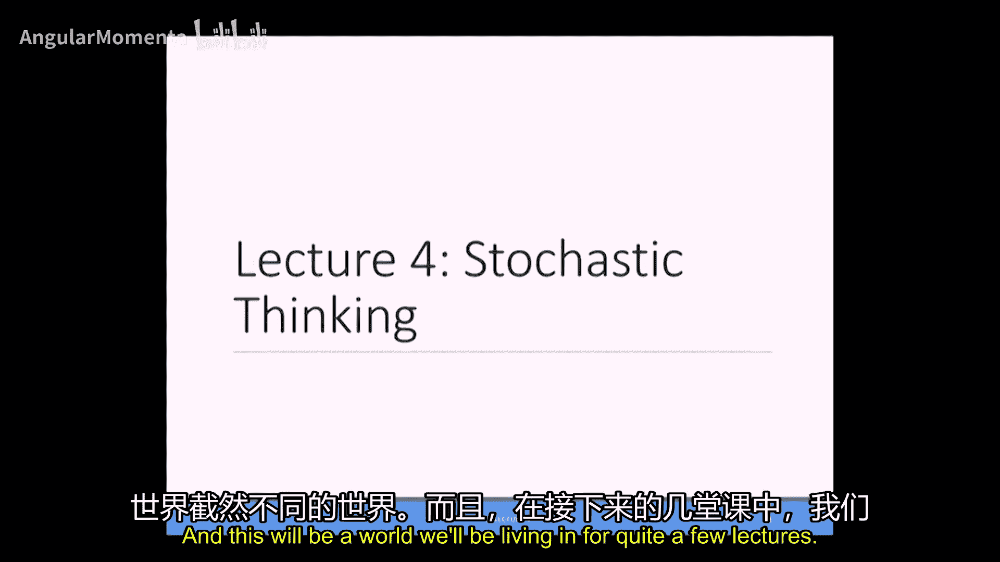

And this will be a world we'll be living in for quite a few lectures。Before I do that。

 I want to get back to just finish up something that Professor Grimson started。You may recall。

 he talked about family trees。And raised the question。

 was it actually possible to represent all ancestral relationships as a tree。Well。

 as a counter example， I'm sure some of you are familiar with Oipus Rex。For those of you who are not。

 I'm happy to give you a plot summary at the end of the lecture。 It's a rather bizarre plot。

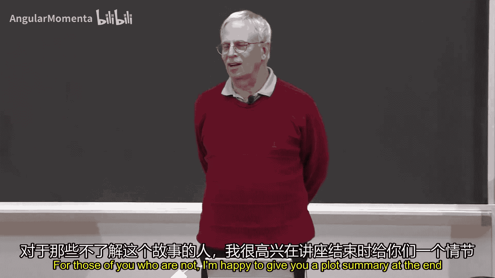

But it was captured in a wonderful song by Tom Leir。😊，The。

 the short story is Oedipus ended up marrying his mother and having four children。And Tom Lair。

 if you've never heard of Tom Lair， you're missing。

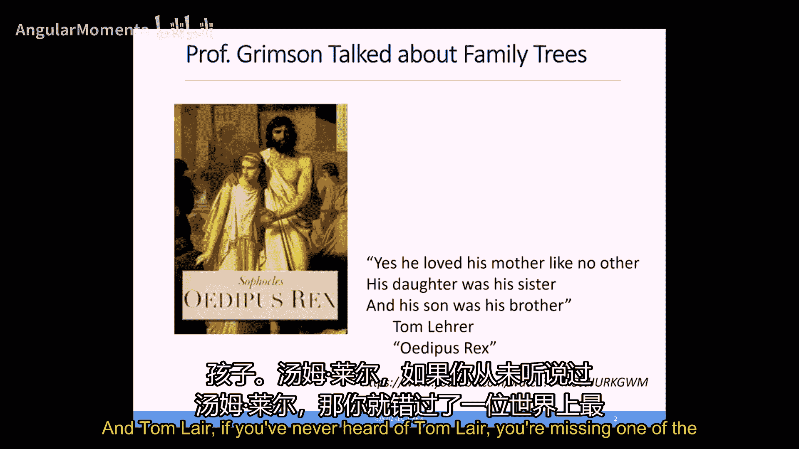

One of the world's funniest songwriters。And he had a wonderful song called Edipus Rex。

 And I recommend this YouTube as a way to go and listen to it。😊，And。You can gather from the quote。

 what the story is about。I also recommend the play， by the way， it's really。

Kd of appalling what goes on， but it's beautiful。All right， back to the main topic。Here's the。

 the relevant reading。呃。A small bit from， from later in the book， and then。Chapter 14。

You may notice that we're not actually going through the book in order。

And the reason we're not doing that is because we're trying to get you information you need in time to do problem sets。

All right。So the topic of today is really uncertainty。And the fact that the world is really。

Annoyingly hard to understand。嗯。This is。Signpost related to 6 triple02。

 but we won't go into too much detail about it。嗯。We'd rather things were certain， but in fact。

They usually are not。And this is a place where 6 A02 diverges from the typical introductory computer science course。

Which focuses on things that are functional。Given an input， you always get the same output。

 It's predictable。And we like to do that because that's easier to teach。

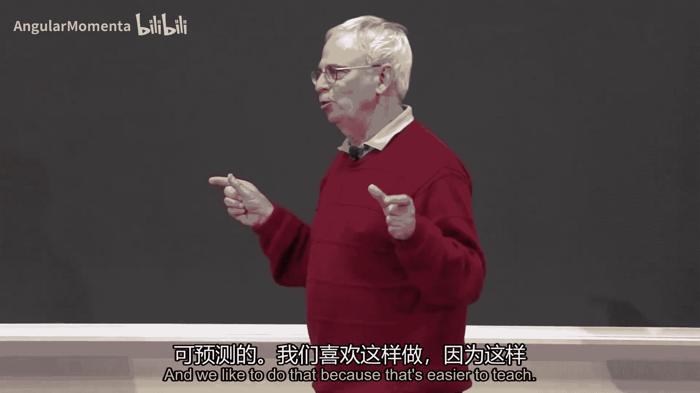

But in fact， for reasons we'll be talking about， it's not nearly as useful。

If you're trying to actually write computations that help you understand the world。

 you have to face uncertainty head on。An analogy is， for many years。

 people believed in Newtonian mechanics。I guess they still do in， in 8，0，1。

 maybe that every effect is a cause。An apple falls from the tree because of gravity。

 And you know where it's going to land。 And the world can be understood causally。

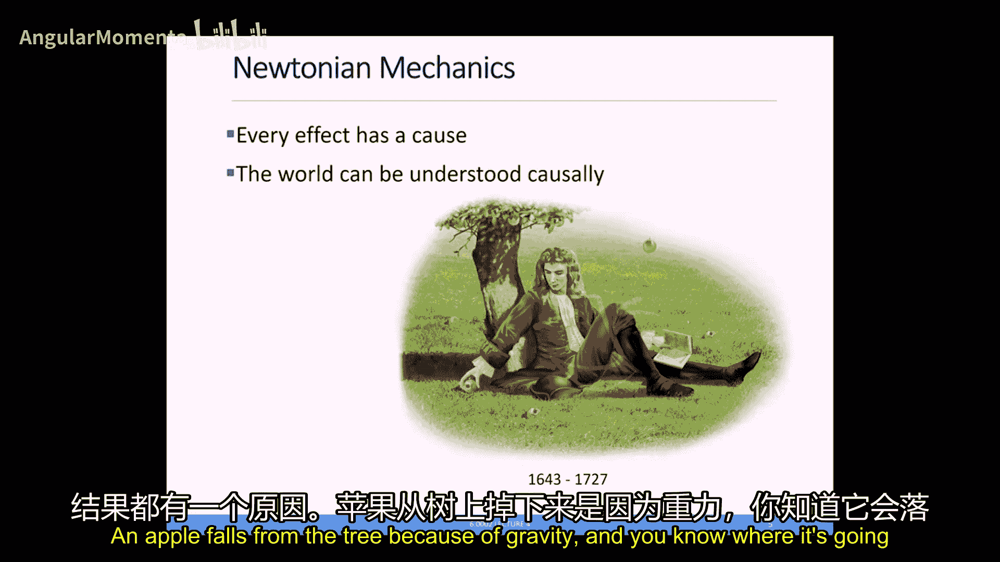

And people believe this really， for quite a long time。Most of history。

Until the early part of the 20th century。

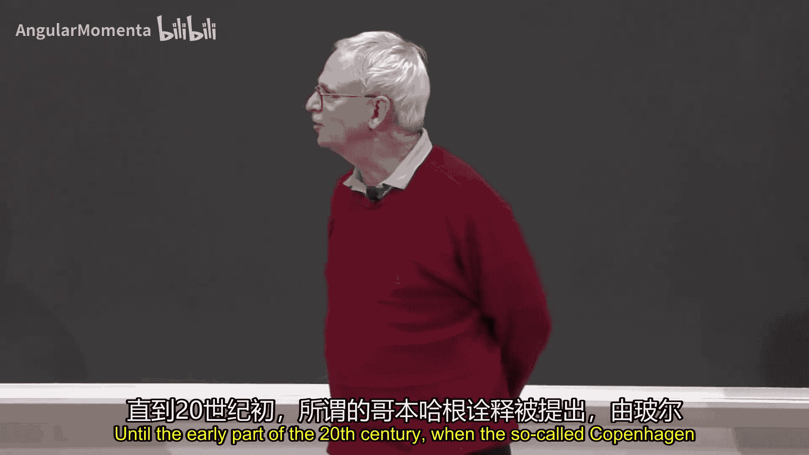

When the so- called Copenhagen doctrine。Was put forth。嗯。The doctrine there from Bor in Heisenberg。

 two very famous physicists。Was one of what they called causal nondeminism。

And their assertion was that the world。At its very most fundamental level。呃。

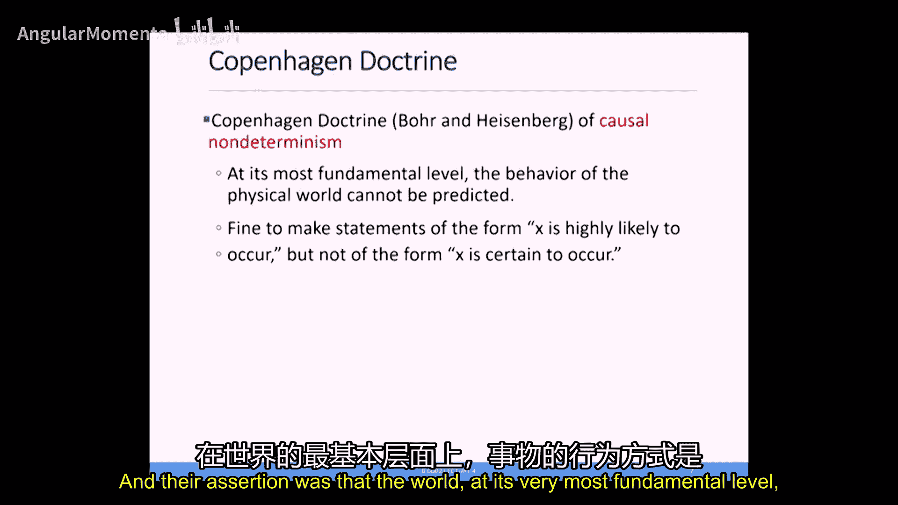

Behaves in a way that you cannot predict。It's O to make a statement that X is highly likely to occur。

 almost certain to occur。But for no case， can you make the statement X will occur。

Nothing has a probability of one。This was。Hard for us to imagine today when we all know quantum mechanics。

 But at the turn of the century， this was a shocking statement。

 And two other very well known physics physicists， Albert Einstein and Schrozeninger basically said。

 no， this is wrong。 Bo Heisenberg。 you guys are idiots。 It's just not true。

They probably didn't call the idiots。And this is most exemplified by Einstein's famous quote that God does not play dice。

Which is indicative of the fact that this was actually a discussion that permeated not just the world of physics。

 but society in general， people。Really turned it into literally a religious issue， as did Einstein。

Well， so now we should ask the question， does it really matter？And to illustrate that。

 I need two coins。 I forgot to bring any coins with me。Does anyone got a coin they can lend me。

All right。Now， this is where I see how much the students trust me。 Do I get a penny。

Do I get a silver dollar？ Alright， so what have we got here。All right。

This is someone who's entrusting me with two quarters， Not so bad。

So we'll take these two quarters and we'll shake them up， and we'll put them down on the table。

And now we'll ask a question。Do we have two heads， two tails or one head and one tail。

So who thinks we have two heads。Who thinks we have two tails。Who thinks we have one of each。

All right。 Well， clearly， everyone excepts a few people， for example。

 the Indians fan who clearly believe in the counterfactual。Made the most probabilistic decision。But。

 in fact， there's no nondeterminism here。I know the answer， right。And so in some sense。

 it doesn't matter。Whether it's deterministic， because， in fact。

 it's not causally non deterterministic。 The answer is quite clear。But you don't know the answer。

And so。Whether or not the world is inherently unpredictable。

The fact that we never have complete knowledge of the world。

Suggest that we might as well treat it as inherently unpredictable。Okay。

 and so this is called predictive nondeminism。And this really is what's going to underline pretty much everything else we're going be doing here。

All right。No comments about that， al right。I wouldn't do that to you。Yeah。Thank you。😊。

I know you're wishing to get an interest on the money， but you don't get any。Yeah， all right。

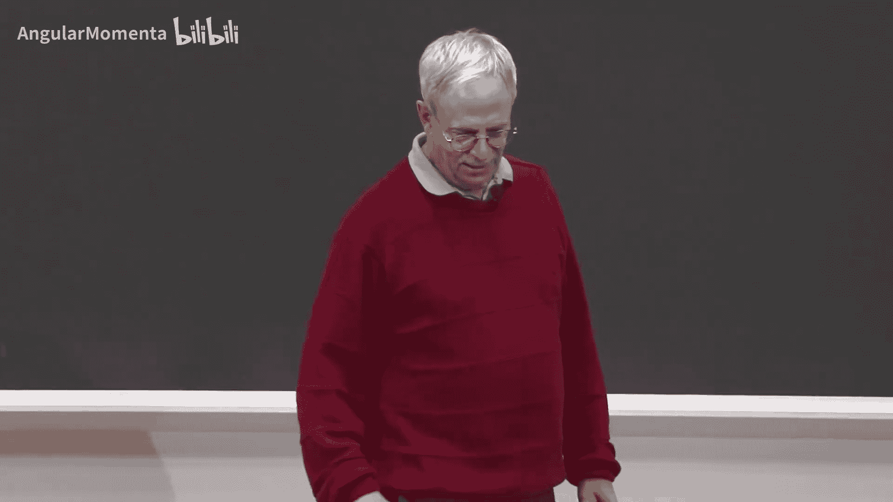

What was that？All right。So when we think about nondeminism in computation。

 we use the word stochastic process。And that's any process that's ongoing in which the next state depends upon the previous states in some random element。

So typically， up till now， when we've written code。

What one line of code did depended only on what the previous lines of code did。

 There was no randomness。Here， we're going to have randomness。

And we can see the difference if we look at these two specifications of rolling a die。

The first one returns that int between 1 and 6。Is what I'll call unders determined。By that， I mean。

 you can't tell what it's going to return。Maybe it will return a different number each time you call it。

But it's not required to。 Maybe it will return 3 every time you call it。

The second specification requires randomness。It says it returns a randomly chosen in。

 So it requires a stochastic implementation。Alright。

 let's look at how we implement a random process in Python。We start by importing the library random。

This is not to say you can report any random library you want。

 It's to say you report the library called randomandom。 me get my pen out of here。

And we'll use that a lot。 And then we're gonna use the function in random， called random dot choice。

It takes as an argument， a sequence。 in this case， a lift。

And randomly chooses one member of the list。And it chooses it uniformly。It's a uniform distribution。

And what that means is that。

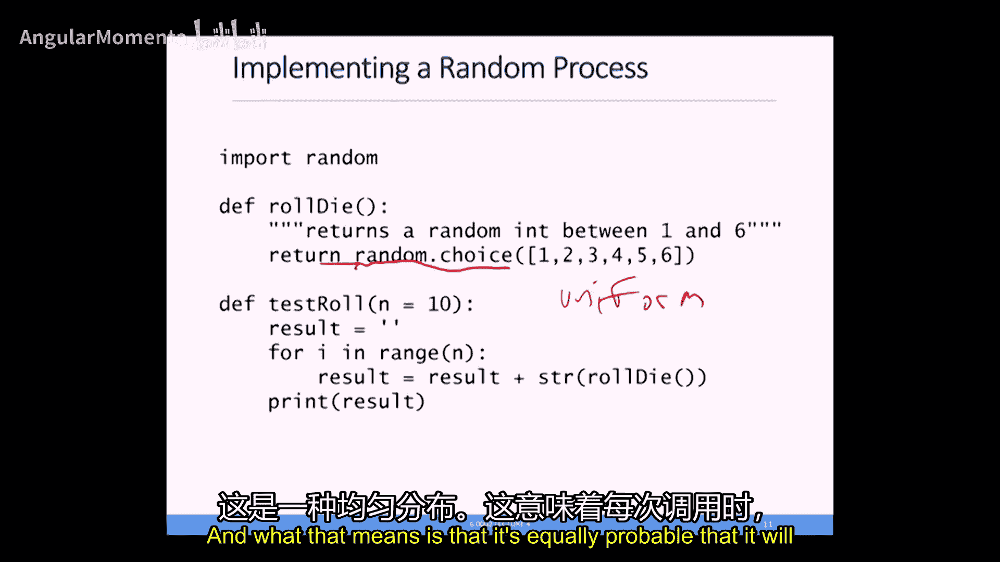

It's equally probable that it will choose any number in that list each time you call it。

We'll later look at distributions that are not uniform。

 not equally probable where things are weighted。But here， it's quite simple。 It's just uniform。

And then we can test it using this test roll， take some number of n。

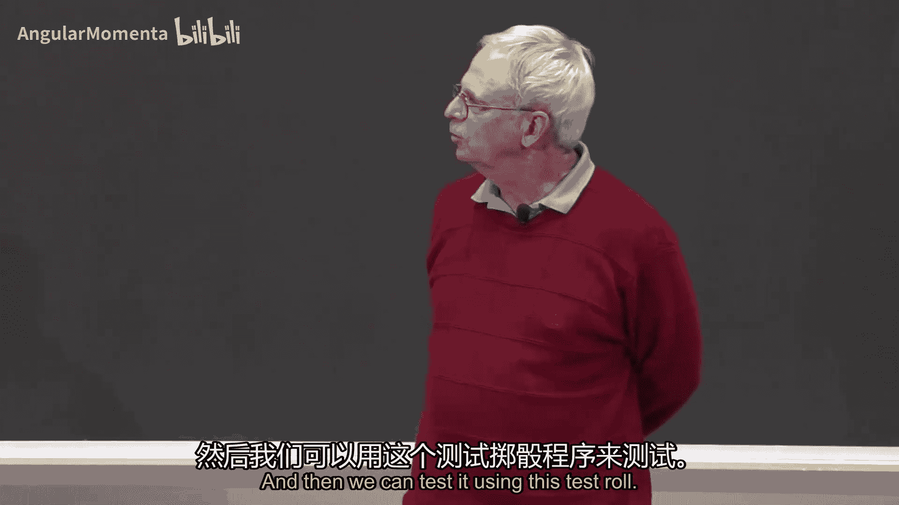

And rolls the dive at many times， and creates a string。Telling us what we got。

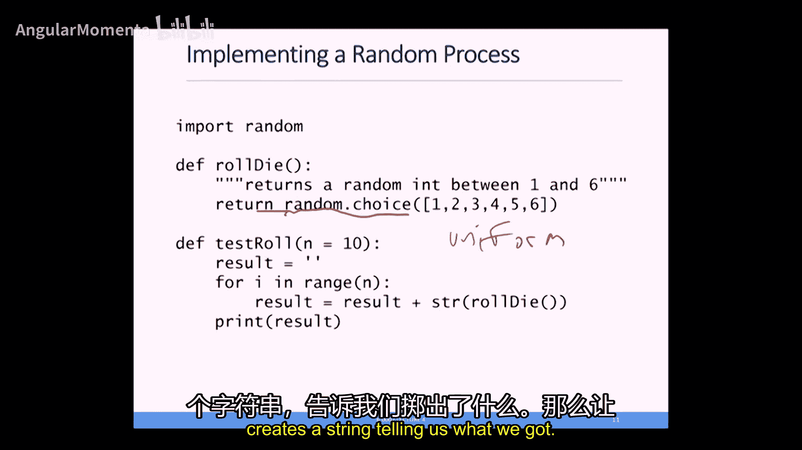

So let's consider running this on， say， test roll of  five。

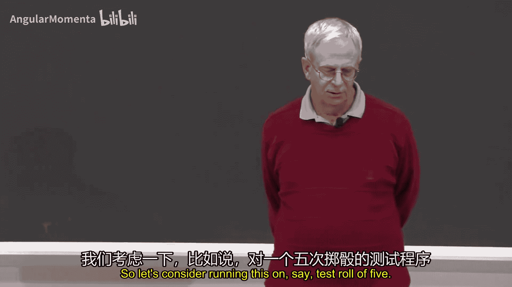

And we'll ask the question， if we run it， how probable is it。

That it's going to return a string of 5 ones。How do we do that？ Now。

 I know how many people here are either in 60，4，1 or have taken 6，0，4，1。 Raise your hand。Oh， good。

 So very few of you know probability。 That helps。Alright， so how do we think about that question。

Well， probability。To me， at least， is all about counting。Especially discrete probability。

 which is what we're looking at here。What you do is you start by counting the number of events that have the property of interest。

And the number of possible events and divide one by the other。

So if we think about rolling a die five times。We can enumerate all of the possible outcomes of five roles。

So if we look at that。What are the outcomes， Well， I could get 5 ones。I could get five ones。

4 ones and a two or four ones in a three。Skip a few。 The next one would be three ones， a2 and a1。

 then a2 and a2。 And finally， at the end， all sixes。

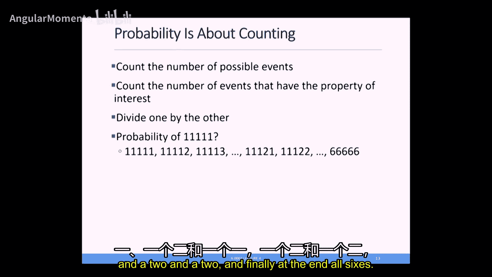

Right。So。Remember， we look before at。When we're looking at optimization problems about binary numbers。

And we said， we could look at all the possible choices of items in the knapsack。

By vector of zeros and ones。 We said how many possible choices are are there。 Well。

 it depended on how many binary numbers you could get in that number of digits。Well。

 here we're doing the same thing。 But instead of base 2， it's base 6。And so。

The number of possible outcomes of five roles is quite high。How many of those are five ones。

 only one of them， right。

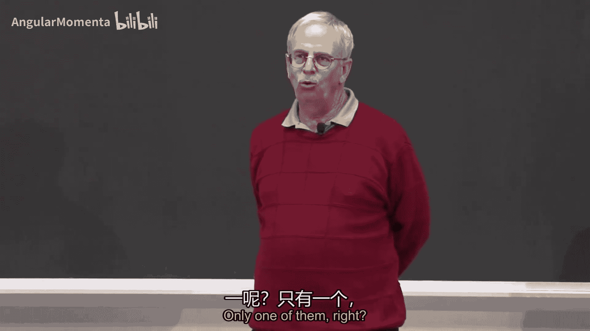

So in order to get the probability of five ones。I divide  one by 6 to the fifth。

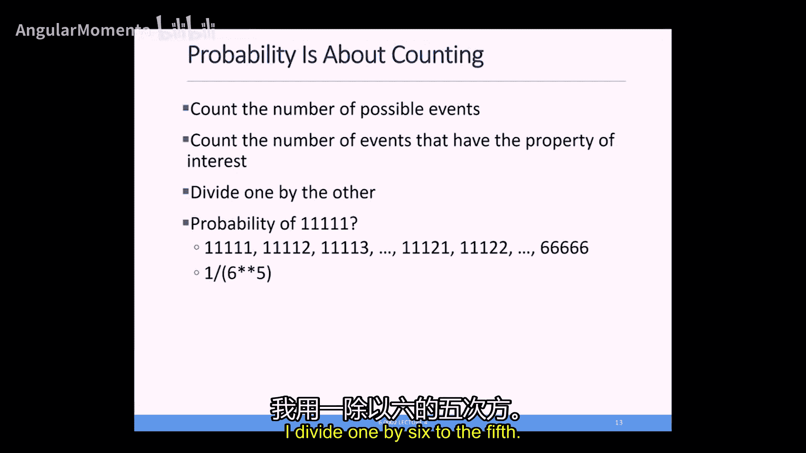

Does that make sense to everybody。So， in fact， we see it's highly unlikely。

Probability of five runs is quite small。And suppose we were to ask about the probability of something else。

Instead of 5，1， say 5，3。For2，1。

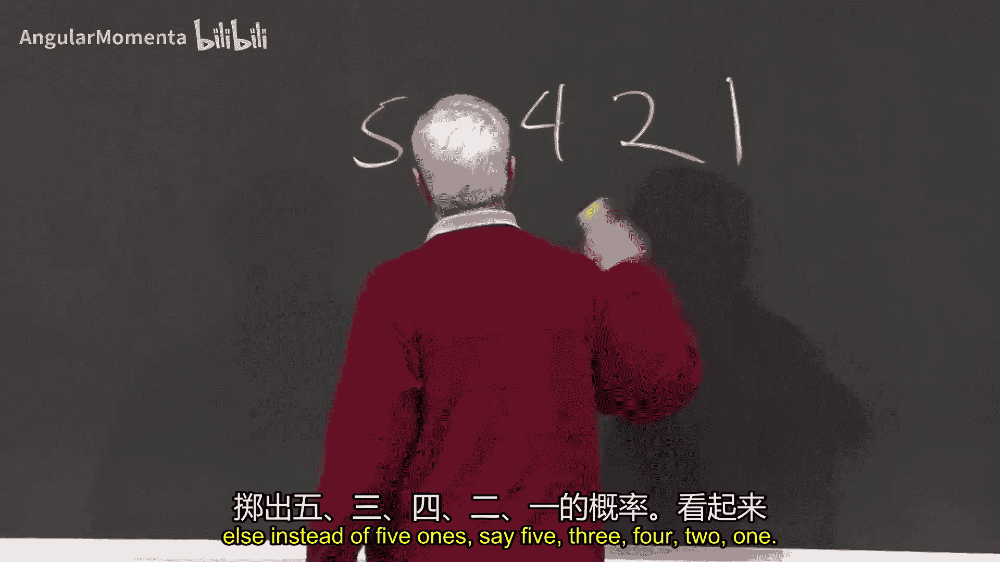

It kind of looks。More likely than that than five ones in a row。 But of course， it isn't， right。

Any specific combination is equally probable。And there are a lot of them。So。

This is all the probability we're going to think about。

 We could think about this way as simply a matter of counting， the number of possible events。

The number of events that have their property of interest。

 in this case being all ones and then simple division。Given that framework。

 there are three basic facts about probability we're going to be using。A lot of。So， one。

Probabilities。Always range from 0 to one。How do we know that？ Well， we've got a fraction， right。

And we， the denominator is all possible events。The numerator is the subset of that。

 that's of interest。So。It has to range from 0 to the denominator。

And that tells us that the fraction has to range from 0 to 1。So one says it's always going happen 0。

 never。So if the probability of event occurring is P， what's the probability of it not occurring。

This follows from the first bullet。It's simply going to be。1 minus P。This is a trick that we'll find。

 We use a lot。Because it's often the case when you want to compute the probability of something happening。

It's easier to compute the probability of it's not happening and subtract it from one。

And we'll see an example of that， later today。Now， here's the biggie。

When events are independent of each other。The probability of all of the events occurring is equal to the product。

Of the probabilities of each of the events occurring。

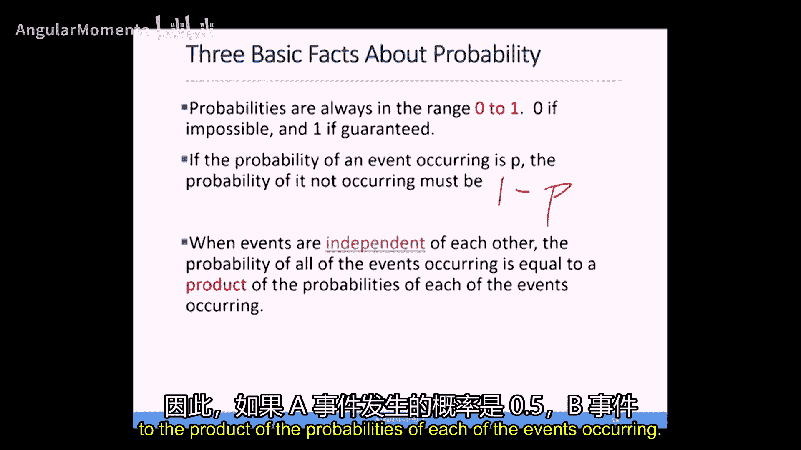

So。

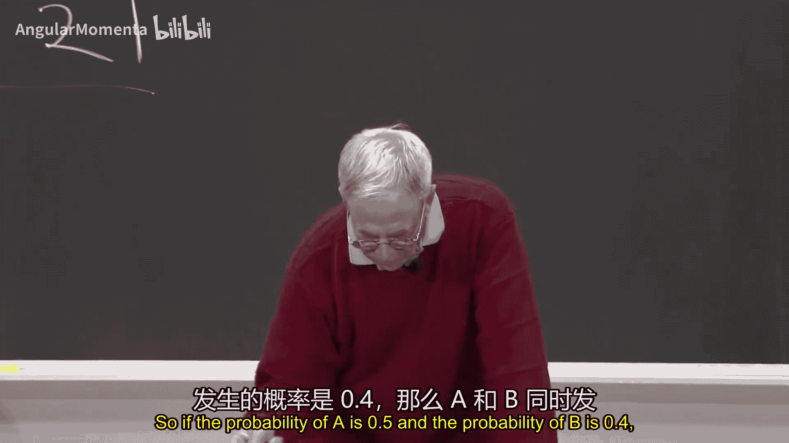

If the probability of。A。Is 05。 And the probability of B。Is 。4。The probability of A。And B。Is what。

Po5 times 0。4。 You guys can figure that out。I think it's  point2。So you'd expect that， right。

 that It should be much smaller than either of the first two probabilities。

This is the most common rule。 It's something we use all the time in probabilities。

 It's so calledled multiplicative law。We have to be careful about it， however。

In that it only holds if the events are actually independent。Two events are independent。

If the outcome of one has no influence in the outcome of the other。

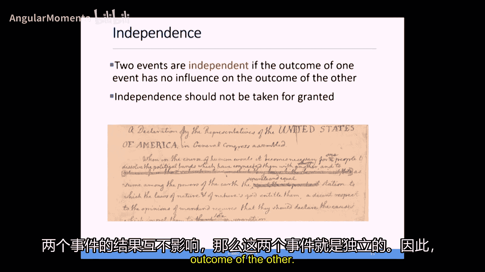

So when we roll the die， we assume that the first role。

 the outcome was independent of the the second role was independent of the first role。

 independent of the fourth role。When we looked at the two coins。

 we assume that heads and tails of each coin was independent of the other coin。I didn't， for example。

 look at one coin and make sure that the other one was different。

The danger here is that people often compute probabilities。

 assuming independence when you don't actually have independence。So let's look at an example。

For those of you familiar with American football， the New England Patriots and the Denver Broncos are two prominent teams。

And let's look at computing the probability of one of whether one of them will lose on a given Sunday。

So the patriots have a winning percentage of 7 of 8。 They've won seven of their eight games so far。

 and the Broncos，6 of 8。The probability of both winning next Sunday。

 we assuming that this is indicative of how good they are we can get with the multiplicative rule。

So it's 7 over 8 times 6 over 8 or 42 over 64。We could simplify that fraction， I suppose。Alright。

 if that makes sense。So this is probably a pretty good estimate。Of both of them winning next Sunday。

So the probability of at least one of them losing。Is  one minus that。

So here's an example of why we often use the one minus rule， right。

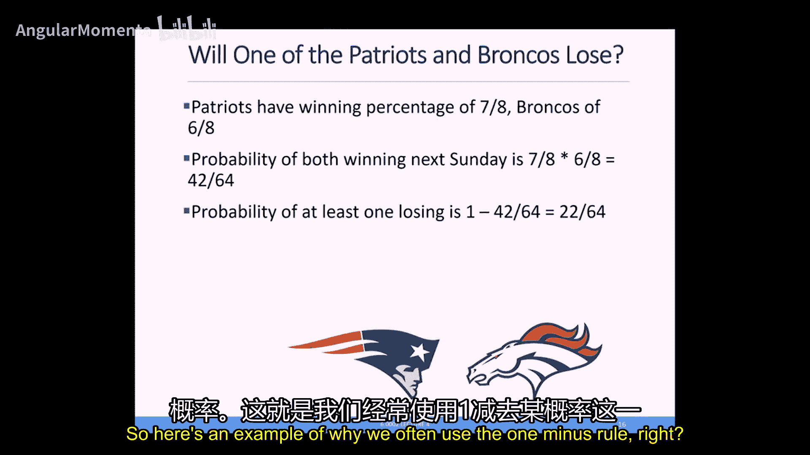

Because we could compute the probability of both of them。Winning by simply multiplying。We。

 and we subtract that from one。However， what about Sunday， December 18， What's the probability。Well。

 as it happens。That day， the patriots are playing the Broncos。So now， suddenly。

 the outcomes are not independent。The probability of。

One of them losing is influenced by the probability of the other winning。Right。

 so you would expect the probability of one of them losing is much closer to one than 22 over 64。

 which is about a third。Alright， so。In this case， it's easy。 But as we'll see。

 as we get through the term， there are lots of cases where you have to work pretty hard to understand whether or not two events really are independent。

And if you get it wrong， you get a totally bogus answer， right。

 A third versus one is a pretty big difference。By the way。As it happens。

 the probability of the Broncos losing is about one。All right。Well， let's。Let's go look at some code。

嗯。

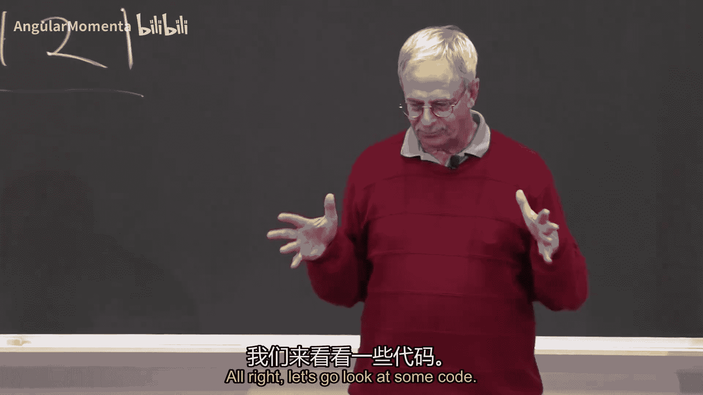

And we'll go back to our dice because it's much easier to simulate dice games than it is to simulate。

Football games。嗯。So here itative。 And we're going to talk a lot about simulations。

So here rather than rolling the dye， I've written a program to do it。

We've already seen the code for rolling a die。And so， to run the simulation。Typically。

 what we're doing here is I'm giving you the goal。For example， are we going to get5 ones。

The number of trials。Each trial。In this case， will be， say， of length 5。

 So I'm going to roll the same die five times。Say，1000 different times。

And then just some text as to what I'm going to print。Almost all the simulations we look at。

Are going to start with lines that look a lot like that。We're going to initialize some variable。

And then we're going to run some number of trials。So， in this case。

We're going to get from the length of the goal。 So if the goal is5 once。

 then we're going to roll the die  five times that 10 runs。 We' roll the eye 10 times。

So this is essentially one trial。One attempt， right？And then， we'll check the result。

And if it has the property we want， in this case。It's equal to the goal。

 Then we're going to increment the total， which we initialized up here by one。So it'll keep track。

 which is just the counting。 The number of trials that actually meet the goal。And then。

 when we're done。What we're going to do is divide the number that met the goal。

By the number of trials。Exactly the counting argument we just looked at。And then。

 we'll print the result。Almost every simulation we look at is going to have this structure。

Therell be an outer loop， which is the number of trials。And then inside。

 maybe we'll have a loop or maybe it won't will be a single trial。Will'll sum up the results。

 and then we'll divide by the number of trials。Alright， let's run it。All right。So。

A couple of things are going to go on here。 If you look at the code。As we've looked at it before。

 what you're seeing is I'm computing the estimated probability by the simulation。

And I'm comparing it to the actual probability， which we've already seen how to compute。

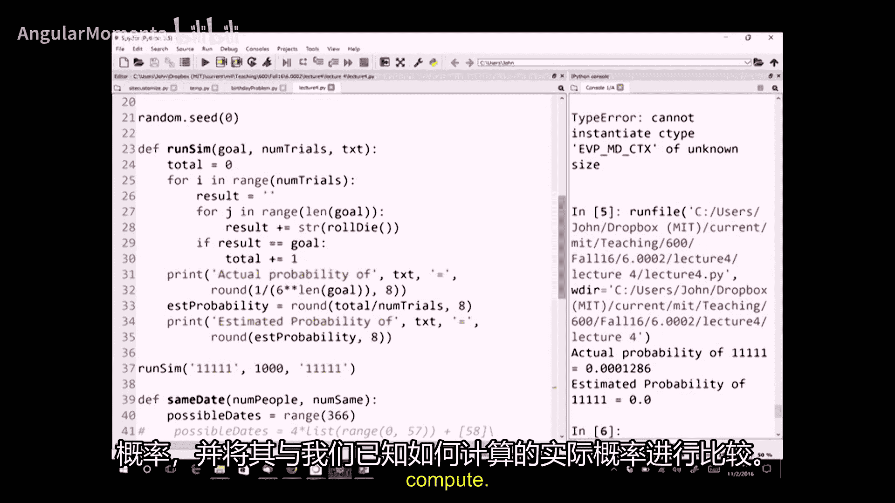

So if you look at it， there are a couple of things to look at。呃。

The estimated probability is pretty close to the actual probability， but not the same。

Let's go back to the PowerPoint。

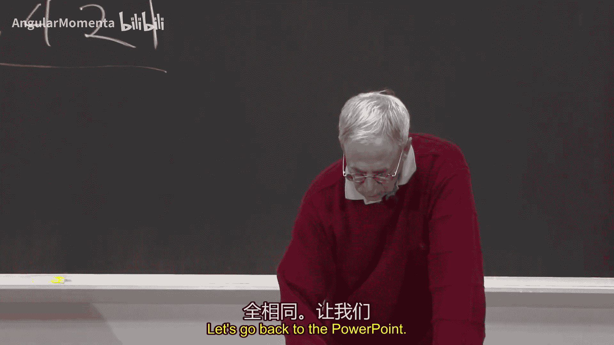

Here are the results。And。There are at least two questions raised by this result， first of all。

How did I know that this is what would get printed。

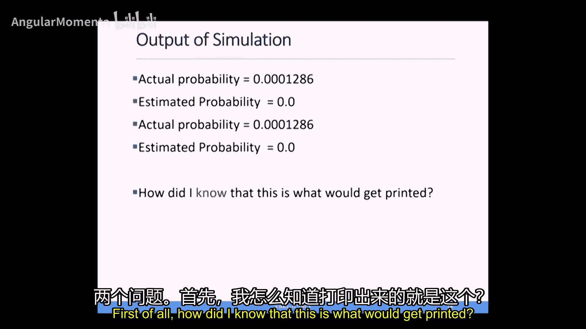

Remember， this is random。How did I know that the estimate， Well。

 there's nothing random about the actual probability。But。

How did I know that the estimated probability would be 0。And why did it print it twice。

 Because I messed up the PowerPoint anyway rate。So how do I know what would get printed。Well。

A confession。Random。Thatt。Choice is not actually random。 In fact。

 nothing we can do in a computer is actually random。

You can prove that it's impossible to build a computer that actually generates truly random numbers。

What they do， instead。

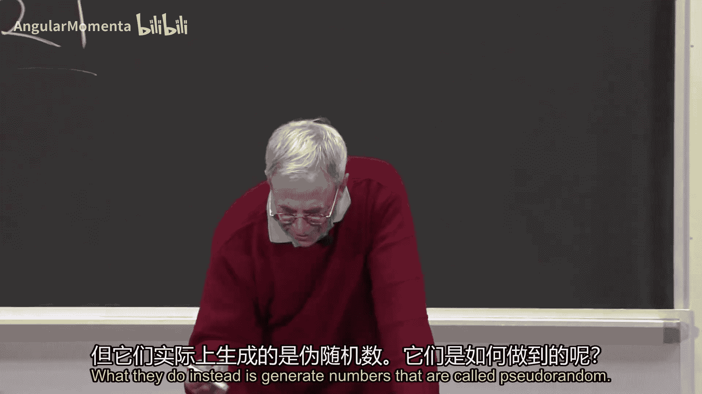

Is generate numbers that are called pseudo random。How do they do that？They have an algorithm。

That given one number generates the next number in a sequence。

And they start that algorithm with a seed。Now， typically。

 they get that seed by reading the clock of the computer。

So most computers have a clock that say keeps track of the number of microseconds since January 1。

1978。I don't know if that's still true。 That's what Uniunuch used to do。So the notion is。

 you start your program。 There's no way of knowing how many microseconds have elapsed。

And so you're getting a random number to start the process。Since you don't know where it starts。

 You don't know what the second number is。 You don't know what the third number is。

 You don't know what the fourth number is。And so it's predictably non deterministic because you don't know what the seed is going to be。

Now， you can imagine。That this makes programs really hard to debug。Every time you run it。

 something different could happen。Now， we'll see often you want them to be unpredictable。

 But for now， we want them to be predictable， makes it easier to prepare PowerPoint。So。

What you have if we go， is a command。You can call random。Got seed。And give it a value。And say。

 I don't want you to just choose some random seed。 I want you to use 0 as the seed。

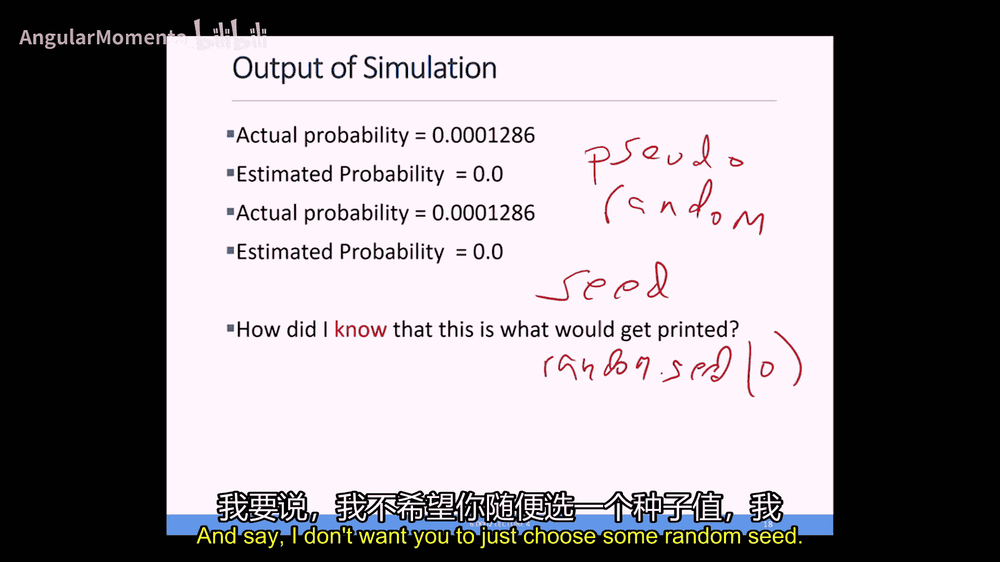

For the same seed， you always get the same sequence of random values。

And so what I've done is I set the seed to be， I think，0 in this case。

 not because there's anything magic about 0。 It's just sort of habit。😊，But it made it predictable。

As you write programs with randomness in。 and when you're debugging it。

 you will almost surely want to start by setting random dot seed to a value。

 So you get the same answer。But make sure you debug it with more than one value of this。

So you didn't just get lucky with your seed。 Alright。

 so that's how I knew would how what would get printed。The next question。

Is why did the simulation give me the wrong answer。The actual probability is 3，0s， and 1，2，8，6。

But it estimated a probability of 0。Why is it wrong？

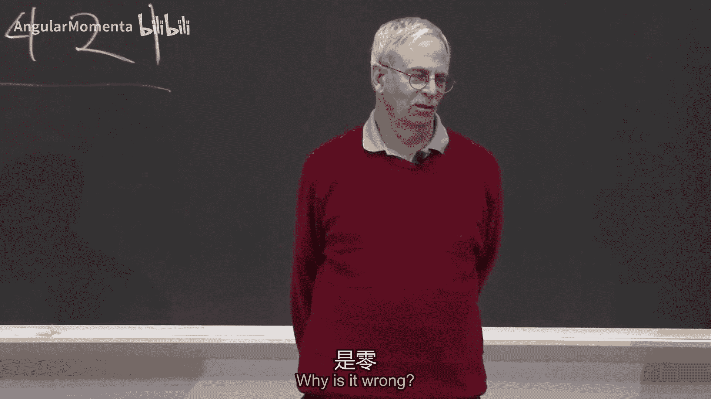

Well， let's think about this。I ran 1000 trials。What does it mean to say the probability is 0。

 It means it tried it a thousand times。And didn't ever get a sequence of51s。

So the numerator of the division at the bottom was zero。Hence， the answer is 0。 Is this surprising。

 Well， no。Because if that's the actual probability。Of getting five ones。

 it's not very shocking that in 1000 trials， I， it never happened， right。You。

 it's not a surprising result。And so we have to be careful when we run these things to understand the difference between what's in this case。

 an actual probability。And what statisticians call a sample probability。

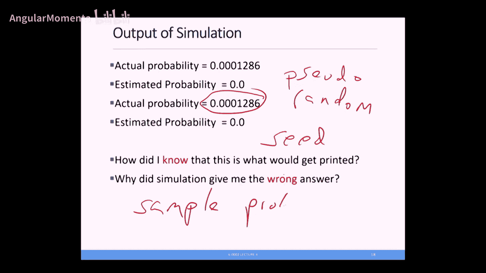

So what we got with the sample。Was 0。So what's the obvious thing to do。

If you're doing a simulation of an event and the event is pretty rare。

You want to try it on a very large number of trials。So let's go back to our code。

And we'll change it。To instead of 1000 a million。You can see up here， by the way。

 where I set their seed。Now， let's run it。We did a lot better。

If we look at here our estimated probability， it's 3，0s，1，2，8。

 still not quite the actual probability， but darn close。

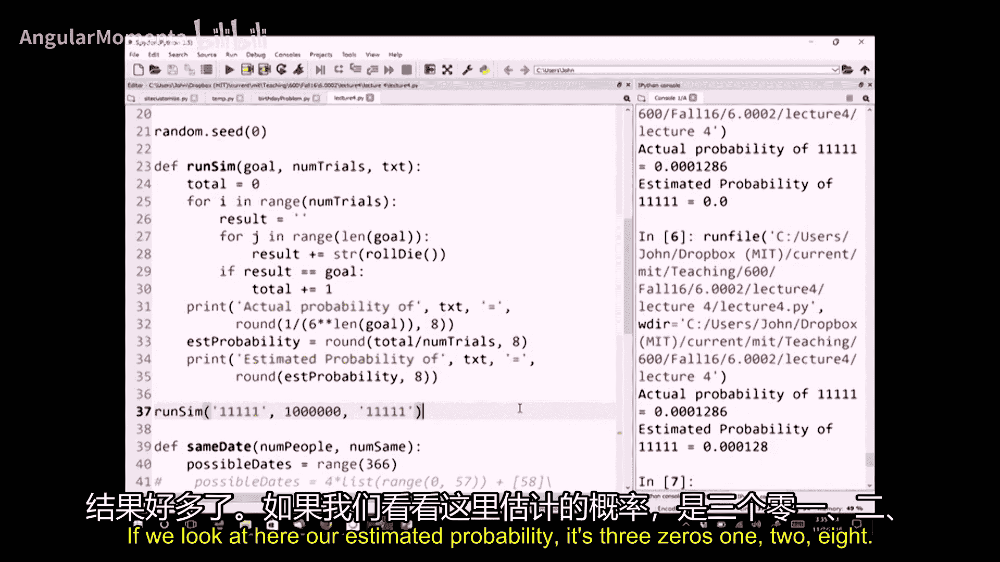

And maybe if I'd done 10 million， it would have been even closer。

So if you're writing a simulation to compute the probability of an event。

And the event is moderately rare。Then you better run a lot of trials before you believe your estimated probability。

In a week or so， we'll actually look at that more mathematically and say， what is a lot。

 How do we know what is enough。All right。What are the morals here， Mor 1， I've just told you。

 takes a lot of trials to get a good estimate。Of the frequency of a rare event。Moral 2。

We should always， if we're getting an estimated probability。

 know that and probably say that and not confuse it with the actual probability。

The third moral here is it was kind of stupid to do a simulation。Since it was a very simple。

 closed form answer that we could compute that would really tell us what the actual probability is。

 why even bother with the simulation。Well。We're going to see why now， simulations can be very useful。

Let's look another problem。This is the famous birthday problem。 Some of you have seen it。

 What's the probability of at least two people in a group having the same birthday。

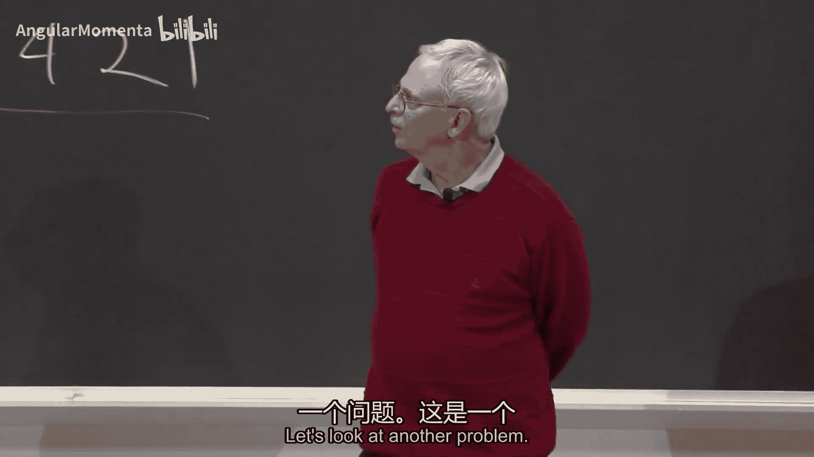

There's a URL at the bottom that's pointing to a Google form。 I'd like， please。

 all of you have a computing device to go to it and fill out your birthday。😊。

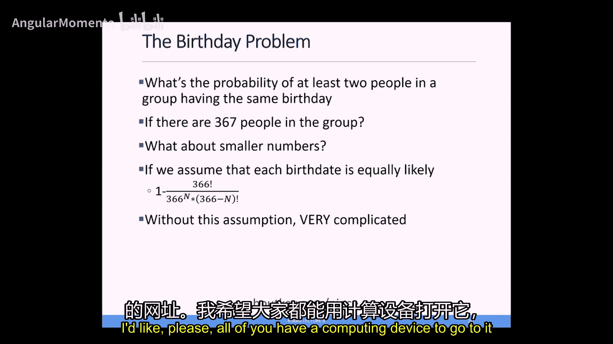

Its， it's anonymous。 so we won't know how old you are。 Don't worry， Actually， it's only the date。

 It's not the year。

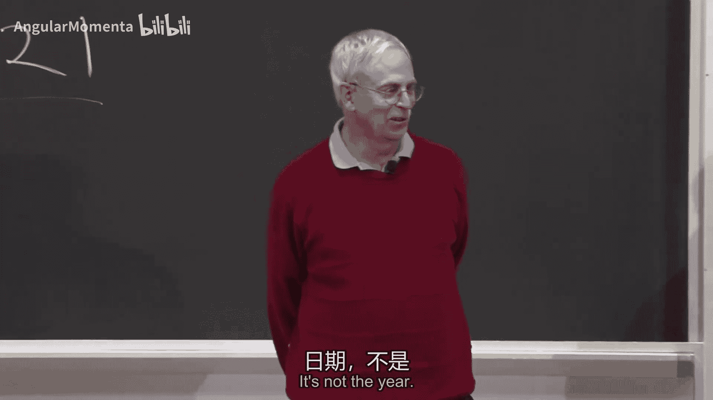

All right。So。Suppose there were 367 people in the group。

Roughly the number of people who took the 6 triple，0，1，600 midterm。Alright， if there are 367 people。

 what's the probability of at least two of them sharing a birthday。1。

By something called the pigeonhole principle， right。You got some number of holes。

 And if you have more pigeons than holes， two pigeons have to share a hole。

What about smaller numbers。Well， if we make a simplifying assumption。

That each birth date is equally likely。Then there's actually a nice closed form solution for it。

Again， this is a question where it's easier to。Compute the opposite of what you're trying to do and subtract it from one。

And so this fraction is giving the probability of two people not sharing a birthday。

The proof that this is right is a little bit elaborate。But。You can trust me， it's accurate。

But it's a formula。 and it's not that complicated a formula。

 though numbers like 366 factorial are big。All right。So let's approximate a solution。

 We'll write a simulation and see if we get the same answer that that formula gave us。

So here's the code for that。2 arguments， the number of people in the group。And the number。

That we asking， do they have the same birthday。So since I'm assuming for now that every birthday is equally likely。

 the possible dates range from 1 to 366。Because some years have a February 29。

I'll keep track of the number of people born in each date。By starting with none。

And then for P in the range of number of people。I'll make a random choice of the possible dates。

And increment that element of the list by one。And then at the end， we can say。

 look at the maximum number of birthdays。And see if it's greater than or equal to the number of same。

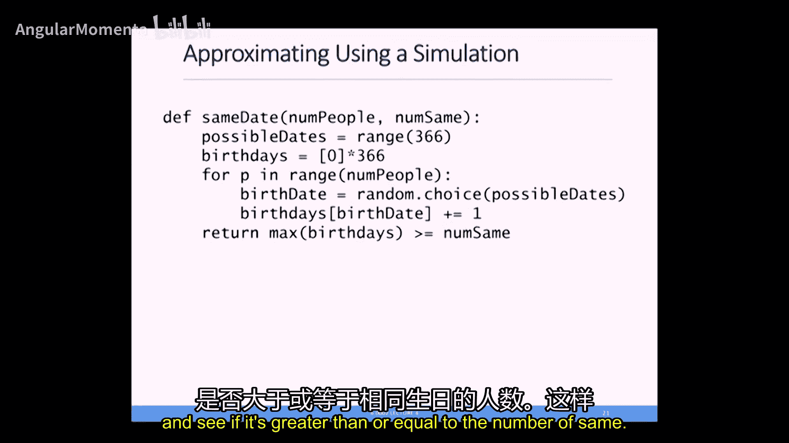

So， that tells us that。And then we can actually look at the birthday problem， number of people。

 the number of same and as usual， the number of trials。

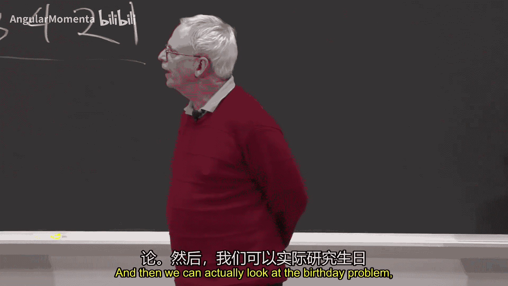

So number of hits is 0 for T and range number of trials。 If same data is true。

Then we'll increment the number of hints by one and then， as usual， divide by the number of trials。

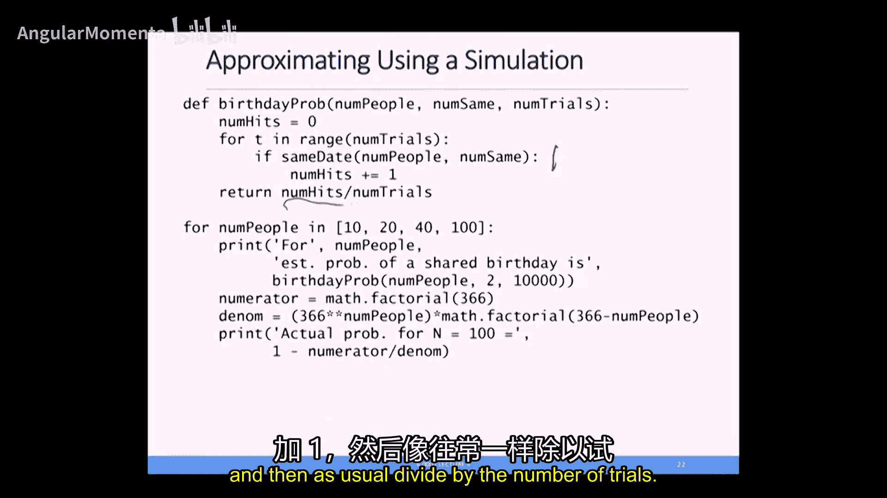

And we'll try it for people in for 1020。

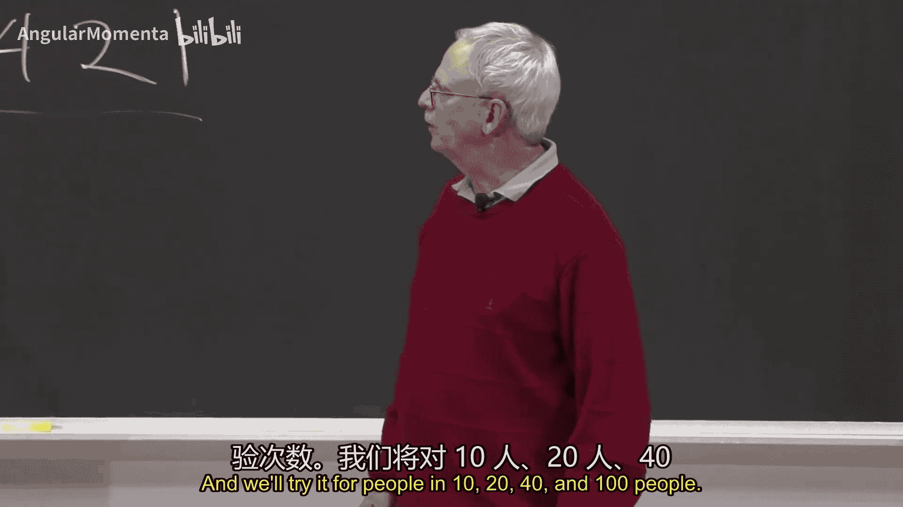

40 and 100 people。And then just will print the estimated probability and the actual probability。

Computed。Using that formula I showed you， I've not shown you。

 but I've imported a library called math。Because it is a factorial implementation that's way faster than the recursive one that we've seen before。

All right， let's run it。And we'll see what we get。 So for 10， the estimated probability is 011。Now。

 so as you can see， the estimates。Are really pretty good。Once again。

 we have this business that for 100， we're estimating one when the real answer is point many， many。

 many9s。But again， this is sample probability。 just means in the number of trials we did。嗯。

Everyone one for 100 people， though was a shared birthday。

This is the number that usually surprises people。As to why with 100 people。

 the probability is so high。But we could work out the formula and see it。 And as you can see。

 the estimates are pretty good from my simulation。All right， now。Now。

 we're going to see why we did a simulation in the first place。

 Suppose we want the probability of three people sharing a birthday instead of two。

It's pretty easy to see how we change the simulation， right， I even made it a parameter。

 I just changed the number 2 to a number 3。The math， on the other hand。Is ugly。

Why is the math so much uglier for three than for two。Because for two。The complementary problem。

 the number we're subtracting from one。Is simply the question of， are all birthdays different。So。

Did two people share a birthday as 1 minus or off。 Does everybody have a different birthday。

On the other hand， for three people。The complementary problem is a complicated disjunc。

 a bunch of oars。 Either all birthdays are distinct。Or two people share a birthday。

 and the rest are distinct。Or。There are two groups of two people sharing a birthday。

 and everything is distinct。So you can see here theres a lot of possibilities。

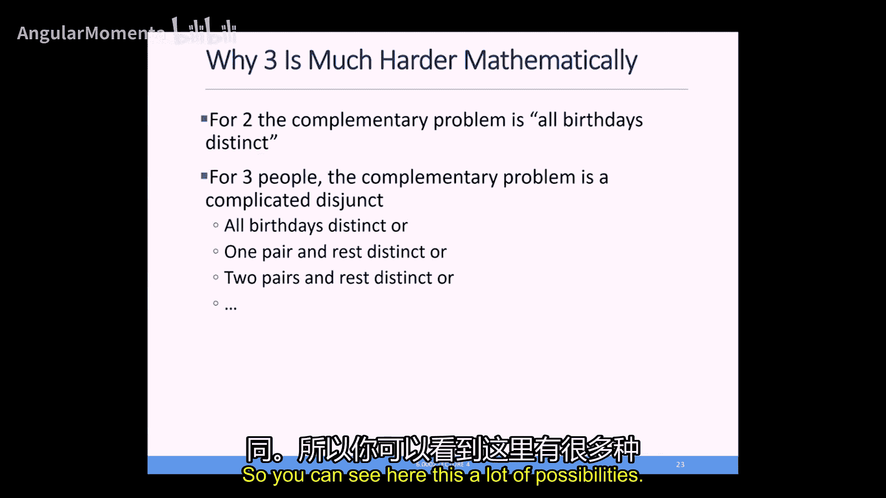

And so it's 1 minus now， a very complicated formula。And in fact， if you try and look how to do this。

 most people will tell you， don't bother。 here's a kind of a good approximation。

But the math gets very hairy。In contrast， changing the simulation is dead easy。We can do that。Whoops。

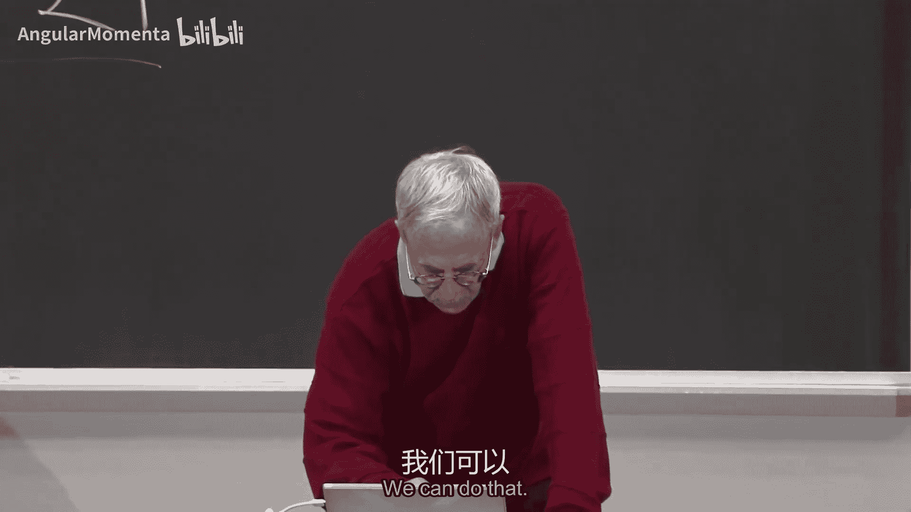

So if we come over here for the code。All I have to do is change this 2 to a three。

And I'm going to leave in this code， which is the wrong code， the computing。

 the actual probability now for。Two people sharing rather than three。

 because I want to make it easy for you to see the difference between what happens when we look at three shared rather than two shared。

And I get invalid syntax。That's not good。That's what happens when I type in real time。

Why do I have invalid syntax？Pdon。One person at Anna。Oh。That's not a good line。So， now we see。

That if we get， say to n equals 100。For two， you'll remember it was 0。99， but for 3， it's only 0。63。

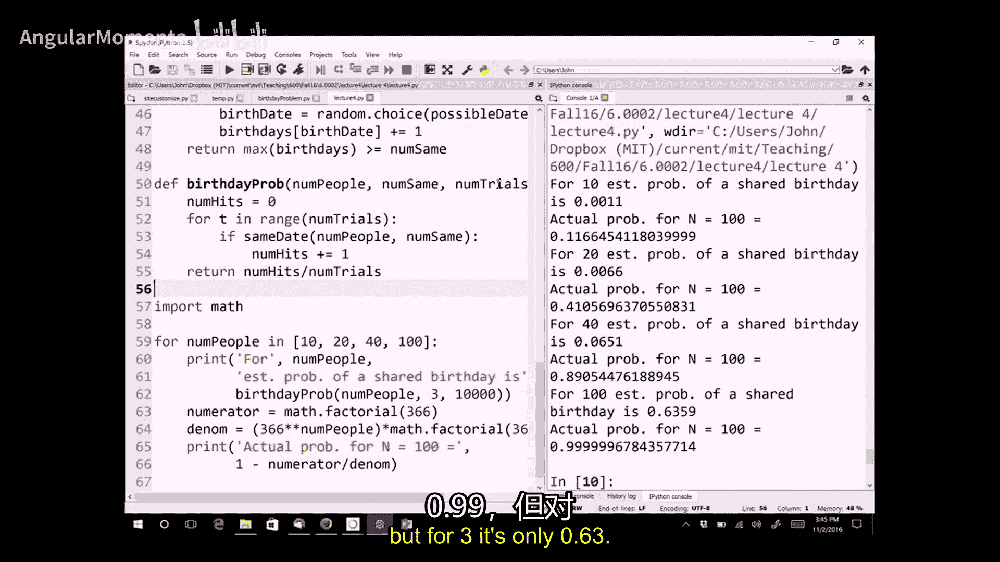

So， we see going from。2 sharing to three sharing gets us a radically different answer。

Not surprisingly。But we also， and the real thing I wanted you to see is how easy it was to answer this question with the simulation。

And that's。A primary reason we use simulations to get probabilistic questions。

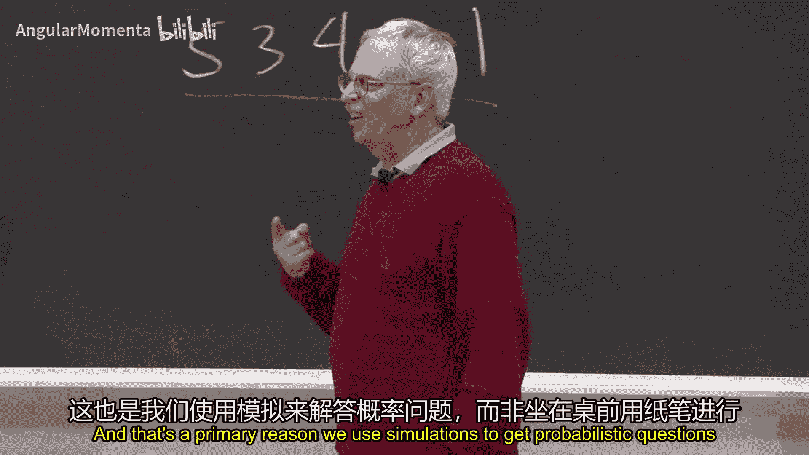

Rather than sitting down in the pencil on paper and doing fancy probability calculations。

Because it's often ways easier to do a simulation。We can see that in spades if we look at the next question。

Let's think about this assumption that all birthdays are equally likely。Well， as you can see。

 this is a chart of how common birth dates are in the US， a heat map。And。You'll see， for example。

 that February 29 is quite an uncommon birthday。So we should probably treat that differently。

Somewhat surprisingly， you'll see that July 4 is a very uncommon birthday as well。

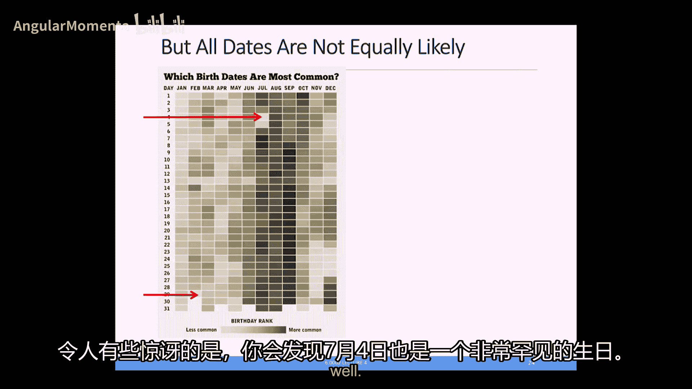

It's easy to understand why February 29。The only thing I can figure out for July 4 is obstetricians don't like working on holidays。

And so they induce labor sometime around the second or so of the third。

 So they don't have to come to work on the  fourth of the fifth。Founds a horrible thought。

 but I can't think of any other explanation for this anomaly。You'll probably if you look at it。

 see Christmas Day is not so common either。U。So now the question which we can answer since you've all filled out this form is。

 how exceptional are M I T students。We like to think that you're different in every respect。

So are your birthdays distributed differently。Than other dates。 Have we got that data。All right。

 so now we'll go look at that。We should have a heat map for you guys。This one。Thank you。Yeah。

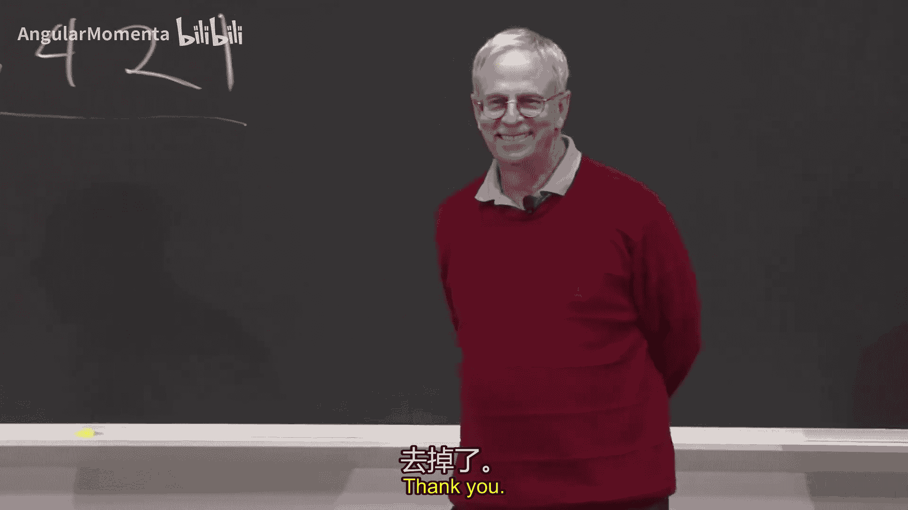

All right， so here it is。And we can see that。Well， they don't seem to be banded quite as much in。

 in the summer months。Probably says more about your parents than it does about you。嗯。

But you can see that， indeed， we do have。Wow， we've。

A day where there are five birthdays that look like or no。Wow！😮。

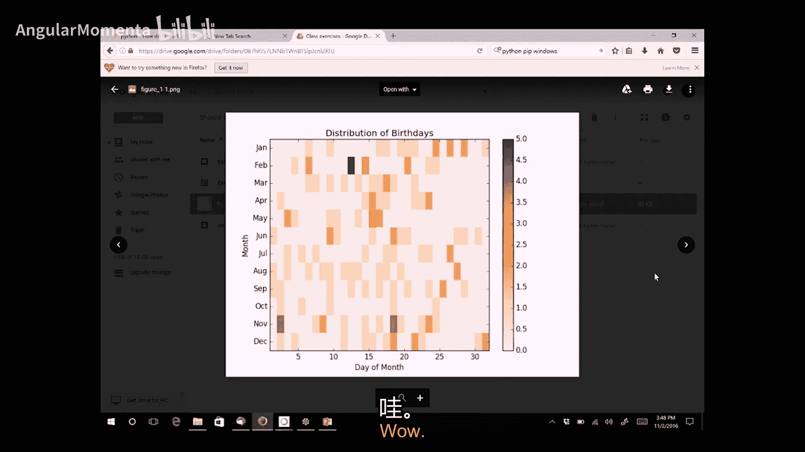

You want to raise your hand if you're born on February 12。啊哈。All right。

 so you are exceptional that you lie about when you're born。But。If you hadn't lied。

 I think we would have still seen the probabilities would hold。How many people were there do we know？

Hred and 46 people，1 and 12 unique birthdays。 So indeed。The probability does work。Okay。

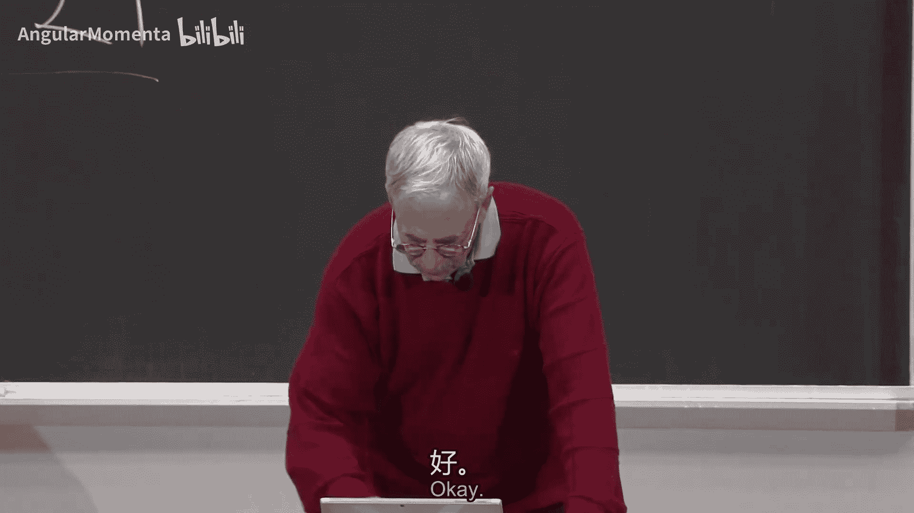

So we know you're exceptional in a funny way， well。

You can imagine how hard it would be to adjust the analytic model。

To account for a weird distribution of birth dates。But again， adjusting the simulation model is easy。

I could have gone back to that heat map I showed you of birthdays in the US and gotten a separate probability for each day。

 but I was too lazy。And instead， what I observed。Was that we had this。A few days， like February 29。

 highly unlikely。And。This band in the middle。Of people who were conceived in the late fall and early winter。

So what I did。Is I duplicated some dates。So the 58th day of the year， February 29， occurs only once。

The dates before that， I said， let's pretend they occur four times。

 What only matters here is not how often they occur， but the relative frequency。And then。

The dates after that occur four times， except for the dates in that band。

 which has going to have occur yet more often。So now， and don't worry about the exact details here。

But what I'm doing is simply adjusting the simulation to change the probability of each date getting chosen。

By same date。And then I can run the simulation model。 And again， with a very small change to code。

I've modeled something that's mathematically， enormously complex。

I have no idea to actually do this probability。Mathematically。But the code is， as you can see。

 quite straightforward。So let's go to that here。So what I'm going to do is comment this one out。

And unment this more complicated。Set of dates。And see what we get。And again。

 it changes quite dramatically。 You might remember before it was around， I think，06。

 something for 100。 And now it's 075。So getting away from the notion that birthdays are uniformly distributed to saying some birthdays are more common than others。

 again， dramatically changes the answer。And we can easily look at that。

So that gets us to the big topic of simulation models。

It's a program that describes a computation that provides information about the possible behaviors of a system。

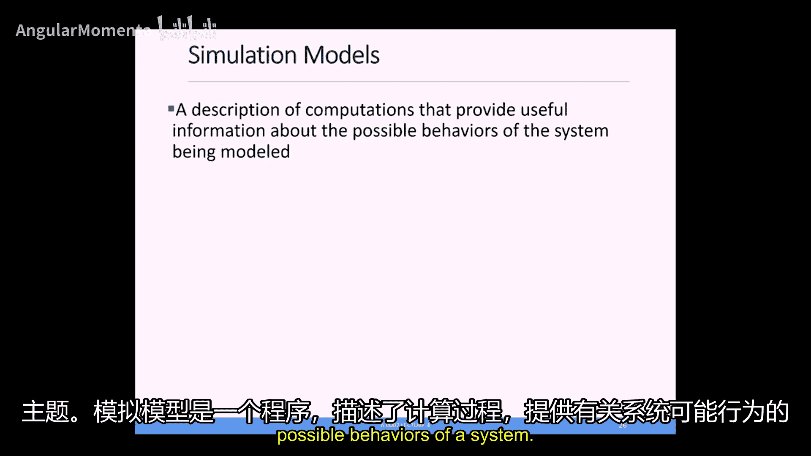

I say possible behaviors because I'm particularly interested in stochastic systems。

They're descriptive， not prescriptive。In the sense that they describe the possible outcomes。

They don't tell you how to achieve a possible outcomes。

This is different from what we looked at earlier in the course。

 where we looked at optimization models。So an optimization model。Is prescriptive。

It tells you how to achieve an effect。How to get the most value out of your knapsack。

How to find the shortest path from A to B in a graph。In contrast， a simulation model says。

 if I do this， here's what happens。It doesn't tell you how to make something happen。

So it's very different。 And it's why we need both。Why we need optimization models and we need simulation models。

We have to remember that a simulation model is only an approximation to reality。You know。

 I put in an approximation to the distribution of birth dates， but it wasn't quite right。

And as a very famous statistician， George Bach said， all models are wrong。But。

 some are actually very useful。In the next lecture。We look at a useful class of models。

When do we use simulations？Typically， as we've just shown to model systems that are mathematically intractable。

Like the birthday problem we just looked at。In other situations， to extract intermediate results。

 something that happens along the way to the answer。

And as I hope you've seen that simulations are used because we can play what if games by successively refining it。

We started with a simple simulation that assumed that we only asked the question of。

 do two people share a birthday。We showed how we could change it to ask do three people share a birthday。

We then saw that we could change it to assume。A different distribution of birth dates in。

 in the group。And so we can start with something simple。

 and we get it ever more complex to answer questions。 What if。

We're going to start in the next lecture by producing a simulation of random， of a random walk。

And with that， I'll stop and see you guys soon。

