# 【麻省理工】计算思维与数据科学导论-｜-MIT-6.0002-Introduction-to-Computational-Thinking，Fall2016-p06-6.-蒙特卡洛模拟--BV1zNjGzxEvk_p6-

The following content is provided under a Creative Commons license。

 Your support will help MiT OpenCoursewareare continue to offer high quality educational resources for free to make a donation or to view additional materials from hundreds of MiT courses。

 Visit mitopcourseourseware at Ow。mt。edduu。

Welcome to Lecture6。As usual， I want to start by posting some relevant reading。嗯。

For those of you who don't know， this lovely picture is of the。

Casino at Monte Carlo。And shortly， you'll see why we're talking about casinos， and gambling today。

Not because I want to encourage you to gamble your life savings away。

Li little history about Monte Carlo's simulation， which is the topic of today's lecture。

The concept was invented by the Polish Americanican mathematician， Stanoslav Ulam。啊。

Probably more well known for his work on thermonuclear weapons than non mathematics。

 But he did do a lot of very important mathematics earlier in his life。

The story here startss that he was ill， recovering from some serious illness and was home and was bored and was playing a lot of games of solitaire。

A game I suspect you've all played。Being a mathematician， he naturally wondered。

 what's the probability of my winning this stupid game， which I keep losing？

And so he actually spent quite a lot of time trying to work out the combinatorics so that he could actually compute the probability。

And despite being a really amazing mathematician， he failed。

The commoninatorques were just too complicated。So he thought， well。

 suppose I just play lots of hands。Count the number I win Divide by the number of hands I played。

And then he thought about and said， well， I've already played a lot of hands and I haven't won yet。

So it probably will take me years to play enough hands to actually get it a good estimate。

And I don't want to do that。So he said， well， suppose instead of playing the game。

 I just simulate the game on a computer。He had no idea how to use a computer。

 but he had friends in high places。And actually talk to John von Neuman。

Who is often viewed as the inventor of the stored program computer。And said， John。

 could you do this on your fancy new EnEAC machine？And on the lower right here。

 you'll see a picture of the EnAC。It was a very large machine， it filled a room。嗯。

And Von Neuman said， sure， we could probably do it in only a few hours of computation。Today。

 we would think of a few microseconds。But those machines were slow。

 hence was born Monte Carl's simulation。And then they actually used it in the design of the hydrogen bomb。

So it turned out to be not just useful for。Cards。So what is Monte Carlo simulation？

It's a method of estimating the values of an unknown quantity。

Using what is called inferential statistics。And we've been using inferential statistics for the last several lectures。

The key concepts。 And I want to be careful about these because we'll be coming back to them。

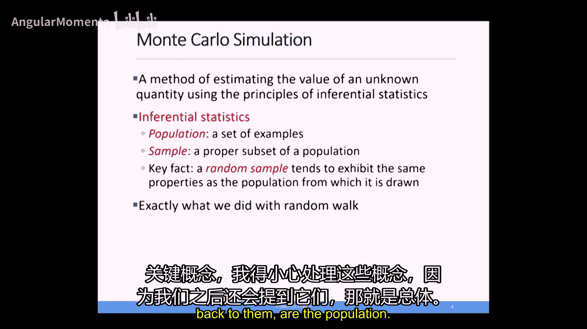

Of the population。So think of the population as the universe of possible examples。

So in the case of solitaire， it's a universe of all possible games of solitaire that you could possibly play。

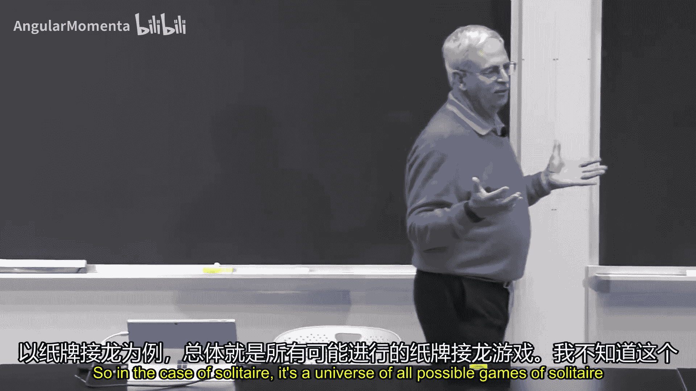

I have no idea how big that is， but it's really big。Then we take that universe， that population。

 and we sample it by drawing a proper subset。Proper means not the whole thing。

Usually more than one sample to be useful， certainly more than 0。

And then we make an inference about the population。

Based upon some set of statistics we do on the sample。

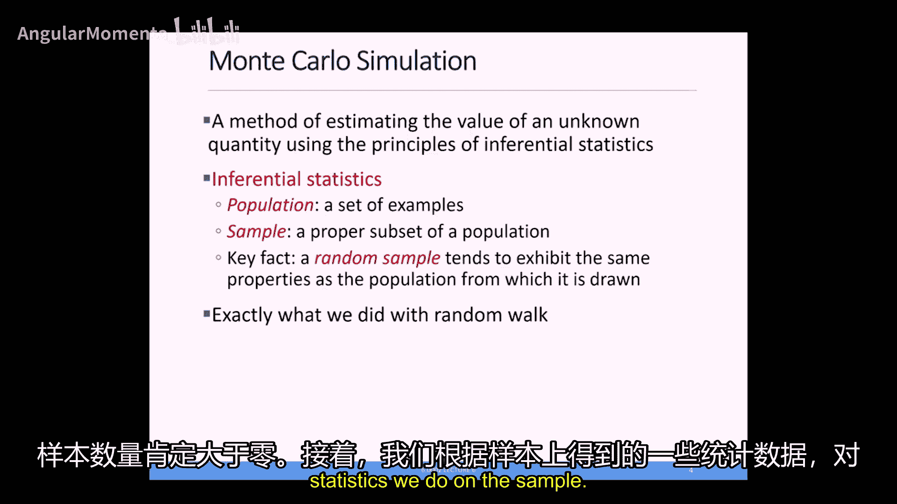

So the population is typically a very large set of examples。

 and the sample is a smaller set of examples。And the key fact that makes them work。

Is that if we choose the sample at random？The sample will tend to exhibit the same properties。

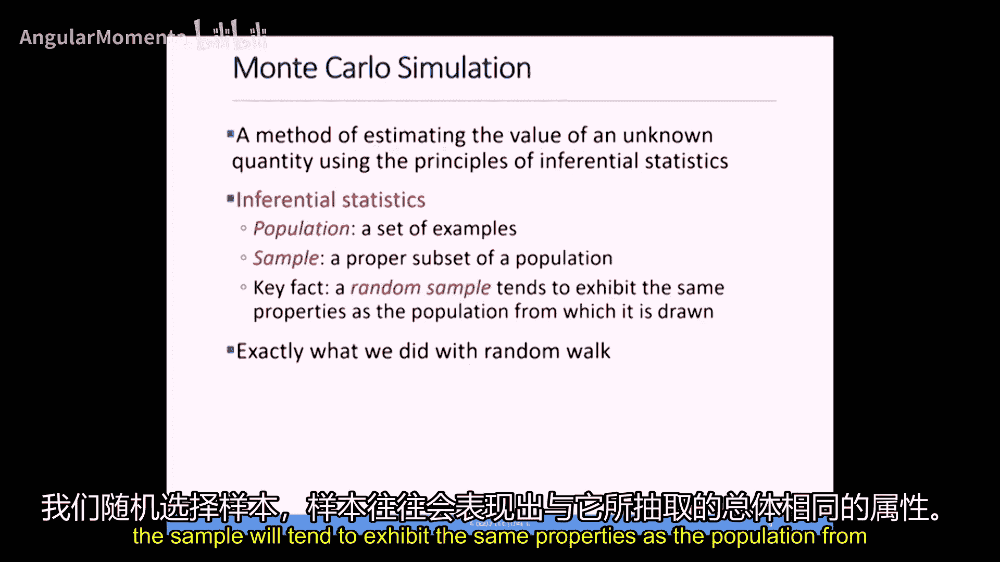

As the population from which it is drawn。And that's exactly what we did with the random walk。Right。

 there were。A very large number of different random walks you could take of， say，10000 steps。

We didn't look at all 10， all possible random walks of 10000 steps。We drew a small sample of， say。

100 such walks。Computed the mean of those 100 and said。We think that's probably a good。

Expectation of what the mean would be of the all the possible walks of 10000 steps。Allright。

 so we were depending upon this principle。And of course， the key fact here。

Is that the sample has to be random。

If you start growing the sample and it's not random。

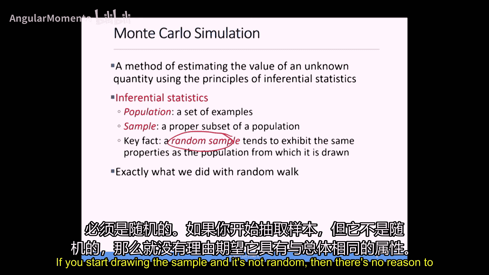

Then there's no reason to expect it of the same properties as that of the population。

And we'll go on throughout the term and talk about the various ways you can get fooled and think you of a random sample when exactly you don't。

All right， let's look at a very simple example， people。

Like to use flipping coins because coins are easy。

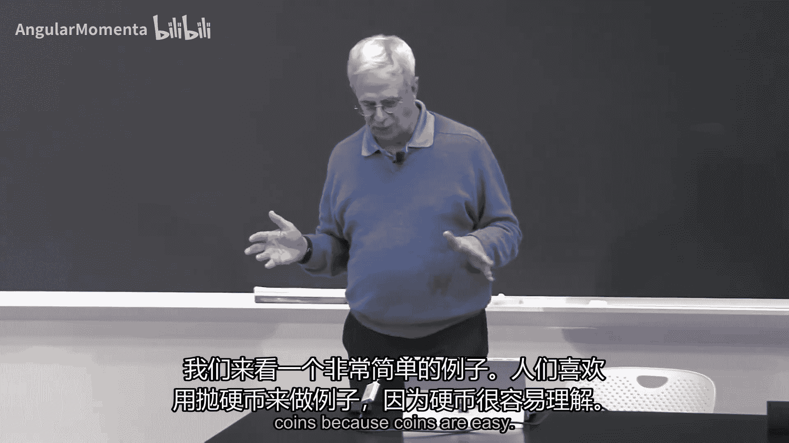

U。So let's assume we have some coin。

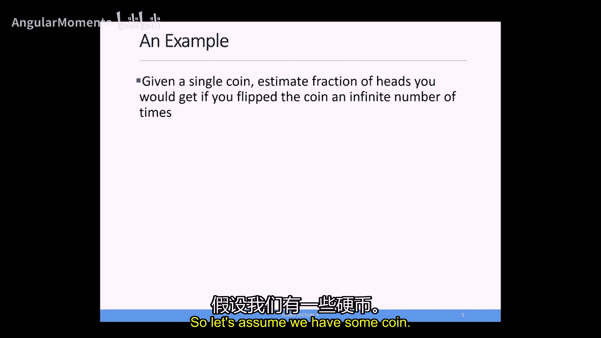

All right， so I brought two coins。Folitely larger than the usual coin。And I can flip it。Flip it once。

And。Let's consider one flip and let's assume it came out heads。I have to say。

 the coin I flipped is not actually a $20 gold piece。

 in case any of you were thinking of stealing it。All right， so we've got one flip。

And it came up heads。 And now I can ask you the question。

If I were to flip the same coin an infinite number of times。

How confident would you be about answering that all infinite flips would be heads。

Or even if I were flip it once more， how confident would you be that the next flip would be heads。

 And the answer is not very。Well， suppose I flipped the coin twice。And both times， it came up heads。

And I I asked you the same question。 Do you think that the next flip is likely to be heads。Well。

Maybe you would be more inclined to say yes than having only seen one flip。

 but you wouldn't really jump to say sure。On the other hand， if I flipped it 100 times。

And all 00 flips came up heads。

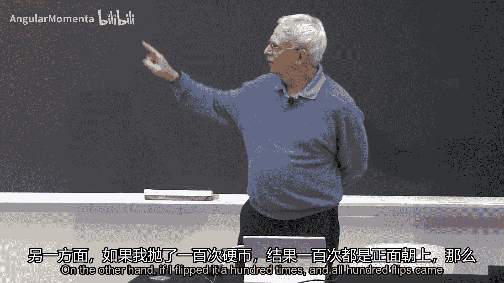

Well， you might be suspicious that my coin only has a head on both sides， for example。

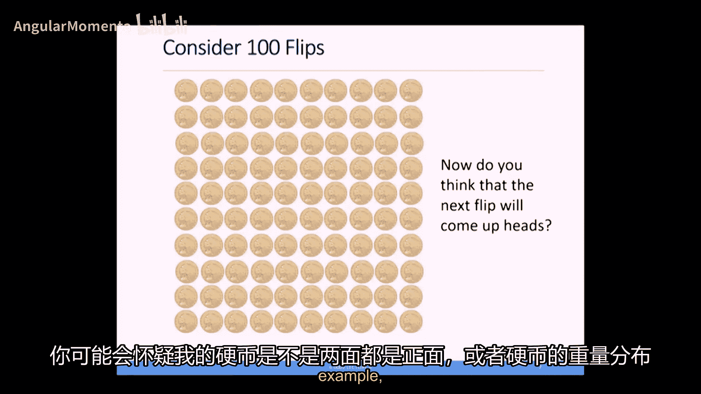

Or is weighted in some funny way that it mostly comes up heads。And so a lot of people， maybe even me。

 if you said I flipped it 100 times and it came up heads， what do you think the next one will be？

My best guess would be probably heads。How about this one？

So here， I've simulated 100 flips， and we have 50 heads here。Two heads here and 48 tails。

And now if I said， do you think that the probability of the next flip coming up heads？

Is it 52 out of 100。Well， if， if you had to guess。

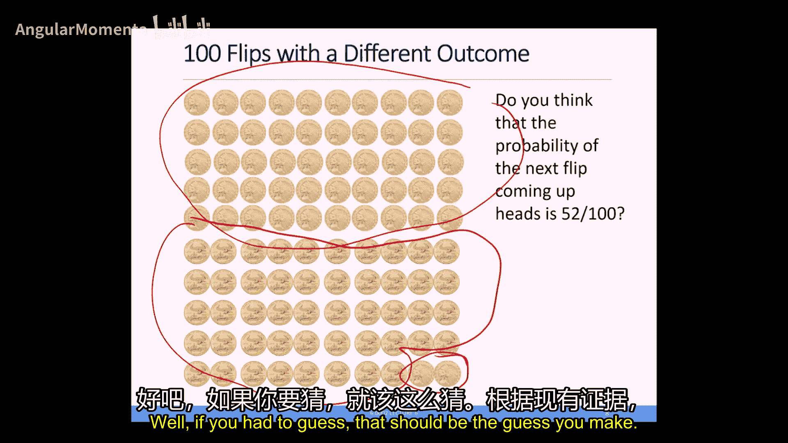

That should be the guess you make。😡，Based upon the available evidence。

That's the best guess you should probably make。😡，Because you have no reason to believe it's a fair coin could well be weighted。

You know， if we don't see it with coins， but we see weighted dice all the time。Or we shouldn't。

 but they exist。You can buy them on the Internet。um。So typically， our best guess is what we've seen。

But we really shouldn't have very much confidence in that guess。Because， well， na。

Could have just been an accident。Highly unlikely， even if the coin is fair that you'd get 50，50。

 right。So why when we see 100 samples and they all come up heads。

Do we feel better about guessing heads。For the 10001， then we did when we saw two。Samples。And why？

Don't we feel so good about guessing 52 out of 100 when we've seen。100 flips that came out，52 and 48。

And the answer is something called variance。

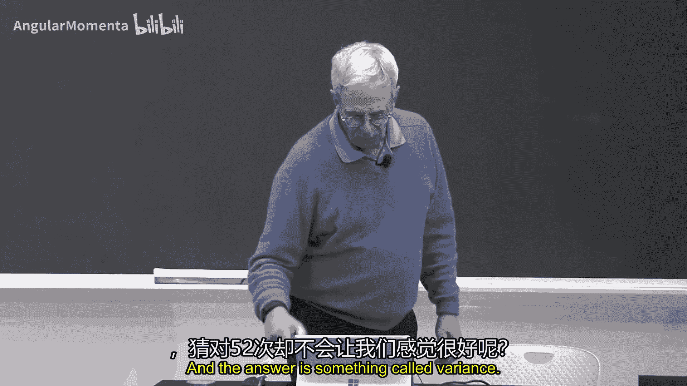

When I had all heads。There was no variability in my answer。 I got the same answer， all the time。

And so there was no variability， And that。Intuitively， and， in fact。

 mathematically should make us feel confident that， okay， maybe that's really the way the world is。

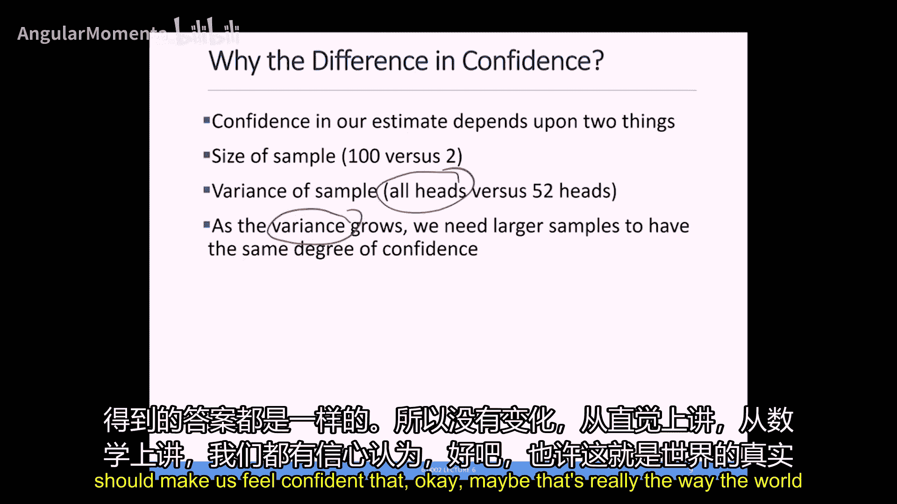

On the other hand， when almost half are heads and almost half are tails， there's a lot of variance。

Right， hard to predict what the next one will be。 And so。We should have very little confidence。

That it isn't an accident that it happened to be 52，48 in one direction。So as the variance grows。

 we need larger samples to have the same amount of confidence。All right。

 let's look at that with a detailed example， we'll look at Roulette。

In keeping with the theme of Monte Carlo simulation。

This is a roulette wheel that could well be at Monte Carlo。There's no need to simulate Roulette。

 by the way， It's a very simple game。

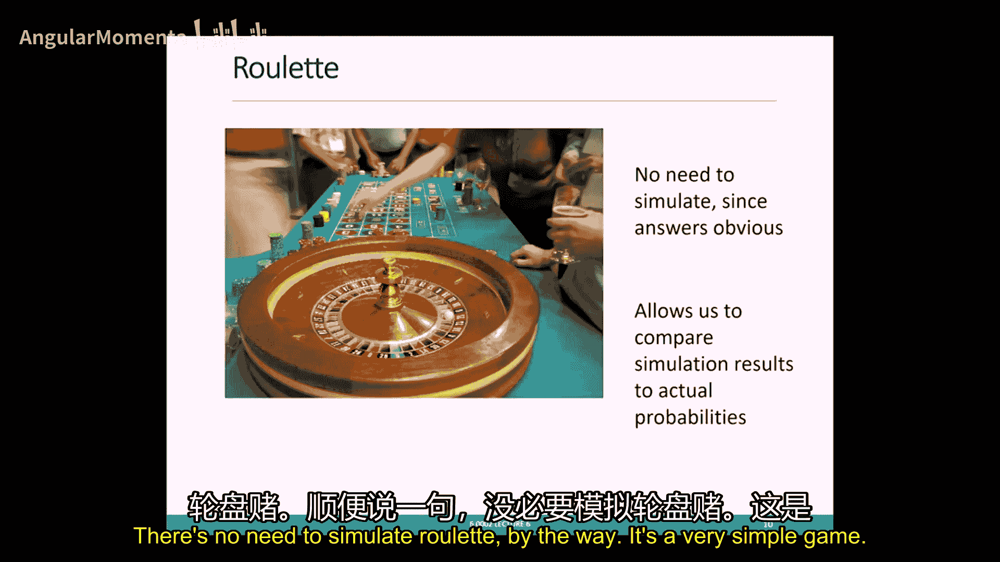

嗯。But as we've seen with our earlier examples， it's nice when we are learning about simulations to simulate things where we actually can know what the actual answer is so that we can then understand our simulation better。

😊，So you don't know how Roetteta is played。 Is there anyone here who doesn't know how Roulette is played。

Good for you。 You grew up virtuous。 Allright， so， well， all right， maybe I won't go there。 Allright。

 so you have。😊，A wheel that that can spins around And in the middle are a bunch of pockets。

 Each pocket has a number and a color。You bet in advance on what number you think is going to come up or what color you think is going to come up。

 Then somebody drops a ball in that wheel， gives it a spin。And through centrifugal force。

 the ball stays on the outside for a while。 But as the wheel flows down it heads towards the middle。

And eventually， it settles in one of those pockets。 and you win or you lose。Now。You can bet on it。

And so let's look at an example of that。 So here's a。

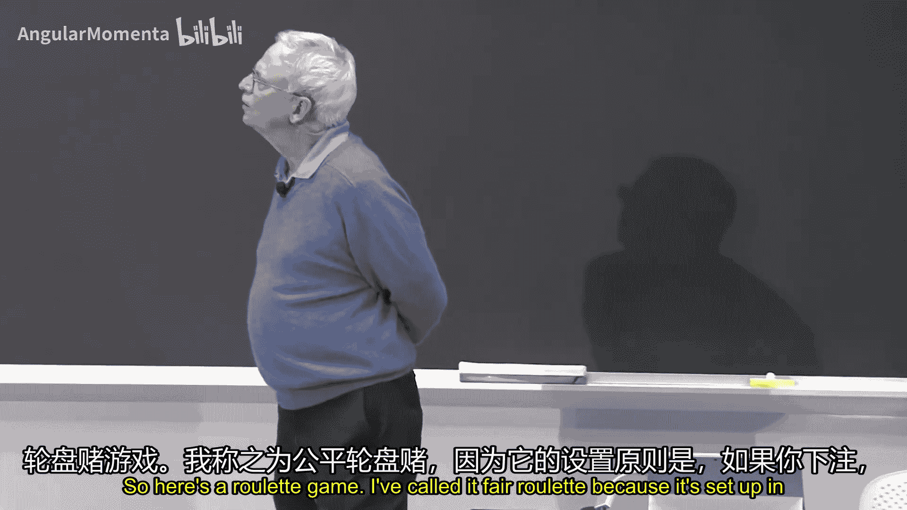

Rulette game。 I've called it fair roulette because it's set up in such a way that。In principle。

 if you bet your expected value should be 0。 You'll win some。 You'll lose some。

 but it's fair in the sense that it's not either a negative or a positive sum game。So as always。

 we have an underbar underbar in it。Typically。Well。

 it was're setting up the wheel with 36 pockets on it。So you can bet on the numbers 1 through 36。

That's the way range works you'll recall。Initially， we don't know where the ball is。

 So we'll say it's none。And here's the key thing is， if you make a bet。

This tells you what your odds are。

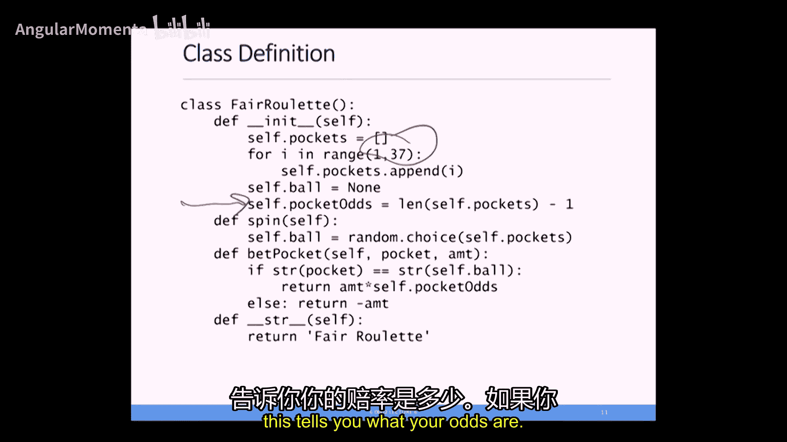

That if you bet on a pocket and you win。You get L of pockets， -1。So this is why it's a fair game。

Right。You be a dollar， if you win。You get $36。Your dollar plus 35 back。 If you lose， you lose。

Alright， self dot spin will be random our choice among the pockets。

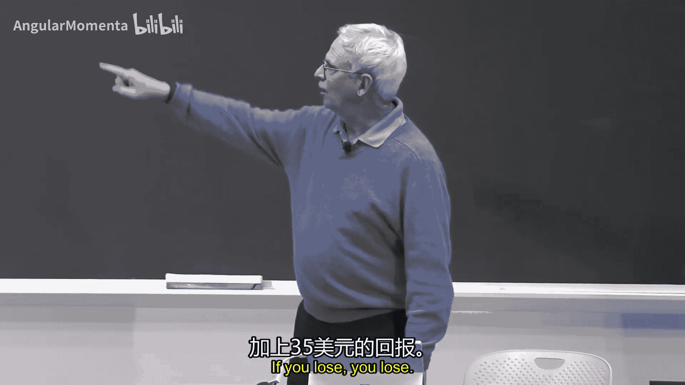

And then， there's simply bet。Where you just can choose an amount to bet and the pocket you want to bet on。

 I've simplified it。 I'm not allowing you to bet here on colors。

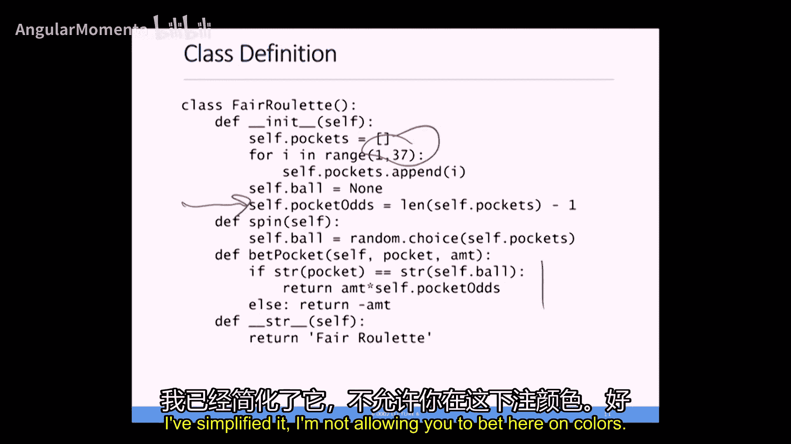

Alright， so then we can play it。 So here' is playulette。

I've made game the class a parameter because later we'll look at other kinds of roulette games。

You tell her how many spins。What pocket you want to bet on for simplicity。

 I'm going to bet on the same pocket all the time。Picture your favorite lucky number。

And how much you want to bet。 And then we'll have a simulation just like the ones we've already looked at。

So。The number you get right starts at 0 for I and range number of spins。 We'll do a spin。And then。

Tote pocket plus equal game dot that pocket。 It'll come back either 0， if you've lost or 35。

 if you've won。

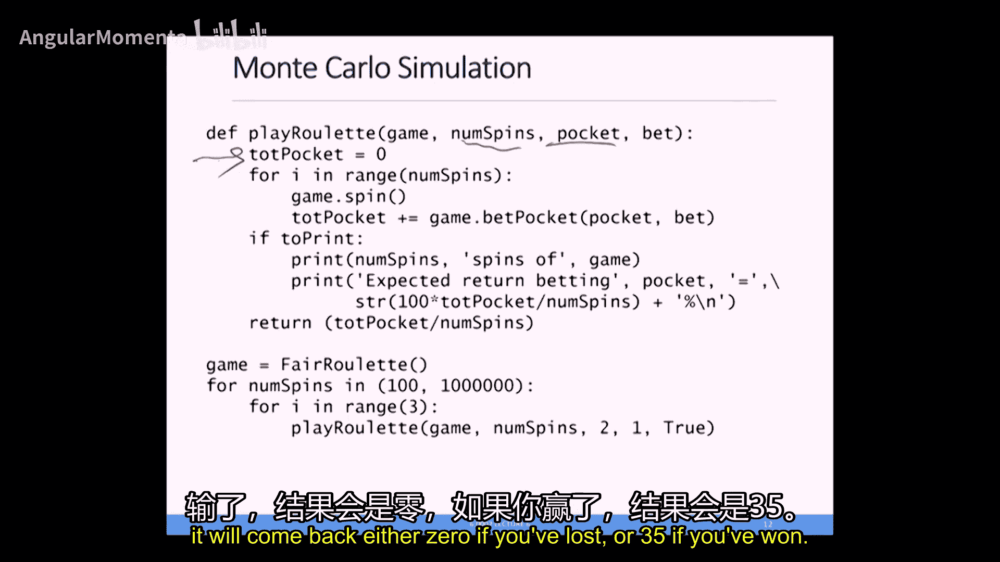

And then we'll just print the results。So we can do it。In fact， let's run it。

So here it is。I guess I'm doing a million simulate games here， so quite a few。嗯。Actually。

 I'm going to do two。 I'm going to look what happens when you spin it 100 times。

 What happens when you spin it a million times。And we'll see what we get。So， what we see here。

Is that。We do 100 spins。 The first time I did it， my expected return was。Minus100%。

 I lost everything I bet。

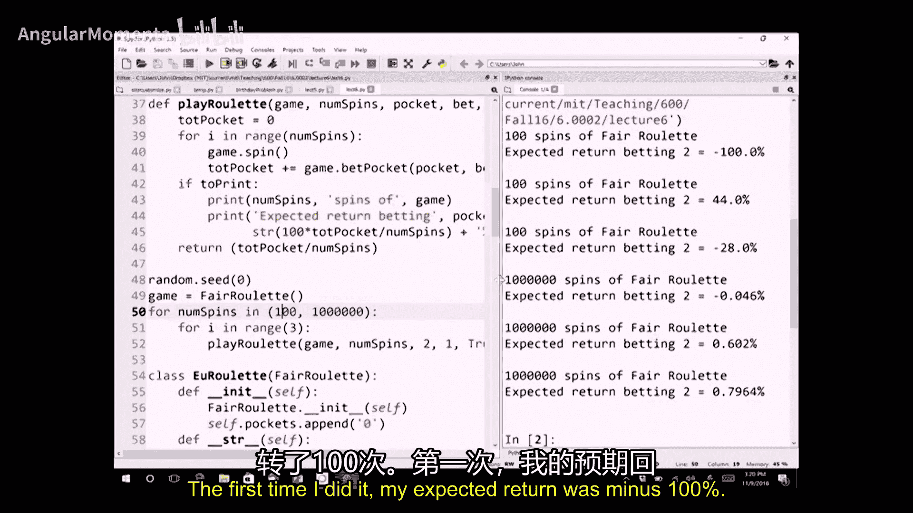

Not so unlikely， given that the odds are pretty long， that do 100 times without winning。

Next time I did 100， my return was a positive 44%。

And then。A positive 28%。So you can see for 100 spins。

It's highly variable what the expected return is。

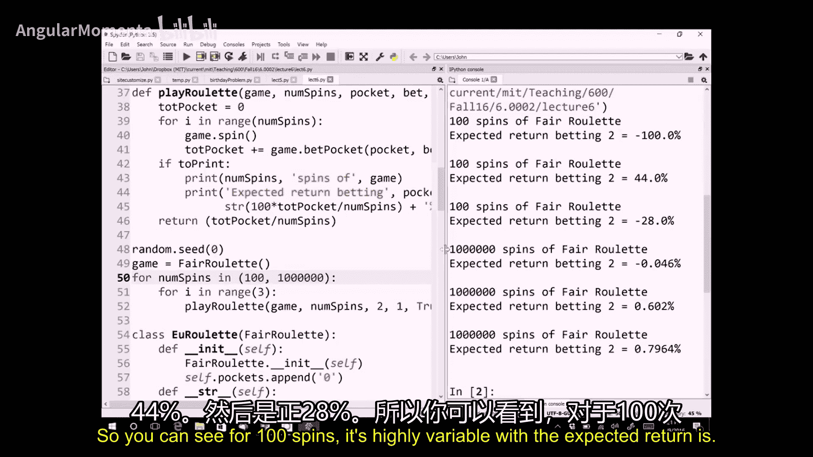

That's one of the things that makes gambling attractive to people。Right that you。

 if you go into a casino，100 spins would be a pretty long night at the table。And， you know。

 maybe you'd  won，44%。 You'd feel pretty good about it。What about a million spins， Well。

 people aren't interested in that， But the casino is， right。

 They don't really care what happens with 100 spins。 They care what happens with a million spins。

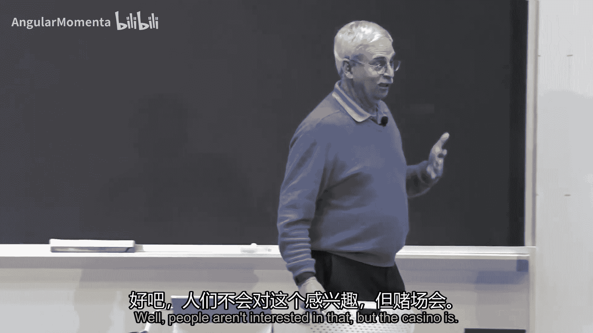

What happens when everybody comes every night to play。And they're what we see。If。

You'll notice much less variance。happensapp to be -0。04 plus 06 plus 。79。So， it's still not0。

But it's certainly these are all closer to zero than any of these are。We know it should be 0。

 but it doesn't happen to be in these examples， but not only are they closer to 0。

 they're closer together。There is much less variance in the results， right。

So here I show you these three numbers and ask， what do you expect to happen， You have no clue。

 right。So I don't know。 maybe I'll win a lot， maybe I'll lose everything。

I show you these three numbers。 You're going look in it say， well， you know。

 it's going to be somewhere between 0 around 0 and maybe 1%。

 But you're never going to guess it's going to be radically different from that。

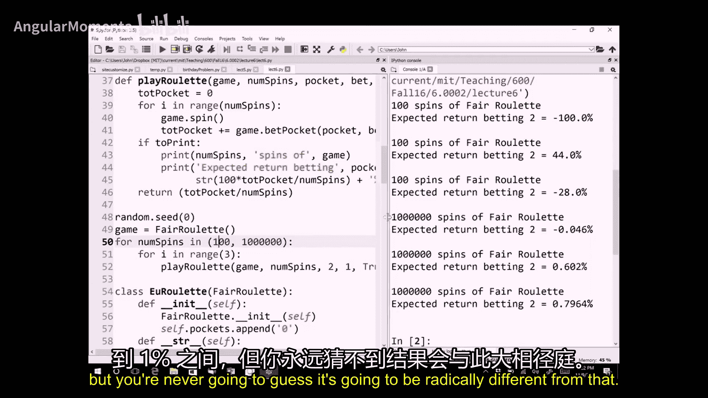

And if I were to change this number to be even higher， it would go even closer to zero。But。

 we won't bother。Okay， so these are the。Yeah， these are the numbers we just looked at because Id set the seed to be the same。

So what's going on here is something called the law of large numbers。Or sometimes Bnoulli's law。

This is a picture of Bernoulli on this stamp。

嗯。It's one of the two most important theorems in all statistics。

 And we'll come to the second most important theorem in the next lecture。

Here it says in repeated independent tests with the same actual probability。

The chance that the fraction of times the outcome differs from P converges to 0 as the number of trials goes to infinity。

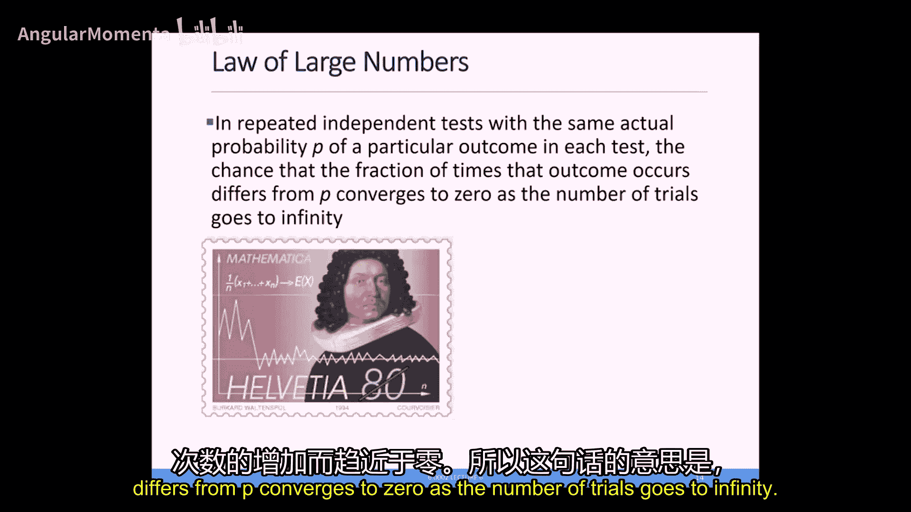

So this says if I were to spin thisette fair roulette wheel an infinite number of times。

Their expected return， the return would be 0。The real true probability from the mathematics。Well。

 infinite is a lot。But a million is getting closer to infinite。

 And what this says is the closer I get to infinite。The closer it will be to the true probability。So。

 that's why。We did better with a million than with 100。 And if I did 100 million。

 we'd do way better than I did with a million。I want to take a minute to talk about a way this law is often misunderstood。

This is something called a gambler's fallacy。And all you have to do is say。

 let's go watch a sporting event。And you'll watch a batter strike out for the sixth consecutive time。

 The next time they come to the plate， The idiot announcer says， well。

 he's struck out six times in a row。 He's due for a hit this time。Because。

He's usually a pretty good hitter。 Well， that's nonsense。Says。

People somehow believe that if deviations from expected occur， they'll be evened out in the future。

And we'll see something similar to this that is true， but this is not true。

And there's a great story about it。 This is told in a book by Huff and Geis。

And this truly happened in Monte Carlo， with Ruulette。And you could either bet on black or red。

Black came up 26 times in a row。Highly unlikely， right，2 to the 26 is a giant number。

And what happened is。Wd got out on the casino floor that black had kept coming up way too often。

 And people more or less panicked to rush to the table to bedt on red。Saying， well。

 it can't keep coming up black。 Surely the next one will be red。And as it happened。

 when the casino totaled up its winnings， it was a record night for the casino。

It just millions of francs got be because people were sure it would have to even out。Well。

 if we think about it。Probability of 26 consecutive reds is that。

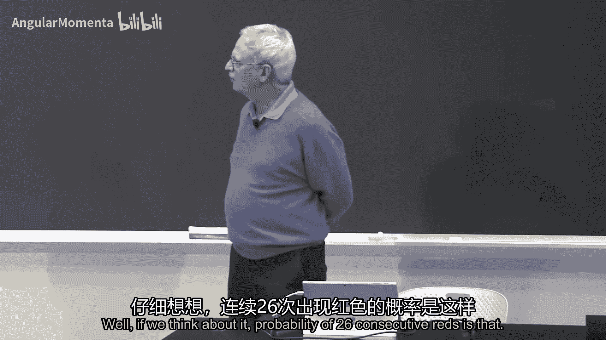

A pretty small number。But。The probability of 2，26th consecutive reds when the previous 25 roles were read is what。

No， that。No， if you'd had 25 reds and then you， you spun the wheel once more。

 the probability of it having 26 reds is now 05。Because these are independent events。 unless。

 of course， the wheel is rigged， and we're assuming it's not。

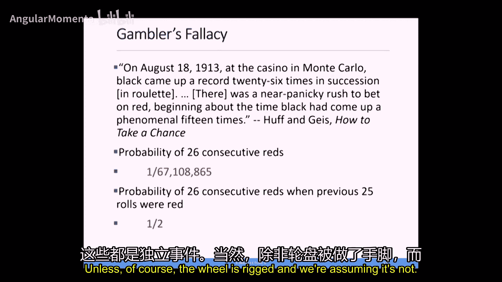

People have a hard time accepting this。 And I know it seems funny。

 but I guarantee there will be some point in the next month or so when you will find yourself thinking this way。

That something has to even out。 I did so badly in the midterm， I will have to do better on the final。

that was mean。 I'm sorry。Alright， speakingea of means。呃。OSee。

 Professor Grim is not the only one who can make bad jokes。嗯。There is something。

 It's not the gambler's fallacy that's often confused with it。

 And that's called regression to the mean。This term was coined in 1885， by Francis Galton。

In a paper of which I've shown you a page from it here。And the basic conclusion here。

Was what this table says is if。

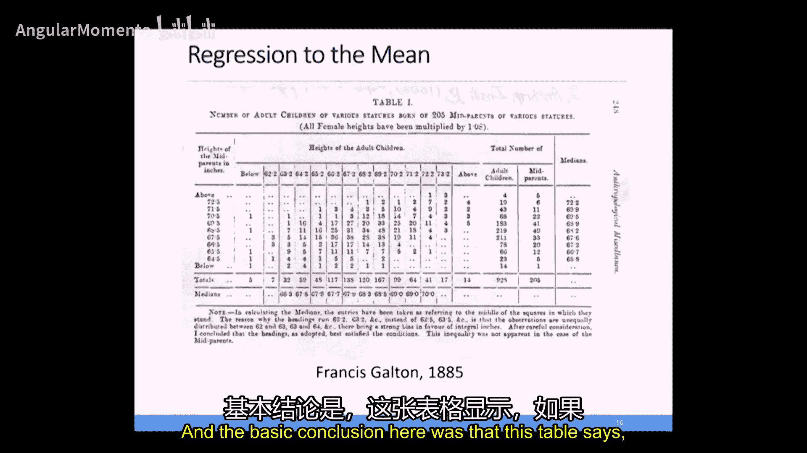

Somebody's parents。Are both taller than average。It's likely that the child will be smaller than the parents。

Conversely， if the parents are shorter than average。

 it's likely that the child will be taller than average。Now。

 you can think about this in terms of genetics and stuff。 That's not what he did。

 He just looked at a bunch of data。And the data actually supported this。

And this LED him to this notion of regression， to the mean。And here's what it is。

 And here's the way in which it is subtly different from the gambler's fallacy。

What he said here is following an extreme event。Parents being unusually tall。

The next random event is likely to be less extreme。He didn't know much about genetics。

 And he kind of assumed the height of people were random。But we'll ignore that。Okay。

 but the idea is here that it will be less extreme。So let's look at it in Roulette。

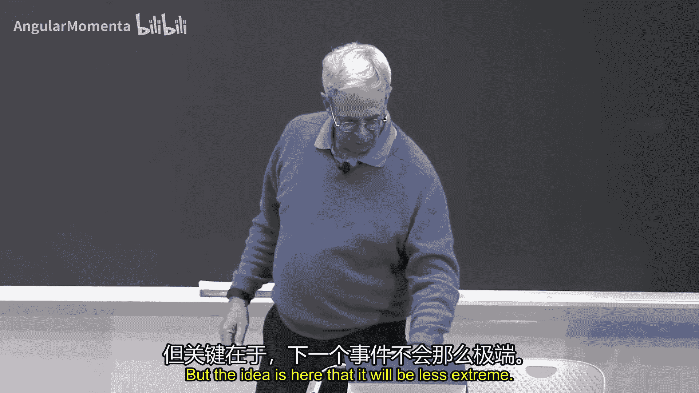

If I spin a fair roulette wheel 10 times and get 10 reds。That's an extreme event。

There's a probability of basically one over 1024。

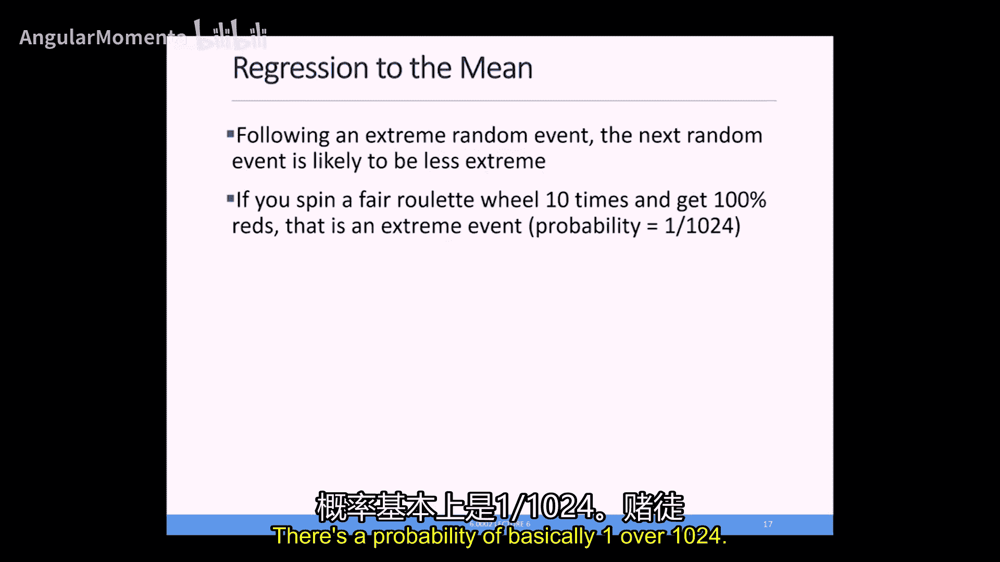

Now， the gamblers fallacy says if I were spin it another 10 times， I would it would need to even out。

 as in I should get more blacks than you would usually get to make up for these excess reds。

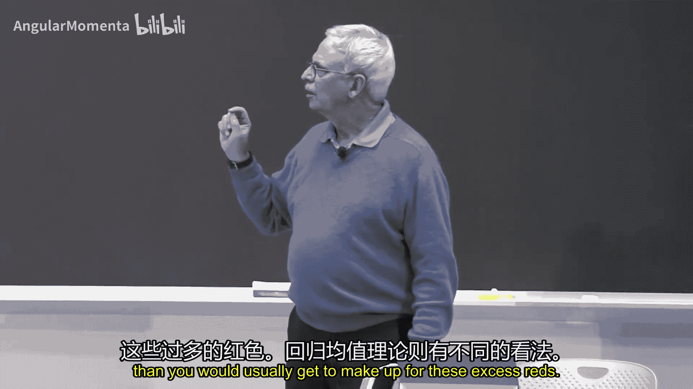

What regression to the mean says。Is different。 says it's likely that in the next 10 spins。

You will get fewer than 10 reds。 You will get a less extreme event。

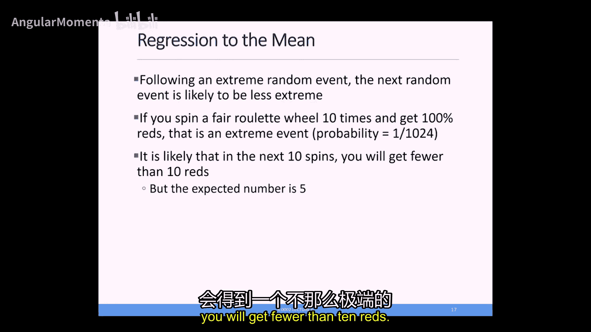

Now， it doesn't have to be 10。 If I'd gotten 7 reds instead of 5， you consider that an extreme。

And you would bet that the next 10 would have fewer than 7。

But you wouldn't bet that it would have fewer than5。All right。

Because of this， if you now look at the average of the 20 spins。

It will be closer to the mean of 50% reds。

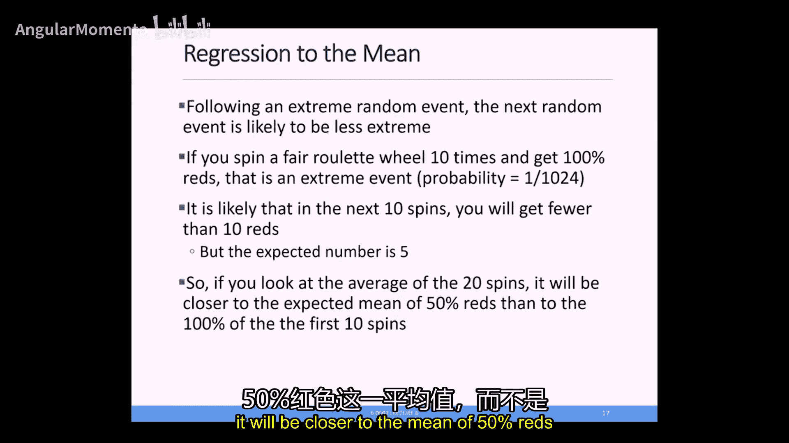

Then you got from the extreme first spins。So that's why it's called regression to the mean。

The more samples you take。😡，The more likely you'll get to the mean。Yes。

Let those fans are supposed to see。Yes，Yeah， that should。Has nothing new with the first one。Right。

 because it's。You have an extreme event， which was unlikely。And now， if you have another event。

 it's likely to be closer to the average。Than the extreme was， to the average。Right。

EAnd it precisely because it is independent。That makes sense to everybody， yeah。すいます。

There's follows them by saying that like because this was super。No， the gambler's fallacy here。

And it's a good question。 And indeed， people。

Often do get these things confused。

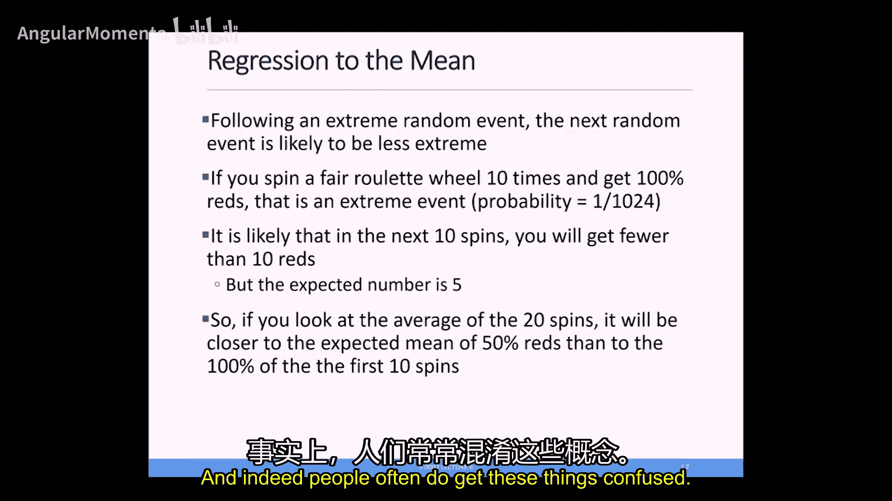

The gambler's fallacy would say that the second10 spins would。

We would expect to have fewer than five reds because you're trying to even out the unusual number of reds in the first spin。

Right is here， we're not saying we would have fewer than five。

 we're saying we'd probably have fewer than 10。That it'll be closer to the mean。

Not that it would be below the mean， whereas the gambler's fallacy would say it should be below the mean to quote。

 even out the first 10。Does that make sense？Okay， great question。 Thank you。All right， now。

 you may not know this， but casinos are not in the business of being fair。嗯。

And the way they don't do that is in Europe。

They're not all red and black。 They sneak in one green。And so now， if you bet red， well。

 sometimes it isn't always red or black。 And furthermore， there's this 0。

 the index from 0 rather than from one。 And so you don't get a full payoff。In American Rulette。

They managed to sneak in two greens。They have a 0 and a double 0。Tilting the odds even favor。

 even more in favor of the casino。

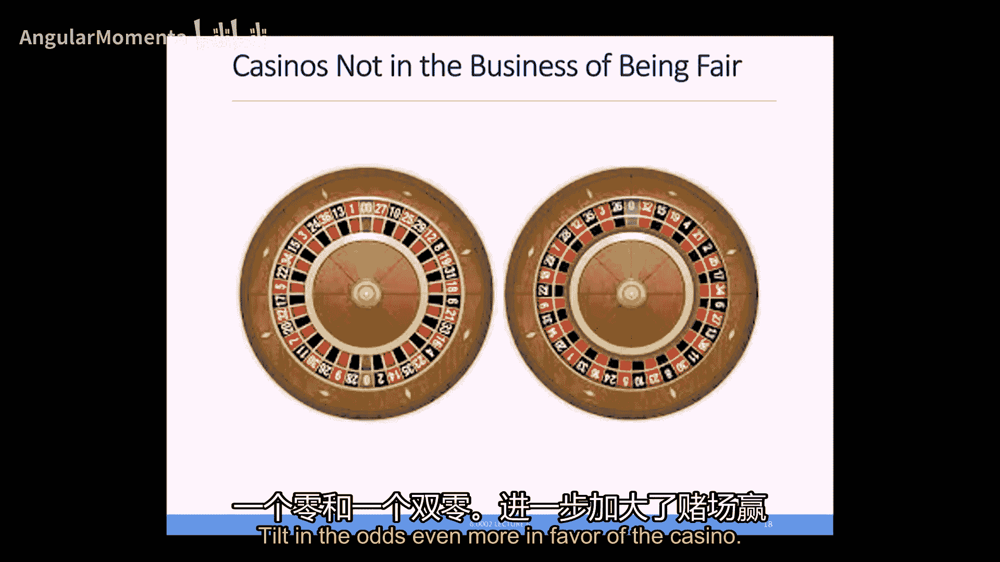

So。We can do that in our simulation。 We'll look at European roulette as a subclass of fairulette。

I've just added this extra pocket，0。And notice， I have not changed the odds。

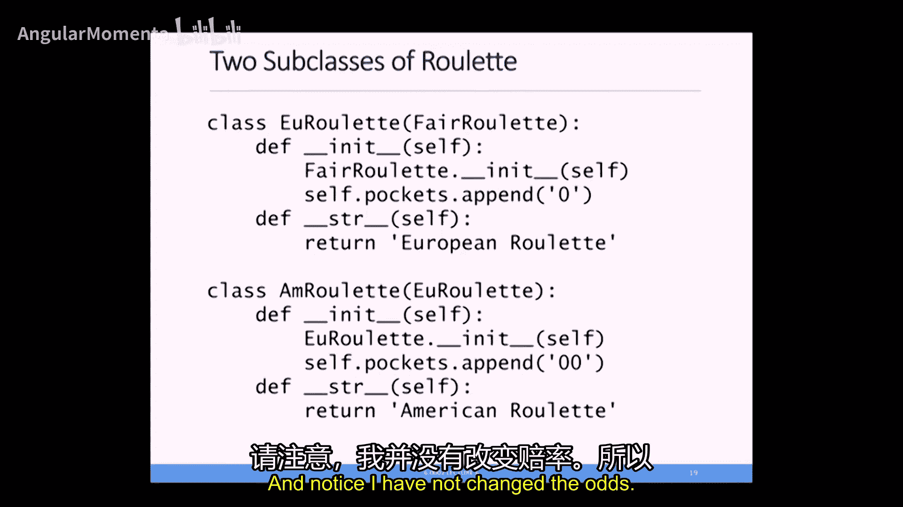

So what you get if you get your number is no higher。

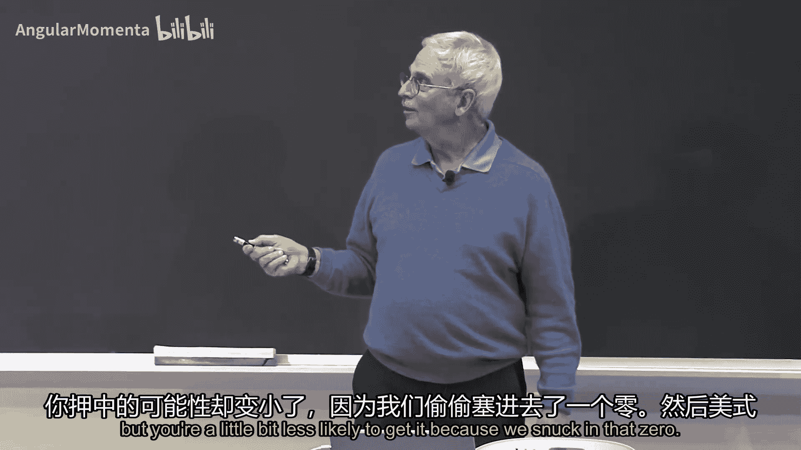

You're a little bit less likely to get it because we snuck in that zero。

Then American Rulette's a subclass of European roulette， in which I add yet。Another pocket。

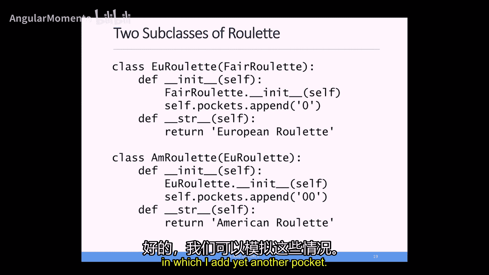

Alright， we can simulate those。 Again， nice thing about simulations。 We can play these games。😊。

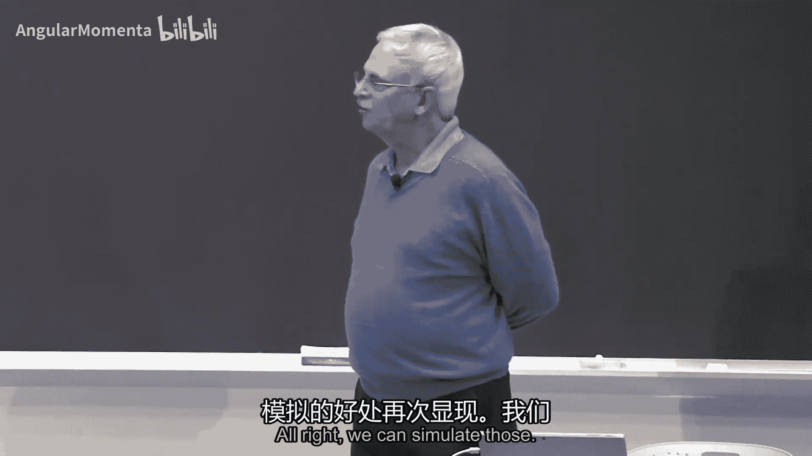

So I've simulated 101020 trials of 1000 spins，10000 spins，100000 and a million。

And what do we see as we look at this。Well。Right away， we can see that Fairulette is。

Usually a much better bet than either of the other two。That even with only 1000 spins。

 the return is negative。And as we get more and more， as I got to a million。

 it starts to look much more like closer to 0。 And these we have reason to believe。

 at least are much closer to your true， true expectation。

Saying that while you break even in fair Roulette， you'll lose 2。7%。In Europe and over 5%。

In Las Vegas or soon in Massachusetts。

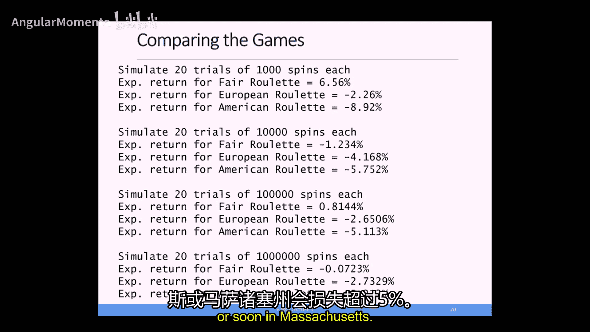

All right。We're sampling， right？That's why the results will change。

 And if I ran a different simulation with a different seed， I get different numbers。

Whenever you're sampling。You can't be guaranteed to get perfect accuracy。

It's always possible you get a weird sample。That's not to say that you won't get exactly the right answer。

I might have spun the wheel twice。And happened to。Get the exact right answer of the return。Actually。

 not twice， because the math doesn't work out， but 35 times gotten exactly the right answer。

But that's not the point。We need to be able to differentiate between what' happens to be true and what we actually know in a rigorous sense。

 is true。Or have maybe don't know it， but have real good reason to believe it's true。

So it's not just a question of faith。And that gets us to what's， in some sense。

 the fundamental question of all computational statistics。Is how many samples do we need to look at？

Before we can have。Real justifiable confidence in our answer。As we've just seen。

Not just a few minutes ago with the coins。 our intuition tells us that it depends upon the variability in the underlying possibilities。

So let's look at that more carefully。We have to look at the variation in the data。

So let's look at first， something called variance。So this is variance of X。

 Think of X as just a list of data examples， data items。And the variance is。

 we first compute the average。Of value。 That's mu。So mu is for the mean。For each little x in big x。

 we compare the difference of that in the mean。 How far is it from the mean。

And square the difference。 And then we just sum them。So this takes。

 how far is everything from the mean， We just add them all up。And then we end up dividing。

By the size of the set， the number of examples。

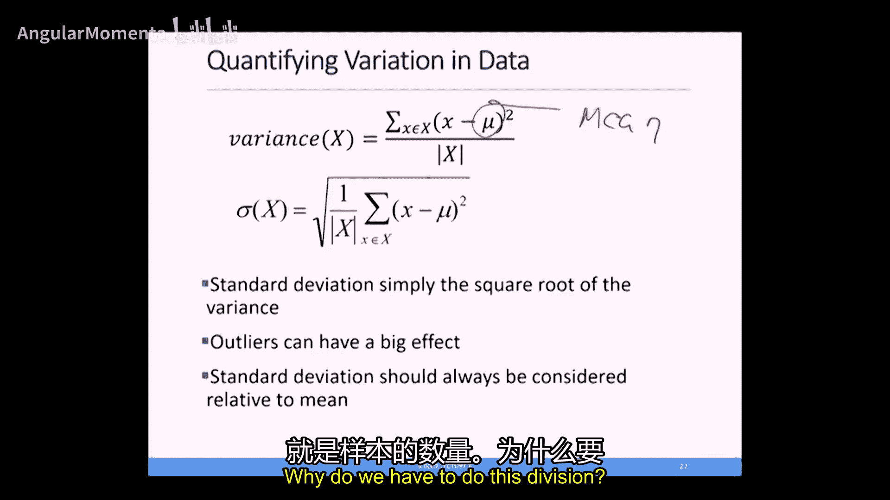

Why do we have to do this division。Well， because we don't want to say something has high variance just because it has many members。

 right。So this sort of normalizes by the number of members。 and this just sums how different。

The members are from the mean。So if everything is the same value。

 what's the variance going to be If I have a set with of 10006th， what's the variance， yes。Zero。Andm。

 and just， you think this is going to be hard。 But I came prepared。I was hoping this would happen。

Look out。 I don't know where this is going to go。

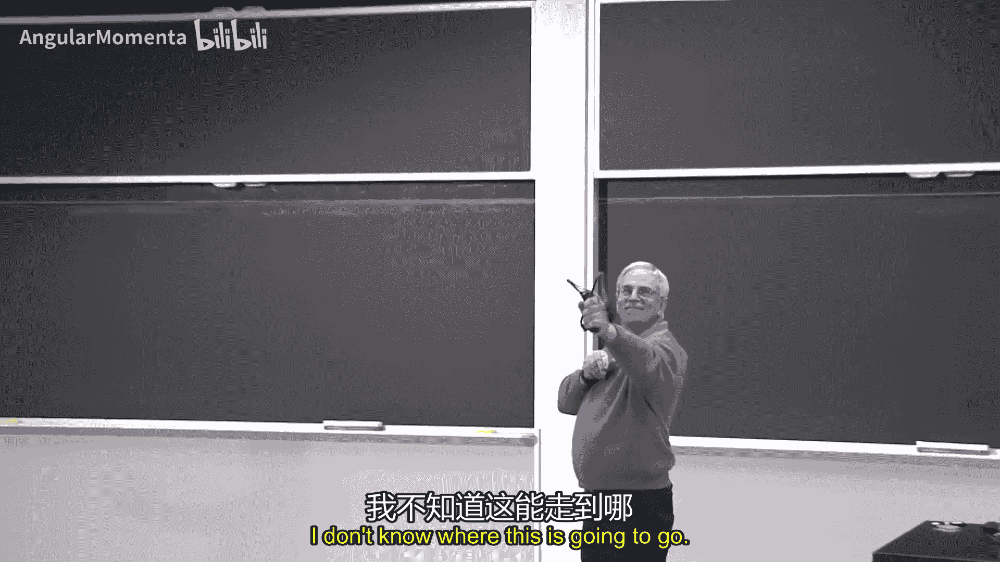

All right。Maybe it isn't the best technology。I'll go home and practice。Alright， so。

 and then the thing you're more familiar with is the standard deviation。

And if you look what the standard deviation is， it's simply the square root of the variance。Now。

 let's。Understand this a little bit。And first， ask。Why am I squaring this here。

 especially because later on， I'm just going to take this square root anyway。

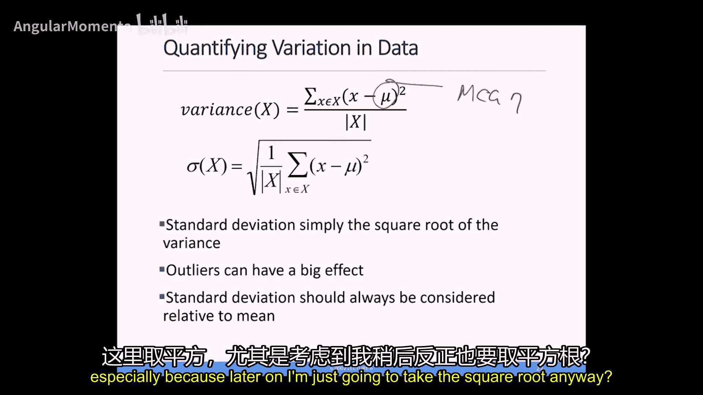

Well， squaring it has one virtue。Which is that it means I don't care whether the difference is positive or negative。

Right， and I shouldn't， right， the variance。 I don't care which side of the mean it's on。

 I just care。 it's not near the mean。But if that's all I wanted to do。

 I could take the absolute value。The other thing we see with squaring is it gives the outliers。

Extra emphasis。Because I'm squaring that distance。Now， you can think that's good or bad。

But it's worth knowing。 It's a fact。The more important thing to think about is standard deviation all by itself。

Is a meaningless number。You always have to think about it in the context of the mean。If I tell you。

 the standard deviation is 100。You then say， well， and I ask you， whether it's big or small。

 you have no idea。If the mean is 100 and the standard deviation is 100， it's pretty big。

If the mean is a billion and the standard deviation is 100， it's pretty small。

So should never want to look at just the standard deviation。Alright。

 here's just some code to compute those Eas enough。Why am I doing this？

Because record of now getting to the punchline。We often try and estimate values。

 just by giving the mean。So we might report on an exam that the mean grade was 80。

It's better instead of trying to describe an unknown value by it。

An unknown parameter by a single value。Say the expected return on， on betting a roulette wheel。

To provide。A confidence interval。So what a confidence interval is is a range that's likely to contain the unknown value。

And a confidence that the unknown value is within that range。So I might say。

 on a fair roulette wheel。I expect。That your return will be between -1% and plus 1%。

And I expect that to be true。95% of the time you play the game。If you play 100 roles， spins。

 If you take 100 spins of the roette wheel， I expect that 95% of the time。

 your return will be between this and that。So here we're saying the return on betting a pocket 10 times。

10000 times in European Rulette is -3。3%。

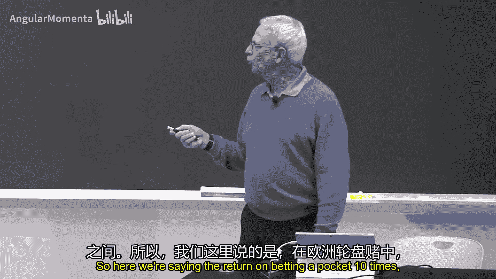

I think that was the number we just saw。And now I'm going to add to that， this margin of error。

Which is plus or-3。5% with a 95% level of confidence。

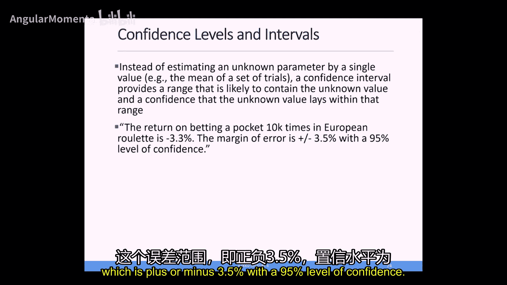

What does this mean？If I were to conduct an infinite number of trials。Of 10000 bets each。

My expected average return would indeed be-3。3%。

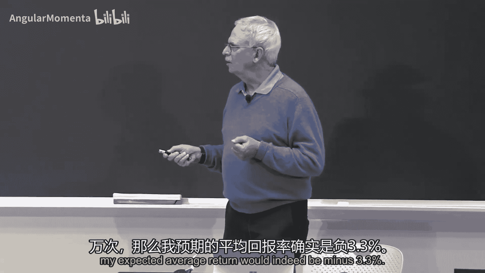

And it would be between。These values，95% of the time。

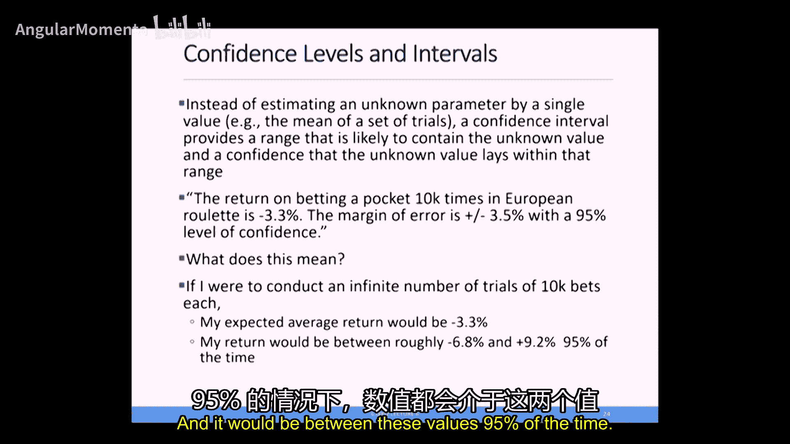

I've just subtracted and added。This 3。5。Saying nothing about what would happen in the other 5% of the time。

 How far away I might be from this。 This is totally silence on that subject， yes。You want 0。9。2。Oh。

Let's see。Yep， I do， thank you。We'll fix it on the spot。

This is why you have to come to lecture rather than just reading the slides， because I make mistakes。

Thank you， Eric。

Alright， so it's telling me that。 And that's all it means。 And it's amazing。😊。

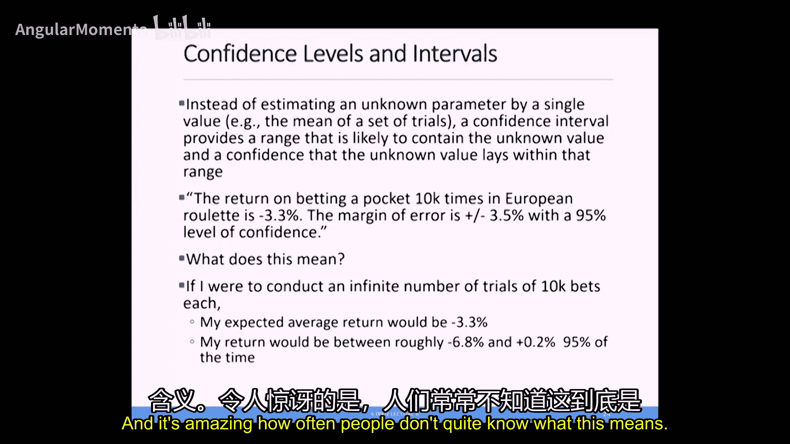

How often people don't quite know what this means。 For example。

 when they look at a political poll and they see how many votes somebody is expected to get。

And they see this confidence interval and say， what does that really mean， Most people don't know。

But it does have a very precise meaning。 And this is， is it。How do we compute confidence intervals？

Most of the time， we compute them using something called the empirical rule。Under some assumptions。

 which I'll get to a little bit later。The empirical rule says that if I take the data， find the mean。

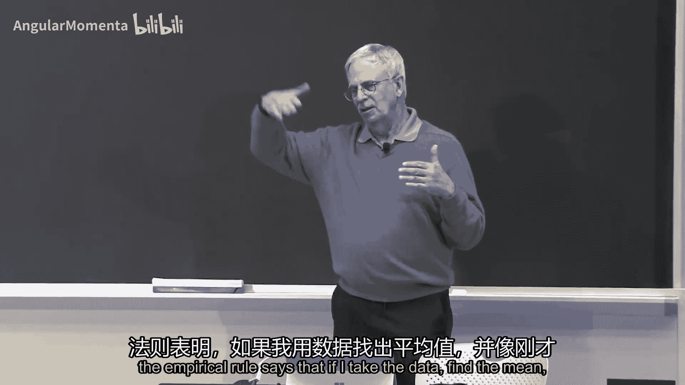

Compute the standard deviation， as we've just seen。

68% of the data will be within one standard deviation。In front of or behind the mean。

Within one standard deviation of the mean。95% will be within 1。96 standard deviations。

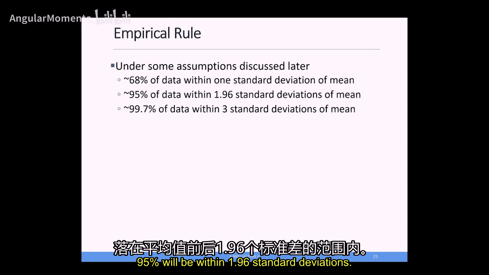

And that's what people usually use。 Usually when people talk about confidence intervals。

 they're talking about the 95% confidence interval。 and they use this 1。6 number。

And 99。7% of the data will be within three standard deviations。

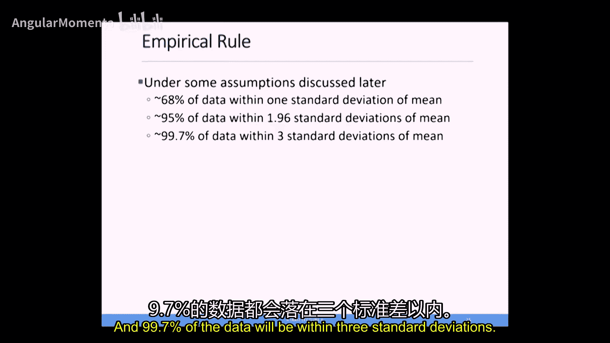

So you can see if youre outside the third standard deviation， you are a pretty rare bird。

For better or worse， depending upon which side。All right。

So let's apply the empirical rule to our Roulette game。So I've got my three Roulette games as before。

I'm going to run a simple simulation。嗯。And the key thing to notice is。Really。

This print statement here。Right， that I'll print the mean。I'm rounding。And then。

I'm going to give the conference intervals。Plus， or minus。 and I'll just take。The standard deviation。

Times 1。6 times 100， Y times 100， because I'm showing you percentages。All right， so again。

 very straightforward code。Just simulation， just like the ones we've been looking at。And， well。

 I just， I don't think I'll bother running it for you in interest of time。You can run it yourself。

 But here's what I got when I ran it。So。When I simulated bedding a pocket for 20 trials。

We see that the。Of 1000 spins each。For 1000 spins， the expected return for farroette happened to be 3。

68%， a bit high。But you'll notice the confidence interval plus or -27。Includes the actual answer。

 which is 0。And we have very large confidence intervals for the other two games。

If you go way down to the bottom。Where I've spun spun the wheel many more times。What we'll see。

Is that。My expected return return。For fairroulette is much closer to 0 than it was here。

But more importantly， my confidence interval is much smaller。8。

So now I really have constrained it pretty well。Tly， for the other two games， you will see。

Maybe it's more accurate。 Maybe it's less accurate， but importantly。

 the confidence interval is smaller。So I have good reason to believe that the mean I'm computing。

Is close to the true mean。Because my confidence interval has shrunk。

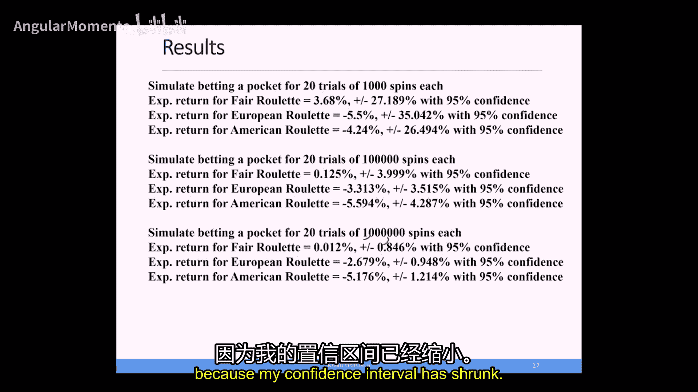

So that's the really important concept here， is that we don't just guess compute the value in the simulation we use。

 in this case， the empirical rule to tell us how much faith we should have in that value。All right。

The empirical rule doesn't always work。There are a couple of assumptions。

One is that the mean estimation error is 0。What is that saying that I'm just as likely to guess high as guess low。

In most experiments of this sort， most simulations， that's a very fair assumption。Right。

 there's no reason to be。 guess I'd be systematically off in one direction or another。

It's different when you use this on a laboratory experiment。Where， in fact。

 depending upon your laboratory technique， there may be a bias in your results in one direction。

So we have to assume that there's no bias in our errors。

And we have to assume that the distribution of errors is normal。

And we'll come back to this in just a second。 But this is a normal distribution called the Gaussian。

Okay， under those two assumptions， the empirical rule。We'll always hold。Allright。

 let's talk about distributions。 since I just introduced one。

We've been using a probability distribution。And this captures the notion of the relative frequency with which some random variable takes on different values。

There are two kinds， discrete。And these when the values are drawn from a finite set of values。

So when I flip these coins。There are only two possible values， head or tails。

And so if we look at the distribution of heads and tails。呃。It's pretty simple。

 We just list the probability of heads。 We list the probability of tails。

We know that those two probabilities must add up to one。And that fully describes our distribution。

Continuous random variables are a bit trickier。They're drawn from a set of reals between two numbers。

The sake of argument， let's say those two numbers are 0 and 1。

Well， we can't just enumerate the probability for each of number。😡。

How many real numbers are there between 0 and 1。An infinite number， right。

And so I can't say for each of these infinite numbers， what's the probability of it occurring。

Actually， the probability is close to 0 for each of them。P is0， if they're truly infinite。

So I need to do something else。

And what I do that is what's called the probability density function。This is a different kind of P。

 D F than the one Adobe self。So there we don't give the probability of the random variable take on a specific value。

We give the probability of it lying somewhere between two values。

And then we define a curve。Which shows how it works。 So let， let's look at an example。

So we'll go back to normal distributions。

This is， for the continuous normal distribution， It's described by this function。

And for those of you who don't know about the magic number E， its。

 this is one of many ways to define it。But。I really don't care whether you remember this。

I don't care where you know what he is。 I don't care if you know what this is。

 What we really want to say is it looks like this。It's。In this case， the mean is 0。

 It doesn't have to be 0。A tone of zmina 0 and a standard deviation of 1。

 This is called the so called standard normal distribution。But it's symmetric around the mean。

And that gets back to， it's equally likely that our errors are in either direction， right。

So it's peaks at the mean。 The peak is always at the mean。 That's the most probable value。

 And it's symmetric。About the mean。So if we look at it， for example， and I say。

 what's the probability。Of the。Number between being between 0 and 1。I can look at it here and say。

 all right， let's draw a line here。And a line here。And then I can integrate the curve under here。

And that tells me the probability of this random variable between being between 0 and 1。

If I want to know between -1 and1。I just do this， and then I integrate over that area。Alright。

 so the area under the curve， in this case， defines。The likelihood。 now。

 I have to divide and normalize to actually get the answer between 0 and 1。

So the question is， what fraction of the area under the curve is between -1 and1。

And that will tell me。The probability。So what does the empirical rule tell us。

 What fraction is between -1 and 1， roughly。Yeah。

68%， right？So that tells me 68% of the area under this curve is between -1 and1。

 because my standard deviation is one。Roughly 68%。 And maybe your eyes will convince you that's a reasonable guess。

Okay， we'll come back and look at this in a bit more detail on Monday of next week and also look at the question of why does this work？

In so many cases where we don't actually have a normal distribution to start with。

