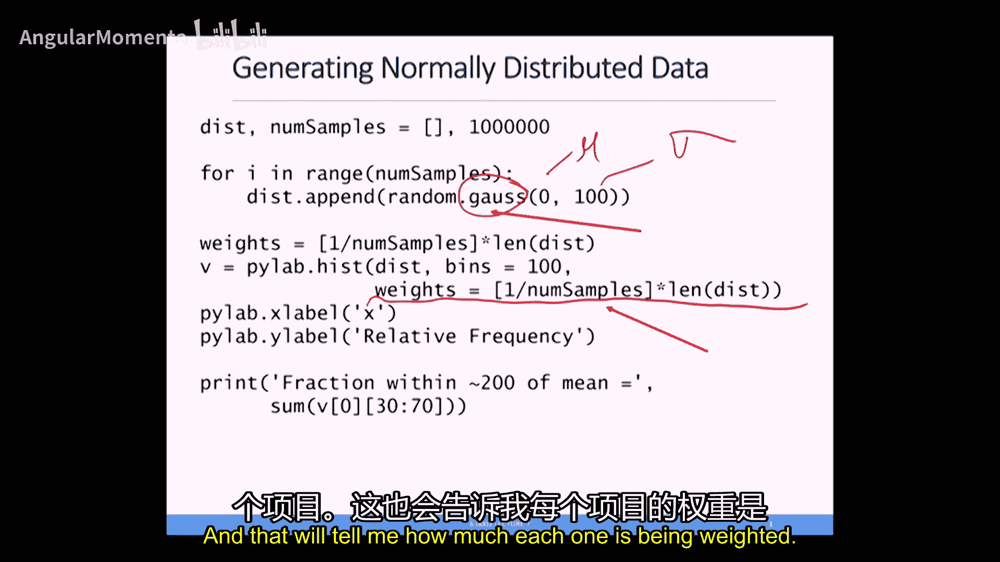
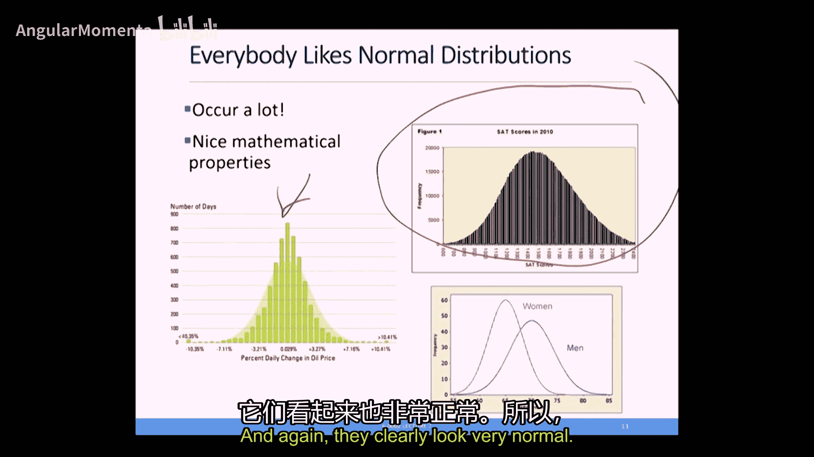
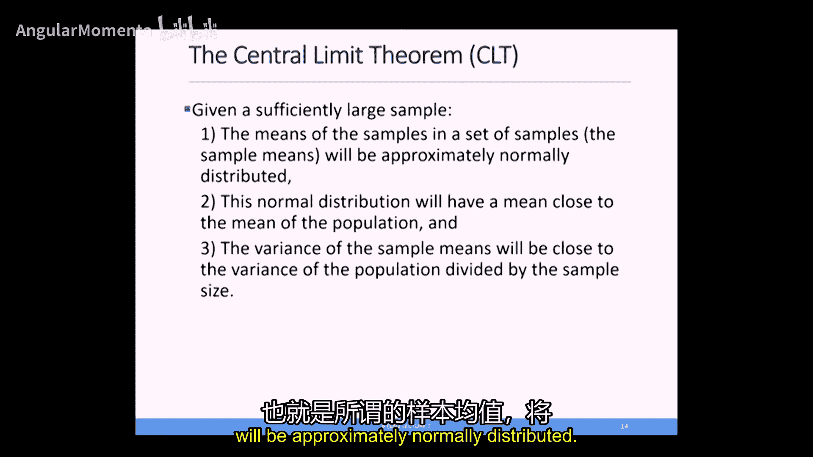
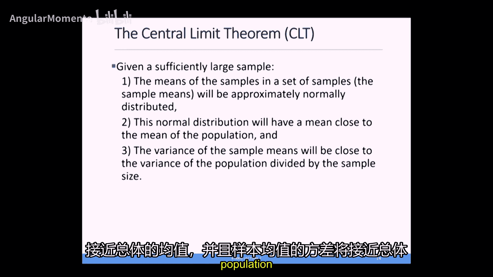
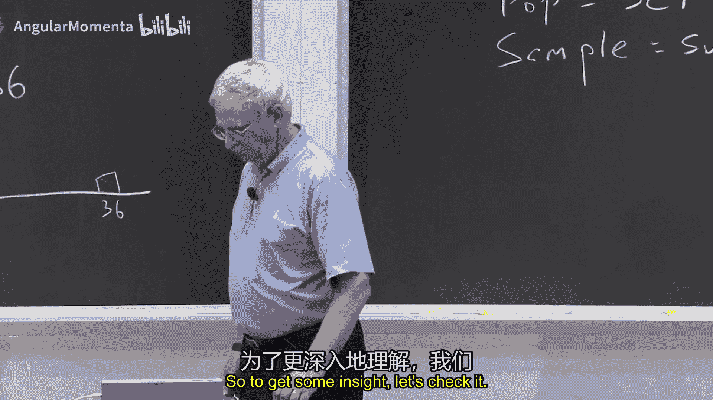
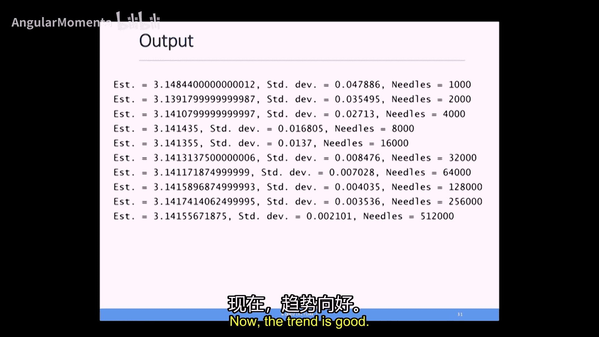
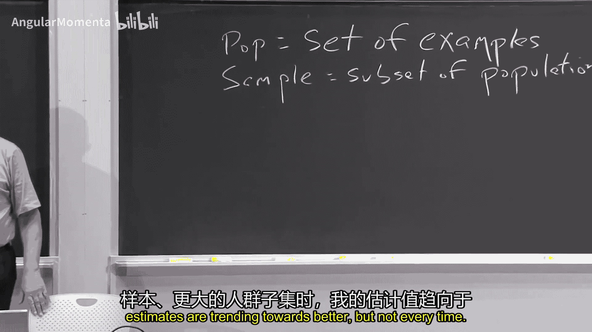
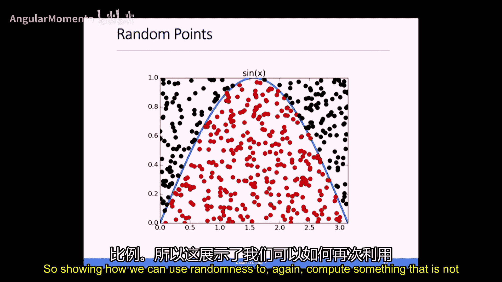

# 【麻省理工】计算思维与数据科学导论-｜-MIT-6.0002-Introduction-to-Computational-Thinking，Fall2016-p07-7.-置信区间--BV1zNjGzxEvk_p7-

The following content is provided under a Cative Commons license。

 Your support will help Mi T OpenCourseware continue to offer high quality educational resources for free to make a donation or to view additional materials from hundreds of MiT courses。

 Visit Mit Opencourseseware at Ocw。 Mt。 Eduu。

Hi， everybody。嗯。Welcome back to class。I have a lot to cover today。

 So I'm just gonna to get right to it。So you may remember at the end of last lecture。

 I talked about the empirical rule。And said that there were a couple of assumptions underlying it。

 that one is the mean estimation error is 0。 And second。

 that the distribution of errors will be normally distributed。 I didn't probably mention at the time。

 But we often call this distribution Gaussian after the astronomer， Carl Gauss。

And it looks like that。呃。Normal distributions are very easy to generate in Python。

And have a little example here of generating not a real normal distribution。

 but a discrete approximation of one。And the， the thing to really notice about it here is this line。

 random dot Gaus。So that's a built in function of the random library。The first argument is the mean。

And the second argument is a standard deviation or a mu in sigma， as are usually called。

Every time I call that， I will get a different， or usually a different random value drawn from a Gaussian with the mean。

 in this case， a 0 and a standard deviation of 100。

I'm then going to produce a plot of those so you can see what it looks like。

 And I'm going to do that using some things we haven't seen before。嗯。So first of all， we've。

 we've seen histograms。So P， P labb dot hist produces a histogram。

Bins tells us how many bins we want in the histogram。 I said we want 100。 The default is 10。

Dis is the values it will use for it。And then this is something we haven't seen before。Weights。

weights is a keyword argument。So normally， when we produce a histogram。We take all of the values。

The minimum to the maximum， in this case， we would divide them into 100 bins。

 because I said bins equals 100。And then， we would。For ever so the first bin might be。 well。

 let's say we only had values ranganging from 0 to 100。 The first bin would be all the zeros。

 all the ones up to all the 99s。U。And it weights each value in the bin by one。

So if the bin had 10 values falling in it， the Y axis would be a 10。

If the bin had 50 values falling in it， the Y axis would go up to 50。

You can tell it how much you want to weigh each bin。The， the， the elements in the bins and say， no。

 I don't want them each to count as 1。 I want them to count as a half or a quarter。

That will change the Y axis。So that's what I've done here。What I've said is， I've created a list。

And I want to say for each of the bins。 in this case。

 I'm going to give them weigh each of them the same way。The weight is going be。

1 over the number of samples。I'm multiplying it by the length of dis。 That will be。

How many items I have。 And that will tell me how much each one is being weighted。

So， for example。If I have， say，1000 items。I could give 1000 values and say。

 I want this item weighted by one。 and I want this item over here weighted by 12 or a half。

We rarely do that。 Usually what we want is to give each item the same weight。

So why would I want it not to be weighted at just one。

Because I want my Y axis to be more easily interpreted。As essentially。

 give me the fraction of the values that fell in that bin。And that's what I'm doing here。

The other new thing I'm doing here。Is。The plotting commands， including Pla dot hist。

 many of them return values。Usually， I just ignore that value。

 And we just say pabb dot plot or pyab dot hist。Here I am taking the value。The value in this case。

 for a histogram。Is a tuple of length 2， the first element。

Is a list or an array giving me how many items are in each bin。And。

The second is the patches used to produce the beautiful pictures we're used to seeing。

So here what I'm going to do is take this value so that I can do this at the end。Now。

 why would I want to look at the fraction within approximately 200 of the mean。

What is that going to correspond to in this case。Well， if I divide 200 by 2， I get 100。

Which happens to be the standard deviation。So in this case。

 what I'm going to be looking at is what fraction of the values。

Fall within two standard deviations of the mean， kind of a check on the empirical rule， right。

All right。When I run the code， I get this。So， it is。

A discrete approximation to the probability density function。You'll notice。

 unlike the previous picture I showed you， which was nice and smooth， this is jaggedy。

You would expect it to be。And。Again， you can see it very nice that the。The peak is what we said。

 The mean should be 0， and then it falls off and indeed。Slightly more than 95% fall within。

2 standard deviations of the mean。Not even surprised that it's a little bit more than 95% because remember。

 the magic number is 1。96， not2。But since this is only a finite sample。

 I only want it to be around 95。 I'm not going worry too much， whether it's bigger or smaller。

All right。So Rand Dot Gaust does a nice job of giving us Gaussian values。 We plotted them。

 And now you can see that I've got the relative frequency。😊，That's why I see fractions on the Y axis。

 rather than counts。And that was because of the way I used the weights command。Allright。

 let's return to P Dfs。So as we said last time， distributions can be defined by probability density functions。

That gives us the probability of some random variable lying between two values。

It defines a curve where the values in the X axis lie between the minimum and maximum values of the variable。

And it's the area under the curve， and we'll come back to this。

Between those two points that give us the probability of an example falling in that range。

So now let's look at it for a normal distribution。You may recall from the last lecture。

 this rather exotic looking formula。Which defines a P D F for normal distribution。And。

Here's some code that's as straightforward an implementation as one could imagine of this。

 this formula。Okay， so that now is a value that given a mu and a sigma and an x。

Gives me the X associated with that mu in sigma。Okay。

And you'll notice there's nothing random about this。Alright， it is giving me the value。Now。

Let's go down here。And I'm going to， for a set of x's。

 get the set of y's corresponding to that and then plot it。I'm going to set mu to 0 and sigma to 1。

 a so called standard normal distribution。And I'm going to look at the distribution from  -4 to 4。

Nothing magic about that other than， as you'll see， it's kind of a place where it asymptotes near 0。

So while x is less than 4。I'll get the X value。I'll get the y value corresponding to that X。

 by calling Gaussian。Increment x by 。05 and do that。Until I'm done。And then simply。

 I'll plot the x values against the y values。And throw a title on it using Pabb dot title。All right。

 code makes sense。Well。This is where I got that beautiful picture we've looked at before。

When I plot it here， it actually looks actually quite smooth。It's not。

 It's really connecting a bunch of tiny little lines。

But I made the points close enough together that it looks， at least here smooth at this resolution。

So we know what the values on the X axis are。 Those are the values I happen to。Want to look at。

From -4 to 4。What are the values on the y axis？We kind of would like to interpret them as probabilities。

 right。But we could be pretty suspicious about that。

 And that if we take this one point that's up here。

 we say the probability of that single point is 04。Well， that doesn't make any sense。Because。

 in fact， we know the probability of any particular point is 0 in some sense， right。So， furthermore。

If I chose a different value for sigma。I can actually get this to。Go bigger than one on the Y axis。

So if you take sigma to be， say 0。1， I think the y axis goes up to something like 40。

So we know we don't have probabilities in the range 40。So if these aren't probabilities。

What are they， What are the why values。Well。Not too surprising。

 since I claim this was a probability density function， They densities。Or what's a density。

If this makes sense， I I'll say it， then I'll try and explain it。 It's a derivative。

Of the cumulative distribution function。Now， why were we talking about derivatives in the first place。

Well， remember what we're trying to say。If we want to say， ask。

 what's the probability of a value falling between here。And here。

We claimed that that was going be the area under this curve。Right。The integral， as you know。

 from 1801， there's a very clear relationship between derivatives and integrals。And so。

If we interpret each of these points as a derivative， in some sense， the slope here。

Then we can look at this as the area， just by integrating under there。So to interpret a PDF。

 we always do it。Mathematically， actually， I do it just by looking at it。

 But the only really interesting mathematical questions to ask have to do with area。

Once we have the area， we can then talk about the probabilities。

Of some value falling within a region of the curve。

So what's interesting here is not the numbers per se on the y axis， but the shape of the curve。

Because those numbers have to be related to the numbers on the X axis。D， X， D， Y， right。

 We're looking at derivatives。All right， so now we have to talk about integration。

I promise you only hear about it for another few minutes。 then we'll leave the topic。

So I mentioned before sip Pi is a library that contains a lot of useful mathematical functions。呃。

One of them is。Integrate dot quad。WellThe integrate part is obvious。 It means integration。

 Quad is telling you the algorithm it's using to do the integration。

All of these integrals are going to be actual approximations to the real integral。Pi lab is。

 or S Pi is not doing some clever mathematics。 Get an analytical solution。

It's using a numerical technique to approximate the integral。

And the one that's used here happens to be called quadriature。 It doesn't matter。Alright。

 you can pass it up to four arguments。You must pass it the function to be integrated。

That makes sense。A number representing the lower limit of the integration。You need to give it that。

 A number representing the upper limit。 You need to give it that。

And then the fourth argument is a tuple。Supplying all values for the arguments to be except the first of the function you're integrating。

I'll show you an example of that， on the next slide。

And we'll see that it returns a tuple an approximation to the result， what it thinks the integral is。

And an estimate of how much error there might be in that one will ignore the error for the moment。

Alright， let's look at the code。So， we start by。Importing si pi dot integrate。

That gives us all the different integration methods。

I'm not going show you the code for Gaussian since I showed it to you a couple of minutes ago。

 but I wanted you to remember that it takes three arguments， X， mu and sigma。

Because when we get down here to the integration。We'll pass it to function Gaussian。And then。

The values that we want to integrate over。So those will be the values that X can take upon。

And that will change， as we go from。Mu minus the number of standard deviations time sigma to mu plus the number of standard deviations times time sigma。

And then this is the optional fourth argument， the tuple mu in sigma。Why do I need to pass that in？

Because Gaussian。Is a  ternary argument a function that takes three values。

And I'm going to integrate over values of x。 So I have to fix mu in sigma to constants。

Which is what I'm doing down here。And then I'll take the zeroth value。

 which is its estimate of the integral。Alright， so that's the new thing。

 The rest of the code is all stuff you've seen。For T and range number of trials。

 I'm going choose a random mu between -10 and 10 and a random sigma between 1 and 10 doesnn't matter what those constants are。

And then。For the number of standard deviations in 1，1。96 and 3。I'm going to integrate Gaussian。

Over that range。And then we're just going to see how many of them are fall within that range。

In some sense， what we're doing is we're checking the empirical rule。We're saying， take a Gaussian。

 I don't care what you and Sigma are。 Does't matter。 The empirical rule will still hold， I think。

But we're just checking it here。Okay。Well， here are the results。

So from R equals 9 and sigma equals 6， happen to choose those。We'll see the fraction points in one。

Fraction when 1。96 and 3。And so for these random mus in sigmas， you can see that all of them。

 you can set them to whatever you want when you get your hands on the code。Essentially。

 what we have is whoops。The empirical rule actually works。

One of those beautiful cases where you can test the theory and see that the theory really is sound。

So。There we go。So why am I making such a big deal of normal distributions。

 They have lots of nice mathematical properties， some of which we've already talked about。

 But all that would be irrelevant if we didn't see them。The good news is they're all over the place。

 I've just taken a few here up here。 We'll see SAT scores。

 I would never show that to high school students。😊，But。Or G R E to you guys。

 But you can see that they're amazingly well distributed as long a normal distribution。😊，嗯。

On downown here。This is plotting percent change in oil prices。And again。

 we see something very close to a normal distribution。

And here is just looking at heights of men and women。 And again， they clearly look very normal。

嗯。So， it's really。Quite impressive。 how often they occur。But not everything is normal。

So we saw that the empirical rule works for normal distributions。 I just。

 I won't say I proved it for you。 I illustrated it for you， with a bunch of examples。呃。

But are the outcomes of the spins of a roulette wheel normal。No， they're totally uniform， right。

 Everything is equally probable，4， 6 an 11 or 13， double 0。 If you're in Las Vegas。

 they're all equally probable。So if I plotted those。I basically just get a straight line。

With everything at one over， however many pockets there are。So in that case。

 why does the empirical rule work。We saw that we were doing some estimates about returns。

And we used the empirical rule。 We checked it。 And by George， it was telling us the truth。

And the reason。Is because we're not reasoning about a single spin of the wheel。

But about the mean of a set of sts。So if you think about it。

 what we were reasoning about was the return of betting。If we look at one spin。Well。

 let's say we bet a dollar。

The return is either -1 because we've lost our dollar。

Or if we get lucky in our pocket happens to come up， it was 36， I think， or 35。 I forget which。Okay。

 but that's all。So if we plotted a histogram。We would see a huge peak。At  -1。

And a little bump here at 36。And nothing in the middle。Clearly， not a normal distribution。

But what we're reasoning about is not the return of a single spin， but the return of many spins。

 If we played 1000 spins， what is our expected return。

As soon as we end up reasoning not about a single event， but about the mean of something。

We can apply something called the central limit theorem。And here it is。

 It's actually for something so important， very simple。

It says that given a sufficiently large sample， I love terms like sufficiently large。

But we'll later put a little meat on that。 The following three things are true。

The means of the samples in a set of samples。The so called sample means will be approximately normally distributed。

So， that says。If I take。A sample。 And remember， a sample might have will have multiple examples。

So just to remind people。A population。Is a set of examples。

A sample。Is a subset。Of the population。So it， too， is a set of examples， right， typically。

If this set is sufficiently large。Certainly， one is not sufficiently large。

Then it will be the case that the mean。Of the means。So I take the mean of each sample。

And then I can now plot all of those means sort take the mean of those， right。

And they'll be normally distributed。Furthermore。This distribution will have a mean that is close to the mean of the population。

The mean of the means will be close to the mean of the population。

And the variance of the sample means will be close to the variance of the population divided by the sample size。

This is really amazing that this is true。And。Dramatically useful。So to get some insight。

 let's check it。

To do that， postulate that we have this kind of miraculous dye。

So instead of a dye that when you roll it， you get a number 1，2，3，4，5 or 6。

 this particular die is continuous。It gives you a real number between 0 and 5。

 Or maybe it's between 1 and 6。Okay。So， it's a continuous die。What we're going to do。

Is roll it a lot of times。We're going to say， how many die。

And then how many times are we going to roll that number of die。

 So the number of die will be the sample size。 numberumb of dice will be the sample size。

 and then we'll take a bunch of samples。Which I'm calling number of roles。 And then we'll plot it。

 And I'm just saying choosing some bins and some colors and some style and。Various other things。

 just to show you how we use the keyword arguments。So for。Actually， I said number roles is。

 is the number of trials， but it isn't。Quite that。Because I'm going get the number of trials by dividing the number of rolls by the number of dice。

So if I have more dice， I get to have fewer samples， more dice per sample。All right。

And we'll just do it。So it will be between 0 and 5 because random dot random returns the number between 0 and 1。

And I'm multiplying it by 5。And then we'll look at the means， and we'll plot it all。Again。

 we're playing games with weights just to make the plot a little easier to read。

And here's what we get。If we roll one die。The mean is very close to 2。5。Well。

 that's certainly what you'd expect， right？ It's some random number between 0 and 5，2。

5 is a pretty good guess as to what it should average。And it。Has a standard deviation of 1。44。

That's a little harder to guess that that's what it would be。

 But you could figure it out a little math。 or as I did here with the simulation。But now。

 if I roll 50 dice。Well， again， the mean is close to 2。5。It's what you'd expect， right。

I roll 50 dive。 I get the mean value of those 50。But look how much smaller the standard deviation is。

More importantly， what we see here。Is that。If we look at the value， the probability。

Is flat for all possible values between 0 and 5 for a single die。

But if we look at the distribution for the means。It's not quite Gaussian， but it's pretty close。

Why is it not Gaussian， Well， I didn't do it an infinite number of times。Did it quite a few。

 but not an infinite number enough that you didn't want to sit here while it ran。

But you can see the amazing thing here that when I go from looking at one to looking at the mean of 50。

 suddenly。😊，I have a normal distribution。And that means that I can bring。To baron the problem。

The central limit theorem。We can try it for Roulette。Again。

 I'm not going to make you sit through a million trials of 200 spins each。

I'll do it only for fair roulette。And again， this is a very。Simple simulation。

And we'll see what we get。And what we see is， it's not。Quite normal again。

But it definitely has that shape。Now， it's going be a little bit strange。Because。

I can't lose more than one， right， if if I'm betting one。So it will never be quite normal， right。

 because it's going be truncated down on the left side。Whereas the tail can be arbitrarily long。So。

 again， we'll。Mathematically， it can't be normal。But。

It's close enough in the main region where most of the values lie that we can get away。

With applying the empirical rule and looking at answers。And indeed， as we saw， it does work。

So what's the moral here。It doesn't matter what the shape of the distribution of the original values happened to be。

If we're trying to estimate the mean。Using samples that are sufficiently large。The C。

 LT will allow us to use the empirical rule。When computing confidence intervals。

Even if we go back and look at this anomaly over in the left。What do you think would happen if I。

 instead of had 200 had， say，1000。What's the probability？😡。

Of the average return being -1 of 1000 bets。Much smaller， right than for 100 bets。

To lose1 thousand times in a row is pretty unlikely。

So to get all the way to the left is going be less likely。 And therefore。

 the thing will start looking more and more normal。As the samples get bigger。All right。

And so we can use the C， O T。To justify using the empirical rule when we compute confidence intervals。

Alright， I want to look at one more example in detail。 This is kind of an interesting one。

You might think that randomness is of no use for， say， finding the value of pi。

Because there's nothing random about that。Similarly。

 you might think that randomness was of no use in integrating a function。But， in fact。

 the way those numerical algorithms work is they use randomness。

What you're about to see is that randomness and， indeed， things related to Monte Carlo simulations。

Can be enormously useful， even when you're computing something that is inherently not random。

Like the value at pie here。And we won't ask you to remember that many digits on the quiz in the exam。

 Allright， so what's pi。But people have known about pie for thousands and thousands of years。

And what people knew。Was that there was some constant。We'll call it pi。

 It wasn't always called that such that it was equal to the circumference of a circle divided by the diameter。

And， furthermore。The area was going be pi R squared。

People knew that way back to the Babylonians and the Egyptians。What they didn't know。

Is what that value was。The earliest known estimate of pie was by the Egyptians on something called the Rndha papyrus。

 pictured here。And they estimated pi to be  four times 8 over 9 squared， or 3。16。Not so bad。

About 1100 years later later。An estimate of pie appeared in the Bible。King 7，23。Didn't say pie is。

 but。It described， I think this was a construction of King Solomon's temple。

He made a molten see 10  cubits from one brim to the other。 It was round。 I。 It was a circle。

 His height was 5 qubits， and a line of 30  cubits did composite round about。Well。

 if you do the arithmetic， what does this imply the value of pi to be。3。

And I'm sure that's what Mike Pence thinks it is。嗯。About。About 300 years later。

Aimedes did a better job of it。He estimated pi by constructing a 96 sided polygon。

There's a picture of one。 It looks a lot like a circle。On the left is one with fewer sides。

 And what he did is he then。Since it was a polygon。

 he knew how to compute its area or its circumference。 And he just counted things up。 And he said。

 well， Pi is somewhere between 223 over 71 and 22 over 7。And that turns out to actually。

 if you look take the average of that， be a really good estimate。2，000 years after Archimedes。

EThe French mathematicians Buffon and Laplaceaz， proposed finding the value of Pi using what we would today call a Monte Carlo simulation。

They did not have a computer to execute this on。So what they proposed。Started with this mathematics。

 They took a circle and inscribed it in a square。Squa of two per。2 units of whatever it is perside。

 And therefore， we know that the area of the square is two times 2 or 4。

We know that the area of the circle。Is pi R squared。And since we know that R is one。

 because that's the square it's inscribed then we know that the area of the circle is exactly pi。

What Buffal then proposed was dropping a bunch of needles at random。You know。

 kind of like when Professor Grimson was sorting things。And seeing where they land。

Some would land in the square， but not in the circle。 Some would land in the circle。

 You would ignore any that landed outside the square。And then they said， well。

 since they're falling at random。The ratio of the needles in the circles and the needles in the square。

Should exactly equal the area of the square over the area of the circle。

Exactly if you did an infinite number of needles。That make sense。Now， given that。

 you can do some algebra。And solve for the area of the circle。

And say it has to be the area of the square。Times the number of needles in the circle divided by the needles in the square。

And since we know that the area of the circle is pi。

That tells us that pi is going to equal four times the needles in the circle。

 Thats4 is the area of the square， divided by the number of needles in the square。

And so the argument was， you can just drop a bunch of these needles。See where they land， add them up。

 And from that you would magically now know the actual value of pi。Well。

 we tried a simulation one year in class， but rather than using needles。

 we had an archer and we blindfolded him so he would shoot arrows at random。

And we would see how see where they ended up。There's a video of this here。 If you'll want to see it。

 I'm gonna play only the very end of the video， which describes the results。

Maybe we should just use Python to build a Monte Carlo simulation instead。

So that's what happened after it was all over Anna came up and gave me some sound advice。 Yeah。

 I was very proud of that particular shop with the Apple。😊。

I had hoped the student would put it on his or her head， but no one volunteered。

That was not done blindfold， at any rate。So， here's。The simulation。So first。

 we have throwing the needles。嗯。For needles can range one to number of needles plus one。

We're going choose that Random X， or random Y。And we're gonna to see whether or not it's in the circle。

 And there we'll use the pythagorean theorem to tell us that， right。And we'll just do this。

 And then we're going to return exactly the formula we saw on the previous slide。

Now comes an interesting part。 We need to get an estimate。

So we start with the number of needles and the number of trials。For tea in range number of trials。

 we'll get a guess by throwing number of needles。And then， we'll。Append that guess。

To our list of estimates。We'll then compute the standard deviation。Get the current estimate。

 which will be the sum of the estimates divided by the length of the estimates。

 just the mean of the estimates。And then， we'll print it。Alright。

 so given a number of needles and a number of trials。

 we'll estimate pi and we'll give you the standard deviation of that estimate。However。

 to do that within a certain precision， I'm going have yet another loop。

And I'm showing you this because we often structure simulations this way。So what I have here is。

 well， the number of trials， which is not so interesting， but the precision。I'm saying。

 I would like to know the value of pi， and I would like to have good reason to believe。

That the value give me is within 0005 in this case， of the true value。O， or maybe more precisely。

 I'd like to know with a confidence of 95%。That the true value is within a certain range。

So what this is going to do。Is it's just gonna， I should have probably used 1。96 instead of 2， but。

 oh， well。It's just gonna keep。Increasing the number of needles， Doubling the number of needles。

Until it's confident about the estimate。confident enough。Alright， so this is a very common thing。

We don't know how many needles we should need。 So let's just start with some small number and we'll keep going until we're good。

Allright， What happens when we run it。Well， we start with some estimates when we had 1000 needles。

It told us that Pi was 3。148。And standard deviation was 0。04，7， etc cetera。

 So a couple of things to notice。1。Are my estimates of pie getting monotonically better。

You'd like to think， as I add more needles， my estimates are getting more accurate。

So that's question 1。 Are they getting more accurate。Not monotonically， right。If we look at it。

 where， where are they getting worse， And let's see。嗯。th3。Alright，3。148。 Well，3。13 is already worse。

 right。So I double the number of mes， and I get a worse estimate。Now， the trend。Is good。

Right by the time I get here。

I've got a pretty good estimate。So overall， as I look at larger samples。

A bigger subset of the population。 My estimates are trending towards better， but not every time。

On the other hand， let's look at the standard deviations。

What we see here is that the standard deviations are， indeed。Getting monotonically better。Now。

 there's nothing mathematical guaranteeing that， right， because there is randomness here。

But I'm increasing the number of needles by so much that it kind of overrides。

The bad luck of maybe getting a bad， random set。And we see those are getting better。

So the important thing to see here is not that I happen to get a better estimate。But that， I know。

More about the estimate， I can have more confidence in the estimate。Because。It's closing in on it。

So the moral here is it's not sufficient to produce a good answer。 I've said this before。

We need to have reason to believe that it is close to the right answer。So in this case。

 I'm using the standard deviation and say， given that it's gotten quite small。Now，2 times01。

96 times 0002 is indeed a small number。I could make it smaller， if I wanted。I believe that。

 I have good reason to believe I'm close to the right value of pi。Everyone agree with that。

Is that right？Not quite， actually。It would be nice if it were true， but it isn't。

So let's look at some things。Is it correct to state that 95% of the time we run this simulation willll get an estimate of pi between these two values。

I don't expect you to be arithtic in your head， but the answer is， yes。

So that is something we believe is true。By the math we've been looking at for the last two lectures。

Next statement， with the probability of 095， the actual value of pi is between these two things。

Is that true。In fact。If I were to say with the probability of one。

 the actual value is pi is between those two values， would it be true。Yes。So。They're both true facts。

However。Only the first of these can be inferred from our simulation。While the second fact is true。

 we can't infer it from the simulation。And to show you that。St test。

The gleeval is not the same as true。We look at this。I've introduced a bug in my simulation。

I've replaced the four。That we saw， we needed by two。🎼You know， easy kind of mistake to make。

 And now， if we go to the code。Well， what do you think will happen if we go to the code and run it。

We'll try it。We'll go down here to the code。We'll make that a two。And what you'll see is， it runs。

Is that。Once again， we're getting very nice confidence intervals。But totally bogus values of pi。

Rightright， so the statistics can tell us something about how reproducible our simulation is。

But not whether the simulation is an actually accurate model of reality。So what do you need to do。

 You need to do something like a sanity check。So here you might look at a polygon and say， well。

 clearly， that's a totally wrong number。 Something is wrong with my code。Okay。So。Just to wrap up。

What we've shown is a way to find pi。This is a generally useful technique。

To estimate the area of any region R。You pick an enclosing region， Call it E。

 such that it's easy to estimate。The area of E。And our lies within it。

Pick some random sets of points within E。Let F be the fraction that fall within R， multiply E by F。

And you're done。 So this， for example， is a very common way to do integration。

I promised you we'd talk about integration。 So here's a sign of x。

 If I want to integrate the sine of x over some region。As done here， all I need to do。

Is pick a bunch of random points， red and black in this case。

And look at the ratio of one to the other。So。Showing how we can use randomness to， again。

 compute something that is not inherently random。

This is a trick people use over and over and over again。😡。

When confronted with some situation where it's not easy to solve for things mathematically。

You just do a simulation。 And if you do it right， you get a very good answer。All right。

 we will move on to a different topic on Wednesday。

