# 【麻省理工】计算思维与数据科学导论-｜-MIT-6.0002-Introduction-to-Computational-Thinking，Fall2016-p08-8.-抽样与标准误差--BV1zNjGzxEvk_p8-

The following content is provided under a Cative Commons license。

 Your support will help Mi T OpenCourseware continue to offer high quality educational resources for free to make a donation or to view additional materials from hundreds of MiT courses。

 Visit Mit Opencourseseware at O Cw Mt Eduu。

Good afternoon， everybody。啊。Welcome to。Lecture 8。 So we're now more than halfway through the。

 the lectures。

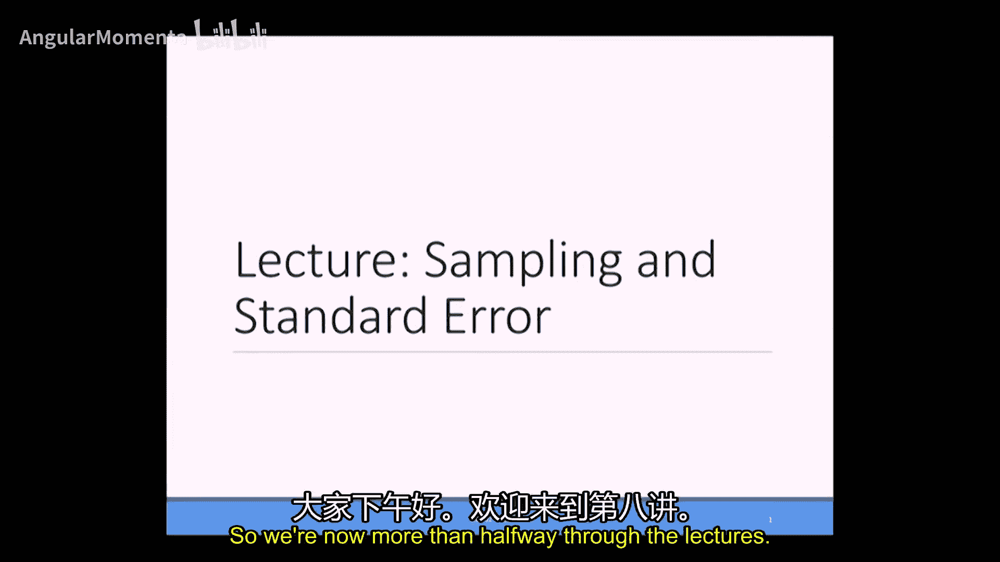

Alright， the topic of today is sampling。I want to start by reminding you about this whole business of inferential statistics。

We make references about populations by examining one or more random samples drawn from that population。

We used Monte Carllo' simulation over the last two lectures。And the key idea there。

 as we saw in trying to find the value of pi， was that we can generate lots of random samples。

And then use them to compute confidence intervals。And then we use the empirical rule to say。

 all right。

We really have good reason to believe that 95% of the time we run this simulation。

 our answer will be between here and here。Well， that's all well and good when we're doing simulations。

But what happens when you have to actually sample something real。For example。

 you run an experiment and you get some data points， and it's too hard to do it over and over again。

Think about political polls。 Here was an interesting poll。How are these created not by simulation。

They didn't run 1000 polls and then compute the conference interval。 They ran one poll。Of 10。

835 people in this case。 And yet。They claim to have a confidence interval。

 That's what that margin of error is。嗯。Obviously。They needed that large confidence interval。

So how is this done。Well， it's。Backing up for a minute。

 let's talk about how sampling is done when you are not running a simulation。

You want to do what's called probability sampling。In which each member of the population has a nonze probability of being included in a sample。

There are roughly speaking two kinds。 We'll spend really all of our time on something called simple random sampling。

And the key idea here is that each member of the population has an equal probability of being chosen in the sample。

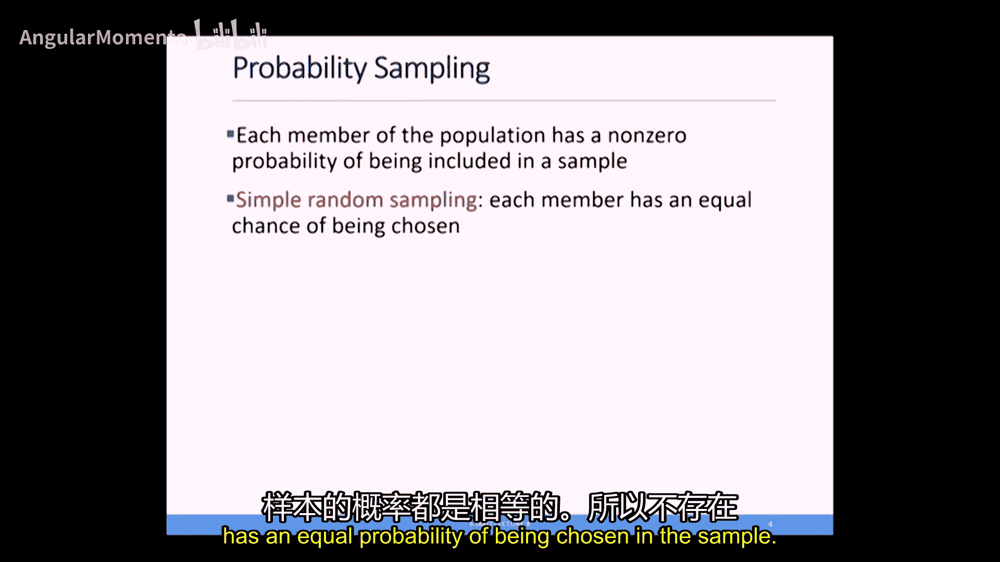

Alright， so theres no bias。Now， that's not always appropriate。

 And I do want to take a minute to talk about why。So suppose we wanted to survey M I T students to find out whether theyre what fraction of them are nerds。

Which， by the way， I consider a compliment。 So suppose he wanted to consider a random sample of 100 students。

We could walk around campus and choose 100 people at random。And if。12% of them werenerds。

 We would say 12% of the M T undergraduates are nerds， if 98%， etctera。Well。

 the problem with that is， let's look at the majors by school。You this is actually the。

Under the majors at M I T by school。 And you can see that they're not exactly evenly distributed。

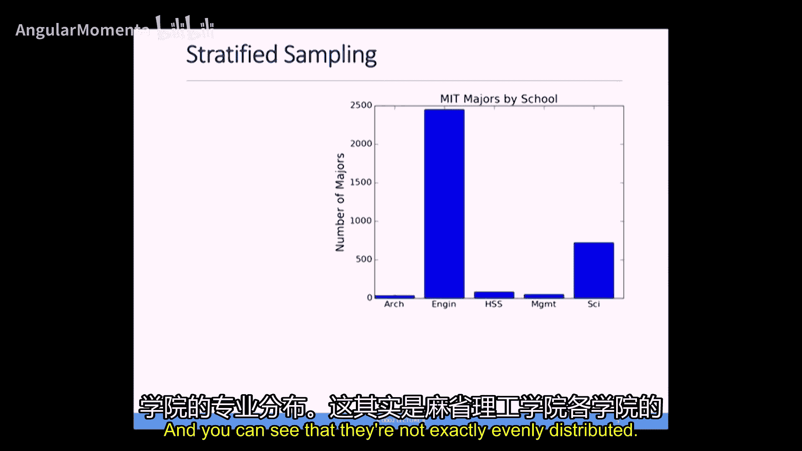

And so if you went around and just sample 100 students at random。

There'd be a reasonably high probability that they would all be from engineering and science。

And that might give you a misleading notion of the fraction of M I T students that were nerds。

Or it might not。In such situations， we do something called stratified sampling。

Where we partition the population into subgroups。And then take a simple random sample from each subgroup。

And we do that proportional to the size of the subgroups。

 So we would certainly want to take more students from engineering than from architecture。

But we probably want to make sure we got somebody from architecture in our sample。This， by the way。

 is the way most political polls are done。 They're stratified。They said， we want to get。

So many rural people， so many， so many city people， so many minorities， things like that。

 And in fact， that's probably where the election recent polls were all messed up。

 is they did a very retrospectively， at least a bad job of stratifying。

So we use stratified sampling when there are small groups。

 subgroups that we want to make sure are represented。

And we want to represent them proportional to their size in the population。

This can also be used to reduce the needed size of the sample。

If we wanted to make sure we got some architecture students in our sample。

 we'd need to get more than 100 people to start with。But if we stratify。We can take fewer samples。呃。

It works well when you do it properly， but it can be tricky to do it properly。

And we are going to stick to simple， random samples here。Alright， let's look at an example。

So this is a map of temperatures。In the United States。

 And so our running example today will be sampling to get。Information about the average temperatures。

And， of course， as you can see， they're highly variable。 and we live in one of the cooler areas。

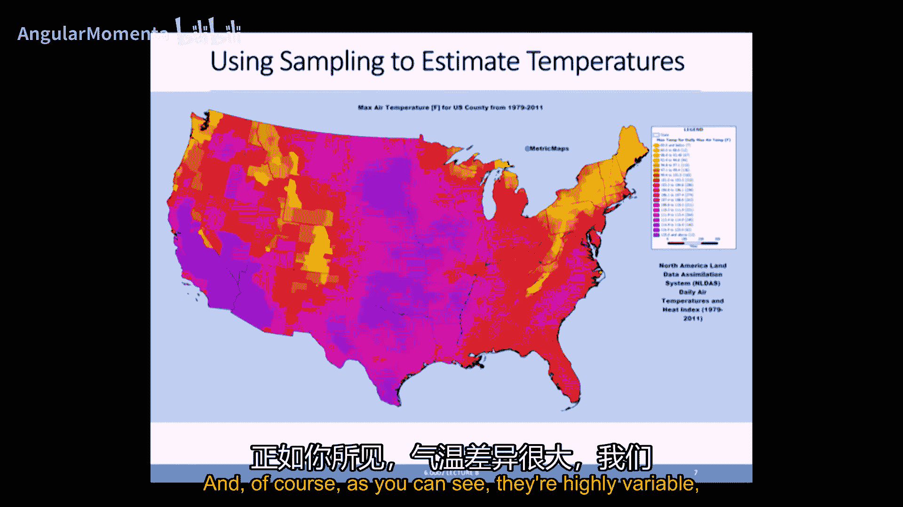

The data we'll be going to use as real data， and it's in the zip file that I put up for the class from the US Centers for Environmental Information。

And it's got the daily， high and low temperatures for 21 different American cities every day from 1961 through 2015。

So it's， it's an interesting dataset set， a total of about 422000 examples in the data。

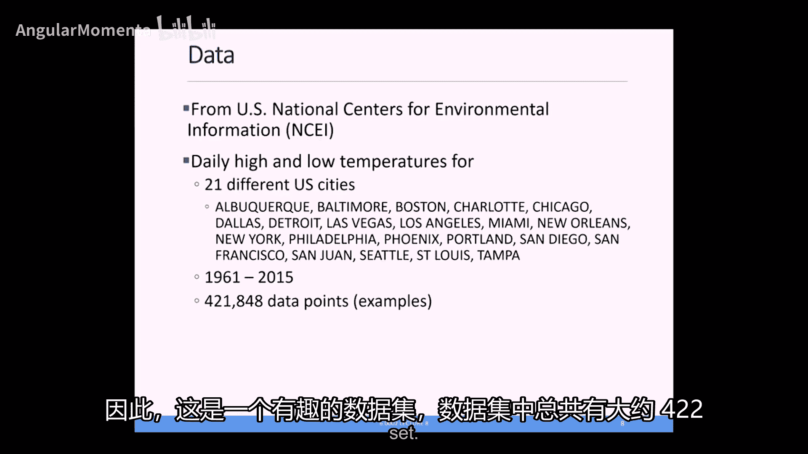

So a fairly good sized data set。 it's fun to play with。Alright。

 so we're sort of in the part of the course where the next series of lectures， including today。

 is going be about。Data science had to analyze data。

I always like to start by actually looking at the data， getting， not looking at all 421000 samples。

 but giving a plot to sort of give me a sense of what the data looks like。

I'm not going to walk you through the code that does this plot。

 I do want to point out that there are two things in it that we may not have seen before。So。

Simply enough， I'm going to use nuumpy dot S TD to get standard deviations instead of my own code for it。

And random doc sample。To take。Simple random samples from the population。

Randomabout sample takes two arguments。 The first is some sort of a sequence of values。

And the second is an integer telling you how many samples you want。

And it returns a list containing sample size， randomly chosen， distinct elements。

Distinct elements is important。Because there are two ways that people do sampling。

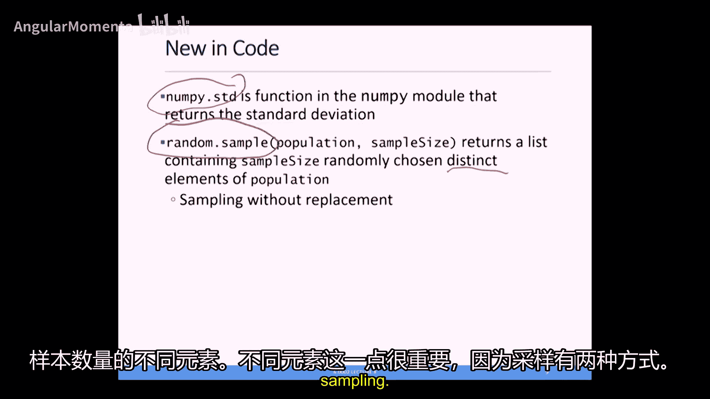

You can do sampling without replacement， which is what's done here。That you take a sample。

 and then it's out of the population。 So you won't draw out the next time。

 or you can do sampling with replacement， which allows you to draw the same sample multiple times。

 the same example， multiple times。

We'll see later in the term that there are good reasons that we sometimes prefer sampling with replacement。

But usually， we're doing sampling without replacement。 And that's what we'll do here。

 So we won't get Boston on April 3 multiple times， or not the same year， at least。Alright。

 so here's the histogram the code produces。You can run it yourself now if you want。

 or you can run it later。And here's what it looks like。 the daily， high temperatures。The mean is 16。

3 degrees Celsius。I sort of vaguely know what that feels like。嗯。And as you can see。

 it's kind of an interesting distribution。 it's not normal。But， it's not。That far， right。

 We have a little tail of these cold temperatures on the left。And it's， it's， it is what it is。

 It's not a normal distribution。 And we'll later see that doesn't really matter。Okay。

 so this gives me a sense。The next thing I'll get is some statistics。 So we know the mean is 16。3。

 and the standard deviation is， is approximately 9。4 degrees。So， if you look at it。

 you can believe that。Well。Here's a histogram of one random sample of size 100。

Looks pretty different， as you might expect。嗯。Its standard deviation is 10。4。 It mean 17。07。

So even though the figures look a little different。In fact。

The means and standard deviations are pretty similar。

If we look at the population mean and the sample mean。

 and I'll try and be careful to use those terms。They're not the same。

 but they're in the same ballpark。And the same is true of the two standard deviations。Well。

That raises the question。Did we get lucky？Or is something we should expect。

If we draw 100 random samples。Examples， should we expect。

ForGm to correspond to the population as a whole。And the answer is sometimes， yeah， and sometimes no。

 And that's one of the issues I want to explore today。

So one way to see whether it's a happy accident is to try it1 thousand times。

 We can draw 1 thousand0 samples of size 100。And plot the results。Again。

 I'm not going go over the code。 There's something in that code as well that we haven't seen before。

 And that's the A X dot V line plotting command， V for vertical。It just。

 in this case will draw a red line because I've said the color is R。At population mean on the X axis。

 So just a vertical line。

So that'll just show us where the mean is。 If we wanted to draw a horizontal line， we use A X。

 H line。Just showing you a couple of useful。Functions。Oh we try it a thousand times。

 here's what it looks like。

So。Here we see what we had originally。Same picture I showed you before。 And here's what we get。

 when we look at the means of 100 samples。So。This。Ploot on the left looks a lot more like it's a normal distribution in the one in the right。

Should that surprise us。

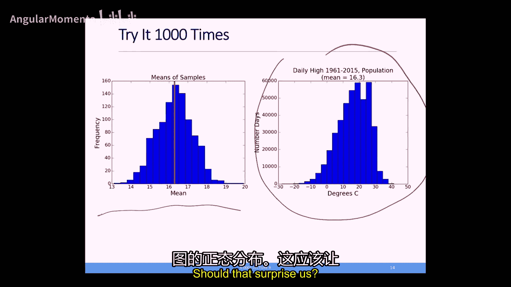

Or is there a reason we should have expected that to happen。Well， what's the answer。

 Someoneone tell me why we should have expected it。Because of the central limit theorem， right。

That's exactly what the central limit the theorem promised us would happen。

And sure enough， it's pretty close to normal。So that's a good thing。And now， if we look at it。

We can see that the mean of the sample means is 16。3。

And their standard deviation of the sample means， is 0。94。

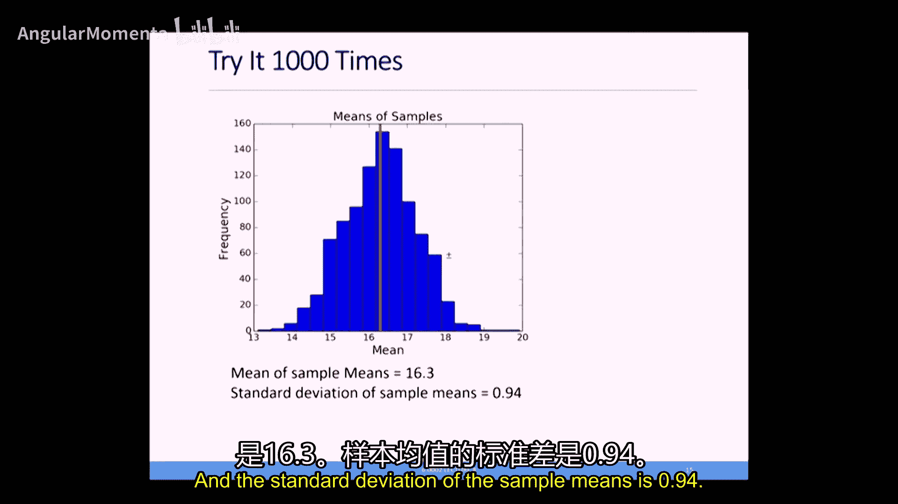

So if we go back。

To what we saw here， we see that actually， when we run it a thousand times and look at the means。嗯。

We get very close。To what we had initially。

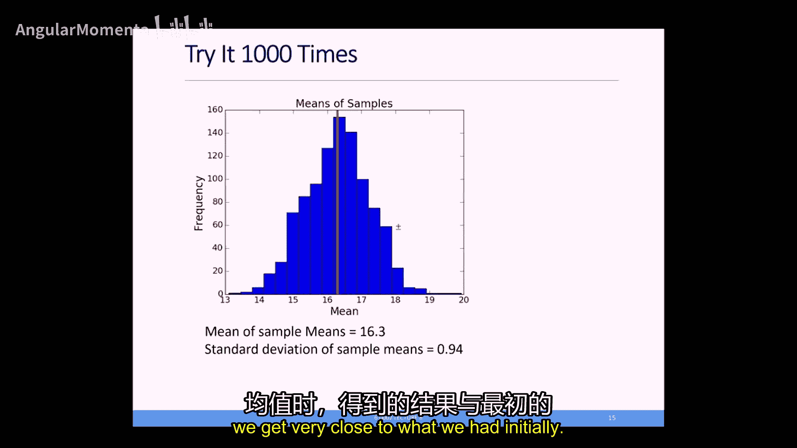

So， indeed， it's not a happy accident。

It's， it's something we can， in general， expect。All right， what's the 95% confidence interval here。

Well， it's going to be 16。28 plus or -1。96 times 0。94。The standard deviation of the sample means。

And so it tells us that the confidence interval is。The mean high temperature is somewhere between 14。

5 and 18。1。

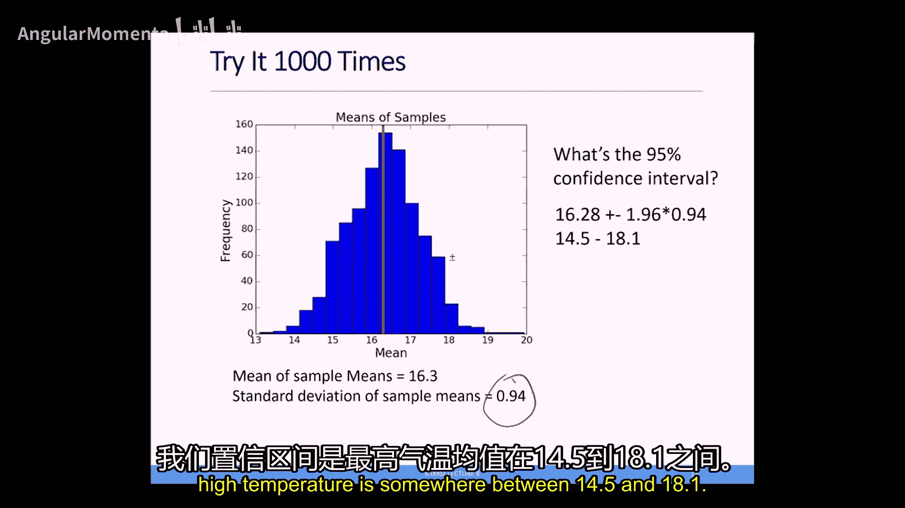

Well， that's actually a pretty big range， right， It's sort of enough to you where you wear a sweater or you don't wear a sweater。

嗯。So the good news is it includes the population mean。That's nice。But the bad news is。

 it's pretty wide。Suppose we wanted a tighter bound。I said， all right， Sure enough。

 the central limit theorem is going to tell me。The mean of the means is going give me。

A good estimate of the actual。Population mean， but。I want a tighter bound。 What can I do。Well。

 let's think about a couple of things we could try。Well， one thing we could think about is。

Drawing more samples。Suppose instead of 1000 samples， Id taken 2000 or 3000 samples。

We can ask the question， would that have given me a smaller standard deviation。

For those of you have not looked ahead， what do you think。

 Who thinks it will give you a smaller standard deviation。Who thinks it won't。

And the rest of you have either looked ahead or refused to think。

Ill prefer to believe you looked ahead。Well。We can run the experiment。 You can go to the code。

 and you'll see that。There's a constant of 1000， which you can easily change to 2000。

And lo and behold， the standard deviation barely budgets。Got a little bit bigger as it happens。

 but that's kind of an accident。

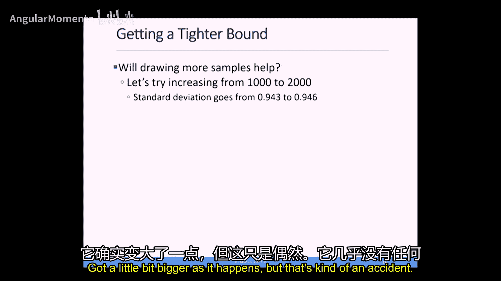

It just， more or less， doesn't change。

And it won't change if I go to 3000 or 4000 or 500， it'll wiggle around。But， it won't help much。So。

What we can see is doing it more often。Is not going to help。Suppose we take larger samples。

Is that going to help。Who thinks that will help。And who thinks it won't。Okay， well。We can， again。

 run the experiment。I did run the experiment。 I changed the sample size from 100 to 200。And again。

 you can run this if you want。 And if you run it， you'll get a result。 maybe not exactly this。

 but something very similar。That， indeed， as I increased the size of the sample rather than the number of the samples。

The standard deviation drops fairly dramatically。

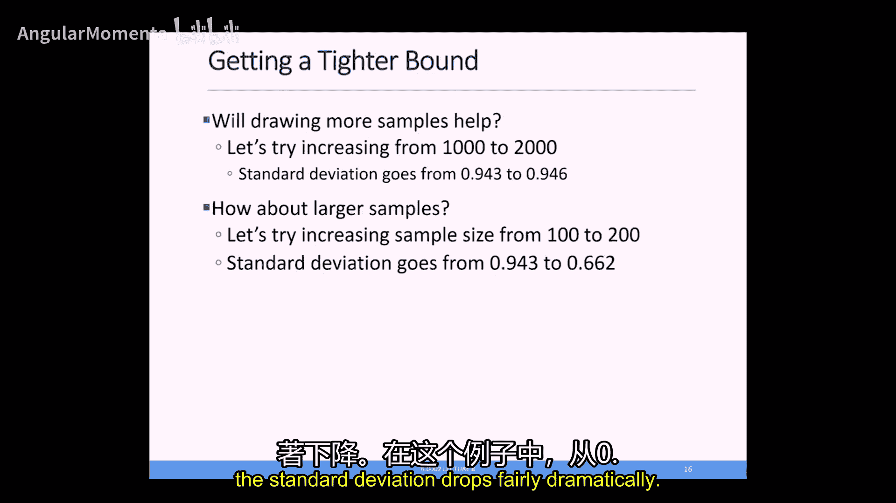

In this case， from 0。94 to 。66。So， that's a good thing。

I now want to digress a little bit before we come back to this and look at how you can visualize this。

Because this is a technique you'll want to use as you write papers and things like that。

Is how do we visualize the variability of the data。

And it's usually done with something called an error bar。 You've all seen these things here。

And this is one I took from the literature。This is plotting。嗯。Pulse rate。

Against how much exercise you do or how frequently you exercise。And what you can see here is。

 is there's definitely a downward trend。Suggesting that the more you exercise。

 the lower your average resting pulse。That's probably worth knowing。

And these error bars give us the 95% confidence intervals。For。Different subpopulations。

And what we can see here is that some of them overlap。So， yes， once a fortnight。

 two weeks for those of you who don't speak British。

It does get a little bit smaller than rarely or never， but the confidence interval is very big。

And so maybe we really shouldn't feel very comfortable that it would actually help。

The thing we can say。Is that if the confidence intervals don't overlap。

We can conclude that the means are actually statistically， significantly different。In this case。

 at the 95% level。So here we see that the more than weekly。Does not overlap with the rarely or never。

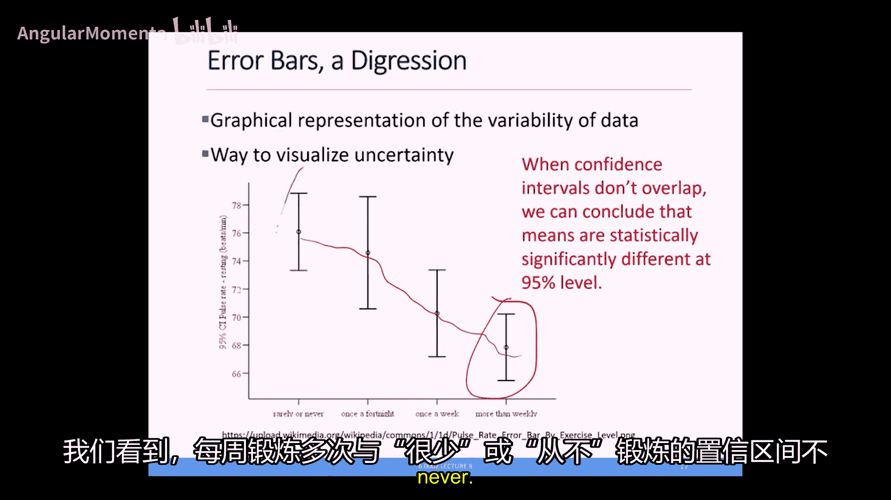

And from that， we can conclude that this is actually statistically true。

That if you exercise more than weekly， your pulse is likely to be lower than if you don't。

If confidence intervals do overlap。You cannot conclude that there is no statistically significant difference。

 There might be。 And you can use other tests to find out whether there are。When they don't overlap。

 it's a good thing。 we can conclude something strong。 When they do overlap。

 we need to investigate further。Alright， let's look at the error bars for our temperatures。And again。

 we can plot those using something called P labb dot error bar。So， what it takes。Is two values。

 the usual。X axis。And y axis。But then it takes another list of the same length or sequence of the same length。

 which is the Y errors。And here， I'm just gonna say 1。96 times the standard deviations。

Where these variables come from， you can tell， by looking at the code。嗯。

And then I can say the format， I want， an O to show the mean and then a label。FMT stands for format。

Eero bar has different keyword arguments than plot。 You'll find that you look at different ways。

 like histograms and bar plots。Scatter plots。 they all have different available keyword arguments。

 So you have to look up each individually。But。Other than this。

 everything in the code should look very familiar to you。And when I run the code， I get this。

And so what I've plotted here。Is the mean。Against the sample size。With error bars。And 100 trials。

 in this case。So， what you can see。Is that as the sample size。Gets bigger。The error bars get smaller。

The estimates of the mean don't necessarily get any better。You know， in fact， we can look。Here。

And this is actually a worse estimate。Relative to the true mean than the previous two estimates。

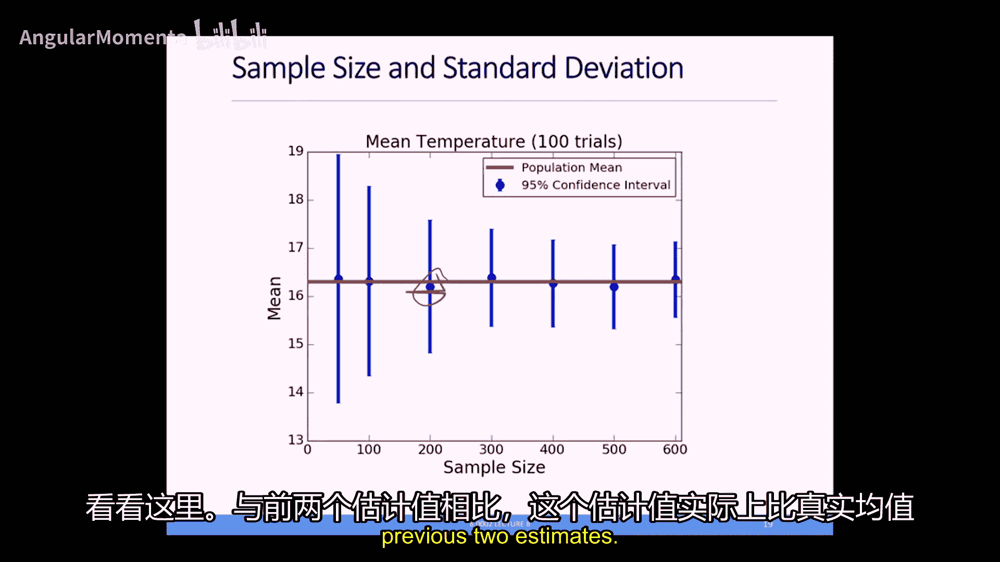

But we can have more confidence in it。The same thing we saw on Monday when we looked at estimating pie。

 dropping more needles didn't necessarily give us a more accurate estimate。

But it gave us more confidence in our estimate。And the same thing is happening here。

And we can see that steadily， we can get more and more confidence。So。Larger。

Samples seem to be better。That's a good thing。Going from a sample size of 50 to a sample size of 600。

Reduce the confidence interval， as you can see。From。A fairly large。啊。

The confidence interval here ran from just below 14 to almost 19。

As opposed to 15 and a half or so to 17。I said confidence interval here。 I should not have。

 I should have said， standard deviations。That's an error on the slides。Okay， what's the catch？ Well。

 we're now looking at。100 samples。Each of five，600。 So we've looked at a total of。600000 examples。

What is this brought us。Absolutely nothing。Right， the entire population only containing to about 422000 samples。

We might as well have looked at the whole thing。Rather than take a few of them。So it's like。

 you know， you might as well hold an election rather than ask 800 people1 thousand times who they're gonna。

 a million times who they're gonna vote for。

Alright， so sure， it's good， but it gave us nothing。嗯。Suppose we did it only once。

Suppose we took only one sample， as we see in political polls。What can we con conclude from that。

And the answer is actually， kind of surprising。How much we can conclude in a real mathematical sense。

 from one sample。And again， this is thanks to our old friend， the central limit theorem。

So if you recall the theorem， it had three parts。Up till now。We've exploited the first two。

We've used the fact that the means will be normally distributed so that we could use the empirical rule to get conference intervals。

And the fact that。The mean of the sample means would be close to the mean of the population。

Now I want to use the third piece of it。Which is that the variance of the sample means will be close to the variance of the population divided by the sample size。

And we're going to use that to compute something called the standard error。Of the formerly。

 the standard error of the mean people often just call it the standard error。

And I will be alas inconsistent。 Ill， I sometimes call it one， sometimes the other。Alright。

 it's a incredibly simple formula。Says the standard error。Is going be equal to sigma。

Where sigma is the population standard deviation。Divided by the square root of n。

Which is going to be the size of the sample。And then there's just this very small function that implements it。

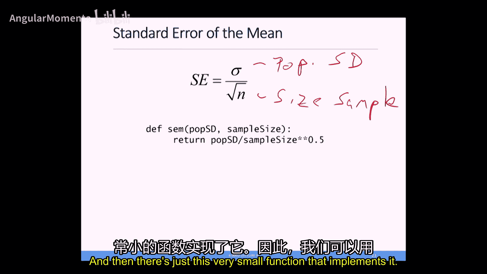

So， so we can compute this thing called the standard error of the mean。In a very straightforward way。

Well。We can compute it。But does it work， What did I mean by work。I mean。

 what's the relationship of the standard error to the standard deviation。

Because remember， that was our goal was to understand。The standard deviation。

 so we could use the empirical rule。Well， let's test the standard error of the mean。So， here's a。

Slightly longer piece of code。I'm going look at a bunch of different sample sizes。From 25 to 600。

50 trials each。嗯。So get highs is just a function that returns the。Temperatures。

I'm going to get the standard deviation of the whole population。

Then the standard error of the means and the sample standard deviations， both。

And then I'm just going to go through and and run it。 So for size and sample size。I'm gonna。

Append the standard error of the mean。And remember。

 that uses the population standard deviation and the size of the sample。So I'll compute all the S Ms。

And then I'm gonna compute all the。Actual standard deviations， as well。

And then we'll produce a bunch of plots or a plot， actually。Alright。

 so let's see what that plot looks like。Pretty striking。

So we see the blue solid line is the standard deviation。Of。The 50 means。

And the red dotted line is the standard error of the mean。So we can see quite strikingly here。

That they really track each other very well。And this is saying that。I can。

Anticipate what the standard deviation would be by computing the standard error。

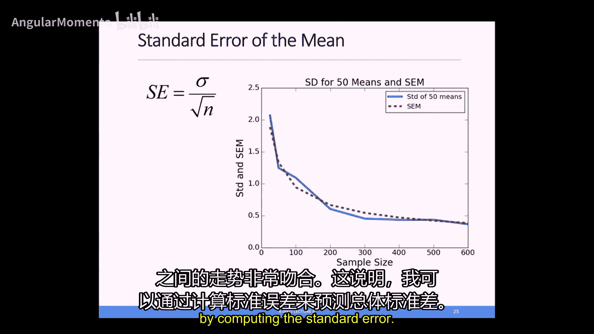

Which is really useful。Becauseuse now I have one sample。 I compute it standard error。

And I get something very similar to what I get of the standard deviation。

 If I took 50 samples and looked at the standard deviation of those 50 samples。All right， so。

Not obvious that this would be true， right， that I could use this simple formula。

And they two things would track each other so well。

And it's not a coincidence， by the way， that as I get out here near the end。

 they're really lying on top of each other。

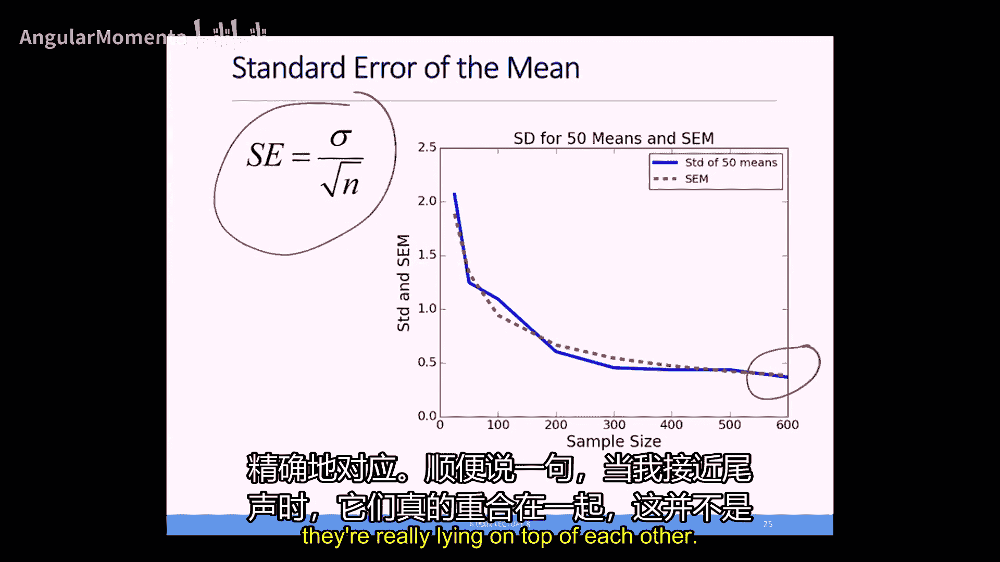

As the sample size gets much larger， they really will coincide。Okay。So， one。

Does everyone understand the difference between the standard deviation and the standard error。No。

 okay。 So how do we compute a standard deviation to do that， We have to look at many samples。

In this case，50。And we compute how much variation there is in those 50 samples。

For the standard error， we look at one sample。And we compute this thing called the standard error。

And we argue that we get the same number， more or less。That we would have gotten。

 had we taken 50 samples or 100 samples and computed the standard deviation。So， I can avoid。

Taking all 50 samples， if my only reason for doing it was to get the standard deviation。

 I can take one sample instead and use the standard error of the mean。

So going back to my temperature， instead of having to look at。Lots of samples。

 I only have to look at one。And I can get a conference interval。 that makes sense。Okay。

There's a catch。

Notice that the formula for the standard error includes the standard deviation of the population。

Not the standard deviation of the sample。Well。That's kind of a bummer。

Because how can I get the standard deviation of the population without looking at the whole population。

And if I'm going look at the whole population， then what's the point of sampling in the first place。

So， we have a catch。That we've got something that's a really good approximation。

But it uses the value。 we don't know。So what should we do about that？

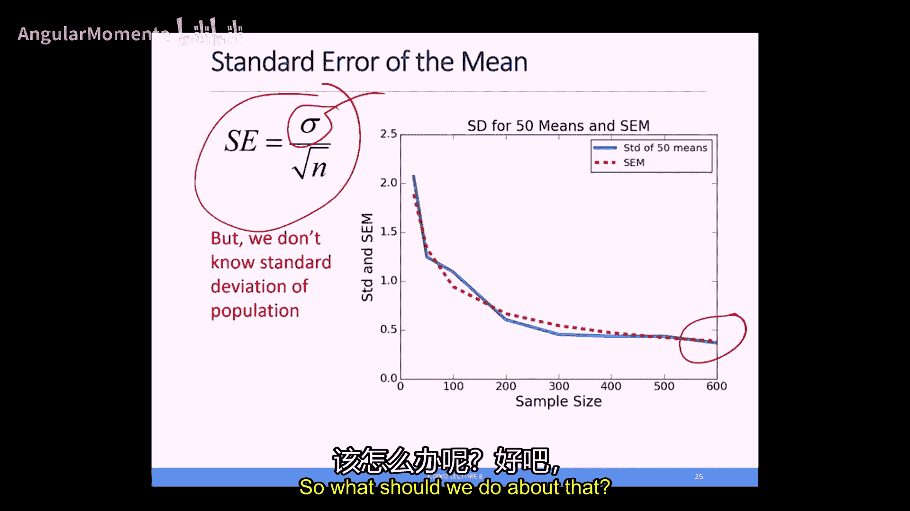

Well。What would be。Really， the only obvious thing to try。

What's our best guess at the standard deviation of the population If we have only one sample to look at。

Now， what would you use。Somebody。I know I forgot to bring the candy today。

 So no one wants to answer any questions。The standard deviation of samples is all I got。So。

 let's ask the question。How good is that。Shockingly good。

So I looked at our example here for the temperatures。

And I'm plotting the sample standard deviation versus the population standard deviation。

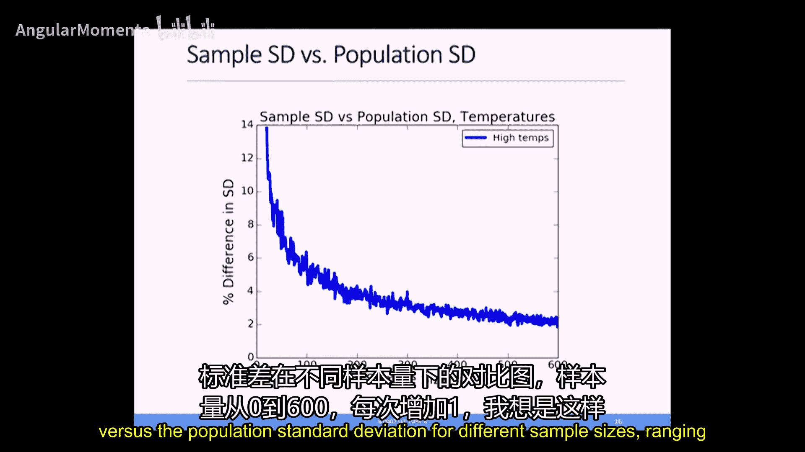

For different sample sizes。

Ranging from 0 to 600 by  one， I think。So what you can see here is when the sample size is small。

I'm pretty far off。 I'm off by 14% here。And I think， that's 25。But when the sample size is larger。

Say， 600。I'm off by about 2%。

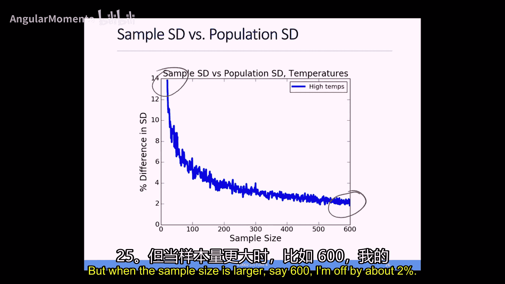

So what we see， at least for this data set of temperatures。If the sample size is large enough。

The sample standard deviation is a pretty good approximation of the population standard deviation。

Well， now we should ask the question。What good is this。Well。As I said。

 once the sample reaches a reasonable size and we see here， reasonable is probably somewhere。

Around 500。It becomes a good approximation。But。Is it true only for this example。

The fact that it happened to work for high temperatures in the US。

Doesn't mean that it will always be true。So there are at least two things we should consider to asking the question。

 when will this be true， when it won't， when won't it be true。One is。

 does the distribution of the population matters。So here we saw in our very first plot the distribution of the high temperatures。

 and it was。Kind of symmetric around a point， not perfectly。

But not everything looks that way， right。So we should say， well。

 suppose we had a different distribution。Would that。Change this conclusion。

And the other thing we should ask is， well， suppose we had a different size population。

Suppose instead of 400000 temperatures， I had 20 million temperatures。

Would I need more than 600 samples for the two things to be about the same。Well。

 let's explore both of those questions。First， let's look at the distributions and we'll look at three common distributions。

A uniform distribution， a normal distribution and an exponential distribution。

And we'll look at each of them for。 what is this，100000。Points。

So we know we can generate a uniform distribution by calling random dot random。

Gives me a uniform distribution of real numbers between 0 and 1。

We know that we can generate a normal distribution by calling random Gaus。In this case。

 I'm looking at it between。With a mean of 0 and a standard deviation of one。

 But as we saw in the last lecture， the shape will be the same independent of these values。

And finally， an exponential distribution。Which we get by calling random dot expovariate。

And this number 。5。

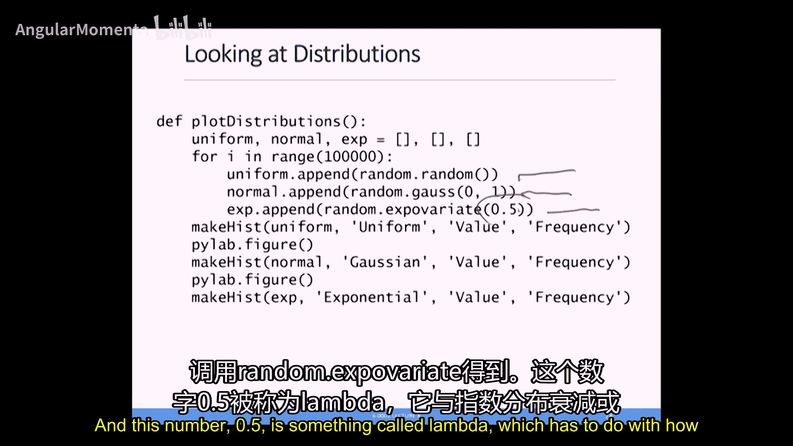

Is something called lambmbda。Which has to do with how quickly the exponential either decays or goes up。

 depending upon which direction。And I'm not going to give you the formula for it at the moment。

 But we'll look at the pictures。

And we'll plot each of these discrete approximations to these distributions。

So here's what they look like。Quite different， right。We've looked at uniform。

 and we've looked at Gaussian before。 And here we see an exponential。

Which basically decays and will assy tote towards 0， never quite getting there。But as you can see it。

Its certainly not。Very symmetric around the， the mean。All right。So let's see what happens。

If we run the experiment。On these three distributions， each of 100000 point examples。

And look at different sample sizes。 We actually see that the difference between the standard deviation。

And the。Sample standard deviation of the population of standard deviation。啊。Is not the same。Right。

 we see。Down here。This looks kind of like what we saw before。

But the exponential one is really quite different。You know， its worst case is up here at 25。

The normal is about 14。 So that's not too surprising since our temperatures were kind of normally distributed when we looked at it。

And the uniform is。Initially。Much better approximation。

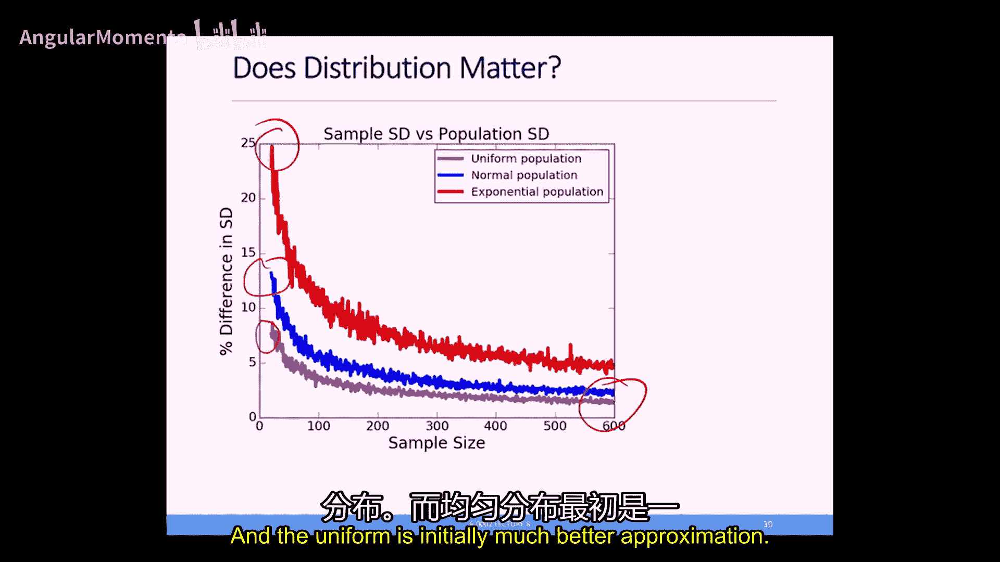

And the reason for this has to do with the fundamental difference in these distributions of something called Sw。

Skew is a measure of the asymmetry。Of a probability distribution。

And what we can see here is that Sw actually matters。The more sw you have。

The more samples you're going to need to get a good approximation。

So if the population is very skewed， very asymmetric in the distribution。

 you need a lot of samples to figure out what's going on。

If it's very uniform， as in， for example， a uniform population， you need many fewer samples。Okay。

 so that's an important thing。When we go about deciding how many samples we need。

 we need to have some estimate of the sw in our population。Alright， how about size。Does size matter。

Shockingly， at least it was to me the first time I looked at this， The answer is no。That。

If we look at this and I'm looking at just for the uniform distribution。

 but we'll see the same thing for all three。啊。It more or less， doesn't matter。Quite amazing。Right。

 if you have a bigger population， you don't need more samples。And。

It's really almost counterintuitive to think that you don't need any more samples。

To find out what's going happen if you have 100 million people or 100 million people。

And that's why when we look at， say， political polls， we actually， they're amazingly small。Right。

 they poll 1000 people and claim they're representative of Massachusetts。All right。This is good news。

So to estimate the mean of a population， given a single sample。

We choose a sample size based upon some estimate of skew in the population。

This is important because if we get that wrong， we might choose a sample size that's too small。

And in some sense， you always want to choose the smallest sample size you can that will give you a accurate answer because it's more economical to have small samples than big samples。

And I've been talking about poles， but the same is true in an experiment。You know。

 how many pieces of data do you need to collect when you run an experiment in a lab。And。

How much will depend again on the skew of the data， And that will help you decide。

Once you know the size？You choose a random sample from the population。

Then you compute the mean and the standard deviation of that sample。

And then use the standard deviation of that sample to estimate the standard error。

And I want to emphasize that what you're getting here is an estimate of the standard error。

Not the standard error itself， which would require you to know the population standard deviation。

But if you've chosen the sample size to be appropriate， this will turn out to be a good estimate。

And then once we've done that， we use the estimated standard error to generate confidence intervals around the sample mean。

And we're done。Now， this works great。 We choose independent random samples。And as we've seen before。

That if you don't choose independent samples。It doesn't work so well。And again。

 this is an issue right， where if you assume that。In an election。

 each state is independent of every other state。And。You get the wrong answer， because they're not。

All right。Let's go back to our temperature example。And。Poose a simple question。

 are 200 samples enough。I don't know why I chose 200。 I did。So we'll do an experiment here。

This is similar to an experiment we saw on Monday。So I'm starting with the number of mistakes I make。

For T and range number of trials， sample will be random dot sample of the temperatures in the sample size。

This is a key step。嗯。

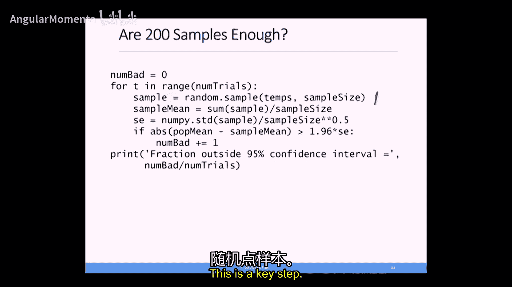

The first time I did this， I messed it up。And instead of doing this very simple thing。

 I did a more complicated thing of just choosing some point in my list of temperatures and taking the nis。

The next 200 temperatures。 why， why did that give me the wrong answer。

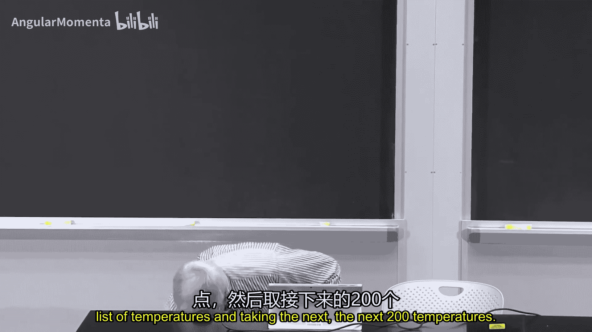

Because it's organized by city。 So if I happened to choose the first day of Phoenix。

 all 200 temperatures were Phoenix。Which is not a very good approximation of the temperature in the country as a whole。

But this will work。 I'm using randomized sample。I'll then get the sample mean。啊。

Then I'll compute my estimate of the standard error。 But by taking that I see it here。And then。If。

The absolute value of the population minus the sample mean。Is more than 1。96 standard errors。

I'm gonna to say。I messed up。Right。It's outside。 And then at the end。

 I'm going look at the fraction outside the 95% conference intervals。

 And what do I hope it should print。

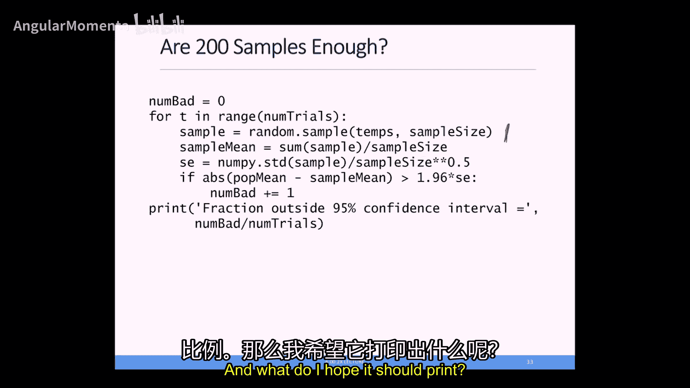

What would I， What would be the perfect answer when I run this。What fraction should lie outside that。

Well。It's a pretty simple calculation。

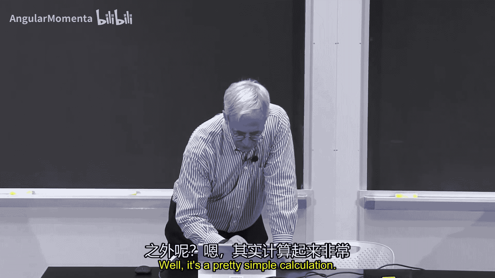

5， right。

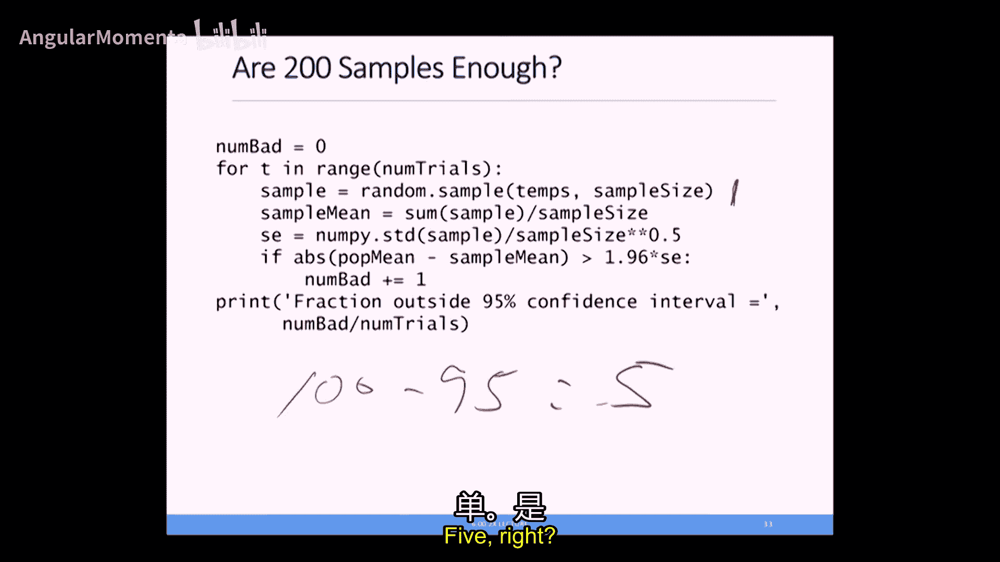

Because if they all were inside， then I'm being too conservative in my interval， right。

I want 5% of the tests to fall outside the 95% conference interval。Right， if I wanted fewer。

 then I would look at three standard deviations instead of 1。96。

 then I would expect less than 1% to fall outside。So this is something we have to always keep in mind when we do this kind of thing。

 If your answer is too good， you've messed up。Right， shouldn't be too bad。

 but it shouldn't be too good either。Right， that's what probabilities are all about。

 If you called every election correctly， then your math is wrong。Alright， well， when we run this。

We get this lovely answer。That the fraction outside the 95% confidence interval is 0。0511。

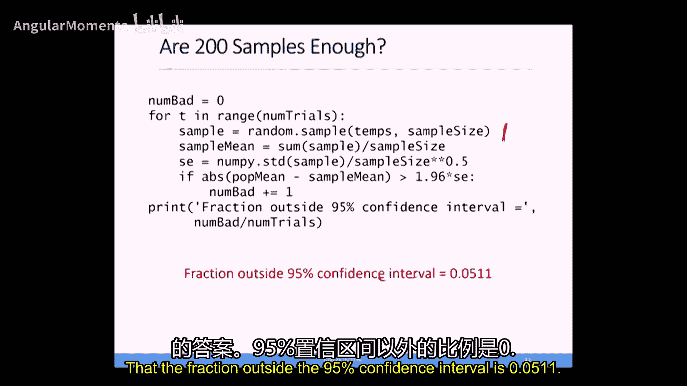

That's exactly which， well， close to what you want。 It's almost exactly 5%。

And if I run it multiple times， I get slightly different numbers。

 but they're all in that range showing that here， in fact， it really does work。Okay。So。

That's what I want to say。 And it's really important， this notion of the standard error。

When I talked to other departments about what we should cover in 6， tripleple 0，2。

About the only thing everybody agreed on was we should talk about standard error。

So now I hope I've made everyone happy。And we will talk about。Fitting curves to experimental data。

 starting next week。All right， thanks a lot。

