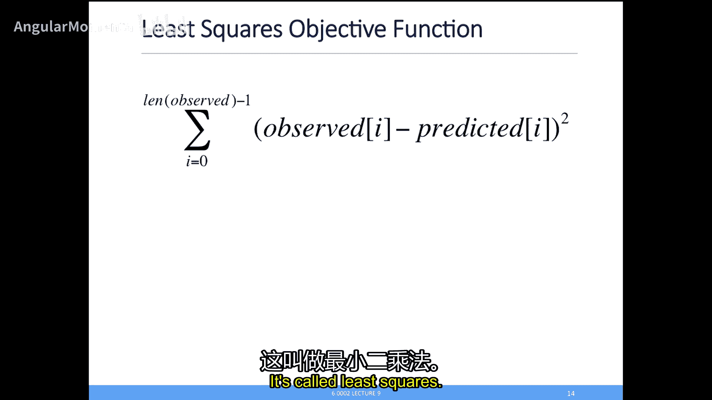
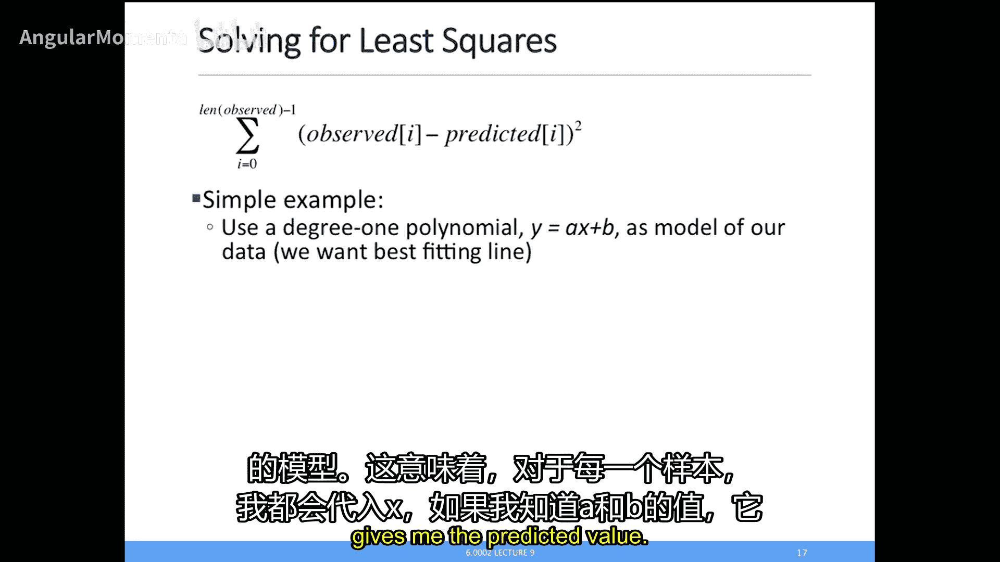
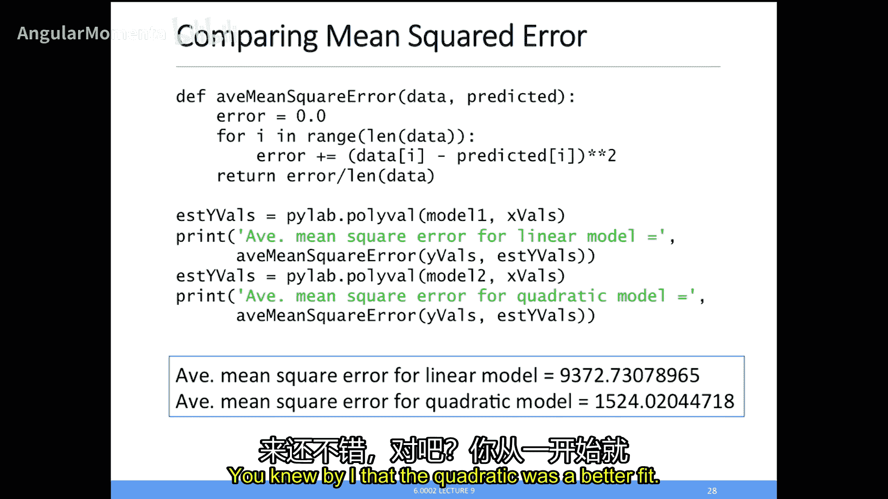
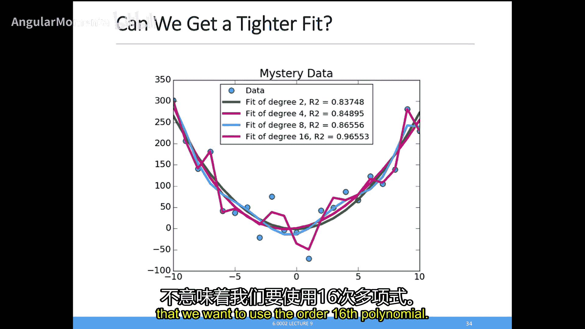

# 【麻省理工】计算思维与数据科学导论-｜-MIT-6.0002-Introduction-to-Computational-Thinking，Fall2016-p09-9.-理解实验数据--BV1zNjGzxEvk_p9-

The following content is provided under a Creative Commons license。

 Your support will help Mi T OpenCourseware continue to offer high quality educational resources for free to make a donation or to view additional materials from hundreds of Mit courses。

 Visit Mit Opencourseseware at Ocw。 Mt。 Eduu。

Okay。Welcome back。Or welcome， depending on whether you've been away or not。

I'm going to start with two simple announcements。There is a reading assignment for this lecture。

 actually， for the next two lectures， which is Chapter 18。

And on a much happier note， there is no lecture Wednesday because we hope that you're going to be busy preparing to get that tryptophan poisoning as you eat away too much turkey and you fall asleep。

More importantly， I hope you have a great break over Thanksgiving。

 whether you're here or you're back home or wherever you are。But， no lecture Wednesday。All right。

 topic for today。I'm going to start with。Seems like sorry。

 what's going to seem like a really obvious statement。

We're living in a data， intensive world。Whether you're a scientist， an engineer， social scientist。

Financial worker， politics。Manager of a sports team。

You're spending increasingly larger amounts of time dealing with data。

And if you're in one of those positions， that often means that you're either writing code or you're hiring somebody to write code for you to figure out that data。

And this section of the course is focusing on exactly that issue。 We want to help you understand。

What you can try to do with software that manipulates data。

How you can write code that would do that manipulation of data for you。

And especially what you should believe about what that software tells you about data。

Because sometimes it tells you stuff that isn't exactly what you need to know。And today。

 we're going to start that by looking at particularly the case where we get data from experiments。

So think of this lecture in the next one as sort of being statistics meets experimental science。

So what do I mean by that？Imagine you're doing a physics lab， biology lab， a chemistry lab。

 or even something in sociology or anthropology。You conduct an experiment to gather some data。

 It could be measurements in a lab。 It could be answers on a questionnaire。 You get a set of data。

Once you've got the data， you want to think about what can I do with it。

And that usually will involve using some model， some theory about the underlying process。

To generate questions， both the data。What does this data and the model associated with。

 Tell me about future expectations， Help me predict other results that will come out of this data。

The social case could be， how do I think about how people are going to respond to a poll about who are you voting for in the next election。

 for example。Given the data。Given the model， the third thing we're typically going to want to do is then design a computation to help us answer questions about the data。

Run a computational experiment to complement the physical experiment or the social experiment we use to gather the data in the first place。

And that computation could be something deep。 It could be something a little more interesting。

 depending on how you're thinking about it。 But we want to think about how do we use computation to run additional experiments for us。

So I'm going to start by using an example of gathering experimental data。

 And I'm going to start with the idea of a spring。How would I model a spring。

 How would I gather data about a spring and how would I write software to help me answer questions about a spring。

So what spring？Well， there's one kind of spring。Little hard to model。

 although it could be interesting。 What's swimming around in there and how do I think about the ecological implications of that spring。

Here's a second kind of spring。It's about 4 or five months away， but eventually。

 we'll get through this winter and get to that spring。 And that would be nice。

 But I'm not going model that one either。 And， yes， my jokes are really bad。 And， yes。

 you can't do a darn thing about them because I am tenured because。Well。

 I'd like to model these two springs。 We're gonna stick with the one that you see in physics labs。

These kinds of springs。So called linear springs。And these are springs that have the property。

That you can stretch or compress them。By applying a force to it。 And when you release them。

 they literally spring back to the position they were originally。

So we're going to deal with these kinds of springs And the distinguishing characteristics of these two springs and others in this class。

Is that that force you require to compress it or stretch it a certain amount。

 The amount of force you require varies linearly。In the distance。

So if it takes some amount of force to compress it。Some amount of distance。

 it takes twice as much force to compress it。Twice as much of a distance。 It's linearly related。Okay。

So each of one of these springs， these kinds of springs， has that property。

 The amount of force needed to stretch or compress its linear in that distance。

Associated with these springs， there is something called a spring constant。

Usually represented by the number K that determines how much force。

Do you need to stretch or compress the spring？Now， it turns out that that spring constant can vary a lot。

The Slinky actually has a very low spring constant。 It one Newton per meter。

That spring on the suspension of a motorcycle has a much bigger spring constant。 It's a lot stiffer。

35000 newtons per meter。And just in case you don't remember。

 a Newton is the amount of force you need to accelerate a 1 kg mass，1 m per second squared。

We'll come back to that in a second。 But the idea is。

 we'd like to think about how do we model these kinds of springs。Okay。Well， it turns out。

 fortunately for us， that that was done about 300 plus years ago by a British physicist named Robert H back in 1676。

 he formulated Hook's law of elasticity。Simple expression。 it says the force you need。

To compress or stretch a spring。Is linear linearly related to the distance D。

That you've actually done that compression in or another way of saying it is。

 if I compress a spring some amount， the force that's stored in it is linear related to that distance。

 And the negative sign here basically says it's pointing in the opposite direction。So if I compress。

 the force is going to push it back out。 If I stretch it。

 the force is going to push it back into that resting position。Okay。Now。

 this law holds for a wide range of springs。 which is kind of nice。

It's going to hold both in biological systems， as well as in physical systems。

It doesn't hold perfectly。There's a limit to how much you can stretch， in particular。

 a spring before the law breaks down。And maybe you did this as a kid。 right。

 If you take a slinky and pull it too far apart。Stops working because you've exceeded what's called the elastic limit of the spring。

Similarly， if you compress it too far， although I think you have to compress it a long ways。

 it'll stop working as well。Okay， so it doesn't hold。Completely。

 and it also doesn't hold for all springs。 Only those springs that satisfy this linear law。

 which are a lot of them。 So， for example， it doesn't apply to rubber bands。

Doesn't apply to recurve bows。 Those are two examples of springs that do not obey this linear relationship。

But nonetheless， there's Hook's law。And one of the things we could do is say， well。

 let's use it to do a little bit of reasoning about this spring。 So we can ask the question。

 how much does a rider have to weigh to compress this spring by 1 centm。And we got hook's Law。

 And I also gave you a little bit of a hint here。 So I told you that this spring has a spring constant of 35000 newtons per meter。

😊，So I could just plug this in， right，1 centimeter。 It's1 hundredth of a meter times。

So that's the the there's the spring constant。 There's the amount we're going to compress it。

And do a little math。 And that says that the force I need is 350 newtons。Okay， so what's in Newton？

Small town in Massachusetts。 An interesting cookie。And a force that we want to think about。

Keep telling you guys the jokes are really bad。So how do I get force？Well。

 you know that mass times acceleration， right， F equals M A。For acceleration here。

 I'm going to make an assumption， which is that the spring is basically oriented。

Perpendicular to the earth。 so that the acceleration is just the acceleration of gravity， which is。

Roughly 9。8 m per second square。 It's basically pulling it down。So I could plug that。Back in。

Because remember， what I want to do is figure out what's the mass I need。 So for the force。

 I'm substituting that in。 I've got that expression。 mass times 9。8 m divided by second squared。

 It's 350 Newtons。Divide through by 9。8， both sides。Do a little bit of math。

And it says that the mass I need is 350 kg divided by 9。8。

 And that K refers to kg not to the spring constant。Poor choice of example。 But there I am。

And if I do the math that says， I need a rider that weighs 35。68 kilos。

And if you're not big on the metric system， It's actually a fairly light rider。 That's about 79。

 So 79 rider would compress that spring，1 centm。O， so we can figure out how to use H's Law。

 We're thinking about what we want to do with springs。 That's kind of nice。How would we actually get？

The spring constant them。It's really valuable to know what the spring constant is。

 And just to give you a sense of that。It's not just to deal with things like slinkies。

Atomic force microscopes need to know the spring constants of the components in order to calibrate them properly。

The force you need to deform a strand of DNA is directly related to the spring constants of the biological structures themselves。

 So I'd really like to figure out。How do I get them？

How many of you have done this experiment in physics。And hated it。Right。

 I don't if you hated it or not， but you've done it， right， Standard way to do it is I take a spring。

 I suspend it from some point。 Let it come to a resting position。And then， I put a mass。

On the bottom of the spring， it kind of bounces around。 And when it settles。

 I measure the distance from where it was before I put the mass on to the distance of where it is after I've added the mass。

 I measure that distance。 and then。I just plug in。Right。P into that formula there。 The force is。

 is minus k times D。 So K， the spring constant is the force。

 Fort the minus sign divided by the distance。 And the force here would be 9。8。

Meters per second squared or kilograms per second squared times the mass divided by D。

 So I could just plug it in。In an ideal world， I plug it in。 I'm done。 One measurement。Yeah。

 not so much， right。Maassesses aren't always perfectly calibrated。

 Maybe the spring has got some not perfect materials in it。 So ideally。

 I'd actually do multiple trials。 I would take different weights， put them on the spring。

 make the measurements and just record those。😊，So that's what I'm going to do。

 And I've actually done that。 I'm not going to make you do it。But I get out。Set of measurements。

What have I done here。I've these different masses all increasing by。05 kg。

 And I've measured the distance that the spring has deformed。And ideally。

 these would all have that nice linear relationship。 So I could just plug them in。

 and I could figure out what the spring constant is。Okay。So let's take this data and let's plot it。

And by the way， all the code you'll be able to see when you download the file。

 I'm going to walk through some of it quickly。 This is a simple way to deal with it。

And I'm going to back up for a second。 There's my data。And I actually have done this in some ways。

 the wrong order。 These are。My independent measures， different masses。

 I'm going to plot those along the X axis， the horizontal axis。These are the dependent things。

 These are the things I'm measuring。 I'm going to plot those along the Y axis。

 So I really should have put them in the other order。

 So just cross your eyes and make this column go over to that column and we'll be in good shape。

Let's plot this。So here's a little file。 Having stored those away in a file。

 I'm just going to read them in， get data It just going to do the obvious thing of reading these things and return to tus or lists one for the X values。

 Or if you like， again， going back to it， this set of values。And one for the y values。Now。

 I'm going to play a little trick that you may have seen before。 That's going to be handy to me。

I'm going to actually call this function out of the Pi lab library， called a rape。

I pass in that tuple。 And what it does is it converts it into an array。

 which is a data structure that has a fixed number of slots in it。

But has a really nice property I want to take advantage of。 I could do all of this with lists。

 But by converting that into a and then giving it the same name， X vows。

 and similarly for the Y vows。I can now do math on the array， without having to write loops。

And in particular， right here。Notice what I'm doing。 I'm taking X vows。

 which is an array multiplying it by a number。And what that does is it takes every entry in the array。

 multiplies that entry。And puts it into basically a new version of the array。

 which I then store into X filess。If you've programmed in Matlab， this is the same kind of feeling。

 right， I can take an array， do something to it。 And that's really nice。

 So I just am going to scale all of my values。 And then I'm going to plot them out some appropriate things。

😊，And if I do it。I get that。嗯。I thought we said Hook's law was。Linear relationship。

So in an ideal world， all of these points ought of line or lay along a line somewhere where the slope of the line would tell me the spring constant。

Not so good， right？In fact， if you look at it， you can kind of see in here。

 you could kind of imagine there's a line there。 something funky's going on up here。

 And we're going to come back to that at the end of the lecture。

But how do we think about actually finding。The line。Well， we know there's noise in the measurement。

 So our best thing to do is to say， well， could we just fit a line to this data。

 And how would we do that。And that's the first big thing we want to do today。

 We want to try and figure out， given that we got measurement noise， how do we fit a line to it。

So how do we fit a curve to data。Well， what we're basically going to try and do is find a way to relate an independent variable。

 which are the masses。The Y values。To the depend， sorry， wrong， the independent values。

 which are the X axis， to the dependent value。 What is the actual displacement we're going to see。

 So another way of saying it is， if I go back to here， I want to know for every point along here。

 how do I fit something that predicts what the y value is。So I need to figure out how to do that fit。

To decide， even if I had a curve， a line that I thought was a good fit to that。

I need to decide how good it is。So imagine I was lucky。 and somebody said。

 here's a line that I think describes H's law in this case， great。I could draw the line on that data。

 I could draw it on this chunk of data here。 I still need to decide。

 how do I know if it's a good fit。And for that， we need something we call an objective function。

And it's going to measure how close is the line to the data to which I'm trying to fit it。Okay。

Once we've defined the objective function。Then what we say is， okay， now let's find the line。

That minimizes it。 the best possible line， the line that makes that objective function as small as possible。

 because that's going to be the best fit to the data。And so that's what I'd like to do。

We're going to see we're going to do it for general curves。

 but we're going to start just with lines with linear functions。 So in this case， we want to say。

 what's the line such that some function of the sum of the distances from the line to the measured points is minimized。

And I'm going to come back in a second to how do we find the line。 But first。

 weve got to think about what does it mean to measure it。Okay， so I've got a point。

 Imagine I've got a line that I think is a good match for the， the thing fitting the data。

 How do I measure distance。Well， there's one option。

It could measure just the the displacement along the X axis。Here's a second option。

 I could measure the displacement vertically。Or a third option is I could actually measure the distance to the closest point on the line。

 which would be that perpendicular distance there。Alright， you're way too quiet。

 which is always dangerous。 What do you think， I'm going to look for a show of hands here。

 How many people think we should use X as the thing that we measure here。Hands up。

 please don't use a single finger when you put your hand up。 Allright， good。

How many people think we should use P the perpendicular distance。Reasonable number of hands。

 And how about why。And I see actually about split between P and Y。 And that's actually really good。

X doesn't make a lot of sense， right， because I know that my values along the X axis are independent measurements。

 So the displacement in that direction doesn't make a lot of sense。P makes a lot of sense。

But unfortunately， isn't what I want。We're going to see examples later on where， in fact。

 minimizing things where you minimize that distance is the right thing to do。

 when we do machine learning。 That is how you find what's called a classifier， or a separator。

But actually here， we're going to pick why。And the reason is important。

I'm trying to predict the dependent value， which is the y value。Given an independent new X value。

And so the displacement， the uncertainty。Is， in fact， the vertical displacement。

And so I'm going to use why that displacement is the thing I'm going to measure as the distance。Okay。

How do I find this， I need an objective function that's going to tell me what is。

The closest of the fit。So here's how I'm going to do it。

 I'm going to have some set of observed values。Think of it as an array。I've got some index into them。

 So the the indices are giving me the X values， and the observed values are the things I've actually measured。

 If you want to think of it this way， I'm going to go back to this slide really quickly。

 The observed values are the displacements or the values along the Y axis。Sorry about that。Okay。

Let's assume that I have some hypothesized line that I think fits this data。Y equals a X plus B。

 I know the A and the B。 I've hypothesized it。Then， predicted。We'll basically say given the x value。

 the line predicts here's what the y value should be。

And so I'm going to take the difference between those two， and square them。

So the difference makes sense。 It tells me how far away is the observed value from what the line predicts it should be。

Why am I squaring it， Well， there are two reasons。 The first one is that squaring is going to get rid of the sign。

Right， it shouldn't matter if my， my observed value is some amount above the predicted value or some amount below the same amount below the predicted value。

 The displacement and direction shouldn't matter。 It's How far away is it。Now， you could say， well。

 why not just use absolute value。And the answer is you could。

 But we're going to see in a couple of slides that by using the square。

 we get a really nice property that helps us find the best fitting line。😊。

So my objective function here is， basically says。Given a bunch of observed values。

 use the hypothesisthesized line to predict what the value should be。

 measuresure the difference in the y direction， which is what I'm doing because I'm measuring predicted and observed Y values。

 Square summa allla。 It's called least squares。

That's going to give me a measure of how close that line is to fit。 In a second。

 I'll get to how do you find the best line。But this。Hopefully， looks familiar。Anybody recognize this。

You've seen it earlier in this class。

Boy， that's a terrible thing to ask because you don't even remember the last thing you did in this class other than the problem set。

So right， variance。 thank you。 Absutely。 sorry， I didn't bring any candy today。

 That's Professor Goodtag。 I got a better arm than he does， but I still didn't bring any candy today。

Yeah， it's variance， not quite。 It's almost variance。

 That's the variance times the number of observations。 another way of saying it is。

 if I divided this by the number of observations， that would be the variance。

 I took the square root to be the standard deviation。 Why is that valuable。

 Because that tells you something about how badly things are dispersed。

 How much variation there is in this measurement。And so if it says。

 if I can minimize this expression， that's great because it not only will find what I hope is the best fit。

😊，But it's going to minimize the variance between what I predict and what I measure。

 which makes intuitive sense。 That's exactly the thing I would like to minimize。Okay。

This was built on the assumption that I had a line that I thought was a good fit。

And this lets me measure how good a fit I have。But I still have to do a little bit more。

 I have to now figure out， O， how do I find the best fitting line。And for that。

 we need to come up with a minimization technique。So to minimize this objective function。

 I want to find the curve for the predicted values。 This thing here。

 some way of representing that that leads to the best possible solution。And I'm going to make。

A simple assumption。I'm going to assume that my model for this predicted curve。

I've been using the example of a line but I to say curve is a polynomial。

It's a polynomial and one variable。 The one variable is。 What are the x values of the samples。

 And I want to assume that the curve is a polynomial。 In the simplest case， it's a line。

case of order N2， it's going be a parabola。 And I'm going to use a technique called linear regression to find the polynomial that best fits the data that minimizes that objective function。

Alright， quick aside， just to remind you， I'm sure you remember so polynomial。

Polynomial is either the value 0， which is really boring。

 or it is a finite sum of nonzero terms that all have the form C times X to the P。C is a constant。

 a real number。P is a power， a non negative integer。

 And this is basically x is the free variable that's going to capture this。

 So easy way to say it is a line would be represented as a degree 1 polynomial A X plus B。

 A parabola is a second degree polynomial A X squared plus B X plus C。

 And we can go up to higher order terms。We're going refer to the degree of the polynomial as the the largest degree of any term in that polynomial。

 So again， degree 1， linear degree 2， quadratic。Okay， now how do I use that。Well。

 here's the basic idea。 Let's take a simple example。

 Let's assume I'm still just trying to fit a line。So my assumption is。

 I want to find a degree 1 polynomial。 Y equals a X plus B。As our model of the day。

 that means for every sample， I'm going to plug in X。 And if I know A and B。

 it gives me the predicted value。

I've already seen that's going to give me a good measure of the closeness of the fit。

And the question is， how do I find A And B。My goal is。

Find A And B such that when we use this polynomial to compute those y values。

 that some squared difference is minimized。Okay， so the sum squared difference is my measure of fit。

 All I have to do is find A And B。And that's where linear regression comes in。

 And I want to just give you a visualization of this。If a line is described by A X plus B。

Then I can represent every possible line in a two dimensional space。

One axis is possible values for a。The other access is possible values for B。

 So if you think about it， I take any point in that space。

 that gives me an A and a B value that describes a line。Why should you care about that？

Because I can put a two dimensional surface over that space。In other words。

 for every A And B that gives me a line， and I could therefore compute this function。

Given the observed values and the predicted values， and it would give me a value。

 which is the height of the surface in that space。If you're with me with the visualization。

 why is that nice， Because linear regression gives me a very easy way to find the lowest point on that surface。

 which is exactly the solution I want， because that's the best fitting line。

And it's called linear regression， not because we're solving for a line。

 but because of how you do that solution。 If you think of this as being。

 take a marble on this two dimensional surface， You want to place the marble on it。

 You want to let it run down to the lowest point in the surface。And oh， yeah， I promised you。

 why do we use some squares Because if we use the sum of the squares。

 that surface always has only one minimum。So it's not a really funky。

 convoluted surface that has exactly one minimum。 It's called linear regression。

 because the way to find it is to start at some point and walk downhill。

I linearly regress or walk downhill along the gradient some distance。

 measure the new gradient and do that until I get down to the lowest point in the， in the surface。

Could you write code to do it？Sure。Are we going to ask you to do it， no。Because， fortunately。Jo。

 I was hoping to get a cheer out of that。 Too bad。 Okay， maybe we will ask you to do it on the exam。

 What the hell。

You could do it。 In fact， you've seen a version of this。 The。

 The typical algorithm for doing it is very similar to Newton's method that we used way back in the beginning of 6 triple 0。

1， when we found square roots。 You could write that kind of a solution。

 But the good news is that the nice people who wrote Python or particularly Pyla have given you code to do it。

😊，And we're going to take advantage of it。So in P lab， there is a built in function called polylyfit。

It takes a collection of x values。 takes a collection of equal length of y values。

 They need to be the same length。 I'm going to assume there are arrays， and it takes an integer n。

 which is the degree of fit。That I want to apply。You know。

 what polyfi will do is it will find the coefficients of a polynomial of that degree that provides the best least squares fit。

So think of it as polyfi walking along that surface to find the best A And B that will come back。

 So if I give it a value of n equals1， it'll give me back the A And B that gives me the best line。

 If I get a value of n equal 2， gives me back A B and C that would fit an A X squared plus B X plus C parabola to best fit the data。

 And I could pick N to be any non negative integer， and it would actually come up with a good fit。

Okay。So let's use it。I'm going to write a little function， called fit data。

The first part up here just comes from plot data。 It's exactly the same thing。 I read in the data。

 I convert them into a array。 I convert this because I want to get out the force。

 I go ahead and plot it。And then notice what I do。 I use polyfi right here to take the inputted x values and y values and a degree 1。

 And it's going to give me back。A tuple， an A and a B that are the best fit line finds that point in the space that best fits it。

Once I've got that。I could go ahead and actually compute now。

 what are the estimated or predicted values。 right。

 The lines going to tell me what I should have seen as those values。

 And I'm going to do the same thing。 I'm going to take x values， converted into array。

 multiply it by a， which says every entry in the array。Is scaled by a add B to every entry。

 So I'm just computing A X plus B for all possible axis。

And that then gives me an estimated set of y values。 And I could plot those out。I'm cheating here。

 sorry， I'm misdirecting you。 I never cheat。I actually don't need to do the conversion to an array there because I did it up here。

 But because I've borrowed this from P Lab， I wanted to show you that I can redundantly do it here to remind you that I want to convert it into array to make sure I can do that kind of of algebra on it。

The last thing I could do is say， even if I could not only， once I show you the fit of this line。

I also want to get up the spring constant。Now， the slope of this line is difference in force over difference in distance。

The spring constant is the opposite of it。 So I could simply take the slope of the line， which is a。

Invert it。 And that gives me the spring constant。Okay。

 so let's see what happens if we actually run this。So I'm going to go over to my code。

 hoping that it works properly and。Here's my Python。 I've loaded this in。 I'm going to run it。

There you go。Fits a line， and it prints out the value of a， which is about 0。46 in the value of B。

And if I go back and look at this。There we go。 Spring constants about 21 and a half。

 which is about the reciprocal of 0。046。 are going to figure that out。

And you can see it's not a bad fit。To align through that data。Again。

 there's still something funky going on over here that we're going to come back to。

 But it's a pretty good fit to the data。Great。So， now。I've got a fit。

I'm going to show you a variation of this that we're going to use in a second。

 I could do the same thing。 But after I've done polyfit here。

 I'm going to use another builtin function called polyval。It's going to take a polynomial。

 which is captured by that model of the thing that I returned。

 And I'm going to show you the difference again。 right back here， we return this as a tuple。

Since it's coming back as a tuple， I can give it a name model。

Polyval will take that tuple plus the x values and do the same thing。

 It will give me back an array of predicted values。

But the nice thing here is that this model could be a line。 could be a prabula。

 It be could be a cortic。 It could be a quinttic。 It could be any order。Polynomial。

And I'm worried if you like the abstraction in here。

 which we're going to see in a little bit that it allows me to use the same code。

 same code for different orders of model。And if I ran this， it would do exactly the same thing。

Alright， I'm going to come back to thinking about what's going on in that spring in a second。

But I want to show you another example。 So here's another set of data。In a little bit。

 I'll show you where that mystery data came from。 But here's another set of data that I'。

 I've plotted out。I could run the same thing。 I could run exactly the same code and fit a line to it。

 And if I do it。I get that。All right， what do you think， Good fit。Show of hands。

 How many people like this fit to the data。Shhow of hands。

 how many people don't like this fit to the data。Show of hands。

 How many hope that I'll stop asking you questions。 Don't put your hands up。 Yeah， thank you。 I know。

 too bad。It's a lousy fit。And you kind of know it， right。

 It's clear that this doesn't look like it's coming from a line。 Or if it is。

 it's a really noisy line。So let's think about this。 What if I。We to try a higher order degree。

Let's change the one to a two。So， I'm going come back to second。 I change the one to a2。

 That says I'm still using the polynomial fit。 But now I'm going to ask。

 what's the best fitting parabola。A x squared plus B， X plus C。Simple change。

 because I was using poly Val。 exactly the same code will work。 It's going do the fit to it。This is。

 by the way， still an example of linear regression。 So think of what I'm doing now。

I have a three dimensional space。 One axis is a values。 Second axis is B values。

 Third axis is C values。 Any point in that space describes a parabola。

And every point in that space describes every possible parabola。

And now you got to twist your head a little bit。 Put a four dimensional surface on that three dimensional basis。

Where the point in that surface is the value of that objective function play the same game。

And you can。 It's just a higher dimensional thing。 So you're again going to walk down the gradient to find this solution and be glad you don't have to write this code because Plab will do it for you freely。

 But it's still an example of regression。 which is great。😊，And if we do that。We get that fit。

Actually， just to show you that， I want to run it， but it will do exactly the same thing。

If I go over to Python。Wherever I have it here。I'm going to change that order of the model。Oops。

 it went a little too far for me。 Sorry about that。Go back and do this again。There's the first one。

And there' is the second one。Okay。So， I could fit。Different models to it。

Qudratic clearly looks like it's a better fit。 I hope you'll agree。So。

How do I decide which one's better other than eyeballing it。

And then if I could fit a quadratic to it， what about other orders of polynomials。

 Maybe there's an even better fit out there。 So how do I figure out what's the best way to do the fit。

And that leads to the second big thing for this lecture。 How good are these fits。

What's the first big thing， The idea of linear regression， a way of finding fits of curves to data。

But now I've got to decide how good are these。 And I've got to ask this question two ways。

1 is just relative to each other。 How do I measure which one's better other than looking at it by eye。

And then the second part of it is， in an absolute sense， how do I know where the best solution is。

 Is quadratic the best I could do， or should I be doing something else to try and figure out a better solution。

 a better fit to the data。Okay， the relative fit。What are we doing here， We're fitting a curve。

Which is a function of the independent variable to the dependent variable。What does it mean by that。

 I've got a set of X values。 I'm trying to predict what the y value should be。

 The displacement should be。 I want to get a good fit to that。

The idea is that given an independent value， it gives me an estimate of what it should be。

 And I really want to know which fit provides the better estimates。

And since I was simply minimizing mean squared error， average square error。

 an obvious thing to do is just to use the goodness of fit by looking at that error。

Why not just measure， where am I on that surface and see which one does better or actually be two surfaces。

 one for a linear fit， one for a quadratic  one。Alright， we'll do what we always do。

 Let's write a little bit of code。 I can write something that's going to get the average main squared error。

 takes in a set of data points， a set of predicted values。

 simply measures the difference between them， squares them， adds them all up in a little loop here。

 and returns that divided by the number of samples I have。 So it gives me the average squared error。

And I could do it for that first model I built， which was for a linear fit。

 And I could do it for the second model I built， which is a quadratic fit。And if I run it。

I get those values。Looks pretty good。Right， you knew by I that the the quadratic was a better fit。

 And look， this says it's about six times better。

That the residual error is six times smaller with the quadratic model than it is the linear model。

Great。But with that， I still have a problem。Which is， okay， it's useful for comparing two models。

But is 1524 a good number。Certainly better than 9000 something or other。

 But how do I know that 1524 is a good number。How do I know there isn't a better fit out there somewhere。

Well， good news is， we're going to be able to measure that。

 It's hard to know because there's no bound on the values。And more importantly。

 this is not scale independent。 What do I mean by that。

 If I take all of the values and multiply them by some factor。

I would still fit the same models to them。 They would just scale。

 But that measure would increase by that amount。 So I could make the error as big as small as I want by just changing the size of the values。

 That doesn't make any sense。I'd like a way to measure goodness of fit。That is scale independent。

 And that tells me for any fit how close it comes to being the perfect fit to the data。

And so for that， we're going to use something called the coefficient of determination written as R squared。

So let me show you what this does。 And then we're going to use it。The whys are measured values。

 Those are my samples I got from my experiment。The P's are their predicted values。

 That is for this curve。 Here's what I predict those values should be。

 So the top here is basically measuring， as we saw before， the sum squared error in those pieces。

Mu down here。Is the average or mean of the measured values。 It's the average of the wises。Okay。

So what I've got here is in the numerator。 This is basically the error in the estimates from my curve fit。

And in the denominator， I've got the amount of variation in the data itself。Right。

This is telling me how much does the data change from just being a constant value。

 And this is telling me how much do my errors vary around it。

That ratio is scale independent because it's a ratio。

 So even if I increase all of the values by some amount， that's going to divide out。

 which is kind of nice。So， I could compute that。And there it is。 R squared is gain that expression。

 It'll take in a set of observed values， a set of predicted values。And I'll measure the error again。

 These are arrays。 I'm going to take the difference between the arrays。

 That's going to give me peacewise or parawise that difference。 I'll square it。

 That's going to give me at every point in the array， the square of that distance。

And then because it's an array， I can just use the builtin sum function to add them all up。

 So that's going to give me if you like the values up there。

And then I'm going to play a little trick。I'm going to compute the mean error。

 which is that thing divided by the number of observations。Why would I do that？Well。

 because then I can compute this really simply。 I could write a little loop to compute it。But。

 in fact， I've already said， what is that， If I take that sum and divide it by the number of samples。

 that's the variance。So that's really nice。 right here， I can say。

 get the variance using the nuy version of that of the observed data。😊。

And because that has associated with a division by the number of samples。

 the ratio of the mean error to the variance is exactly the same as the ratio of that to that。

Little trick。 So let me save doing a little bit of computation。So， I can compute。Our squared values。

Okay， so what does R squared actually tell us。What we're doing is we're trying to compare the estimation errors。

 the top part with the variability in the original values， the bottom part。So R squared。

 as you can see there， is intended to capture what portion of the variability in the data is accounted for by my model。

My models are really good fit。 It should account for almost all of that data。

So what we see then is if we do a fit with a linear regression。

R squared is always going to be between 0 and 1。And I want to just show you some examples。R squared。

 if R squared is equal to one， this is great。 It says the model explains all of the variability in the data。

 And you can see if we go back here。😊，How do we make R squared equal to  one， We need this to be 0。

 which says that the variability in the data is perfectly predicted by my model。

Every point lies exactly along the curve。 That's great。Okay。

Second option at the other extreme is if R squared is equal to 0。You basically got Bbkas。

 which is a well known technical term， meaning there's no relationship between the values predicted by the model and the actual data。

That basically says that all of the variability here。

Is exactly the same as all the variability in the data。 The model doesn't capture anything。

 And it's making this one， which is making the whole thing 0。 And then in between。

 an R squared of about a half says you're capturing about half the variability。

 So what you would like。Is a system in which your fit is as close to an R squared value of one as possible because it says my model is capturing all the variability in the data really well。

Okay， so two functions that will do this for us。We're going to come back to these in the next lecture。

 The first one called generate fits or Gen fits will take a set of x values， a set of y values。

 and a list or a tuple of degrees。 And these will be the different degrees of models I'd like to fit。

 I could just give it 1。 I could give it 2。 I could give it 1，2，4，8，16， whatever。

And I'll just run through a little loop here where I'm going to build up a set of models for each degree D in degrees。

 I'll do the fit exactly as I had before。 It's going to return a model。

 which is a tuple of coefficients。 And I'm going to store that in models， and then return it。

And then I'm going to use that because in test fits， I will take the models that come from Gen fits。

I'll take the set of degrees that I also passed in there， as well as the values。I'll plot them out。

 and then I'll simply run through each of the models。And generate a fit。Compute the R squared value。

Ploot it and then print out some data。O， with that in mind。Let's see what happens if we run this。So。

 I'm going to take。Again， that example of that data that I started with。

As I picked the right one here， which I think is this 1， I'm going to do a fit。

With a degree 1 and a degree 2。Curbs， I'm going fit the best line。 I'm going fit the best quadratic。

 the best parabola。 And I want to see how well that comes out。So I do that？ I got some data there。

 looks good。 And what does the data tell me。Data says， oh， cool。I know you don't believe it。

 but it is because notice what it says， it says。The R squared value for the line is horrible。

It accounts for less than。05%。Of the data。You can say， okay， I can see that。 I can look at it。

 It does a lousy job。On the other hand， the quadratic is really pretty good。

 It's accounting for about 84% of the variability in the data。 This is a nice high value。

 It's not one， but it's a nice high value。 So this is now reinforcing what I already knew。

 but in a nice way。 It's telling me that that R squared value tells me that the quadratic is a much better fit。

😊，Then the linear fit was。Okay。But then you say， maybe， wait a minute。

 I could have done that by just comparing。The fits themselves。 I already saw that。Part of my goal is。

 how do I know if I've got the best fit possible or not。So I'm going to do the same thing。

 but now I'm going to run it。With another set。Of of degrees。I'm going to go over here。

 I'm going to take exactly the same code， but let's try it。With。A quadratic。With acortic。

An order 8 and an order 16 fit。 So I'm going to take different size polynomials。As a quick aside。

 this is why I want to use the P lab kind of code。 because now I'm simply optimizing over a 16 dimensional space。

 Every point in that 16 dimensional space defines a 16 degree polynomial。

 And I could still use linear regression， meaning walking down the gradient to find the best solution。

All I'm going to run this。And I get out a set of values。Looks good。 And let's go look at them。哈。

Here's the R squared value for quadratic， about 84%。Degrreee 4 does a little bit degree better。

 A degree 8 does a little bit better。 But wow， look at that。Deegrees 16。

16th order polynomial does a really good job。 It accounts for almost 97%。

Of the variability in the data。That sounds great。Now。

To quote something that your parents probably said to you when you were much younger。

 just because something looks good。Doesn't mean we should do it。And， in fact。

 just because this has a really high R squared value doesn't mean that we want to use the order 16th polynomial。

And I will wonderfully leave you waiting in suspense because we're going to answer that question next Monday。

😊，And with that， I'll let you out a few minutes early。 have a great Thanksgiving break。

