# 【麻省理工】计算思维与数据科学导论-｜-MIT-6.0002-Introduction-to-Computational-Thinking，Fall2016-p10-10.-理解实验数据（续）--BV1zNjGzxEvk_p10-

The following content is provided under a C Commons license。

 Your support will help Mi T OpenCourseware continue to offer high quality educational resources for free to make a donation or to view additional materials from hundreds of MiT courses。

 Visit Mit Opencourseseware at O Cw Mt Eduu。

Welcome back。I hope you didn't spend。Time doing 6 triple02 problem sets while eating Turkey。

 Its not recommended for digestion。

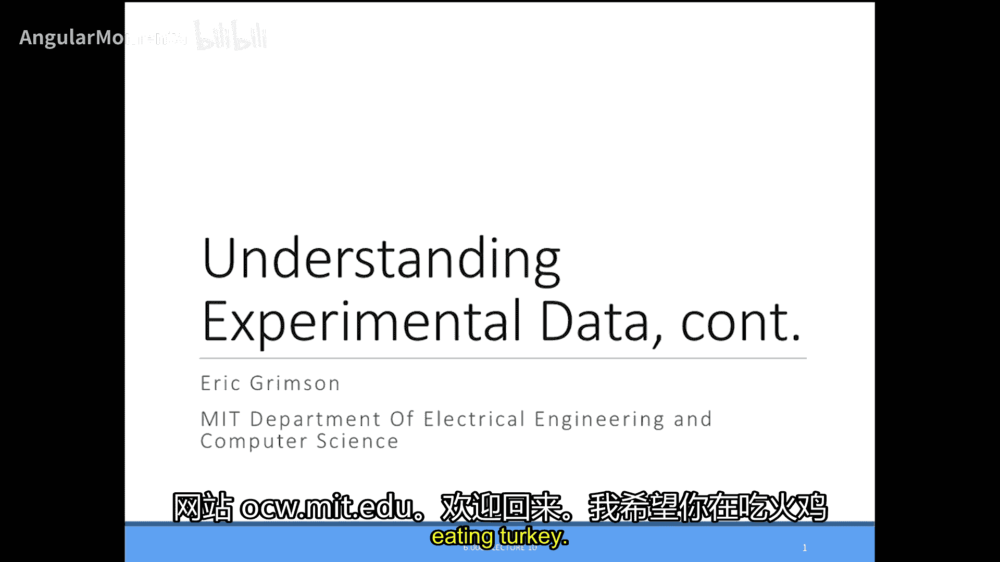

But I hope you're ready to go back into diving into material。

And since it's been a week since we got together， let me remind you of what we were doing。

We were looking at the issue of。How to understand experimental data。

Data could come from a physical experiment。 We had the example of measuring the。

 the spring constant of， of a linear spring。Could come from biological data。

 could come from social data。And what we looked at was the idea of how do we actually fit models to that data in order to understand them。

So what I want to do is I want to start with that high level reminder of what we were after。

I want to do about a five minute recap of what we were doing last time because it has been a while。

 And then we're going to talk about how do you actually validate models that you're fitting to data to understand。

 are they really good fits or not。And if you remember。

 and I know you spent all your time thinking about6 trip below 2。 If you remember。

 I left you with a puzzle where I fit data to some sorry， fit models to some noisy data。

 And there was a question of， did the model really have an order 16 fit。Alright。

 so what are we trying to do， Remember， our goal is to try and model。Experimental data。And really。

 what we want to do is have a model that both explains the phenomena underlying what we see gives us a sense of what might be the underlying physical mechanism。

 the underlying social mechanism。And can let us make predictions about the behavior in new settings。

In the case of my spring， being able to predict， what will the displacement be when I actually put a different weight on it than something I measured。

Or if you want to think of from a design perspective， working the other direction and saying。

 I don't want my spring to deflect more than this amount under certain kinds of weights。

 So how do I use the model to tell me what the spring constant should be for the spring I want in that case。

So we want to be able to predict behavior new settings。

last piece we know is that if the data was perfect， this is easy。But， it ain't。

It's always going to be noise。 There's always going to be experimental uncertainty。

 And so I really want to account for that uncertainty when I fit that model。

And while sometimes I'll have theories that will help。 Hook says models of springs are linear。

In some cases， I don't。 And in those cases， I want to actually try and figure out what's the best model to fit。

 even when I don't know what the theory tells me。Okay， so quick recap。 What did we use to solve this。

We said， if we got to set of observed values。My spring case， for different displace。

 where for different masses， I measure the displacements。

 those displacements were my observed values。 And if I had a model。

That would predict what the displacements should be。

I can measure how good the fit is by looking at that expression right there。

 The sum of the squares of the differences between the observed and the predicted data。As I said。

 we could use other measures。 We could use a first order an absolute value。

 The square is actually really handy because it makes the solution space very easy to deal with。

 which we'll get to in a second。So given an observed data， get a prediction。

 I can use sum square differences to measure how good the fit is。And then， the second piece is。

I now want to find what's the best way to predict the data。 What's the best curve that fits the data。

 It's the best model for protecting the values。And we suggested last time。

 we'll focus on mathematical expressions， polynomials。

Professor Gutag is so excited about polynomomic expressions。 He's throwing laptops on the floor。

 Please don't do that to your laptop。We're going to fit polynomials to these expressions。

And since the polynomials have some coefficients。The game is， basically。

 how do I find the coefficients of the polynooma that minimize that expression。

And that we said was an example of linear regression。

So let me just remind you what linear regression says， simpleimple example case of the spring。

 I'm going fit a degree 1 polynomial。 So that is something of the form。 Y is A X plus B。A and B。

Are the free variables， the parameters I can change。 And the idea is for every X。

 in the case of my spring， for every mass。I'm going to use that model to predict what's the displacement。

 measuresure the differences and find the thing that minimizes。

 So I just want to find values of A M B。That let me predict values that minimize that expression。

As I suggested， you could solve this。 You could write code to do it。

 It's a neat little piece of code to write。But fortunately， P lab provides that for you。

 And I just want to give you the visualization of what we're doing here。

 And then we're gonna look at examples。I'm going to try and find the best line。

It's represented by two values， A and B。I could represent all possible lines in a space that has one access with a values。

In the other axis with B values， every point in that plane defines a line for me。Now。

 imagine a surface laid over this two dimensional space。

Where the value or the height of the surface is the value of that objective function at every point。

Don't worry about computing at all。 But just imagine I could do that。And by the way。

 one of the nice things about doing some of squares is that surface always has a concave shape。

And now， the idea of linear regression is， I'm going start at some point on that surface。

And I'm just going to walk downhill。Until I get to the bottom。There will always be one bottom。

 one point。And once I get to that point。That A And B value tell me the best line。

So it's called linear regression because I'm linearly walking downhill on this space。 Now。

 I'm doing this for line with two parameters， A B， because it's easy to visualize。

If you're a good mathematician， even if you're not。

 you can generalize this to think about arbitrary dimensions。 So a。

 a fourth order surface in a five dimensional space， for example。

 would solve a a cubic example of this。That's the idea of linear regression。

 That's what we're going to use to actually figure out to find the best solution。

So here was the example I used。Gaive you a set of data。

 And about three slides are' going to tell you where the data came from。

 But I give you a set of data。We could fit the best line to this， using that linear regression idea。

And again， last piece of reminder。I'm going use polyfit from Pla。

 It just solves that linear regression problem。 I give it a set of X values。

 I give a corresponding set of y values need to be the same number in in each case。

 And I give it a dimension。 And in this case， one says， find the best fitting line。

It will produce that and return it as a tuple， which I'll store under the name Model 1。

And I could plot it out。 So just to remind you， polylyfi will find the best fitting and dimensional surface。

And being that last parameter there。 And return it。And in a second， we're going to use polyval。

 which will say， given that model and a set of x values。Predt what the y value should be。 Apply them。

Okay， so I fit the line。What do you think。Good fit。Not so much。Right。Pretty ugly。I mean。

 you can see it's probably the best not probably。 It is the best fitting line。 It sort of you know。

 accounts for the variation on either side of it， but it's not a very good fit。

So then the question is， well， why not try fitting a higher order model。So， I could fit。A quadratic。

 that is a second order model。 Y equals a X squared plus B， X plus C。Run the same code。 P that out。

And I get that。s the linear model。 Here's the quadratic model。Leas by eye， looks a lot better， right。

 It looks like it's following that data reasonably well。O， if I can fit a linear model。

 I can fit a quadratic model。 What about higher order models， What about a fourth order model。

 an8 order model。A64th order model。How do I know which one's going to be best。So for that。

 I'm gonna remind you of the last thing we used。 And then we're going to start talking about how to use it further。

 which is if we try fitting high order polynomials， do we get a better fit。And to do that。

 we need to measure what it means for the data to fit。If I don't have any other information。

 for example， my don't have a theory that tells me this should be linear in the case of hook。

Then the best way to do it is to use what's called the coefficient of determination， R squared。

It's a scale independent thing， which is good by scale independent。 I mean。

 if I take all the data and stretch it out， this will still give me back the same value in terms of the fits。

 So it doesn't depend on the size of the data。And what it does is it basically tells me that the value between 0 and1。

 How well does this model fit the data。So just to remind you， in this case。

 the Y's are the measured values。The Ps are their predicted values。

 is what my model is saying for each one of these cases。And mu down here。

Is the mean or the average of the measured values。The way to think about this is this top expression here。

 well， that's exactly what I'm trying to minimize， right。

So it's giving me an estimate or a measure of the error in the estimates between what the model says and what I actually measure。

And the denominator down here basically tells me how much does the data vary away from the mean value。

Now， here's the idea。If， in fact， I can get this to 0。I can get a model that completely accounts。

For all the variation in the estimates， that's great。 says the model has fit perfectly。

 And that means this is 0。 So this R value or R squared value is  one。😊，On the other hand。

If this is equal to that and meaning that all of the variation in the estimates accounts for none of the variation in the data。

Then this is one， and this goes to 0。And so the idea is that an R squared value is close to one is great。

 It says the model is a good fit to the data。 R squared value is getting closer to 0， not so good。

Okay。So， I ran this。Fitting models of order 2，4，8 and 16。Now， you can see that Model 2。

 that's the green line here。 That's the one that we saw before。

 It's basically a parabolic kind of artrc。 It kind of follows the data pretty well。

 But if I look at those R squared values。 look at that。

Order 16 Ft accounts for all but 3% of the variation in the data。It's a great fit。And you can see。

 if you can see how it follows。 it actually goes through most， but not quite all of the data points。

 So it's following them pretty well。

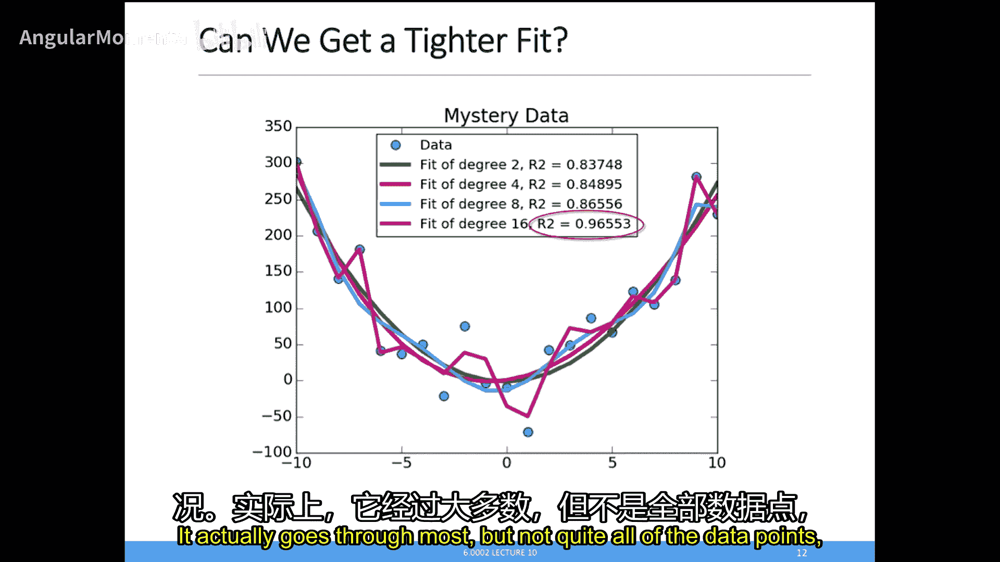

Okay。So if that's the case， the order 16 Fi is really the best fit。Should we just use it？

And I left you last time with that quote that says from your parents， right。

 Your mother telling you just because you can do something doesn't mean you should do something。

I'll leave it at that。Same thing applies here。Why are we building the model。Remember。

 I said two reasons。 One is to be able to explain the phenomena。

And the second one is to be able to make predictions。So。

Want to be able to explain the phenomenon in the case of a spring with things like it's linear。

 And that gives me a sense of a linear relationship between compression and force。In this case。

 a 16th order model。What kind of physical process has an order 16 variation。对的。

Sounds a little painful。 So maybe not a great insight into the， into the， the process。

The second reason is I want to be able to predict future behavior of this system。

In the case of the spring， I put a different weight on than I've done before。

 I want to predict what the， the， the displacement is going to be。

I've done a set of trials for an FDA approval of a drug。 Now。

 I want to predict the effect of a treatment on a new patient。

 How do I use the model to help me with that。1 that may be not so good。 Currently。

 I want to predict the outcome of an election。 Maybe those models need to be fixed from at least what happened the last time around。

But I need to be able to make the prediction。 So another way of saying it is a good model both explains the phenomena unless let me make the predictions。

Okay， so let's go back then to our example。And before I do it。

 let me tell you where that data came from。I actually built that data by looking at another kind of physical phenomena。

 And theres a lot of them things that follow a parabolic arc。So， for example， comets。

Any particle under the influence of a uniform gravitational field follows a parabolic arc。

 is why Haley's comet gets really close for a while and then goes way off into the solar system and comes back around。

My favorite example， I'm biased on this。 And I know you all know which team I root for。

 But there's Tom Brady throwing a pass against the Pittsburgh Steelers。

Senator Mass of the past follows a nice paraolicarch。Even in design。

 you see parabolic arcs in lots of places。 They have nice properties in terms of dis disbursement of loads and forces。

 which is why architects like to use them。So here's how I generated the data。

I wrote a little function。 Actually， I didn'。 Professor Gutag did， but I borrowed it。

That took in three parameters， A， B and C。A X squared plus B， X plus C。I gave it a set of X values。

 Those are the independent measurements， the things along the the horizontal axis。

 And notice what I did。 I generated。Values given in A， B， and C。For that equation。

And then I added in some noise。So random dot Gause takes a mean and a standard deviation。

 and it generates noise following that bell shaped curve or， that Gaussian distribution。

So the0 says it's 0 mean， meaning there's no bias。 It's going be equally likely to be above or below the value。

 positive or negative。But 35 is a pretty good standard deviation。

 This is putting a lot of noise into the data。And then I just added that into Y values。

 The rest of this， you can see it's simply going to write it into a file， a set of X and y values。

 But this will generate， given a value for A， B and C。

Data from a parabolic arc with noise added to it。And in this case。

 I took it as a Y equals 3 x squared。And then B and C are 0。And that's how I generated。

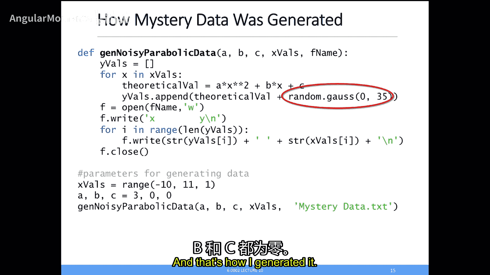

Okay。What I want to do， I want to see how well this model actually predicts behavior。

 So one of the ways I could do it to say the question I want to ask is， whoa。

If I generated the data from a degree2 polynomial， a quadratic。

 why in the world is the 16th order polynomial the best fit。P总。So， let's test it out。

I'm going to give 3， sorry，4。I can't count four different degrees， Order 2， order 4， order 8。

 order 6。And I've generated two different data sets。Using。Exactly that code。 just ran it twice。

 It's going to have slightly different values because the noise is going be different in each case。

 But they're both coming from that A， A Y equals 3 x squared equation。

And the code here basically says， I want to take those two data sets and。Basically。

 get the X and Y values out and then fit models。So'll remind you。

 Gen Fitz takes in a collection of X and Y values。And a list or tuple of degrees。

 And for each degree， finds using polyfit the best model。So models 1 will be four models for order 2。

4，8 and 16。And similarly， down here， I'm going to do the same thing。But using the second data set。

 and I'm going to fit again， a set of models。And then I'll remind you， test fits she saw last time。

 I know a while ago， basically takes a set of models。A corresponding set of degrees。

X and Y values and says for each model in that degree， measure how well that model meets。The fear。

Using that R squared value。 So test fits is going to give us back a set of R squared values。Alright。

 with that in mind。I've got the code here。 Let's run it。And。Here we go。I'm going to run that code。

I got two fits。Looks good。 Let's look at the values。So there's the first data set。Alright。

 the green line still is doing not a bad job。 The purple line boy is fitting it really well。

 And again， notice。Here's the best fit。 That's amazing。 That is accounting for all， but 。

4% of the variation in the data。 Great fit。😊，Order 16 came from an order two thing。 All right。

 what about the second data set。Og。Grump。It also says。Order 16 F。Is the best fit。

 Not quite as good as accounts for all， but about 2% of the variation。Again， the green line。

 the red line do O。 But in this case， again， that purple line is still the best fit。

 So I still got this puzzle。

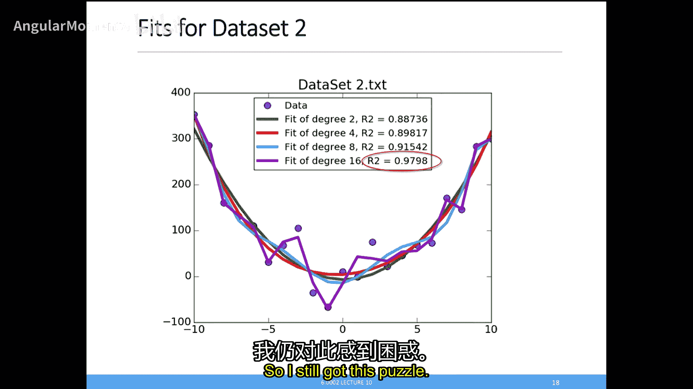

But， I didn't quite test。What I wanted。Right。Soid， I want to see how well it predicts。New behavior。

Here， what I did was I took two data sets， fit the model， and I got two different fits。

 one for each data set。 They both fit well for order 16， but they're not quite right。Okay。

 so best fitting model is still order 16， but we know it came from an order to polynomial。

So how can I really get a handle on seeing how good this model is。Well， what we're seeing here。

Is coming from training error。Or another way of saying it is。

 what we're measuring is how well does the model perform on the data from which it was learned。

How well do I fit the model to the training data。I want a small training error。

And if you think about it， go back to the first example。 When I fit a line to this data。

 it did not do well。 That was not a good model。 When I fit a quadratic。It was pretty decent。

 And then it got better and better as I went on。 So I certainly need at least a small training error。

 but it's to use the mathematical terms a necessary but not sufficient condition to get a great model。

I need a small training error， but I really want to make sure that the model is capturing what I'd like。

And so for that， I want to see， how well does it do on other data generated from the same process。

Whether it's weights on springs。Different comments， besides Haley's comments。

Different voters than those surveyed when we tried to figure out what's going to happen in an election。

And I'm set up to do that。By using。A really important tool called validation， or cross validation。

And we set the stage， and then we're gonna do the example。I'm going to get a set of data。

I'm going fit a model to it。 actually， different models， different degrees。

 different kinds of models。To see how well they work。

 I want to see how well they predict behavior under other data than that from which I did the training。

So I could do that right here。I could generate the models from one dataset。

But test them on the other。And so， in fact。I had one data set。

 I built a set of models for the verse dataset。 I compared how well it did on that data。

 but I could now apply it to the second data。How well does that account for that data set and similarly。

 take the models I built for the second data set and see how well they predict the points from the first data。

What do I expect。I certainly expect that the testing error is likely to be larger than the training error because I trained on one set of data。

And that means this ought to be a better way to think about how well does this model generalize。

 How well does it predict other behavior， besides what I started with。

So here's the code I'm gonna to use。 It's pretty straightforward。

 All I want to draw your attention to here is remember。

 models 1 I built by fitting models of degree 2，4，8 and 16 to the first data set。

And I'm going to apply those models to the second data set。X vows 2 and and Y vows 2。Similarly。

 I'm going to take the models built for the second data。

And test them on the first data set to see how well they fit。I know you're eagerly anticipating。

 as I've been setting this up for a whole week。Alright， let's look at what happens when I do this。

 I'm going to run it， and then we'll look at the examples。

So if I go back over to Python and this code was distributed earlier if you want to go play with it yourself。

It should be the right place to do it。 I am going to run that code。啊。Now。

 I get something a little different。AndIn fact， if I go look at it。Here's。Model 1。

Applied to data set 2。And we can both eyeball it and look at the numbers。 eyeballing it。

 There's that green line。Still， generally following the form of this pretty well。

What about the purple line， the order 16 degree。 Remember， that's the purple line from Model 1。

 from training set 1。Wow。Misses a bunch of points pretty badly。 And， in fact。

Look at the R squared values。Order 2 and order 4。 Pretty good fit。Accounts for all， but about 14。

13% of the data。 Look what happened。To degree，16 degree，165。Way down at 。7。Last time around， it was 。

997。哈。And what about the other direction。Taking。The model built on the second data。

 testing it on the first data set， the gain notice。Nice fit for degree 2 and 4。

Not so good for degree 16。AndJust to give you a sense of this， I want to go back， there is。The model。

In one case， there is the model in the other case。 You can see the model that accounts for variation in one doesn't account for the variation in the other。

 When I look at an order 60 fit。Okay。So what this says is something important。Now， I can see。

 in fact， if I look back at this， if I were just looking at the coefficient of determination。

 this says in order to predict other behavior， I'm better off with an order to or maybe order for polynomial。

Those R squared values are both the same。 I happen to know its order too。

 because that's where I generated it from。 But that's a whole lot better than order 16。

What you're seeing here is an example of something that happens a lot in statistics。And， in fact。

 I would suggest as often misused in fitting data to statistical samples。 It's called overfitting。

And what it means is I've let there be too many degrees of freedom in my model。

 too many free parameters。 And what it's fitting isn't just the underlying process。

 It's also fitting to the noise。Message I want you to take out of this part of the lecture is if we only fit the model to training data and we look at how well it does。

We could get what looks like a great fit。But we may actually have come up with far too complex。

 a model。Order 16， instead of order 2。And the only way you're likely to detect that is to train on one test set and test on a different。

And if you do that， it's likely to expose whether， In fact。

 I have done a good job of fitting or whether I have overfit to the data。

There are lots of horror stories in the literature。

 especially from early days of machine learning of people overfitting to data and coming up with models that they thought wonderfully predicted in effect。

And then when it ran on new data， really bit the big one。Al。

 so this is something you want to try and stay away from。

 And the best way to do it is to do validation。You can see it here。Right。

 the upper left is my training data。 Data set 1， there's the set of models。

This is now taking that and applying it to a different data set from the same process。

And notice for the degree2 polynomial。The coefficient in a determination，86。Now，87。

 the fact it's slightly higher is just accident。But it's really about the same level。

 It's doing the same kind of job on the training data and on the test data。On the other hand。

 degrees 16。Co to determination is a wonderful 。996 here。😊，And a pretty awful 。699 down there。

And that's a sign that's we're in not good shape when， in fact。

 our coefficient of determination drops significantly when we try and handle new data。

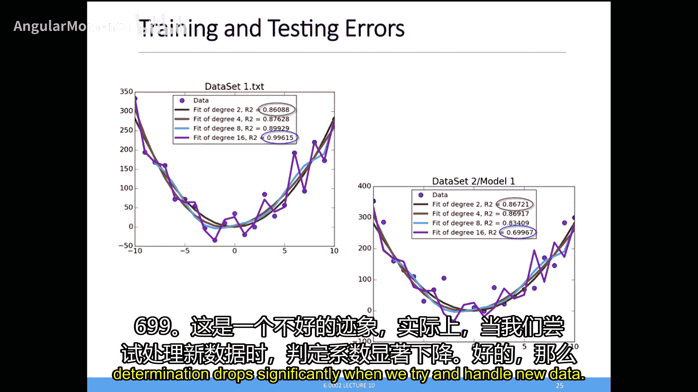

Okay。So。Why do we get a better fit。On the training data with a higher order model。

But then do less well when we're actually handling new data。Or another way of saying it is。

If I started out with。In the case of that， that data， a linear model， it didn't fit well。

 And then I got to a quadratic model。 Why didn't that quadratic model still say the best。

 Why was it the case that， as I added more degrees of freedom， I did better。

Or another way of asking it is， can I actually get a worse fit to training data as I increase the model complexity。

And I see at least one negative head shake。 Thank you。 You're right。 I cannot。 And let's look at why。

If I add in some higher order terms and they actually don't matter if I got perfect data。

The coefficient will just be 0。The fit will basically say this term doesn't matter。 ignorere it。

 And that'll work in perfect data。But if the data is noisy。

What the model is going to do is actually start fitting the noise。

And while it may lead to a better R squared value， it's not really a better fit。Right。

 let me show you an example of that。I'm gonna fit a quadratic to straight line。Easy thing to do。

 But I want to show you the effect of overfitting or adding in those extra terms。

So let me say it a little bit better。 I'm gonna start off with just3， sorry，3。

 I'm doing that again today，4 simple values，0，1，2，3。 The y values are the same as x values。

 So this is00，1，1，2，2，3，3。 They're all lying on a line， But I'm going to fit。

 I'm gonna plot them out。And then I'm going to fit a quadratic。Y equals A x squared plus B， X plus C。

To this。 now， I know it's a line， but I want to see what happens。 I， I fit a quadratic。

 So I'm gonna to use polyfit to fit a quadratic。 I'm going print out some data about it。

And then I'm going to use polyval to estimate what those values should be。

Ploot them out and then compute the R squared value and see what happens。Al right。Okay。

 let me set this up better。 What am I doing。 I'm going to fit it to a line。 I know it's a line。

 but I'm gonna to fit a quadratic to it。 And what I'd expect is。

 even though there's an extra term there， it shouldn't matter。So if I go to Python and I run this。

I'm going to run exactly that example。2。O吧。A equals 0。 B is 1。 C equals 0。

 Look at the R squared value。Let me pull that together for you。It says， in this perfect case。

There's what I get。The blue line is drawn through the actual values。

 The dotted red line is drawn through the predicted values that exactly line up。 And， in fact。

 the solution it finds says that higher order term coefficient 0， it doesn't matter。

So what it found was y equals x。I know you're totally impressed。 I could find a straight line。

 but notice what happened there。 I dropped or the system said you don't need the higher order term。

 Wonderful R squared value。Okay， let's see how well it predicts。

Let's add in one more point out at 20。 So this is 0，1，2，3。 That's 0，1，2，3。 I'm going add 20 in there。

 So it's 0，0，1，1，2，2，3，3，2020。Again， I can estimate using the same model。

 So I'm not recomputing the model。 The model I predicted from using those first set of four points。

 I can get the estimated y values， P those out and again， compute the R squared value here。

And even adding that point in， there's the line。And guess what？Perfectly predicts it。No big surprise。

So it says in the case of perfect data， adding the higher order terms isn't going to cause a problem。

 The system will say coefficients are 0。 That's all I need。Alright。

 now let's go back in and add in just a tiny bit of noise。Right there。0，0，1，1，22 and 3，3。1。

 So I've got a slight deviation in the y value there。Again， I can plot them。

 I'm going fit a quadratic to them。I'm going print out some information about it and then get the estimated values using that new model to see what it should look like。

I'm not going to run it。 And I'm just going to show you the result。

 I get a really good R squared value。And there's the equation it comes up with。Yeah， not so bad。

 right。It's almost y equal x。But because of that little bit of noise there。

 there's a small second order term here and a little constant term down there。

 The y squared value is really pretty good。And if you really squint and look carefully at this。

 you'll actually see there's a little bit of a deviation between the red and the blue line。

 It undershoots， sorry， overshoots there。 undershoots here， but it's really pretty close。All right。

 so am I just。Whistling in the dark here。 What's the difference。Well。

 now let's add in that extra point。And what happens。So again， I'm now taking the same set of points。

0，0，1，1，2，2，3 and 3。1。 I'm going to do 2020。Using the model I captured from fitting to that first set。

I want to see what happens here。Crap， oh， sorry。 didn't say that。 darn dra。Pick up another word。

Shouldn't surprise you。 write a small variation here。

Is now causing a really large variation up there。And this is why in the ideal case。

 overfitting is not a problem because the coefficients get zeroed out。

 but even a little bit of noise can cause a problem。 Now， I'll grant you。

We set this up deliberately to show a big effect here。

 But a 3% error in one data point is causing a huge problem when I get further out on this curve。

And by the way， there's the r squared value It' 0。7， doesn't do a particularly good job。

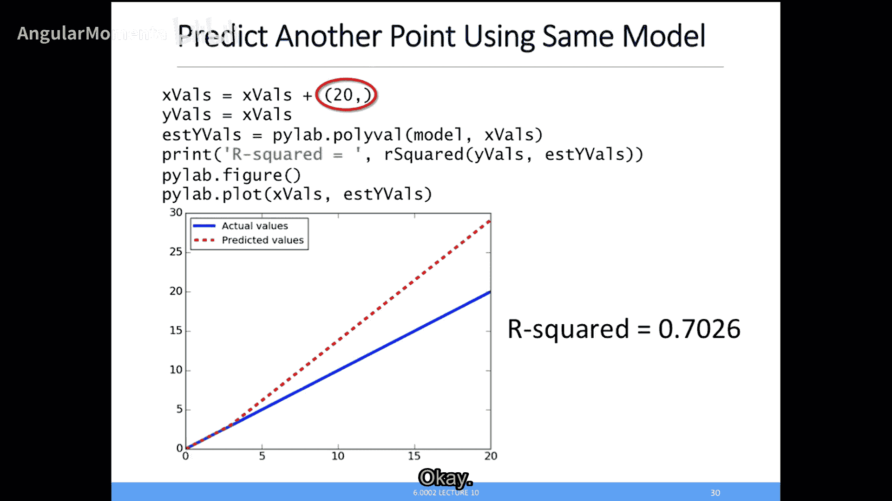

Okay。So how would I fix this。Well， what if I had simply done a first degree fit。Same situation。

 Let's say， fit a line to this rather than fitting a quadratic。 Remember， my question was。

 what's the harm of fitting a higher order model if the coefficients would be zeroed out。

 we've seen they won't be zeroed out。 But if I were just to have fit a line to this。

 exactly the same experiment，0，0，1，1，2，2，3 and 3。1。

20 and 20。Now， you can see。He still does a really good job of fitting。And the R squared value is 。

9988。So again， fitting the right level of model， the noise doesn't cause nearly as much of a problem。

And so just to pull that together， basically， it says the predictive ability of the first order model is much better than the second order model。

 And that's why in this case， I would want to use that first order model。So take home message。

 and then we're going to amplify this。If I pick an overly complex model。

I have the danger of overfitting to the training data， overfitting。

 meaning that I'm not only fitting the underlying process。 I'm fitting the noise。

 I get an order 16 model as the best fit when it'， in fact， an order2 model that was generating it。

That increases the risk。That it's not going to do well with new data。Not what I like。

 I want to be able to predict what's going to go on well here。On the other hand， so that would say。

 boy， just stick with the simplest possible model。But there's a trade off here。

And we already saw that when I tried to fit a line to a data that was basically quadratic。

 I didn't get a good fit。So I'd want to find the balance。

 an insufficiently complex model won't explain the data well。

An overly complex model will overfit to the training data。

 So I'd like to find the place where the model is as simple as possible， but still explains the data。

And I can't resist the quote from Einstein that captures it pretty well。

 everything should be made as simple as possible， but not simpler。In the case of where I started。

 it should be fit a quadratic because it's the right fit。

 but don't fit more than that because it's getting overly complex。Now。

 how might we go about finding them the right model。We're not going to dwell on this。

 but here's a standard way in which you might do it。Start with a low water model。 Again。

 take that data fit a linear model to it。 Look at。Not only the R squared value。

 but see how well it accounts for new data。Increase the order of the model。 Repeat the process。

And keep doing that until you find a point at which a model does a good job。

 both on the training data and on predicting new data。Anat starts to fall off。

 That gives you a point where you might say there's a good size model。In the case of this data。

 whether I would have stopped at a quadratic or it might have used a cubic or accdtic。

 depends on the values。 But I certainly wouldn't have gone much beyond that。

 And this is one way if you don't have a theory to drive you to think about how do I actually fit the model the way I would like。

Let's go back to where we started。 We still have one more big topic to do。

 and we still have a few minutes left。 let's go back to where we started。Hook's law。

There was the data from measuring displacements of a spring。

 as I added different weights to the bottom of the spring。And there's the linear fit。 It's not bad。

There's the quadratic fit。And it certainly got a better R squared value。

 though that could be just fitting to the noise。 But you actually can see。

 I think that that green curve probably does a better job of fitting the data。😊。

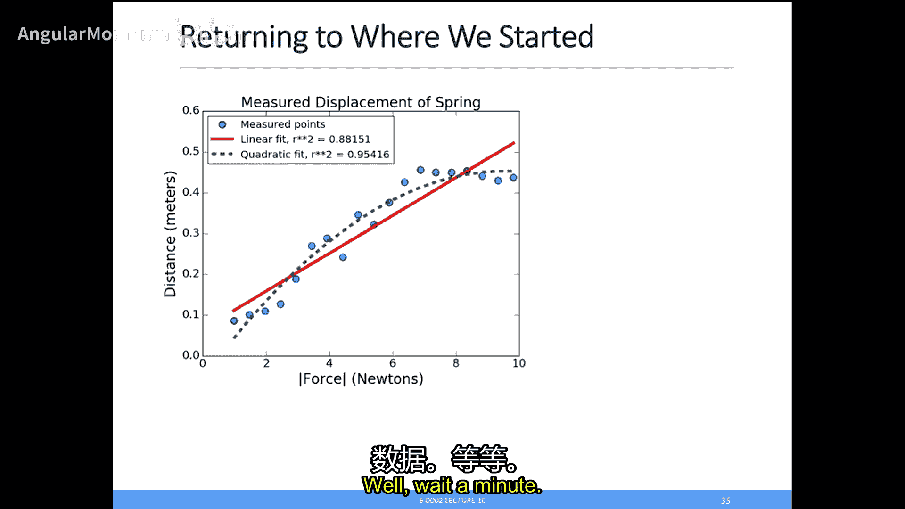

Well wait a minute。Even though the quadratic fit is tighter here。Hook says， this is linear。

So what's going on。Well， this is another place where you want to think about your model。

 And I'll remind you， in case you don't remember your physics。Unless we believe that H was wrong。

 this should tell us something。 And in particular， H's Law says the model holds until you reach the elastic limit of the spring。

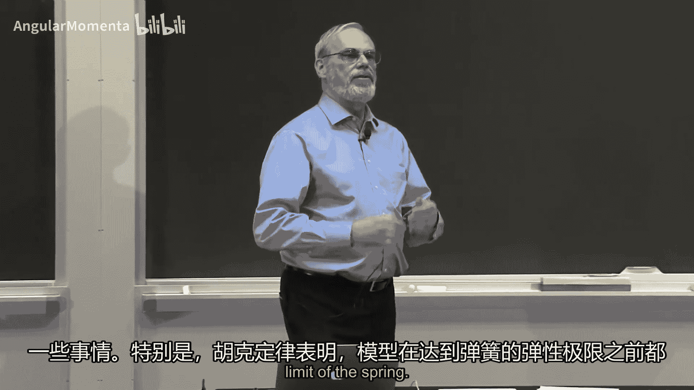

He stretches slinky too far。 It never springs back。You go beyond that elastic limit。

 And that's probably what's happening right up there。Through here。

 it's following that linear relationship up at this point of essentially broken the spring。

 The elastic limit doesn't hold anymore。And so really， in this case。

 I should probably fit different models to different segments。And there's a much better fit。

Linear through the first part and another linear line。 Once I hit that elastic limit。

How might I find this， Well， you could imagine a little search process。In which you try and find。

 where's the best place along here to break the data into two sets。

Fit linear segments to both and get really good fits for both examples。

And I raise it because that's the kind of thing you've also seen before。

 You could imagine writing code to do that search to find that good fit。

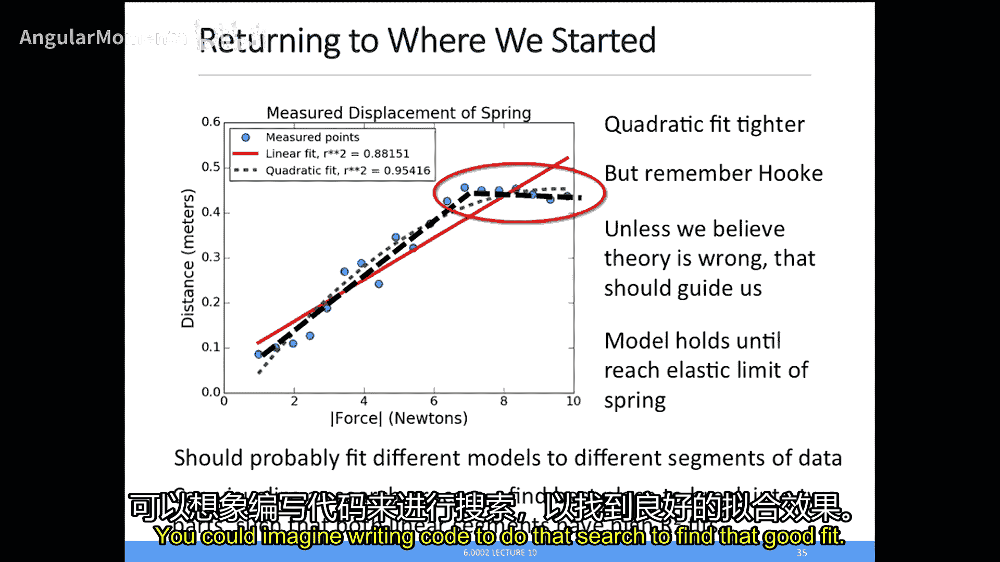

Okay。That gives you a sense then of why you want to be careful about overfitting。

 why you want to not just look at the coefficient of the determination。

 but see how well does this predict behavior on new data sets。Now。

 suppose I don't have a theory like hook to guide me。

Can I still figure out what's a good model to fit to the data。And the answer is， you bet。

 we're going to use cross validation to guide the choice of the model complexity。

And I want to show you two examples。If the data sets small。

We can use what's called leave one out cross validation。 I'll give you definition of that。

 in a second。If the data sets bigger than that， we can use Kfold cross validation。

 I'll give you a definition that a second， or just what's called repeated random sampling。

 But we can use this same idea of validating on new data to try and figure out whether the model is a good model or not。

Leave one out cross validation。 This is just written in pseudocode， but the idea is pretty simple。

'm given a data set， it's not too large。The idea is to walk through。A number of trials。

 number of trials equal to the size of the dataset set。 And for each one。

 take the data or a copy of it。And drop out one of the samples。 So leave one out。

Start off by leaving out the first one， then leaving out the second one。

 leaving out the third one for each one of those training sets， build the model。For example。

 by using linear regression。And then， test that model。

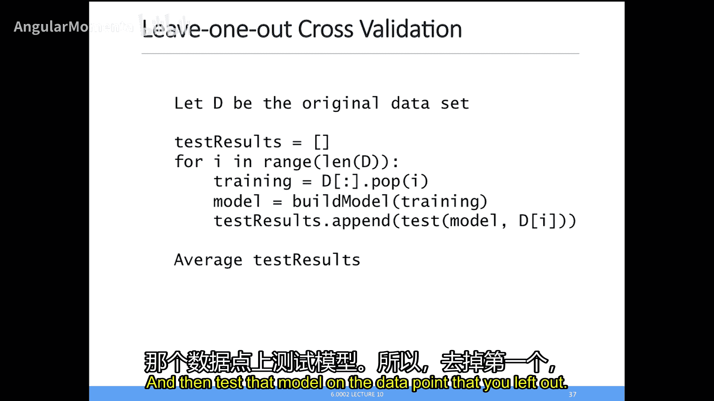

On the data point that you left out。So leave out the first one， build a model on all the other ones。

 and then see how well that model predicts the first one。 Leave out the second one。

Build a model using all them， But the second one， See how well it predicts the second one。

 It just average the results。

Works when you don't have a really large data set because it won't take too long。

 but it's a nice way of actually testing validation。If the data sets a lot bigger。

 you can still use the same idea to use what's called kfold。Divide the data set up into K。

 equal sized chunks。Leave one of them out， use the rest to build the model。

 and then use that model to predict that first chunk you left out。 Leave out the second chunk。

 keep doing it。 same idea。 But now with groups of things rather than just leaving out single data points。

Right， the other way you can deal with it。Which has。

A nice effect to it is to use what's called repeated random sampling。G， start out with some data set。

And what I'm going to do here is I'm going to run through some number of trials。

 I'm going to call that K， but I'm also going to pick some number of random samples from the data。

Usually， I think N is， as I recall， it is somewhere between reserving 20% to 50% of of the samples out。

 But the idea is， again， walk over all of those K trials。 and in each one。

Pick out at random n elements for the test set。Use the remainder as the training set。

 build the model on the training set， and then apply that model to the test set。

So rather than doing Kfold where I select K in turn and keep them。

 This is just randomly selecting which ones to pull out。So I'm gonna show you one last example。

 Let's look at that idea of， I don't have a model here。

 I want to use this idea of cross validation to try and figure out what's the best possible model。

And for this， I'm going to use a different data set。

 The data here is I want to model or the task here is I want to try and model。

How the mean daily high temperature in the US has varied over about what is that a 55 year period from 61 to 2015。

Got a set of data。 It's the meanre sorry， the daily high for every day of the year through that entire period。

 And what I'm gonna do is I'm going to compute the means for each year and plot them out。

And then I'm going to try and fit models to them， in in particular。

I'm going to take a set of different dimensionalities， Line， quadratic， cubic， cortic。

And in each case， I'm going to run through a trial where I train on one half of the data test on the other。

There gains that idea of seeing how well it predicts other data。

 record the coefficient of determination and do that get out an average and report what I get as the mean for each of those values across each dimensionality。

Okay。Here we go。 set a code that's pretty easy to see。 Hopefully。

 you can just look at it and rock it。 We start off with a boring class。

Which Professor Goodtag suggests refers to this lecture， but it doesn't。 It maybe a boring lecture。

 but it's not a boring class。 This is a great class。And boy， those jokes are really awful。

 aren't they， But here we go， simpleim class that builds temperature data。This reads in。

Some information splits it up and basically records the high for the day and the year in which I got that。

 So for each day， I've got a high temperature for that day。

 I'm gonna to give you back the high temperature in the year in which it recorded because I don't care whether it was in January and June。

A little function。That opens up a file。 We've actually given you that file。

 If you want to go look at it and simply walks through the file。

 reading it in and returning a big list of all those data objects。Okay。

Then what I want to do is I want to get the mean high temperature for each year。Given that data。

 I'm going to set up a dictionary called yearss。I'm just going to run through a loop through all the data points where in the dictionary under that year。

 So there's the data point。 I use the method get year to get out the year at that point。

I add in the high temperature， corresponding to that data point。

And I'm using that nice little triceep loop。 I'll do that unless I haven't had anything yet for this year in which case Sisll fail。

 And I'll simply store the first one in his a list。

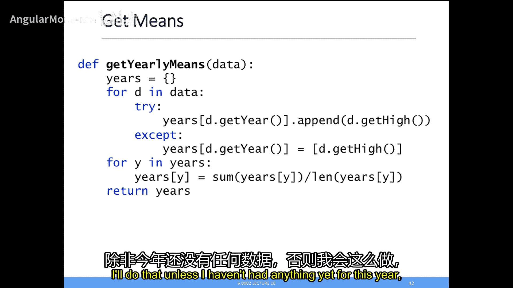

So after I'd run through this loop in the dictionary under the year。

 I have a list of the high temperatures for each day associated with it。

Excuse me。 And then I can just compute。The average。It is， for each year in the years。

 I get out that value。 I add them up。 I get the length of the item out。

 and I store that in as the average high temperature for the year。Now， I can plotud it。Get the data。

Get out the information by computing those yearly means。

 Run through a little loop that basically in the x values puts in the year in the Y values puts in the high temperature。

And I can do a plot。And if I do that。I get that。I'll let you run this yourself。Now。

 this is a little bit deceptive because of the scale I've used here。 But nonetheless。

 it shows in the US over a 55 year period the mean high day sorry。

 the mean daily high has gone from about 15。5 degrees Celsius up to about 17 and a half。So。

 it's changed。Now， question is， how could I model this。

 Could I actually get a model that would give me a sense of how this is changing。

And that's why I'm going to use cross validation。I'm going to run through a number of trials。

10 trials。I'm going to try and fit four different models。 Linear， quadratic， cubic， quatic。

And for each of these dimensions， I'm going to get out a set of R squared values。

 So I'm just going to initialize that dictionary， an empty list。And now。

 here's how I'm going to do this。Got a list of x values。 Those are years。

 Theyve got a list of y values。 Those are average highs， daily highs。

I'm going to create a list of random samples。So if you haven't seen this before。

 random dot sample says， given this iterator， which you can think of as the collection from 0 up to n -1。

It's going to select this many or half of them in this case， of those numbers at random。

So if I give it0 up to 9 and I say， pick 5 and them， well at random。

 give me back  five of those 10 numbers with no duplicates。That's nice。

Because now notice what I can do。 I'm gonna set up a training。 sorry X and Y values for training set。

 X and Y values for the test set。 And I'm just going to run through a loop here where if this index is in that list。

I'll stick it in the training set。Otherwise， I'll stick it in the test set。And then。

 I just return them。So this is a really nice way of at random， just splitting。

The data set into a test set， and a training set。And then， finally。

I can run over the number of trials I want to deal with。 in each case。

 get a different training and test set at random。And then， for each dimension。Do the fit。

There's polyfit on the training X and training Y values。 And that dimension gives me back a model。

I could just check to see how well the training set does， But I really want to look at。

 given that model， how well does Paullyval predict。The test set。Right，The model will say。

 here's what I expect is the values。 I'm going to compare that to the actual values that I saw。

From the training set。Computing that R squared value and adding it in。

And then the lasta this just says， I'll run this through a set of examples。Okay。

Here's what happens if I do that。 I'm not going to run it， although the code will run。

Let me again remind you what I'm doing。 I've got a big set of data。

 I'm going to pick out at random subsets of it。 build the model on one part。

 Test it on the other part。And if I run it。I get。A linear fit。Qudratic fit。 cubic fit。An acortic fit。

And here's the standard deviation of those samples。 Remember， I got multiple trials。

 I got 10 trials in this case。 So this gives me the average over those trials。

 And this tells me how much they vary。What can I conclude from this。Well。

 I would argue that the linear fits probably the winner here。Goes back to Einstein。

 I want the simplest possible model that accounts for it。

And you can see it's got the highest R scored value， which was already a good sign。

It's got the smallest deviation across the trials， which says it's probably a pretty good fit。

 and it's the simplest model。So linear sounds like a pretty good fit。Now。

 why should we run multiple data sets to test this， I ran 10 trials of each one of these dimensions。

Why bother with it？Well， notice that those deviations， I go back to it here。They're pretty good。

 They're about an order of magnitude less than the actual meme， which says they're pretty tight。

 but they're still。Reasonable size。And that suggests that while there's good agreement。

 the deviations are large enough that you could see a range of variation across the trials。So。

 in fact， if I had just run one trial。I could have been screwed。 Sorry， hosed， sorry。

 pick your favorite number word here。 Hose is a Canadian expression in case you haven't seen it。

Here are the R squared values where each trial of the linear fit。

And you can see the mean comes up pretty well。 But notice if I'd only run one trial and I happened to get that one。

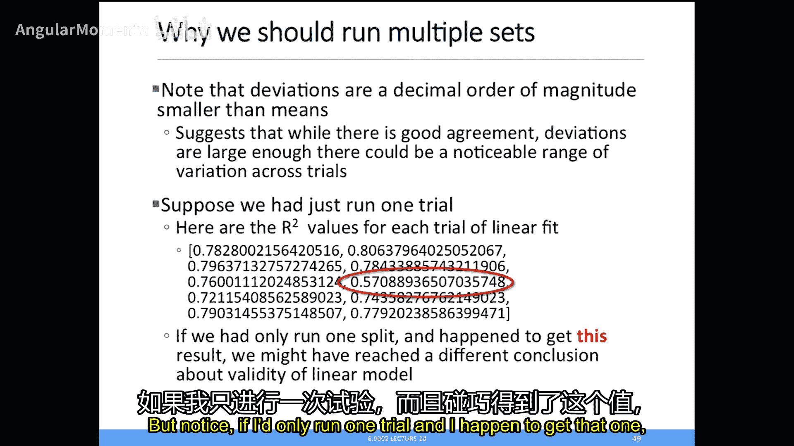

Oh， darn。That's a really low R squared value。 And we might have decided， in this case。

 a different conclusion that the linear fit was not a good fit。So this is a way of saying。

 even in random sampling， run multiple trials。Because it lets you get statistics on those trials。

 as well as statistics within each trial。 So within each trial。

 I'm doing a whole bunch of different random samples。 I' measuring those values。

 And then across those trials， I'm seeing what the deviation is。

And I'm gonna hope my machine comes back because what I want to do is then pull this together。

What have we done。Something you're gonna to use。 We've seen how you can use linear regression to fit a curve to data。

2D，3D，60， however big the data set is。It gives us a mapping from the independent values to the dependent values。

 And that can then be used to predict values associated with the independent values that we haven't seen yet。

That leads naturally to both a way to measure it， which is R squared。

But especially to see that we want to look at how well does that model actually predict new data。

 Because that lets us select the simplest model we can。

That accounts for the data。But predicts new data in an effective way。

And that complexity can either be based on theory。 In the case of hook。

Or in more likely cases by doing cross validation to try and figure out which one is the simplest model that still does a good job of predicting out of out of data behavior。

And with that， we'll see you next time。

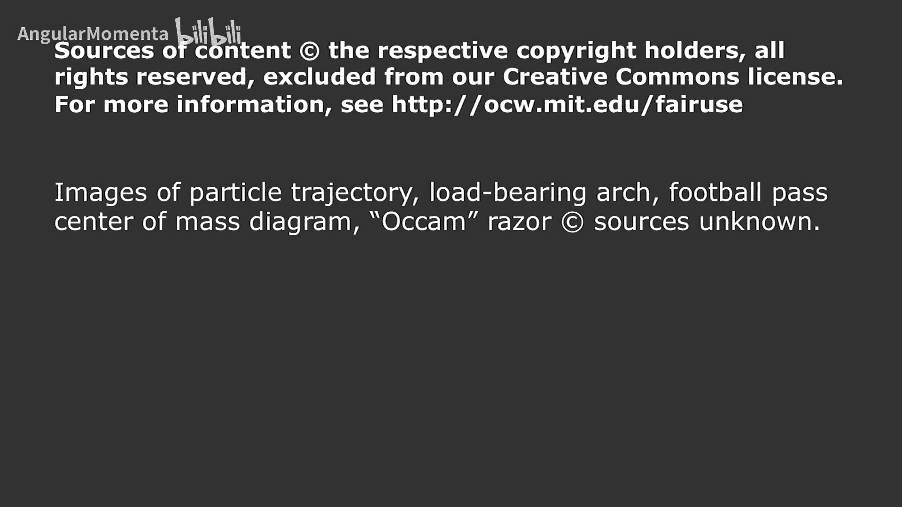