# 【麻省理工】计算思维与数据科学导论-｜-MIT-6.0002-Introduction-to-Computational-Thinking，Fall2016-p11-11.-机器学习简介--BV1zNjGzxEvk_p11-

The following content is provided under a Creative Commons license。

 Your support will help MiT OpenCoursewareare continue to offer high quality educational resources for free to make a donation or to view additional materials from hundreds of Mit courses。

 Visit Mit Opencourseourseware at Ow。mt。edduu。Okay， welcome back。

You know it's that time of term when we're all kind of doing this。

So let me see if I can get a few smiles by simply noting to you that two weeks from today is the last class。

Should be worth at least a little bit of a smile。 right， Professor Goodtag is smiling。

 He likes that idea。 You're almost there。😊，What are we doing for the last couple of lectures？

We're talking about linear regression。 And I just want to remind you。

 this was the idea of I have some experimental data。

 case of a spring where I put different weights on measure displacements。

 and regression was giving us a way of deducing a model。To fit that data。And in some cases。

 it was easy。 we knew， for example， it was going to be a linear model。

 We found the best line that would fit that data。 In some cases。

 we said we could use validation to actually let us explore to find the best model that would fit it。

 whether it's a linear， abic sorry， a linear， a quadratic， a cubic， some higher order thing。

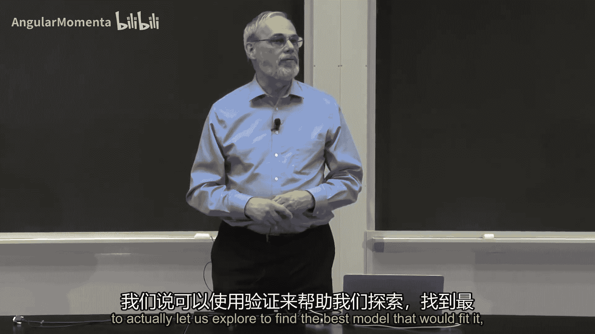

So， we'd be using that。To deuce something about a model。

That's a nice segue into the topic for the next three lectures。 The last big topic of the class。

 which is machine learning。And I'm going to argue， you can debate whether that's actually an example of learning。

 but it has many of the elements that we want to talk about when we talk about machine learning。

So as always， there's a reading assignment。Chapter 22 of the book gives you a good start on this。

 and it will follow up with other pieces。And I want to start。

By basically outlining what we're going to do。 And I'm going to begin by saying。

 as I'm sure you're aware， this is a huge topic。I've listed just five subjects in course six that all focus on machine learning。

 and that doesn't include other subjects where learning is a central part。

 so natural language processing， computational biology， computer vision。

 robotics all rely today heavily on machine learning， and you'll see those in those subjects as well。

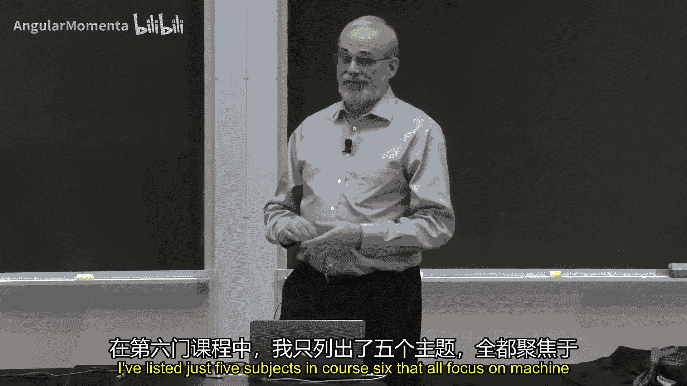

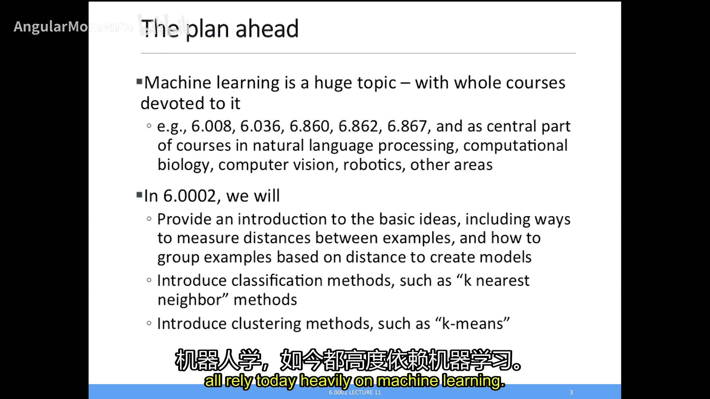

So we're not going to compress five subjects into three lectures。

But what we are going to do is give you the introduction。

 We're going to start by talking about the basic concepts of machine learning。

 The idea of having examples and how do you talk about features representing those examples。

 How do you measure distances between them and use the notion of distance to try and group similar things together as a way of doing machine learning。

 And we're going to look as a consequence of two different standard ways of doing learning。

One we call classification methods。

Example， we're going to see there's something called K nearest neighbor。In the second class。

 called clustering methods。

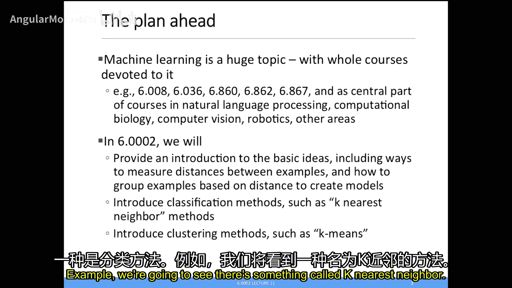

Classification works well when I have what we would call label data。 I know labels on my examples。

 and I'm going to use that to try and define classes that I can learn and clustering working well when I don't have labeled data。

 And we'll see what that means in a couple of minutes。 But we're going to give you。

An early view of this。Unless Professor Goodtag changes his mind。

 we're probably not going to show you the current really sophisticated machine learning methods like convolutional neural nets or deep learning。

 things you'll read about in the news。 But you're going to get a sense of what's behind those by looking at what we do when we talk about learning algorithms。

Before I do it， I want to point out to you just how prevalent this is。 And I'm going to admit。

 with my gray hair。I started working in AI in 1975 when machine learning was a pretty simple thing to do。

 And it's been fascinating to watch over 40 years， the change。 And if you think about it。

 just think about where you see it。

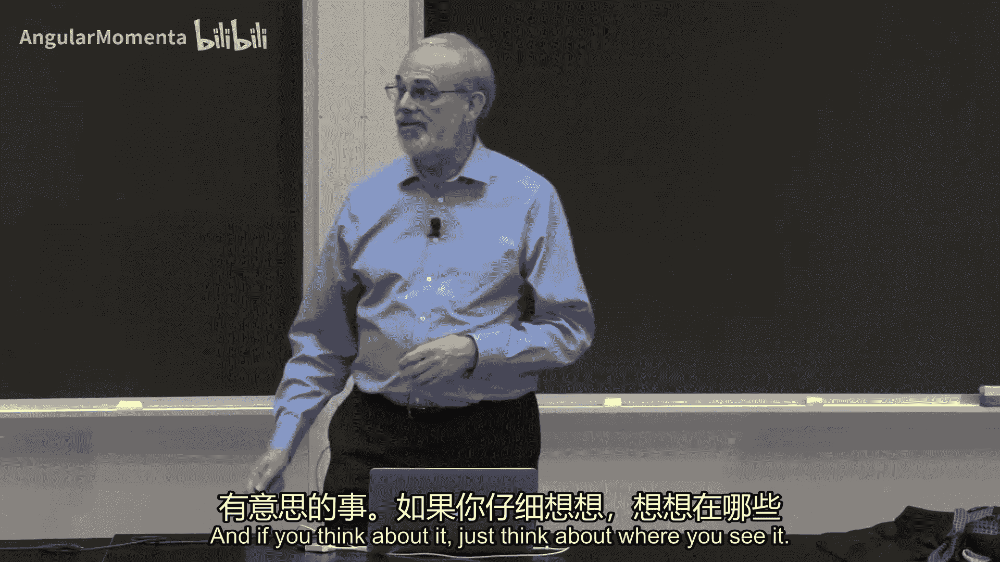

Alpha go。Machine learning based system from Google that beat a world class level go player。

 Cheess has already been conquer conquered by computers for a while。 Go now belongs to computers。

 Best go players in the world are computers。I'm sure many of you use Netflix。

 any recommendation system。 Netflix， Amazon， pick your favorite。

 uses a machine learning algorithm to suggest things for you。 And In fact。

 you've probably seen it on Google， right， The ads that pop up on Google are coming from a machine learning algorithm that's looking at your preferences。

 Scary thought。

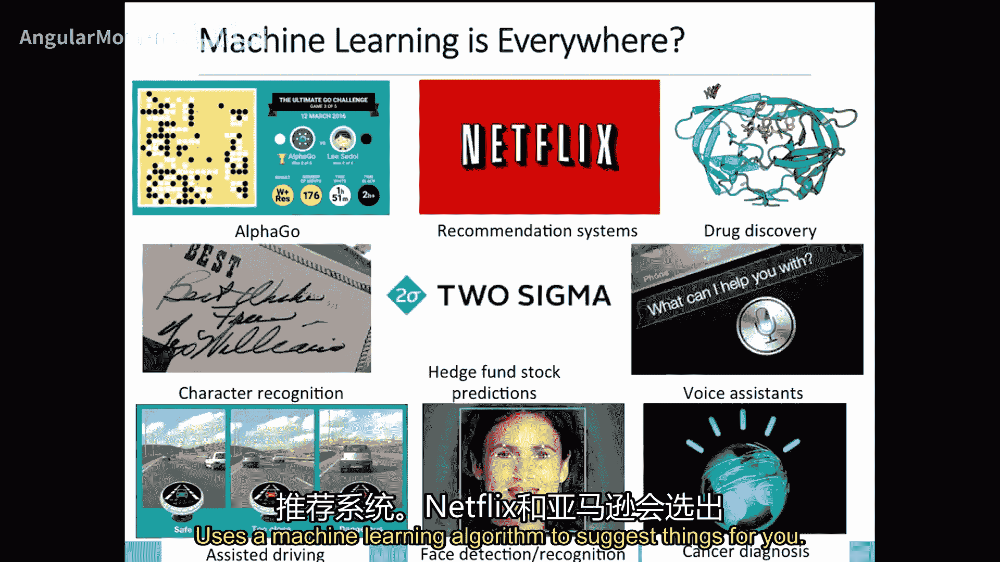

Drug discovery。Character recognition， the post office does character recognition of handwritten characters using a machine learning algorithm and a computer vision system behind it。

You probably don't know this company。 It's actually an MIT spinoff called two Sigs。

 a hedge fund in New York。

They heavily use AI and machine learning techniques。 And two years ago。

 their fund returned a 56% return。I wish I'd invested in the fund。

 I don't have the kinds of millions you need， but that's an impressive return。

56% return on your money in one year。Last year， they didn't do quite as well。

 but they do extremely well using machine learning techniques Siri。

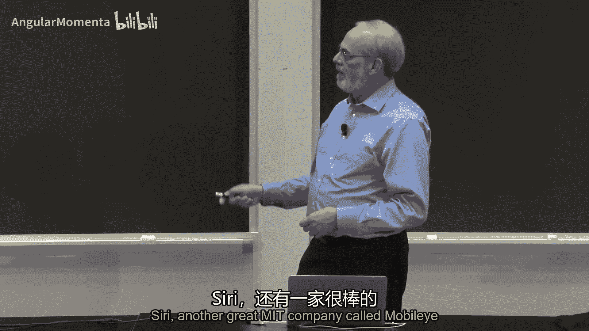

Another great MIT company called Mobil Eye that does computer vision systems with a heavy machine learning component that is used in assistive driving and will be used in completely autonomous driving。

 It will do things like kick in your brakes if you're closing too fast on the car in front of you。

Which is going to be really bad for me because I drive like a Bostonian。

 and it would be kicking in constantly。Face recognition， Facebook。Uses this。

 many other systems do to recognize， both detect and recognize faces。

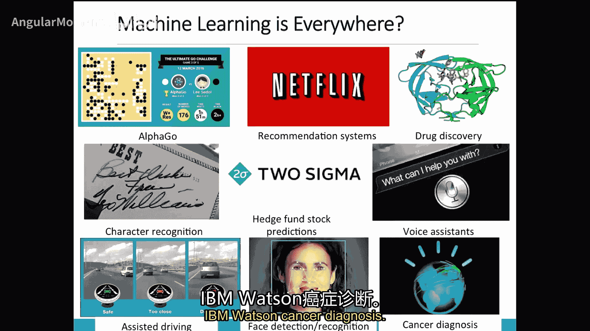

IBM Watson。Cancer diagnosis， these are all just examples of machine learning being used everywhere。

 And it really is。 I've only picked 9。So what is it？Who'm going to make an obnoxious statement。

 and you're now used to that。I'm going to claim that you could argue that almost every computer program learns something。

But the level of learning really varies a lot。 So if you think back to the first lecture in 601。

We showed you Newton's method for computing square roots。And you could argue youd have to stretch it。

 but you could argue that that method learn something about how to compute square roots。 In fact。

 you could generalize it to roots of any order power。But I really didn't learn。

 I really had to program it。I think about last week， when we talked about linear regression。

That starts to feel a little bit more like a learning algorithm。 because what did we do。

 We gave you a set of data points。Mass displacement data points。

And then we showed you how the computer could essentially fit a curve to that data point。 And it was。

 in some sense， learning a model for that data that it could then use to predict behavior in other situations。

And that's getting closer to what we would like when we think about a machine learning algorithm。

 We'd like to have。Program。That can learn from experience。

Something that it can then use to deduce new facts。Now。

 it's been a problem in AI for a very long time。 And I love this quote。

 It from a gentleman named Art Samuel。😊。

1959 is the quote in which he says his definition of machine learning is the field of study that gives computers the ability to learn without being explicitly programmed。

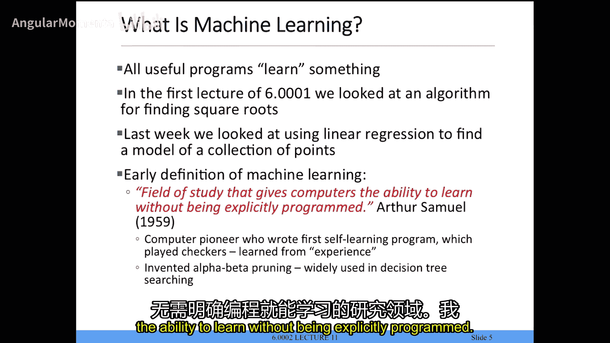

And I think many people would argue he wrote the first such program。 it learned from experience。

In his case， it played chers。Kind of shows you how the field has progressed。

 we started with checkers， we got the chess， we now do go。But it played checkers。

 It beat national level players。 Most importantly， it learned to improve its methods by watching how it did in games and then inferring something to change what it thought about as it did that。

Samuel did a bunch of other things I just highlighted one you may see in a follow on course。

 he invented what's called Alpha beta pruning， which is a really useful technique for doing search。

But the idea is， how can we have the computer learn without being explicitly programmed。

And one way to think about this is to think about the difference between how we would normally program and what we would like from a machine learning algorithm。

Normal programming， I know you're not convinced there's such a thing as normal programming。

 but if you think of traditional programming， what's the process？

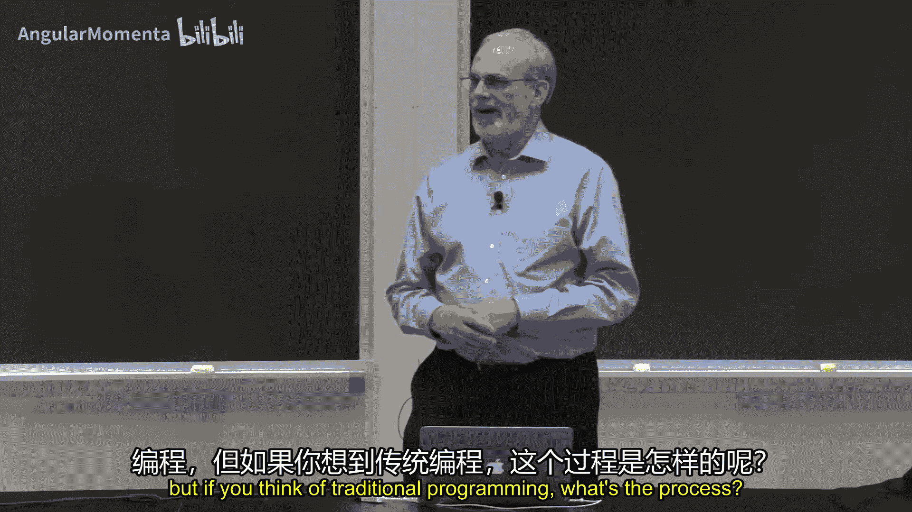

I write a program。That I input to the computer so that it can then take data and produce some appropriate output。

And the square root finder really sits there， right。

 I wrote code for using Newton method to find a square root。

 and then it gave me the process of giving any number， I'll give you the square root。

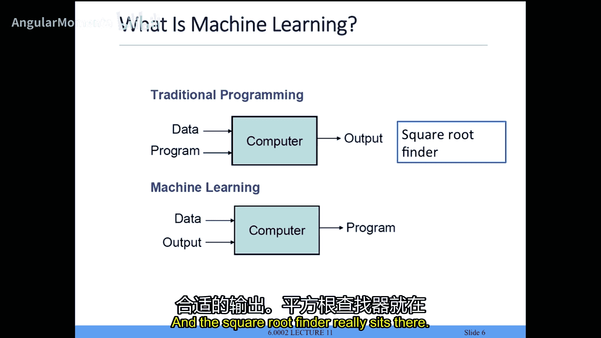

But if you think about what we did last time， it was a little different。 And， in fact。

 in a machine learning approach。

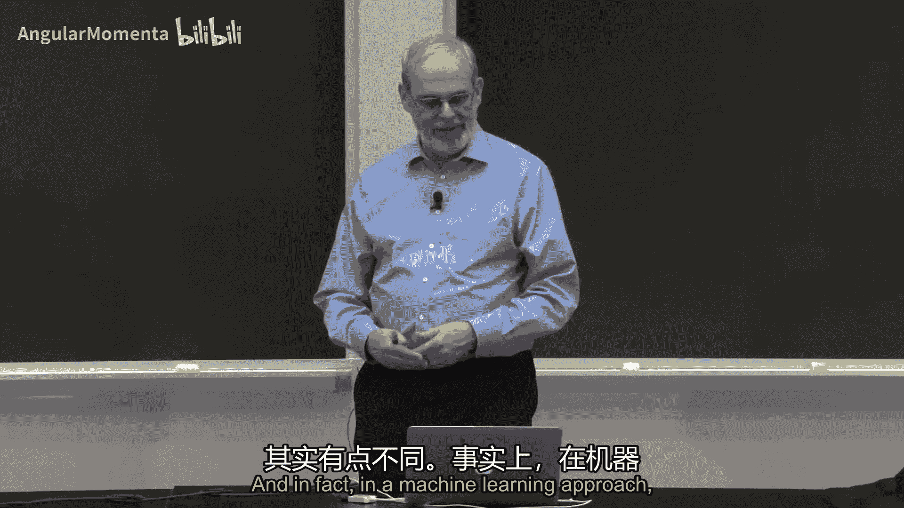

The idea is that I'm going to give the computer。Output。

I'm going to give it examples of what I want the program to do。Labels on data。

 characterizations of different classes of things。And what I want the computer to do is given that characterization of output and data。

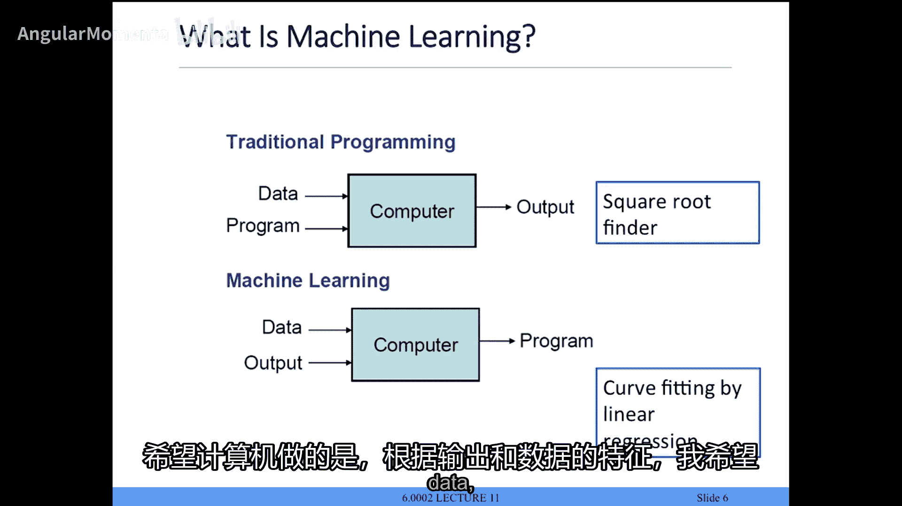

I wanted that machine learning algorithm to actually produce for me， a program。

A program that I can then use to infer new information about things。 And that creates， if you like。

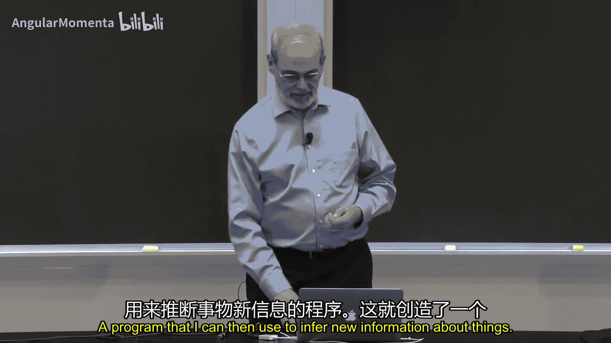

A really nice loop。Where I can have the machine learning algorithm learn the program which I can then use。

To solve some other problem。

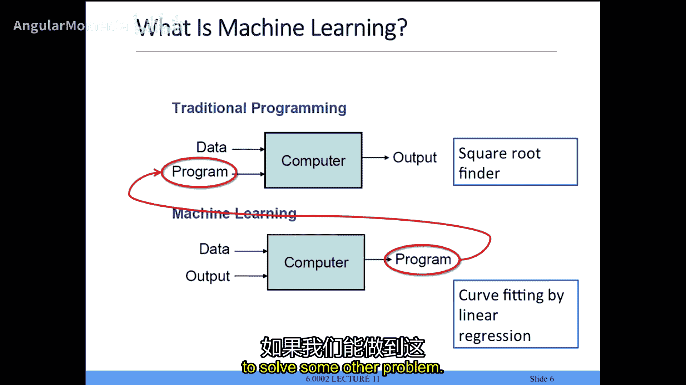

That would be really great if we could do it。 And as I suggested。

 that curve fittinging algorithm is a simple version of that。 It learned a model for the data。

 which I could then use to label any other instances of the data or predict what I would see in terms of spring displacement as I changed the masses。

😊，So that's the kind of idea we're going to explore。If we want to learn things， we could also ask。

 so how do you learn？And how should a computer learn？Well， for you as a human。

 there are a couple of possibilities。 This is the boring one。

 This is the old style way of doing it right。 Memorize facts。

Memorize as many facts as you can and hope that we ask you on the final exam instances of those facts。

 as opposed to some other facts you haven't memorized。This is。

 if you think way back to the first lecture。

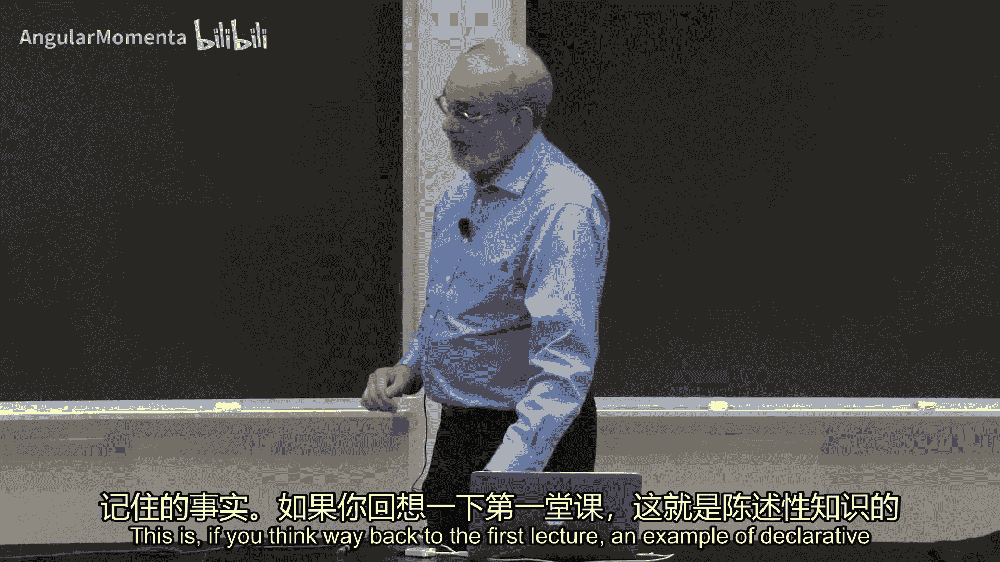

An example of declarative knowledge， statements of truth。Memorize as many as you can。

 have Wikipedia in your back pocket。

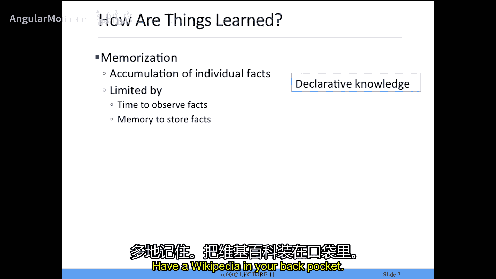

Better way to learn。ItsTo be able to infer to deduce new information from old。

And if you think about this， this gets closer to what we called imperative knowledge。

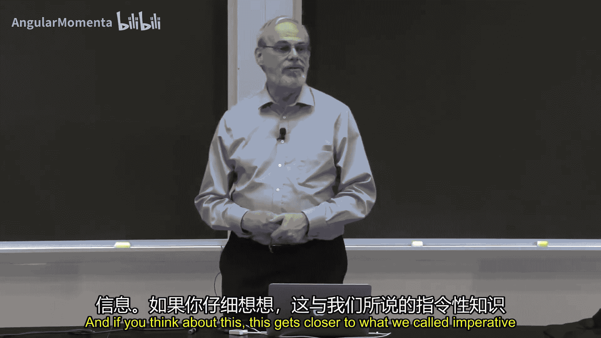

Ways to deduce new things。Now， in the first cases， we built that in when we wrote that program to do square roots。

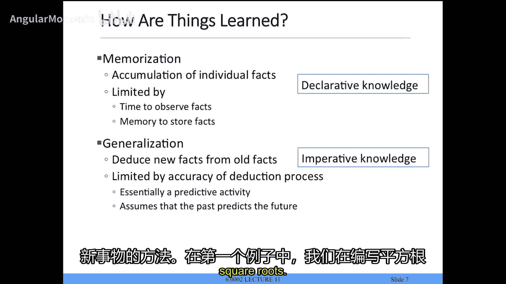

But what we'd like in a learning algorithm is to have much more like that generalization idea。

 We're interested in extending our capabilities to write programs that can infer useful information from implicit patterns in the data。

 So not something explicitly built in， like that comparison of weights and displacements。

 but actually implicit patterns in the data and have the algorithm。

 figure out what those patterns are and use those to generate a program you can use to infer new data about objects about spring displacements。

 whatever it is you're trying to do。😊，Okay， so the idea。

 then the basic paradigm that we're going to see。Is we're going to give the system some training data。

 some observations。We did that last time， with just the spring displacements。

We're going to then try and have a way to figure out how do we write code， How do we write a program。

 a system that will infer something about the process that generated the data。And then from that。

 we want to be able to use that to make predictions about things we haven't seen before。So again。

 I want to drive home this point。 If you think about it， the spring example fit that model。

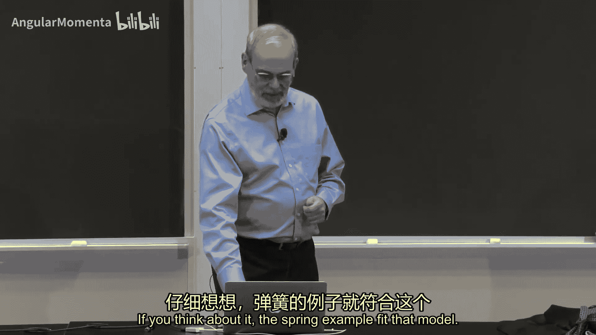

I gave you a set of data。Spatacial deviations relative to massive space。 for different masses。

 how far did the spring move。I then inferred something about the underlying process。

In the first case I said， I know it's linear， but let me figure out what the actual linear equation is。

 What's the spring constant associated with it。And based on that result。

 I got a piece of code I could use to predict new displacements。

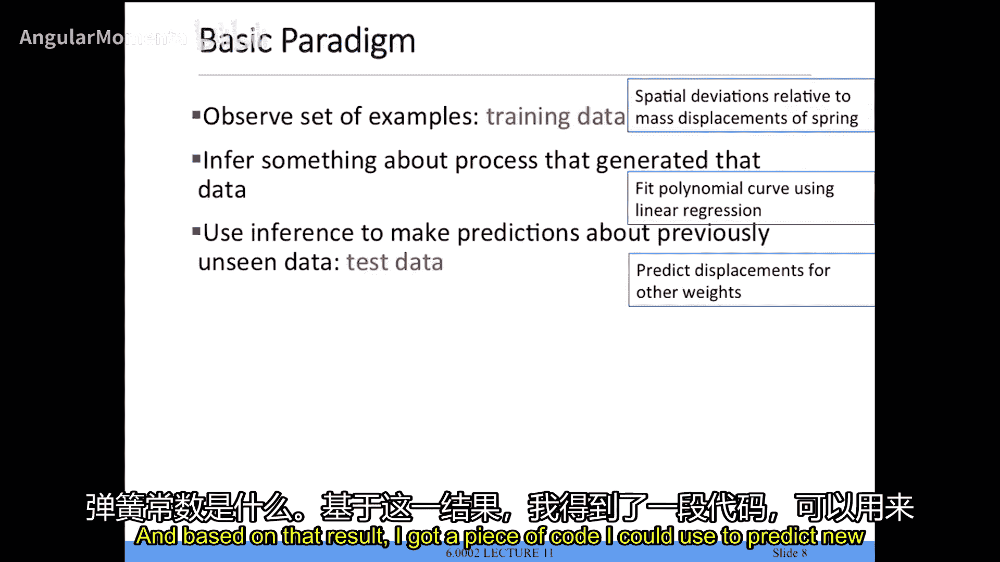

So it's got all of those elements， training data inference engine。

 and then the ability to use that to make new predictions。

But that's a very simple kind of learning setting。 So the more common one is what I'm going to use as an example。

 which is when I give you a set of examples。Those examples have some data associated with them。

 some features。And some labels。for each example， I might say this is a particular kind of thing。

 This other one's another kind of thing。And what I want to do is figure out how to do inference on labeling new things。

 So it's not just what's the displacement of the mass。 It's actually a label。

 And I'm going to use one of my favorite examples。 I'm a big New England Patriots fan。 if you're not。

 my apologies。But I'm going to use football players。 So I'm going to show you in a second。

 I'm going to give you a set of examples of football players。 The label is the position they play。

In the data， well， it could be lots of things， We're going to use height and weight。

But what we want to do is then see if how would we come up with a way of characterizing the implicit pattern of how does weight and height predict the kind of position this player could play。

 and then come come up with an algorithm will predict the position of new players。

We do the draft for next year。 Where do we want them to play。That's the paradigm。Set of observations。

Potentially， they will， potentially not。Think about how do we do inference to find a model。

 and then how do we use that model to make predictions。

What we're going to see and we're going to see multiple examples today is that that learning can be done in one of two very broad ways。

The first one's called supervised learning。And in that case。

 for every new example I give you as part of the training data， I have a label on it。

 I know the kind of thing it is。And what I'm going to do is look for。

 how do I find a rule that would predict the label associated with unseen input based on those examples。

 It's supervised because I know what the labeling is。Second kind， if this is supervised。

 the obvious other one is called unsupervised。 In that case。

 I'm just going to give you a bunch of examples。But I don't know the labels associated with it。

 I'm going to just try and find what are the natural ways to group those examples together into different models。

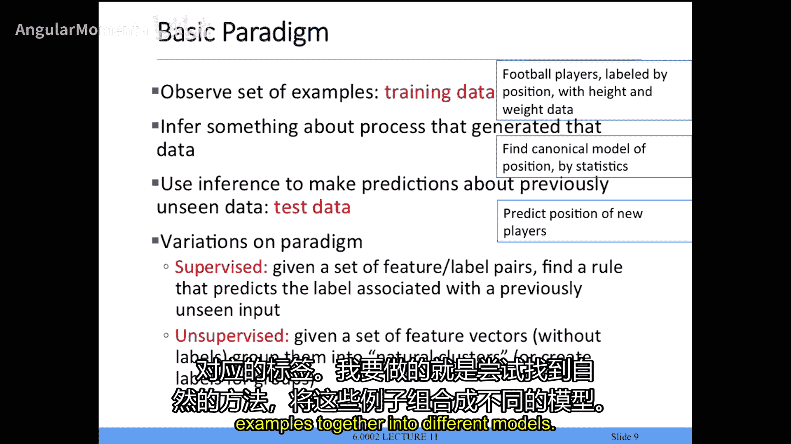

And in some cases， I may know how many models are there。 In some cases， I may want to just say。

 what's the best grouping I can find。Okay。What I'm going to do today is not a lot of code。

I was expecting cheers for that job， but I didn't get them， not a lot of code。

What I'm going to do is show you basically the intuitions behind doing this learning。

 And I'm going to start with my new England Patriot example。

 So here are some data points about current Patriots players。 And I got two kinds。 Sorry。

 I have positions。 I got receivers and I have linemen。

And each one is dislabeled by the name， the height in inches and the weight in pounds。

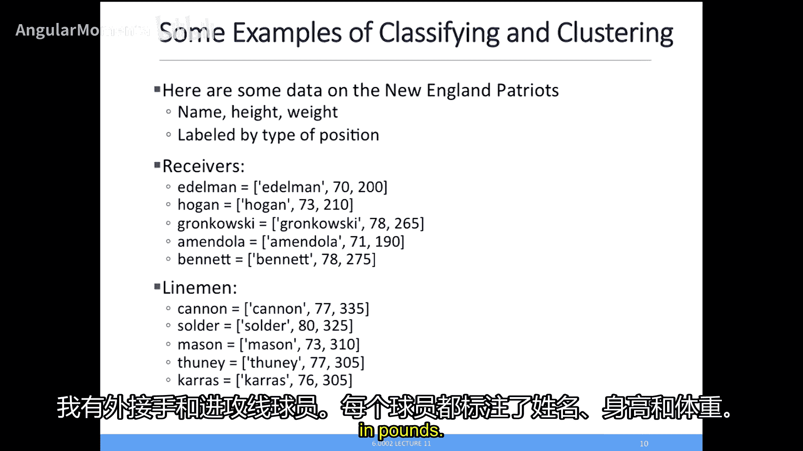

Okay，5 of each。

If I plot those。On a two dimensional plot， this is what I get。Okay， no big deal。

What am I trying to do？

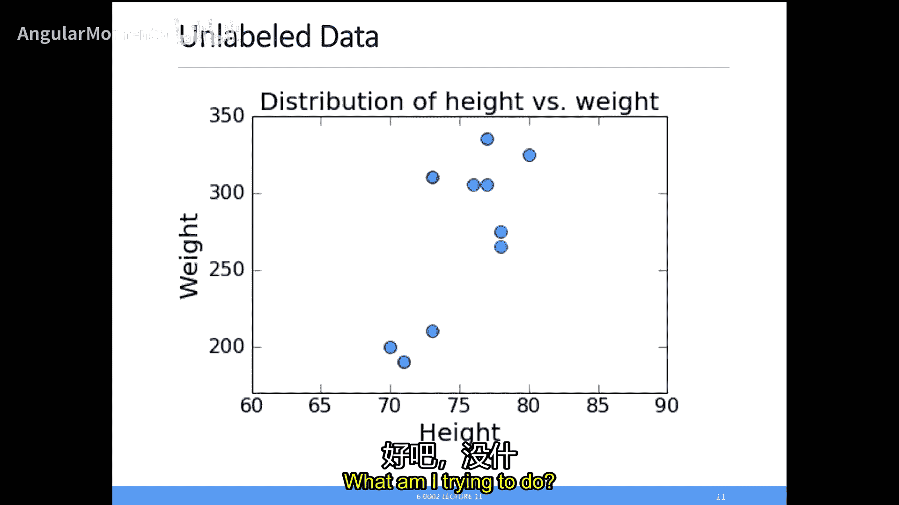

tryingrying to learn， are there characteristics that distinguish the two classes from one another。

 And in the unlabeled case， all I have are just a set of examples。

So what I want to do is decide what makes two players similar。With the goal of seeing。

 can I separate this distribution into two or more natural groups？Similar is a distance measure。

 It says， how do I take two examples with values or features associated we decide how far apart are they。

And in the unlabeled case， the simple way to do it is to say。

 if I know that there are at least K groups there。 in this case。

 I'm going to tell you there are two different groups there。

 how could I decide how best to cluster things together so that all the examples in one group are close to each other。

 All the examples in the other group are close to each other and they're reasonably far apart。

There are many ways to do it。 I'm going to show you one。

It's a very standard weight， and it works basically as follows。

If all I know is that there are two groups there， I'm going to start by just picking two examples。

As my exemplars。Pick them at random。 Actually， at random is not great。

 I don't want to pick too close to each other。 I'm going to try and pick them far apart。

 but I picked two examples as my exemplars。And for all the other examples in the training data。

 I say， which one is it closest to。

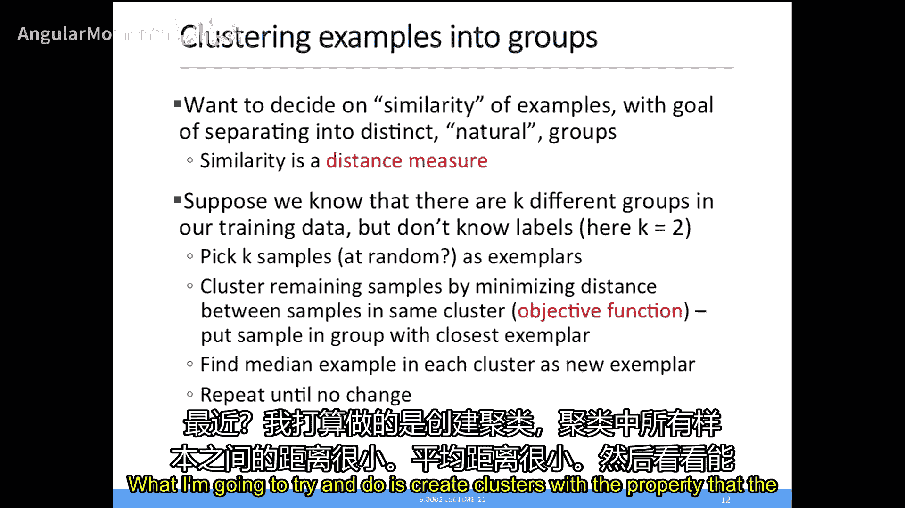

What I'm going to try and do is create clusters with the property that the distances between all of the examples of that cluster are small。

 The average distance is small and see if I can find clusters that gets the average distance for both cluster as small as possible。

This algorithm works by picking two examples， clustering all the other examples by simply saying。

 put it in the group。WhichTo which it's closest to that example。Once I've got those clusters。

 I'm going to find the median element of that group， not mean， but median。

 What's the one closest to the center。

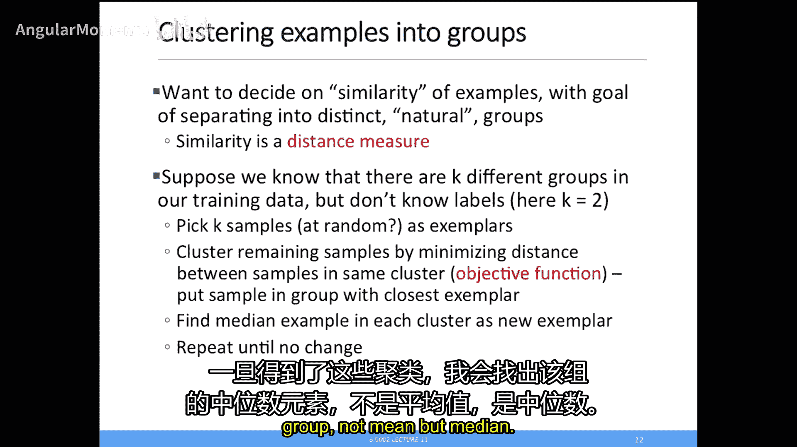

And treat those as my exemplars， and repeat the process。

And I'll just do it either some number of times or until I don't get any change in the process。

 So it's clustering based on distance。 and we'll come back to distance in a second。

So here's what would happen with my football players。 If I just did this based on weight。

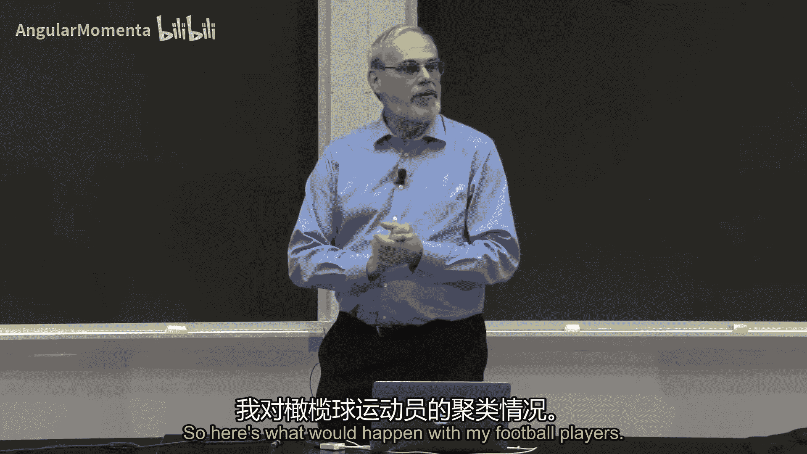

There's the natural dividing line。 and it kind of makes sense。 right。

 These three are obviously clustered。 And again， it's just on this axis。 They're all down here。

 These  seven are at a different place。 There's a natural dividing line there。

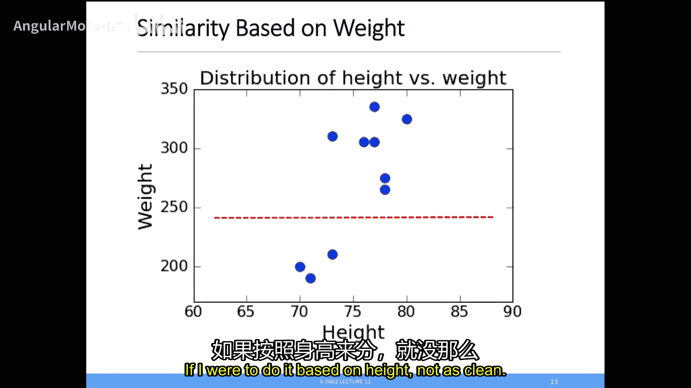

If I were to do it based on height。Not as clean。

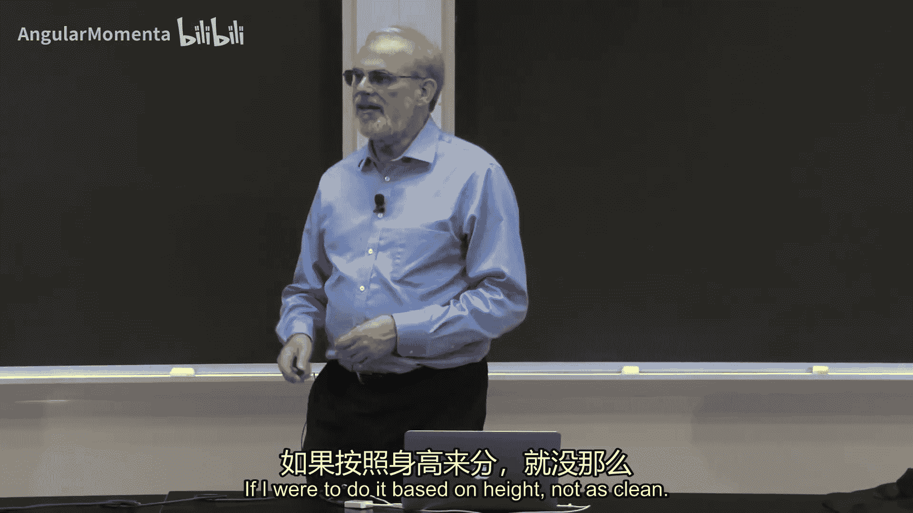

This is what my algorithm came up with as the best dividing line here， meaning that these four games。

 just based on this axis， are close together。 These six are close together。

 but it's not nearly as clean。

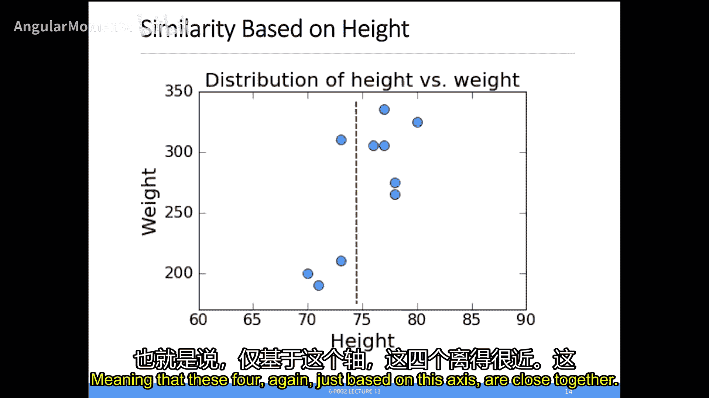

And that's part of the issue we'll look at is， how do I find the best clusters。

If I use both height and weight。

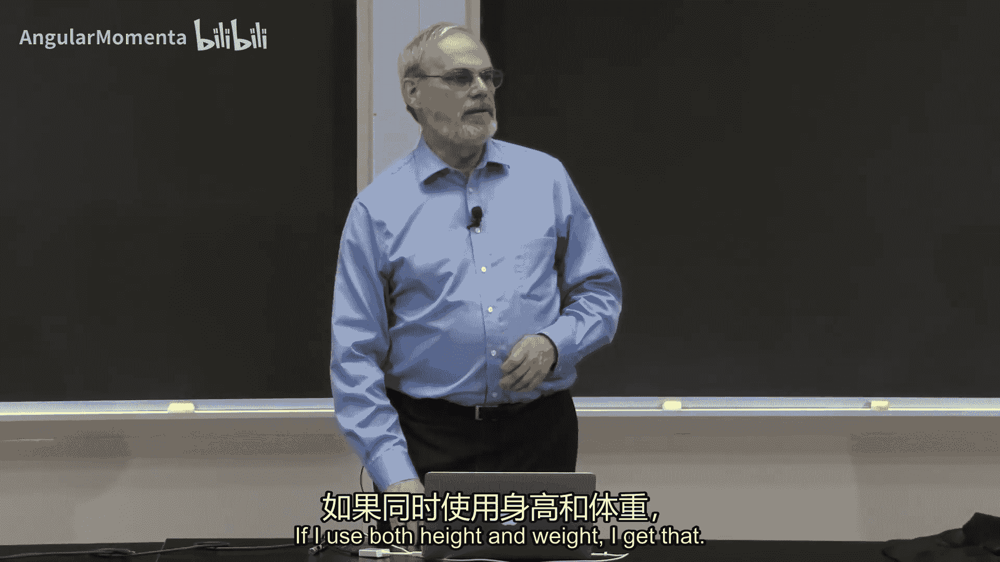

I get that。Which is actually kind of nice， right， Those three clustered together。

 Theyre near each other in terms of just distance in the plane。 Those 7 are near each other。

 There's a nice， natural， dividing line through here。😊，And in fact， that gives me。A classifier。

This line。Is the equiistant line between the centers of those two clusters。

 meaningan any point along this line is the same distance to the center of that group as it is to that group。

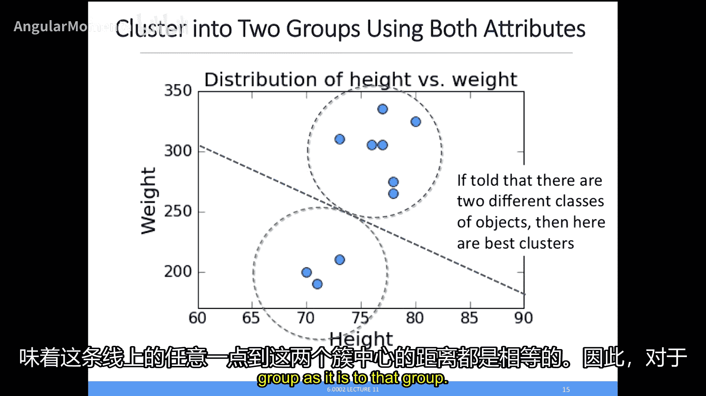

And so any new example， if it's above the line， I would say， gets that label。 if it's below the line。

 gets that label。In a second， we'll come back to look at how do we measure the distances。

 But the idea here is pretty simple。 I want to find groupings near each other and far apart from the other group。

Now， suppose I actually knew the labels。On these players， I shouldn't call them objects。

 they're people， these players。

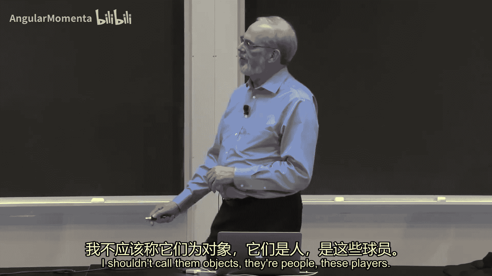

These are the receivers。Those are the linemen。And for those of you who are football fans。

 you can figure out， right， Those are the two tight ends。 They are much bigger。

I think that's Bennettt and that's Gronk。 if you're really a big Patriots fan。

 but those are tight ends。 Those are wide receivers。 and it's going to come back in a second。

 but there are the labels。

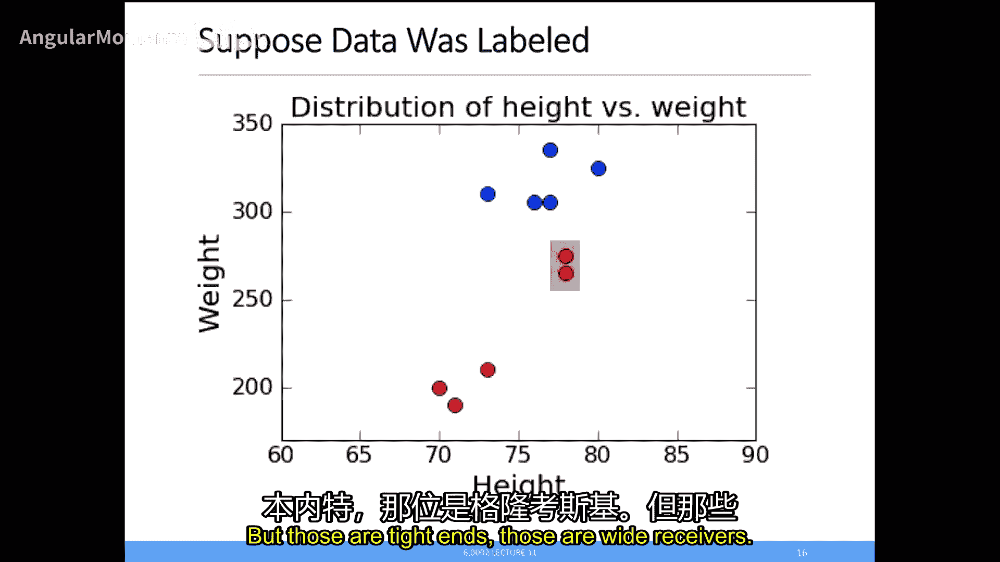

Now， what I want to do is say if I could take advantage of knowing the labels。

 how would I divide these groups up， and that's kind of easy to see。

Basic idea in this case is if I've got labeled groups in that feature space。

 what I want to do is find a subsurface。That naturally divides that space。 Now。

 subsurface is a fancy word。 It says in the two dimensional case。

 I don't want to know what's the best line。If I can find a single line that separates all the examples with one label from all the examples of the second label。

We'll see that if the examples are well separated， this is easy to do， and it's great。

But in some cases， it's going to be more complicated because some of the examples may be very close to one another。

And that's going to raise a problem that you saw last lecture。 I want to avoid overfitting。

 I don't want to create a really complicated surface to separate things。

 And so we may have to tolerate a few incorrectly labeled things if we can't pull it out。

And as you already figured out， in this case， with the labeled data。

 there's the best fitting line right there。Anybody over 280 pounds is going to be a great lineman。

 anybody under 280 pounds is more likely to be a receiver。

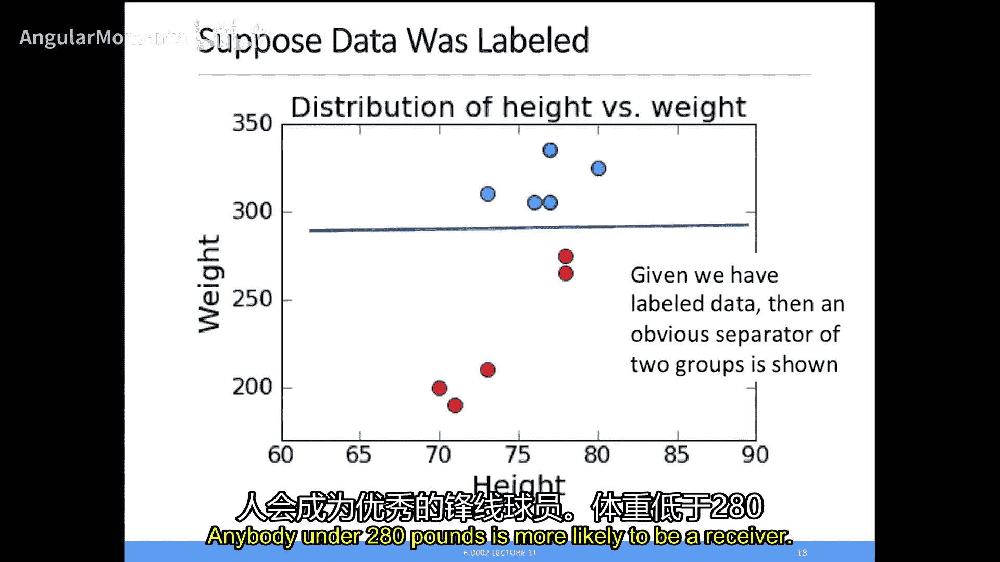

O， so I've got two different ways of trying to think about doing this labeling。

 I'm going to come back to both of them in a second。Now suppose I add in some new data。

I want to label new instances。Now， these are actually players of a different position。

 these are running backs， but I say all I know about is receivers and linemen。

 I get these two new data points。 I'd like to know。

 are they more likely to be a receiver or a lineman。

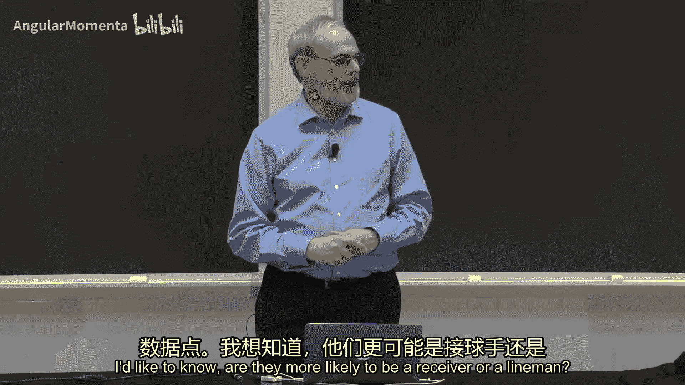

And there's the data for these two gentlemen。So if I go back to now plotting them。Oh。

 you notice one of the the issues。 So there are my lineman。 The red ones are my receivers。

 The two black dots are the two running backs。Notice right here。

It's going to be really hard to separate those two examples from one another。

 They are so close to each other。 And that's going to be one of the things we have to trade off。

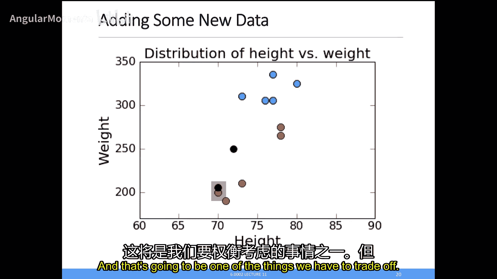

But if I think about using what I learned as a classifier。With unlabeled data。

There were my two clusters。

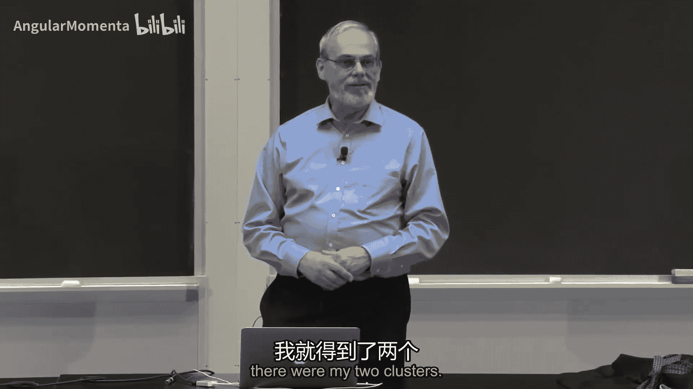

Now you see， oh， I've got an interesting example。 This new example， I would say。

 is clearly more like a receiver than a lineman。But that one there。Unclear。

Almost exactly lies along that dividing line between those two clusters。

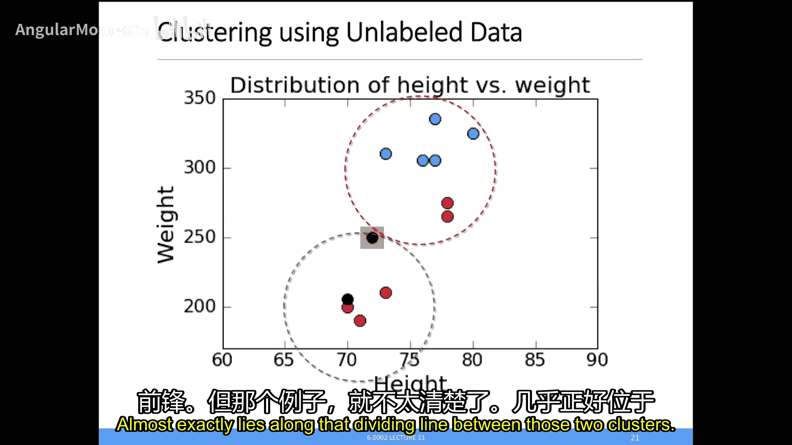

And that would either say， I want to rethink the clustering or I want to say， you know what。

 As I know， maybe there aren't two clusters here， Maybe there are three。

 And I want to classify them a little differently。So I'll come back to that。

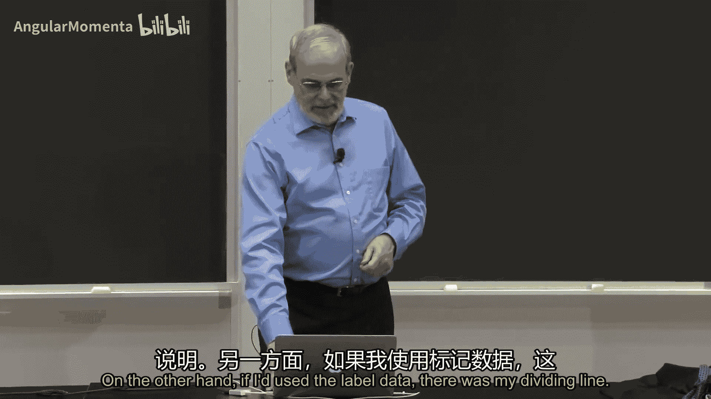

On the other hand， if I'd use the labeled data， there was my dividing line。 This is really easy。

Both of those new examples are clearly below the dividing line。

 They are clearly examples that I would categorize as being more like receivers than they are like lineman。

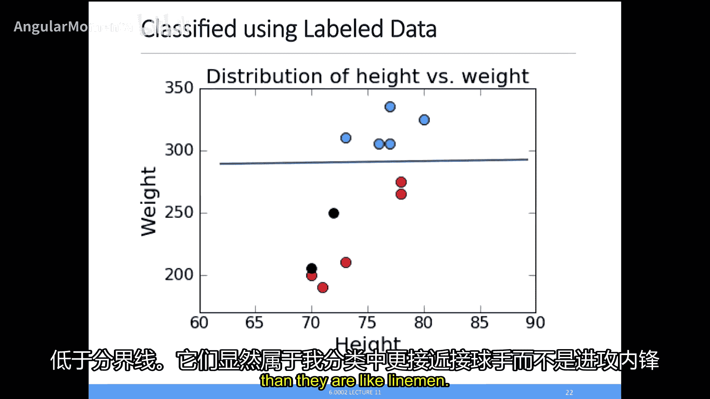

And I know it's a football example if you don't like football， pick another example。

 but you get the sense of why I can use the data in the labeled case in the unlabeled case to come up with different ways of building the clusters。

So what we're going to do over the next two and a half lectures。

Is look at how can we write code to learn that way of separating things out。

We're going to learn models based on unlabeled data。

That's the case where I don't know what the labels are by simply trying to find ways to cluster things together nearby and then use the clusters to assign labels to new data。

And we're going to learn models by looking at label data and seeing how do we best come up with a way of separating with a line or a plane or a collection of lines。

 examples from one group， from examples of the other group。

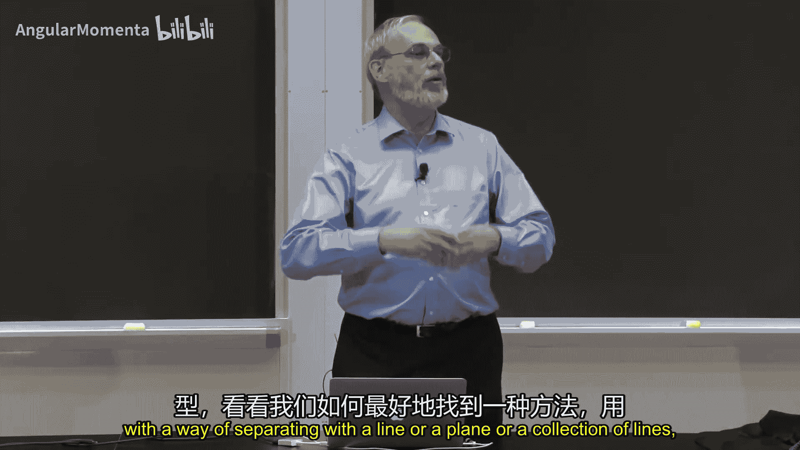

With the acknowledgecment that we want to avoid overfitting。

 we don't want to create a really complicated system。 And as a consequence。

 we're going to have to make some tradeoffs between what we call false positives and false negatives。

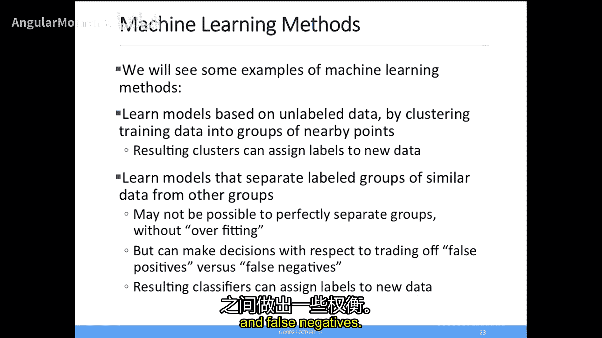

But the resulting classifier can then label any new data by just deciding where you are with respect to that separating line。

So here's what you're going to see over the next two and a half lectures。

Every machine learning method has five essential components。

We need to decide what's the training data and how are we going to evaluate the success of that system。

 I've already seen some examples of that。We need to decide how are we going to represent each instance that we're giving it。

I happen to choose height and weight for football players。

 but I might have been better off to pick average speed， or I don't know， arm length， something else。

 How do I figure out what are the right features。And associated with that。

 how do I measure distances between those features？

 How do I decide what's close and what's not close。

Maybe it should be different in terms of weight versus height， for example。

 I need to make that decision。And those are the two things we're going to show you examples up to date。

 How to go through that。Starting next week， Professor Goodteg is going to show you how you take those and actually start building more detailed versions of measuring。

Cluing， measuring similarities to find an objective function that you want to minimize to decide what is the best cluster to use and then what is the best optimization method you want to use to learn that model。

So let's start talking about features。I've got a set of examples labeled or not。

 I need to decide what is it about those examples that's useful to use when I want to decide what's close to another thing or not。

And one of the problems is if it was really easy， it would be really easy。

Features don't always capture what you want。I'm going to belabor that football analogy。

 but why did I pick height and weight because it was easy to find， but what is。

 you know if you work for the New England Patriots。

 what is the thing that you really look for when you're asking what's the right feature。

 it's probably some other combination thing So you as a designer have to say。

 what are the features I want to use。A quote， by the way。

 is from one of the great statisticians of the 20th century， which I think captures it well。

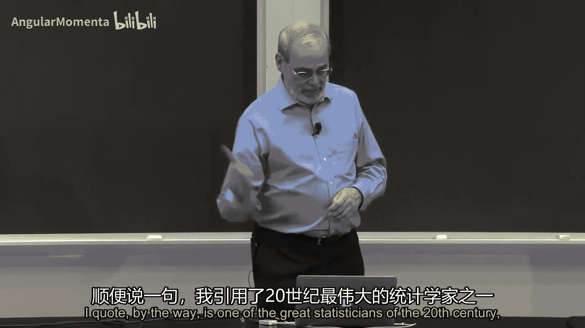

So。Feature engineering， as you， as a programmer， comes down to deciding both what are the features I want to measure in that vector that I'm going to put together。

 And how do I decide relative ways to weight it。

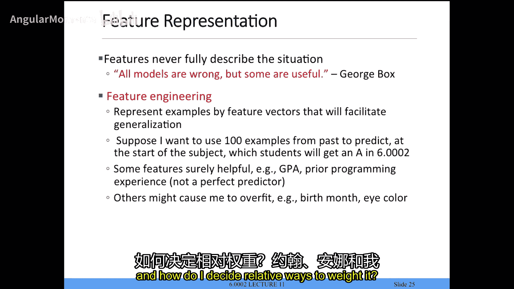

So John and Anna and I could have made our our chore this chore wrong term， John， our our job。

 this term really easy。If we had sat down at the beginning of the term and said， you know。

 we've taught this course many times we've got data from I don't know， John。

 thousandshou of students， probably over this time， let's just build a little learning algorithm。

 It takes a set of data and predicts your final grade。You don't have to come to class。

 Don't have to go through all the problems That will， just predict your final grade。n't that be nice。

 make our job a little easier， And you may or may not like that idea。

But I could think about predicting that great。 Now， why am I telling you this example。

 I was trying to see if I could get a few smiles。 I saw a couple of them there。

But think about the features。What would I measure。Actually。

 I'll put this on John because it's his idea， what would he measure？

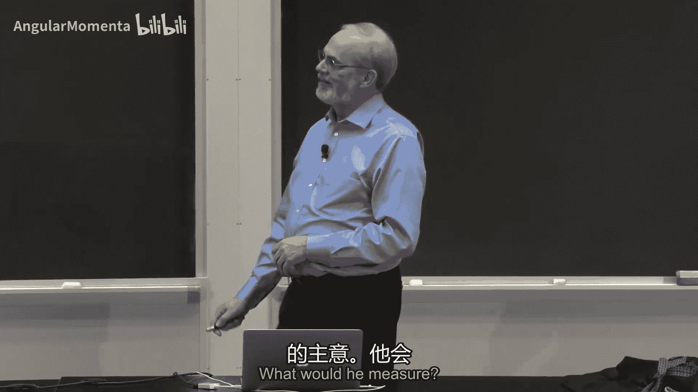

Well， GP is probably not a bad predictor performance。 You do well in other classes。

 You're likely to do well in this class。I'm going to use this one very carefully。

 Prior programming experience is at least a predictor， but it is not a perfect predictor。

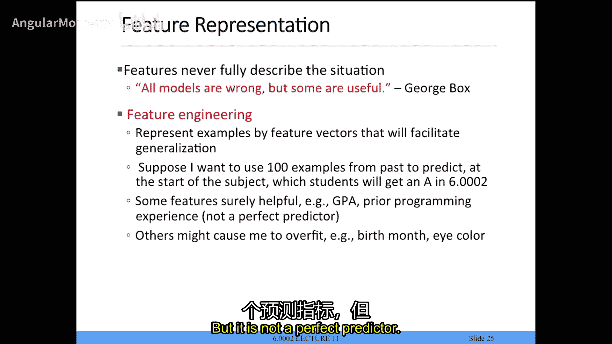

Those of you haven't programmed before in this class， you can still do really well in this class。

 but it's an indication that you've seen other programming languages。On the other hand。

 I don't believe in astrology。So I don't think the month in which you're born。

 the astrological sign under which you were born， it has probably anything to do with how well you'd program。

 I doubt that eye color has anything to do with how well you'd program。 You get the idea。

 Some features matter。 Others don't。Now， I could just throw all the features in and hope that the machine learning algorithm sorts out those it wants to keep from those it doesn't。

But I remind you of that idea of overfitting。 If I do that。

 there is the danger that it will find some correlation between birth month， eye color and GPA。

And that's going to lead to a conclusion that we really don't like。By the way。

 in case you're worried， I can assure you that Sus Schm in the dean of Admissions Department does not use machine learning to pick you。

 He actually looks at a whole bunch of things because it's not easy to replace him with a machine yet。

Right， so what this says is we need to think about how do we pick the features。

 And mostly what we're trying to do is to maximize something called the signal to noise ratio。

 maximize those features that carry the most information and remove the ones that don't。

So I want to show you an example of how you might think about this。I want to label。Reptiles。

 I want to come up with a way of labeling animals as are they a reptile or not。

And to give you a single example。 Well a single example， you can't really do much。

 But from this example， I know that a cobra it lays eggs。 It has scales。 It's poisonous。

 It's cold blood。 It has no legs， and it's a reptile。 So I could say， my model of a reptile is， well。

 I'm not certain I don't have enough data yet。

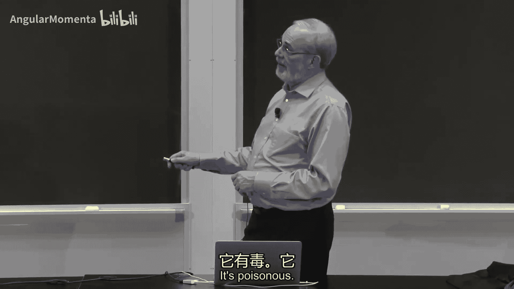

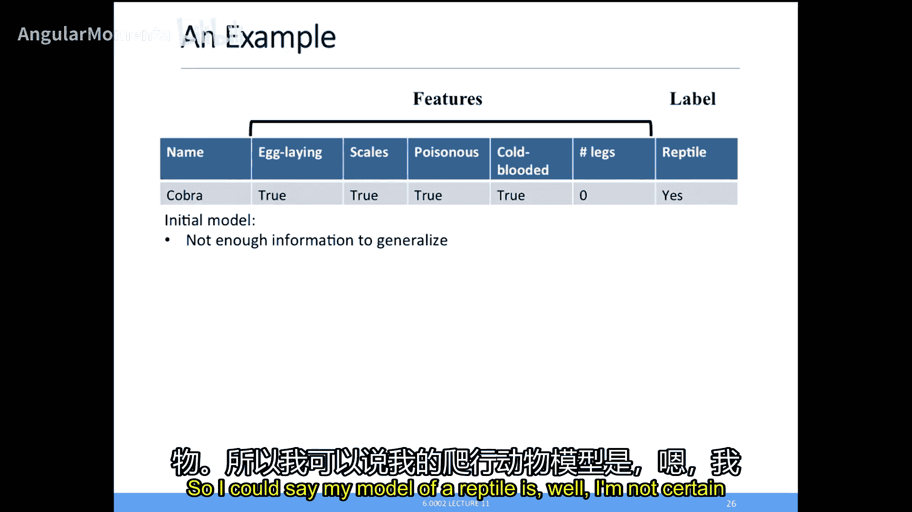

But if I give you a second example and it also happens to be egg laying， have scales。

 poisonous cold bloodooed node legs， There's my model， right， perfectly reasonable model。

 whether I design it or a machine learning algorithm would do it says if all of these are true。

 label it is a repile。

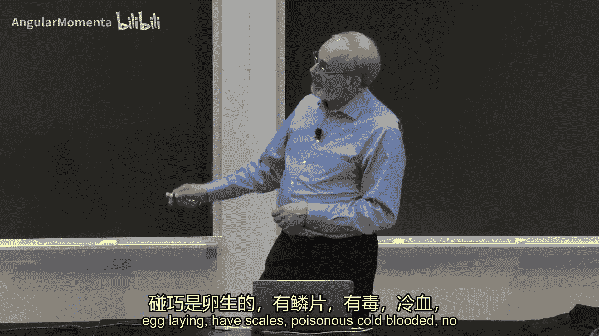

Okay。

And now I give you Ebola constrictor。啊。It's a reptile， but it doesn't fit the model。

And in particular。It's not egggling。And it's not poisonous。

So I've got to refine the model， or the algorithm's got to refine the model。 And this。

 I want to remind you looking at the features。 So I started out with five features。 This doesn't fit。

So probably what I should do is reduce it。I'm going to look at scales。

 I'm going to look at cold blood。 I'm going to look at lakes。That captures all three examples。 Again。

 if you think about this in terms of clustering， all three of them would fit with that。

Okay， now I give you another example。Chicken。I don't think it's a reptile。In fact。

 I'm pretty sure it's not a reptile。And it nicely still fits this model， right。

 because while it has scales， which you may have not realized， it's not cold blooded and it has legs。

 So it is a negative example that reinforces the model。

Sounds good。And now we'll give you an alligator。It's a reptile。You know fudge， right。

 it doesn't satisfy the model。Because while it does have scales and it is cold blooded， it has lakes。

I'm almost done with the example， But you see the point。 Again。

 I've got to think about how do I refine this。 And I could by saying， all right。

 let's make it a little more complicated。 Ha scales， cold blooded 0 or four legs。

 I'm going say it's a reptile。I'll give you the dart frog。Not a reptile is an amphibian。

 And that's nice because it still satisfies it。 So it's an example outside of the cluster that says no scales。

 not cold blooded， but happens to have four legs。 It's not a reptile。 That's good。

And then I give you， I have to Python， right， I mean， there has to be a Python in here。Oh， come on。

 At least groan at me when I say that。 there has to be a Python here。And I give you that in a salmon。

And now I am in trouble。Because。Look at scales， look at cold blooded。Look at lakes。

I can't separate them。On those features， there's no way to come up with a way that will correctly say that the Python is a reptile and the salmon is not。

And so there's no easy way to add in that rule。 And probably my best thing is to simply go back to just two features。

 scales and cold blooded。

And basically say， if something has scales and it's cold blooded， I'm going to call it a reptile。

If it doesn't have both of those， I'm going to say it's not a reptile。It won't be perfect。

 It's going to incorrectly label the salmon。 But I've made a design choice here。 that's important。

And the design choice is that I will have no false negatives。

What that means is there's not going to be any instance of something that's not a reptile。

Then I'm going to call a reptile。I may have some false positives。So I did that the wrong way。

 a false negative says everything that's not a reptile。 I'm going to say。

Andm going to categorize that direction， I may have some false positives in that I may have a few things that I will incorrectly label as a reptile。

And in particular，ops sorry， salmon is going to be an instance of that。

This trade off of false posism and false negatives is something that we worry about as we think about it because there's no perfect way in many cases to separate the data。

And if you think back to my example of the New England Patriots that running back on that wide receiver were so close together in height weight。

 There is no way I'm going to be able to separate them apart。

 And I just have to be willing to decide how many false。

 positive or false negatives do I want to tolerate。Once I figured out what features to use。

Which is good。 Then I have to decide about distance。 How do I compare two feature vectors。

 And I're going to say vector because there'd be multiple dimensions to it。

 How do I decide how to compare them， Because I want to use the distances to figure out either how to group things together or how to find a dividing line that separates things apart。

So one of the things I have to decide is which features。I also have to decide the distance。

 And finally， I may want to decide how to weigh relative importance of different dimensions in the feature vector。

 Some may be more valuable than others in making that decision。

 And I want to show you an example of that。So let's go back to my animals。I've got。

 I started off with a feature vector that actually had five dimensions to it。 It was。What egg laying。

 cold blooded， half scales， I forget what the other one was in number of lake。

So one of the ways I could think about this is saying， I've got four binary features。

And one integer feature associated with each animal。

And one way to learn to separate out reptiles from non reppttiles is to measure the distance between。

Pearairs of examples。And use that distance to decide what's near each other and what's not。

And as we said before， it'd either be used to cluster things or to find a classifier surface that separates them。

So here's a simple way to do it。For each of these examples。

 I'm going to just let true be one false be 0。 So the first four are either zeros or ones。

 And the last ones the number of legs。And now I could say， all right。

 how do I measure distances between。Animals。Or anything else。 But these kinds of feature vectors。

Here， we're going to use something called the Minowsky metric or the Minowski difference。

Given two vectors and a power P。We basically take the absolute value of the difference between each of the components of the vector。

Raise it to the peace power。Take the sum。And take the piece root of that。

So let's do the two obvious examples。 If P is equal to 1。

 I just measure the absolute distance between each component。 add them up。 And that's my distance。

 It's called the Manhattan metric。The one you've seen more， the one we saw last time。

 if P is equal to 2， this is this is Euclidean distance， right。

 It's the sum of the squares of the differences of the components take the square root。

Take the square root because it makes have certain properties of a distance。

Thats sorry， that's the Euclidean distance。So now， if I want to measure difference between these two。

Here's the question。

Is this circle closer to the star。We're closer to the cross。Unfortunately， I put the answer up here。

But it differs depending on the metric I use。Right， Euclidean distance。 Well。

 that's square root of 2 times 2。 So it's about 2。8。 And that's 3。

 So in terms of just standard distance in the plane。

 we would say that these two are closer than those two are。Manhattan distance。

 why is it called that because you can only walk along the avenues and the streets？

Manhattan distance would basically say this is 1，2，3，4 units away。 This is 1，2，3 units away。

 And under Manhattan distance， this is closer。 This pairing is closer than that pairing is。Now。

 you're used to thinking Euclidean we're going to use that。

 but this is going to be important when we think about how are we comparing distances between these different pieces。

So typically， we'll use Euclidean。 We're gonna see Manhattan actually has some value。

 So if I go back to my three examples， Boy， that's a gross slide， isn't it， But there we go， Rattle。

snake bow， a constrictor and dart frog。 There's the representation。 I can ask。

 what's the distance between them。

In the handout for today， we've given you a little piece of code that would do that。

 And if I actually run through it， I get。

Actually， a nice little result。Here are the distances between those vectors， using Euclidean metric。

opm sorry。 I'm going to come back then， but you can see the two snakes。

Nicely are reasonably close to each other。 whereas the dart frog is a fair distance away from that。

Nice， right， That's a nice separation。 that says， there's a difference between these two， okay。

Now I throw in the alligator。

Sounds like a dungeons and Dragons game。 I throw in the alligator。

 and I want to do the same comparison。And I don't get nearly as nice a result。Because now it says。

 as before， the two snakes are close to each other。

But it says that the dart frog and the alligator are much closer under this measurement。

Thenhan either of them is to the other。And to remind you， right， the alligator and the two snakes。

 I would like to be close to one another and a distance away from the frock。

 because I'm trying to classify reptiles versus not。

So what happened here？Well， this is a place where the feature engineering is going to be important because。

 in fact， the alligator differs from the frog in three features。But， and only in two features from。

 say， the Boa constrictor。But one of those features is the number of legs。 And there。

 while on the binary axes， the differences between a0 and 1 here it can be between 0 and 4。

So that is weighing the distance a lot more than we would like。 The leg dimension is too large。

 if you like。How would I fix this？This is actually， I would argue。

 a natural place to use Manhattan distance。Why should I think that the difference in the number of legs。

Or the number of legs difference is more important than whether it has scales or not。

Why should I think that measuring that distance， Euclidean wise makes sense。

 They are really completely different measurements。 And， in fact， I'm not going to do it。

 But if I ran Manhattan metric on this， it would get the alligator much closer to the snakes。

 exactly because it differs only in two features， not three。

The other way I could fix it would be to say， I'm letting too much weight be associated with the difference in the number of legs。

 So let's just make it a binary feature。 Either it doesn't have legs or it does have legs。

Run the same classification。And now， you see。The snakes and the alligator were all close to each other。

Whereas the dart frog， not as far away as it was before， but there's a pretty natural separation。

 especially using that number between them。

What's my point？Choice of features matters。Throwing too many features in may， in fact。

 give us some overfitting。And in particular， deciding the weights that I want on those features has a real impact。

 And you， as a designer， a programmer， have a lot of influence in how you think about using those。

So feature engineering really matters how you pick the features。

 what you use is going to be important。Okay。The last piece of this， then， is。

We're going to look at some examples where we give you data。It've got features associated with them。

We're going， in some cases， have them labeled in other cases， not。

 And we know how now to think about how do we measure distances between them， John。

You probably didn't intend to say， wait so。Sorry， the scales of not， though。 Thank you， John。 I did。

 I take that back。 I did not mean to say weights of features。

 I meant to say the scale of the dimension is going to be important。 here。

 thank you for the for the amplification and correction。 You're absolutely right。

And we're going to see next time why we're going to use weights of different weight。 So rephrase it。

 block that out of your mind。 We're going to talk about scales and the scale on the aeses being important here。

And we already said， we're going to look at two different kinds of learning， labeled and unlabeled。

 clustering and classifying。And I want to just finish up by showing you two examples of that。

 how we would think about them algorithmically， and we'll look at them in more detail next time。

As we look at it， I want to remind you the things that are going to be important to you。

How do I measure distance between examples？ What's the right way to design that。

What is the right set of features to use in that vector。

And then what constraints do I want to put on the model？In the case of unlabeled data。

 how do I decide how many clusters I want to have？

Because I can give you a really easy way to do clustering。 Now if I give you 100 examples， I say。

 build 100 clusters。 Every example is its own cluster。Distance is really good。

 It's really close to itself， but it does a lousy job of labeling things on it。

 So I have to think about how do I decide how many clusters。

 What's the complexity of that separating service， How do I basically avoid the overfitting problem。

 which I don't want to have。So。Just remind you， we've already seen a little version of this。

 the clustering method。This is a standard way to do it。

 simply repeating what we had on an earlier slide。 If I want to cluster it into groups。

 I start by saying how many clusters am I looking for， pick an example。

 I take as my early representation for every other example in the training data。

 put it to the closest cluster。Once I've got those， find the median， repeat the process。And that LED。

To that separation。

Now， once I've got it， I like to validate it。 And， in fact， I should have said this better。

 Those two clusters came without looking at the the two black dots。 Once I put the black dots in。

 I'd like to validate。 how well does this really work。

 And that example there is really not very encouraging。 It's too close。

So that's a natural place to say， okay， what if I did this with three clusters？

That's what I get。I like that。Right，That has a really nice cluster up here。

factact that the algorithm didn't know the labeling is irrelevant。 There's a nice grouping of 5。

 There's a nice grouping of four， and there's a nice grouping of three in between。And in fact。

 if I looked at the distance， the average distance between examples in each of these clusters。

 it is much tighter。

Then in that example。And so thatop sorry， that leads to then the question of。

 should I look for four clusters， question， please。The overlap between the two clusters not Yeah。

 the question is， is the overlap between the two clusters a problem。 No。

 I just drew it here so I could let you see where those pieces are。 But in fact。

 if you like the boundary is that the center is there。

 those three points are all closer to that center than they are to that center。

 So the fact that they overlaps。 a good question is just the way I happen to draw them。

 I should really draw these not as circles， but as some little bit more convoluted surface。 okay。

Having done three， I could say， should I look for four？Well。Those points down there。

 as I've already said， are an example where it's going to be hard to separate them out。

 And I don't want to overfit because the only way to separate those out is is going to be to come up with a really convoluted cluster。

 which I don't like， right。Let me finish with showing you one other example。From the other direction。

 she is， suppose I give you labeled examples。So again。

 the goal is I've got features associated with each example。

 I're going to have multiple dimensions on it， but I also know the label associated with them。

 and I want to learn what is the best way to come up with a rule that will let me take new examples and assign them to the right group。

Numb of ways to do this。 You can simply say， I'm looking for the simplest surface that will separate those examples。

In my football case that we're in the plane， what's the best line that separates them。

 which turns out to be easy。I might look for a more complicated surface。

 and we're going to see an example in a second where maybe it's a sequence of line segments that separates them out because there's not just one line that does the separation。

As before， I want to be careful， if I make it too complicated， I may get a really good separator。

 but I overfit to the data。And you're going to see next time， I'm going to highlight it here。

 There's a third wave， which will lead to them almost the same kind of result called K nearestris neighbors。

And the idea here is， I've got a set of labeled data。And what I'm going to do is。

 for every new example， say， find the case， say the five closest labeled examples。And take a vote。

If 3 out of  five or4 out of5 or five out of five of those labels are the same。

 I'm going say it's part of that group。And if I have less than that。

 I'm want to leave it as unclassified。 And that's a nice way of actually thinking about how to learn them。

And let me just finish by showing you an example。 And I won't use football players on this one。

 I'll use a different example。

I'm going to give you some voting data。I think this is actually simulated data。

 but these are a set of voters in the United States。With their preference。

 they tend to vote Republican， they tend to vote Democrat。 and the two categories are their age。

And how far away they live from Boston。Whether those are relevant or not， I don't know。

 But there are just two things we're going to use to classify them。 And I'd like to say。

 how would I fit a curve to separate those two classes。I'm going to keep half the data to test。

 I'm going to use half the data to train。

So if this is my training data， I could say， what's the best line that separates these。

I don't know about best， but here are two examples。

This solid line has the property that all the Democrats are on one side。

Everything on the other side is a Republican， but there are some Republicans on this side of the line。

 I can't find a line that completely separates these as I did with the football players。

But there's a decent line to separate them。Here's another candidate。

 That dashed line has the property that on the right side。You've got， boy。

 I don't think this is deliberate， John Wright， But on the right side。

 you've got almost all Republicans。 See like perfectly appropriate。One Democrat。

 But there's a pretty good separation there。 You know， on the left side， you got a mix of things。

 But most of the Democrats are on the left side of that line。

Right，The fact that left and right correlates with distance from Boston is completely irrelevant here。

 but it has a nice punch to it。But not accidental。 Thank you。 so now the question is。

 how would I evaluate these， How do I decide which ones better。

And I'm simply going to show you very quickly some examples。

First one is to look at what's called the confusion matrix。

What does that mean it？For this one of these classifiers， for example， the solid line。

 here are the predictions based on the solid line of whether they would be more likely to be Democrat or Republican。

 And here's the actual label。Same thing for the dash line。

 And that diagonal is important because those are the correctly labeled results， right。

 correctly in the dash line case， solid line case gets all of the correct labelings of the Democrats。

 It gets half of the Republicans， right， But it has some where it's actually a Republican。

 But it labels it as a Democrat。That we'd like to be really large。 And， in fact。

 it leads to a natural measure called the accuracy。Which is， just to go back to that。

 we say that these are true positives， meaning I labeled it as being an instance， and it really is。

 These are true negatives。 I labeled it as not being an instance， and it really isn't。

 And then these are the false positives。 I labeled it as being an instance and not。

 And these are the false negatives。 I labeled it as not being an instance， and it is。

And an easy way to measure it is to look at the correct labels over all of the labels。

The true positives and the true negatives， the ones I got right。And in that case。

 both models come up with a value of 0。7。

So which one's better， Well， I should validate that。

 And I'm going to do that in a second by looking at other data。We could also ask。

 could we find something with less training error。 This is only getting 70% right。Not great。Well。

 here's a more complicated model。

And this is where you start getting worried about overfitting。 Now。

 what I've done is I've come up with a sequence of lines。That separate them。

 So everything above this line， I'm going to say is a Republican。 everything below this line。

 I'm going to say is a Demo。 So I'm avoiding that one。 I'm avoiding that one。

 I'm still capturing many of the same things。And in this case。I get 12 true positives。

13 true negatives， and only five false positives。And that's kind of nice。 You can see the five。

 It's those five red ones down there。 Its accuracy is 0。833。And now。

 if I apply that to the test data。I get an O result。

Has an accuracy of about 。6。I could use this idea to try and generalize and say。

 could I come up with a better model， And you're going to see that next time。

There could be other ways in which I measure this。 And I want to use this as the last example。

 Another good measure we use is called PP PV， predictive， sorry， positive predictive value。

Which is how many true positives do I come up with out of all the things I labeled positively？

And in the solid model in the dash line， I get values of about 0。57。

 The complex model on the training data is better in the the testing data is even stronger。

And finally， two other examples are called sensitivity and specificity。

Sensitivity basically tells you what percentage did I correctly find。And specificity， said。

 what percentage did I correctly reject。And I show you this because this is where the trade off comes in。

I could make sense sensitivityit is how many did I correctly label out of those that I both correctly labeled and incorrectly labeled as being negative。

 How many then did I correctly label as being the kind that I want。

I can make sensitivity one。Label everything is the thing I'm looking for。Great， everything's correct。

 but the specificity will be 0 because I'll have a bunch of things incorrectly labeled。😊。

I could make the specificity， one。Reject everything。 Say nothing is an instance。

True negatives goes to 0， with the sensitivity。Sorry， true negatives goes to one。

 and I'm in a great place there， but my sensitivity goes to 0。

I've got a trade off as I think about the machine learning algorithm I'm using and my choice of that classifier。

 I'm going to see a trade off where I can increase specificity at the cost of sensitivity or vice versa。

And you'll see a nice technique called R O C or receiver operator curve that gives you a sense of how you want to deal with that。

And with that， we'll see you next time。 We'll take your question offline if you don't mind。

 because I run over time， but we'll see you next time where Professor Goodtg will show you examples of this。

