# 【麻省理工】计算思维与数据科学导论-｜-MIT-6.0002-Introduction-to-Computational-Thinking，Fall2016-p12-12.-聚类--BV1zNjGzxEvk_p12-

The following content is provided under a Creative Commons license。

 Your support will help MiT OpenCoursewareare continue to offer high quality educational resources for free to make a donation or to view additional materials from hundreds of Mitcourses。

 Visit Mitopcourseourseware at Ocw。mt。edduu。

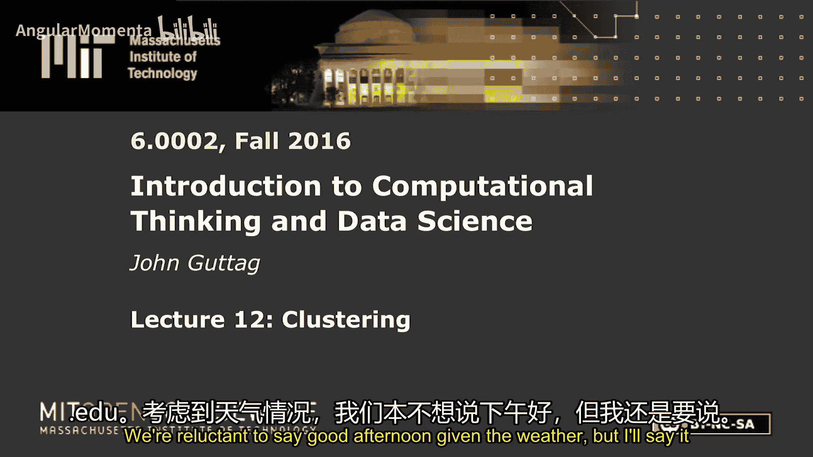

Reeluccant to say good afternoon， given the weather。

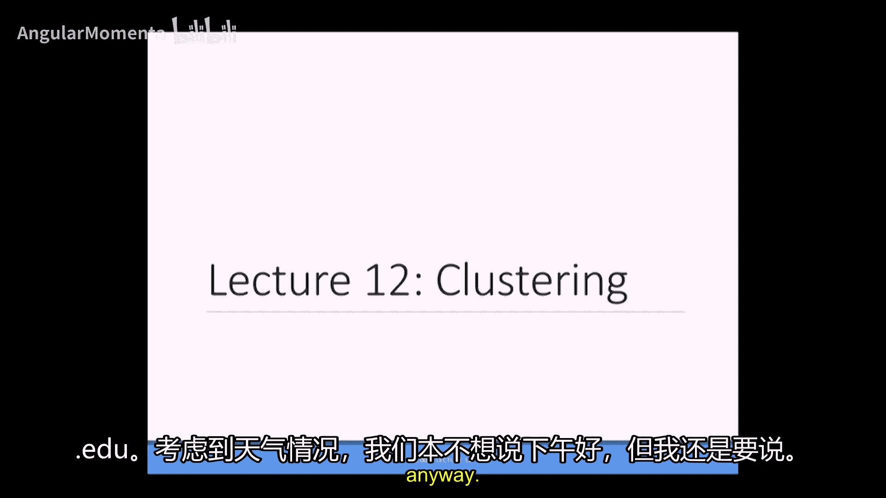

But， but I'll say it anyway。I guess now we all do know that we live in in Boston。And I should say。

 I hope none of you were affected too much by the fire yesterday in Cambridge。

But that seems to have been a pretty disastrous event for some。Anyway， here's the reading。

This is a chapter in the book， on clustering。A topic that Professor Grimson introduced last week。

 and I'm going to try and。Well finish up with respect to this course today， though。

 not with respect to everything there is to know about clustering。Quickly just reviewing。

Where we were。We're in the unit of the course on machine learning。

And we always follow the same paradigm。 We observe some set of examples。

Which we call the training data。We try and infer something about the process that created those examples。

And then we use inference techniques， different kinds of techniques to make predictions about previously unseen data。

 We call that the test data。As Professor Grimson said。

 you can think of two broad classes supervised where we have a set of examples in some label associated with the example。

Democrat， Republican。Smart， dumb， whatever you want to to associate with them。嗯。

And then we try and infer the labels。Or unsupervised。

 where we're given a set of feature vectors without labels。

And then we attempt to group them into natural clusters。That's going to be today's topic clustering。

So clustering is an optimization problem。As we'll see later。

 supervised machine learning is also an optimization problem。Clustering is a rather simple one。

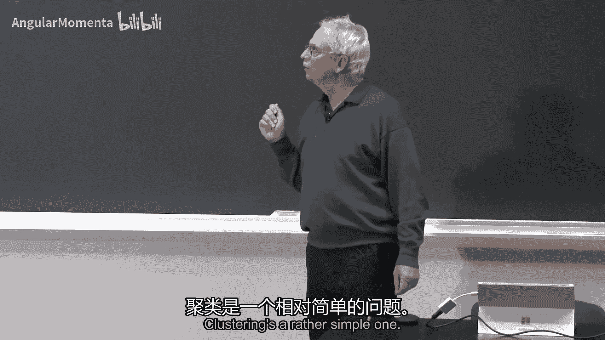

We're going to start first with the notion of variability。So this little C is a single cluster。

And we're going to talk about the variability in that cluster。Of the sum。

Of the distance between the mean of the cluster。

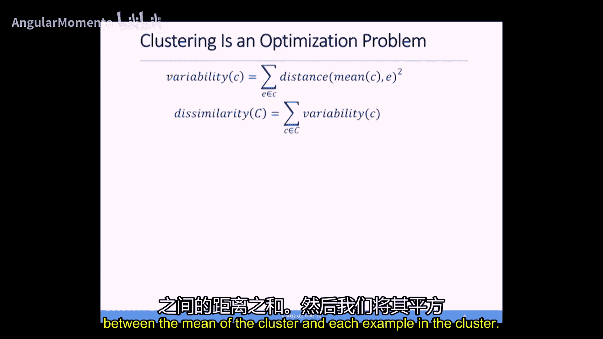

And each example in the cluster。 And then we square it。Okay， pretty straightforward。For the moment。

 we can just assume that we're using Euclidean distance as our distance metric。M Kaowski。

 with P equals 2。So variability should look pretty similar。To something we've seen before， right？

It's not quite variances， right， but it's very close。 And a minute， we'll look at why it's different。

And then we can look at the dissimilarity。

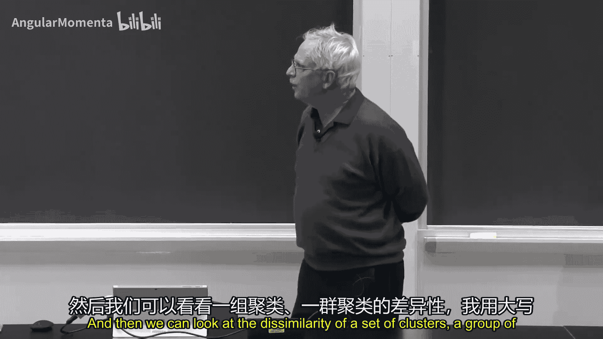

Of a set of clusters。A group of clusters， which I'm writing as capital C。

And that's just as sum of all thevariabilities。

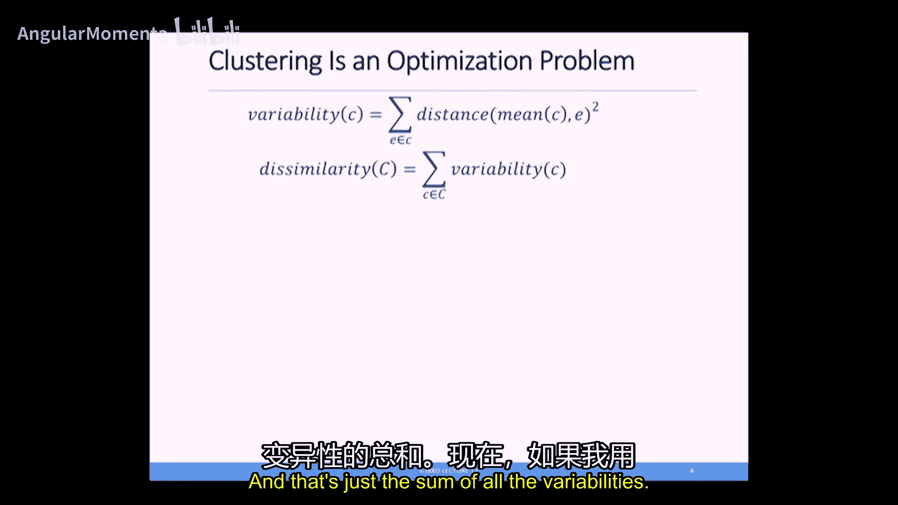

Now。If I had divided variability。By the size of the cluster， what would I have。

Something we've seen before， would that be。Somebody。Isn't that just the variance。So the question is。

 why am I not doing that， If up till now， we always wanted to talk about variants。

Why suddenly am I not doing it。Why do I define this notion of variability instead of good old variance。

Any thoughts。What am I accomplishing by not dividing by the size of the cluster。

Or what would happen if I did divide by the size of the cluster。Yes。😊，Absolutely， I'd normalize it。😡。

That's exactly what it would be doing。 And what might be good or bad about normalizing it。

What does essentially mean to normalize。It means that the penalty。

For a big cluster with a lot of variances in it。Is no higher than the penalty of a tiny little cluster with a lot of variants in it。

By not normalizing。What I'm saying is I want to penalize big。Highly diverse clusters。

 more than small， highly diverse clusters。Okay， and if you think about it， that。Probably makes sense。

You know， big and bad is worse than small and bad。Alright， so now we define the objective function。

And can we say that the optimization problem we want to solve by clustering。

Is simply finding a capital C that minimizes dissimilarity。Is that a reasonable definition？Well。Hint。

 no。What foolish thing could we do that would optimize that objective function， yeah。Yeah。

 I could have the same number of clusters as points assigned each point to its own cluster。Whoops。Oh。

 almost a real a。The dissimilarity of each cluster would be 0。Or the variability would be 0。

 So the similarity would be 0。 and I' have solved the problem。Well。

 that's clearly not a very useful thing to do。So， well， what do you think we do to get around that。

Yeah。We apply a constraint， exactly。And so we have to pick some constraint。

What would be a suitable constraint？For example。Well， maybe we'd say， okay。

 the clusters have to have some minimum distance between them。

Or and this is the constraint we'll be using today。 We constrain the number of clusters。So。

 all right， I only want to have it most 5 clusters。Do the best you can to minimize dissimilarity。

But you're not allowed to use more than5 clusters。 That's the most common constraint that gets placed in the problem。

All right， we're going to look at two algorithms。Maybe I should say two methods。

 because there are multiple implementations of these methods。

The first is called hierarchical clustering。And the second is called K means。

 There should be an S on the word mean there。 Sorry about that。Allright。

 let's look at hierarchical clustering first。It's strange algorithm。

We start by assigning each item， each example， to its own cluster。

So this is the trivial solution we talked about before。 So if you have n items。

 you now have n clusters each containing just one item。

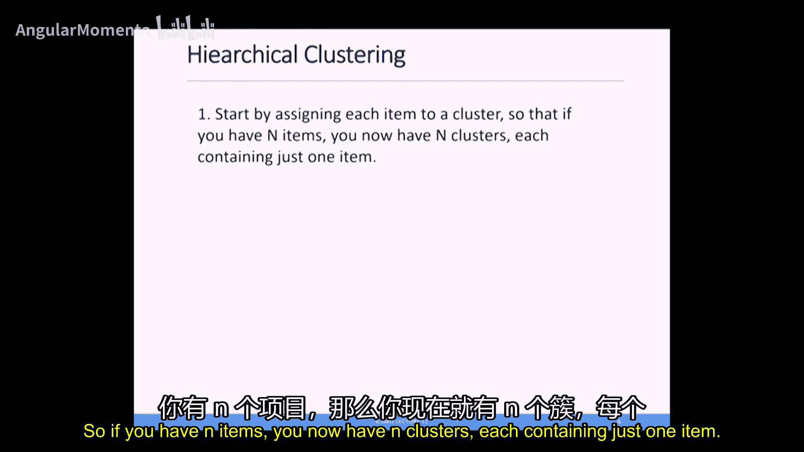

It's the next step。We find the two most similar clusters we have and merge them into a single cluster。

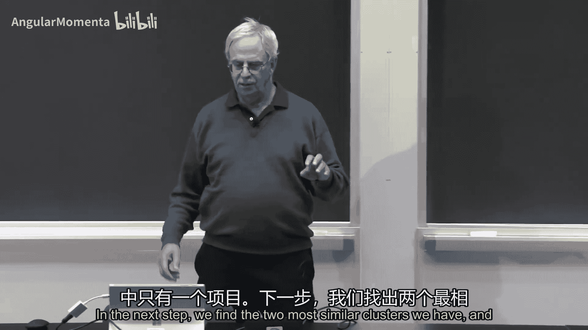

So that now， instead of n clusters， we have n-1 clusters。

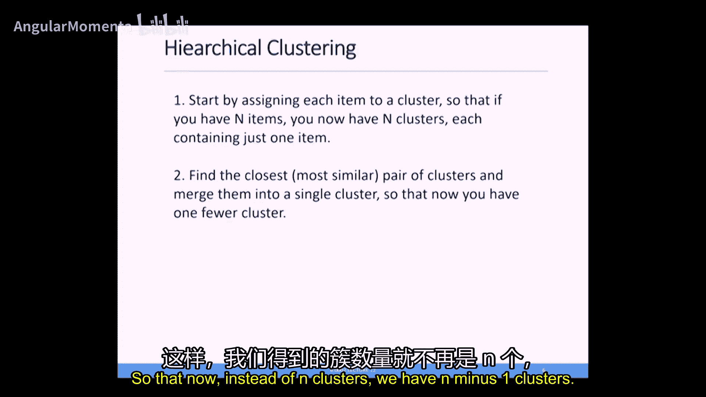

And we continue this process until all items are clustered into a single cluster of size N。Now。

 of course， that's kind of sillyy。Because if all I wanted to put them all is in a single cluster。

 I don't need to iterate。 I just go wham， right。But what's interesting about hierarchical clustering is you stop it typically somewhere along the way。

You produce something called a dendoogram。They write that down。

At each step here。

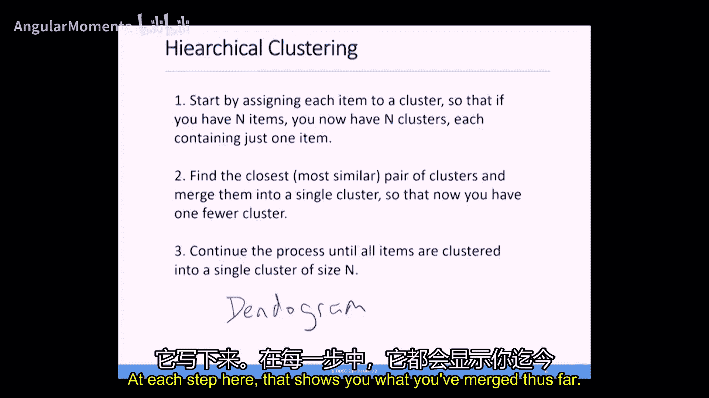

That shows you what you've merged thus far。 We'll see an example of that shortly。

 And then you can have some stopping criteria。 And we'll talk about that。

This is called agglomerative hierarchical clustering。

 because we start with a bunch of things and we agglomerate them。 That is to say。

 we put them together。All right， makes sense。Well， there's a catch。What do we mean by distance。

And there are multiple plausible definitions of distance。And you would get a different answer。

 depending upon which measure you used。These are called linkage metrics。

The most common one used is probably single leakage。

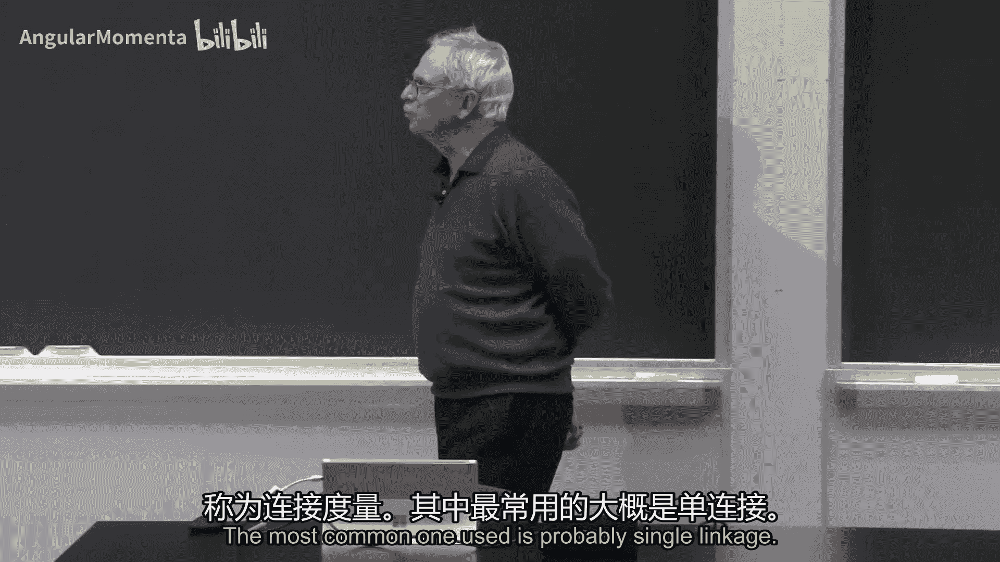

And that says the distance between a pair of clusters。

Is equal to the shortest distance from any member of one cluster to any member of the other cluster。

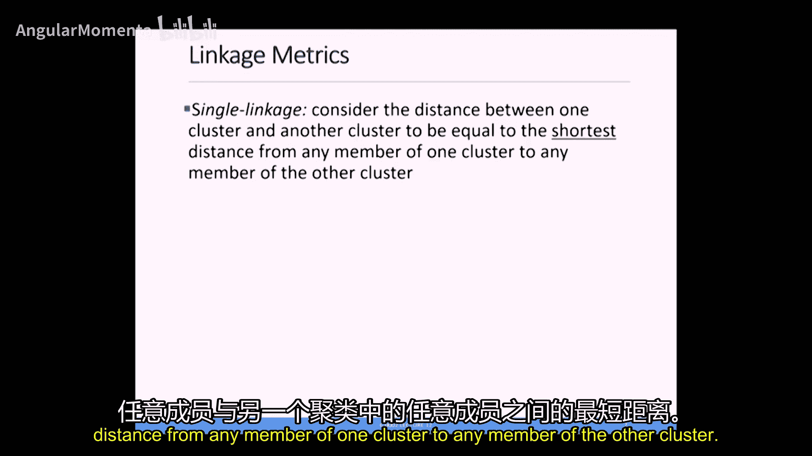

So if I have。Two clusters here。And here， and they have bunches of points in them。

Single leakage distance would say， well， let's use these two points， which are the closest。

And the distance between these two。Is the distance between the clusters。

You can also use complete linkage。And that says the distance between any two clusters is equal to the greatest distance from any member to any other member。

Okay， so if we had the same picture we had before。Probably not the same picture， but it's a picture。

Whoops。Then we would say， well， I guess complete linkage is probably the distance maybe between those two。

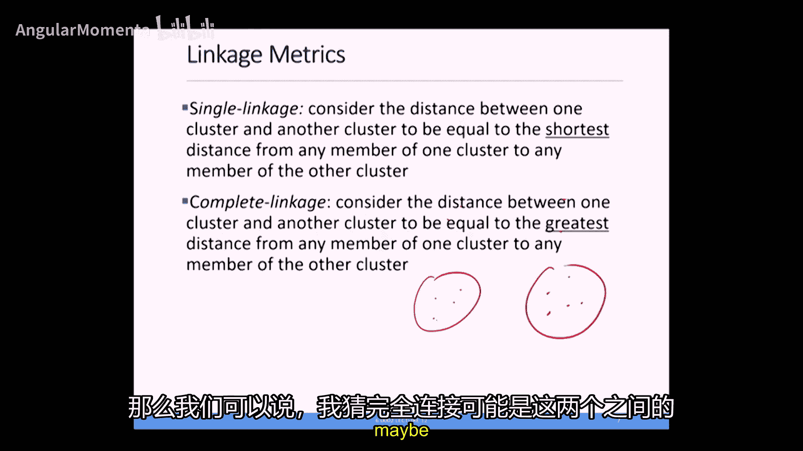

And， finally。Not surprisingly， you can take the average distance。These are all plausible metrics。

 They're all used and practiced for different。Kinds of results。

 depending upon the application of the clustering。

Allright， let's look an example。So what I have here is the air distance between us。

6 different cities。Boston， New York， Chicago， Denver， San Francisco and Seattle。And now。

 let's say we want to cluster these airports。Because based upon their distance。So， we start。

The first piece of ar dendoogram。Says， well， all right。 I have six cities。 I have six clusters。

 each containing one city。

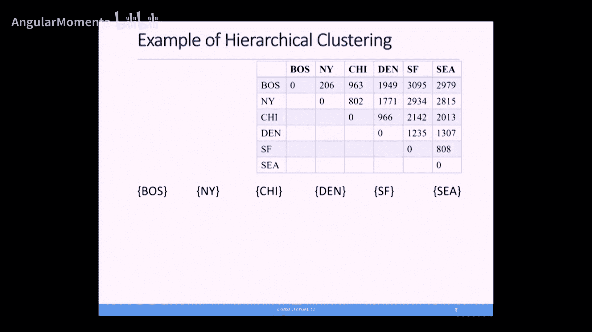

Al right， what happens next。What's the next level going to look like。Yeah。

I'm going to join Boston and New York as improbable as that sounds。

Alright， so that's the next level。And if for some reason， I only wanted to have five clusters， well。

 I could stop here。Next， what happens。Well， I look at it and I say， well。

Join up Chicago with Boston and New York。

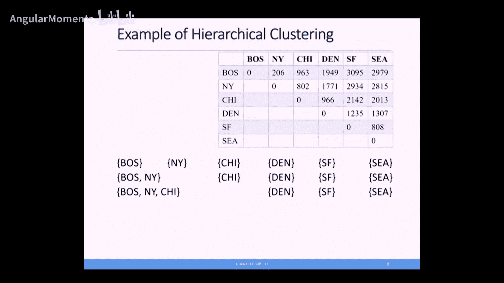

All right， what do I get at the next level， somebody， yeah。

Doesn't look like it to me。 If you look at San Francisco and Seattle。They are 808 miles。

And Denver in San Francisco is 1235。So I， I'd end up， in fact， joining San Francisco in Seattle。아。

Well， that explains why I need my hearing fixed。All right。So I combine San Francisco and Seattle。

 and now it gets interesting。I have two choices with Denver。Obviously， there are only two choices。

And which I choose depends upon which linkage criterion I use。

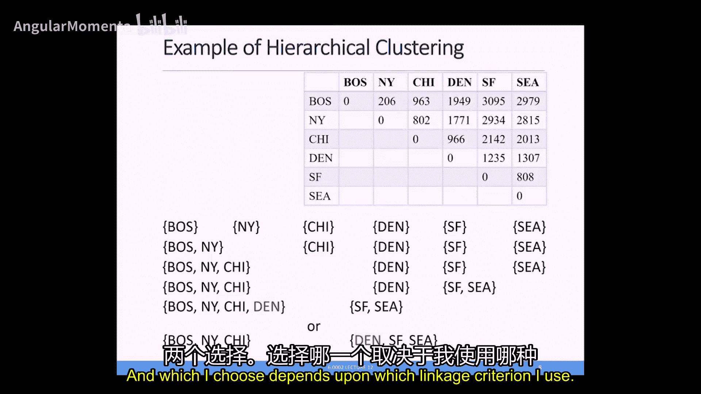

If I'm using single linkage。Well， then Denver gets joined with Boston， New York。

 and Chicago because it's closer to Chicago than it is to either San Francisco or Seattle。

But if I use complete linkage。It gets joined up with San Francisco and Seattle。

Because it is further from Boston。T it is from。

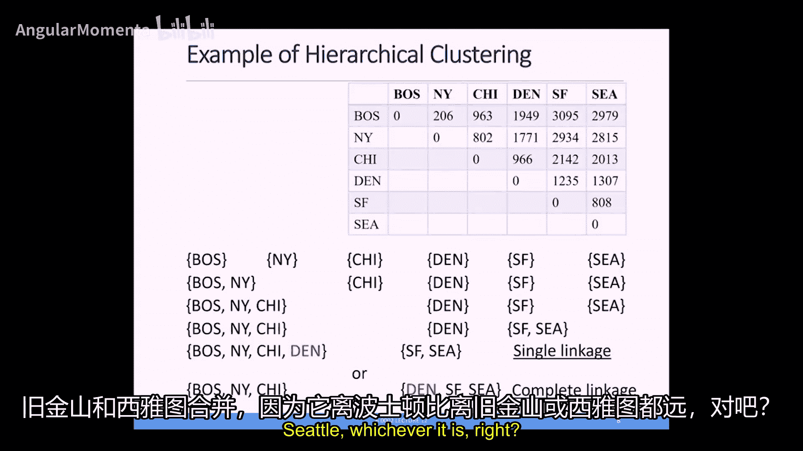

I guess it's San Francisco or Seattle， whichever it is， right？

So this is a place where you see What answer I get depends upon the linkage criteria。

And then if I want， I can consider to the next step and just join them all。All right。

 that's hierarchical clustering。So。It's good because you get this whole history of the dendoograms。

And you get to look at it and say， well， all right， that looks pretty good。 Ill。

Stick with this clustering。It's deterministic。Given a linkage crion， you always get the same answer。

There's nothing random here。Notice， by the way。The answer might not be optimal with regards to that linkage criteria。

 why not？What kind of algorithm is this？It's a greedy algorithm， exactly。

And so I'm making locally optimal decisions at each point。Which may or may not be globally optimal。

It's flexible。 choosing different linkage criteria， get different results。

But it's also potentially really， really slow。This is not something you want to do on a million examples。

The naive algorithm， the 1 I just sort of showed you， is N cubed。N cubed is typically。Iractical。

For some languageage criteria， for example， single linkage。

 there exist very clever and squared algorithms。For others， you can't beat n cubed。

 but even n squared is。Really not very good。Which gets me to a much faster greedy algorithm。

 called K means。Now， the K in K means is the number of clusters you want。

So the catch with K means is if you don't have any idea how many clusters you want。It's。

 it's problematic。Whereas hierarchical， you get to inspect it and see what you're getting。

If you know how many you want， it's a good choice。Because it's much faster。All right。The algorithm。

 again， is very simple。

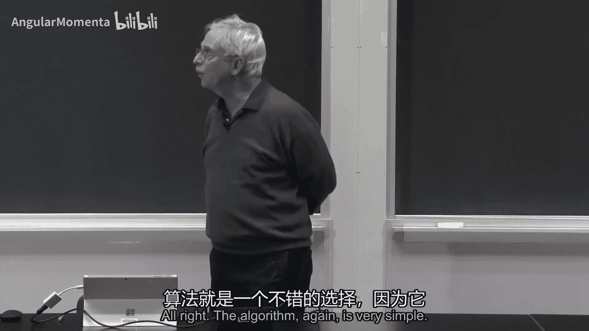

This is the one that Professor Grson briefly discussed。

You randomly choose K examples as your initial centroids。

Doesn't matter which of the examples you choose。Then you create K clusters by assigning each example to the closest centroid。

Compute K new cents。By averaging the examples in each cluster。 So in the first iteration。

The centroids are all examples。That you started with。 But after that。

 they're probably not examples because you're now taking the average of two examples。

 which may not correspond to any example you have， or actually the average of n examples。

And then you just keep doing this until the centroids don't move。

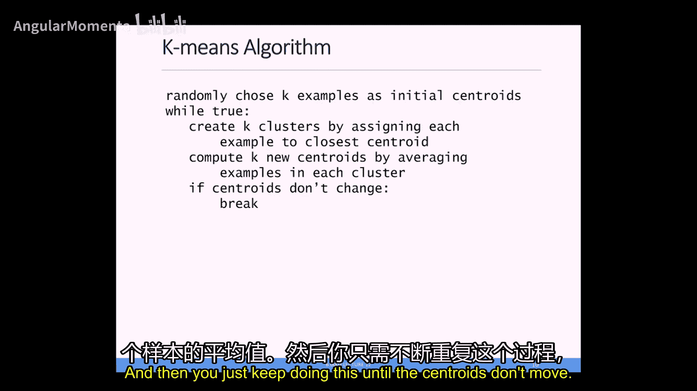

Right，Once you go through one iteration where they don't move。

 there's no point in recomputing them again and again and again。So， it is kind。Converged。So， let's。

Look at the complexity。Well， at the moment， we can't。

Tell you how many iterations you're going to have。 But what's the complexity of one iteration。Well。

Let's think about what you're doing here。You've got。K centroids。Now， I have to take each example。

And compare it to each in a naively， at least to each centroid to see which it's closest to。Right。

So that's。K comparisons per example。

So that's k times n。Times D where。How much time each of these comparison takes。

 which is likely to depend upon the dimensionality of the features。

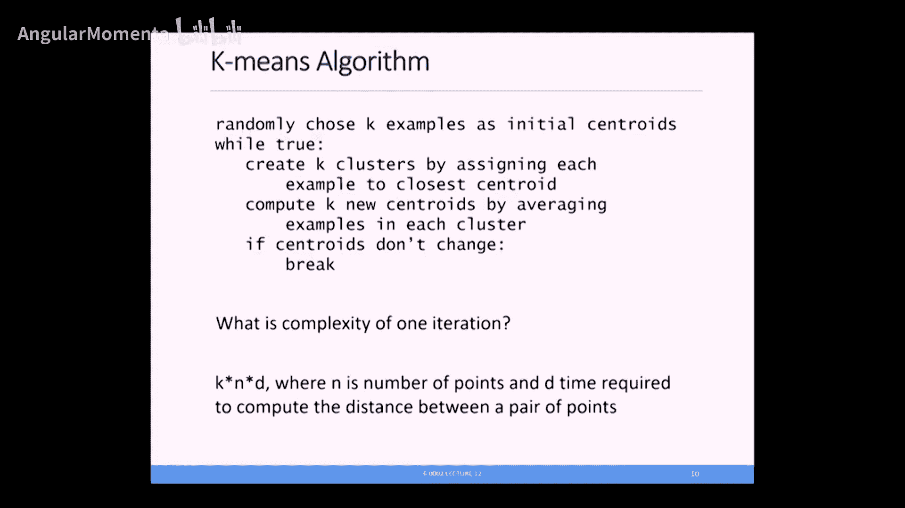

Right， just the Euclidean distance， for example。But this is a way small number than n squared。

 typically。So each iteration is pretty quick and in practice， as we'll see。

This typically converges quite quickly。So you usually need a very small number of iterations。

So it is quite efficient。 And then there are various ways you can optimize it to make it even more efficient。

 This is the most commonly used clustering algorithm。Because it works really fast。

Let's look at an example。So I've got a bunch of blue points here。

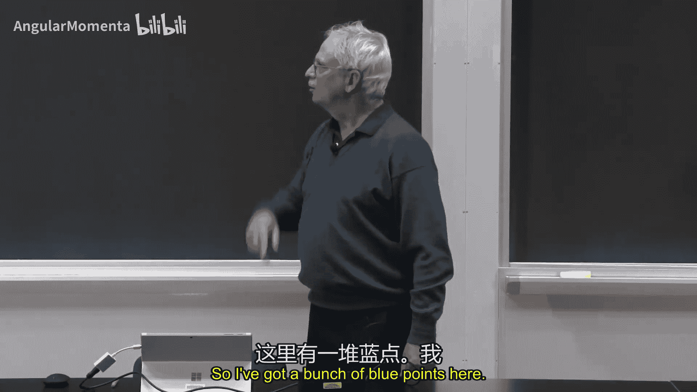

And。I actually wrote the code to do this。 I'm not going to show you the code， and I chose4。

Centroids at random。Colored stars， a green 1， a fusia colored one， a red one， and a blue1。

So maybe they're not the ones you would have chosen， but there they are。And I then。

 having chosen them。Assign each point to one of those centroids， whichever one it's closest to。

All right。Step 1。And then。I recompute the centroids。 Let's go back。So we're here。

And these are the initial centroids。Now， when I find the new centroids。

 if we look at where the red one is。The red one is this point， this point and this point。Clearly。

 the new centroid is going to move， right。It's going to move somewhere along in here or something like that。

Right。So we'll get those new centroids。There it is。And now， we'll reassign。Points。

And what we'll see is this point。Is now closer to the red star than it is to the fusia star having because we've moved the red star。

Oops， that one said the wrong thing。 They were ready to start with。

 This one is now suddenly closer to the purple。So it to the red， it will get recolored。

We compute the new centroids。We're going to move something again。 We continue。

Points will move around This time we move two points。Here we go again。 notice， again。

 the centroids don't correspond to actual examples。 This one is close。

 but it's not really one of them。Move two more。We compute centroids， and we're done。So here。

We've converged， and I think it was five iterations， and nothing will move again。All right。

 does that make sense to everybody。So， it's pretty simple。嗯。What are the downsides， Well， choosing K。

Foolishly can lead to strange results。So if I chose K equal to 3。

Looking at this particular arrangement of points， it， it's not obvious what quote。

 the right answer is。

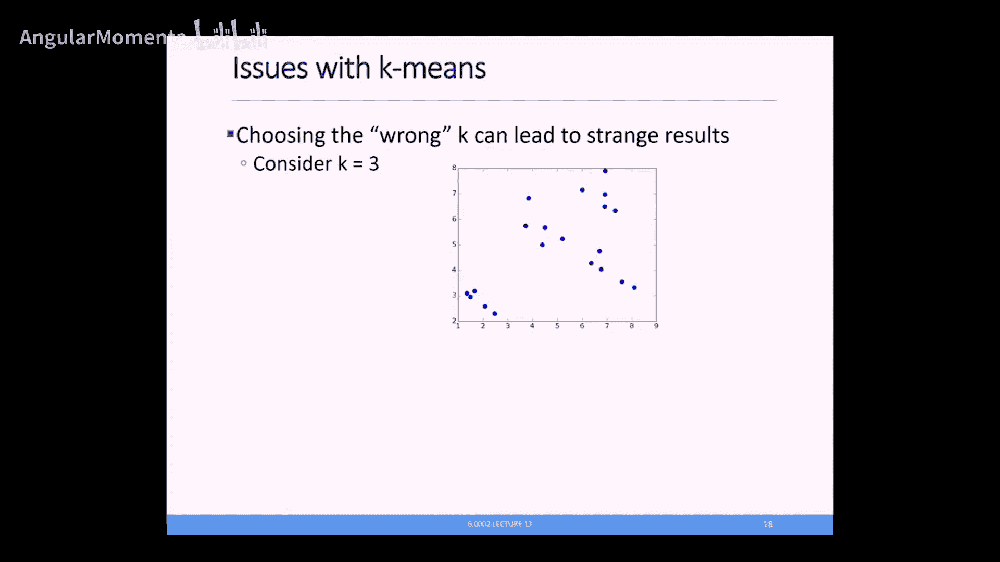

Right， maybe it's making all of this one cluster， I don't know。But。There are weird case。

 and if you choose a K that is nonsensical with respect to your data。

Then your classroom will be nonsensical。So that's one problem we have to think about。

 how do we choose K。Another problem， this is one somebody raised last time。

 is that the results can depend upon the initial centroids。Unlike hierarchical clustering。

 K means is non deterterministic。Depending upon what random examples we choose。

We can get a different number of iterations。 If we choose them poorly。

 it could take longer to converge。More worrisome， you get a different answer。

You're running this greedy algorithm， and you might actually get to a different place。

 depending upon which centroids you chose。So these are the two issues we have to think about dealing with。

So let's first think about choosing K。What often happens is people choose K using our priori knowledge about the application。

You know， if I'm in medicine， I actually know that there are only five different kinds of bacteria in the world。

That's true。I mean， they're subspecies， but five large categories。 And if I had a bunch of bacterium。

 I wanted to cluster me just a K equal to 5。

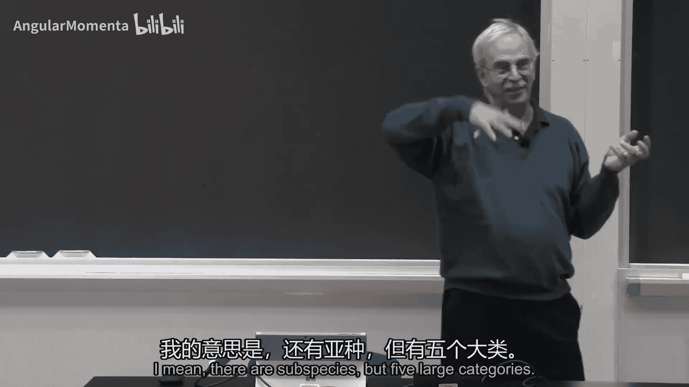

Maybe I believe there are only two kinds of people into the world。

 those who are at MIT and those who are not。

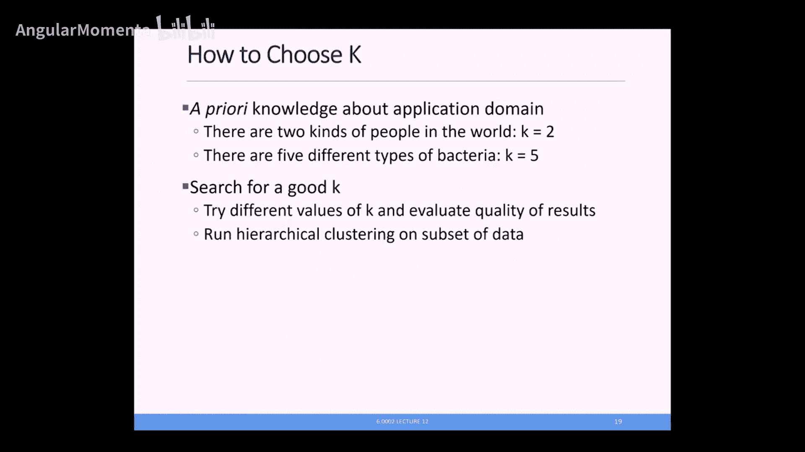

And so I'll choose K equal to 2。嗯。Often， we know enough about the application。 we can choose K。

As we'll see later， often we can。Think we do when we don't。A better approach。

Is to search for a good K。是。So you can try different values of k and evaluate the quality of the result。

Assuming you have some metric as to say， yeah， I like this clustering。 I don't like this clustering。

And we'll talk about how to do that in detail。Or you can run hierarchical clustering。

On a subset of data， I've got a million points。 All right。

 what I'm going to do is take a subset of 1000 of them or 10000 run hierarchical clockical clustering。

From that， get a sense of the structure underlying the data。

The side K should be 6 and then run K means with k equal 6。People often do this。

 They run hierarchical clustering on a small subset of the data。

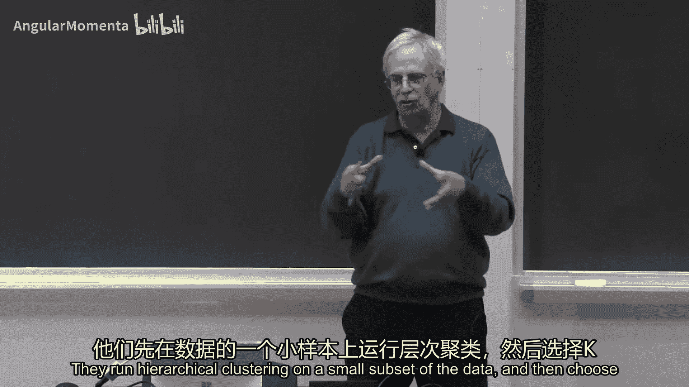

And then， choose K。And we'll look。 But the one we're going to look at is that one。

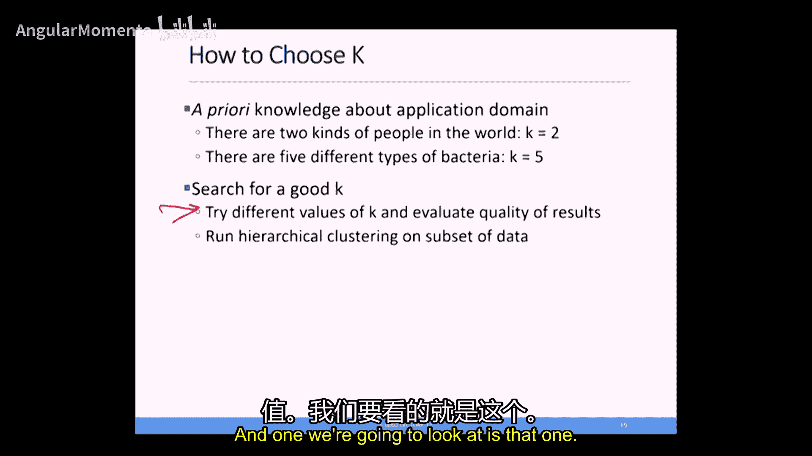

What about unlucky centroids。

So here。I got same points。 We started with different initial centroids。I've got a fuchsia one。

 a black one。And。Then I've got red and blue down here。

 which I happen to accidentally choose close to one another。Well， if I start with these centroids。

 certainly you would expect。Things to take longer to converge。 But， in fact， what happens is this。

I get to this assignment of blue。This assignment of red。And I'm done。

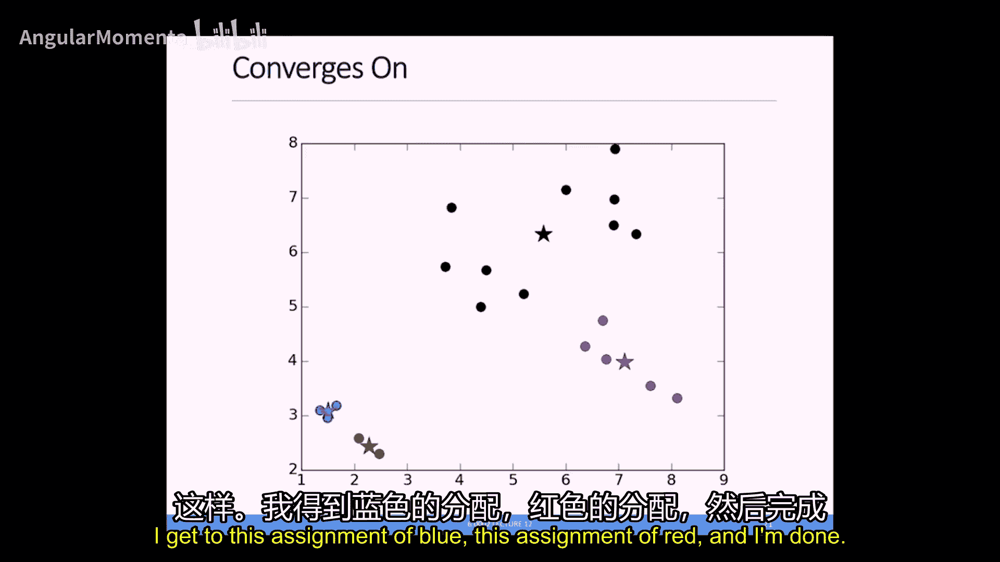

It converges on this。Which。Probably is not what we wanted out of this。 maybe it is。

But the fact that I converged on some very different place。

Shows that it's a real weakness of the algorithm that it's sensitive to the randomly chosen initial conditions。

Well。A couple of things you can do about that， you could be clever。

And try and select good initial centroids。So people often will do that。

 and what they'll do is try and just make sure that they're distributed over the space。

So they would look at some picture like this and say， well， let's just put my centroids。

At the corners or something like that so that they're far apart。

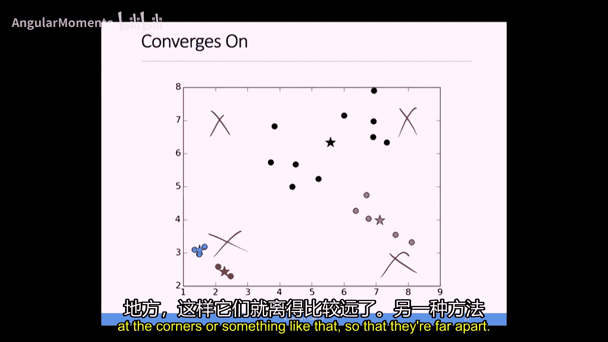

Another approach is to try multiple sets of randomly chosen centroids。

And then just select the best results。

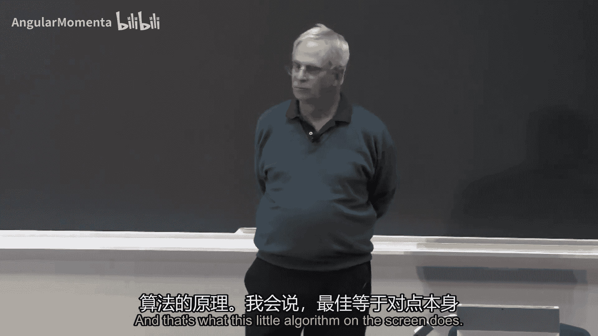

And that's what this little algorithm on the screen does。So I'll say best is equal to K means of。

The points themselves。Or something。 Then for T and range number of trials。

 I'll say C equals K means of points， And I'll just keep track and choose the one with the least dissimilarity。

 The thing I'm trying to minimize， okay。

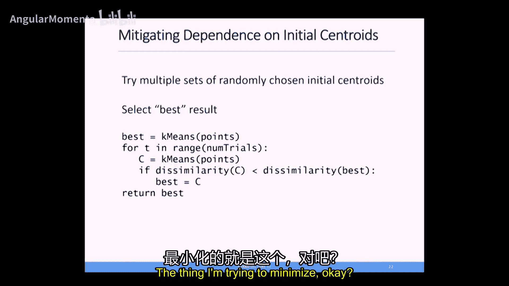

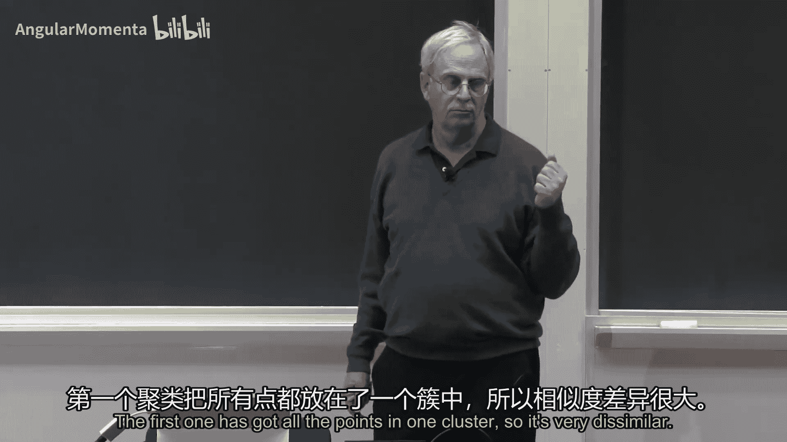

The first one is got all the points in one cluster。 So it's very dissimilar。

And then I'll just keep generating for different ks， and I'll choose the K that seems to be the best。

That does the best job of minimizing my objective function。And this is a very common solution。

 by the way， for any randomized greedy algorithm。And there are a lot of randomized greedy algorithms that you just choose multiple initial conditions。

 Try them all out and pick the best。

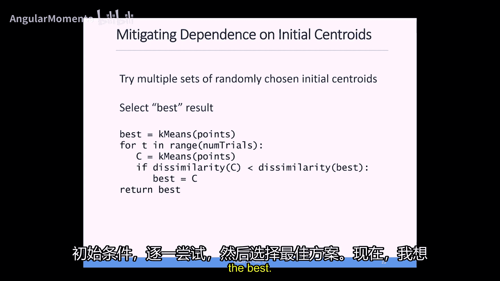

All right， now I want to show you a。AFlightly more real example。

嗯。So this is。A file we've got with medical patients。

And we're going to try and cluster them and see whether the clusters tell us anything about the probability of them dying of a heart attack。

In say， the next year or some period of time。So to simplify things。

 and this is something I have done with research。But we're looking at only four features here。

The heart rate in beats per minute。The number of previous heart attacks。The age。

And something called S T elevation， a binary attribute。So， the first three are obvious。

If you take an ECG of somebody's heart， it looks like this。 This is a normal one。They have the S。

 the T。 And then there's this region between the S wave and the T wave。 And if it's higher。

 hence elevated， that's a bad thing。

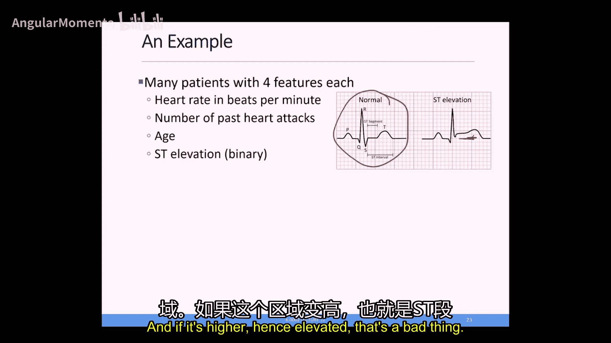

And so this is about the first thing that they measure if someone is having cardiac problems。

 do they have ST elevation？And then with each patient。

 we're going to have an outcome whether they died。And it's related to the features。

But it's probabilistic， not toministic。So， for example。

 an older person of multiple heart attacks is at higher risk than a young person who's never had a heart attack。

That doesn't mean， though， that the older person will die first。It's just more probable。

We're going to take this data。 We're going to cluster it。

And then we're going to look at what's called the purity of the clusters。

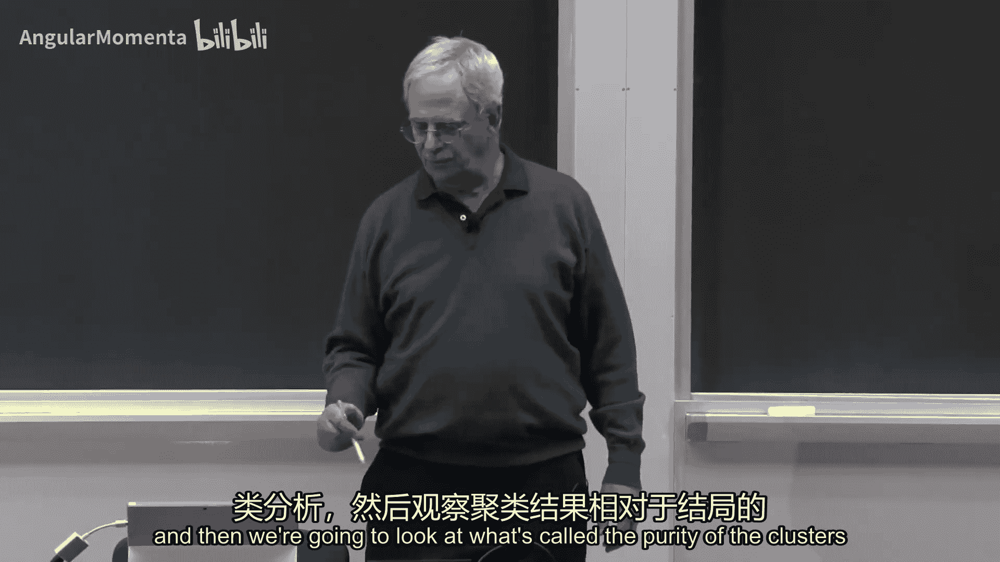

Relative to the outcomes。

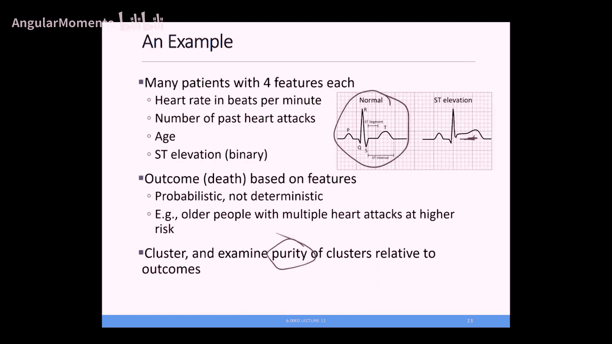

So is the cluster say enriched by people who died。Now。

 if you have one cluster and everyone in it died， then the clustering is clearly finding some structure related to the outcome。

So the file is in the zip file I uploaded。 It looks more or less like this。

So it's very straightforward。 The outcomes are binary。 One is a positive outcome。

Strangely enough in the medical jargon death is a positive outcome。

I guess maybe if you're responsible for the medical bills， it's positive。 If you're the patient。

 it's hard to think of it as a good thing。Nevertheless， that's the way that they talk。

And the others are all there， right， heart rate。

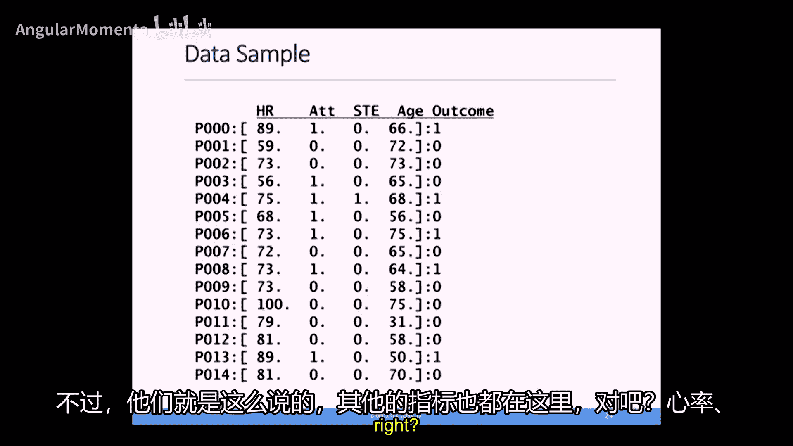

Other things。All right， let's look at some code。嗯。So I've extracted some code。

 I'm not going to show you all of it。 There's quite a lot of it， as you'll see。So we'll start。

 There one of the files you've got is called cluster dot Pi。I decided there was enough code。

 I didn't want to put it all in one file。 I was getting confused。 So I said。

 let me create a file that has some of the code and a different file that will then import it and use it。

Cluster has things that are pretty much unrelated to this example， but just useful for clustering。

So an example here has name， features and a label。

And really， the only interesting thing in it。 And it's not that interesting is distance。

And the fact that。I'm using Menkowski with two， says we're using Euclidean distance。

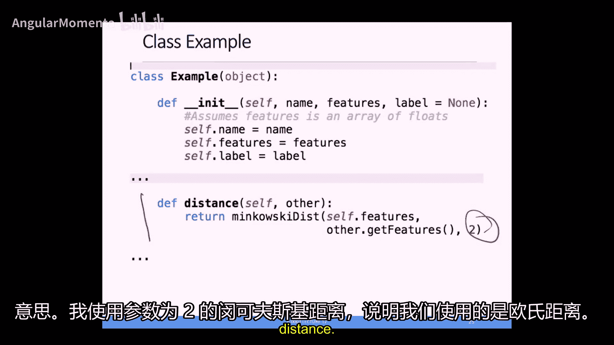

Class cluster。It's a lot more code to that one。

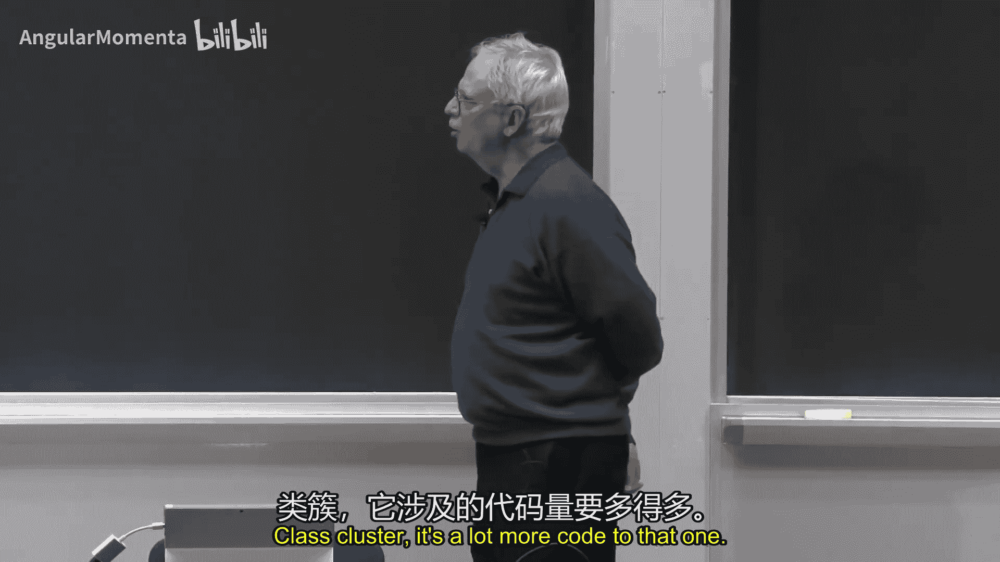

嗯。So we start with a non empty list of examples。 That's what inni does。

 You can imagine what the code looks like， or you can look at it。updatepdate。

Is interesting in that it takes the cluster。And examples。And。Puts them in。

 if you think of K means in the。In， in the cluster， closest to the previous centroids。And then。

Returns the amount the centroid has changed。So if the centroid is changed by 0。

 then you don't have anything， right， It creates the new cluster。

 And the most interesting thing is compute centroid。And if you look at this code。

 you can see that I'm a slightly unreconstructed Python2 programmers。I just noticed this。

 I really shouldn't have written 0。0。 I should have just written 0。But in Python 2。

 you had to write that  point0。 Sorry about that。 thoughtt I'd fix these。Anyway。

 so how do we compute the centroid。We start by creating an array。Of all zeros。

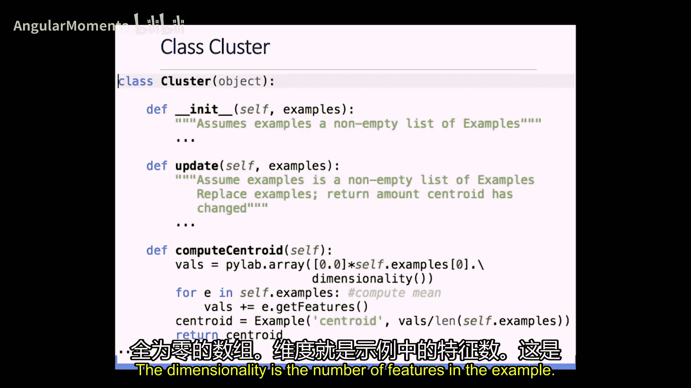

The dimensionality is the number of features in the example。It's one of the。Methods from。

 I didn't put up on the PowerPoint。

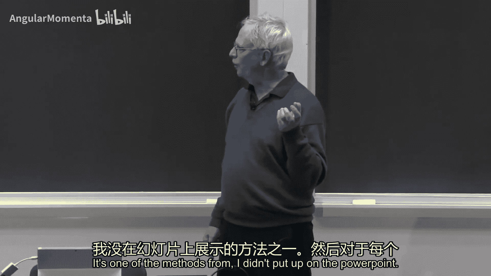

And then for Ean examples。I'm going to。Add to Vals E dot get features。

And then I'm just going to divide valves by the length。Of self thought examples。

 a number of examples。 So now you see why I made it a pileab array。

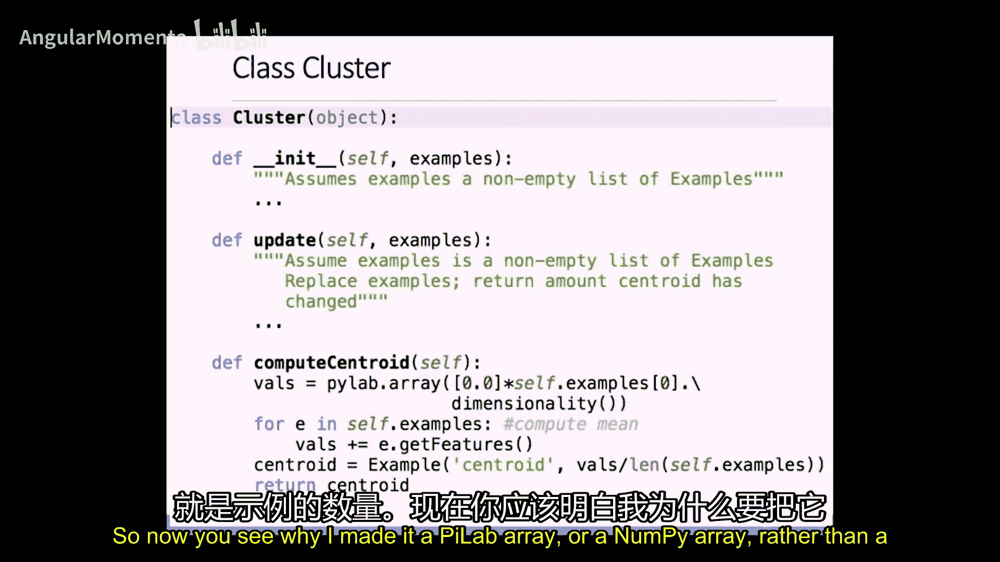

Or aumpy array rather than a list。 So I could do nice things like divide the whole thing and。

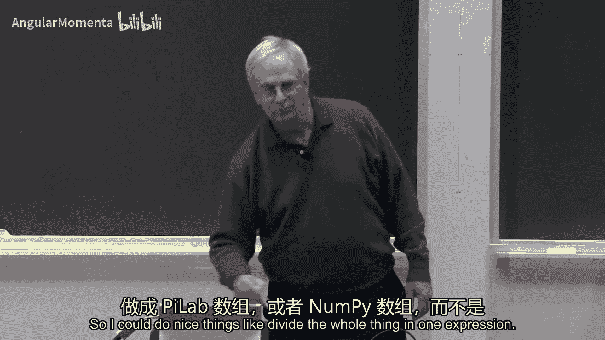

One expression。As you do math， many kind of math things。

 you'll find these arrays are incredibly convenient。

 rather than having to write recursive functions or do bunches of iterations。

 The fact that you can do it in。😊。

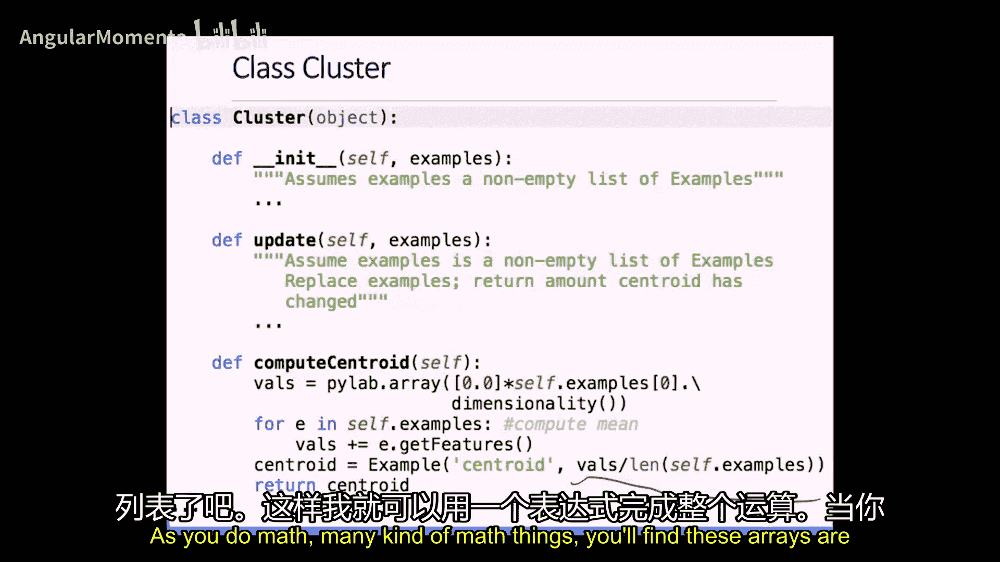

One keystroke is incredibly nice。 And then I'm going to return the centroid。

Variability is exactly what we saw in the formula。啊。And then just for fun。 So you could see this。

I used an iterator here。I don't know that any of you have used the yield statement in Python。

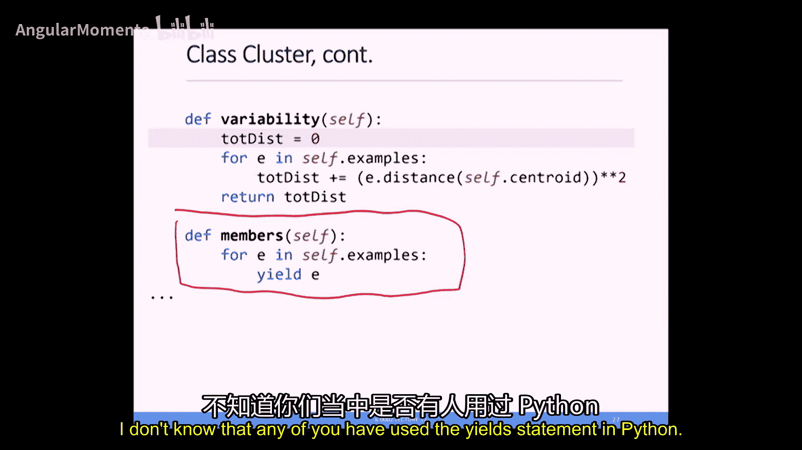

I recommend it。 It's very convenient。One of the nice things about Python is almost anything that's built in。

 You can make your own version of it。And so once I've done this。

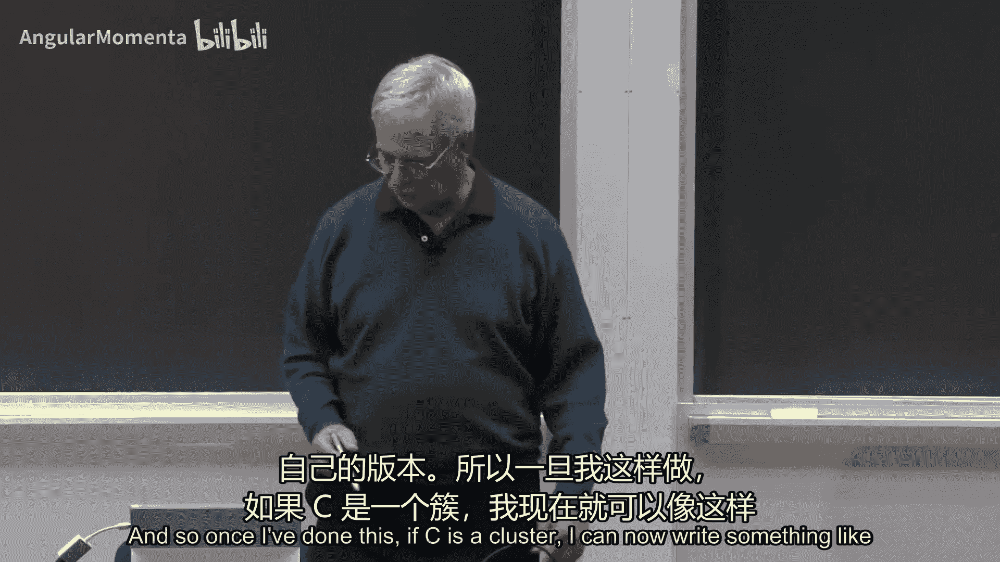

If。C is a cluster。I can now write something like for C in big C。And this。

Will make it work just like iterating over a list。

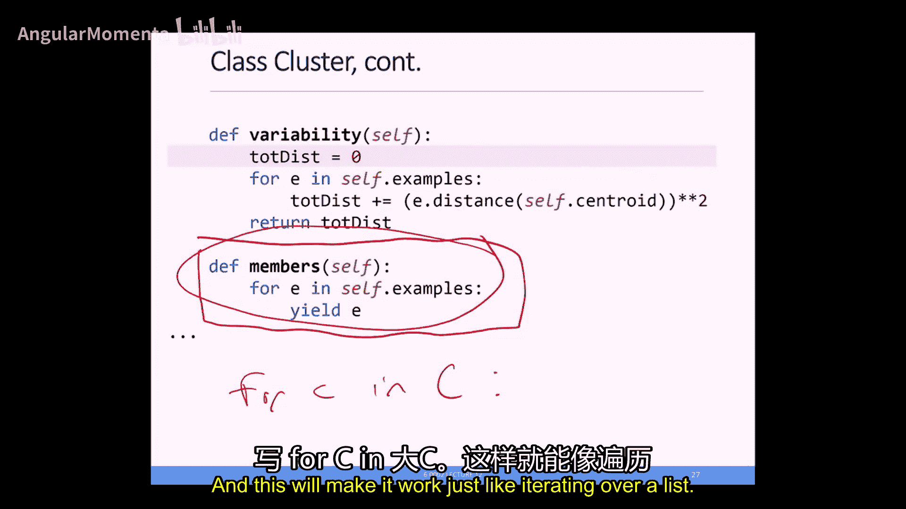

Right， so this makes it possible to iterate over it。 If you haven't read about yield。

 you probably should。Read the probably about two paragraphs in the textbook， explaining how it works。

But it's very convenient。Disimilarity， we've， we've already seen。Allright， now we get to patients。

This is in the file 12， lecture 12。 pi。In addition to importing the usual suspects of P labb and nuumpy。

And probably it should import random， too。It imports cluster。The one we just looked at。

And so patient is a subtype of cluster dot example。

Then I'm going to define this interesting thing called scale attributes。

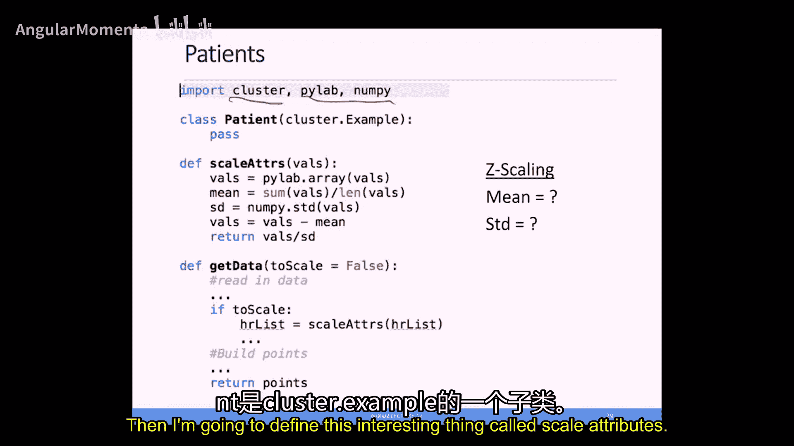

So you might remember in the last lecture when Professor Grimson was looking at these reptiles。

He ran into this problem about alligators looking like chickens because they each had a large number of legs。

And he said， well， what can we do to get around this Well we can represent。

The feature as a binary number， has legs， doesn't have legs 0 or 1。

And the problem he was dealing with。Is that when you have a feature vector。And。

The dynamic range of some features is much greater than the others。

They tend to dominate because the distances just look bigger when you get Euclidean distance。So。

 for example， if we wanted to cluster the people in this room。And I had one feature that was， say。

One for male and0 for female。 and another feature that was one for wears glasses。

 zeros for doesn't wear glasses。And then a third feature， which was weight。And I clustered them。Well。

 weight would always completely dominate the Euclidean distance， right。

Because the dynamic range of the weights in this room is much higher than the dynamic range of 0 to 1。

And so。For the reptiles， he said， well， okay， we'll just make it a binary variable。

 but maybe we don't want to make weight a binary variable because maybe it is something we want to take into account。

So what we do is we scale it。So this is a method called Z scaling。

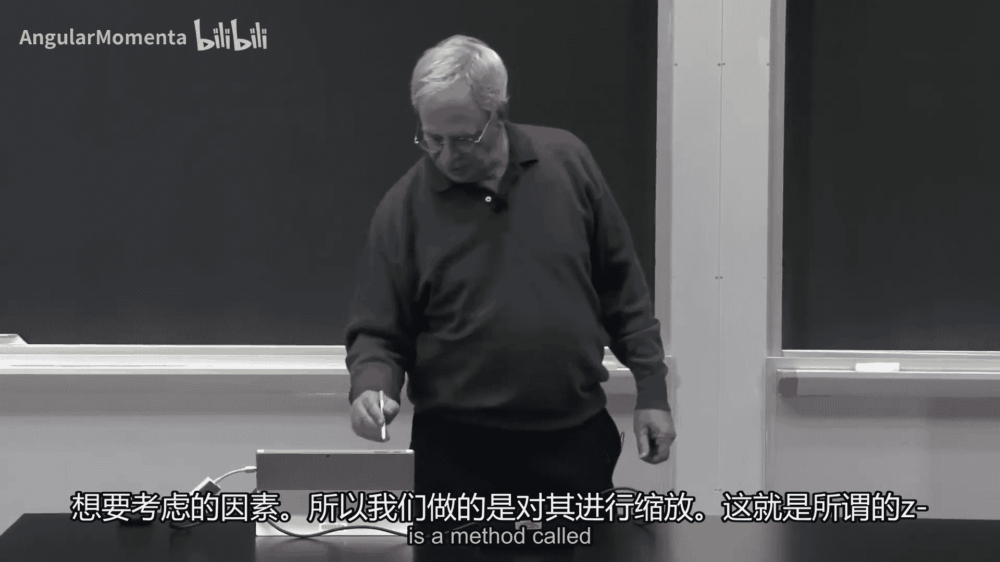

More general than just making things  zero1。It's a simple code。

 It takes in all of the values of a specific feature。And then perform some simple calculations。

And when it's done。The resulting。是。Aray， it returns。Has。Un known mean。

 and a known standard deviation。So what's the mean going to be。

 It's always going to be the same thing， independent of the initial values。Take a look at the code。

 try and see if you can figure it out。Anybody want to take a guess at it？0。Right。

 so the mean will always be 0。And the standard deviation， a little harder to figure。

 but it will always be one。

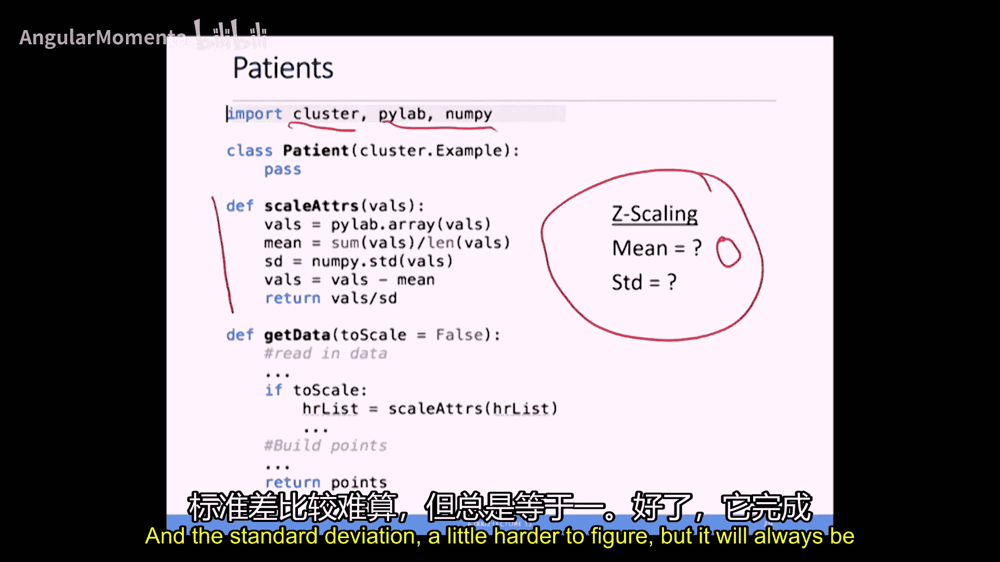

Okay， so it's done this scaling。This is a very common kind of scaling， called Z scaling。

The other way people scale is interpolate。They take the smallest value and call it 0。

 the biggest value they call it  one。And then they do a linear interpolation of all the values between 0 and 1。

 So the range is 0 to 1。That's also very common。So this is a general way to get all of the features sort of in the same ballpark so that we can compare them。

And we'll look at what happens when we scale and when we don't scale。

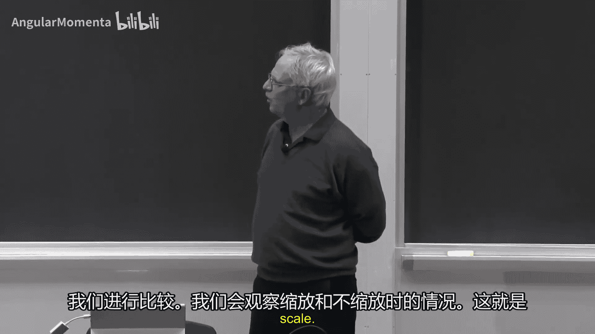

And that's why my get data function has this parameter to scale。

It either creates a set of examples with the attributes as initially or scaled。

And then there's K means。 It's exactly the algorithm I showed you with one little wrinkle。

Which is this part。You don't want to end up with empty clusters。 If I tell you， I want four clusters。

I don't mean I want three with examples and one that's empty。Right。

 because then I really don't have four clusters。And so this is one of multiple ways to avoid having empty clusters。

Basically， what I did here is said， well， I'm going to try a lot of different initial conditions。

If one of them is so unlucky to give me an empty cluster。

 I'm just going skip it and go on to the next one。By raising a value error， empty cluster。

And if you look at the code， you'll see how this value error is used。And then try K means。😡。

We'll call K meanss nu trial times。Each one getting a different set of initial centroids and return the result with the lowest dissimilarity。

Then I have various ways to。Examine the results。Nothing very interesting。

 And here's the key place where we're going to run the whole thing。

We'll get the data。Initially not scaling it。 because remember it defaults to true。 Then initially。

 I'm only going to try  one K K equals 2。And。We'll call。Test clustering。With the patients。

The number of cluster is k。I put in seed as a parameter here。😡。

Because I wanted to be able to play with it and make sure I got different things for 0 and1 and 2。

 just as a testing thing and five trials it's defaulting to。And then。Will。Look at。

Test clustering is returning。The fraction of positive examples for each cluster。

Okay。So let's see what happens when we run it。嗯。

All right。So we got two clusters。Cluster of size 118 with 03，305 and a cluster of size 1。

32 with a positive fraction of0。Quadruple 3。嗯。Should we be happy？

Does our clustering。Tell us anything somehow correspond to the expected outcome for patients here。

Probably not， right？Those numbers are pretty much indistinguishable， statistically。

And you'd have to guess that the fraction of positives in the whole population is around 。33， right。

 that about a third of these people died of their heart attack。And。

I might as well have assigned them randomly to the two clusters。 right。

 There's not much difference between this in which you would get with the random result。Well。

 why do we think that's true？Because I didn't scale， right。

And so one of the issues we had to deal with is， well， age had a big dynamic range。

And say F T elevation， which I told you is highly diagnostic。Was either zero or one。

And so probably everything is getting swamped by。Age。Or something else， right。All right。

 so we have an easy way to fix that。

Well just scale the data。Now， let's see what we get。All right， that's interesting。With casting rule。

Good grief。That caught me by surprise。啊。嗯。Good thing I have the answers in PowerPoint to show you。

Because the code doesn't seem to be working。Try it once more。No， all right。 Well。

 in the interest of getting through this lecture on schedule。

 we'll go look at the results that we get。 I got last time I ran it。All right。When I scaled。嗯。

What we see here is that。Now， there's a pretty dramatic difference。

RightOne of the clusters is a much higher fraction of positive patients than others。But。

It's still a bit problematic。So。This has pretty good。Spificity of positive， predictive value。

But its sensitivity is lousy。嗯。Remember， a third of our initial population。More O S was positive。

26 is way less than a third。

So in fact， I've got a class。A cluster that is strongly enriched。

 but I'm still lumping most of the positive patients into the other cluster。And， in fact。

 there are 83 positives。

Or with some code to do that。 And so we see that of the 83 positives。Only this class。

 which is 70% positive， only has 26 in it to start with it。

 So I'm clearly missing most of the positives。So why？Well。

 my hypothesis was that different subgroups of positive patients have different characteristics。

And so。We could test this by trying other values of K。To see what， we would get more clusters。

 So here I said， let's try K equals 2，4， and 6。

And here's what I got when I ran that。So what you'll notice here。As we get to say，4。That。

I have two clusters。This one。And this one。Which are heavily enriched。With positive patients。

26 as before in the first one。But，76 patients。In the third one。

So I'm now getting a much higher fraction of patients in one of the quote， risky clusters。

And I can continue to do that。but it。If I look at K equals 6， we now look at the positive clusters。

 There were three of them。Significantly positive。But I'm not really getting a lot more。Patience。

 total。So maybe four is the right answer。

So what you see here is that。We have at least two parameters to play with， scaling in K。

Even though I was only wanted a structure that would separate the risk。

 high risk patients from the lower risk， which is why I started with two。I later discovered that。

 in fact， there are multiple reasons for being high risk。

And so maybe one of these clusters is heavily enriched by old people。

Maybe another one is heavily enriched by people who have had three heart attacks in the past or S T elevation or some combination。

And when I had only two clusters， I couldn't get that fine gradation。So this is what。

Data scientists spend their time doing when they're doing clustering is they actually have multiple parameters。

 They try different things out。 They look at the results。

 And that's why you actually have to think to manipulate data rather than just push a button and wait for the answer。

All right。More of this general topic on Wednesday， when we're going to talk about classification。

Thank you。