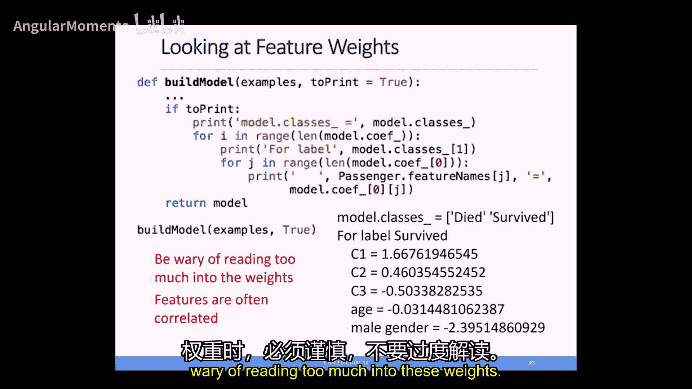

# 【麻省理工】计算思维与数据科学导论-｜-MIT-6.0002-Introduction-to-Computational-Thinking，Fall2016-p13-13.-分类--BV1zNjGzxEvk_p13-

The following content is provided under a C Commons license。

 Your support will help Mi T OpenCourseware continue to offer high quality educational resources for free to make a donation or to view additional materials from hundreds of MiT courses。

 Visit Mit Opencourseseware at O Cw Mt Eduu。

Hello， everybody。 Before we start the material， a couple of announcements。As usual。

 there's some reading assignments， and you might be surprised to see something from Chapter 5 suddenly popping up。

But this is my relentless attempt to introduce more Python。 We'll see one new concept later today。

 list comprehension。Today。We're going to look at classification。And you remember last on Monday。

 we looked at。Unsupervised learning。 Today， we're looking at。Supervised learning。

 It can usually be divided into two categories。Regression。

Where you try and predict some real number associated with the feature vector。

And this is something we've already done， really。Right， back when we looked at curve fitting。

Linear regression in particular， it was exactly building a model that given some features would predict a point。

In this case， it was pretty simple。 It was given X predict Y。

 You can imagine generalizing that to multi dimensionmens。Today。

 I'm going to talk about classification。Which is。Very common in many ways。

 more common than regression for in the machine learning world。And here。

 the goal is to predict a discrete value。Often called a label。Associated with some feature vector。

So this is the sort of thing where you try and， for example。

 predict whether person will have an adverse reaction to a drug。You're not looking for a real number。

 You're looking for， will they get sick， won't they， Will they not get sick。嗯。

Maybe you're trying to predict the grade in a course， AB，C， D。And other grades， we won't mention。

 again， those are labels。 So it doesn't have to be a binary label。

 but it's a finite number of labels。So here's an example to start with。

 We won't linger on it too long。 This is basically something you saw。

In an earlier lecture where we had a bunch of animals and a bunch of properties and a label identifying whether or not they were a reptile。

嗯。So we start by building a distance matrix。How far apart they are。And， in fact， in this case。

I'm not using the representation you just saw。 I'm going to use the binary representation。

As Professor Grson showed you， and for the reasons he showed you。And。If you're interested。

 I didn't produce this table by hand。 I wrote some Python code to produce it。

Not only to compute the distances， but more in more more delicately to produce the actual table。

And you probably find it instructive at some point to at least remember that that code is there in case you need to ever produce a table for some paper。

In general。You've probably noticed， I've spent relatively little time going over the actual vast amounts of codes we've been posting。

That doesn't mean you shouldn't look at it。 In part。

 a lot of it's there because I'm hoping at some point in the future will be handy for you to have a model on how to do something。

Alright， so we have all these distances。And we can tell how far apart one animal is from another。Now。

 how do we use those to classify animals。And the simplest approach to classification。

 And it's actually one that's used a fair amount in practice， is called nearest neighbor。

So the learning part is trivial。 We don't actually learn anything other than we just remember。

So we remember the training data。And when we want to predict the label of a new example。

 we find the nearest example in the training data and just choose the label。

Associate with that example。So， here。I've just drawn a cloud of red dots， and black dots。

I have a fusia colored X。And if I want to classify X as black or red， I'd say， well。

 its nearest neighbor is red， So we'll call X red。Very， doesn't get much simpler than that。Allright。

 let's try and do it now for our animals。I've blocked out this lower right hand corner because I want to classify these three animals that are in gray。

 So my training data。Very small are these animals。 And these are my tests set here。

So let's first try and classify the zebra。If we look at the's nearest neighbor， well。

 it's either a guppy or a dart frog。And， well， let's just choose  one。 Let's choose the guppy。

 And if we look at the guppy， it's not a reptile。So we say the zebra is not a reptile。

So got one right。Look at the Python， Chos its nearest neighbor， say it's a Cobra。

The label associated with Colbra is reptile， so。We win again， on the Python。Alligator。

 its nearest neighbor， is。Clearly， a chicken。And so， we classify。The alligator as not a reptile。

Oh dear。Clearly the wrong answer。All right。What might have gone wrong。Well。

The problem with K nearest neighbors。We can illustrate it by looking at this example。

So one of the things people do with classifiers these days is handwriting recognition。

So I just copied from a website a bunch of numbers。

 Then I wrote the number 40 in my own inimmable handwriting。So if we go and we look for， say。

 the nearest neighbor of four， or sorry of whatever that digit is。It is， I believe， this one。

And sure enough， that's the role of fours。We're O on this。Now， if we want to classify my 0。

The actual nearest neighbor， in terms of the bitmas， if you will， turns out to be this guy。

A very poorly written 9。I didn't make up this 9。 It was， It was already there。

And the problem we see here when we use nearest neighbor。Is if something is noisy。

 If you have one noisy piece of data， in this case， this rather ugly looking version of 9。

 you can get the wrong answer because you match it。And indeed， in this case。

 you would get the wrong answer。What is usually done to avoid that。

Is something called k nearest neighbors。And the basic idea here is that we don't just take the nearest neighbors。

We take some。Number of nearest neighbors， usually an odd number。 And we just let them vote。So， now。

If we want to classify this fusia X。And we said， Ca well the three。 We said， well。

 these are its three nearest neighbors。1 is red。2 are black。

 So we're going to call X black is our better guess。

And maybe that's actually is a better guess because it looks like this red point here is really an outlier。

Right， and we don't want to let the outliers dominate our classification。

And this is why people almost always use key nearest neighbors rather than just nearest neighbor。Now。

 if we look at this and we use K nearest neighbors。Those are the three nearest to the first numeral。

And they are all fours。And if we look at the K nearest neighbors for the second numeral。

 we still have this 9， but now we have two zeros。And so we vote and we decide it's a 0。

Is it infallible no， but it's。Typically， much more reliable than just nearest neighbors。Hence。

 used much more often。And that was our problem， by the way， with the alligator。

The nearest neighbor was the chicken。But if we went back and looked at it。

 maybe we should go do that。And we take the alligator's three nearest neighbors。

 It would be the chicken。The cobra and the rattlesnake or the Boa。 We don't care。

 And we would end up correctly classifying it now as a reptile。Yes。Quest is。

 is there a limit to how many nearest neighbors you'd want？Absolutely。Most obviously。

 there's no point in setting K equal to whoops， on the rebound。To the size of the training set。

 right。So one of the problems with Canie earth neighbors is efficiency。

If you're trying to find K nearest neighbors， and K is bigger。It takes longer。So， we worry about。

How big K should be。And if we make it too big。And this is a crucial thing。

We end up getting dominated by the size of the class。So let's look at this picture we had before。

Happens to be more red dots than black dots。If I make K 10 or 15。

 I'm going to classify a lot of things as red just because red is so much more prevalent than black。

And so when you have an imbalance， which you usually do。You have to be very careful about K。

 Does that make sense。So how do you choose K， Remember back on Monday when we talked about choosing K for K means clustering。

We typically do a very similar kind of thing。 We take our training data。

And we split it into two parts。So we have， we have training and testing。

 But now we just take the training and we split that into training and testing。Multiple times。

 And we experiment with different ks。And we see which case gives us the best result。

On the training data。 And then that becomes acade。Okay， and that's。A very common method。

 It's called cross validation。And it's。For almost all of machine learning。

The algorithms have parameters。 In this case， it's just one parameter， K。

And the way we typically choose the parameter values is by searching through the space。

 using this cross validation in the training data。That makes sense to everybody。Great question。

And it was someone else had a question， but maybe it was the same。 Do you still have a question。

If you were using w。Kay nearest than you get。If my K is three， and I' get three different。

Free even clusters。Well， right。 So if K is3 and I had red， black and purple。And I get one of each。

 Then what do I do。And then I'm kind of stuck。 So you need to typically choose K in such a way that when you vote。

 you get a winner。Right， so if there's two， any odd number， we'll do。If it's three。

 well then you need another number so that there's always a majority。Right。

You want to make sure that there is a winner。Also， a good question。

LetSee if I get this to you directly。I'm much better at throwing overhand， I guess。Wow。

 finally got applause for something。 All right。Advantages and disadvantages of K， N N。

The learning is really fast， right， I just remember everything。No math is required。

 didnn't have to show you any theory。 It was obviously an idea。

It's easy to explain the method to somebody and the results。 Why did I label it black。

 Because that's who it was closest to。The disadvantages is its memory intensive。

If I've got a million examples， I have to store them all。And the predictions can take a long time。

If I have。An example， and I want to find its can nearest neighbors。 I'm doing a lot of comparisons。

Right， if I have a million training points， I have to compare my example to all a million。

So I have no real pre processingcess overhead。But each time I need you a classification。

 it takes a long time。Now， there are better algorithms than brute force that give you approximate K nearest neighbors。

But on the whole， it's still not fast。And。We're not getting any information about what process might have generated the data。

Right， which we don't have a model of the data in the way we say when we did our linear regression for curve fitting。

 we had a model for the data that sort of described a pattern。We don't get that out of Ka。

 nearest neighbors。I'm going to show you a different approach where we do get that。

And I'm going to do it on a more interesting example， than reptiles。

I apologize to those of you who are rhologists。So you probably all heard of the Titanic。

There was a movie about it， I'm told。It was one of the great dece disasters of all time。

 a so called unsinkable ship。He advertised it as unsinkable， Hi an iceberg and went down。

 The 1300 passengers，812 died。 The crew did way worse。

So at least it looks as if the crew was actually pretty heroic。 right， They had a higher death rate。

So we're going use machine learning to see if we can predict which passengers survived。啊。

There's an online database I'm using。 It doesn't have all 1300 passengers。

 but it's information about 1046 of them。Some of them that couldn't get the information says what cabin class they were in first second or third。

How old they were and their gender。Also has their name and their home address and things。

 which I'm not using。Alright， so we want to use these features。To see if we can predict。

Which passengers were going to survive the disaster。Well， the first question。

Is something that Professor Grimson alluded to。Is。Is it okay just to look at accuracy。

 How are we going to evaluate our machine learning。And it's not。

 If we just predict died for everybody。Well then will be 62% accurate for the passengers and 70%。

76% accurate for the crew members。Usually machine learning， if you're 76%， you say it's not bad。Well。

Here， I can get that just by predicting died。So whenever you have a class im balance。

That much more of one than of the other， accuracy isn't a particularly meaningful measure。嗯。

I discovered this early on in my work in medical area。 There are a lot of diseases that rarely occur。

 They occur in say，01% of the population。 And I can build a great model for predicting it by just saying。

 nope， you don't have it。Which will be 0。999% accurate。But totally useless， right。And unfortunately。

 you do see people doing that sort of thing in the literature。Alright。

 so you saw these in an earlier lecture， just to remind you。

We're going to be looking at other metrics。Sensitivity。Think of that as。

 how good is it at identifying the positive cases， In this case， positive is going to be dead。

How specific is it。And the positive predictive value， if we say somebody died。

 what's the probability that they really did。And then there's a negative predictive value。

 If we say they didn't die。 What's the probability they didn't die。

So these are four very common metrics。There is something called an F score that combines them。But。

 I'm not gonna。Be showing you that today。I will mention that in the literature。

 people often use the word recall to mean sensitivity or sensitivity to mean recall。

And specificity and precision。Are used pretty much interchangeably。So， you might see。

Various combinations of these words， typicallyypically。

 people talk about recalled end precision or sensitivity and specificity。All right。

That makes sense why we want to look at the measures other than accuracy。 We will look at accuracy。

 too。And how they all tell us kind of different things。And how you might choose a different balance。

So， for example， if I'm running a screening test， say for breast cancer， a mammogram。

And trying to find the people who should get on for a more extensive examination。

 What do I want to emphasize here。Which of these is likely to be the most important。

Or what's likely to you， What would you care about most。Well， maybe I want sensitivity。

Since I'm going to send this person on for future tests。

 I really don't want to miss somebody who has cancer。

And so I might think sensitivity is more important than specificity in that particular case。

On the other hand， if I'm deciding who， who is so sick， I should do open heart surgery on them。

Maybe I want to be pretty specific because the risks of the surgery itself are very high。

 I don't want to do it on people。Who don't need it。

And so we end up having to choose a balance between these things， depending upon our application。

The other thing I want to talk about before actually building a classifier。

Is how we test our classifier。Because this is very important。

 I'm going to talk about two different methods。Leave one outclass。Testing and repeated random。

Sub samplingling。For leave one out。Is typically used when you have a small number of examples。

And so you want as much training data as possible as you build your model。

And so you take all of your N examples， remove one of them。Train on n -1。 Test on the one。

Then you put that one back and remove another one。Train on n-1。 Test on one。

And you do this for each element of the data。 And then you average your results。

Repeated random sub sampling is done when you have a more a larger set of data。

And there you might say， split your data 80，20。Take 80% of the data to train on。Tested on 20。

So this is very similar to what I talked about earlier in the answer to the question about how do you choose K。

 right。That I haven't seen the future examples， but in order to believe in my model。

And say my parameter settings， I do this repeated random sub samplingampling。Or leave one out。

 either one。So there's the code for leave one out。嗯。Absolutely nothing interesting about it。So。

 I'm not gonna。Waste your time looking at it。Repeated random sub sampling is a little more interesting。

So what I've done here is I first。Sample。This one is just to split it 80，20。

It's not doing anything repeated。And I start。By sampling。20%。Of the indices。Not the samples。

And I want to do that at random。 I don't want to say you get consecutive ones。So， we do that。

And then once I've got the indices， I just go through and assign each example to either test or training。

And then， return the two sets。Okay， but if I just sort of sampled。1。

 then I'd have to do a more complicated thing to subtract it from the other。 This is just efficiency。

And then， here's the。Sorry about the yellow there。The random splits。Obviously。

 I was searching for results when I did my screen capture。嗯。

So I'm just going range a number of splits。 I'm going split at 8020。啊。It takes a parameter method。

And that's interesting。 And we'll see the ramifications of that later。

That's going to be the machine learning method。So we're going to compare K And N to another method called logistic regression。

 I didn't want to have to do this twice。This code twice。 So I made the method itself， a parameter。

We'll see that introduces a slight complication， but we'll get to it when we get to it。So I split it。

 I apply whatever that method is to the training， the test set。I get the results。啊。True positive。

 false， positive， true negative， false negatives。And then I called this thing， get stats。

But I'm dividing it by the number of splits。 So that will give me the average number of true positives。

 the average number of false positives， etc。And then， I'm just gonna。Return them， the average。

 get stats actually just prints a bunch of statistics for us。All right。

Any questions about the two methods， Leave one out versus repeated random sampling。All right。

So let's try it for K N N on the Titanic。So I'm not going to show you the code for Can nearest classify。

 it's in the code we uploaded。It takes four arguments， the training set， the test set。

The label that we're trying to classify。Are we looking for the people who died or the people who didn't die。

 Are we looking for reptiles or not reptiles。Or if case there were six labels。

 Which one are we trying to detect。And K， as in how many nearest neighbors。

And then it returns the true positives， the false positives。

 the true negatives and the false negatives。Then you'll recall。

 we'd already looked at Lambda in a different context。The issue here is， K nearest classify。

Takes four arguments。Yet if we go back。Here， for example， to random splits。

What we're seeing is I'm calling the method with only two arguments。Because after all。

 if I'm not doing k nearest neighbors， maybe I don't need to pass in K。Right， I'm sure I don't。

So different methods will take different numbers of parameters。And yet。

 I want to use the same function here， method。And so the trick I used to get around that。

 And this is a very common programming trick。In math， it's called currying。

After the mathematician curry， not the Indian dish。If I'm creating a function。

 a new function called K， N N。This will be a function of two arguments。

The training set and the test set。And it will be k nearest classifier。

With training set and test set as variables。And two constants survived。

So I'm going to predict who survived and three。Dey。Alright。

 so I've been able to turn a function of four arguments。

 K nearest classify into a function of two arguments， K， and， N。😊，By using lambmbda abstraction。

This is something that people do fairly frequently because it lets you build much more general programs when you don't have to worry about the number of arguments。

So it's a good trick to keep in your bag of tricks。Again， it's a trick we've used before。

Then I've just chosen 10 for the number of splits。And。We'll try it。

And we'll try it for both methods of testing。All right， any questions before I run this code？

So here it is。 We'll run it。Well， I should learn how to spell finished， shouldn't I， but that's okay。

Alright， so here we have the results。And。well， what can we say about them。

They're not much different to start with， right。So it doesn't appear that our testing methodology had much of a different son。

How well the， the K And N worked。And that's actually kind of comforting。Right， the accurate。

 none of the， none of the evaluation criteria are radically different。So that's kind of good。

 We hope that was true。The other thing to notice。Is that we're actually doing considerably better than just always predicting。

 say， didn't survive。Right。So we're， we're doing better than a random prediction。Alright。

 let's go back now to the PowerPoint。You are the results， we don't need to study them anymore。

Better than 62% accuracy。But not much difference between the experiments。Alright。

 so that's one method。Now， let's look at a different method。

And this is probably the most common method used in machine learning。

 It's called logistic regression。It's in some ways， if you look at it similar to linear regression。

 but different in some important ways。Linear regression。You will， I'm sure， recall。

 Pur is designed to predict a real number。Now， what we want here is a probability。

So the probability of some event。And we know that the dependent variable can only take on a finite set of values。

Right， so we want to predict。Survived or didn't survive。

It's no good to say we predict this person half survived。You know， survive。

 but his brain dead or something。 I don't know。 You know， that's not what we're trying to do。

And so the problem with just using regular linear regression is a lot of time you get nonsense predictions。

Now， you could claim， okay，05 is there， and it means has a half probability。Of dying。

 not that half died。But， in fact， if you look at what goes on， you could get more than one。Out of。

 or less than 0 out of linear regression。 And that's nonsense when we're talking about probabilities。

So we need a different method。 And that's logistic regression。What logistic regression does。

Is it finds what are called weights for each feature。And you may recall。

 I complained when Professor Grimimpson used the word waits to mean something somewhat different。So。

 we take each feature。For example， the gender， the， the cabin class。The age。And。

Compute for that a weight that we're going to use in making predictions。

 So think of the weights as corresponding to the coefficients we get when we do a linear regression。

So we have now a coefficient associated with each variable。

And we're going to take those coefficients， add them up and make。

 multiply them by something and make a prediction。A positive weight implies。Now。

 I'll come back to this later。 it almost implies that the variable is positively correlated with the outcome。

So we would， for example， say。Have scales is positively correlated with being a reptile。

A negative weight implies that the variable is negatively correlated with the outcome。

So number of legs might have a negative weight。The more legs an animal has。

 the less likely it is to be a reptile。It's not absolute， right， It's just。A correlation。

And the absolute magnitude is related to the strength of the correlation。So if it's big， positive。

 it means it's a really strong indicator。 If it's big negative。

 it's a really strong negative indicator。And then we use an optimization process to compute these weights from the training data。

It's a little bit complex。 It's key is the way it uses the log function。 hence the name logistic。

But I'm not gonna make you look at it。But I will show you how to implement， how to use it。

So you start by importing something called S K learn dot linear model。SK learnn is a Python library。

And in that is a class called logistic regression。It's the name of a class。

And here are three methods of that class。Fit。Which takes。

A sequence of feature vectors and a sequence of labels。And returns an object。Of type。

 logistic regression。So this is the place where the。Optimization is done。Now。

 all of the examples I'm going to show you。These two sequences will be。Well， all right。

 So think of this as the sequence of feature vectors，1 per passenger。

And the labels associated with those。 So this and this have to be the same length， al right。

So that produces an object of this type。And then I can ask for the coefficients。

Which will return the weight of each variable， each feature。And then。I can make a prediction。

Given a feature vector。Return the probabilities of。Different labels。Alright， let's look at。

And as an example。 So first， let's build the model。So the builder model will take the examples。

 the training data。And I've just said， whether we're going print something。

 you'll notice from this slide， I've elighted the printed stuff。We'll come back in a later slide。

 and look at。What's in there。 But for now， I want to focus on actually building the model。

So I need to create two vectors， to lists。 in this case， the feature vectors in the labels。

So for Ean examples， feature vectors dotta pen， E dot get featuress， E dot get label。Alright。

 couldn't be much。Simpr than that。And then just because it wouldn't fit on a line of my slide。

I've created this identifier called logistic regression。Which is S， K learn dot linear model。

 dot logistic regression。So this is the thing I imported。 and this is a class。

And now I'll get a model by first creating an instance of the class， logistic regression。😊，Here。

 I'm getting an instance， and then I'll call dot fit with that instance。

Passing at feature X and labels。I now have built a logistic regression model。

Which is simply a set of weights for each of the variables。This makes sense。Now。

 we're going to apply the model。And I think this is the last piece of Python I'm going to introduce this semester。

C you're tired of learning about Python。And this is least， list comprehension。

This is how I'm going build my set of test feature vectors。 So before we go and look at the code。

Let's look at how this comprehension works。So in its simplest form。

 says some expression for some identifier in some list， L。It creates a new list。

By evaluating this expression。Len L Time。With the I D and the expression replaced by each element of the list L。

So let's look at a simple example。So here I'm saying L equals x times x for x in range 10。

So what's that going to do。It's gonna。Essentially， create a lift。 Think of it as a list。

 or at least a sequence of value， a range type， actually in Python 3。Of values，0 to 9。

It will then create a list of length10。Where the first element is going be 0 times 0。

 the second element， one times 1。Et cetera。Okay。So it's a simple way for me to create a list that looks like that。

I can be fancier。And say for x times L equals x times x for x in range 10。 And then I add an if。

If x mod 2 is equal to 0。So now， instead of returning all building a list using each value in range 10。

It will use only those values that satisfy that test。

So we can go look at what happens when we run that code。So you can see the first list is one times 1。

2 times 2， etc cea。And the second list is much shorter because I'm only sweararing even numbers。

Well you can see that list comprehension gives us a convenient。

 compact way to do certain kinds of things。Like lambda expressions。They're easy to misuse。Right。

 I hate reading code where I have list comprehensions that go over multiple lines on my screen。

 for example。So I use it quite a lot for small things like this。If it's very large。

 I I find another way to do it。All right。So now we can move forward。So in applying the model。

 I first build。My testing feature of X by E dot get features for E in test set。

So that will give me the features associated with each element in the test set。

I could obviously have written a for loop to do the same thing。But this was just a little cooler。

Then I'm going to get model dot predict for each of these。

So model dot predict prob A is nice in that I don't have to predict it for one example at a time。

I can pass it a set of examples。And what I get back is。A list of predictions。So。

 that's just convenient。Len。Setting these to 0。And for I range line of pros。Here a probability of 05。

 What that saying is。What I get out of logistic regression。

Is a probability of something having a label。I then have to， to build a classifier， give a threshold。

And here what I've said， if the probability of it being true is over 05， call it true。

So if the probability of survival is over 05， call it survived， if it's below， call it not survived。

We'll later see that， again， setting that probability。Is itself an interesting thing。

 But the default in most systems is half。For obvious reasons。Okay。

 so I get my probabilities for each feature vector。And then for I and range lens of probabilities。

 I'm just testing whether the predictive label is the same as the actual label。

And updating true positives， false positives， true negatives and false negatives。Accordingly。Okay。

 so far so good。All right， let's put it all together。

So I'm defining something called L R for logistic regression。 She takes the training data。

 the test data， the probability。It builds a model。And then it gets the results by calling a p model with the labels survived and。

Whatever this probe was。And again， we'll do it for both leave one out and。Random splits。 And again。

 for 10 random splits。You'll notice it actually runs。Maybe you won't notice。

 but it does run faster than K N N。One of the nice thing about logistic regression is building the model takes a while。

 But once you've got the model， applying it to a large number of variables feature vectors is fast。😊。

It's independent of the number of training examples， because we've got our weights。

So solving the optimization problem， getting the weights depends upon the number of training examples。

 Once we've got the weights， it's just evaluating a polynomial。So it's very fast。

 So that's a nice advantage。So if we look at those。And。

We should probably compare them to our earlier K N N results。So K And N on the left。

 logistic regression on the right。And。I guess if I look at it。

 it looks like logistic regression did a little bit better。嗯。That's not guaranteed。

 but it often does outperform。Because it's， it's more subtle in what it does in being able to assign different weights to different variables。

So it's a little bit better。 That's， that's probably a good thing。

But there's another reason that's really important that people prefer logistic regression is it provides insights about the variables。

So we can look at the feature weights。So this code does that。So remember， we looked at build model。

 and I left out the printing。Well， here I'm leaving out everything， except the printing。

Same function。 But leaving out everything except the printing。嗯。So we can do model underbar classes。

 So model dot classes underbar。Gives you the classes。 In this case， the classes that survived。

 didn't survive。 I forget what I called it。 We'll see。So I can see what the classes it's using are。

 And then for I and range， L model dot co F underbar。These are giving the weights of each variable。

 the coefficient。I can print what they are。So let's run that and see what we get。

We get a syntax error， because I。Turned a comment into a line of code。Alright， so our model classes。

Are died and survived。And for labels survived。What I've done， by the way。

 in the representation is I represented the cabin class as a binary variable。 It's either 0 or  one。

Because it doesn't make sense to treat them as， as if there are really numbers。Right。

 because we don't know， for example， the difference between  first and second is the same as the difference between  second and third。

We treated the class， we just said cabin class and used an integer。Implicitly。

 the learning algorithm is going assume that the difference between 1 and 2 is the same as between 2 and 3。

If you， for example， look at the prices of these cabins， you'll see that that's not true。Right。

 the difference in an airplane between economy plus an economy is way smaller than becoming economy plus and first。

Same thing on the Titanic。But what we see here is that。

For the label survived a pretty good size positive weight for being in first class cabin。😊。

Moderate for being in the second。 And if you're in the third class， well， tough luck。

So what we see here is that rich people do better than the poor people。Shocking。If we look at age。

 we'll see it's negatively correlated。What does this mean？It's not a huge weight。

 but it basically says that if you're。Older， the bigger your age。

The less likely you order would have survived the， the disaster。And finally。

 it says it's really bad to be a male。that the men。

Being a male was very negatively correlated with surviving。

So we see a nice thing here is we get these labels， which we can make sense of。One more slide。

 And then I'm done。These values are slightly different because different randomization。

 different example。 But the main point I want to say is you have to be a little bit wary of reading too much into these weights。

Because not in this example， but in other examples， well， also in this features are often correlated。

And。If they're correlated， you run。Actually， it's 3，56。

 I'm going to explain the problem with this on Monday when I have time to do it properly。

So I'll see you then。

