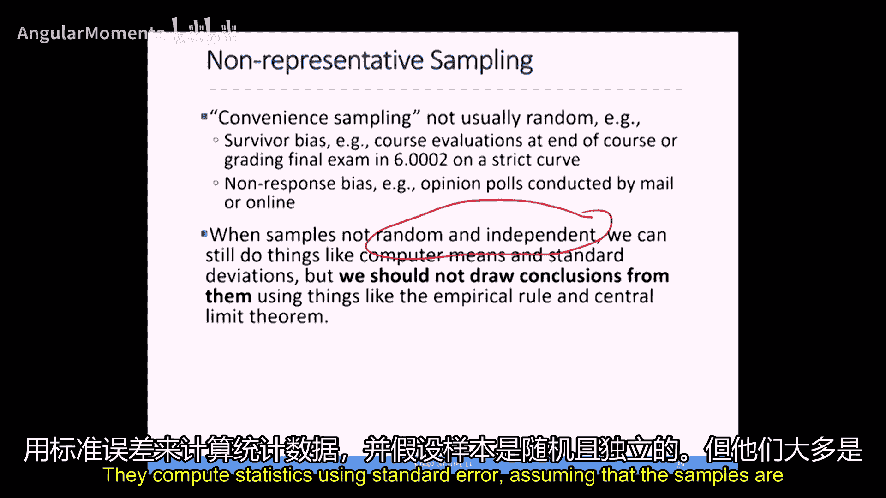

# 【麻省理工】计算思维与数据科学导论-｜-MIT-6.0002-Introduction-to-Computational-Thinking，Fall2016-p14-14.-分类与统计--BV1zNjGzxEvk_p14-

The following content is provided under a C Commons license。

 Your support will help Mi T OpenCourseware continue to offer high quality educational resources for free to make a donation or to view additional materials from hundreds of MiT courses。

 Visit Mit Opencourseseware at O Cw Mt Eduu。

Hello， everybody。Some announcements。呃。The last reading assignment of the semester， at least from us。

Course evaluations are still available。嗯。Through this this Friday， but only till noon， again。

 I urge you all to do it。And then， finally，For the final exam。

 we're going to be giving you some code to study and advance the exam。

And then we will ask questions about that code on the exam itself。

This was described in the announcement for the exam。

 and we will be making this code available later today。

I would suggest that you try and get your heads around it if you're confused。

 That's a good thing to talk about in office hours。To to get some help with it。

 as opposed to waiting till 20 minutes before the exam and realizing you're confused。All right。

 I want to pick up where we left off on Monday。So you may recall that we were comparing。Results。Of K。

 N， N and logistic regression on our Titanic data。And we have this up。啊。Using 1080。

20 splits for K and N equals 3， and logistic regression with P equals 05。And what。I observed。

 is that。Logistic regression happened to perform slightly better。

But certainly nothing that you would choose to write home about。Right， it's。

 it's a little bit better。It isn't to say， well， always be better。 It happens to be here。

But the point I closed with。Is one of the things we care about when we use machine learning。

Is not only our ability to make predictions with the model。

But what can we learn by studying the model itself。Remember。

 the idea is that the model is somehow capturing。The system or the process that generated the data。

 And by studying the model， we can learn something useful。So to do that for logistic regression。

We begin by looking at the weight of the different variables。And we had this up in the last slide。

The model classes are died and survived。For the labels survived。

We said that if you were in a first class cabin。That have a positive impact on your survival。

 A pretty strong， positive impact。You can't interpret these weights in and of themselves。

 If I say it's 1。6， that really doesn't mean anything。

So what you have to look at is the relative weights。Not the absolute weights。

 And we see that it's a pretty strong relative weight。

A second class cabin also has a positive weight。 In this case of 。46。

So it was indicating you better than average chance of surviving。

But much less strong than a first class。 And if you were one of those poor people in a third class cabin。

 well， that had a negative weight on survival。You were less likely to survive。

Age had a very small effect here。Slightly negative。 And what that meant is the older you were。

 the less likely you were to have survived。 But it's a very small， negative value。

AndMa gender had a very large， relatively large negative gender， suggesting that if you were a male。

 you were more likely to die than if you were a female。This might be true in the general population。

 but it was especially true on the Titanic。Finally。

 I warned you that while what I just went through is something you will read in lots of papers that use machine learning。

😊，You will hear in lots of talks。About people have used machine learning。

 But you should be very wary when people speak that way。It's not nonsense， but some cautionary notes。

In particular。There's a big issue because the features are often correlated with one another。

And so you can't interpret the weights one feature at a time。To get a little bit technical。

There are two major。Ways people use logistic regression。They're called L 1 and L 2。We used an L 2。

 and I'll come back to that in a minute， because that's the default。In， in， in Python or P kit。

 you can set that parameter at L 2 and do that to L 1。 if you want。 I experimented with it。

 It didn't change the results that much。But what an L 1 regression is designed to do is to find some weights and drive them to 0。

This is particularly useful when you have a very high dimensional problem。

Relative to the number of examples。And this gets back to that question we've talked about many times of overfitting。

If you've got。1000 variables and 1000 examples。 you're very likely to overfit。L 2。

 L 1 is designed to avoid overfitting by taking many of those thousand variables and just giving them0 weight。

And it does， typically， generalize better。But if you have two variables that are correlated。

L 1 will drive 1 to 0， and it will look like it's unimportant。But， in fact， it might be important。

 It's just correlated with another， which has gotten all the credit。L2， which is what we did。

Does the opposite， It spreads the way across the variables。

So if you have a bunch of correlated variables， it might look like none of them are very important because each of them gets a small amount of the weight。

Again， not so important when you have4 or five variables is what I'm showing you。

 but it matters when you have 100 or 1000 variables。Let's look at an example。So。The cabin classes。

The way we set it up， C 1 plus C 2 plus C 3 whoops is not equal to 0。 What is it equal to。

I'll fix this right now。What should that have said。What's the invariant here。Well， a person。

 it is in exactly one class， right， I guess if you're really rich， maybe you。Rented two cabins。

 one in first and one in second， but probably not。 Or if you did。

 you put your servants in second or third。But。What does this got to add up to， Yeah。

 has to add up to one。Thank you。So it adds up to one。Oh。Got his attention， at least。 All right。

So what this tells us is the values are not independent。Because if C1 is1。

 then C 2 and C 3 must be 0， right。And so now we could go back to the previous slide and ask a question。

 Well， is it that being in first class is protective or is it that being in second or third class is risky。

And there's no simple answer to that。So let's do an experiment。 We have these correlated variables。

Suppose we eliminate C1 altogether。So I did that by changing the ait method。Of class passenger。

Takes the same argument。But。Now look at the code。Because it's a little bit clearer there。

So there was the original one。And I'm gonna。Replace that by this。Comment out。 the original one。

So what you see is。That， instead of having。呃。5 features I now have4。

 I've eliminated the C1 binary feature。And then the code is， is straightforward。

That I've just come through here。And I've just enumerated the possibilities。So。

If you're in first class， then second and third are both 0。Otherwise， one of them is a one。

Some land variant is， is gone now， right。It's not the case that we know that these two things have to add up to one because maybe I'm in the third case。

Okay， let's go run that code。And see what happens。Well， if you remember。

 we see that our accuracy has not really declined much， pretty much the same results we got before。

But our weights are really quite different。Now， suddenly， C 2 and C 3 have large negative weights。

We can look at them， side by side， here。So you see not much difference。 It actually performs maybe。

 well， really no real difference in performance。But you'll notice that the weights are really quite different。

That now。What had been a strong positive weight and relatively weak， negative weights。

Is now replaced by two strong negative weights。And age and gender changed just a little bit。

So the whole point here is we have to be very careful when you have correlated features about over interpreting the weights。

It is generally pretty safe to rely on the sign， whether it's negative or positive。All right。

Changing the topic， but sticking with logistic regression。There is this parameter you may recall P。

 which is the probability。And that was the cutoff。And we set it to 05， saying。

 if it estimates the probability of survival to be。Pot5 or higher than we're going to guess survived。

 predict， survived， otherwise deceased。You can change that。And so I'm going try two extreme values。

Setting Pta 。1 and Pta 。9。Now， what do we think that's likely to change。Remember。

 we looked at a bunch of different attributes。In particular。

 what attributes we think are most likely to change Anyone who has not answered a question。

 want to volunteer。I have nothing against you。 It's just， I'm trying to spread the wealth。

 and I don't want to give you diabetes。all the candy。All right， you get to go again。P。

Sensitivity and specificity， positive predictive value， right。

 because we're shifting and we're saying， well， by changing the probability we're。😊，Inclining。

 we're making a decision that it's more important to not miss survivors。Then it is to。Say， ask。

 gets too high。So let's look at what happens when we run that。I won't run it for you。

 but these are the results we got。So as it happens， 0。9 gave me higher accuracy。

But the key thing is notice the big difference here。So what is that telling me。Well。

 it's telling me that if I predict you're going to survive， you probably did。

But look what it did to the sensitivity。Right， it means that most of the survivors。

 I'm predicting they died。Why is the accuracy still okay？Well， because most people died on the boat。

On this ship， right。So we would have done pretty well。 Youll recall。

 if we just guess died for everybody。So it's important to understand these things。

I once did some work using machine learning for an insurance company whos trying to set rates。

And they， I asked them what they wanted to do。 And they said they wanted it to。

They didn't want to lose money。 They didn't want to ensure people were going to get in accidents。

So I was able to change this。P parameter， so that。It did a great job。

 The problem was they got to write almost no policies。

Because I could pretty much guarantee the people I said wouldn't get an an accident， wouldn't。

But there were a whole bunch of people who didn't who they wouldn't write policies for。

 So they ended up not making any money。 It was a bad decision。All right。So。We can change the cutoff。

That leads to a really important concept。Of something called the receiver operating characteristic。

And it's a funny name having to do with it originally going back to radios radio receivers。

 But we can ignore that。The goal here is to say， suppose I don't want to make a decision。

About where the cutoff is。But I want to look at。In some sense。

 all possible cutoffs and sort of look at the shape of it。

And that's what this code is designed to do。So the way it works。Is I'll take a training set。

And a test set， the usual thing。I'll build one model。

And that's an important thing that there's only one model getting built。And then I'm going to vary P。

And I'm going to call apply model。With the same model and the same test set。But different peas。

And keep track。Of all of those results。I'm then， going to plot。A two dimensional plot。The y axis。

We'll have sensitivity。And the X axis will have one minus specificity。Alright。

 so I am accumulating a bunch of results。And then I'm going to produce this curve calling S K learn dot metrics dot A U。

 C。 That's not the curve。 A U C stands for area。Under the curve。And we'll see why we want to。

Get that area under the curve。Okay。When I run that。It produces this。So here's the curve。

 the blue line。There's some things to note about it。Way down at this end。I can have。0， right。

You know， I can set it so that I don't make any predictions。So I can be and way。

 and this end is interesting。So， with this end is。Saying what。

Remember that my X axis is not specificity， but one minus specificity。Right。

So what we see is this corner。Is highly sensitive and very unspecific。

So I'll get a lot of false positives。This corner。Is very specific。Because one minus specificity is 0。

 and very insensitive。Right。So way down at the bottom， I'm declaring nobody to be positive。

And way up here， everybody。Clearly， I don't want to be at either of these places on the curve， right。

 And typicallyp， I want to be somewhere in the middle。And here。

 maybe we can see there's a nice knee in the curve here。We can choose a place。

What does this green line represent， do you think。The green line。Represents。A random classifier。

I flip a coin， and I just classify something positive or negative， depending on the。Heads or tails。

 in this case， right。So， now。We can look at an interesting region。Which is this region。

The area between the curve and a random classifier。

 And that sort of tells me how much better I am than random。I can look at the whole area。

The area under the curve。And that's。This， the area under the receiver operating curve。

In the best of all worlds。The curve would be shaped like， it would be one， right。

That would be a perfect classifier。And the worst of all worlds， it would be 0。

 but it's never 0 because we don't do worse than 05， right。We hope not to do worse than random。

 If so， we just reverse our predictions。 And then we're。Better than random。

 So random is as bad as you can do， really。And so this is a very important concept。

 And it lets us evaluate how good a classifier is independently of what we choose to be the cutoff。

So that's when you read the literature and people say。

 I had this wonderful method of making predictions， You'll almost always see them cite the A U R。

 O C。😊，All right。Any questions about this， if so， or about machine learning in general， If so。

 this would be a good time to ask them since I'm about to totally change the topic。Yes。他的已经。Right。

 so the question is， at what point does the A U R O C become statistically significant。

And that is essentially， an unanswerable question。啊。Well。Relay it back。

 needed to put more air under the throw。I look like quarterback for the Rams， any rate。

He saw them them play lately。So， if you you。Ask this question about significance。

 It will depend upon a number of things。 So you're always asking， is it significantly better than X。

 right。And so the question is significantly better than random。And you can't just say， for example。

 that 06 is， isn't and 07 is。Because it depends how many points you have。The more points。

 if you have a lot of points， it can be only a tiny bit better than 。

5 and still be statistically significant。It may be。Uninterestingly better。

It may not be significant in the English sense， but you still get statistical significance。

So that's a problem。 And studies have lots of points。 In general， it depends upon the application。

For a lot of applications， you'll see things in the 07s being considered pretty useful。

And the real question is， shouldn't be whether it's significant or whether it's useful。

 Can you make useful decisions based upon it。And the other thing is， typically。

 when you're talking about that， you're selecting some point。

And really talking about a region relative to that point。You know。

 we usually don't really care what it does out here。Because we hardly ever operate out there anyway。

RightWe're usually somewhere in the middle。Good， good question。Yeah。

Why are we doing one minus specificity instead of specificity。Is iss that the question？

And the answer is essentially， so we can do this trick of computing the area。It gives us this nice。

Cve con， that's nice， if you will。 Concave curve， which lets us compute this area under here nicely。

If you were to take specificity and just draw it， it would。 it would look different。It just really。

Obviously， mathematically， they're in some sense， the same， right。If you have1 minus x and X。

 you can get either from the other。So it really just has to do with the way people want to draw this picture。

Pardon。Does it not。Well， you'd have to use a different statistic， right。

 You couldn't cite the A U R O C if you did specificity directly。Right。

 which is why they do  one minus。Right， the goal is you want to have this point at 0 and this  point0。

0 and 11。And playing one minus gives you this trick of anchoring those two points。

 And so then you get a curve connecting them， which you can then easily compare to the random curve。

Right， it it's just one of these little tricks that statisticians like to play to make things easy to visualize and easy to compute。

Statistics about it's not a fundamentally important issue。Anything else？Alright。

 so I told you I was going。Change topics。Finally， got one completed。 And I am。

And this is a topic I approach with some reluctance。So。

You have probably all heard this expression that there are three kinds of lies。Live。Damned lies。

And statistics。We've been talking a lot about statistics。

 And now I want to spend the rest of today's lecture and the start of next of Wednesday's lecture talking about。

How to lie with statistics。So at this point， I usually put on my numbers。 Never lie hat。

But do say that numbers never lie， but liars use numbers。

And I hope none of you will ever go work for a politician and put this knowledge to bad use。

This quote is well known。 It's variously attributed often to Mark Twain， the fellow in the left。

 He claimed not to have invented it， but said it was invented by Benjamin Disraeli。

And I prefer to believe that since it does seem like something a prime minister would invent。So。

 let's think about this。The issue here is the way the human mind works and statistics。Dararyl Huff。

 a well known statistician。Who did write a book called How to Li with Statistics。

Says if you can't prove what you want to prove。Demonstrate something else and pretend they're the same thing。

In the days that follows the collision of statistics with the human mind。

 hardly anyone will notice the difference。And， indeed。Empirically， he seems to be right。

So let's look at some examples。Here's 1 I like。 This is from another famous satistician。

 called Anscom。And he invented this thing called Ansstrom's quartet。 I take my hat off now。

 It's too hot in here。嗯。A bunch of numbers。11 X， Y pairs。

I know you don't want to look at the numbers。 So here are some statistics about them。

Each of those pairs。Has the same mean value。For x， the same mean for y， the same variance for x。

 the same variance for y。And then I went， I fit a linear regression model to it。 And lo and behold。

 I got the same equation for everyone。 Y equals 05 x plus 3。So， that raises the question。

If we go back， is there really much difference between these， these pairs of X and y。

Are they really similar？And the answer is， that's what they look like if you plot them。

So even though statistically， they appear to be kind of the same。They could hardly be more different。

 right？Those are not the same distributions。So there's an important moral here。

Which is that statistics about data is not the same thing as the data itself。And this seems obvious。

 but it's amazing how easy it is to forget it。The number of papers I've read where I see a bunch of statistics about the data。

 but don't see the data is enormous。And it's easy to lose track of the fact that the statistics。

Don't tell the whole story。So the answer is the old Chinese proverb， a picture is worth 100 words。

I urge you， the first thing you should do when you get a data set is plot it。

If it's got too many points to apply all the points。Sub sampleample it and plot a sub sampleample。

Use some visualization tool to look at the data itself。Now， that said， pictures are wonderful。

But you can lie with pictures。 So here's an interesting chart。 These are grades in 6， triple，0。

1 by gender。So the males are blue and the females are pink。 Sorry for being such a traditionalist。

And as you can see， the women did way better than the men。Now， I know for some of you。

 this is confirmation bias。 You say， of course。Others say， impossible。But， in fact。

 if you look carefully， you'll see that's not what this chart says at all。

Because if you look at the axis here。You'll see that actually， there's not much difference。

Here's what I get if I plot it from 0 to 5。Yeah， the women did a little bit better。

That's not a statistically significant difference。And by the way。

 when I plotted last year for 6 triple02， I the blue was about that much higher than the pink。

Don't read much into either of them。But the trick was here。I took the Y axis and ran it from 3。

9 to 4。05。I cleverly chose my baseline in such a way to make the difference look really big。

 much bigger than it is。Here I did the honest thing。Of put the baseline at 0 and run it to 5。

Because that's the range of grades at Mit。And so when you look at a chart。

It's important to keep in mind that you need to look at the axis labels。And the scales。

Look at another chart。 just in case you think I'm the only one who likes to。Play with graphics。

This is a chart from Fox News。And they are arguing here。

There's this shocking statistics that there are 108。6 million people on welfare and 101。7。

With a full time job。And you can imagine the rhetoric that accompanies this chart。嗯。

This is actually correct。It is from， It is true from the Census Bureau data， sort of。But notice that。

I'd said you should read the labels on the axes。There is no label here。So。But you can bet。

The the Y intercept is not 0。On this， right， because you can see how small 101。7 looks like。

So it makes the difference look bigger than it is。Now， that's not the only funny thing about it。

I said you should look at the labels on the X axis。Well， they've labeled them。

 But what do these things mean。Well， I looked it up and I'll tell you what they actually mean。

People on welfare。Counts the number of people in a household in which at least one person is on welfare。

So， if there is a。2 parents， one is working， and one is collecting welfare。

 And there are four kids That counts as six people on welfare。People with a full time job。

 is actually， does not count households。So in the same family。

You would have 6 on the bar on the left and one on the bar in the right。Clearly。

 giving a very different impression， right。And so， again。Pictures can be good， but if you don't。

Dive deep into them。 They really can fool you。Now， before I should leave this slide。

 I should say that it's not the case that you can't believe anything you read on Fox News。

Because in fact， the Red Sox did beat the St。 Louis Cardinals four to two that day。

So the moral here is to ask whether the things being compared are actually comparable。

Orre you really comparing apples and oranges， as they say。Okay。

This is probably the most common statistical sin。 It's called Geiggo。

 And perhaps this picture can tell you， make you guess what the G stand for。Gaigo is garbage in。

 garbage out。So here's a great， again， quote about it。 So Charles Babbage。Yeah。

Design the first digital computer。The first actual computation engine， he was unable to build it。

But hundreds of years after he died， one was built according to his design。 and it actually worked。

No electronics， really。So he was a famous person， and he was asked by Parliament。About his machine。

 which he was asking them to fund。 Well， if you put wrong numbers into the machine。

Will the machine have right numbers come out the other end。And， of course， he was a very smart guy。

 and he was totally baffled。 This question seemed so stupid。

 he couldn't believe it would anyone even ask it。That it was just computation。

And the answers you get are based on the data you put in。You put in garbage， you get out garbage。

So here is an example from the 1840s。They did a census in the 1840s。 And for those of you who were。

Not familiar with American。 And history， it was a very contentious time in the US。

The country was divided between states that had slavery in states that didn't。And。

That was the dominant political issue of the day。John Calhoun。

 who was secretary of state and a leader in the Senate， was from South Carolina and a strong。

 probably the strongest proponent of slavery。And he used the sentence。

 the census data to say that slavery was actually good for the slaves。Kind of an amazing thought。

 basically saying that。This data claimed that。Freed slaves were more likely to be insane than enslaved slaves。

嗯。He was rebutted in the sentence， Senate or in the House by John Quincy Adams。

Who had formerly been president of the United States after he stopped being president。

 He ran for Congress。From Braintree， Massachusetts。Actually， now called Quincy。

 the part he's from after his family。And he claimed that atrocious misrepresentations have been made on a subject of deep importance。

 He was an abolitionist。So you don't even have to look at statistics， Know who to believe。

 Just look at these pictures， right。You going believe this nice gentleman from Braintree or this scary guy from South Carolina。

But setting that looks aside， Calhoun eventually admitted that this。

 the census was indeed full of errors。But he said that was fine because there were so many of them。

That they would balance each other out and lead to the same conclusion as if they were all correct。

So he didn't believe in garbage in garbage out。 He said， yeah， it is garbage。

 but it'll all come out in， in the end， O。Well。Now， we know enough to ask the question。This isn't。

Totally brain dead。 in that we've already looked at experiments and said， we get experimental error。

 And under some circumstances， you can manage the error。Right， the data isn't garbage just as errors。

 but it's true if the measurement errors are unbiased。And independent of each other。And。

Almost identically distributed on either side of the mean， right。

 That's why we spend so much time looking at the normal distribution。And why it's called Gaussian。

Because Gaus said， yes， I know I have errors in my astronomical measurements。

 but I believe my errors are distributed in what we now call a Gaussian curve。 And therefore。

 I can still work with them and get an accurate estimate of the values。Now， of course。

That wasn't true here。 The the errors were not random。 They were， in fact， quite systematic。

Designed to produce a certain thing。And the last word was from another。

Abolitionist who claimed it was the incentiveus that was insane。All right， That's garbage in。

 garbage out。The moral here is that analysis of bad data is worse than no analysis at all， really。

 right。Time and again， we see people doing actually often correct statistical analysis of incorrect data。

And reaching conclusions。Right， and that's really risky。

 So before one goes off and starts using statistical techniques of the sort we've been discussing。

 the first question you have to ask is， is the data itself worth analyzing。And it often isn't。Now。

 you could argue that this is a thing of the past and no modern politician would make these kinds of mistakes。

 I'm not going to insert a photo here， but I leave it to you to think which politicians's photo you might paste in this frame。

All right， on to another statistical thing。This is the picture of a World War I fighter plane。

I don't know enough about planes to know what kind of plane it is。

 Anyone here must be anarrow student who will be able to tell me what plane this is。

Don't they teach you guys anything in error these days。Shame on them。 All right。 anyway。

 it's a plane that much I know。 And it has a propeller。

 And that's all I can tell you about the airplane。So this was a photo taken at an airfield in Britain。

And the allies would send。Planes over Germany for bombing runs and fighters to protect the bombers。

And when they came back， the planes were often damaged。And they would inspect the damage and say， oh。

 look， there's a lot of flack there。 The Germans shot flack at the planes。

And that would be a part of the plane that maybe we should reinforce in the future。

 So when it gets hit by flak。It survives it。 does less damage。

 So you'd analyze where the Germans were hitting the planes， and you would add a little。

Extra armor to that part of the plane。What's the flaw in that？Yeah。Yeah。

 this is what's called in the jargon Sur bias。SUR， V V O R。

The planes they really should have been analyzing were the ones that got shot down。

But those were hard to analyze。So they analyzed the ones they had。And。

Drew conclusions and perhaps totally the wrong conclusion。

 Maybe the conclusion they should have drawn as well， it's Ok。 if you get hit here。

 let's reinforce the other places。I don't know enough to know what the right answer was。

 I do know that this was。Statistically， the wrong thing to be thinking about doing。

And this is an issue we have whenever we do sampling。

All statistical techniques are based upon the assumption。That by sampling a subset of the population。

We can infer things about the population as a whole， right。

 Everything we've done this term has been based on that。When we were。Fitting curves。

 we were doing that when we were talking about the empirical rule and Monte Carllos simulation。

 we were doing that。 We were building models with machine learning。 we were doing that。

And if random sampling is used。You can make meaningful mathematical statements about the relation of the sample to the entire population。

And that's why so many of what we did work。And when we're doing simulations， that's really easy。

Right， when we were choosing random values of the needles for for trying to find pie or random values of the roulette wheel spins。

We could be pretty sure our samples were indeed random。In the field。It's not so easy。Right。

 because some samples are much more convenient to acquire than others。It's much more。

 It's much easier to acquire a plane on the field in Britain than a plane on the ground in France。

Convenient sampling， as it's often called， is not usually random。So you have survivor or bias。

So I I asked you to do course evaluations。 Well， there's survivor bias there。

The people who really hated this course have already dropped it。And so we won't sample them。

 And that's good for me， at least。But。We see that。 We see that with grades。

The people who are really struggling who were most likely to fail have probably dropped the course。

 too。That's one of the reasons I don't think it's fair to say we're gonna have a curve。

 and we're gonna always。Fail this fraction and give an A to this fraction。

 because by the end of the term， we have a lot of survivor bias。

The students who are left are on average， better than the students who started the semester。

So you need to take that into the account。Another kind of。

Non representative sampling or convenient sampling is opinion polls。

In that you have something there called nonre bias。So I don't know about you。

 but I get phone calls asking my opinion about things。Surveys about products。

 whatever I never answer。 I just hang up the phone。

 I get a zillion emails every time I stay in a hotel， I get an email asking me to rate the hotel。

When I fly， I get emails from the the airline。 I don't answer any of those surveys。

But some people do， or presumably or they wouldn't send them out。

 But why should they think that the people who answer the survey are representative of all the people who stay in the hotel or all the people who fly on the plane。

 They're not。 They're the kind of people who maybe have time to answer surveys。

And so you get a non nonre bias， And that tends to distort your results。

When samples are not random and independent。We can still run statistics on them。

 We can compute means and standard deviations。 And that's fine。

But we can't draw conclusions using things like the empirical rule。Or the central limit theorem。

 standard error。Because the basic assumption underlying all of that。

Is that the samples are random and independent。This is one of the reasons why political polls are so unreliable。

They compute statistics using standard error， assuming that the samples are random and independent。

But they， for example， get them mostly by calling landlines。

And so they get a bias towards people who actually answer the phone on a landline。 As opposed。

 how many of you have a landline where you live。Not many， right， Most you rely on your cell phones。

Right， and so any survey that。Depends on landlines is going to leave a lot of the population out。

Theyll get a lot of people of。Of my vintage， not of your vintage。And that gets you in trouble。

So the moral here。Is。Always understand how the data was collected。

What the assumptions in the analysis were。And whether they're satisfied。If these things are not true。

 you need to be very wary of the results。Alright， I think I'll stop here。

We'll finish up our panoply of statistical sins on Wednesday in the first half。

 then we'll do a course wrap up。 Then I'll wish you all Godspeed in a good final。😊，See you Wednesday。

