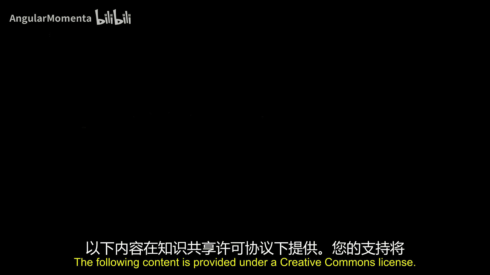
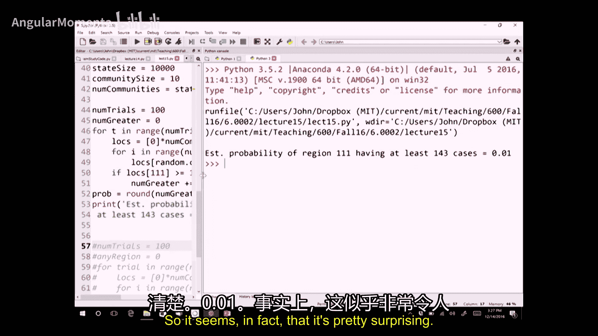
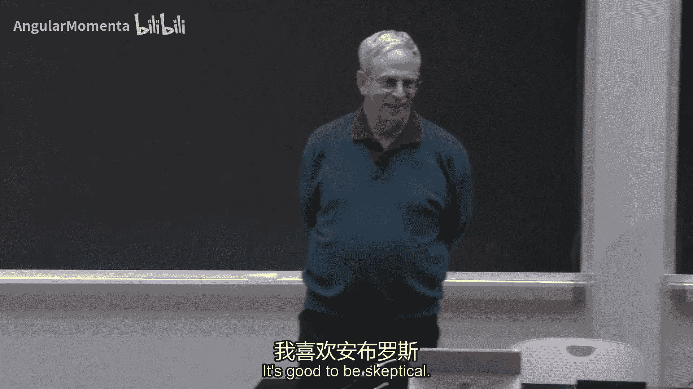
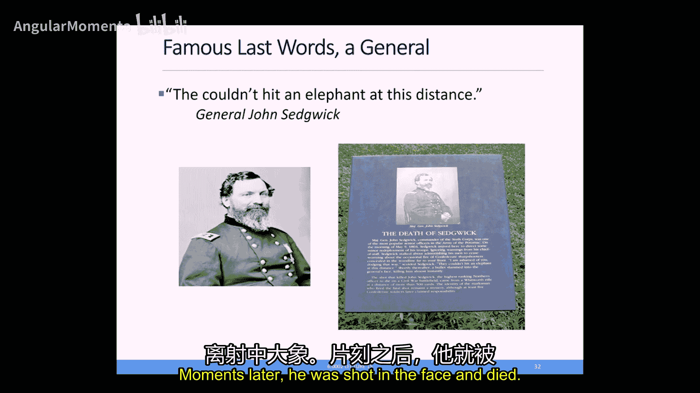
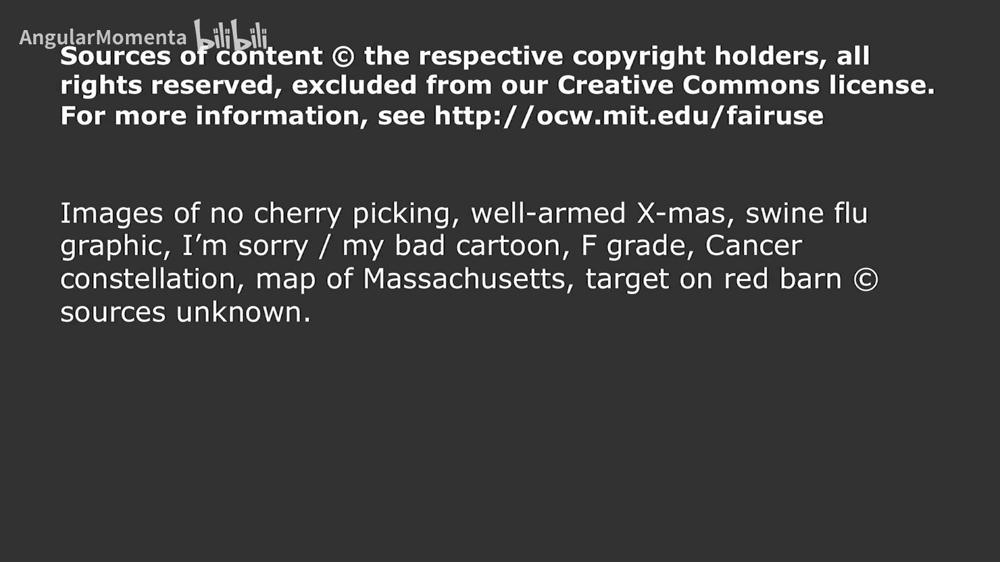

# 【麻省理工】计算思维与数据科学导论-｜-MIT-6.0002-Introduction-to-Computational-Thinking，Fall2016-p15-15.-统计学总结--BV1zNjGzxEvk_p15-

The following content is provided under a C Commons license。

 Your support will help Mi T OpenCourseware continue to offer high quality educational resources for free to make a donation or to view additional materials from hundreds of MiT courses。

 Visit Mit Opencourseseware at O Cw Mt Eduu。Hello， everybody。

Well， here we are at the last lecture。 We're going finish talking about statistical sins and then do a little bit of a wrap up。

All right。Let's look at a hot topic， of global fiction。Or global warming， fact or fiction。You've。

Thenhan a problem set related to temperatures in the US。

 Here is a plot generally accepted of the change in temperatures。On the planet between 1880 and 2014。

Now， if we look at this plot， we could see this commits one of the statistical sins I complained about on Monday。

That look， we're starting the Y axis way down here at55。And you remember。

 I told you to be aware of charts for the Y axis doesn't start at 0。

So maybe the people who are trying to claim about global warming are just deceiving us with this trick of。

The axis。 So here's what happens if you put it at 0。And as you can see or barely see。

 this axis runs from zero up to 110 as the average temperature。And as you can see quite clearly。

 it's hardly changed at all。So。What's the deal here？Well， which is a more accurate presentation。

Of the facts， which conveys the accurate impression。 Let's look at another example。

 maybe a little less controversial than climate change。Fever and flu。

 It's generally accepted that when you get the flu， you might run a fever。

So here is someone who had the flu。 and this is plotting their fever from the beginning。To its peak。

And it does appear if we were to fit a curve to this， we would look。Pretty much like that。

On the other hand， if we assume that somebody's temperature could range between 0 and 200。

We can see that in fact， your temperature doesn't move at all when you get the flu。

So the moral is pretty clear， I think。Even though on Monday。

 I talked about being suspicious when people start the Y axis。Too far from zero。It。

 you should trunccate it to eliminate totally preposterous values。Right。

 no living person has a temperature of 0 degrees Fahrenheit。So。Again。

Don't trunccate it just to make something look like it isn't， but don't expand it to deceive either。

Allright， let's return to global warming。This is a chart that was actually shown on the floor of the US Senate。

By a。A senator from Texas， who I shall not name。And obviously， the argument here was that， well。

 sure， global warming bounces up and down。But if we go back。嗯。We can see here the date is 19。

Can we see it， I can see it。Maybe 1986， I think。You can see that the argument here is， in fact。

If you fit a trend line to this， as he's done， it hasn't changed at all。

And so even though we've had a lot of carbon emissions during this period。

 maybe global warming is not actually happening。This is in contradiction to the trend I showed before。

Well， what's going on here？This is a very common way that people。Use statistics poorly。

They confuse fluctuations with trends。What we see in any theories of data， time series， other series。

 you always have fluctuations。嗯。And that's not to be confused with the trend。And in particular。

 what you need to think about when you're looking at a phenomenon。

Is choose an interval consistent with the thing that's being considered。

So we believe that climate change is something that happens over very long periods of time。

And it's a little bit silly to look at it on a short period of time。

Some of you may remember two years ago， we had a very cold winter here。

And there were people who were saying， well， that shows we don't have global warming。Well。

 you can't really conclude anything about climate change， looking at a year。

Or probably not even looking at 10 years or 20 years。 It's a very slow phenomenon。On the other hand。

 if you're looking at the change in somebody's heart rate， seeing if they have a heart condition。

 you probably don't want to look at it over a 10 year period。

So you have to decide what you're doing and find an interval that lets you look at the trends rather than the fluctuations。

Anyway rate， maybe even if we're having global warming， at least the Arctic ice isn't melting。

Though apparently， I read in the paper this morning， they found a huge crack in it。嗯。

So this was reported in the financial post on。April 15，2013。You can read it yourself。But the basic。

Import of it is they took the period from April 14，19。89 to April 15，2013。啊。And said， look。

It's not changing。In fact， the amount of Arctic ice is， is， is unchanged。Well， what's the financial。

 not the financial， What's the statistical sin。Being committed here。If we look at this data。This is。

This is an anomaly chart。 I think you saw one of these in one of the problem sets where you fix something at 0。

 and then you show fluctuations relative to that。So here it's the Arctic ice relative to a point。And。

What we see here is that if you go and choose the right date。Say。This one。In 1989。

And you come over here and you choose the right date in 2013。嗯。Say， this one。

You can then draw a line and say， oh， look， it hasn't changed。This is something people frequently do。

Is they find， They take a whole set of data。And they find two points that are consistent with something they believe。

And they draw a line between those two points， fit a curve to those two points and draw some conclusion。

This is what we call cherry picking。I guess from the notion that when you go to pick cherries。

 you only want to pick the ripe ones， leave the others to ripen for a bit on the tree。嗯。

It's really bad。And it's something that unfortunately， a scientific literature is replete with。

Where people look at a lot of data and they pick the points that match。What they want to prove。

And so as you can see， while the trend is quite clear。

 you could prove almost anything you wanted by selecting。Two points， very carefully。You know。

I could also show that it's crashing much faster than people think it is。By picking these two points。

YouIf I wanted to argue that it's catastrophic， I'd pick those two points and say， look at that it's。

Disappearing at an incredible rate。So you can lie in either direction with this data。By careful。

 cherry picking。All right。As a service to you， I know the holidays are coming。

 and many of you have not bought presents for your parents。 So here's a modest gift suggestion。That。

 you know， the family that shoots together something or other。 Well， alright， so we can ask。

 is this a good gift。Well， probably we can look at this statistic。 It's not dangerous。 at least。

 We see that 99。8% of the firearms in the US will not be used to commit a violent crime。

So guns apparently are not actually dangerous， or at least not in the hands of criminals。Well。

 let's look at this。How many privately owned firearms are there in the US。

 And anyone want to guess who hasn't looked ahead。Yeah。400 million。

340 million people and 400 million guns is the guess， more than one per person。

You certainly are the right order of magnitude。 I think it's about 300 million。

 but it's hard to count them。 Maybe this doesn't count water pistols。

So if you assume there were 300 million firearms。And。

2% of them are used to commit a violent crime in every year。Here。

 we see that how many crimes is that。600000。So， in fact。Yeah。

It's not necessarily very meaningful to say that most of them are not used to commit a crime。Well。

Let's look at another place where we look at a statistic。

Probably most of you don't even remember the scary swine flu epidemic。U。This was a big headline。

And people got so scared of the swine flu。 They were doing things like closing schools。😰。

To try and limit the spread of the flu。New York Citys closed some schools because of it， for example。

So is this a scary statistic。Well， maybe。But here's an interesting statistic。

 How many deaths per year from the seasonal flu in the US。

The ones we try and prevent with our flu shot。36000。So what we see is that。

Doesn't make a lot of sense to panic over 159。In the light of this number。

So the point here for both this and the issue about the firearms。Is that context matters。Yeah。

 I love this cartoon。A number without context， is just a number。And numbers by themselves。

 don't mean anything。So to say that there were 159 deaths from the swine flu is not very meaningful without some context。

To say that。Only 00。2% of firearms are used to commit a violent crime is not very meaningful without context。

Whenever you're prevent presenting a statistic， reading about a statistic。

 and you just see a number that seems comforting or terrifying。Try and put some context around it。

So a related thing is relative to what。Suppose I told you that skipping lectures increases your probability of failing this course by 50%。

Well， you would all feel great because you're here。

And you would be laughing at your friends who are not here because figuring that will leave much better grades for you。

 What does this mean， though。Well。If I told you that。

It changed the probability of failing from a half to 075。

You would be very tempted to come to lectures。On the other hand， if I told you。

That it changed the probability from 0005 to 。0075。You might say a heck with it。

 I'd rather go to the gym。Right。Again， this is an issue。

 and this is something that we see all the time when people talk about percentage change。

This is particularly prominent in。The pharmaceutical field。Right。

 you will read a headline saying that。Drug X for arthritis increases the probability of a heart attack。

By。1% or 5%。Well， what does that mean if the probability was already very low， increasing it by 5%。

 it's still very low。And maybe it's worth it not to be in pain from arthritis。So， you。

Talking in percentages is， again， one of these issues of。

It doesn't make sense without the context in order to know what this means。

I need to know what regime I'm in here。In order to make a intelligent decision about whether to attend lecture or not。

It goes without saying you have all made the right decision。

So beware of percentage change when you don't know the denominator， right。

You get a percentage by dividing by something。 And if you don't know what you're dividing by。

Then the percentage is itself， a meaningless number。All right。

While we're sort of talking about medical things。 and let's look at cancer clusters。

To illustrate another。Statistical。Question。So this is a definition of a cancer cluster by the CDC。

 a greater than expected number of cancer cases。That occurs within a group of people in a geographic area over a period of time。

And the key part of this definition is。Greater than expected。About 1000 cancer cases。

 cancer clusters per year。A reported in the US， mostly to the Centers for Disease Control。

 But in general to other。Health agencies。Upon analysis， almost none of them。Past this test。So。

 the vast majority。Some years， all of them。Are deemed actually not to be cancer clusters。嗯。

So I don't know。 have anyone here seen the movie， Aaron Broovich。

Subsequent analysis showed that was actually not a cancer cluster。You know， so。

It may it was a good movie， but turns out。Statistically wrong。Alright， this， by the way。

 is not a cancer cluster。 This is a constellation， All right。So let's look at a hypothetical example。

By the way， the， the other movie about cancer clusters was the one set in Massachusetts。

What was a civil action。 Anyone see that。No， that was a cancer cluster。All right。

Massachusetts is about 10000 square miles。And there are about 36000 cancer cases per year。

 reported in Massachusetts。Those two numbers are accurate， and the rest of this is pure fiction。So。

Let's assume that we had some ambitious attorney。Who partition the state into 1000 regions of 10 square miles each。

And looked at the distribution of cancer cases in these regions。

Trying to find cancer clusters that he or she could file a lawsuit about。Well。

 you can do some arithmetic。 And if there are 36000 new cancer cases a year。

 and we have 1000 regions。That should say that we should get。

About 36 clusters per year or cancer cases per year per region。Well。

 when the attorney looked at the data， this mythical attorney。He discovered that region， number 1，11。

Had 143 new cancer cases over a three year period。He compared that to three times 36 and said， wow。

 that's 32% more than expected。I've got a lawsuit。 So he went to tell all these people they lived in a cancer cluster。

 The question is， should they be worried。嗯。Well， another way to look at the question is。

 how likely is it。That it was just bad luck。Right， that's the question we've always asked when we do statistical analysis。

 Is this result meaningful or is it just random variation that you would expect to see。So。

I wrote some code， to do， to simulate it， to see what happens。So number of cases， 36，000。

 number of years three。So all of this is just the numbers I had on the slide。Well do a ci。

A simulation rule。Take 100 trials。嗯。And then what I'm going to do is for T in the range number of trials。

The locations， the regions， if you will， I'll initialize each to 0，1000 of them， in this case。

And then for I in the range， number of years times number of cases per year。

So this will be  three times 36000。At random， I will assign the case to one of these regions。Okay。

 this is the random。Nothing to do with cancer clusters just at random。

 This case gets assigned to one of the thousand regions。And then I'm going to check。

If region number 111。Had greater than 1040， greater than or equal to 143。

 A number of cases we assumed it had。If so。Willll increment the variable nu greater by one， saying。

 all right。 in this trial of the hundred， indeed， it had that many。

And then we'll see how often that happens。That will tell us how improbable it is。That region 1。

11 actually had that many cases。And then， we'll print it。

Does that makes sense to everyone that here I am doing my simulation。

To see whether or not is how probable is it？That1，11 would have had this many cases。Any questions。

Allright， let's run it。So here's the code we just looked at。Oh。Take just a second。

 That's why I did only 100 trials， instead of 1000。I know the suspense is killing you。

It's killing me。 I don't know why it's taking so long。Alright， we'll finish。

I wish I had the jeopardy music or something to play while we waited for this。Anna。

 can you hum some music or something to keep people amused？She，She will not。Wow。Allright。

 so here it is。 The estimated probability of region 1，11， having at least one case。At least one。

At least 143 cases。Easier to readify。Spread this out。01。So it seems， in fact。

 that it's pretty surprising。

Unlikelikely to have happened at random。Do you buy it or is there a flaw here。

Getting back to this whole question。Yes。😊，该怎 look at what。All right， let's assume that in fact。

 instead of by square miles， I let's assume the populations were balanced。Exactly right。

Exactly right。

I'm sorry。 I forgot my candy bag today。Just means there'll be more candy for the final。

What we have here。Is。A variant of cherry picking。What I have done in this simulation。😡。

Is I've looked at 1000 different regions。Right， what I。

 what the attorney did is not in the simulation， is he looked at 1000 different regions。

Found the one with the most cancer cases and said， aha， there are too many here。Right。

And that's not what I did in my simulation。What my simulation didn't ask the question。

 How likely is it that there is at least one region with that many cases。But it asks the question。

 how likely is it that this specific region has that many cases。Now。

 if the attorney had had reason in advance to be suspicious of Region 111。

Then maybe it would have been O to just go check that。

 But having looked at 1000 and then Cheerry picked the best is not right。So。

This is a simulation that does the right thing。I've left out the initialization。But what you can see。

 I'm doing here。Is I'm looking at the probability of there being any region。

That has at least 143 cases。What this is called in the technical literature， what。

The attorney did his multiple hypothesis checking。So rather than having a single hypothesis that region 1。

11 is bad。He checked 1000 different hypotheses and then chose the one that met what he wanted。Now。

 there are good statistical techniques that exist for dealing with multiple hypotheses。

 things like the Bonferroni correction。 I love to say that name。But。You have to worry about it。And。

 in fact。If we go back to the code。And comment out this one。And run this one。

We'll see we get a very different answer。Yeah。Alright， the answer we get。Is， let's see。Oh。

 I see all right。Comment this out。Yeah， this should work， right？Well。

 maybe we don't want to wait for it。 But the answer you'll get is that it's actually very probable。

 My recollection is， it's a 。6 probability。That at least one region has that many cases。

And that's really what's going on with this whole business of people reporting cancer clusters。

 right， It's just by accident。By pure randomness， some region has more than its share。

This particular。Form of cherry picking is also goes by the name of the Texas Shapshooter Fallacy。啊。

I don't know why people pick on Texas for this， but they seem to。

 But the notion is you're driving down a road in Texas and you see a barn with a bunch of bullet holes in the wall right in the middle of a target。

But what actually happened。Was you had a barn。The farmer just shot some things at random at the barn。

 then got out his paintbrush and painted a target right around where they happened to land。

And that's what happens when you cherry pick hypotheses。All right。

What's the bottom line of all these statistical fallacies。When drawing inferences from data。

 skepticism is merited。There are unfortunately more ways to go wrong than to go right。

And you'll read the literature that tells you that in the scientific literature。

 more than half of the papers are later shown to be wrong。

You do need to remember that skepticism and denial are different。 It's good to be skeptical。

 And I love Amberrov Bece's description of the difference here。😊。

If you had never read Ambros Beerce， he's well worth reading。

 He wrote something called the Devil's Dictionary， among other things。

Which in which he has his own definition of a lot of words and。He went by the nickname Bider Beerce。

 And if you read the devil's dictionary， you'll see why。 But this， I think。

 has a lot of wisdom in it。All right。Let's in the remaining few minutes， wrap up the course。

So what did we cover in 6 triple 0，2。A lot of things。If you look at the technical things。

 there were three major units optimization problems。

Sttochastic thinking and modeling aspects of the world。But there was a big subtext amongst all of it。

 which was this。There was a reason our problem sets were not pencil and paper probability problems。

 but all coding。And that's because。We really want as an important part of the course is to make you a better programmer。

We introduced a few extra features of Python。But， more importantly。We emphasize the use of libraries。

Because in the real world， when you're trying to build things， you rarely start from scratch。

And if you do start from scratch， you're probably making a mistake。

And so we wanted to get you used to the idea of finding and using libraries。

So we looked at plotting libraries and machine learning libraries and numeric libraries。

And hopefully， you got a lot of practice and that you're a way better programmer than you were six weeks ago。

A little more detail。The optimization problem。Probably most important takeaway is that many important problems can be formulated in terms of an objective function that you either maximize or minimize in some set of constraints。

Once you've done that。There are lots of toolbox， lots of libraries that you can use to solve the problem。

You wrote some optimization code yourself。 But most of the time we don't solve them ourselves。

 We just call an built in function that does it。So the hard part is not writing the code。

 but doing the formulation。We talked about different algorithms。Greedy algorithms， very often useful。

But often don't find the optimal solution。So， for example， we looked at K means clustering。

It was a very efficient way to find clusters， but it did not necessarily find the optimal set of clusters。

We then observe that many optimization problems are inherently exponential。But even so。

 dynamic programming often works。And gives us an really fast solution。

And the notion here is this is not an approximate solution。 It's not like using a greedy algorithm。

It gives you an exact solution。And in many circumstances， it gives it to you quickly。

And the other thing I want you to take away is outside the context of dynamic programming。

Memmoization is a generally useful technique。What we've done there is we've traded time for space。

We compute something。 We save it。 And when we need it， we look it up。

And that's a very common programming technique。And we looked at a lot of different examples of optimization。

napsack problems， several graph problems， curve fitting， clustering， logistic regression。

Those are all optimization problems。Can all be formulated as optimization problems。So it's。

 it's very powerful， and。Fits lots of needs。The next unit， and， of course。

 I'm speaking as if these things were discrete in time， but they're not， right。

 We talked about optimization at beginning， and I talked about optimization last week。

So these things were sort of spread out over the term。We talked about stochastic thinking。

And the basic notion here is， the world is。Non deterterministic。

 or at least predictably non deterterministic。And therefore。

 we need to think about things in terms of probabilities most of the time or frequently。

And randomness is a powerful tool for their building computations that model the world。

If you think the world is stochastic， then you need to have ways to write programs that are stotchastic if you're trying to model the world itself。

The other point we made is that random computations， randomness is a computational technique。

It's useful。 even for problems， don't appear to involve any randomness。

So we used it to find the value of pi。 We showed that you can use it to do integration。

There's nothing random about the value of the integral of a function。

Yet the easiest way to solve it in a program is to use randomness。

So randomness is a very powerful tool。 And there's this whole area of random algorithms。

 research area and practical area that's used to solve non probabilistic problems。Alright。

 modeling the world。 we just talked about part of it。modelsels are always inaccurate。

 They're providing some abstraction of reality。We looked at deterministic models。

The graph theory models， who was nothing non deterterministic about the graphs we looked at。

And then we spent more time on statistical models。We look at simulation models， in particular。

 Sp quite a bit of time in Monte Carlo simulation。We looked at models， based on sampling。嗯。And there。

 and also， when we talk about simulation， I really hope I emphasized enough the notion。

That we need to be able to characterize how believable the results are。

It's not good enough to just run a program and say， oh， it has an answer。

You need to know whether to believe the answer。And the point we made is it's not a binary question。

 It's not， yes， it's right。 No， it's wrong。Typically， what we do is we have some。Statement about。

Confidence intervals。And confidence levels， right， We use two variables to describe how believable the answer is。

嗯。And that's an important thing。 And then we looked at tools we use for doing that。

 We looked at the central limit theorem， We looked at the empirical rule。

 We talked about different distributions。And especially。

 we spent a fair amount of time on the normal or Gaussian distribution。And then finally。

 we looked at statistical models based upon machine learning。We looked at unsupervised learning。

 basically just clustering， looked at two algorithms， hierarchical and K means。

 And we looked at supervised learning。And there， we've essentially focused。Mostly on classification。

And we looked at two ways of doing that。 Ca nearest neighbors and logistic regression。Finally。

 we talked about presentation of data。啊。How to build plots， U utility of plots。And recently。

 in the last two lectures， good and bad practices in presenting results about data。All right。

So my summary is， I hope that you think you've come a long way。

 particularly those of how many of you were here in September when we started 6， triple 0，1。Allright。

 most of you。Yeah， this， by the way， was a very popular ad for a long time saying that finally。

 women are allowed to smoke。 Isn't this great。And Virginia Slims sponsored tennis。

 the women's tennis tour。And to， to show how good it was that women were now able to smoke。But。

 anyway。I know not everyone in this class is a woman。 So just for the men in the room。

You too could have come a long way。嗯。You know， I hope you think that if you look back at how you struggle in those early problem sets。

 I hope you really feel that you've learned a lot about how to build programs。

And if you spend enough time in front of a terminal， this is what you get to look like。Alright。

 what might be next， I should start by saying， this is a hard course。

 We know that many of you have worked hard and the staff and I really do appreciate it。You know。

 your return on investment。I'd like you to remember。

That you can now write programs to do useful things。So， you know， if you're doing a Europe。

 you're sitting in a lab and you get a bunch of data from some experiments。Don't just stare at it。

 Sit down and write some code to plot it， to do something useful with it。Don't be afraid。

To write programs to help you out。There are some courses that I think you're now well prepared to take。

I've listed the ones I know best。 the courses in Co 6。

 6 triple09 is a sort of introduction to computer science。

 I think many of you will find that too easy after taking this course。

 but maybe that's not a downside。6 double0，5 is a software engineering course。

We all switch programming languages on you。You get to program in Java 6。

 double06 is an algorithms course in in Python。 And I think actually quite interesting。

 And students seem to like it a lot and， and learn about algorithms and implementing them。And 60，3。

4 is an introduction to artificial intelligence。Also in Python。 And I should have listed 6，0，3，6。

Another introduction to machine learning in， in Python。嗯。

You should go look for an interesting Europe。A lot of students come out of this course and go do euros where they use what they've learned in this course。

 And many of them really have a very positive experience。

 So if you were worried that you're not ready for a euroop。

 you probably are to a U using what's been done here。You can minor in computer science。

 This is now available for the first time this year。But really， if you have time。

 you should major in computer science。 that is really the best major on campus。Not even close。

 as somebody I know would say。All right。Finally， sometimes people ask me where I think computing is headed。

 And I'll quote one of my favorite baseball players。 It's tough to make predictions。

 especially about the future。And instead of my predictions。

 I'm going to show you the predictions of some famous people。So。Thomas Watson。

 who is the chairman of IBM company you've probably heard of。And he said。

 I think theres a world market for maybe five computers。

This was in response to should they become a computer company， which they were not at the time。

He was off by a little bit。Some few years later， there was an article in Pular mechanicchans。

Which was saying computers are amazing。 They're going to change enormously。 Someday。

 they may be no more than one and a half tons。😊，You might get a computer that's no more than 3000。

 someday。So we're still waiting for that， I guess。I like this one。

 This is having written a book recently， the editor in charge of Book for Preice Hall。

 I have traveled the length and breadth of this country and talked with the best people。

 And I can assure you that data processing is a fad that won't last out the year。

M I T had that attitude for a while。 For about 35 years。

 Comp science was in a building off campus because they weren't sure we were here to stay。

Maybe that's not why， but that's why I interpret it。Kenen Olson， an M T graduate， I should say。

 a course，6 graduate。Was the founder and president and chair of Digital Equipment Corporation。

 which in 1977 was the second largest computer manufacturer in the world。Based in Maynard。

 Massachusetts。None of you have ever heard of it。 They disappeared。 And this is， in part why。

 because Ken said there's no reason anyone would want a computer in their home。And。Totally missed。

That part of computation。Alright， finally， since this is the end of some famous last words。呃。

Douglas Fairbank， senior， a famous actor。 this is true。

 The last thing he said before he died was never felt better。嗯。Amazing。this is from the movie。

 the Marco Zorro。Scientists are better。 Luther Burbank says his last words where I don't feel so good。

And yeah。Well， I guess not。嗯。And this is the last one。

John Fedwick was a union general in the Civil War。This is a true story。

 He was riding behind the lines。And trying to rally his men to， to， to。

Not behind behind the stone walls， but to stand up and shoot at the enemy。

And he said they couldn't hit an elephant at this distance。Moments later。

 he was shot in the face and died。

And I thought this was an apocryphal story。 But， in fact。

 there's a plaque at the battlefield where this happened documenting the story。

 And apparently it's quite true。嗯。So with that， I'll say my last words for the chorus， which is。

 I appreciate all your coming and。😊，I guess you were the survivors， so thank you for being here。

