# 【麻省理工】认知机器人学-｜-MIT-16.412J-Cognitive-Robotics,-Spring-2016-p01-进阶1.-增量式路径规划--BV1eEtTzhExj_p1-

The following content is provided under a Creative Commons license。

 Your support will help Mi T OpenCourseware continue to offer high quality educational resources for free to make a donation or to view additional materials from hundreds of MiT courses。

 Visit Mitopcourseseware at Ocw。 Mt。 Eduu。

Good afternoon， my name is Joe Levitt my group members are Van Aton， Jess Noss， In Harderitz。

 Jake Barnwell and Sam Pinto， and we're going to introduce you to the topic of incremental Pa。

Listed on the screen now are just some of the references we used in putting together this lecture。

 the top three are the main references we use in developing our material on the D Star light algorithm。

 but also take note of the bottom reference which is a paper done within Professor Williams group here at MIT that talks about all pairs shortest paths incremental search method so if you're interested in more incremental search methods and those we're going to talk about today。

 please get into this especially if you're going to go ahead and do our pieceet these references will be very helpful to you。

So。Today we're going to first motivate the problem。

 then we're going to introduce the idea of incremental search。

 then we're going to go into detail on the D Star light algorithm。

 which is a type of incremental path planning， an algorithm used for incremental path planning。

 run through an example of D Star light， talk about when it is good to use incremental path planning when other path planners might be better and then go into some algorithm extensions and related topics and some applications and mobile divide。

So in order to motivate the problem， we're going to use a robot living in a grid world。

 it's at a start location， trying to get to a goal location， it can move up down。

 left or right or diagonally and it can only see the eight cells around it as it's moving through this grid world and we're going to give it some predefined map of the world。

 this is the map that has of the world before it starts moving and it's possible as it's moving through that some of these new obstacles could appear。

 obstacles could go away and the idea is that it's going to make observations as it's moving through this world and update its plan to get to the goal based on what it sees as it's moving along。

So I must correct to myself， sorry， the map that you're seeing now is the map that the robot has ahead of time。

 the previous map is what the environment actually looks like。So as it starts moving。

 it's going to make a plan to get from the start to the goal， that's what we want it to do。

And then it's going to move to the next position and then realize that there's an obstacle in the path that had previously planned。

 and now must replan in order to find a valid path to the goal。

And so now it replans and continues to move on the new plan and now finds another obstacle that it has to replan around and does the same thing and then continues to walk through。

Until it gets to the point where we have a change in the environment。

 change is represented by these two cells going black here。

 and now its original plan is no longer valid again。

 and what we want it to do is to replan to find a new valid optimal path to the goal。

This is just showing here what happened to our environment。And then we the robot replans。

And continues to march towards the goal。So this is the behavior we want from a mobile robot。

 whether it's a twodisional path planning problem， where we're talking about multidimensional robot farms planning。

 working with humans on a manufacturing environment or an activity planning process。

 the idea is that we want the robot to build account for new obstacles or changes in its representation of the environment and continue to plan along the fire quickly and optimally。

So there's methods that accomplish this， one method used in path planning is rapidly exploring random trees or RTs。

 RTs are basically going to plan replan on every time step based on changes in the environment and one problem in my experience here though is that RTs are selfoptimal。

Even though fast。So here you see the robot has come up with a plan。

 it's seeing new obstacles the table in front of it the coffee cup。

 and it's planning for those things that the plan came up with is clearly not optimal。

So we can perform some additional computation， we can use a method that builds upon the RRT star that finds an optimal path。

 but that requires a pretty significant amount of offline computation time。

 and then you can accomplish something that looks a little more normal but again。

We have to allow the robots to form a lot of compensation offline。

So how do we accomplish what we want to， we want to compute quickly， we want to compute optimally。

 and then have the robot continue to move as it's receiving your information from this environment。

So the problems we're facing， there's changing environmental conditions， we have sensor limitations。

 you might not be able to see everything in the environment around you。

 and then we have limited computation time。And the solution that we're going to explore here is to reuse data from the previous search in order to speed up the search process and continue to plan optimally and the method we're going to use to accomplish this is incremental search so now we're going to talk a little bit about what incremental search means。

First to show you kind of how powerful incremental search can be this is one example of an incremental search method。

 an incremental all pair shorts PAs which allows you to online compute paths between any goal start and goal location the idea is that you have a robot that's trying to move around one obstacle that's what you see in the upper sequence of events there and then another obstacle is added and now it has to plan around this new obstacle using this algorithm。

 you have a significant increase in performance in computation time using the all pair shorts paths versus an RT RT Connect is another version of an RT where you're playing basically from both the goal and start and connecting your PAs it's on the order of what you get with RT but this RT connect algorithm doesn't give you an optimal result and then it's even faster than another algorithm probabilistic road mappinging where you're randomly samplinging the environment connecting connecting points to produce a path。

The idea here is that we can really leverage this idea of reusing results from previous searches to accomplish fast replaning online。

So the whole idea of incremental search is that we're going to form a normal graph search。

Just like anybody's used to， and then we're going to repeat as the robot moves through the environment or you're executing your plan。

 you're going to execute the next point in the plan， or the next action in the plan。

 we're going to receive changes from the environment either through our sensors or information provided from the outside。

 and then we're going to use that information to update our previous search results instead of completely replaning and then continue to perform that loop。

Until you reach your goal。So before we get into too many of the details of how we're going to accomplish this first of we want to review the graph searcharch problem so in graph search you have a graph consisting of vertices or nodes。

 we're going to use nodes throughout this lecture to talk about the vertices or nodes in the graph that' are connected by edges and then there's an edge weighting function that describes the cost going from one node to another and then a heuristic function that describes the cost or is an estimate of cost to get from a current node to the goal node and then we have start vertex and a goal vertex。

In the graph search problem we're also going to have this idea of a G value or a cost so far。

 we're going to use the term G value， which is essentially the cost that is taken to get to some predecessor node plus the cost of the node that you're actually expanding so from you would have this W start to S1 cost to get from start to S1 and then the G value for S goal would be the weight from S1 to the goal plus the S1's G value。

And then De， yes， but what is W？Ws is the weighting function that I talked about previously here。

 so the weighting function describes the cost to get from one node to another along any edge in the graph。

And then when you use those weighting functions to develop the idea of the G value。

 so W is just the cost of the edge cost。And then our heuristic value。

 like we use our heuristic function to establish a heuristic value from one goal to an another and we're going to call that our H value or H。

 and then the total estimated cost to get from a node that we're currently expanding in a graph search is F。

 which is your cost so far plus your estimated cost to go。

 I think I might mess that up in there G value associated with cost so far。

 not cost to go and then H is an estimate of cost to go。

So in order to reason about a real worldld environment。

 we first have to take that environment and convert it to a graph so we can form graph search and then do everything we're talking about。

 some of the examples we're going to talk about in some of the ones we've already talked about we're using this notion of a grid world。

 you can have a four connectedected graph or grid where a robot can move up down left to right。

 basically an x or Y directions or an in connecteded graph where we can also move along the diagonals。

 and then here we just show the graphs associated with those with the nodes and edges。

And then you would have an associated amissible heuristic with those if you going to perform a heuristic search。

So just know upffront that any time we're moving from a real world environment that we're trying to reason about with these search methods we have to develop。

an associated graph。And one more thing that is important as far as understanding incremental search is the notion or idea of relaxation。

 we're going to use Dykester's algorithm， everybody here familiar with Dyster's algorithm I've seen in the past we're going to use Dyster's algorithm to kind of illustrate the idea of relaxation remind everybody of what that means because it's an important concept when we're talking about incremental search algorithms。

 so essentially in Dyxster's algorithm is a single source shortest path algorithm。

 a best first search so we're going to be expanding nodes according to their best Gvalue or cost so far and we have our start node initialized to a zero cost so far because Geerstar node that occurred any cost and then every other nodes going to be initialized to infinity and the idea is we're going to find the shortest distance to all of the other nodes by relaxing the cost to those nodes from infinity down to their actual shortest or lowest cost value。

So we start with it by expanding the start node， and then you find the cost to go or cost so apart to each of the children nodes of the start node。

 so you have an edge of one， so you have the node on the bottom has a value of one。

 similarly for the middle node at five and the top node for three。Now。

 the next node we're going to expand here， may tell me what the next node we're going to expand based on performing Best first search here amazing costs so far。

对住得。One yes， so the node labeled one here though that has a G value of one is the lowest out of1。

 three and five and infinity， so we're going to go ahead and expand one next。

And now we find that using this value of one plus three equals4。

 which is less than what we previously had here is four。

 so now the center node has been relaxed from a value of five down to four。

 so now the or the shortest path we found into the center node is four and we're going to continue to perform this by going through each node in order and lowest cost and similarly you saw how the top node was relaxed to six by going through one。

 three and two whereas as previously it had a lowest cost of seven going through three and four。

And if we form that through the whole graph until all nodes have been expanded。

 then we've relaxed every node in the graph to its shortest path value。

 and then we can just do a greedy search from a chosen goal node back through the graph to find the shortest path。

is the term relaxation standard or because it seems to me I mean？

The fact that you're bringing numbers from Findi double you a small value sounds more like a tightening as opposed to relaxation so I was just wondering if people use as like standard I'm not sure if it is in all areas。

 but I have seen in multiple places when you're talking about G searcharch specifically with respect to Dycher's algorithm this concept。

That is where the term relaxation is used and we're going to use that as we go throughout talk about incremental search and when we're kind of repairing the results because of new edge weights and things like that。

 we're going to figure out which nodes we have to relax back down to their shortest value to be able to find the new shortest path so that's the term we're going to use here if it's not used universally I can't say for certain but we will use relaxation to talk about reducing or it's kind of related to a thing about like attention strength。

As you have it。As you reduce the constraints on it。

 it'll slowly relax to its completely relaxed position， that's kind of the idea here。

So now that we have talked about the ideas of relaxation and graph search。

 how do we reuse the results from a previous search and a new search to be able to do this employ an incremental search method where you have done a search you found a shortest path。

 and now you had some changes to your graph。You want to use your previous results to come up with your new Shos path so the way we're going to do that is we're going to store our optimal results from a previous path from a previous search this can be done in every number of ways is going to depend on the algorithm but you can store like a list of Shos paths as an incremental all pair Shos PAS problem the one we're going to talk most about is storing G values and that's how what's done in the Dstar light algorithm where you're finding the shortest distance from any given node to that you've expanded so far in your search to the gold node。

And then you'll use that data to find out Find your shortest path and then when you go to your next iteration。

 you'll look for inconsistencies in that graph， and then in order to find a new shortest path we'll leverage that previous data and inconsistencies form relaxations that come up with a new optimal solution。

And that's all we're showing here on the right side of these three graphics is you have an initial search。

 you have an obstacle that is now in a place that wasn't there previously。

 which causes you to update edge weights in the graph associated with this grid world。

 and then using these values which represent the G values in the graph search。

 you update the ones that you need to only update the ones you need to update to find a new optimal path。

Instead of completely reperforming our search。So what incremental search methods exist。

 now that weve kind of talked about what they are。And what we can do with them so the whole idea of this slide here is to show you that incremental search can be used across many domains。

 it's not just specific path planning， it's used in temporal planning to determine temporal consistency that can be used in propositional satisfiability to。

To instead of every time you're trying to。Determint of updating another algorithm you can use or previous results and one we're going to focus on today is D Star late which is specific to mobile robots。

 but the ideas and concepts we're going to talk about there are applicable elsewhere and you can use to help you learn about。

Expand your knowledge and other areas of incremental search。

So the Dstar incremental path planning approach， the whole idea behind it is that we're going to take the idea of incremental search that we just talked about and we're going to combine it with heuristic search。

 which gives us an optimal solution， and the idea is that these two things to some extent or are orthogonal so that we can combine them and then we can form efficient incremental path playing both an optimal result and quickly getting a new path when things change in the environment without having to completely replan。

Ands what that looks like。If we have a grid world which is shown in four instances here up on the board and we're trying to plan from a start node to a goal node shown in each of these sections and in the upper left or on the left axis we have。

whether we're form a complete search or an incremental search and on the horizontal axis。

 whether it's an uninformed search or a heuristic search。

 so the upper left is a complete search just using breath first search。

 no heuristics and what's showing is all the nodes that are expanded and trying to find a path in the start to the goal and the upper right is a heuristic search A star employing the heuristic we're able to collapse the number of nodes expanded by quite a bit in the bottom left is a incremental search method that's using uninformed search or breath first search as an underlying search algorithm so it's going to expand the same nodes as the bread first search and then in the bottom right you see a incremental heuristic search the lifelong planning Astar algorithm which is kind of the baseline for the D star light algorithm we're going to talk about that on the initial search will expand the same nodes as the heuristic search since it's using A star as its baseline。

And then so now let's say the robot moves， we get an update to the environment。

 there's a bunch of changed edges。And now Breford search as you can see。

 is going to have to expand pretty much the same number。

 if not more nodes than did on previous search， and A star also is going to expand about the same number of nodes as it did previously。

 the incremental search method using Bretford search by using the previous results produces significantly the number of nodes that need to be expanded and then lifelong planning A star。

 the incremental search plus the heuristic search it reduces that number by even more。

 so you only have very even way quite a few changes in the environment。

 you have very few nodes that you need to expand on the next search in order to find a new optimal path。

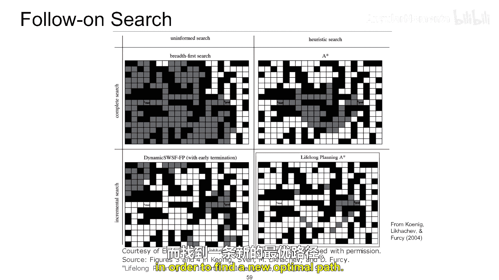

With that， I'll turn it over to Ben to talk about the D Starlight algorithm。

Thanks so I'll be welcoming you through the D Star Light algorithm today now I start emphasizing that D Star Light is not the only incremental algorithm as we mentioned previously。

 but it is a widely used incremental algorithm。quite efficient at what it does Dart light is an algorithm that searches from a single start node to a single gold node。

 but as we see changes that occur in the path along the way， it will adjust that。

So it's nice to think about D star life from two perspectives。

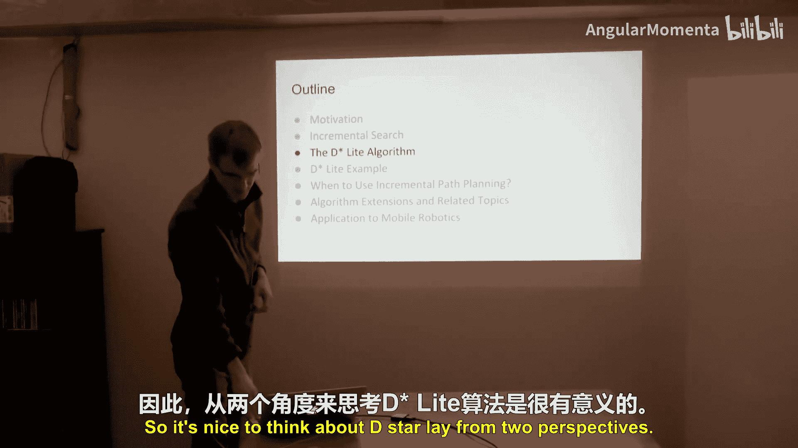

W us to think about it as a modification of the principles based。

Now you'll see that D star light in its first iteration or its first run through before any modifications behaves very similar to A star。

 and that's where it's nice to keep that mental model in mind and you'll see that in an example further wrong。

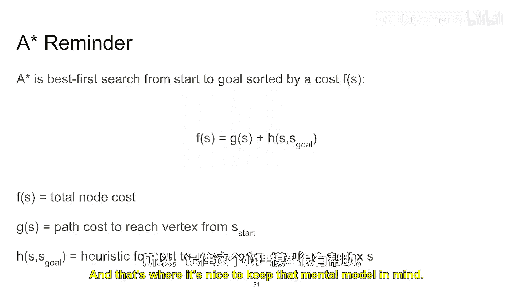

With。The second perspective to look at a start with is from the perspective of Dter's algorithm。

From which we see many of the principles of relaxation that we covered beforehand。

From this perspective we see that when we do reparations to the graph or changes to the graph。

 our methods of repairing the graph is essentially to relax down or change edge weights until they reach their truth now whereas we differ from dixsters algorithm with something like T star light is selecting only the nodes that we want to hit efficiently so whereas D star light travel oh sorry whereas diyxster's algorithm travel the entire graph。

 we only want to travel from a single star node to a single gold mode and so D star light behaves like dixsters but a guided dixsters。

So I'd like to just remind you of several concepts from A start first because it's easier to introduce them in that context and then we'll modify them a little bit。

So Joe mentioned before that for A star， we're searching from a start node to a goal node。

 and we're sorting the nodes in our queue by a total cost， which is the sum of what were calling G。

 which our cost to go or cost to get to a single node， and our heuristic。

 which is the cost to get from a node S to the goal node here。

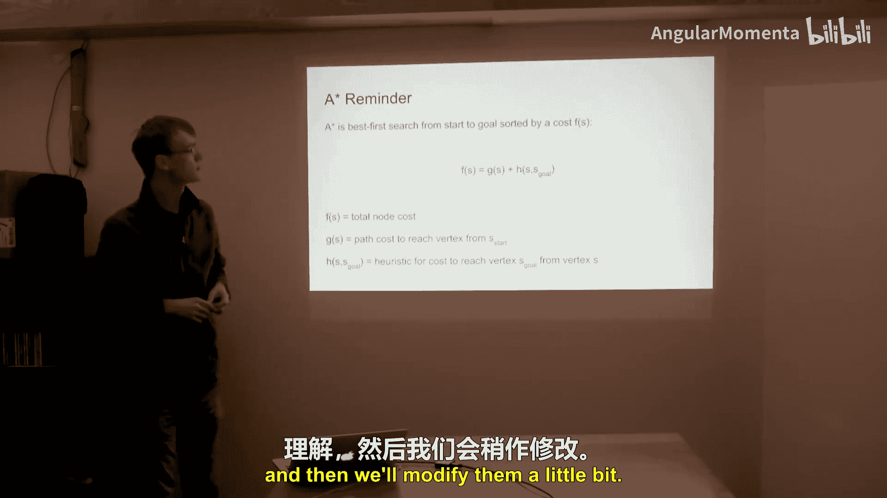

Now what we don't usually consider with a star but is very important for D stars is how we distinguish between ties when two different nodes on the search cube have the same total cost so here what we're doing is we're introducing a couplet which consists of two values。

 the first which I'm calling F1 here for any given state it's the same as what we're usually used to it's the linear combination of your cost to reach a node and a hereistic function。

But we also introduce a second value for this couple that's used in the case where only those two draw。

 and that is simply the cost to go that G value， so in order of expansion of nodes from the Q。

 we'll order them in terms of F1 first and then if two nodes at the front of the tie in terms of their F1 value。

 we select the node with the lowest G value。

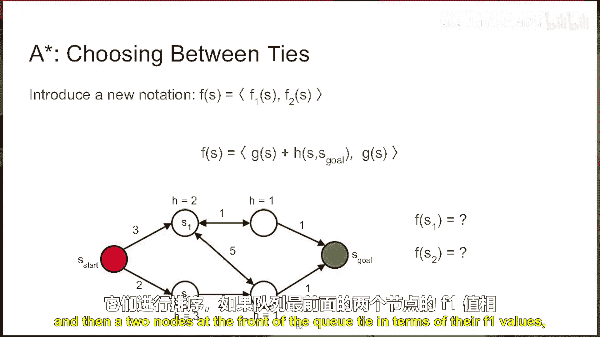

So looking at our graph down here， we're looking at our state's S1 here and S2 here。

 can anyone tell me the total cost for our state or our node S1。

 which remember is a couple of two different values？

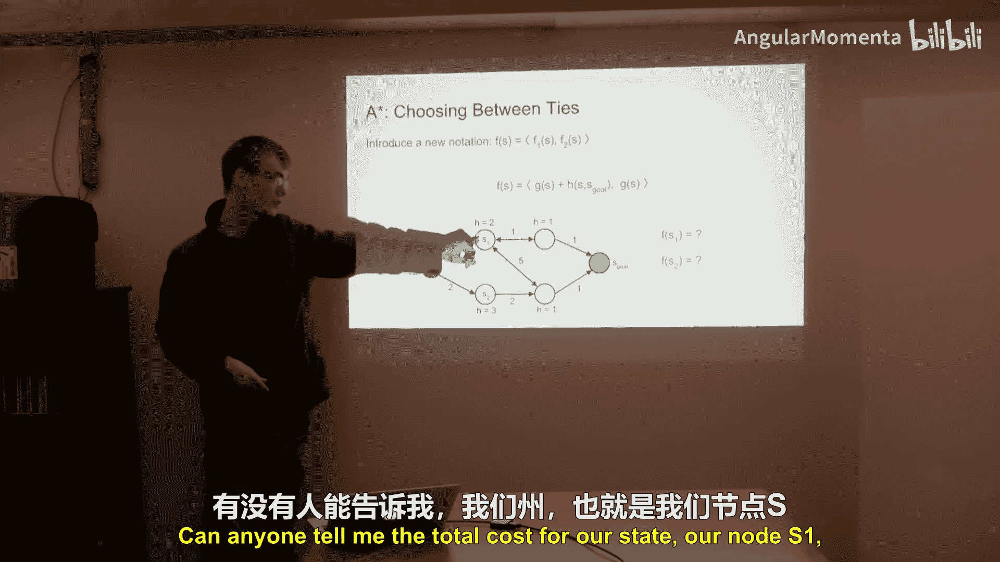

Fre 3。So five， yes， is our cost to reach this node one plus the heuristic， which is two here。

 and also three is our second value because it's totally our cheap value there。

And so what would the value be by the same logic for S29？他去。I two， that's exactly right。

And so bearing in mind what I told you before， which should we take off the queue first？

That's two that's exactly right， because the first value F1 for these two nodes is exactly the same。

 but the second value is lower for2。I'd also like to introduce the concept of successors and predecessors of any given note。

In general， a graph consists of directed edges and we can have a graph with undirected edges but we can think of that as just any edge being directed in both directions。

 so here we define the concept of a successor of a node which is every node that can be reached from a given node along edges that can。

So the successors of this given red node are at least two blue node here。

We also introduced the concept of predecessors， which is every node from which that node can be reached。

 meaning node from which we can follow our directed edge to our node。So for our red note。

 the predecessors are these pseudo。

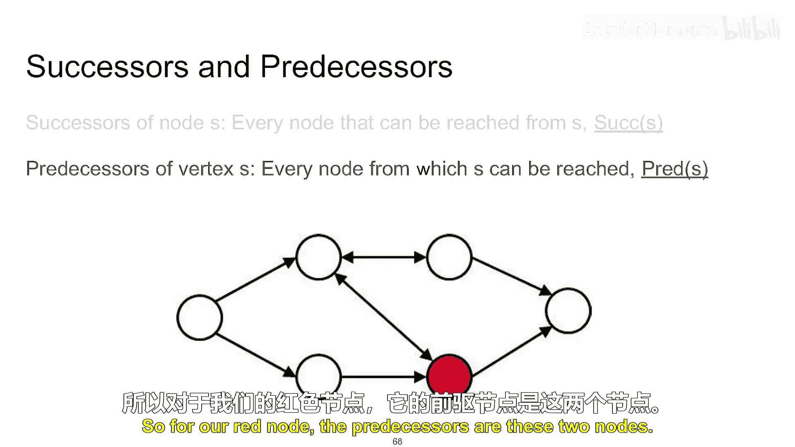

What I'd like to emphasize here is comparing the two that this node here was both the predecessor and a successor of our written node。

And that's fine。That occurs when we have undirected edges or edges thatdirects in both directions。

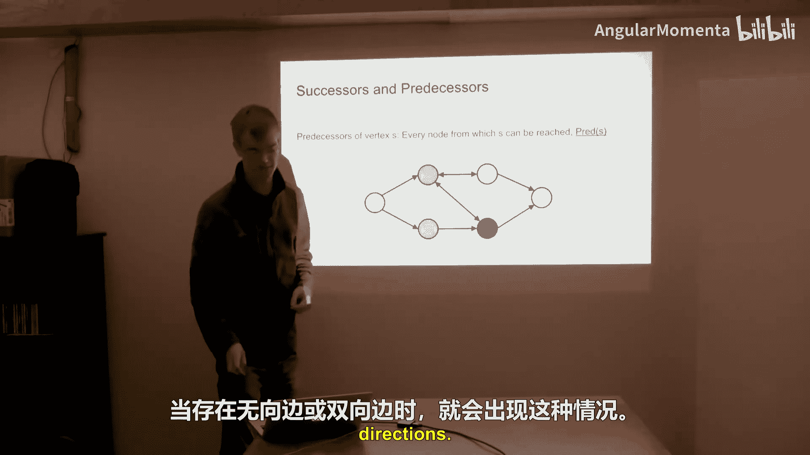

So think about D star light in the sense that it is the repeated best first search。

 which is where the A star principles come in through a graph with changing edge weights as that graph is trad。

 meaning that as we travel from our start node to our goal node along a path that we are planning。

 we can see that edge weights are changing and in this example I'm modeling a obstacle coming in place between this node here and the goal mode。

 which means that we have removed that edge， and that's effectivelyceptively the same as changing an edge weight。

 we're just modeling it as changing this edge weight to infinity。

 which means that edge can't be travel along。

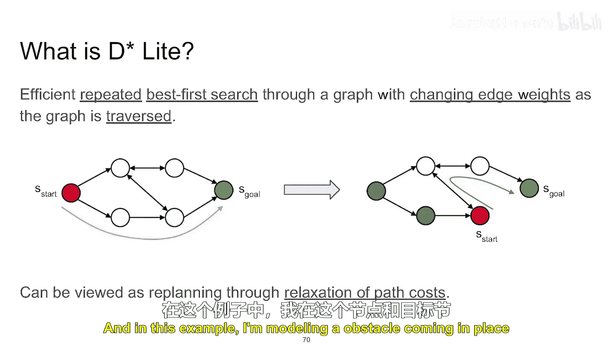

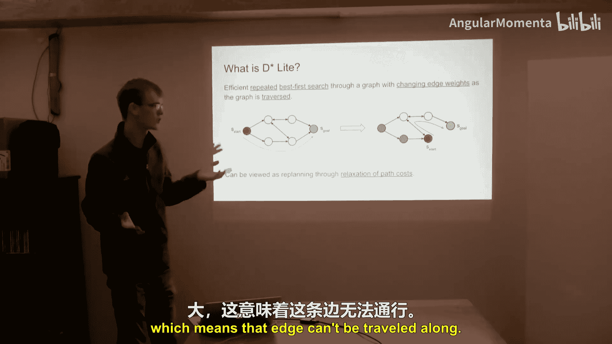

And as I mentioned before， we can also view this as replanning through relaxation costs。

 so once we have moved to this point， how do we find the path from here to here when this edge has been？

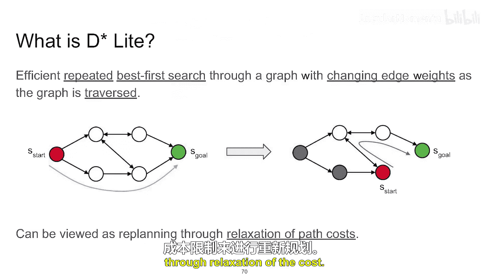

essentially。So we want to make D star light efficient and it's repeated search through the graph as we traverse it。

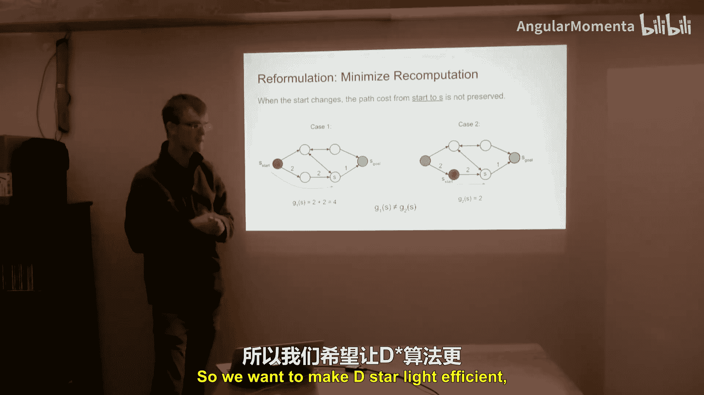

So you'll see that since we're using these G values， if we maintain a。

If we maintain a formulation where we're measuring the distance to go or to reach a node from our start node。

 this is not preserved when we move our start node and we move our start node when we're updating the position of our vehicle。

So we show this through an example here。The G value or cost to get from our start node to our current node S here is the combination of these two edges。

 and so it sums to four。Now when we move along that path that we've planned to this next node。

 the G value to get to that same node is here too， and so this isn't preserved and that means that we'd have to potentially reformulate things on our queue。

 which should be very inefficient。

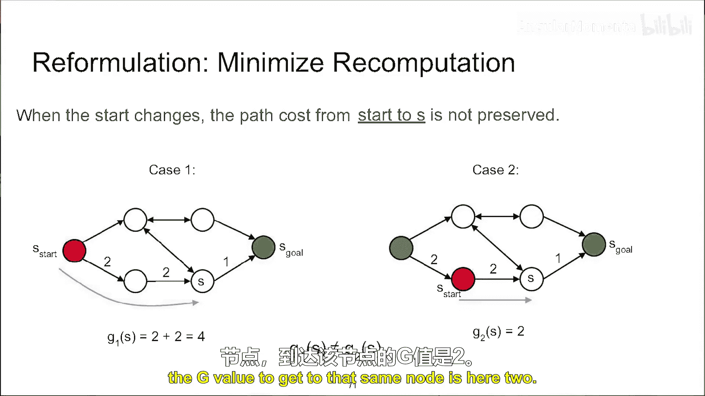

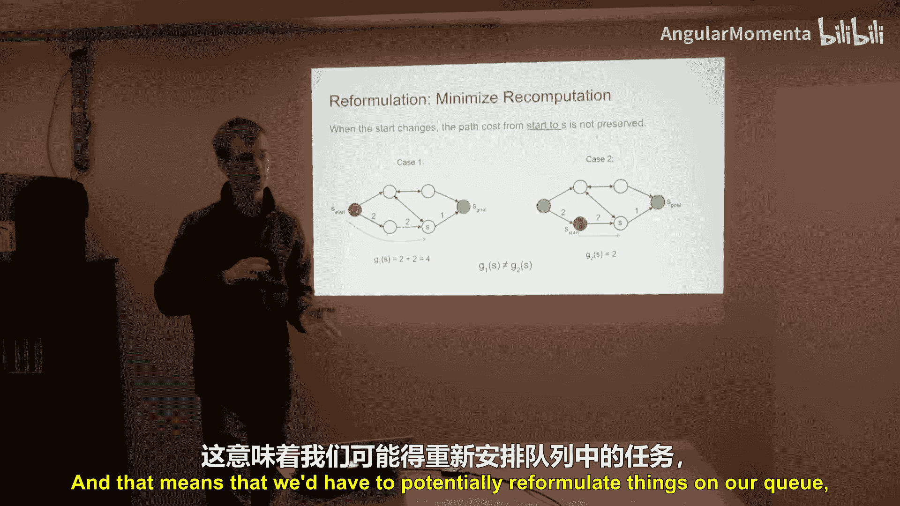

So what we do is we reformulate our search and it's perfectly valid or reformulate our search to search in the opposite direction。

 we're essentially measuring for our G values now the cost to reach the goal from a specific node and instead our heuristics then measure the costs the specific node or to get from the start node to our specific node。

And so we search from the gold backwards to the craft。In this case。

 we see that regardless of whether our start no is we preserve our GE values or our costs to travel from S to that growth。

 that's what we like and we will keep that reformulation to maximize efficiency。

So here I want to give you a kind of。Overall understanding of the D star light network before we dive into the specifics of what it's doing。

Firstly， we want to initialize all nodes as unexpanded and what exactly means expand a node later here I'll cover。

And then we're doing a best first search from the gold node to the start node until the start node is consistent for its neighbors and I'll again say what that means later。

 we then move our start node to the next best vertex essentially moving along the plan our node moving along the plan that we created and then we have to see if any of those edge costs change we track how our heuristics change and then we update the source nodes of those changed edges and we essentially repeat this process until again we've converged to a solution when we keep moving。

So this best first search， the Astar light part of the algorithm。

 is where most of the computation is going to be occurring。However。

The incremental component is actually how we adjust our age costs to make sure that we're using most of the information that we previously gathered as efficiently as possible。

So I'm going to walk you through various steps of this。

 but first I'd like to walk you through this step of Mo to next best vertex just so you understand that well。

So we can extract a path given the path costs that we have through this simple argument。

 which says that we map the successor。By which I mean we restate what the start note is。

Because we're moving from one state to the next state， which becomes the new start node。

 by this formula， which essentially says that we're taking the best path in the sense that we're minimizing the total cost that would be gained traveling by that path to this node。

So in essence， the G value to get to this node both to the red node from the green。

 recall we're searching back through the graph。By this path here is seven。

 but to get to this node from the lower node is 10。

 and so our G value that is optimal is seven in this case。

 and the node that we pick as the successor is the green node up here。

So now to walk through some principles that appear in both of these steps。

I want to show how we handle weight changes locally and we do this because we don't want to track weight changes throughout the entire graph。

 we want to handle this efficientlyly and separate them so we only need to handle the changes that really impact on problem。

So this is the same formula that defines our success。A G values for a different note？

But we can see that this may no longer hold when edge weights change the example that I have here is that I've changed this edge weight cost from six。

去 want。And so now we' can reach the red node， searching back through the graph by a new optimal path coming down from this node here。

 which would make our new G value5 instead。

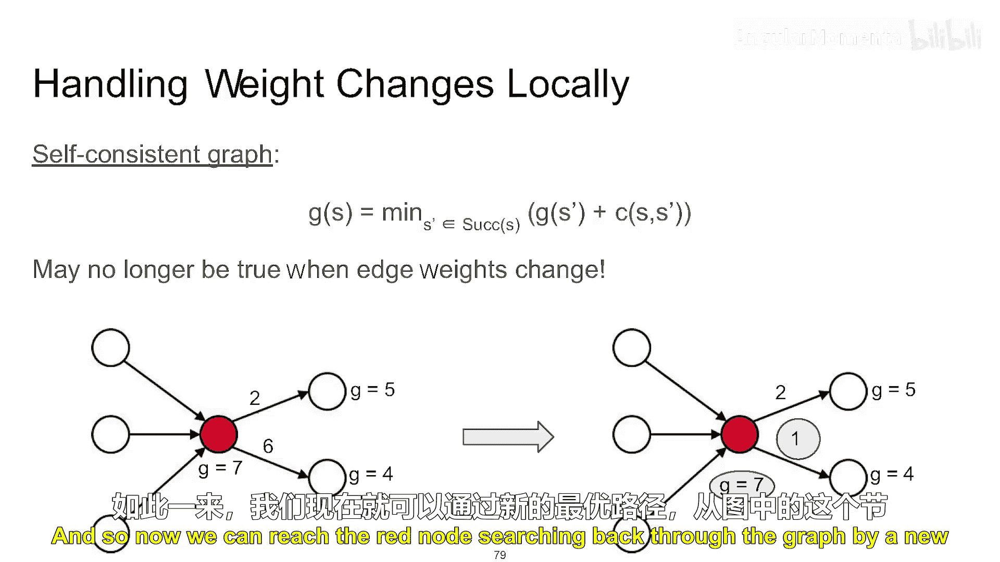

So。This hasn't been preserved。And then these changes then propagate to our predecessors because the costs for the predecessors are each dependent on the G value for their successor。

 and so when we hit a node， we have to propagate that change all the way back through the cross。

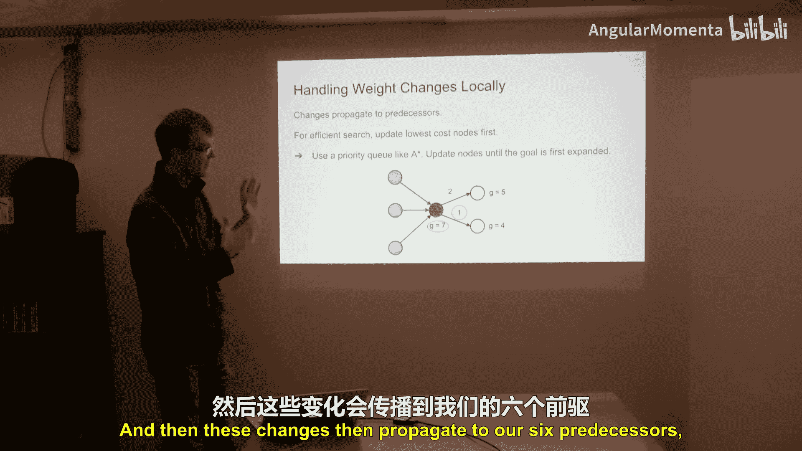

So to do this efficiently， we take an AS star like approach where we update the lowest costs first。

 nodes first， and we don't expand a node until it is the next lowest cost。To help us do this。

 we're going to store an additional value we'll call this RHS Now the meaning behind RHS。

 it comes from the term right hand side， which in the paper where it was first introduced and made more sense than it does so here what you can think of your RHS value as is essentially your corrected G costs when H costs change how G should be assigned so that it is correct for your。

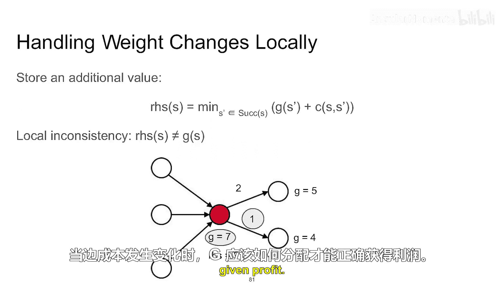

And means when your RHS value is not equal to your G value。

 that means that we have what is called a local inconsistencies。

So given the logic that your RHS value should be what your G value would be corrected to be。

What would your RHS value be for this profit here？5， five， yes。So that is。

 this is the same graph that I presented previously， and I walked through how G should be5。

RHS should be five here。And what we're tracking is RHs and G different。So G is what it should be。

 but we haven't updated G2 be 5 yet。

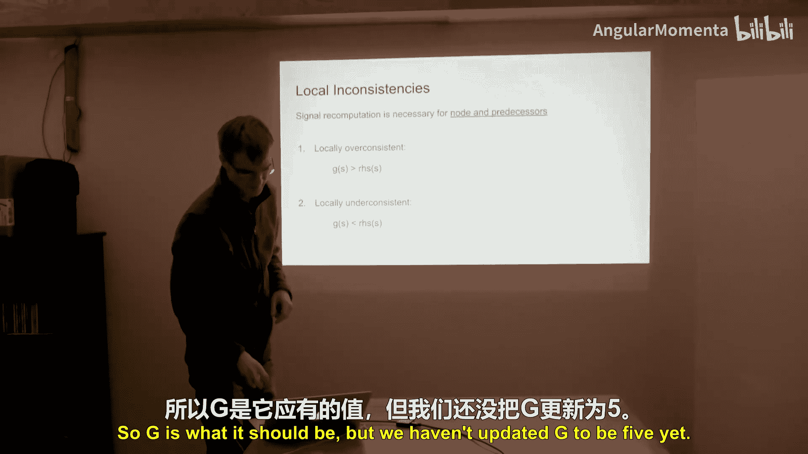

So we have two different types of local inconsistencies that we distinguish between。

When you have what do we call local overcon， where gene is greater than your RHS value。

 this is going to behave more similarly to dirous algorithm where you're。

The value that we're associating to every given note now is higher than it should be。

 and we're relaxing down to the true value。However。

 we have a locally under consistent case that we have to handle slightly differently。

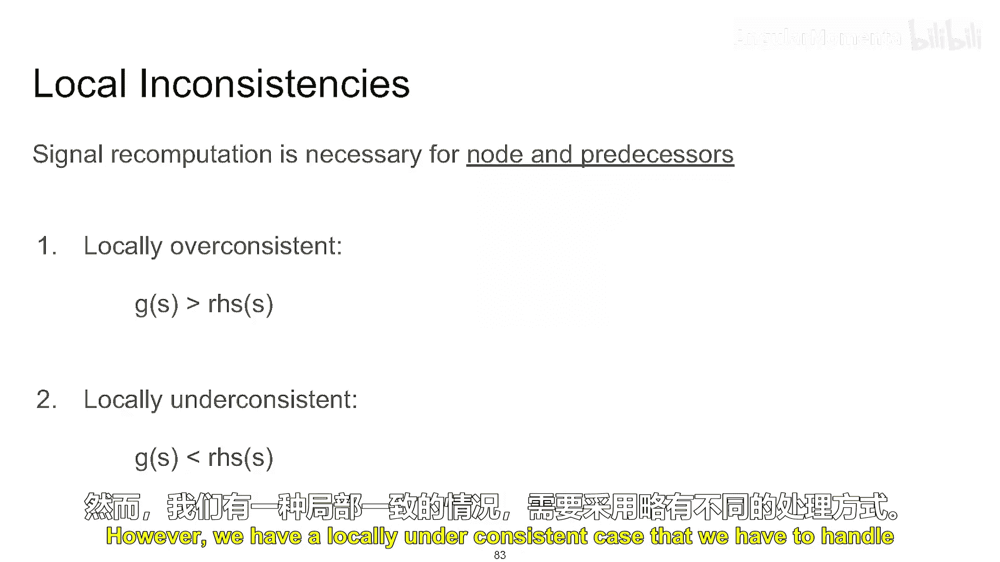

So now we're going to walk through updating and expanding nodes what I mean by updating a node is recomputing the RHS value and then placing that node on the priority queue if that node is locally inconsistent。

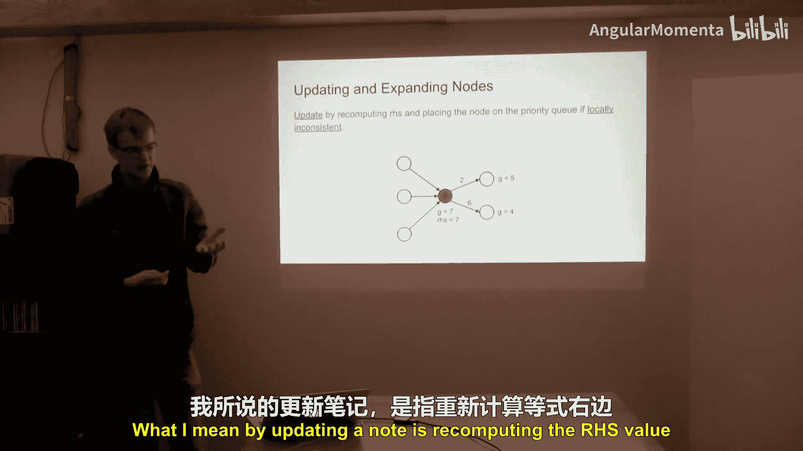

So's give an example here。I've changed this value。Moving from six to the bottom to one and recomputing RHS as we did beforehand。

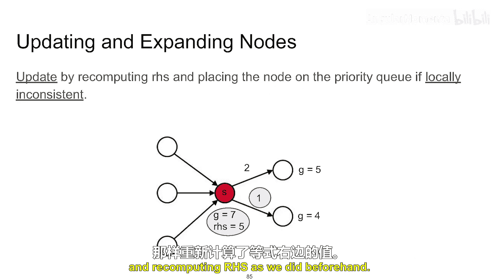

Now we see that the node is locally inconsistent in this case it locally。

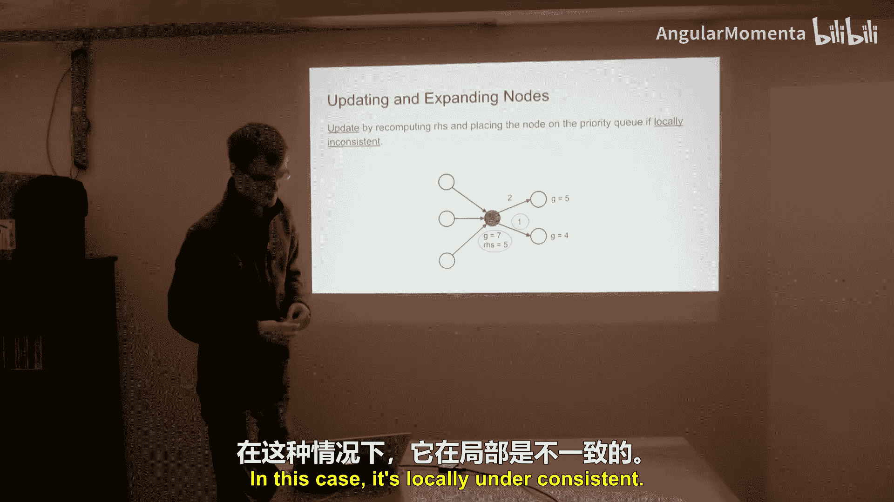

Under consistent。And so we place that on the priority too。

The priority Q values are based on this new formula。

This new formula essentially handles how we see G and RHS。In essence。

 we want to take the minimal value off of one of these so that we can handle it the first time that it'll cause changes that propagate through the。

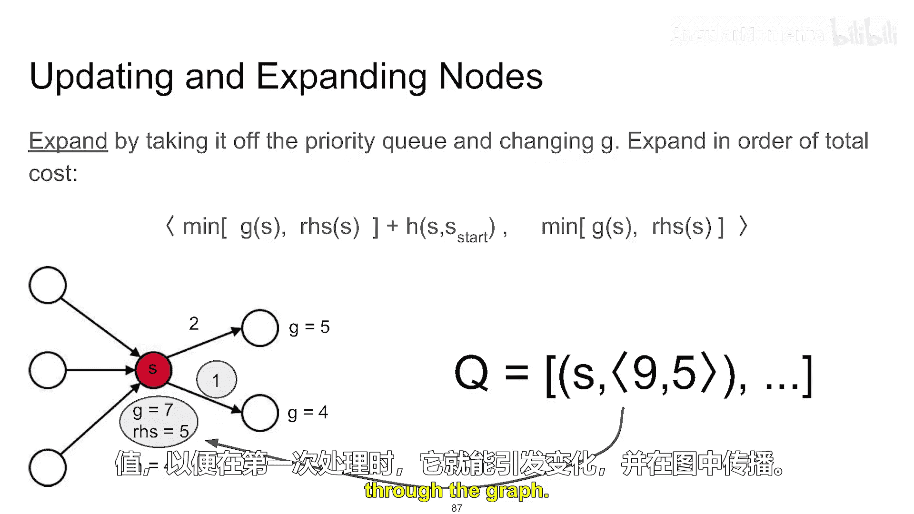

And so this is essentially our ordering on our priority queue which is essentially the same coupling that we saw for AAR。

 but here we just had G ofS replaced by the minimum of GS and RHSMSS。

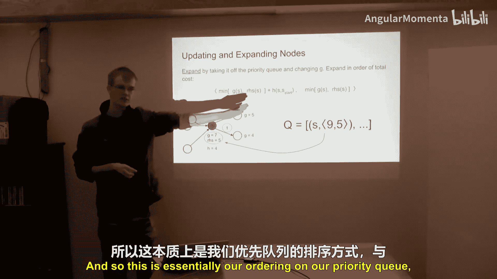

And so here， your minimum of G and RHS is5 plus a heuristic leads to a total cost associated with this node of 95。

So we expand our prior nodes by then taking them off the priority queue and changing G。

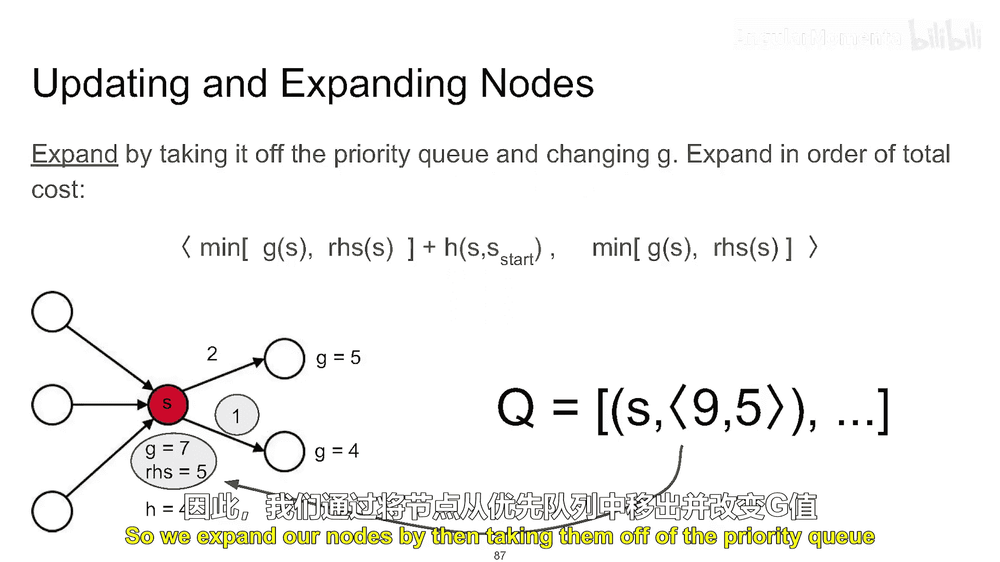

And I said here have we had a locally but consistent node。

And so we update this in much the way that we would expect your G values are relaxing down to your RHS values。

 so we just set G to be equal to RHS。

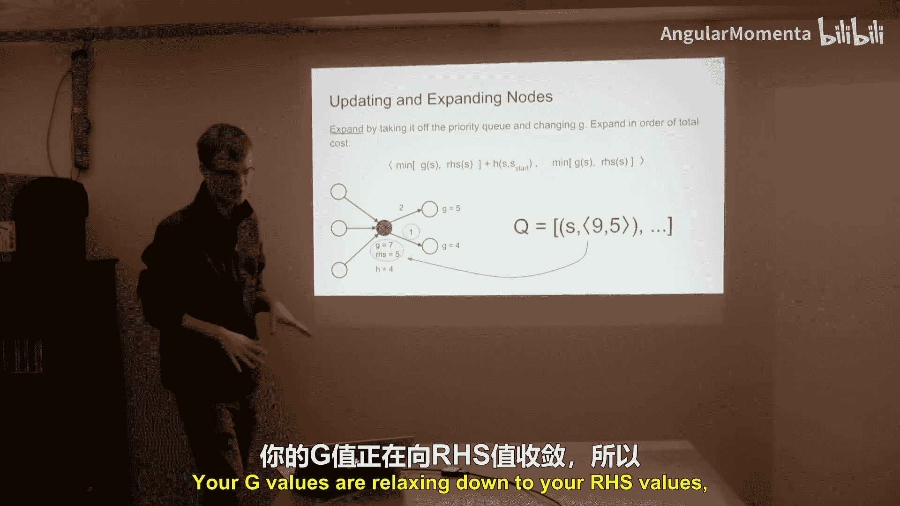

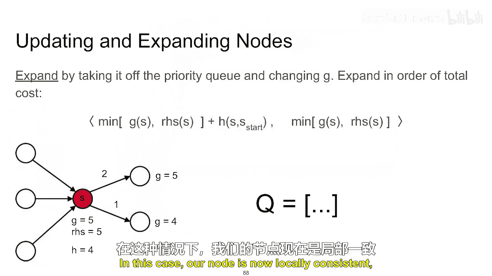

In this case， our node is now locally consistent and it's going to state that with。

So can anyone think of some good reasons why I go through the process of changing RHS and keeping track of that new value。

 I need to put that on the queue and then take it off again instead of just recomputing what QS should be in the first place。

Does anyone have any ideas？What you can think of is that。You're putting something on the queue。

 but if we update that value， immediately， there are multiple nodes that could change the same node that we've just considered。

 by which I mean more changes as they propagate back through the graph could lead to changes in the RHS value of that specific note。

And so what we would need to do if we recomputed G ofs every time is put it on the queue， take it or。

But it's only here to signal that we're recomputing G ofS and do that recomputation。你给。

New changes could come perform that again， do that again and again and again and again we want to avoid that situation so what we're going to do is we're going to keep RHS as essentially a temp value that can be adjusted when it's in the queue so when something is on the few it's on there once and it can be updating taken off but we know when it's been taken off that has been taken off at the correct time and won't need to be handled again。

So。To understand margin。 So present， if you had a single。

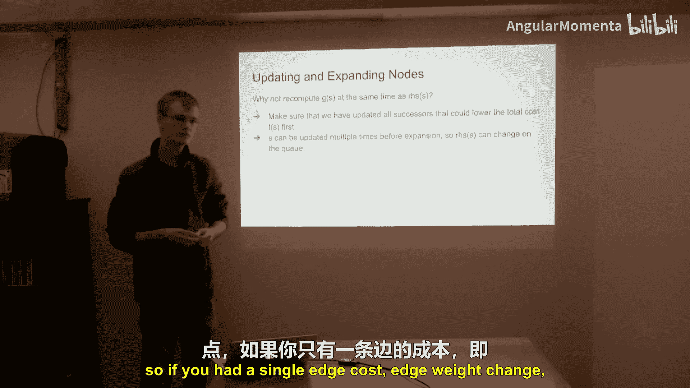

Eddge cost， edge weight， change。Then you could just do what what you just said in terms like you could just update the thing and propagate to the predecessors right Yeah so if you knew for sure that nothing else was coming back and down。

 okay then we could just do that change and propagate to all the predecessors because nothing upstream of that notice effectively so I understanding you correctly so you're basically running that in programming。

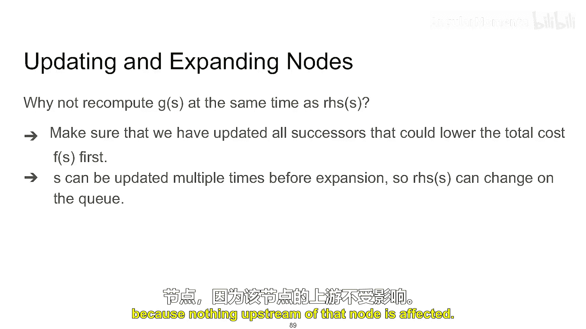

So then because you are even keeping the cost you go to the goal。

 and then what you're doing is every time you have an edge that changes to a value that could potentially make that node better than it was before。

 so either changes the value of that node。Just something better than it was before then basically so you would change that node and then propagate every and then Q or the predecessors a bit because those could be changing as well and then I mean if those nodes do not change you don't do anything you remove them from the queue if they also change to a better be would then even keep propagating until you have nothing else you probably but we only do the propagation or。

We queue changes that occur earlier in the graph， but well only actually。Perform the change。

 resetting the G value when it's expected Okay， so and then the reason and the reason for that is for efficiency when you have more than one edge changing。

 so you could basically have multiple passs。Affecting the same node and in this situation so if you actually allow your changes to occur at multiple edges。

 that's when the importance of the queue comes thats exactly prevents you from redoing the same work over in the that's exactly right because another change came through then we put all the predecessors back in the queue again we do updates plan as well because we're avoiding that process and the queue also ensures that we're only updating the but and I think that'll cover it but in the manner which we terminate we don't necessarily we don't expand every node in the queue we only expand those we need in order to find the shortest path then we retain the queue for the next search in case we need to update those the next the next round of the search。

嗯。So I have to correct a mistake in my language that I said before。

 I said that the note in my samples that I gave before was sounded consistent when it was in fact over consistent。

 I apologize for that mistake， overconsistency is the easy case that we're handling here where when we expand that node。

 we have to take GS and set that to be equal to the RHS value for expansion。

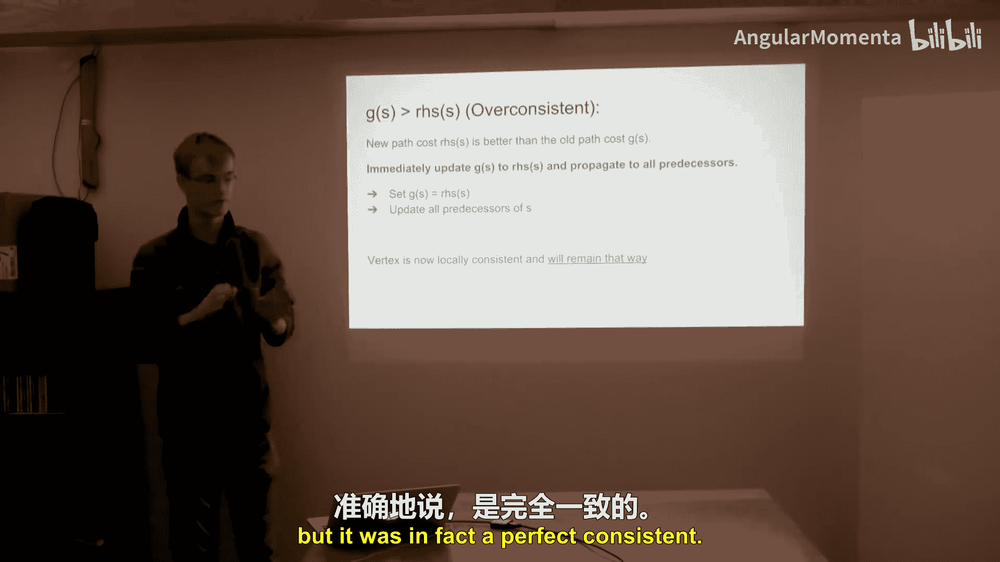

And then we propagate that effect to all of the predecessors at that point。

 which means we update predecessors and put those on the cu if the has an impact on them。

This means that the node is now locally consistent and it's going to remain that way in that fashion。

The under consistentistent case， which was the opposite of what I showed， is the more difficult case。

In this case， the al path cost was better than the new RHS value， RHS value has increased above4。

In this case， we can no longer relax down to that G value from our di algorithm perspective。

 so we have to think of a new way。What we do is we essentially set our G value to be equal to infinity。

And this is an extra step that's going to cause all the node to go back on the queue an additional time。

 but what this mechanism assures is that that node goes back on the queue at most one additional。

 which means that for Dstar light， we only ever examine any node most twice on the queue。

Once we've sent GSb equal to infinity， then we can essentially relax down to the RHS value from the perspective that we had before。

So we set GS be equal to infinity， and we update all the predecessors of the S and S itself this time。

 as I was saying before we need to put that note back on the queue so that we handle it when RHS is hit its minimal value。

And this means that that node is now going to be locally consistent or over consistent。

And we handle over consistency in the case that I showed before。

So to give you an idea of how exactly this works， I didn't you it， I'm showing you an example here。

We start off with this graph。And we introduced two changes。We have increased this edge cost to five。

 and so RHS has now increased to a total of 10， but have' also changed a value here for edges that you can't see。

 but assume that the RHS value of this node has also changed to。

So now we can put all of these nodes on the keyboard ordered in this way。

 computer using the formula that we've seen before。

We expand the node S1 first and because it's under consistentistent。We set G to be equal to infinity。

Then we propagate to all predecessors。And put。And。We propagate all predecessors and S1 itself。

 meaning those go back on the cube now assuming that no changes of any relevance happened in these nodes。

We recompute the cost for S1， which has not changed to 1410 because we're using the minimum of infinity in 10 which is 10 plus 414 going behind the node S2。

Next we expand this node S2， and because that was an over consistentsistent case。

 we can just set G to be equal to our RHS value。We then have to propagate that to its predecessors。

 which includes S1， which is updated its RHS value。So if we didn't do this。

 have we wouldn't have if it handled this effect correctly。When we set our RHS value here。

 we then have to put this node back on the queue so previously。S1 is already on the queue。

 though the effect has to be propagated to this node， which puts it on the queue again。

 which would mean adjusting the values because RHS has been reduced by one。

 both the costs here have been reduced by one then we expand that node。

We have an overconsistent case we're setting G to be equal to RHS。

 and finally we have completed our graph search problem。

So now what we have to handle is an additional complication that occurs between several steps。

 tracking how our heuristics have changed。So we want to carry over our priority。

 which was what was mentioned previously between our different searches as our start node moves。

But the problem is that we're moving from our start node to a different point。

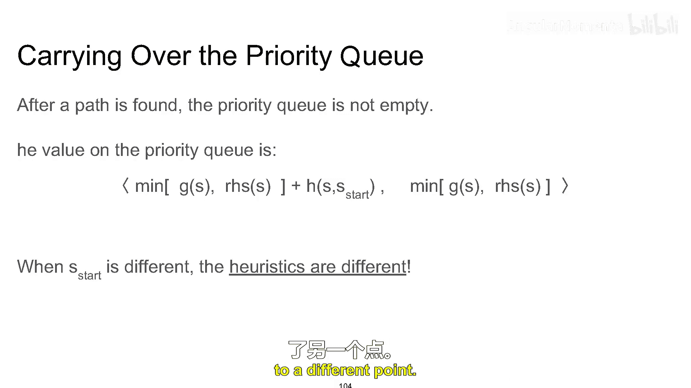

Recall that our heuristic value is measured from any given node to the start node。

 so when our start node has changed， the heuristic value is not going to be the same value。

To the new stock mode so we want what's already on the queue to be comparable to what is being computed for our new values。

 so we can use the math and the algebra that we've already done。

So how we handle this is we introduced to something called the keyword fire。

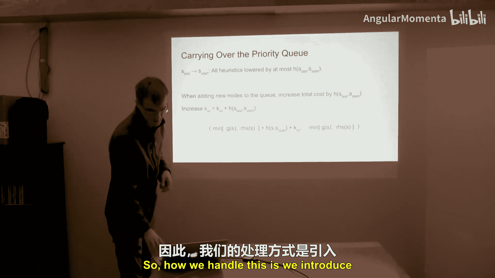

When we move from the previous start node， which here I indicated is S last to the new start mode。

All the heuristics for admissible heuristic are lowered by most the heuristic from the last dark note to the new document。

So now when we add new nodes to the queue， instead of subtracting that value from everything that's already on the queue。

 what we do is we just increase for all nodes that we put on the queue。

 their values by this new modifier because essentially when we're taking things off of the queue。

 all that matters is the relative differences between the two and so instead of subtracting a value from everything on the queue。

 adding that value to all new values that are put on the queue we'll achieve the same purpose。

And so our key modifier is initialized to zero at the start of the algorithm and is increased every time that we update our start by this new map。

By the heuristic between the last start node and the new start node。

 and then we update our total cost to include the addition of the key modifier for our F1 term。

So now we've covered all of the D star light algorithm basics。

 and we can essentially walk through the slide that I showed before with the math。

So when we start we initialize all of our G values to be equal to infinity and all of our RHS values be equal to infinity except of the goal mode。

 and that's to ensure that we always have a note to start from our search。

We best first search until from the goal node to the start node until that's locally consistent and expanded。

 we should now know what that means， and that signal that we have found our best。

We move according to our movement rule， and then if any of our edge costs have changed。

 we update our key modifier and update our RHS&Q positions for the source nodes of change edge costs。

 meaning the node from which those edge originate。And then we simply repeat from two following best first search through the principles that I walked you through for over consistent on consistent notes。

And as a reminder down here， we always search by or sort by this very long couple of TM。

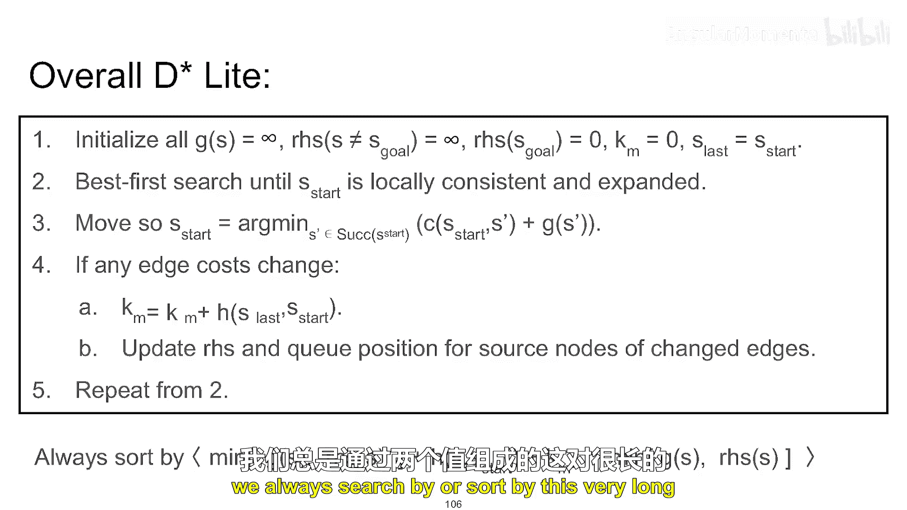

So now we're going to walk through an example to start like out。So。

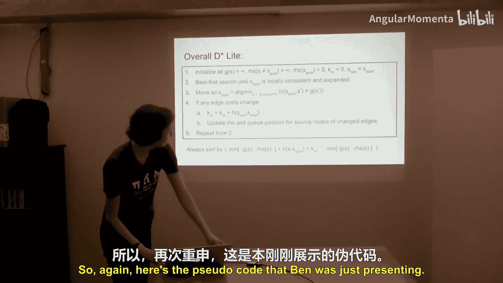

So again， here's the pseudocode that Ben was just presenting。

We're going to go through a quick example with five nodes。

 so this isn't going to show all of the properties of why you would want to use incremental path planning because when you have only five nodes you're going to end up updating a lot of them a lot of the time。

 but after the example you'll see how it makes more of a difference on a larger graph。

So in this graph， we're going to have five nodes labeled， A，B，C， D， and G is our goal node。

 the robot will start at node A， and its goal is to find the shortest path to node G。

 except that the graph might change as the robot goes through where the robot might gain new information。

So initially the robot thinks that every node is available and it knows that the paths are all one except for from D to G。

 the path length is 10。So this is a bidirectional graph。

 every edge goes both directions and the heuristic as then described will be with respect to the start node。

 in this case we'll just say that the heuristic is the number of nodes to the start node so we're ignoring the fact that this edge length is 10。

So first we'll initialize all of the G and RHS values。

 so we have infinity at every node except for the goal node which has an RHS value of zero。

So this means that all of the nodes are currently locally consistent because their G and RHS values are the same except the goal node。

So we put the goal note on the queuee using。The formula that was on Ben's slide。

But do' put here for wrap。So， the。The key。It's going to be these two terms first we have the minimum。

Of G and RHS。Plus the heuristic value。Plus， the。Keymodifier， which is initially zero。

And then we have the second term， which is just the minimum of G and RHS。

So you can see how we would get 30 here because the three comes from the heuristic and everything else is zeros。

 or're just adding a bunch of zeros。So that's everything that happens for the initialization and now we have one node on the queuee。

 so what do we Dque first？easyThe one note on the， so weDQG。

So we're going to update its G value So as Ben said， the RHS value is sort of a look ahead。

 you can also think of RHS as being。As being the shortest path that we've found so far。

 andG is the guaranteed shortest path to that node， so this one is trivial。

 the shortest path from this node to itself has length zero because it's the same node。

So now we're going to update the RHS values at its neighbors。So it has two neighbors C and D。

 and in each case the RHS value。Willll be the minimum。

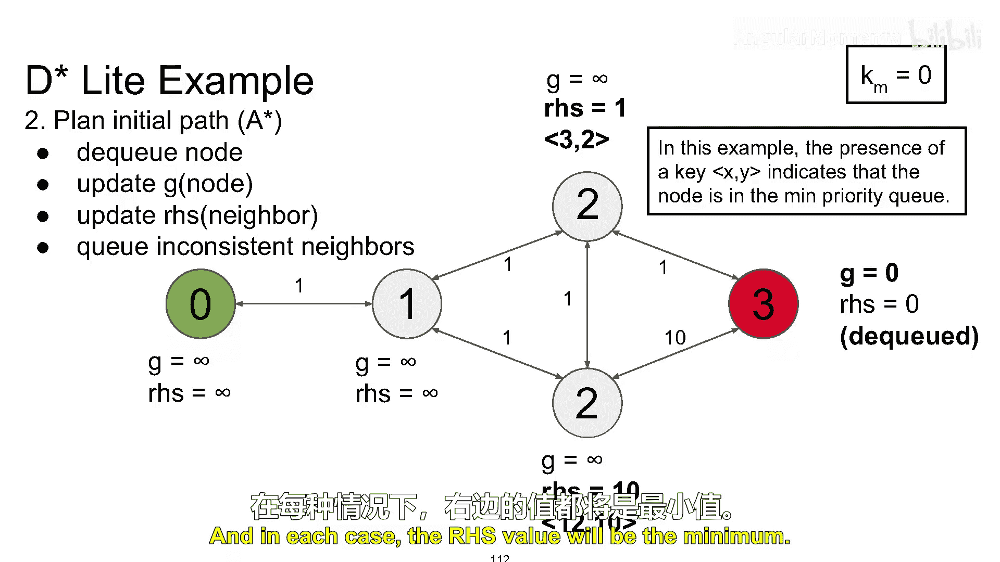

This is not actual math， but it's the minimum of。The edge cost， well the Dvalue of a neighbor。Plus。

 the edge cost。

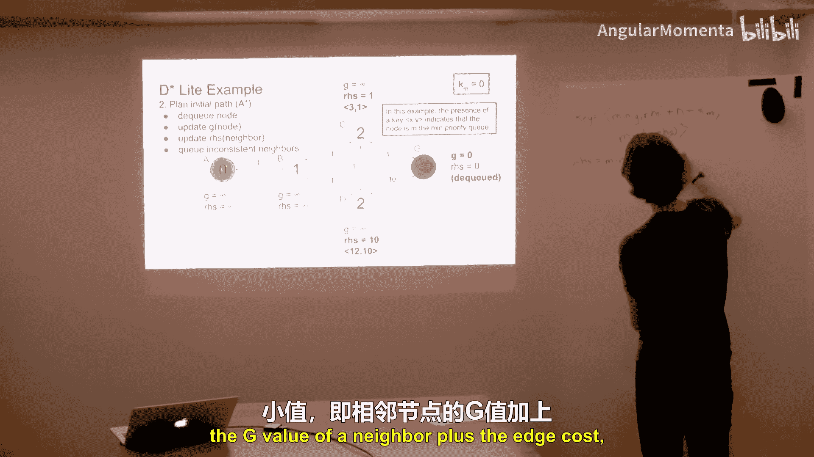

Which is the same thing as the edge weight or the weight W。

So we have RHS is 10 here because it's the distance from G to D， and then it's one， which is G to C。

So again， we can calculate keys for those。So now we'll deque another nerve to redQ next。See。See。

 because it has a smaller key。So in DQC， we update his G values， this is saying now we know that。

The shortest path to sea actually has length one。And we can also compare this to A star algorithm by drawing a search tree。

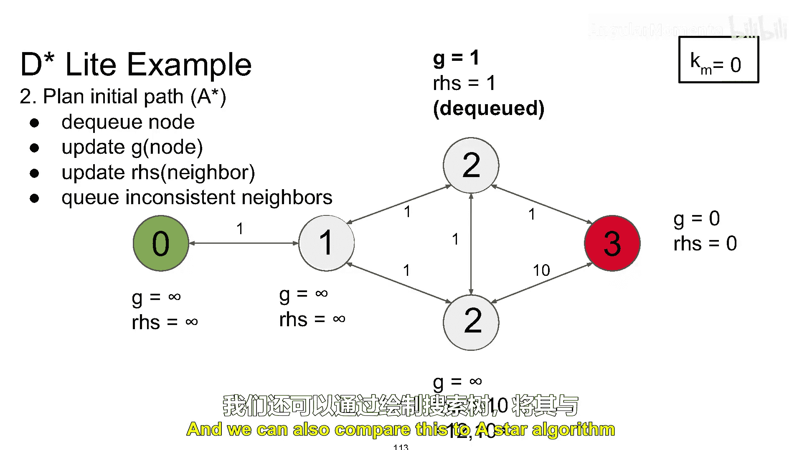

So in the beginning， we had。Here's our A star。In the beginning。

 we just had no G because we're searching from G backward through the goal。And then we expanded that。

To get C。And D， and in Astar， we keep track of the。

The path length to that node plus the heuristic at each node， so the path to C。

Was one plus the heuristics two gives us a value of three。 So if we go back a moment you can see。

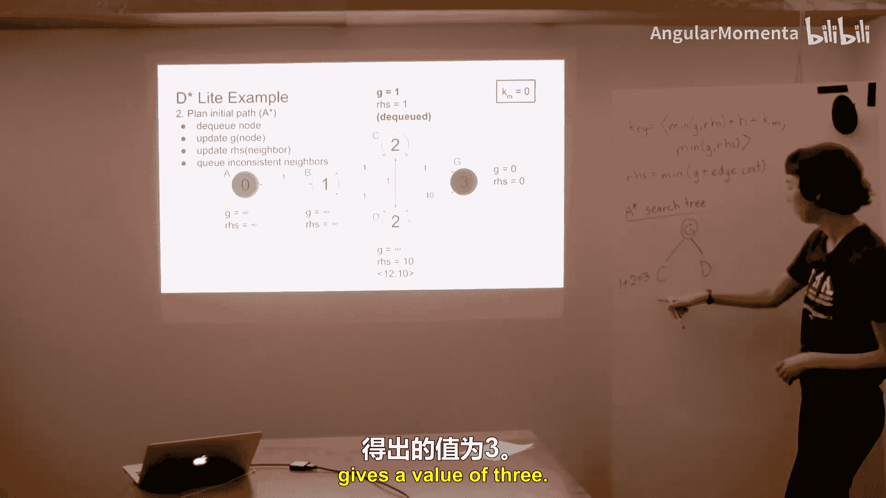

is is okay。So you can see that this three was the same as the first part of the key。

And the pathway one is the same as the second part of the key。And then similarly at D。

 we have the path length， which is 10。Plus the2 US was 12。So， there's 12。

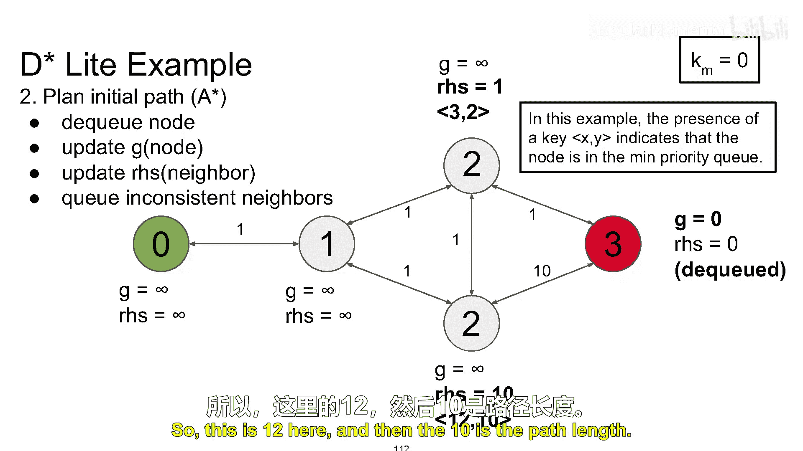

I's the 12 here and then the10 is the top。And so you could see how if we were doing this the AS starA。

 you would also DQ see next。Okay， so now we DQC and we're going to update the RHS and its neighbors。

So B is pretty simple， previously its RHS was infinity。

 now the shortest path to B that we found so far has length two。

So here we have B with a path length of two plus a heuristic of one who gives us three。

But what about D， previously as RHS value is 10， but do we now have a shorter path to D given that we're expanding C？

For his 10 still the shortest path。Yeah， so now that we're expanding C。

 we see that you can actually get to D in only two units instead of1 units， so that's better。

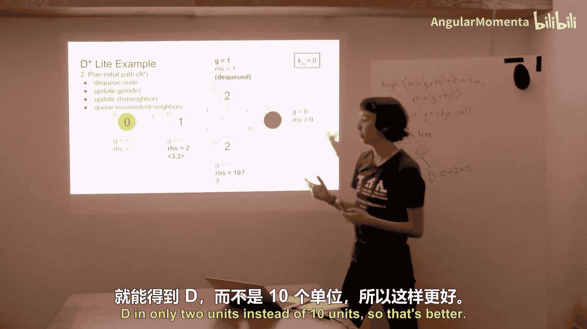

So we'll update the RIS value to two， and that means that we're going to change。

Change D's key accordingly。And the way that matched to A star is so here we have the pathway is two plus the heuristic is two gives us four。

And the fact that we're changing the key to 42 means that we're never going to expand this D because A star uses an extended set。

 so it would always expand this D with a shorter cost before this one。

So that's indicated by remove by changing the key on the queue。So what do we do next？

Which no do we DQ。B yes， because it is a smaller key。So DQB will update its G value。

 which is again saying that we know now that the shortest path to B is 2。So以 DQB。

And then we expand it。

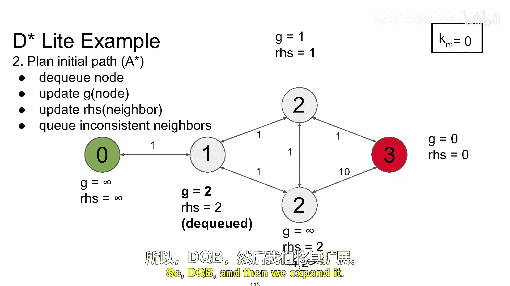

How many neighbors does bee have？Three， so we're actually expanding to all three of those neighbors we have a。

C。Indeed， can you still see this？目前。So at A， it's pretty simple。

 we have RHS values3 because it's the shortest path through GB to A。

So that's three plus the heuristic zero， it's three。What about。Oh， at C。

 it doesn't change because the you could go through B and back to C。

 but sea should actually be on here， sorry。C should be on here because we don't want to loop in our path。

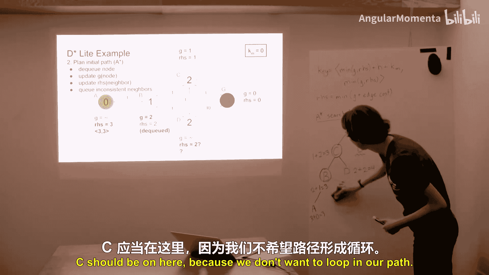

Okay， so at D。Can we do better than this path length of two？No。

 because what happened was originally we had the path length of 10 through G。

 and then we had the path length of 2 through C， and this path through B is not as good。

 so we're going to keep。The same R adjusted value and key at D。

And we could see the analog in A star where we would have， if we did do GCB。D。

 we would have a path length of three plus the he stick of two。

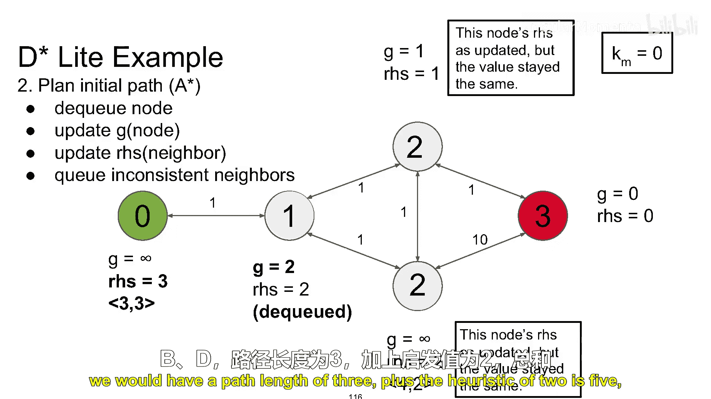

Is five， but we would never actually want to expand that D because it's not as good as this one。Okay。

 so now it reads VQ。

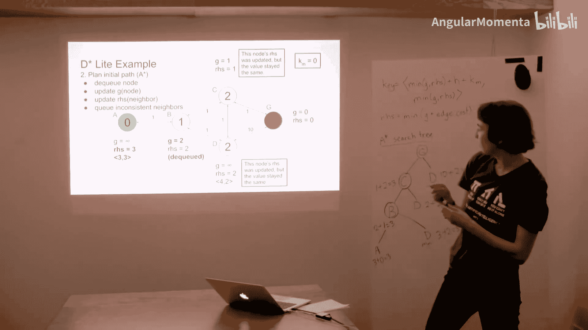

Looks like we have two nodes on our queue currently life。诶。所 d q a。

That's where we were trying to get to because that's the current start node。

So we set the G value to three， which means that that's actually the shortest path。And we're done。

 we found a shortest path well we're done except that the path might have to change so one thing to notice here is that we never had to actually set Ds G value。

 so it's possible maybe there's still a shortest path， a shorter path to D but it doesn't matter。

So now the robot will move to its next best place， which is B。

And we'll update the heuristics accordingly because this is our new start node， so now again。

 our heuristic is the number of nodes away from that green node。

And we're keeping the same items on the queue from before。

But we also have to update that a key modifier。So now what happens is an obstacle appears。

 so there's an obstacle at C that the robot can now see because it's moved closer to node C。

 but it couldn't see it before。So。Now we're going to indicate that by keeping all the edges but changing their weights to infinity。

And that means that the robot could try to get to see but it won' ever get there。

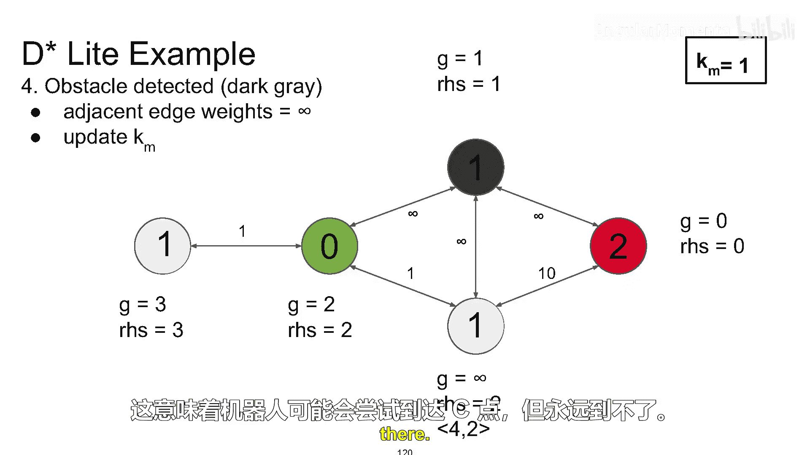

So what we do next in the algorithm is we're going to update all of the RHS values associated with the source nodes of these edges。

 and in this case the edges go both directions， so it's all four of these nodes are affected by the infinities。

So let's start with node C， what would be its new RHS value， given that RHS is the minimum。

From one of its neighbors to it of the G plus edge cost。

finInfinity because all of the edge costs going to see are infinity。So what would be the key？

The tricky part here is the first part of the key is the minimum of G and RHS。

So the minimum of GNRS is one。So it be three。Yeah， yeah， three， one because。

The minimum of G and RHS is G， which is1， the heuristic is one， and the key modifier is done。Okay。

 how about node B， what's the new IS value？So it has a neighbor here with G is infinity。

 a neighbor here with G is one， except the edgeulate is infinity。And then this guy with G is3。这是么兄弟。

yeah， because currently we still think that you can get to A in three units。

This is actually going to be four so this is one of the failureier things that D StarA does。

 but luckily it doesn't do this very much， so it doesn't actually really cost too much time。

And then how about D， what would be the new RHS value？5ive，3。Oh， no， very just。

So it has three neighborors， this edge length is infinity， so that's useless。

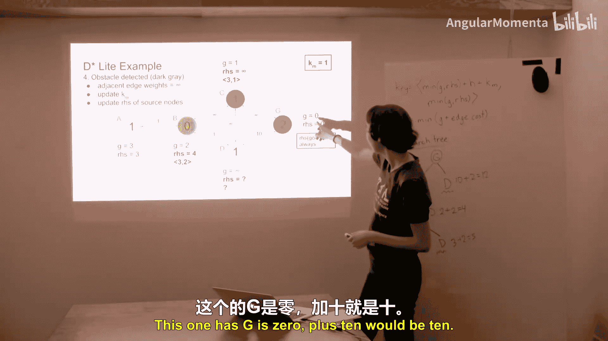

This one has g is zero plus 10 would be 10， Yeah so this is the best one， G is2 plus edge of one。

So let give us three。It's now during DQ。すげ。C， so this is one of those tie breaking cases where both of them have the first value is3。

 but C has a better second value in this key， so Dq C。

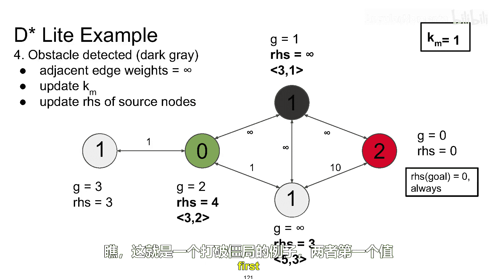

Is this over or under consistent？So the definitions of over and underconsistent that we had earlier。

We had。If G is greater than。All right， Jess。The mets。

Over consistent and we G equal to RHS when we're updating G。

 so that was the case that we've seen so far。But then if G is less than RHS。It's under consistent。

And we set G to infinity。So what is this？so the reason intuitively why we're going to set G to infinity is because we're saying there's some sort of contradiction here。

 this one doesn't make any sense it's less than the RHS value。

 so we're going to just reset G and start to sort of start over with this node。

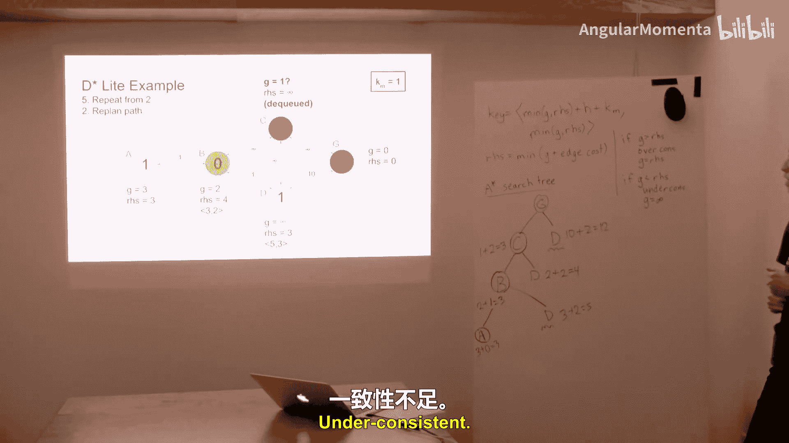

So we set that to infinity， and in this case we don't actually need to add the node back onto the queue because it's now consistent but it's not locally consistent。

So next we'll deque the one with the smallest key， which is B B is also under consistentist。

 so we're going to set its G value back to infinity。

 so this is sort of resetting the weird thing we did earlier that didn't make any sense。

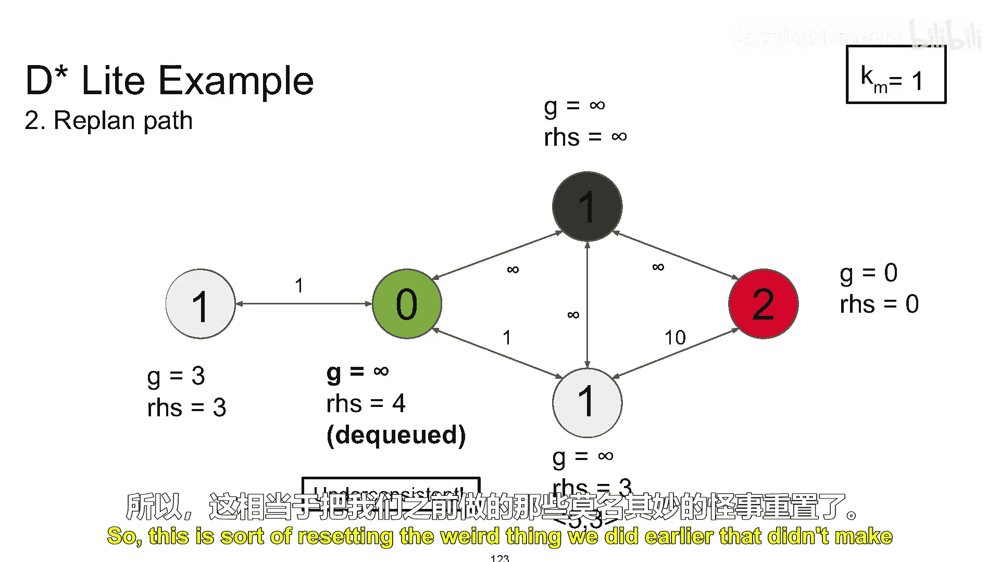

We're going to update its neighbor's RHS values。So it would be the new RHS value for a now that we know that you can' actually。

 we don't actually have a path to B。YeahInfin， yeah。

And then how about the RHS value to D because currently D got its RHS value by going from A to B to D？

1， yeah， it's not the only way。Our Je is 10， the key would have。

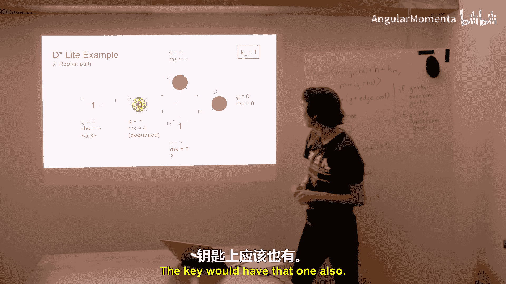

That one also。Is that right？Yeah， because currently the best path to D and actually the best path to D you can see is from G to D because you can't go through C anymore。

So now we'll deque node A because it has the smallest key。It was also under consistent。

 so we reset G to infinity。So we'll propagate that to its neighbors。And if we continue doing this。

Then we find。Eventually we deque this node， and in this case we had to deque everything。

 so now all the nodes are locally consistent。So what's the best path that we found from B to goal？

BD BDG， and it's also the only path in this case。Oh， we had to update these neighbors。Okay。

 so here's our new shortest path， so now the robot will move to node D。But now it's going to happen。

 again we update our heuristics， but now what happens is it turns out it's a moving obstacle and it starts following the robots and now the obstacle is moved to there so as humans we can see that obviously the shortest path is through C。

 but the algorithm doesn't know this yet。So what would we do next？

So we just updated our edge weights， so now all of the edges to B are infinity。

 but some of the edges to C are no longer infinity。So we need to update the RHS values accordingly。

So we'll update all of the RS values that were affected by this change。In this case。

 G's RHS value never changes because the distance from G to itself is always zero and this one doesn't change because。

We still use the G value here。Okay， so now again， we can start dequeing and plant a new path so we'll deque this node will propagate to its neighbors。

D queue that one。Update the RHS values but in this case。We don't。Let me go back step。

So we deQ this node and we update its G value。But we don't actually need to continue decqueing things。

We should， oh， this RHS value shouldn't be updated。Oh， it isあ there。Why is this our just infinity？

All edges into it are Yeah， all edges into it our infinity。 you can't get there。

 but we don't actually have to bother。While they're expanding B because we really found the shortest path。

 so this gives us sort of a hint at wheny star might be efficient because even if there were a whole bunch of nodes over there。

 we wouldn't need to consider them because we found the shortest path。

So now the robot can move up to sea。And let's say the obstacle chases the wereot again。

Do we need to plan a new path？No， so intuitively， we don't because the obstacle is not in the way of our current best path。

But we can also see algorithmically why that's the case。

 so first we'll update all of our RHS values accordingly because we've changed all the edge weights。

😊，But the reason why algorithmically why we don't actually need to consider any of these changed values is because this node has the smallest key。

 which means that this is the node that has the shortest path to G anyway。Well。

 it has a smaller key than all of the other nodes that are on the queue。

 so dequeing things would actually help us find the shorter path。

So the robot can move to the goal and we've succeeded。Any questions on that？Okay。

 so now Ben will talk about sometimes when you would want to use incremental path planning other than this fiven graph。

Thanks， so as Jess said。There are sometimes good reasons to use incremental path planning but there are also good reasons not to in certain circumstances in certain circumstances we can actually formulate graph problems where the problem is worse by using incremental path planning remember that I said that D star light puts any node on the queue at most twice and so we can compare that to a star or something like that that does full repplaning whenever search occurs but that puts every node on the search queue at most once so D star light is most beneficial when putting nodes on the queue potentially more than once leads to less nodes being examined overall。

So here is essentially what I've just said。So AAR might perform better for certain problems if we only have to consider a small amount of nodes anyway。

 so putting nodes on the block twice would actually lead to more expansions。

And so to get up an intuition behind why that might occur， your changes are close to the start node。

I want to show you an example here， so here we're actually showing an example that's derived from LPA star。

 so we're searching forwards here from the start node to the golden mode and that's just a different reformulation so don't let that confuse you too much。

When we walk forward through a star with a good heuristic。

 we might move directly from the start node to the goal and find that path。

Now， if a change occurs somewhere upstream of the start node， when we're replaning。

 we essentially have to replan。

The sections that are beyond the change that's occurred。

So everything that's here to an extent is relatively insensitive to this change。

 it could occur that we would have to take an entirely different route。

 but for the most part it's likely that changes are going to coupled to our existing path in some point。

And so we have an efficient search that will just go around。From the path that we've already planned。

To our golfn。And so in this sense， we have an example where incremental class planning would be fairly efficient。

In this case， which is a different one， we introduce an obstacle very near our start node。

 and this means that most of our existing path is distract。

So when we search out from our start node to our goal node。

 we have to do a lot of recomputation from scratch。

And so a incremental path searching algorithm is going to have to undo all the search that we've already done and then search through almost the entirety of the graph again。

So intuitively， in this case， just restarting with a star from a blank slate。

 which would search directly down to the goal， instead of doing reparations that would send us in the wrong path would be a better idea in this case。

So since we're palling from the start to the goal， in this example that we're showing。

 it's worse to use incremental path planning algorithms when your changes happen near your start。

From something like D star light， we search back from the goal node to the start node。

 it's better if changes occur nearer to the start node。

 which for our vehicles that we normally see that have limited sensor horizons is what's going to occur in the most case。

 so in those type of situations incremental pathfin is going to be very efficient。Yes。

So I understand how this could be a problem for LPA star and D star light where we're finding a single path where you have like a single source。

 single destination or something like that， but what if it's like incremental all pairhos paths where you've computed。

I assume you want to experience the same problem if your algorithm is computing short paths between all pairs of nodes and that？

Yeah， it already exists。Well， that depends， I mean is。When you're redoing recomputation。嗯。

Between all those。In the， it depends if our obstacle。

Has changed the neighbors of the node that we want to consider and by that I mean imagine in this graph we've computed the partss and the path costs to get from every single node to every single other node。

Now， if introducing an obstacle here only changed the path to get from our start node to our goal node。

 for example， then。Replanning that specific pair of parts from start note to the gold node would use data that already exists from the other node to the gold node。

 we already have that， but if introducing an obstacle would cause changes throughout the entire graph。

 then we can potentially create what would have to be a very well connected graph where again incremental pipeline would probably perform works in that yeah so you could still end up in the same situation。

Now， these algorithms very interesting because they allow for some extensions that allow us to do。

Some very different things quite easily。One example is greedy mapping in terms of how can we design an algorithm using what we know about incremental planning to hit every single node on our graph。

And what we do is that we introduce a foaux goal mode。

 essentially a node that doesn't exist that we can never reach and we add。

We add to our initial beliefs， they or our initial understanding of the graph。

Connections between all nodes to this foaux goal node Now it's false in the sense that whenever we move our start node to one of the nodes that we've examined before。

 what happens in terms of it changes of the edge costs is removing that edge that connected that node to the goal node So what this means in principle is that our vehicle。

 our poor vehicle can never reach the goal node whenever it reaches a node that it thinks it can get to the goal node from that path disappears but while that causes it to do is when it's replanning。

 it finds a path to a node that we haven't visited before because it thinks that there is a path at least from that node to the goal node and so this means that it's efficiently replanning a route from its current understanding to a node that it hasn't examined before and so we can apply something like Dstar light or LPA star with this formulaism in order to search through the graph in its entirety。

Make sure that in a。Gally efficient manner， we hit every single node in the graph。

Is this absurdly？Con shouldn the TSB problem you traveling citizens problem。I'm not first familiar。

You are traveling something and you try to cover all the season and try to come up with a route that is the most efficient really try to visit every node。

Every single once okay， then in that case， yes， it's not going to be globally efficient。

 but as you said， it's going to be an approximation4 it in a sense from each note that you visited。

 you're searching for the next best choice。

So it's possible you can corner it yourself， but it's a way that we use what we've already implemented and the methods that we've already established to tackle a different type of problem。

And all this is usually if you。If have a strategy which is visit the closest unvisiting node。

Instead of making this whole incremental pattern， you if you just， if your policy is。

 always go to the closest unient zone。How worse does that get compared to this？嗯。

I think it would behave quite similarly， what we're just trying to show here is that we can。

Implement that problem as an extension of the hyper it may be an inefficient way to do it。

if really you'd probably like to Z Zg a lot more。Also， if you're just going to。

The nearest connected node， if you corner yourself。As we show here。

Then you can potentially run into issues if your algorithm doesn't then do an extended search for if it only considers notes in its immediate neighborhood that hasn't visited once it Cors itself。

 it doesn't know where to go。

But just keep going through the graph until you hit the next one。

 assuming that you know how many locations you have you did it。P of like a random walk type approach。

Well， I mean， kind of like degree version of it， you kind of like you start from a node and then you keep searching you'll see what is the next un the node and you pick that。

Kind of like if you like some audio transition is usually that you see what you have covered。

 youll see what's the next fast move， you make that move。And you're done。嗯。

But I it doesn't look the objective here doesn't seem to so much for this instead。

You don't have diminish mention gains。So you probably don't have to in the other cheese。

 so it probably doesn't make it。Which sense you。一见。And like yeah。

 basically in ensures you're going to find the shortest path to back to the maximum unvisited node。

嗯。We also can use these incremental thought planning algorithms for anytime planners and the benefit of an anytime planner is that we quickly reach a plan which is suboptimal and then from there we are repairing this plan。

To approach technology。And this is useful in the real world where you want to get the solution that comes out quickly and we want to start along our solution and then repair it as we go once we've started moving to save some more time if your reparations might lead to small changes with it。

And this can be handled quite efficiently using an incremental pathpoint。

 so what happens is we apply something idea。Called Inflated heuristics。

And so these inflated heuristics are essentially increasing our heuristic values that exist on our graph in our true graph by a constant scale factor。

 and this is typically very large， so differences in heuristics become very large This means that once we start along the path。

We continue along it and that causes us to very quickly find the first path that actually works。

 then we can view reducing those heuristics back to their original values as essentially a form of changing our H weight costs。

Or。Sorry its a form of replanning， and then by applying the principles of an incremental planner。

 we can efficiently use the data that we already have in order to perform this search and repair our solution as we go。

Finally， we want to make explicit to you guys。How we can actually apply these algorithms to mobile products。

Because it may not immediately be clear how we go from a full space to a graph。

 Job touched on this kind of briefly when we talked about how we might discretize the world。

 but we want to give you guys some ideas of how we might do this collectively。

So in order to build a graph system out of our world state。

 we differentiate between polynoomic systems and nonpolynoomic systems。

 which their difference is just in terms of whether your constraints are differential in nature or not。

Then we are going to outline three methods here very briefly， cell decomposition。

 using a visibility graph and sampling based construction methods。So for cell decomposition methods。

 we might do what you would expect， take the free space in this region and split it up into various different cells。

 and each of those cells is going to represent a node in our graph。

And how we can do this is we split the region up based on each of the vertices of our host。

So we draw a line partiss are vertically sorry， from each of our vertices that goes in the direction away from the obstacle。

 so at the top here it's going up and out of the obstacle but in the lower left corner there。

 both up and down， don't intersect the obstacles so we draw them in this entirety。

 so we can continue this throughout the entirety of the state space and then we can attribute to each essentially cell that we've defined through these regions。

 a single point that represents the midpoint of that cell。

 which is going to be our graph node because we attribute a single set of coordinates to each of our graph nodes。

And we also to make sure that our transitions between these cells are consistent。

And additional nodes at the midpoint of each of these lines that we've drawn where we make the distinction that from here we've actually drawn two lines。

 so we draw the midpoint between all of those。This allows us to essentially create a graph throughout the entire system。

 and we connect each central or each node at the center if we even cell to the node that are on the boundary going to get itself。

This allows us to create a full graph through the system that we can move through guaranteeing that none of these paths if we follow them exactly collide the obstacles。

Now this works in environments where the obstacles are 2D polygons and the path is far from optimal as we can see。

 but we can plan an optimal part over the graph that we have defined。

And this only works on honomomic systems。We can also define what's called a visibility graph。

 We already essentially drawing a boundary between both our vehicle down there and the bottom left and boundaries around our obstacles。

 These boundaries are sufficiently sized so that if the center of the。

Of the vehicle that we're defining is along the extended edge of the obstacle that the vehicle will not collide with that obstacle。

Then for each of the vertices of the extended boundary that we've defined， we add in a new note。

And we draw all lines between all nodes， which can be connected without intersecting the extended obstacles。

Which we've drawn here。And this leads to a graph that we can again plan over。

This again works in environments where the obstacles are toopoli。

 but what's nice about this system is that we do get an optimal path provided that we assume that our extension of the robot itself is。

Is valid or it doesn't add too much。Isn't too excessive for constraint。Finally。

 going back to some of the random sampling methods。

That we mentioned at the very beginning of the lecture。

 we can introduce sampling based for map construction。

 wherein we choose nodes randomly or deterministically throughout our environment。

 the difference here though is that we then create a graph out of this system and then we reason over that graph using something like an incrementalement algorithm。

And so when we create that graph， after we've sampled。

 we can use the key nearest neighbors of each node or we can connect each node to every node within a certain radius。

 which is what we've drawn here。Finally， in order to actually move between nodes。

 we need to have some knowledge about the dynamics of the vehicle。

 which is what we're discussing here。And one method that we can do this for non hoomic systems is we can。

Distinguish between different paths that use turning right。

 turning life and traveling in straight lines。It turns out that the shortest path between two points can be defined using one of these systems。

And so we just have to search over a finite number of options in order to find the best path that can connect any two nodes。

Hopefully that has given you some intuition to how you can apply these systems and incremental path planning。

To some of your systems， are there any questions？

嗯。

